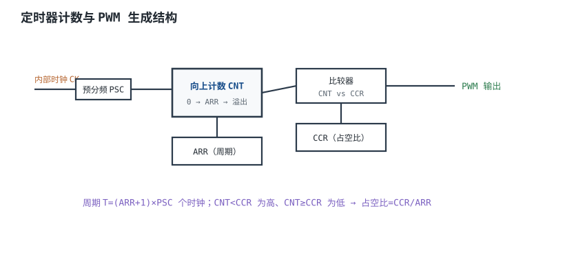
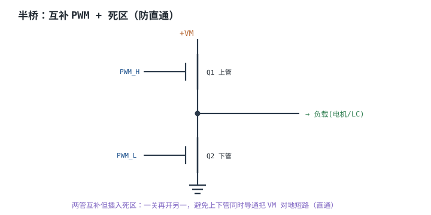

# 定时器与 PWM 原理 Timer & PWM

需要"可调能量"的地方几乎都在用 **PWM（Pulse Width Modulation，脉冲宽度调制）**：调 LED 亮度、控电机转速、给加热器恒温、给开关电源做控制。它用一串固定频率的方波，改变高电平占空比，等效出平均电压；比 DAC 便宜、效率高，而且功率级可以做得很大。

但 PWM 不是"设个占空比就完事"。定时器的预分频、自动重装载值、比较值三者决定了频率和分辨率，而这两个指标是互相拉扯的；驱动电机/加热器时，频率又要在纹波、噪音、开关损耗之间选；半桥还要算死区，否则上下管直通，几百纳秒就能把管子烧掉。本章把这些量全部落到可复算的公式上，最后用 20 kHz 电机 PWM、12 位加热 PWM 和死区直通三个算例收尾。

PWM 滤波后当 DAC 用的精度问题见[DAC 与模拟输出](dac.md)，用 ADC 测电流/温度构成闭环见[ADC 原理、参数与参考电压](adc.md)，低功耗设备里 PWM 的唤醒与占空比更新见[看门狗、RTC 与低功耗硬件](watchdog-rtc-lowpower.md)；计数器本身的同步/行波结构见[寄存器、计数器与分频](../digital/registers-counters.md)。

## 1. 设计动机

::: motivation 三个现场
**现场一：72 MHz、20 kHz，写 ARR=3600 还是 3599？** 有人按 $f=f_{clk}/ARR$ 算，写 3600，得到 20.000 kHz；有人记得"要减一"，写 3599，得到 20.006 kHz。正确式子是 $f=f_{clk}/[(PSC+1)(ARR+1)]$，ARR=3599 才是 20.000 kHz。**一个 +1 的差别是 0.03%，在电机控制里无所谓，在音频/通信里就不能忽略。**

**现场二：想要 12 位分辨率，还要 20 kHz。** 72 MHz 下 12 位、20 kHz 需要 $4096\times20000=81.92$ MHz，时钟不够；于是有人把 PSC 取 224（分频 225）、ARR 取 15，频率对了，分辨率只剩 4 位，电机低速时一顿一顿。**频率和分辨率不是独立的，预分频和 ARR 的分配方式决定了你拿到哪一个。**

**现场三：半桥死区只留了 50 ns。** MOSFET 关断有拖尾，驱动有传输延迟差，50 ns 不够；上下管同时导通 100 ns，24 V 母线经两只管子近似短路，电流按 $di/dt=V/L$ 上升，100 ns 就到 24 A，单次能量 28.8 µJ，20 kHz 下平均 0.576 W 全变成热。**死区不是"留一点就好"，要按关断时间、驱动偏斜和温度余量算。**
:::

| 你想确认 | 先算 | 判据（工程经验值） |
|---|---|---|
| PWM 频率 | $f_{clk}/[(PSC+1)(ARR+1)]$ | 电机 16~25 kHz，加热 1~20 kHz |
| 占空比分辨率 | $\log_2(ARR+1)$ | 电机 10~12 位，调光 10 位以上 |
| 电流纹波 | $V_MD(1-D)/(Lf)$ | 小于额定电流的 10~30% |
| 开关损耗 | $0.5V_MI_L(t_r+t_f)f$ | 小于总损耗的 10~20% |
| 死区 | $t_{off,max}+t_{skew}+$ 余量 | 大于最坏关断时间，通常 200~500 ns |
| 捕获分辨率 | $1/(f_{cnt}T_{meas})$ | 误差小于目标精度的 1/3 |

**不算会摔在哪**，四个带数字的代价：

1. **ARR 差一。** 72 MHz、ARR=3600 实际是 19.994 kHz，不是 20.000 kHz；PSC 不为 0 时误差按 $(PSC+1)$ 放大。
2. **分辨率不够。** 20 kHz 下若强行把 ARR 取成 15，只有 4 位，占空比一步 6.25%，电机低速会明显抖动。
3. **死区不足。** 100 ns 重叠、24 V/100 nH 回路，峰值 24 A，单次 28.8 µJ；500 ns 重叠时 120 A、720 µJ，足以损坏管子。
4. **频率选错。** 5 kHz 驱动电机，电流纹波是 20 kHz 的 4 倍，且有可闻噪音；50 kHz 虽然安静，但开关损耗和栅极驱动功率按频率线性上升。

## 2. 定义与直观

### 2.1 定时器内核：预分频、计数器、比较

定时器的核心是一个**计数器（Counter）**，每个"计数时钟"加 1 或减 1。计数时钟来自总线时钟 $f_{clk}$ 经**预分频器（Prescaler，PSC）**分频：

$$f_{cnt}=\frac{f_{clk}}{PSC+1}$$

计数器数到**自动重装载值（Auto-Reload Register，ARR）**后回零（向上计数）或反向（向下/中心对齐）。**比较寄存器（Capture/Compare Register，CCR）**与计数器比较，产生输出翻转、中断或 DMA 请求。三种常见计数模式：

- **向上计数（Edge-Aligned）**：0→ARR→0，PWM 边沿对齐，频率 $f_{clk}/[(PSC+1)(ARR+1)]$。
- **向下计数**：ARR→0→ARR，边沿对齐，频率同上。
- **中心对齐（Up/Down，Center-Aligned）**：0→ARR→0，PWM 脉冲关于周期中心对称，频率 $f_{clk}/[2(PSC+1)ARR]$，谐波更低，但同样频率下分辨率少约 1 位。



### 2.2 PWM 是怎么"变成"平均电压的

以向上计数、CNT<CCR 输出高为例：

$$D=\frac{CCR}{ARR+1},\qquad V_{avg}=D\cdot V_M$$

其中 $D$ 是占空比（无量纲）；$CCR$ 是比较值（0~ARR）；$V_M$ 是功率级母线电压（V）；$V_{avg}$ 是负载上的平均电压（V）。$CCR=0$ 时恒低，$CCR=ARR+1$ 时恒高（部分定时器用 $CCR>ARR$ 表示 100%）。

对**电阻负载**（LED、加热丝），平均功率是 $D V_M^2/R$，所以亮度/发热与占空比近似线性；对**感性负载**（电机、继电器），电流不能突变，PWM 经电感滤波后是带纹波的直流，平均电压仍是 $D V_M$，但纹波大小由电感和频率决定。

### 2.3 边沿对齐与中心对齐

边沿对齐的 PWM 在每个周期开头（或结尾）跳变，谐波集中在 $f_{PWM}$ 及其整数倍；中心对齐的脉冲关于周期中心对称，偶次谐波相互抵消，电流纹波和 EMI 通常更小，常用于电机和音频 D 类功放。代价是同样时钟/ARR 下频率减半，或同样频率下分辨率减半。

### 2.4 死区：半桥的"先关后开"

半桥/全桥的上下管不能同时导通：同时导通时，母线经两只管子直接到地，叫**直通（Shoot-Through）**。死区（Dead Time）是在关断一只管子后、开通另一只前插入的等待时间，保证两只管子不同时导通。现代高级定时器（如 TIM1/TIM8）自带死区发生器，只需写死区寄存器；通用定时器则要靠软件或外部驱动芯片插入。



## 3. 定量关系

### 3.1 频率、占空比与分辨率

向上/向下计数的精确关系：

$$f_{PWM}=\frac{f_{clk}}{(PSC+1)(ARR+1)}$$

$$D=\frac{CCR}{ARR+1}$$

$$\Delta D=\frac{1}{ARR+1},\qquad n=\log_2(ARR+1)$$

符号与单位：$f_{clk}$ 是定时器输入时钟（Hz）；$PSC$ 是预分频寄存器值（0~65535，实际分频比 $PSC+1$）；$ARR$ 是自动重装载值（0~65535 或更大，视定时器位宽）；$f_{PWM}$ 是 PWM 频率（Hz）；$D$ 是占空比；$\Delta D$ 是占空比步进；$n$ 是等效分辨率（bit）。

**任务书里常见的简化式**：

$$f_{PWM}=\frac{f_{clk}}{N\cdot2^n},\qquad N=PSC+1$$

这个式子只在**强制 $ARR+1=2^n$** 时成立。真实定时器的 $ARR+1$ 不要求是 2 的幂，所以它给出的分辨率是**保守下限**，不是上限。以 72 MHz、20 kHz 为例：$N(ARR+1)=3600$。若强行 $2^n$，3600 里最大的 2 的幂是 16，只能取 $n=4$、$N=225$，分辨率 4 位；但取 $PSC=0$、$ARR=3599$，同样 20.000 kHz，分辨率是 $\log_2 3600=11.81$ 位。**把 $2^n$ 当成硬约束，会白白丢掉 7.8 位。** 正确做法是先按 $N(ARR+1)=f_{clk}/f_{PWM}$ 分解，再把 2 的幂尽量留给 ARR、把剩下的因子给 PSC。

**再纠正一处现稿写法**：现稿写 $f_{PWM}=f_{CK}/ARR$，漏了预分频 $(PSC+1)$ 和计数边界 $+1$。PSC=0 时它只是近似（20 kHz 下差 0.03%）；PSC≠0 时会差 $(PSC+1)$ 倍，直接把频率算错一个数量级。

中心对齐的频率：

$$f_{PWM,center}=\frac{f_{clk}}{2(PSC+1)ARR}$$

符号同上；分母的 2 来自"上数 ARR 拍、下数 ARR 拍"。具体是 $ARR$ 还是 $ARR+1$ 取决于定时器的计数边界，以数据手册为准。

### 3.2 电流纹波与平均电压

以 Buck/电机为例，开关导通时电感电压 $V_M-V_{out}$，关断时 $-V_{out}$，稳态 $V_{out}=D V_M$。纹峰峰值：

$$\Delta I_L=\frac{V_M D(1-D)}{L f_{PWM}}$$

符号与单位：$\Delta I_L$ 是电感电流纹峰峰值（A）；$V_M$ 是母线电压（V）；$D$ 是占空比；$L$ 是电感/电机电感（H）；$f_{PWM}$ 是频率（Hz）。$D=0.5$ 时 $D(1-D)$ 最大，纹波最大；所以电机低速/高速两端纹波反而小，中间最大。

平均电压：

$$V_{out}=D V_M$$

对电阻负载，平均功率：

$$P=D\frac{V_M^2}{R}$$

### 3.3 开关损耗与栅极驱动

MOSFET 每次开关在米勒平台附近同时有电压和电流，开关损耗近似：

$$P_{sw}=\frac{1}{2}V_M I_L(t_r+t_f)f_{PWM}$$

符号与单位：$P_{sw}$ 是开关损耗（W）；$V_M$ 是漏源电压（V）；$I_L$ 是导通电流（A）；$t_r$、$t_f$ 是上升/下降时间（s）；$f_{PWM}$ 是频率（Hz）。系数 $1/2$ 来自线性近似，实际波形要按数据手册的双脉冲测试修正。

栅极驱动电流与开关时间：设栅极电荷 $Q_g$、驱动电压 $V_{drive}$、栅极电阻 $R_g$（含驱动内阻），峰值电流：

$$I_g=\frac{V_{drive}}{R_g}$$

开关时间近似：

$$t_{sw}\approx\frac{Q_g}{I_g}=\frac{Q_gR_g}{V_{drive}}$$

符号与单位：$Q_g$ 是栅极电荷（C）；$V_{drive}$ 是驱动电压（V）；$R_g$ 是栅极总电阻（$\Omega$）；$t_{sw}$ 是开关时间（s）。这个式子是"电荷/电流"的估算，实际 $Q_g$ 随 $V_{DS}$、$I_D$ 变，以数据手册曲线为准。

### 3.4 死区与直通电流

直通回路的电阻限流：

$$I_{peak,resistive}=\frac{V_M}{R_{loop}}$$

电感限流（短时间）：

$$\frac{di}{dt}=\frac{V_M}{L_{loop}},\qquad I(t)=\frac{V_M}{L_{loop}}t$$

单次直通能量：

$$E=\frac{1}{2}L_{loop}I^2$$

平均功率（每个周期都发生）：

$$P_{shoot}=E f_{PWM}=\frac{1}{2}L_{loop}I^2f_{PWM}$$

符号与单位：$V_M$ 是母线电压（V）；$R_{loop}$ 是直通回路总电阻（$\Omega$）；$L_{loop}$ 是回路电感（H）；$I$ 是直通电流（A）；$E$ 是单次能量（J）；$P_{shoot}$ 是平均功率（W）。第一个式子是稳态上限，实际会被封装/键合线/电源内阻限制；第二个式子适合几十~几百 ns 的短脉冲。

所需死区：

$$t_{dead}\geq t_{off,max}+t_{skew}+t_{margin}$$

其中 $t_{off,max}$ 是两只管子中最慢的关断时间（s）；$t_{skew}$ 是驱动通道间的传输延迟差（s）；$t_{margin}$ 是温度/批次余量（s），通常取 $0.2t_{off,max}$ 或 50~100 ns。$t_{off,max}$ 随温度上升而变大，要按最高工作结温的数据手册值取。

### 3.5 输入捕获：测周期与脉宽

输入捕获在边沿到来时把计数器值锁存到 CCR。计数时钟 $f_{cnt}=f_{clk}/(PSC+1)$，被测周期 $T$ 对应的计数：

$$N_T=T f_{cnt}$$

频率分辨率（±1 个计数）：

$$\frac{\Delta f}{f}=\frac{1}{N_T}=\frac{1}{T f_{cnt}}$$

符号与单位：$T$ 是被测周期（s）；$f_{cnt}$ 是计数时钟（Hz）；$N_T$ 是计数值；$\Delta f/f$ 是相对频率误差。**计数越少，±1 误差越大**：同样 1 MHz 计数时钟，测 1 kHz 是 1000 个计数（0.1%），测 10 kHz 只有 100 个计数（1%）。高频测量要么提高计数时钟，要么用"测周+多周期平均"。

### 3.6 编码器接口：×4 解码与转速

正交编码器输出 A、B 两相，相位差 90°。定时器的编码器模式在 A/B 的每个边沿根据另一相电平加/减计数，四倍频后每转计数：

$$N_{rev}=4N_{line}$$

$$n_{rpm}=\frac{\Delta N}{\Delta t}\cdot\frac{60}{N_{rev}}$$

符号与单位：$N_{line}$ 是编码器每转线数（lines/rev）；$N_{rev}$ 是四倍频后每转计数；$\Delta N$ 是时间 $\Delta t$ 内的计数增量；$n_{rpm}$ 是转速（r/min）。$\Delta t$ 内的计数误差为 ±1，对应转速分辨率：

$$\Delta n_{rpm}=\frac{60}{N_{rev}\Delta t}$$

这个式子是低速测量的关键：同样的编码器，$\Delta t$ 从 10 ms 加到 100 ms，分辨率提高 10 倍，但响应变慢。

### 3.7 适用条件与失效边界

1. **时钟准确假设**：$f_{clk}$ 来自晶振/RC，RC 的温漂直接变成 PWM 频率误差；电机控制对频率误差不敏感，但音频/通信敏感。
2. **计数边界假设**：不同定时器的 ARR 是"计到 ARR 回零"还是"计到 ARR-1"，中心对齐是 $2ARR$ 还是 $2(ARR+1)$，以数据手册为准；本章按常见的 $ARR+1$ 口径。
3. **线性近似**：纹波公式假设电感恒定、无饱和；电机电感随电流/位置变，实际纹波会偏离。
4. **开关损耗近似**：$1/2$ 系数和恒定 $t_r/t_f$ 只在特定测试条件成立；实际要按双脉冲测试和热设计核对。
5. **死区公式假设**：只算了关断时间，没算驱动电源跌落、米勒电容回灌、负压关断；高可靠场合要实测 $V_{GS}$ 波形。
6. **编码器假设**：A/B 是理想方波、无抖动；长线、差分接收和屏蔽会影响计数，见 5.3 节。

## 4. 典型计算

### 4.1 完整算例：20 kHz 电机 PWM，时钟 72 MHz

**已知**：$f_{clk}=72\ \text{MHz}$，目标 $f_{PWM}=20\ \text{kHz}$，电机额定 24 V/5 A，电感 1 mH。求：预分频与 ARR 的可行组合、分辨率、电流纹波。

**第 1 步：总的分频比。**

$$(PSC+1)(ARR+1)=\frac{f_{clk}}{f_{PWM}}=\frac{72\times10^6}{20\times10^3}=3600$$

**第 2 步：可行的整数组合。** 3600 的因子很多，下面列出几组：

| PSC | ARR | $PSC+1$ | $ARR+1$ | 实际频率 | 分辨率 |
|---|---|---|---|---|---|
| 0 | 3599 | 1 | 3600 | 20.000 kHz | $\log_2 3600=11.81$ 位 |
| 1 | 1799 | 2 | 1800 | 20.000 kHz | 10.81 位 |
| 3 | 899 | 4 | 900 | 20.000 kHz | 9.81 位 |
| 7 | 449 | 8 | 450 | 20.000 kHz | 8.81 位 |
| 15 | 224 | 16 | 225 | 20.000 kHz | 7.81 位 |
| 224 | 15 | 225 | 16 | 20.000 kHz | 4.00 位 |

**最优是 PSC=0、ARR=3599**：频率精确 20.000 kHz，分辨率 11.81 位，占空比步进 $1/3600=0.0278\%$。如果为了"16 位对齐"把 ARR 取 65535、PSC=0，频率会变成 $72\times10^6/65536=1.0986\ \text{kHz}$，完全不是 20 kHz。**先定频率，再在因子分解里挑分辨率最高的组合，不要反过来。**

**第 3 步：占空比。** 50% 时：

$$CCR=0.5\times(ARR+1)=0.5\times3600=1800$$

25% 时 $CCR=900$。CCR 是整数，所以实际占空比是 $1800/3600=50.000\%$，没有误差。

**第 4 步：电流纹波。** $D=0.5$：

$$\Delta I_L=\frac{24\times0.5\times(1-0.5)}{1\times10^{-3}\times20\times10^3}=\frac{6}{20}=0.30\ \text{A}$$

占 5 A 额定电流的 6%，可以接受。如果频率降到 5 kHz：

$$\Delta I_L=\frac{6}{1\times10^{-3}\times5\times10^3}=1.20\ \text{A}$$

占额定 24%，电机发热和转矩脉动都会变大。

**第 5 步：想要 12 位怎么办？** 12 位要求 $ARR+1=4096$，PSC=0 时：

$$f_{PWM}=\frac{72\times10^6}{4096}=17.578\ \text{kHz}$$

仍在 16~25 kHz 的常用区间内，只是离 20 kHz 差 12%。如果必须 20 kHz + 12 位，需要 $4096\times20000=81.92\ \text{MHz}$ 的定时器时钟，72 MHz 不够；可以换更高主频的 MCU，或接受 11.81 位。**"20 kHz + 12 位"不是软件想设就能设的，它先受时钟频率约束。**

**第 6 步：开关损耗。** 设 $t_r+t_f=100\ \text{ns}$、$I_L=5\ \text{A}$：

$$P_{sw}=0.5\times24\times5\times100\times10^{-9}\times20\times10^3=0.12\ \text{W}$$

两只管子/三相桥要按实际数量乘。频率升到 50 kHz，开关损耗变成 0.30 W；这就是"高频更安静，但更热"的定量来源。

```echarts
{
  "animation": false,
  "tooltip": {"trigger": "axis"},
  "grid": {"left": 72, "right": 30, "top": 30, "bottom": 58},
  "xAxis": {"type": "category", "name": "ARR+1（PSC=0）", "nameLocation": "middle", "nameGap": 36, "data": ["256", "512", "1024", "2048", "3600", "4096"], "axisLabel": {"fontSize": 11}},
  "yAxis": {"type": "value", "name": "PWM 频率 / kHz", "nameLocation": "middle", "nameGap": 52, "type": "log", "min": 10, "max": 400, "axisLabel": {"fontSize": 11}},
  "series": [
    {"name": "f_PWM", "type": "line", "symbolSize": 7, "lineStyle": {"width": 2.6, "color": "#1a4f8b"}, "itemStyle": {"color": "#1a4f8b"},
     "markLine": {"silent": true, "symbol": "none", "lineStyle": {"color": "#b5642e", "type": "dashed"}, "label": {"formatter": "20 kHz", "fontSize": 11}, "data": [{"yAxis": 20}]},
     "data": [281.25, 140.625, 70.3125, 35.156, 20.0, 17.578]}
  ]
}
```

上图是 PSC=0 时 $f_{PWM}=72\ \text{MHz}/(ARR+1)$：ARR+1=3600 正好 20 kHz（11.81 位），4096 是 17.578 kHz（12 位）。**同样的时钟，分辨率和频率只能二选一。**

### 4.2 完整算例：12 位加热 PWM 的最低频率

**已知**：12 位分辨率，$f_{clk}=72\ \text{MHz}$，加热器 24 V/1 A（24 W），热容 $C_{th}=10\ \text{J/K}$（示例值，实际按加热器/负载热容测），要求温度纹波 $\leq0.1\ \text{K}$。求：12 位允许的最高频率、热纹波决定的最低频率、硬件能做到的最低频率。

**第 1 步：12 位允许的最高频率。** $ARR+1=4096$，PSC=0：

$$f_{max}=\frac{72\times10^6}{4096}=17.578\ \text{kHz}$$

**第 2 步：硬件最低频率。** PSC 最大 65535、ARR=4095：

$$f_{min,hw}=\frac{72\times10^6}{65536\times4096}=0.268\ \text{Hz}$$

这个频率没有工程意义（周期 3.7 s），只说明寄存器范围很宽。

**第 3 步：热纹波决定的最低频率。** 一个 PWM 周期内，加热功率在"全功率"和"零"之间切换，温度纹波近似：

$$\Delta T_{pp}\approx\frac{P\cdot D(1-D)}{C_{th}f_{PWM}}$$

$D=0.5$ 时 $D(1-D)=0.25$ 最大。要求 $\Delta T_{pp}\leq0.1\ \text{K}$：

$$f_{PWM}\geq\frac{24\times0.25}{10\times0.1}=\frac{6}{1}=6\ \text{Hz}$$

所以**热纹波只要求 6 Hz 以上**；1 kHz 时纹波是 $24\times0.25/(10\times1000)=0.0006\ \text{K}$，远小于 0.1 K。**"最低频率"不是 17.58 kHz 的反面，而是由热时间常数和允许纹波决定的；12 位只限制最高频率。**

**第 4 步：工程取值。** 取 1 kHz：12 位需要计数时钟 $1000\times4096=4.096\ \text{MHz}$，72 MHz 经 PSC=17（分频 18）得 4 MHz，ARR=4095，实际 $f=4\times10^6/4096=976.6\ \text{Hz}$；或 PSC=0、ARR=4095 得 17.578 kHz。两者都满足纹波，1 kHz 的开关损耗和 EMI 更低，17.578 kHz 超出人耳但开关损耗高。**加热控制通常选 1~20 kHz，具体看热容、EMI 和开关器件。**

**第 5 步：占空比分辨率。** 12 位步进 $1/4096=0.0244\%$；对 24 W 加热器，功率步进 $24\times0.000244=5.86\ \text{mW}$。如果温度环的调节精度要求 0.01 K，按热阻折算成功率步进要小于这个值，否则会被 PWM 量化限制。

### 4.3 完整算例：死区不足的直通电流

**已知**：$V_M=24\ \text{V}$，直通回路 $L_{loop}=100\ \text{nH}$，$R_{loop}=0.1\ \Omega$，重叠时间 $t=100\ \text{ns}$，$f_{PWM}=20\ \text{kHz}$。求：峰值电流、单次能量、平均功率；再算需要多大死区。

**第 1 步：电阻限流（稳态上限）。**

$$I_{peak,resistive}=\frac{24}{0.1}=240\ \text{A}$$

实际会被封装、键合线、电源内阻限制，不会真到 240 A，但它说明"如果没有电感，直通电流是灾难性的"。

**第 2 步：电感限流（短脉冲）。**

$$\frac{di}{dt}=\frac{24}{100\times10^{-9}}=2.4\times10^8\ \text{A/s}=240\ \text{A}/\mu\text{s}$$

$$I(100\ \text{ns})=240\times10^6\times100\times10^{-9}=24\ \text{A}$$

**第 3 步：单次能量与平均功率。**

$$E=0.5\times100\times10^{-9}\times24^2=0.5\times100\times10^{-9}\times576=2.88\times10^{-5}\ \text{J}=28.8\ \mu\text{J}$$

$$P_{shoot}=28.8\times10^{-6}\times20\times10^3=0.576\ \text{W}$$

如果重叠 500 ns：$I=120\ \text{A}$，$E=720\ \mu\text{J}$，$P=14.4\ \text{W}$。**100 ns 已经 0.576 W，500 ns 的 14.4 W 持续发热足以损坏管子，具体结温要按封装热阻和散热条件算。**

**第 4 步：需要多大死区。** 设栅极电荷 $Q_g=20\ \text{nC}$（测试条件以数据手册为准），驱动电压 3.3 V，栅极电阻 47 Ω：

$$I_g=\frac{3.3}{47}=70.2\ \text{mA}$$

$$t_{sw}\approx\frac{20\times10^{-9}}{70.2\times10^{-3}}=285\ \text{ns}$$

取最坏关断 285 ns、驱动偏斜 50 ns、余量 20%（57 ns）：

$$t_{dead}\geq285+50+57=392\ \text{ns}$$

取 **500 ns**。20 kHz 周期 50 µs，500 ns 占 1%，可以接受；如果占空比要低到 1%（500 ns 高电平），死区会把脉冲吃光，这时要么提高频率、要么用更快的栅极驱动/更小的 $R_g$。

**第 5 步：体二极管损耗。** 死区期间电感电流经下管体二极管续流，设 $V_f=0.8\ \text{V}$、$I=5\ \text{A}$：

$$P_{diode}=5\times0.8\times500\times10^{-9}\times20\times10^3=0.04\ \text{W}$$

不大，但高温下 $V_f$ 下降、反向恢复变差，要留余量。

### 4.4 输入捕获与编码器算例

**输入捕获**：$f_{clk}=72\ \text{MHz}$，PSC=71，计数时钟 $f_{cnt}=1\ \text{MHz}$。测 1 kHz 信号：

$$N_T=1\times10^{-3}\times1\times10^6=1000$$

$$\frac{\Delta f}{f}=\frac{1}{1000}=0.1\%\Rightarrow\Delta f=1\ \text{Hz}$$

测 10 kHz 信号：$N_T=100$，误差 1%，即 100 Hz。**同样的计数时钟，频率越高、计数越少、±1 误差越大。** 要测 10 kHz 到 0.1%，需要 $N_T\geq1000$，即 $f_{cnt}\geq10\ \text{MHz}$，PSC=6（72/7≈10.29 MHz）。

**编码器**：1000 线/转，×4 解码：

$$N_{rev}=4\times1000=4000\ \text{counts/rev}$$

3000 r/min = 50 r/s，计数率：

$$50\times4000=200000\ \text{counts/s}$$

16 位定时器在 200 kcounts/s 下约 $65536/200000=0.328\ \text{s}$ 溢出一次，10 ms 读取间隔内计数 2000，不会溢出：

$$n_{rpm}=\frac{2000}{4000\times0.01}\times60=3000\ \text{r/min}$$

低速 1 r/min 时，10 ms 内只有 $4000\times(1/60)\times0.01=0.667$ 个计数，±1 误差就是 ±1.5 r/min；把测量窗口加到 100 ms，计数 6.67 个，分辨率变成 0.15 r/min，代价是响应慢 10 倍。

## 5. 工程含义

### 5.1 频率怎么选

| 应用 | 常用频率 | 理由 | 主要代价 |
|---|---|---|---|
| LED 调光 | 1~20 kHz | 避开可闻/可见频闪 | 低频有啸叫，高频开关损耗 |
| 有刷直流电机 | 16~25 kHz | 超出人耳，纹波可接受 | 开关损耗、栅极驱动功率 |
| 无刷电机 FOC | 10~20 kHz | 电流环带宽与开关损耗折中 | 死区、采样与 PWM 同步 |
| 加热器 | 1~20 kHz | 热惯量大，低频即可 | 低频电流纹波、EMI |
| 音频 D 类 | 200~500 kHz | 远离音频带，滤波器小 | 开关损耗、EMI、死区失真 |

**选频顺序**：先看负载时间常数（热/机械/电感）决定最低频率，再看人耳/EMI 决定允许的频率窗口（要么低于可闻段，要么高于可闻段），最后看开关损耗/驱动能力决定上限。三者没有交集时，换器件或换拓扑。

### 5.2 栅极驱动与功率级

- **栅极电阻**：10~100 Ω 是常见范围。小电阻开关快、损耗低，但振铃/EMI 大；大电阻开关慢、损耗高，但安静。按 $t_{sw}=Q_gR_g/V_{drive}$ 估算，再实测 $V_{GS}$ 波形。
- **续流二极管**：感性负载关断时电流不能突变，必须给回路。低边驱动用反并联续流二极管；半桥用下管体二极管或外并肖特基。二极管的反向恢复会带来额外损耗和振铃。
- **栅极保护**：栅源电阻、TVS/齐纳钳位、负压关断（高可靠场合）；米勒电容回灌可能导致误导通，要算 $C_{gd}dv/dt$。
- **布局**：功率回路面积最小化，栅极回路与功率回路分开，采样地单点汇合；具体见 PCB 的功率布局与 EMC 章节。

### 5.3 捕获、编码器与软件配合

- **输入捕获**：用定时器的捕获/比较单元，输入加 RC 滤波和施密特触发器；长线用差分/光耦。测周法适合低频，测频法适合高频，二者可以自动切换。
- **编码器**：A/B 加差分接收（RS-422）或光耦，屏蔽双绞；Z 相做每转零位。定时器编码器模式自动加减计数，CPU 只读 CNT；多圈位置要软件扩展。
- **PWM 与 ADC 同步**：电流采样要在 PWM 中心或下管导通期间触发，避免开关噪声；定时器的 TRGO 可以触发 ADC，见[ADC 原理、参数与参考电压](adc.md)。
- **死区与互补输出**：高级定时器的死区发生器要配合刹车（BKIN）输入，过流时硬件封波；软件死区只适合低速/低可靠场合。

### 5.4 与其他三章的分工

本章提供"时间换电压/能量"的引擎；[DAC 与模拟输出](dac.md) 是另一条更精确的模拟输出路线，PWM+RC 可以看作低成本的 DAC，但纹波和分辨率要按 DAC 的滤波器方法算；[ADC 原理、参数与参考电压](adc.md) 负责把电流/温度采回来构成闭环；[看门狗、RTC 与低功耗硬件](watchdog-rtc-lowpower.md) 决定 PWM 在休眠时是否关断、唤醒后如何安全重启。四章的共同点是：**先把频率、占空比、死区和采样时刻的时序算清楚，再写寄存器。**

## 6. 常见坑

::: pitfall 常见坑
- **现象**：PWM 频率比设计值差几倍，或者占空比 100% 时输出仍是窄脉冲。**原因**：漏了 $PSC+1$ 或 $ARR+1$；把"计到 ARR"当成"计 ARR 个数"；CCR 超过 ARR 时部分定时器不会自动满占空。**解决**：按 $f=f_{clk}/[(PSC+1)(ARR+1)]$ 重算，用示波器实测；100% 占空比用 CCR=ARR+1 或强制输出高，查数据手册的边界定义。
- **现象**：电机低速抖动、LED 低亮度跳变。**原因**：占空比分辨率不够，ARR 太小；或者为了频率把 PSC 取得很大，ARR 只剩几位。**解决**：先按 $N(ARR+1)=f_{clk}/f$ 分解，把 2 的幂尽量留给 ARR；必要时提高时钟或降低 PWM 频率。
- **现象**：半桥上下管发烫、母线电流尖峰大，甚至炸管。**原因**：死区小于最坏关断时间，或驱动通道偏斜/米勒回灌导致同时导通。**解决**：按 $t_{dead}\geq t_{off,max}+t_{skew}+$ 余量取 200~500 ns；实测两只 $V_{GS}$ 的交叠；用带死区发生器和刹车输入的定时器。
- **现象**：电机有可闻啸叫，或 LED 有频闪。**原因**：PWM 频率落在人耳/人眼敏感区间（几百 Hz~几 kHz）。**解决**：电机提到 16~25 kHz，LED 提到 1 kHz 以上（或 >20 kHz）；注意频率提高后开关损耗和驱动功率上升。
- **现象**：编码器计数乱跳、低速测速不准。**原因**：A/B 无滤波/无差分、长线噪声被当成边沿；或者测量窗口太短，±1 计数误差主导。**解决**：A/B 加 RC/施密特/差分接收，屏蔽双绞；低速用更长测量窗口或多周期平均；Z 相校准零位。
- **现象**：电流采样值在开关瞬间跳变，闭环振荡。**原因**：ADC 采样时刻与 PWM 开关沿重合，采到开关噪声/续流二极管反向恢复。**解决**：用定时器 TRGO 在 PWM 中心或下管导通中点触发 ADC；采样前加消隐时间；电流环与 PWM 同步。
:::

## 7. 自测题

<details><summary>时钟 72 MHz、PSC=0、ARR=3599，PWM 频率和分辨率是多少？50% 占空比的 CCR 是多少？</summary>

$$f_{PWM}=\frac{72\times10^6}{(0+1)(3599+1)}=\frac{72\times10^6}{3600}=20.000\ \text{kHz}$$

$$n=\log_2 3600=11.81\ \text{bit}$$

$$CCR=0.5\times3600=1800$$

占空比步进 $1/3600=0.0278\%$。

</details>

<details><summary>为什么 $f_{PWM}=f_{clk}/(N\cdot2^n)$ 只是特例？72 MHz、20 kHz 下强行用它，分辨率会损失多少？</summary>

这个式子要求 $ARR+1=2^n$。真实定时器的 $ARR+1$ 可以是任意整数。72 MHz、20 kHz 时 $(PSC+1)(ARR+1)=3600$；3600 中最大的 2 的幂是 16，所以强行 $2^n$ 只能取 $n=4$、$PSC+1=225$，分辨率 4 位。取 $PSC=0$、$ARR=3599$ 同样是 20.000 kHz，分辨率 $\log_2 3600=11.81$ 位。**损失 7.81 位。**

</details>

<details><summary>24 V、1 mH、20 kHz、D=0.5，电机电流纹波是多少？降到 5 kHz 呢？</summary>

$$\Delta I_L=\frac{24\times0.5\times0.5}{1\times10^{-3}\times20\times10^3}=\frac{6}{20}=0.30\ \text{A}$$

5 kHz：

$$\Delta I_L=\frac{6}{1\times10^{-3}\times5\times10^3}=1.20\ \text{A}$$

频率降 4 倍，纹波升 4 倍；5 kHz 时纹波占 5 A 额定的 24%。

</details>

<details><summary>12 位 PWM、72 MHz，最高频率是多少？如果加热器 24 W、热容 10 J/K，要求温度纹波 0.1 K，最低频率是多少？</summary>

最高频率：

$$f_{max}=\frac{72\times10^6}{4096}=17.578\ \text{kHz}$$

热纹波（$D=0.5$）：

$$\Delta T_{pp}\approx\frac{P D(1-D)}{C_{th}f}\leq0.1\ \text{K}$$

$$f\geq\frac{24\times0.25}{10\times0.1}=6\ \text{Hz}$$

所以 12 位只限制上限 17.58 kHz，下限由热纹波决定，约 6 Hz；工程上取 1 kHz 量级。

</details>

<details><summary>24 V、100 nH 直通回路，重叠 100 ns，峰值电流、单次能量、20 kHz 下平均功率各是多少？</summary>

$$di/dt=24/(100\times10^{-9})=240\ \text{A}/\mu\text{s}$$

$$I=240\times10^6\times100\times10^{-9}=24\ \text{A}$$

$$E=0.5\times100\times10^{-9}\times24^2=28.8\ \mu\text{J}$$

$$P=28.8\times10^{-6}\times20\times10^3=0.576\ \text{W}$$

如果重叠 500 ns，电流 120 A、能量 720 µJ、平均 14.4 W，足以损坏管子。

</details>

<details><summary>1 MHz 计数时钟，测 1 kHz 和 10 kHz，±1 计数误差各是多少？</summary>

1 kHz：$N_T=1000$，误差 $1/1000=0.1\%$，即 1 Hz。

10 kHz：$N_T=100$，误差 $1/100=1\%$，即 100 Hz。

要测 10 kHz 到 0.1%，需要 $N_T\geq1000$，计数时钟至少 10 MHz。

</details>

<details><summary>1000 线编码器、×4 解码、10 ms 测量窗口，3000 r/min 时计数多少？1 r/min 时分辨率是多少？</summary>

$$N_{rev}=4\times1000=4000$$

3000 r/min = 50 r/s：

$$\Delta N=50\times4000\times0.01=2000$$

$$n_{rpm}=\frac{2000}{4000\times0.01}\times60=3000$$

1 r/min 时 10 ms 内 $4000\times(1/60)\times0.01=0.667$ 个计数，±1 计数对应 ±1.5 r/min；窗口加到 100 ms，分辨率 0.15 r/min。

</details>

## 8. 参考资料

- **STMicroelectronics, RM0008 *STM32F10xxx 参考手册*，高级控制定时器 TIM1 与通用定时器 TIMx 章节**：预分频、ARR/CCR、向上/向下/中心对齐、死区发生器、刹车输入与编码器接口；本章 2.1、3.1、3.4 节的寄存器口径以该手册为准。
- **STMicroelectronics, RM0090 *STM32F4xx 参考手册*，TIM 章节**：32 位定时器、重复计数器、死区与输入捕获；本章 3.5、4.4 节的捕获/编码器计算按该手册的计数模式。
- **Texas Instruments, *MSP430x5xx and MSP430x6xx Family User's Guide*（SLAU208）**：Timer_B 的计数模式、捕获/比较、PWM 与低功耗唤醒；本章 2.1、5.3 节的另一种定时器实现参考该手册。
- **Microchip, AN538 *Using PWM to Generate an Analog Output***：PWM 加 RC 滤波的纹波、分辨率、建立时间与误差分析；本章 3.2、4.2 节的纹波与量化口径按该应用笔记。
- **Dynapar, *Encoder Application Handbook***：正交编码器 A/B/Z 信号、×1/×2/×4 解码、分辨率与安装误差；本章 3.6、4.4 节的编码器计算参考该手册。
- **IEC 61800-3 *Adjustable speed electrical power drive systems — EMC requirements and specific test methods***：电机驱动 PWM 的传导/辐射发射限值、测试布置与滤波器要求；本章 5.1、5.2 节的 EMC 取舍以该标准为背景。
