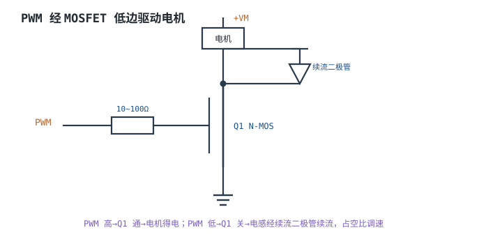
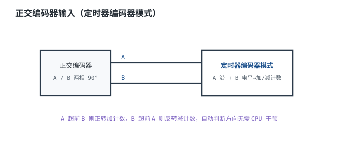

# 定时器与 PWM 原理 Timer & PWM

## 1. 设计动机

::: motivation 为什么 PWM 是最常用的模拟输出
需要"可调能量"的地方——调 LED 亮度、控电机转速、给开关电源做控制——几乎都用 **PWM（Pulse Width Modulation，脉冲宽度调制）**：一串固定频率的方波，用改变高电平占空比的方式等效出平均电压，比 DAC 省成本、效率高。

定时器是产生 PWM 的硬件引擎。硬件工程师要懂的是：PWM 频率由哪些寄存器决定、占空比怎么算、驱动电机时为什么要加续流二极管和死区。这些都不是软件细节，而是直接关系到管子会不会烧、电机会不会抖。
:::

## 2. 原理图

定时器内核是一个**向上计数器 CNT**，每个经预分频 PSC 后的时钟加 1，数到 ARR（自动重装载值）溢出归零。CNT 与 CCR（比较寄存器）比较：CNT<CCR 输出高、CNT≥CCR 输出低，就得到固定周期、占空比可调的 PWM。


## 3. 静态分析（DC）

PWM 的直流等效就是**平均电压**：

$$V_{avg}=D\cdot V_{OH},\quad D=\frac{CCR}{ARR+1}$$

- 占空比 D=CCR/(ARR+1)。ARR=999、CCR=300 时 D=30%。
- 直流看：PWM 经电感/电容平滑后，输出约 D×电源电压；这就是开关电源和电机调速的原理。

## 4. 动态分析（AC / 瞬态）

PWM 频率由时钟、预分频、周期共同决定：

$$f_{PWM}=\frac{f_{CK}}{(PSC+1)(ARR+1)}$$

- 例：$f_{CK}=72\text{MHz}$、PSC=0、ARR=999 → $f_{PWM}=72\text{kHz}$。
- 频率选择：太高开关损耗大、EMI 重；太低电机有可闻噪音、LED 有频闪。电机常用 16~25kHz，LED 调光 >20kHz 避免频闪。

```echarts
{
  "tooltip": {"trigger": "axis"},
  "legend": {"data": ["CNT", "PWM输出"], "bottom": 0, "textStyle": {"fontSize": 13}},
  "grid": {"left": 56, "right": 24, "top": 26, "bottom": 56},
  "xAxis": {"type": "category", "name": "计数", "data": [0,100,200,300,400,500,600,700,800,900,999], "axisLabel": {"fontSize": 11}},
  "yAxis": {"type": "value", "min": 0, "max": 1050, "axisLabel": {"fontSize": 11}},
  "series": [
    {"name": "CNT", "type": "line", "step": "end", "showSymbol": false, "lineStyle": {"width": 2.2, "color": "#1a4f8b"},
     "data": [0,100,200,300,400,500,600,700,800,900,999]},
    {"name": "PWM输出", "type": "line", "step": "end", "showSymbol": false, "lineStyle": {"width": 2.6, "color": "#b5642e"},
     "data": [1,1,1,1,0,0,0,0,0,0,0]}
  ]
}
```

## 5. 环路分析

::: advanced 进阶：PWM 分辨率与频率的折中
PWM 的等效电压分辨率 = log2(ARR+1)。ARR=999 约 10bit；但 $f_{PWM}=f_{CK}/ARR$，要更高分辨率就得拉大 ARR、降低频率。高频与高分辨率不可兼得——这是 PWM 设计的核心折中。电机控制常取 16kHz + 10~12bit 分辨率。
:::

## 6. 元件取值与工程权衡

- **PWM 频率**：电机 16~25kHz（避开可闻噪音）；LED >20kHz；开关电源按磁性元件设计。
- **栅极电阻**：PWM 经 10~100Ω 串到 MOSFET 栅极，抑制振铃。
- **续流二极管**：感性负载（电机/继电器）必须并续流二极管，否则关断瞬间反电动势打穿 MOSFET。
- **死区**：半桥上下管互补时必须插死区，防直通。

## 7. 完整设计示例

::: example 25kHz PWM 调 LED 亮度
1. **需求**：MCU 时钟 72MHz，PWM 25kHz、占空比 0~100%。
2. **算 ARR**：$ARR=72\text{MHz}/25\text{kHz}-1=2879$，PSC=0。
3. **分辨率**：约 11.5bit。
4. **调光**：CCR=1440 得 50% 占空。
5. **驱动**：LED 串限流电阻（见 [GPIO](gpio.md)）。
6. **验算**：$f=72\text{M}/2880=25\text{kHz}$，>20kHz 无频闪。
:::

## 8. 仿真与实验

- 示波器量 PWM 脚，核对频率与占空比是否等于 $f_{CK}/((PSC+1)(ARR+1))$。
- 改 CCR，观察平均亮度/转速随占空比变化。
- 电机不带续流二极管关断，观察漏极尖峰电压。

## 扩展与变种电路

### 扩展1：PWM 经 MOSFET 低边驱动电机 Low-Side Drive

定位：PWM 直接驱动不了电机电流，要靠 MOSFET 做功率开关。



::: example 工作原理
- PWM 高 → MOSFET 通 → 电机两端加 VM，电流上升。
- PWM 低 → MOSFET 关 → 电感电流不能突变，经续流二极管续流。
- 平均电压 = D×VM，占空比调速。栅极电阻 10~100Ω 抑制栅极振铃。
:::

取值对比：

| 栅极电阻 | 开关速度 | EMI/振铃 |
|---|---|---|
| 10Ω | 快 | 振铃大 |
| 47Ω | 中 | 折中 |
| 100Ω | 慢 | 损耗大 |

::: pitfall 忘记续流二极管
- **现象**：MOSFET 反复击穿。
- **原因**：关断瞬间电机电感反电动势产生高压尖峰，超过 MOSFET 耐压。
- **解决**：电机两端反并联快恢复续流二极管（或用带体二极管/内置的 MOSFET 模块）。
:::

### 扩展2：互补 PWM 与死区 Complementary PWM

定位：半桥/全桥驱动，上下管交替导通。


::: example 工作原理与时序
- 上管 PWM_H、下管 PWM_L 反相。若两管同时导通，VM 经两管直通到地，瞬间大电流烧管。
- **死区（Dead Time）**：先关一个、延时几十~几百 ns 再开另一个，保证任一时刻只有一管导通。
- 现代高级定时器自带死区生成硬件，无需软件插入。
:::

取值对比：

| 死区 | 风险 | 说明 |
|---|---|---|
| 0 | 直通烧管 | 不可接受 |
| 100~500ns | 折中 | 按开关速度取 |
| 过大 | 波形畸变 | 低速时失真明显 |

::: pitfall 死区太小仍直通
- **现象**：管子发烫、电源电流大。
- **原因**：MOSFET 关断拖尾，死区内未真正关断就开另一只。
- **解决**：加大死区或选开关更快的管子；用带死区的互补输出定时器。
:::

### 扩展3：正交编码器接口 Quadrature Encoder

定位：测位置/转速，免 CPU 扫描。



::: example 工作原理
- 编码器输出 A、B 两相，相位差 90°。正转时 A 超前 B，反转时相反。
- 定时器编码器模式在 A 沿根据 B 电平决定加/减计数，硬件自动完成，CPU 只定期读 CNT。
- 无需软件消抖，倍频（×2/×4）提高分辨率。
:::

取值对比：

| 方案 | CPU 占用 | 精度 |
|---|---|---|
| 外部中断逐沿 | 高 | 一般 |
| 定时器编码器模式 | 极低 | 高（可倍频） |

::: pitfall A/B 线没接保护/上拉
- **现象**：计数乱跳。
- **原因**：长线噪声、接触抖动被当成沿。
- **解决**：A/B 加合适上拉、短线缆，必要时 RC 滤波。
:::

## 9. 常见坑与故障现象

::: pitfall 常见坑
- **频率算错**：忘了 PSC 或 ARR+1，PWM 频率差几倍。按 $f=f_{CK}/((PSC+1)(ARR+1))$ 核对。
- **感性负载无续流**：击穿开关管。加续流二极管。
- **半桥直通**：无死区或死区太小烧管。用互补输出+死区。
- **频率太低可闻噪音/频闪**：电机嗡嗡响、LED 闪。提到 16~25kHz 以上。
:::

## 10. 自测题

<details><summary>时钟 72MHz、PSC=0、ARR=999，PWM 频率和 30% 占空比的 CCR 是多少？</summary>
$f=72\text{M}/(1\times1000)=72\text{kHz}$；30% 占空 → CCR=0.3×1000=300。
</details>

<details><summary>为什么驱动电机这种感性负载要并联续流二极管？</summary>
关断时电感电流不能突变，会产生高压尖峰试图维持电流；续流二极管给电流提供回路，把尖峰钳位，保护开关管。
</details>

<details><summary>半桥上下管为什么要加死区？</summary>
防止上下管同时导通造成 VM 到地的低阻直通大电流。死区保证先关后开，任一时刻只有一管导通。
</details>

## 11. 参考资料

- STM32 定时器/高级定时器应用笔记
- TI 电机驱动与 PWM 设计指南
- 功率电子半桥死区设计资料
