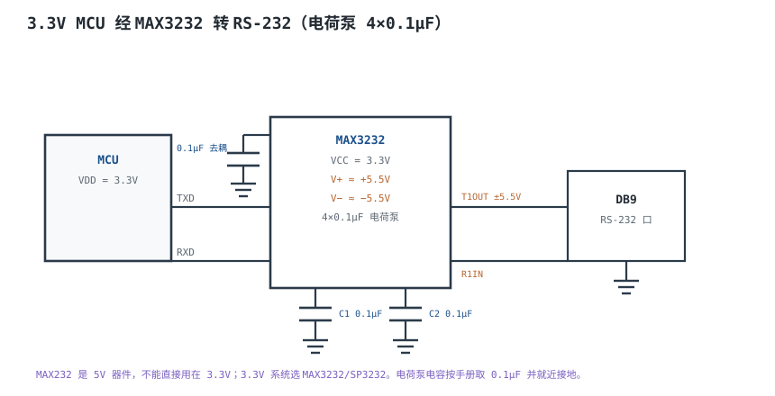
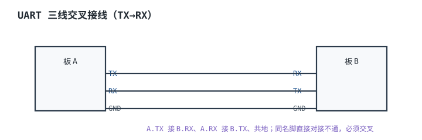

# UART 与 RS-232 物理层 UART & RS-232

一颗 8MHz 的 MCU 要跑 115200 波特率。分频比是 $8\times10^6/(16\times115200)=4.34$，整数分频只能取 4，实际波特率变成 125000，误差 +8.5%。串口助手上一半字符是乱码，但把波特率降到 9600 就一切正常——很多人因此以为“115200 就是不稳定”，真正的原因是分频比取整。**UART 的可靠性不是玄学，而是一笔可以逐位算清的误差账；RS-232 的可靠性则是一笔电平、电容和共模的账。**

这一章先讲 UART 帧怎么在没有时钟线的情况下对齐，再讲 RS-232 的 ±3~±15V 负逻辑从哪来、为什么不能用“共模抑制”解释它，最后用两个完整算例把 8MHz 配 115200 的误差和 1% 晶振能撑多少位算到底。差分长距离总线见[RS-485 与 CAN 总线硬件](rs485-can.md)，同步总线的时序核对见[I²C 与 SPI 总线时序](i2c-spi.md)，高速差分接口见[USB 与以太网物理层概览](usb-ethernet.md)，接口的保护与隔离套路见[常用外设接口设计](peripheral-design.md)。

## 1. 设计动机

::: motivation 三个现场
**现场一：3.3V TTL 直接插 DB9。** 有人把 MCU 的 TX 直接接到 PC 串口的 RXD，结果 PC 收到一串乱码；反过来把 PC 的 TX 接到 MCU 的 RX，MCU 的引脚当场发热。原因是两套电平的定义完全不同：TTL 空闲是高电平 3.3V，RS-232 空闲是负电压，接收器把 3.3V 判成 space（逻辑 0），于是连续读到起始位；而 RS-232 的 −12V 灌进 3.3V 引脚，会通过 ESD 钳位二极管把电流倒灌进电源轨。**TTL 和 RS-232 之间必须有电平转换，不能只接 TX/RX。**

**现场二：TX/RX 接对了，但没有共地。** 两块板各自用本地电源，只连了 TX、RX 两根线。实验室桌面上偶尔能通，一到现场就大量误码。RS-232 是单端、以地为参考的接口，两地的地电位差会直接叠加到信号上；差值超过约 2V，±5V 的驱动器就没有余量了。**“共地”不是可选项，是 RS-232 的工作前提。**

**现场三：8MHz 配 115200，整数分频取 4。** 实际波特率 125000，误差 8.5%，远超一帧 10 位能容忍的 5%。改成小数分频 4.3125 后误差 0.64%，通信立刻正常；或者换 11.0592MHz 晶振，分频比正好是 6。**波特率误差要按“两端累计、逐位漂移”算，不能只看单端误差。**
:::

串口设计要同时满足四个约束，它们经常互相牵制：

| 约束 | 要控制什么 | 典型手段 | 失效后果 |
|---|---|---|---|
| 电平 | TTL 与 RS-232 的摆幅、极性、门限 | 电荷泵电平转换芯片 | 不通、烧引脚 |
| 时序 | 波特率误差、采样点、帧长 | 晶振、小数分频、降低波特率 | 逐位错位、整帧乱码 |
| 参考地 | 两地共模电位 | 共地、隔离、缩短电缆 | 偶发误码、接口损坏 |
| 驱动/负载 | 电缆电容、接收器输入电阻 | 限速、限长、终端 | 边沿变慢、采样失败 |

## 2. 定义与直观

### 2.1 UART 帧：没有时钟线，靠起始沿对齐

**UART（Universal Asynchronous Receiver/Transmitter，通用异步收发器）**是 MCU 片上的一个数字外设。它把并行字节串行化，按约定好的波特率一位一位发出去；接收方没有单独的时钟线，只能靠**起始位**的下降沿启动自己的位定时器，然后在每一位的中间采样。

一帧的组成是固定的：

| 段 | 电平/长度 | 作用 |
|---|---|---|
| 空闲（idle） | 逻辑 1，高电平 | 线路未被占用 |
| 起始位（start） | 逻辑 0，1 位 | 下降沿给接收方对齐 |
| 数据位（data） | 5~9 位，LSB 先发 | 有效载荷 |
| 校验位（parity） | 0 或 1 位 | 奇偶校验，只能查单比特错 |
| 停止位（stop） | 逻辑 1，1 或 2 位 | 帧结束，回到空闲 |

最常用的是 **8N1**：1 位起始、8 位数据、无校验、1 位停止，共 $1+8+1=10$ 位。接收方通常以 16 倍波特率采样：检测到起始沿后，数 8 个采样时钟到起始位中间，之后每 16 个时钟采一位，并在第 7、8、9 个采样点做三取二，抑制毛刺。**16 倍过采样把起始沿的检测误差量化到 $1/16$ 位，这是后面误差预算里必须扣掉的一项。**

### 2.2 RS-232 的电气定义

**RS-232（EIA/TIA-232）**是单端、以地为参考的串行接口。它不定义逻辑“1/0”对应高/低，而定义**负逻辑**：

| 信号 | 逻辑值 | 驱动器输出 | 接收器判读 |
|---|---|---|---|
| mark（标记） | 1 | −5~−15V（标准保证 −5V 以下） | ≤−3V 判为 1 |
| space（间隔） | 0 | +5~+15V | ≥+3V 判为 0 |
| 空闲 | 1（mark） | 负电压 | 判为 1 |
| 未定义区 | — | −3~+3V | 状态不确定 |

TIA-232-F 的关键电气参数可以归成一张表：

| 参数 | 数值 | 工程含义 |
|---|---|---|
| 驱动器输出（带 3kΩ 负载） | 至少 ±5V，最大 ±15V（空载可到 ±25V） | 保证接收端有足够摆幅 |
| 接收器门限 | ±3V | 门限与摆幅之间留 2V 噪声容限 |
| 接收器输入电阻 | 3~7kΩ | 负载不能太重 |
| 电缆电容上限 | 2500pF（含接收器） | 真正的距离限制来自电容，不是“15m” |
| 最大压摆率 | 30V/µs | 限制 EMI 与串扰 |
| 标准数据率 | 20kbps | 超过要按电容和边沿重新核算 |

**“15m”不是标准里的硬指标。** 标准限制的是 2500pF 负载电容和 20kbps 数据率；15m 是在典型 100pF/m 电缆、19200bps 下得出的工程经验值。电缆电容小、速率低，可以更长；电缆电容大、速率高，可能 3m 就不行。后面 4.3 节会把这条经验值算出来。

### 2.3 为什么是负逻辑

这是最常被讲错的一节。常见的说法是“负逻辑抗干扰”“正负对称所以共模被抵消”——**这两句都不准确**。RS-232 是单端接口，地是参考，共模根本不会被抵消；它的抗干扰来自大摆幅带来的噪声容限，不来自负逻辑本身。

负逻辑的来源有两条，一条历史、一条工程：

**历史来源：电报电流环的 mark/space。** RS-232 的祖先之一是电传打字机的 20mA 电流环：有电流表示 mark（空闲/逻辑 1），无电流表示 space（逻辑 0）。后来把电流环翻译成电压接口时，“有电流/有效”的状态被映射成负电压，“无电流/空闲”映射成正电压，mark/space 的命名和极性就这样保留了下来。ITU-T V.24 至今仍用“交换电路 103/104”这样的编号，而不是“TX/RX 高低电平”，也是这段历史的痕迹。

**工程来源：失效安全（fail-safe）。** 空闲态是 mark，对应负电压。如果驱动器掉电、电缆断开、或者线路悬空，接收端看到的电压通常在 0V 附近——它落在 −3~+3V 的未定义区，而不是有效的 space。很多带失效保护偏置的 RS-232 接收器会把开路输入判成 mark（空闲），于是线路故障表现为“没有数据”，而不是“连续收到 0x00 起始位”。**注意：标准并不强制要求这个偏置，老式接收器可能没有**，所以“开路必为 mark”是常见实现行为，不是标准保证。**换句话说，负逻辑让“坏掉”退化为“安静”，而不是“乱叫”。** 同理，驱动器失去电源时，输出级不会主动把线推到 +3V 以上去伪造 space。

还有一条常被忽略的电气好处：正负双极性让两种逻辑状态的摆幅都以 0V 为中心对称，接收器只要一个 ±3V 的比较窗口，就能同时覆盖两个方向；如果用 0/+5V 单极性，门限要设在 1.5V 附近，噪声容限和失效行为都更难做。但这是“实现上的便利”，不是“负逻辑抗共模”。

::: pitfall 纠正：RS-232 并不抑制共模
现稿写“RS-232 定义逻辑用电平的极性而非相对地的高低，收发双方共模电位可以差几十伏而不影响判决”，这句话是错的。RS-232 的接收器测的是**输入端相对本地地的电压**，两地的地电位差 $V_{GND}$ 会一比一地叠加到信号上：

$$
V_{RX}=V_{drive}+V_{GND}
$$

驱动器保证 ±5V、接收器门限 ±3V，噪声容限只有 2V。地电位差到 +2.5V 时，mark 的 −5V 变成 −2.5V，高于 −3V 门限，mark 就判不出来了。只有驱动器实际输出 ±12V 时，才有约 9V 的共模余量。**“几十伏共模”是差分接口（RS-485/CAN）的能力，不是 RS-232 的。**
:::

## 3. 定量关系

### 3.1 帧时间与有效吞吐

设波特率为 $B$（单位 baud，即 bit/s），一帧有 $n_{bit}$ 位，则：

$$
T_{bit}=\frac{1}{B},\qquad T_{frame}=\frac{n_{bit}}{B}
$$

其中 $T_{bit}$ 是位时间，s；$T_{frame}$ 是帧时间，s；$n_{bit}$ 是一帧的总位数（含起始、校验、停止）。8N1 的 $n_{bit}=10$。

代入 $B=115200$：

$$
T_{bit}=\frac{1}{115200}=8.681\times10^{-6}\ \text{s}=8.681\ \mu\text{s}
$$

$$
T_{frame}=10\times8.681\ \mu\text{s}=86.81\ \mu\text{s}
$$

代入 $B=9600$：

$$
T_{bit}=\frac{1}{9600}=104.17\ \mu\text{s},\qquad T_{frame}=1.0417\ \text{ms}
$$

有效数据吞吐不是波特率本身，而是数据位占一帧的比例：

$$
R_{data}=B\times\frac{n_{data}}{n_{bit}}
$$

8N1 时 $n_{data}=8$、$n_{bit}=10$，所以 $R_{data}=115200\times0.8=92160$ bit/s = 11.52KB/s。这就是“115200 的串口，实际每秒最多传约 11.5KB”的来历——**波特率是位率，不是字节率。**

### 3.2 两端累计误差 5% 的推导

UART 接收方在每个起始沿重新对齐，所以误差**不会跨帧累积**，只在一帧之内累积。设发送端和接收端的波特率相对偏差分别为 $\varepsilon_{TX}$、$\varepsilon_{RX}$，最坏情况下方向相反，总偏差：

$$
\varepsilon_{total}=\varepsilon_{TX}+\varepsilon_{RX}
$$

接收方从起始沿开始计时。到第 $k$ 位时，采样点相对理想位置漂移了 $k\varepsilon_{total}$ 个位时间（一阶近似）。对 8N1，最后一位是停止位，其中心在起始沿之后 9.5 个位时间；要求漂移不超过半个位：

$$
9.5\,\varepsilon_{total}\leq0.5
$$

得到 $\varepsilon_{total}\leq5.26\%$。工程上把“最后一位”按第 10 位算，取整成 **5%**，这就是“两端累计误差 ≤ 5%”的来历。它不是拍脑袋的经验值，而是“半个位时间内必须采到”的直接结果。

还要扣掉起始沿检测的量化误差。16 倍过采样下，起始沿被定位到 $1/16$ 位 = 6.25% 位时间内，最坏情况这部分也吃掉预算：

$$
10\,\varepsilon_{total}+\frac{1}{16}\leq0.5
$$

$$
\varepsilon_{total}\leq\frac{0.5-0.0625}{10}=4.375\%
$$

所以 **5% 是理论上限，4.4% 是 16 倍过采样下的实际上限，工程上再留一半余量，按 2%~3% 设计**。这个上限与帧长有关：

| 一帧位数 $n_{bit}$ | 理论上限 $0.5/n_{bit}$ | 扣掉 1/16 量化 | 典型帧 |
|---|---|---|---|
| 10 | 5.00% | 4.38% | 8N1 |
| 11 | 4.55% | 3.98% | 8E1、8N2 |
| 12 | 4.17% | 3.65% | 8E2 |
| 13 | 3.85% | 3.37% | 9E2 |

可见“5%”只对 10 位帧成立；帧越长，允许的误差越小。**如果两端都用 ±2% 的内部 RC 振荡器，累计 4%，10 位帧只剩 0.38% 的余量，温度一变就会出错。**

### 3.3 RS-232 的电容、速率与共模

RS-232 的边沿由驱动器输出电阻、电缆电容和接收器输入电阻共同决定。把电缆电容 $C$ 与接收器 3kΩ 输入电阻看成 RC，上升时间按 10%~90% 定义：

$$
t_r=2.2RC
$$

其中 $R$ 是接收器输入电阻（取 3kΩ），$\Omega$；$C$ 是电缆加接收器的总电容，F；$t_r$ 是上升时间，s。2500pF、3kΩ 时：

$$
t_r=2.2\times3000\times2500\times10^{-12}=1.65\times10^{-5}\ \text{s}=16.5\ \mu\text{s}
$$

这个边沿能不能用，要看它占位时间的比例。设允许边沿占位时间的比例为 $\alpha$，则：

$$
t_r\leq\alpha T_{bit}\quad\Rightarrow\quad C\leq\frac{\alpha}{2.2RB}
$$

取 $\alpha=0.2$、$B=115200$、$R=3\text{k}\Omega$：

$$
C\leq\frac{0.2}{2.2\times3000\times115200}=2.63\times10^{-10}\ \text{F}=263\ \text{pF}
$$

按 100pF/m 的电缆，**115200 下 RS-232 只能走约 2.6m**；换成 19200：

$$
C\leq\frac{0.2}{2.2\times3000\times19200}=1.58\times10^{-9}\ \text{F}=1580\ \text{pF}
$$

约 15.8m——这正是“15m”经验值的定量来源。表 3.1 把几个常用速率放在一起：

| 波特率 | 位时间 | 20% 边沿预算 | 允许电容 | 100pF/m 对应长度 |
|---|---|---|---|---|
| 9600 | 104.2µs | 20.8µs | 3150pF | 31.5m（受 2500pF 标准上限约束，实际 25m） |
| 19200 | 52.08µs | 10.42µs | 1580pF | 15.8m |
| 38400 | 26.04µs | 5.21µs | 789pF | 7.9m |
| 115200 | 8.681µs | 1.736µs | 263pF | 2.6m |

这张表解释了两件事：第一，RS-232 的“15m”只对 19200 附近成立；第二，115200 想走长线，要么换差分接口（见[RS-485 与 CAN 总线硬件](rs485-can.md)），要么用隔离/线驱动器，不能靠“换根好线”解决。

共模的计算前面已经给过：

$$
V_{RX}=V_{drive}+V_{GND}
$$

驱动器最小 ±5V、接收器门限 ±3V，所以允许的 $|V_{GND}|$ 最大 2V；驱动器实际 ±12V 时，允许约 9V。**这是“共地”要求的定量版本：不是“最好共地”，而是“地电位差超过 2V 就开始丢数据”。**

### 3.4 电荷泵与电平转换

RS-232 需要正负两路电源，而板上通常只有 3.3V 或 5V。电平转换芯片内部用**电荷泵（charge pump）**把单电源倍压、反相：

$$
V_{+}\approx2V_{CC}-2V_{f},\qquad V_{-}\approx-(2V_{CC}-2V_{f})
$$

其中 $V_{CC}$ 是芯片供电，V；$V_f$ 是泵二极管的正向压降（典型 0.7V 量级，以数据手册为准），V；$V_+$、$V_-$ 是泵出的正负电源，V。5V 供电的 MAX232：

$$
V_{+}\approx2\times5-2\times0.7=8.6\ \text{V}
$$

数据手册给的是约 +8.5V / −8.5V（典型值，随负载和温度变化），足以覆盖 ±5V 的最小保证值。3.3V 供电的 MAX3232：

$$
V_{+}\approx2\times3.3-2\times0.7=5.2\ \text{V}
$$

数据手册给的是约 ±5.5V（典型值）。注意 5.5V 只比 ±5V 高 0.5V，**3.3V 方案的摆幅余量比 5V 方案小得多**；长线、大电容、多接收器负载时要按最坏情况核算，必要时选 5V 供电的 MAX232 或带更高泵压的器件。

负载电流也要算。每个接收器 3kΩ，在 ±5V 时：

$$
I_{load}=\frac{5}{3000}=1.67\ \text{mA}
$$

两路驱动器同时工作时约 3.3mA，电荷泵要能持续供这个电流；电容值不够或等效串联电阻太大，泵压会掉，输出摆幅就不达标。MAX232 用 1µF，MAX232A/MAX3232 用 0.1µF——**不能把 MAX232 的 1µF 直接套到 MAX3232 上，也不能把 MAX3232 的 0.1µF 套到 MAX232 上**，按具体型号的数据手册取值。

## 4. 典型计算

### 4.1 8MHz 时钟配 115200：整数分频为什么不行

设过采样倍率为 $OS$（常见 16 或 8），分频比为：

$$
D=\frac{f_{clk}}{OS\cdot B}
$$

其中 $f_{clk}$ 是外设时钟，Hz；$OS$ 是过采样倍率；$B$ 是目标波特率，baud。8MHz、16 倍、115200：

$$
D=\frac{8\times10^6}{16\times115200}=4.3403
$$

分频比必须是整数时，只能取 4 或 5：

$$
B_{4}=\frac{8\times10^6}{16\times4}=125000\ \text{baud}
$$

$$
\varepsilon_{4}=\frac{125000-115200}{115200}=+8.51\%
$$

$$
B_{5}=\frac{8\times10^6}{16\times5}=100000\ \text{baud},\qquad \varepsilon_{5}=-13.19\%
$$

两个都超过 5% 的上限，**8MHz + 16 倍过采样 + 整数分频，配不出可用的 115200**。这就是很多 8MHz 板子“115200 必乱码、9600 正常”的根本原因。

带小数分频的 USART（分频寄存器低 4 位为小数）可以取 $D=4+5/16=4.3125$：

$$
B'=\frac{8\times10^6}{16\times4.3125}=115942\ \text{baud}
$$

$$
\varepsilon=\frac{115942-115200}{115200}=+0.644\%
$$

或者取 $D=4+6/16=4.375$：

$$
B'=\frac{8\times10^6}{16\times4.375}=114286\ \text{baud},\qquad \varepsilon=-0.794\%
$$

两个都在 1% 以内，8N1 可以可靠工作。把几种常见组合列成表：

| 时钟 | 过采样 | 分频比 | 取整方式 | 实际波特率 | 误差 | 结论 |
|---|---|---|---|---|---|---|
| 8MHz | 16 | 4.3403 | 整数 4 | 125000 | +8.51% | 不可用 |
| 8MHz | 16 | 4.3403 | 小数 4.3125 | 115942 | +0.64% | 可用 |
| 8MHz | 16 | 4.3403 | 小数 4.375 | 114286 | −0.79% | 可用 |
| 8MHz | 8 | 8.6806 | 整数 9 | 111111 | −3.55% | 勉强，余量小 |
| 8MHz | 16 | 52.083（9600） | 整数 52 | 9615.4 | +0.16% | 可用 |
| 11.0592MHz | 16 | 6.000 | 整数 6 | 115200 | 0 | 理想 |
| 12MHz | 16 | 6.5104 | 小数 6.5 | 115385 | +0.16% | 可用 |

**11.0592MHz 不是“玄学晶振”**：它是 115200 的整数倍关系（$11.0592\times10^6/(16\times115200)=6$），同时 9600、19200、38400、57600、115200 都能整除。选它，就是为了让分频比落在整数上。

::: pitfall 只看“波特率设置成功”，不看实际误差
**现象**：串口助手能打开，发短字符串偶尔正常，发长字符串必乱码；换一块同型号板子又好了。
**原因**：分频比取整后误差 8.5%，短帧偶尔落在采样窗口内，长帧累积漂移越界；不同批次的晶振偏差还不一样。
**解决**：先算 $D=f_{clk}/(OS\cdot B)$，看小数部分；误差超过 2% 就换时钟、换过采样倍率或启用小数分频，不要靠“多试几次”解决。
:::

### 4.2 1% 晶振能撑多少位

设两端各用 ±1% 的晶振（含温度、老化、负载电容偏差），最坏情况总偏差：

$$
\varepsilon_{total}=1\%+1\%=2\%
$$

扣掉起始沿量化 $1/16=6.25\%$，可用于漂移的预算：

$$
\Delta=0.5-\frac{1}{16}=0.4375
$$

能安全传输的位数：

$$
N_{safe}=\frac{\Delta}{\varepsilon_{total}}=\frac{0.4375}{0.02}=21.875\ \text{位}
$$

也就是约 21 位。8N1 一帧 10 位，只用了预算的 $10/21.875=45.7\%$，到停止位时漂移 $10\times2\%=20\%$ 个位时间，加上起始量化 6.25%，总共 26.25%，还剩 23.75% 的余量——**可靠**。

对应的时间：

$$
t_{safe}=\frac{21.875}{115200}=1.899\times10^{-4}\ \text{s}=189.9\ \mu\text{s}
$$

在 9600 下：

$$
t_{safe}=\frac{21.875}{9600}=2.278\times10^{-3}\ \text{s}=2.278\ \text{ms}
$$

“1% 晶振能撑多久”的准确答案是：**每一帧最多 21.9 位、115200 下约 190µs；只要帧长不超过这个数，帧与帧之间会重新对齐，可以无限传下去。** 它不是“连续传几小时后累积出错”，因为 UART 每帧都用起始沿重新同步。

把不同误差组合列成表：

| 两端误差 | 总误差 | 安全位数 | 8N1 用掉预算 | 8N1 结论 | 13 位帧结论 |
|---|---|---|---|---|---|
| 1% + 1% | 2% | 21.9 | 45.7% | 可靠 | 59.4%，可靠 |
| 1% + 2% | 3% | 14.6 | 68.6% | 可靠，余量小 | 89.1%，勉强 |
| 2% + 2% | 4% | 10.9 | 91.4% | 不可靠 | 超限 |
| 0.1% + 0.1% | 0.2% | 218.8 | 4.6% | 余量很大 | 5.9% |

**结论**：两端都用 1% 晶振，8N1 甚至 9 位数据 + 校验都够；一端 1% 晶振、另一端 2% 内部 RC，8N1 还能用，但长帧要小心；两端都用 2% RC，10 位帧只剩 3.4% 余量，温度或批次一变就出错。内部 RC 的标称精度经常是“室温 ±1%，全温 ±2%~±3%”，设计时要按全温最坏值算，不能按室温典型值。

### 4.3 115200 在 RS-232 上能走多远

**需求**：3.3V MCU 经 MAX3232 接 PC，115200 8N1，电缆 100pF/m，允许边沿占位时间的 20%。求最大电缆长度。

**第一步，算允许电容**（用 3.3 节的式子）：

$$
C_{max}=\frac{0.2}{2.2\times3000\times115200}=2.63\times10^{-10}\ \text{F}=263\ \text{pF}
$$

**第二步，扣掉固定电容**。接收器输入电容约 10pF、连接器约 20pF，留给电缆的只有：

$$
C_{cable}=263-10-20=233\ \text{pF}
$$

**第三步，算长度**：

$$
L=\frac{233\ \text{pF}}{100\ \text{pF/m}}=2.33\ \text{m}
$$

也就是 **2.3m 左右**，不是 15m。如果把速率降到 19200，同样的 20% 预算：

$$
C_{max}=\frac{0.2}{2.2\times3000\times19200}=1.58\ \text{nF}
$$

扣掉 30pF 固定电容，电缆 1550pF，约 15.5m——这才和“15m”对上。

**第四步，验算 15m/19200 的实际边沿**。15m × 100pF/m = 1500pF，加 30pF 固定电容：

$$
t_r=2.2\times3000\times1530\times10^{-12}=1.01\times10^{-5}\ \text{s}=10.1\ \mu\text{s}
$$

19200 的位时间是 52.08µs，边沿占 19.4%，可行；同样的电缆换到 115200，边沿占 $10.1/8.681=116\%$，**一个位的宽度还不够边沿爬完**，必然误码。

::: example 一条 15m、19200 的 RS-232 链路
1. **需求**：MCU 3.3V，接 15m 外的设备，19200 8N1。
2. **电平**：MAX3232，3.3V 供电，4×0.1µF 电荷泵电容。
3. **电缆**：15m，100pF/m，总电容约 1500pF；加连接器/接收器约 1530pF。
4. **边沿**：$t_r=2.2\times3000\times1530\text{pF}=10.1\mu\text{s}$，占 19200 位时间的 19.4%。
5. **共模**：两端共地，地电位差实测 <0.2V；驱动器 ±5.5V，门限 ±3V，余量 2.3V。
6. **验算**：示波器看接收端波形，上升沿约 10µs、过冲 <10%，误码率测试 10 分钟无错。
:::

### 4.4 流控与半双工的时序

**硬件流控 RTS/CTS。** DTE 用 RTS（V.24 电路 105）告诉 DCE“我要发”，DCE 用 CTS（电路 106）回答“可以发”。接线时 RTS 要接到对方的 CTS，CTS 接到对方的 RTS；只接 TX/RX/GND 而不接流控，在高速下会丢字节。

为什么高速必须流控？算 FIFO 的缓冲时间。16 字节 FIFO、115200 8N1：

$$
t_{FIFO}=16\times86.81\ \mu\text{s}=1.389\ \text{ms}
$$

64 字节 FIFO：

$$
t_{FIFO}=64\times86.81\ \mu\text{s}=5.556\ \text{ms}
$$

如果中断/任务延迟超过这个时间，FIFO 溢出，字节丢失。**要么加流控，要么加大 FIFO，要么降速；三者至少选一个。**

**半双工 RS-485 的 DE 时序。** 半双工收发器用 DE（Driver Enable）控制发送。发送完最后一个字节后，必须等**最后一个停止位完全移出**才能释放 DE；如果只看“发送寄存器空”就释放，最后半个字节会被截断。8N1、115200 下最后一位结束于起始沿之后：

$$
t_{frame}=10\times8.681\ \mu\text{s}=86.81\ \mu\text{s}
$$

软件要等“发送完成（TC）”而不是“发送寄存器空（TXE）”，再留一个收发器关断时间（典型几十到几百 ns，以数据手册为准）。方向控制接反、DE 释放过早，是半双工总线最常见的“最后一个字节偶尔错”的原因。差分总线的终端与偏置见[RS-485 与 CAN 总线硬件](rs485-can.md)。

## 5. 工程含义

### 5.1 电平转换芯片怎么选

| 方案 | 供电 | 泵压（典型） | 电容 | 适用 |
|---|---|---|---|---|
| MAX232 | 5V | ±8.5V | 4×1µF | 5V 系统、老设备 |
| MAX3232 | 3.3V | ±5.5V | 4×0.1µF | 3.3V MCU，最常用 |
| SP3232 | 3.3V | ±5.5V | 4×0.1µF | 3.3V，兼容替代 |
| 隔离型（如 ADM3251E 类） | 3.3V/5V | 片内隔离 | 按手册 | 两地电位差大、长线 |

选型看四件事：**逻辑侧电压**（3.3V 还是 5V）、**泵压是否够 ±5V**、**电容值**（1µF 还是 0.1µF）、**是否需要隔离**。MAX232 的主要问题在**供电**：它规定 5V±10%，3.3V 已超出范围，电荷泵无法保证 ±5V 输出摆幅。它的逻辑输入本身是 TTL 兼容的（$V_{IH}=2.0\ \text{V}$），3.3V 逻辑高（典型 $V_{OH}\ge2.4\ \text{V}$）虽然够用，但只剩 0.4V 余量、没有设计余量。反过来，MAX3232 规定 3.3V 供电，逻辑输入可直接接 3.3V MCU。**不要把 MAX232 接在 3.3V 上，也不要把 5V 器件的输出直接灌进 3.3V MCU 的 RX。**

### 5.2 接线、流控与 DB9

DB9 的常用信号（DTE 侧）：

| 引脚 | 信号 | 方向（DTE） | 说明 |
|---|---|---|---|
| 2 | RXD | 输入 | 接收数据 |
| 3 | TXD | 输出 | 发送数据 |
| 5 | GND | — | 信号地，必须接 |
| 7 | RTS | 输出 | 请求发送 |
| 8 | CTS | 输入 | 清除发送 |
| 1/4/6 | DCD/DTR/DSR | — | 调制解调器控制，很多设备不用 |
| 9 | RI | 输入 | 振铃指示 |

两块 DTE 直连（null modem）时，TX/RX 要交叉（2↔3），RTS/CTS 也要交叉（7↔8），GND 直通（5↔5）。只接 2、3、5 能通，但没有流控；长距离、高速率下建议把 7/8 也接上。**同名对接（TX-TX）一定不通**，这是最常见的接线错误。

### 5.3 保护与隔离

RS-232 接口经常暴露在机箱外，要按“外露接口”设计：

- **ESD**：连接器入口放 TVS，钳位电压低于后级绝对最大值；TVS 的结电容对 115200 影响不大，但仍要选低电容型号。
- **限流**：TVS 与芯片之间串 10~100Ω，限制浪涌残流；电阻不能太大，否则和电缆电容一起把边沿拖慢。
- **隔离**：两地电位差超过 2V（±5V 驱动器）或 9V（±12V 驱动器）时，共地方案失效，要用隔离型收发器 + 隔离 DC/DC；隔离侧的“地”是浮地，不能再用 0Ω 连回本地地。
- **电缆**：双绞 + 屏蔽，屏蔽层单点接地；不要把屏蔽层两端都接，否则形成地环路。

### 5.4 测量与排故

- **空闲电平**：MCU TX 空闲应是 3.3V 高；MAX3232 的 T1OUT 空闲应是负电压（mark）。两边都量，先确认极性。
- **起始位**：发 0x55（01010101）最容易看，示波器上是一串等宽方波；量位宽，反推波特率。
- **上升沿**：量 10%~90%，和 3.3 节算出的 $2.2RC$ 对比；明显更慢，查电缆电容、探头电容、TVS 电容。
- **共模**：用万用表量两地 GND 之间的交流/直流电压；超过 2V 就别再调软件了。
- **回环**：把 TX 和 RX 短接做本地回环，能通说明 MCU 侧正常，问题在电缆/对端。

## 6. 常见坑

::: pitfall 常见坑
- **TTL 直接接 RS-232**：现象——PC 收到乱码，或 MCU 引脚发热、通信口损坏。原因——3.3V 被 RS-232 接收器判成 space，连续产生假起始位；−12V 灌进 3.3V 引脚，ESD 二极管倒灌。解决——加 MAX3232/MAX232 电平转换，确认逻辑侧电压与器件匹配。
- **TX/RX 没有交叉**：现象——完全收不到数据，示波器上发送端有波形、接收端没有。原因——两块 DTE 的 TX 都接在对方的 TX 上，两个输出对顶。解决——TX→RX、RX→TX 交叉；画图时在连接器旁标清楚 DTE/DCE。
- **不共地或地电位差过大**：现象——实验室能通，现场偶发误码；用手碰一下地线就好了。原因——RS-232 单端参考地，地电位差直接叠加到信号，超过 2V 就吃掉噪声容限。解决——通信电缆必须包含 GND；跨设备、长线用隔离型收发器。
- **8MHz 配 115200 用整数分频**：现象——短帧偶尔正常、长帧必乱码；换 9600 就好。原因——分频比 4.34 取 4，实际 125000，误差 8.5%。解决——启用小数分频（4.3125 或 4.375）、换 11.0592MHz 晶振，或降到 9600。
- **MAX232 用在 3.3V**：现象——输出摆幅不够、通信时好时坏，或芯片发热。原因——MAX232 规定 5V±10% 供电，3.3V 超出范围，电荷泵泵压不足以保证 ±5V 输出摆幅；其 TTL 兼容输入虽能识别 3.3V 高电平，但余量仅约 0.4V。解决——3.3V 系统用 MAX3232/SP3232，电荷泵电容按手册取 0.1µF。
- **高速下不用流控**：现象——发大文件时随机丢字节，短命令正常。原因——FIFO 在中断延迟内溢出；16 字节 FIFO 在 115200 下只有 1.39ms 缓冲。解决——接 RTS/CTS，或加大 FIFO、降低波特率。
- **半双工 DE 释放过早**：现象——最后一个字节偶尔变成 0x00 或半个字节。原因——看到 TXE 就释放 DE，最后一个停止位还没移出。解决——等 TC（发送完成）再释放 DE，并留收发器关断时间。
:::

## 7. 自测题

8N1、115200 波特率，一帧多少时间？有效数据吞吐是多少 KB/s？

一帧 10 位：

$$
T_{frame}=\frac{10}{115200}=86.81\ \mu\text{s}
$$

有效数据吞吐：

$$
R_{data}=115200\times\frac{8}{10}=92160\ \text{bit/s}=11.52\ \text{KB/s}
$$

注意这是“位率 × 数据位占比”，不是 115200/8=14.4KB/s。

为什么 RS-232 用负逻辑？它真的能抑制共模吗？

负逻辑有两个来源：历史上电传电流环用“有电流=mark、无电流=space”，翻译成电压接口时 mark 被映射成负电压；工程上空闲态为负电压，线路断开/驱动器掉电时输入落在 0V 附近（−3~+3V 未定义区），接收器偏置把它判成 mark，故障表现为“安静”而不是连续假起始位。

它**不能**抑制共模。RS-232 是单端、以地为参考的接口，地电位差会一比一叠加到信号上：

$$
V_{RX}=V_{drive}+V_{GND}
$$

±5V 驱动器、±3V 门限只有 2V 余量；只有 ±12V 驱动器才有约 9V 余量。“几十伏共模”是 RS-485/CAN 这类差分接口的能力。

8MHz、16 倍过采样，配 115200。整数分频和小数分频的误差各是多少？

分频比：

$$
D=\frac{8\times10^6}{16\times115200}=4.3403
$$

整数取 4：

$$
B'=\frac{8\times10^6}{16\times4}=125000,\qquad \varepsilon=+8.51\%
$$

小数取 4.3125：

$$
B'=\frac{8\times10^6}{16\times4.3125}=115942,\qquad \varepsilon=+0.64\%
$$

取 4.375：

$$
B'=114286,\qquad \varepsilon=-0.79\%
$$

整数分频超 5% 上限，不可用；小数分频在 1% 以内，可用。11.0592MHz 时 $D=6$，误差为 0。

两端各用 1% 晶振，8N1 一帧 10 位，够不够？能连续传多久？

总误差 2%。扣掉 1/16 起始量化：

$$
N_{safe}=\frac{0.5-0.0625}{0.02}=21.875\ \text{位}
$$

8N1 一帧 10 位，用掉 45.7% 的预算，够用；到停止位漂移 20% 位时间，加 6.25% 量化，共 26.25%，余量 23.75%。

时间：

$$
t_{safe}=\frac{21.875}{115200}=189.9\ \mu\text{s}
$$

UART 每帧用起始沿重新对齐，所以不是“传 190µs 后永久失效”，而是“任何一帧都不能超过约 21 位”；10 位帧可以一帧接一帧无限传。

115200、RS-232、100pF/m 电缆、边沿占位时间不超过 20%，最大线长是多少？15m 对应哪个速率？

允许电容：

$$
C_{max}=\frac{0.2}{2.2\times3000\times115200}=263\ \text{pF}
$$

扣掉接收器/连接器约 30pF，电缆 233pF，长度：

$$
L=\frac{233}{100}=2.33\ \text{m}
$$

15m 对应 19200：

$$
C_{max}=\frac{0.2}{2.2\times3000\times19200}=1.58\ \text{nF}
$$

扣 30pF 后约 1550pF，即 15.5m。

MAX232 和 MAX3232 有什么关键区别？为什么 3.3V 系统不能直接用 MAX232？

MAX232 是 5V 器件，泵压典型 ±8.5V，电荷泵电容 4×1µF；MAX3232 是 3.3V 器件，泵压典型 ±5.5V，电容 4×0.1µF。

3.3V 系统用 MAX232 的**关键问题是供电**：3.3V 低于器件规定的 5V±10%，电荷泵泵压不足以保证 ±5V 输出摆幅。逻辑输入是 TTL 兼容的（$V_{IH}=2.0\ \text{V}$），3.3V 通常能识别，但只剩约 0.4V 余量，属于“能用但没余量”，不能作为设计依据。应选 MAX3232/SP3232，并按手册用 0.1µF 电容。5.5V 泵压只比 ±5V 高 0.5V，长线/大负载时还要按最坏情况验算。

16 字节 FIFO、115200 8N1，中断最晚多久必须取走数据？64 字节呢？

一帧 10 位，帧时间 86.81µs。

16 字节：

$$
t=16\times86.81=1.389\ \text{ms}
$$

64 字节：

$$
t=64\times86.81=5.556\ \text{ms}
$$

超过这个时间就溢出。要么把中断延迟压到 1.39ms 以内，要么加流控/加大 FIFO/降速。

## 8. 参考资料

- **TIA-232-F（EIA-232-F）, *Interface Between Data Terminal Equipment and Data Circuit-Terminating Equipment Employing Serial Binary Data Interchange*, 1997**：电气特性中的 ±3~±15V 信号电平、接收器 ±3V 门限、3~7kΩ 负载、2500pF 电缆电容上限、30V/µs 压摆率上限与 20kbps 数据率；本章 2.2、3.3、4.3 的电平与电容计算以该标准为准。
- **ITU-T Recommendation V.28, *Electrical characteristics for unbalanced double-current interchange circuits*, 1993**：RS-232 电气参数的国际对应文本，信号电平、接收门限与负载定义；本章 2.2 的门限与负载表参考该建议书。
- **ITU-T Recommendation V.24, *List of definitions for interchange circuits between data terminal equipment and data circuit-terminating equipment*, 2000**：103/104/105/106/107/108/109/125 交换电路（TXD/RXD/RTS/CTS/DSR/DTR/DCD/RI）的方向定义；本章 5.2 的 DB9 与流控接线参考该建议书。
- **Texas Instruments, MAX232 数据手册（SLLS047）**：5V 供电、片内电荷泵、V+ 与 V− 典型值、四只 1µF 电容接法；本章 3.4、5.1 的 5V 方案参数以该数据手册为准。
- **Texas Instruments, MAX3232 数据手册（SLLS410）**：3.3V 供电、V+ 与 V− 典型值、四只 0.1µF 电容接法；本章 3.4、5.1 的 3.3V 方案参数以该数据手册为准。
