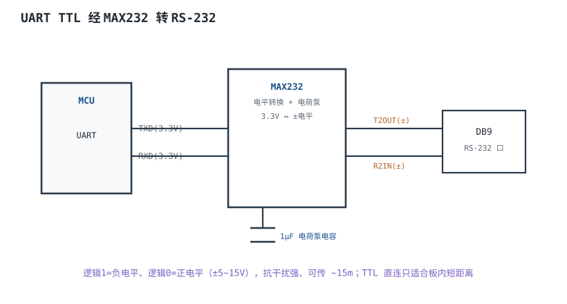
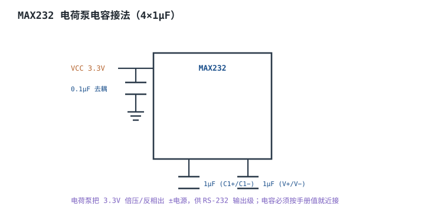

# UART 与 RS-232 物理层 UART & RS-232

## 1. 设计动机

::: motivation 板内串口和真实 RS-232 不是一回事
**UART（Universal Asynchronous Receiver/Transmitter，通用异步收发）**是 MCU 片上的一个数字外设，引脚是 3.3V TTL 电平，只适合板内短距离。而设备背后那个 DB9 串口遵循 **RS-232（EIA-232）**标准，用 ±5~15V 的双极性电平，逻辑正好反相。

很多人以为"接了 TX/RX 就能通"，结果要么不通、要么把 MCU 脚烧了——因为没做电平转换、没交叉 TX/RX、没共地。本章把协议帧和物理电平讲清楚。
:::

## 2. 原理图

MCU 的 UART 引脚输出 3.3V TTL，经 **MAX232** 电荷泵芯片转换成 RS-232 双极性电平，再上 DB9；反向同理。



## 3. 静态分析（DC）

两种电平的直流定义完全不同：

| 信号 | TTL UART | RS-232 |
|---|---|---|
| 逻辑 1（mark） | ≈3.3V | 负电压 −3~−15V |
| 逻辑 0（space） | ≈0V | 正电压 +3~+15V |
| 空闲态 | 高电平 | 负电压 |

直接把 3.3V TTL 接到 RS-232 设备：对方读到的电平不在门限内，通信失败；反之 RS-232 的 ±12V 灌进 MCU 会烧坏引脚。**两者之间必须有电平转换。**

## 4. 动态分析（AC / 瞬态）

UART 一帧 = 1 起始位 + 5~9 数据位 +（可选）校验 + 1~2 停止位，无时钟线，靠双方约定**波特率（Baud Rate）**对位采样。

```echarts
{
  "tooltip": {"trigger": "axis"},
  "legend": {"data": ["TTL TX"], "bottom": 0, "textStyle": {"fontSize": 13}},
  "grid": {"left": 56, "right": 24, "top": 26, "bottom": 56},
  "xAxis": {"type": "category", "name": "位时间", "data": ["空闲","起始","D0","D1","D2","D3","D4","D5","D6","D7","停止"], "axisLabel": {"fontSize": 10}},
  "yAxis": {"type": "value", "min": -0.5, "max": 3.8, "axisLabel": {"fontSize": 11}},
  "series": [
    {"name": "TTL TX", "type": "line", "step": "end", "showSymbol": false, "lineStyle": {"width": 2.6, "color": "#1a4f8b"},
     "data": [3.3,0,3.3,0,0,3.3,0,3.3,0,3.3,3.3]}
  ]
}
```

- 波特率误差容忍约 ±2~3%；两端波特率/晶振不一致会逐位错位直到整帧错乱。
- 常用 9600 / 115200；距离越远、线越差，波特率要越低。

## 5. 环路分析

::: advanced 进阶：为什么 RS-232 用双极性电平
RS-232 定义逻辑用电平的**极性**而非相对地的高低，收发双方共模电位可以差几十伏而不影响判决；±电平摆幅大、噪声容限高，故能传约 15m。TTL 单端小摆幅只在板内可靠。代价是需要电荷泵产生负压。
:::

## 6. 元件取值与工程权衡

- **电平转换**：板内直连用 TTL；出机箱/接老设备必须 MAX232 类转换。
- **MAX232 电容**：4 只 1µF（电荷泵），按手册就近接，值错则不出 ±电平。
- **接线**：TX 接 RX、共地；同名对接不通。
- **波特率**：晶振精度不足时，高波特率（115200）误码，降速或换外部晶振。

## 7. 完整设计示例

::: example 做一个 DB9 串口接 PC
1. **需求**：MCU UART 接 PC 的 RS-232 口，9600 8N1。
2. **转换**：TXD/RXD 接 MAX232，4×1µF 电荷泵电容。
3. **DB9**：T2OUT/R2IN 引出到 DB9。
4. **接线**：PC 端 TX 接本板 RX、RX 接本板 TX，共地。
5. **波特率**：9600，容忍大，内部 RC 晶振也够。
6. **验算**：串口助手收到 MCU 发送的字符串，回环正常。
:::

## 8. 仿真与实验

- 示波器量 MCU TX 空闲电平（≈3.3V）与起始位（拉低）。
- 量 MAX232 输出，应为 ±几 V 的双极性方波。
- TX/RX 不交叉时通信失败，交叉后通——亲手验证一次。

## 扩展与变种电路

### 扩展1：MAX232 电荷泵电容 Charge-Pump

定位：为什么 MAX232 周围要焊 4 只电容。



::: example 工作原理
- 芯片内部振荡器驱动电容二极管泵：C1 倍压出 +V，再反相出 −V。
- 每只电容 1µF（钽或陶瓷），VCC 旁再加 0.1µF 去耦。
- 电容开路/取值不对，就没有 ±电平，输出全为 0。
:::

取值对比：

| 电容 | 作用 | 缺失后果 |
|---|---|---|
| C1+/C1− 1µF | 倍压 | 无 +V |
| V+/V− 1µF | 反相 | 无 −V |
| VCC 0.1µF | 去耦 | 抖动/不出波形 |

::: pitfall 漏焊电荷泵电容
- **现象**：MAX232 输出恒为 0 或不出双极性。
- **原因**：没有电荷泵电容，产生不出 ±电源。
- **解决**：严格按手册焊齐 4 只电容，就近引脚。
:::

### 扩展2：UART 三线交叉接线 Crossover

定位：两块板直接 UART 互连怎么接。


::: example 工作原理
- 发送端 TX 必须接对方接收端 RX，是交叉关系；同名直连（TX-TX）不通。
- GND 必须共地，否则双方电平参考不同，采样出错。
- 只需 TX/RX/GND 三线即可全双工。
:::

取值对比：

| 接法 | 结果 |
|---|---|
| TX-TX, RX-RX | 不通 |
| TX-RX 交叉 + 共地 | 正常 |
| TX-RX 交叉不共地 | 偶发误码 |

::: pitfall 忘了共地
- **现象**：近距离偶尔通、稍远或地电位不同就乱码。
- **原因**：双方 GND 不等电位，TTL 门限相对参考漂。
- **解决**：通信线必含 GND，长线跨地用电平转换/隔离。
:::

## 9. 常见坑与故障现象

::: pitfall 常见坑
- **TTL 直接接 RS-232 设备**：不通或烧脚。必须 MAX232 转换。
- **TX/RX 接反**：完全不通。交叉接线。
- **不共地**：乱码/时通时断。加 GND 线。
- **波特率/晶振不匹配**：整帧错乱。降波特率或用外部晶振。
- **漏焊电荷泵电容**：MAX232 不出 ±电平。
:::

## 10. 自测题

<details><summary>RS-232 的逻辑 1 是正电压还是负电压？</summary>
逻辑 1（mark）是负电压（−3~−15V），逻辑 0 是正电压，与 TTL 反相且摆幅大。
</details>

<details><summary>两块 MCU 板用 UART 互连，TX/RX 怎么接？</summary>
A.TX→B.RX、A.RX→B.TX，且 GND 相连。同名直连不通。
</details>

## 11. 参考资料

- TIA/EIA-232-F 串行接口标准
- MAX232 数据手册（电荷泵电容接法）
