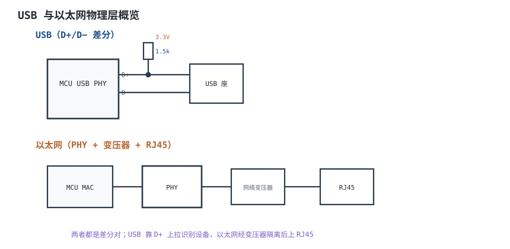
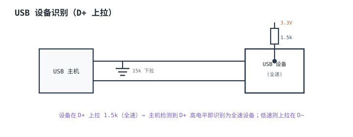
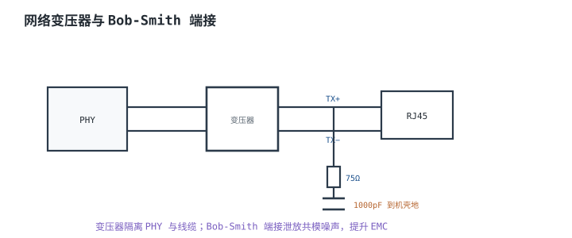

# USB 与以太网物理层概览 USB & Ethernet PHY

## 1. 设计动机

::: motivation 高速接口的物理层不能随便接
**USB** 和**以太网**是两类"自带 PHY"的高速差分接口，和 UART/I²C 不是一个量级。它们不只是几根线，而是一整套差分对、端接、识别、隔离的物理约定。

硬件上最常踩的坑：USB 没有做设备识别上拉、D+/D− 没等长走线导致信号完整性差；以太网 PHY 与 RJ45 之间漏了网络变压器、Bob-Smith 端接。本章只做硬件概览——告诉画板时该留什么、接什么，协议细节留给专门的栈。
:::

## 2. 原理图

USB 用一对差分线 D+/D−；以太网经 MAC→PHY→网络变压器→RJ45。两者都是差分信号，靠差分对的电压差传数据。



## 3. 静态分析（DC）

- **USB 设备识别**：USB 主机在 D+/D− 上各有 15kΩ 下拉；设备在 D+ 上拉 1.5kΩ（全速）或 D− 上拉 1.5kΩ（低速），主机据此判断接入与速度。
- **USB 电平**：D+/D− 差分，单端约 0~3.3V，靠差分判决。
- **以太网**：PHY 输出经变压器耦合，直流上与线缆隔离；RJ45 侧的中心抽头常接 Bob-Smith 端接。

## 4. 动态分析（AC / 瞬态）

高速差分对最怕**信号完整性**：走线不等长、参考平面不完整、端接不匹配都会引起反射、眼图闭合。

```echarts
{
  "tooltip": {"trigger": "axis"},
  "legend": {"data": ["D+", "D−"], "bottom": 0, "textStyle": {"fontSize": 13}},
  "grid": {"left": 56, "right": 24, "top": 26, "bottom": 56},
  "xAxis": {"type": "category", "name": "时间", "data": [0,1,2,3,4,5,6,7,8], "axisLabel": {"fontSize": 11}},
  "yAxis": {"type": "value", "name": "V", "min": -0.5, "max": 3.8, "axisLabel": {"fontSize": 11}},
  "series": [
    {"name": "D+", "type": "line", "step": "end", "showSymbol": false, "lineStyle": {"width": 2.4, "color": "#1a4f8b"},
     "data": [3.3,0,0,3.3,3.3,0,0,3.3,3.3]},
    {"name": "D−", "type": "line", "step": "end", "showSymbol": false, "lineStyle": {"width": 2.4, "color": "#b5642e"},
     "data": [0,3.3,3.3,0,0,3.3,3.3,0,0]}
  ]
}
```

## 5. 环路分析

::: advanced 进阶：为什么用差分对
差分信号 D+/D− 反相传输，外界共模干扰同时耦合到两线，相减后抵消；这是 USB/以太网/CAN 都用差分的根本原因。硬件要求两线等长、紧耦合、参考平面完整，才能让差分对真正"差"起来。
:::

## 6. 元件取值与工程权衡

- **USB 识别上拉**：设备侧 D+（全速）1.5kΩ 上拉到 3.3V。
- **走线**：D+/D−、以太网两对差分线等长、阻抗控制（USB 90Ω、以太网 100Ω）。
- **网络变压器**：PHY 与 RJ45 之间必须加，隔离+共模抑制。
- **Bob-Smith**：75Ω×4 + 1000pF 到机壳地，泄放共模。
- **ESD**：USB/网口对外，加 ESD 保护器件。

## 7. 完整设计示例

::: example USB 设备口硬件
1. **需求**：MCU USB Device 全速 12Mbps。
2. **PHY**：用 MCU 内置 FS USB PHY。
3. **识别**：D+ 经 1.5kΩ 上拉到 3.3V。
4. **走线**：D+/D− 等长、90Ω 差分阻抗、完整地平面。
5. **保护**：USB 座加 ESD 二极管。
6. **验算**：插上 PC，主机识别到新设备，枚举成功。
:::

## 8. 仿真与实验

- USB 插上 PC，主机设备管理器出现新设备 = 识别上拉住对了；无反应查 D+ 上拉。
- 以太网插上网线，PHY 的 LINK 指示灯亮 = 变压器/接线基本通。
- 用 USB 分析仪看枚举过程是否完整。

## 扩展与变种电路

### 扩展1：USB 设备识别上拉 Device Attach

定位：主机怎么知道你插了设备、是全速还是低速。



::: example 工作原理
- 主机空闲时 D+/D− 都被 15k 下拉到低。
- 设备接入后在 D+ 上拉 1.5k，把 D+ 拉高，主机检测到上升沿并判断为全速设备。
- 低速设备把 1.5k 上拉放在 D− 上。
:::

取值对比：

| 上拉位置 | 设备速度 |
|---|---|
| D+ 1.5k | 全速 12Mbps |
| D− 1.5k | 低速 1.5Mbps |
| 无上拉 | 主机不识别 |

::: pitfall 漏了 D+ 上拉
- **现象**：插上 USB 主机毫无反应。
- **原因**：没有上拉，主机检测不到设备接入。
- **解决**：D+ 加 1.5k 上拉（全速设备）。
:::

### 扩展2：以太网变压器与端接 Magnetics & Termination

定位：PHY 不能直接网线，要隔离与端接。



::: example 工作原理
- 变压器把 PHY 与线缆直流隔离，抑制共模、提高耐压。
- Bob-Smith：4 根线各经 75Ω 汇到一点，再经 1000pF 到机壳地，泄放高频共模噪声。
- 现在常用带变压器的 RJ45 一体座（Magjack）。
:::

取值对比：

| 方案 | 隔离 | EMC |
|---|---|---|
| PHY 直接出 | 无 | 差 |
| 分立变压器+Bob-Smith | 有 | 好 |
| Magjack 一体座 | 有 | 好、省板 |

::: pitfall PHY 直接驱动网线
- **现象**：网口静电/浪涌打坏 PHY。
- **原因**：没有变压器隔离，网线浪涌直接进 PHY。
- **解决**：PHY 与 RJ45 之间必须经网络变压器/Magjack。
:::

## 9. 常见坑与故障现象

::: pitfall 常见坑
- **USB 不识别**：D+ 上拉漏接/接错。全速上拉 D+。
- **以太网 LINK 不亮**：变压器/RJ45 接线错、线序错。查 1/2、3/6 两对。
- **差分线不等长**：高速误码、眼图差。等长紧耦合。
- **无 ESD 保护**：对外口易被静电打坏。加 TVS/ESD。
:::

## 10. 自测题

<details><summary>全速 USB 设备在哪个线上拉 1.5k 电阻？</summary>
在 D+ 上拉 1.5kΩ 到 3.3V，主机据此识别为全速设备；低速设备则上拉在 D−。
</details>

<details><summary>以太网 PHY 为什么不能直接接网线？</summary>
需要网络变压器做电气隔离与共模抑制，保护 PHY 并满足 EMC；否则网线浪涌/地电位差会损坏 PHY。
</details>

## 11. 参考资料

- USB 2.0 Specification（设备枚举与电气）
- IEEE 802.3 以太网物理层
- 以太网 PHY 与 Magjack 数据手册
