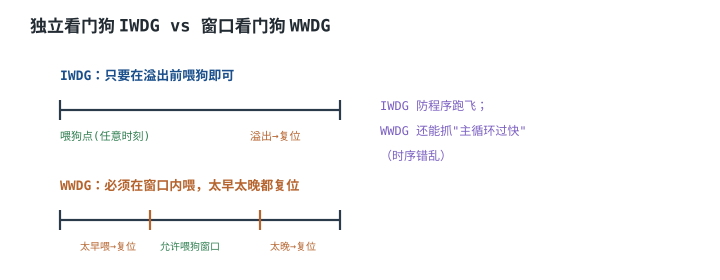
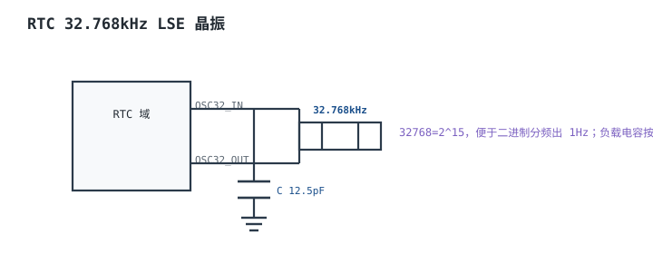
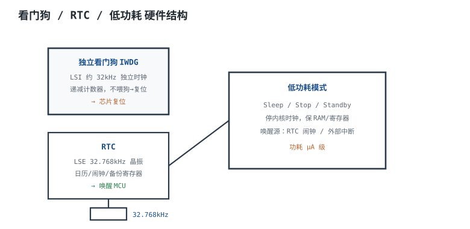

# 看门狗、RTC 与低功耗硬件 Watchdog / RTC / Low-Power

无人值守的设备有三个共同的硬指标：**程序跑飞了要能自己回来、断电/休眠时时间不能丢、电池要撑得够久。** 对应三块硬件：看门狗（Watchdog）负责复位，实时时钟（Real-Time Clock，RTC）负责走时和定时唤醒，低功耗模式负责把不工作的部分关掉。它们经常被放在一起讲，因为真正的电池寿命不是"休眠电流"一个数决定的，而是"休眠电流 + 每次唤醒搬移的电荷 × 唤醒频率 + 电源/看门狗/RTC 的静态电流"共同决定的。

本章按"复位 → 走时 → 功耗"的顺序展开，最后用 CR2032 供电、每秒唤醒一次的完整算例，把平均电流、电池寿命和 RTC 月误差一次算清。ADC 的采样唤醒节奏见[ADC 原理、参数与参考电压](adc.md)，PWM 在休眠时的关断与重启见[定时器与 PWM 原理](timer-pwm.md)，DAC 偏置的保持见[DAC 与模拟输出](dac.md)；复位与时钟的硬件基础见[最小系统：电源、时钟、复位、调试](minimum-system.md)，中断优先级与唤醒见[中断机制（硬件视角）](interrupts.md)。

## 1. 设计动机

::: motivation 三个现场
**现场一：看门狗和主程序共用一个时钟。** 主时钟停振时，CPU 停了，看门狗也停了，永远不会复位——设备就那样"安静地死掉"。独立看门狗（Independent Watchdog，IWDG）用内部 LSI 或外部独立振荡器，主时钟挂了它还在走，到点就把芯片拉回复位。**"独立"二字的硬件意义就是：它的时基不能依赖被监控的对象。**

**现场二：CR2032 每秒唤醒一次，到底能用几年？** 直觉上"休眠 1 µA，220 mAh，能用 25 年"，但每次唤醒 5 mA 持续 10 µs，平均电流变成 $1\ \mu\text{A}+5\ \text{mA}\times10\ \mu\text{s}\times1\ \text{Hz}=1.05\ \mu\text{A}$，寿命 23.9 年；如果唤醒后要重新启动/ Bootloader，耗时 10 ms 而不是 10 µs，平均电流 51 µA，寿命只剩 0.49 年。**唤醒时间是电池寿命的一阶变量，不是小数点后的修正。**

**现场三：RTC 用 LSE 晶振，标称 ±20 ppm，一个月差多少？** $20\times10^{-6}\times30\times86400=51.84\ \text{s}$，约 52 秒。这还只是 25°C 的初始容差；32.768 kHz 音叉晶振的频率-温度曲线是抛物线，-20°C 时可能再偏 -70 ppm，一个月差 3 分钟。**"±20 ppm"不是全温区指标，温度补偿必须单独算。**
:::

| 你想确认 | 先算 | 判据（工程经验值） |
|---|---|---|
| 看门狗超时够不够 | $t_{out}=4\times2^{PR}\times(RL+1)/f_{LSI}$ | 大于最坏任务时间，留 2 倍 |
| 喂狗窗口 | $T_{task,max}<T_{feed}<T_{out,min}$ | 窗口看门狗还要大于下限 |
| RTC 月误差 | $\text{ppm}\times10^{-6}\times30\times86400$ | 按全温区最坏 ppm，不按 25°C |
| 晶振负载电容 | $C_1=C_2=2(C_L-C_{stray})$ | 按晶振 $C_L$ 和 PCB 寄生算 |
| 平均电流 | $I_{sleep}+Q_wf_w$ | 把 RTC/IWDG/电源静态电流都算进去 |
| 电池寿命 | $Q_{bat}/I_{avg}$ | 再乘 0.8 容量裕量、算自放电 |

**不算会摔在哪**，四个带数字的代价：

1. **看门狗超时太短。** 任务最坏 300 ms，超时设 200 ms，正常负载下也会反复复位；设 2 s 超时、1 s 喂一次，超时是任务时间的 6.7 倍，喂狗周期还有约 1.8 倍余量。
2. **唤醒时间没算。** 10 µs 和 10 ms 差 1000 倍，电池寿命从 23.9 年掉到 0.49 年。
3. **RTC 只用 25°C 的 20 ppm。** -20°C 再偏 -70 ppm，月误差从 52 s 变成 184 s；加上初始容差可到 235 s。
4. **漏算静态电流。** 休眠 1 µA，但 LDO 静态 1 µA、RTC 1 µA、IWDG 1.5 µA，合计 4.5 µA，寿命从 23.9 年掉到 5.6 年。

## 2. 定义与直观

### 2.1 看门狗：普通超时 vs 窗口

**看门狗（Watchdog）**是一个独立于 CPU 的递减/递增计数器：程序必须在计数器溢出前"喂狗"（重新装载），否则看门狗产生复位。按"什么时候允许喂"分两类：

- **普通/独立看门狗（IWDG）**：只要在溢出前喂都行。它防的是"程序卡死/跑飞，完全没喂"。超时时间由独立时钟（LSI 或外部振荡器）和装载值决定。
- **窗口看门狗（WWDG）**：只能在"窗口"内喂——太早喂（说明主循环跑得异常快、可能跳过了某些任务）或太晚喂（快溢出了）都会复位。它防的不只是卡死，还能抓时序错乱。



**喂狗策略**的核心不是"定时喂"，而是"喂狗这个动作必须证明所有关键任务都跑到了"。常见做法：每个任务置一个位，主循环检查所有位都置起后才喂狗并清位；喂狗放在主循环，不放在定时器中断里（中断还在跑不代表主循环没卡）。窗口看门狗则把喂狗点放在窗口中间，既证明"跑完了"，又证明"没跑太快"。

### 2.2 RTC：32.768 kHz 与备份域

**RTC** 是一个低频时钟驱动的日历计数器：时、分、秒、日期、闹钟、周期唤醒。它的时钟源通常有两种：

- **LSE（Low-Speed External）**：外部 32.768 kHz 音叉晶振，精度高（25°C 初始 ±20 ppm 量级），需要负载电容和起振裕量。
- **LSI（Low-Speed Internal）**：内部 RC，便宜、省引脚，但精度差（典型 ±1%~±5%，随温度/电压变），只适合"粗略定时"。

$32768=2^{15}$，经 15 次二分频正好得到 1 Hz，所以 32.768 kHz 成了 RTC 的标准频率。RTC 和备份寄存器通常挂在**备份域（Backup Domain）**，主电源掉电后由 VBAT（纽扣电池/超级电容）供电，主电源恢复后再切回来。



### 2.3 低功耗模式：关到什么程度，醒得多快

不同 MCU 的命名不同，但大体分四档：

| 模式 | 内核时钟 | 外设/时钟 | 保留内容 | 典型电流 | 唤醒时间 | 唤醒后 |
|---|---|---|---|---|---|---|
| Run | 开 | 开 | 全部 | mA~几十 mA | — | 继续 |
| Sleep | 停 | 大部分开 | 全部 | mA 级 | 几个时钟 | 继续 |
| Stop | 停 | 大部分停，LSE/LSI 可留 | RAM/寄存器 | µA 级 | µs 级 | 继续 |
| Standby | 停 | 几乎全停 | 备份域/少量 | 亚 µA~µA | ms 级 | 复位重启 |

**关键区别是"唤醒后从哪里继续"**：Sleep/Stop 从断点继续，Standby 通常走复位/启动流程，唤醒时间包括时钟稳定、启动代码、外设初始化。电池寿命算例里，"10 µs 唤醒"只可能发生在 Stop 且时钟/外设都保持；如果每次从 Standby 冷启动，10 ms 都算快的。



## 3. 定量关系

### 3.1 IWDG 超时

以常见的 STM32 风格 IWDG 为例：

$$t_{out}=\frac{4\times2^{PR}\times(RL+1)}{f_{LSI}}$$

符号与单位：$PR$ 是预分频选择（0~6，对应分频 4/8/16/32/64/128/256）；$RL$ 是 12 位重装载值（0~4095）；$f_{LSI}$ 是独立时钟频率（Hz）；$t_{out}$ 是超时时间（s）。不同厂商的公式可能是 $2^{PR}$ 或 $4\times2^{PR}$，以数据手册为准；本章按前者常见的 4 倍口径。

**LSI 本身有误差。** 标称 40 kHz 的 LSI，随温度/电压可能在 ±10% 甚至更大范围变化，所以实际超时是一个区间，不是单点：

$$t_{out,min}=\frac{4\times2^{PR}\times(RL+1)}{f_{LSI,max}},\qquad t_{out,max}=\frac{4\times2^{PR}\times(RL+1)}{f_{LSI,min}}$$

喂狗周期必须小于 $t_{out,min}$，而不是标称值；否则 LSI 偏快时就会误复位。

### 3.2 喂狗窗口

普通看门狗：

$$T_{task,max}<T_{feed}<t_{out,min}$$

其中 $T_{task,max}$ 是最坏任务执行时间（s）；$T_{feed}$ 是喂狗周期（s）。$T_{feed}$ 要大于任务时间（任务没跑完不能喂），小于最小超时（不能等太久）。工程上取 $T_{feed}\approx0.5t_{out,min}$：超时侧留 2 倍余量，任务侧还要满足 $T_{task,max}<0.5t_{out,min}$。

**纠正一处常见写法**：一些资料写"喂狗周期要远大于正常任务最长执行时间"，这只说了一半。完整链条是 $T_{task,max}<T_{feed}<t_{out,min}$：喂狗周期必须**小于**最小超时，否则看门狗会在下一次喂狗前溢出；同时又要大于最坏任务时间，否则任务没跑完就被喂，等于没监控。单独说"远大于任务时间"而不提超时上限，会把看门狗设计反。

窗口看门狗：

$$T_{window,low}<T_{feed}<T_{window,high}$$

$T_{window,low}$ 是窗口下限（太早喂会复位），$T_{window,high}$ 是上限（太晚喂会复位）。窗口宽度通常取超时的 30%~70%，喂狗点放在中间。**窗口看门狗的价值是"抓过快"**：如果主循环因为某个任务被跳过而跑得飞快，普通看门狗看不出来，窗口看门狗会复位。

### 3.3 RTC 走时：从 32.768 kHz 到秒，再到月误差

分频：

$$f_{1Hz}=\frac{32768}{2^{15}}=1\ \text{Hz}$$

ppm 到时间误差：

$$\Delta t=\text{ppm}\times10^{-6}\times T$$

符号与单位：ppm 是百万分之一；$T$ 是累计时间（s）；$\Delta t$ 是误差（s）。一个月按 30 天：

$$T=30\times86400=2\,592\,000\ \text{s}$$

$$\Delta t=20\times10^{-6}\times2\,592\,000=51.84\ \text{s}$$

一天是 1.728 s，一年是 630.72 s（约 10.5 分钟）。**ppm 是相对量，累计时间越长，绝对误差越大；校准只能把 25°C 的初始误差调掉，调不掉温度漂移。**

### 3.4 晶振负载电容与温度特性

音叉晶振的负载电容：

$$C_L=\frac{C_1C_2}{C_1+C_2}+C_{stray}$$

当 $C_1=C_2$ 时：

$$C_1=C_2=2(C_L-C_{stray})$$

符号与单位：$C_L$ 是晶振规定的负载电容（pF）；$C_1$、$C_2$ 是两端对地电容（pF）；$C_{stray}$ 是 PCB 走线/引脚寄生电容（pF，典型 2~5 pF）。$C_L=12.5\ \text{pF}$、$C_{stray}=3\ \text{pF}$ 时 $C_1=C_2=2(12.5-3)=19\ \text{pF}$，取标准值 18 pF，实际 $C_L=18/2+3=12\ \text{pF}$，比标称低 0.5 pF；这会带来几 ppm 的频率偏移，具体牵引灵敏度看晶振的 motional capacitance，以数据手册为准。

温度特性近似抛物线：

$$\frac{\Delta f}{f}\approx k(T-T_0)^2$$

其中 $k$ 是抛物线系数（典型 $-0.03\sim-0.04\ \text{ppm}/^{\circ}\text{C}^2$，以晶振数据手册为准）；$T_0$ 是拐点温度（通常 25°C）；$T$ 是工作温度（°C）。取 $k=-0.035\ \text{ppm}/^{\circ}\text{C}^2$：

- 0°C（$\Delta T=25$）：$-0.035\times625=-21.9\ \text{ppm}$；
- -20°C（$\Delta T=45$）：$-0.035\times2025=-70.9\ \text{ppm}$；
- 50°C（$\Delta T=25$）：同样 -21.9 ppm。

**这个抛物线是"以 25°C 为顶点"的，所以 0°C 和 50°C 的偏差相同；温度补偿要按实际温度查表/多项式，不是简单线性修正。**

### 3.5 电池寿命：平均电流法

一次唤醒搬移的电荷：

$$Q_w=I_w t_w$$

平均电流：

$$I_{avg}=I_{sleep}+Q_wf_w$$

电池寿命：

$$t_{bat}=\frac{Q_{bat}}{I_{avg}}$$

符号与单位：$I_w$ 是唤醒期间电流（A）；$t_w$ 是唤醒持续时间（s）；$f_w$ 是唤醒频率（Hz）；$I_{sleep}$ 是休眠电流（A，含 RTC/IWDG/电源静态）；$Q_{bat}$ 是电池可用容量（Ah）；$t_{bat}$ 是寿命（h）。这个模型假设唤醒电流恒定、忽略温升和电压下降；精确预算要按电流波形积分。

**容量要打折。** 电池标称容量是在特定放电电流/温度/截止电压下测的；纽扣电池还有自放电（典型 1%/年量级）和低温容量下降。工程上先把标称容量乘 0.8，再算寿命，最后和自放电的指数衰减取小值。

### 3.6 唤醒时间与平均电流的取舍

把 $Q_w=I_wt_w$ 代入：

$$I_{avg}=I_{sleep}+I_wt_wf_w$$

唤醒频率 $f_w$ 越高，平均电流越大；唤醒时间 $t_w$ 越长，平均电流也越大。两者都直接抬高 $I_{avg}$，而寿命 $t_{bat}=Q_{bat}/I_{avg}$ 与平均电流成反比，所以"唤醒时间翻倍、寿命减半"；休眠电流则是**常数底**。优化顺序是：

1. 先把 $I_{sleep}$ 压到最低（关外设时钟、引脚固定、电源静态电流）；
2. 再缩短 $t_w$（用 Stop 而不是 Standby、保留时钟/外设、减少启动代码）；
3. 最后才降 $f_w$（降采样率、批量上传），因为很多应用对唤醒频率有硬需求。

### 3.7 适用条件与失效边界

1. **IWDG 独立性假设**：IWDG 依赖 LSI；LSI 停振/被误关时看门狗也会失效。安全关键场合要用外部看门狗或独立振荡器。
2. **喂狗点假设**：喂狗必须覆盖所有关键任务；如果只在主循环喂、某个任务被跳过但主循环还在跑，普通看门狗抓不到，要用窗口看门狗或任务位图。
3. **RTC 温漂假设**：抛物线系数和拐点随批次变；-40~+85°C 全温区要按数据手册曲线或实测校准。
4. **电池模型假设**：$Q_{bat}/I_{avg}$ 是恒流近似；脉冲放电、低温、老化都会让可用容量下降。
5. **唤醒时间假设**：数据手册的唤醒时间通常从唤醒事件到时钟稳定/第一条指令，不包括用户启动代码和外设初始化；实际 $t_w$ 要实测。
6. **备份域假设**：VBAT 切换、备份寄存器写保护、RTC 时钟源切换都会影响走时；第一次上电要初始化，之后不能每次复位都重写。

## 4. 典型计算

### 4.1 完整算例：CR2032 每秒唤醒一次

**已知**：CR2032 标称 220 mAh（不同厂家 200~240 mAh，以数据手册为准）；每秒唤醒 1 次；每次 5 mA 持续 10 µs；休眠 1 µA。求平均电流和寿命。

**第 1 步：每次唤醒的电荷。**

$$Q_w=I_wt_w=5\times10^{-3}\times10\times10^{-6}=5\times10^{-8}\ \text{C}=50\ \text{nC}$$

**第 2 步：平均电流。** 每秒 1 次，$f_w=1\ \text{Hz}$：

$$I_wt_wf_w=5\times10^{-3}\times10\times10^{-6}\times1=5\times10^{-8}\ \text{A}=0.05\ \mu\text{A}$$

$$I_{avg}=1\ \mu\text{A}+0.05\ \mu\text{A}=1.05\ \mu\text{A}$$

**第 3 步：寿命。**

$$t_{bat}=\frac{220\times10^{-3}}{1.05\times10^{-6}}=2.095\times10^5\ \text{h}=8730\ \text{day}=23.9\ \text{year}$$

**第 4 步：容量打折。** 按 80% 可用容量：

$$t_{bat,80\%}=\frac{0.8\times220\times10^{-3}}{1.05\times10^{-6}}=1.676\times10^5\ \text{h}=19.1\ \text{year}$$

**第 5 步：加上电源静态电流。** 如果 LDO/DC-DC 静态电流 1 µA：

$$I_{avg}=1+1+0.05=2.05\ \mu\text{A}$$

$$t_{bat}=\frac{220\times10^{-3}}{2.05\times10^{-6}}=1.073\times10^5\ \text{h}=12.3\ \text{year}$$

**第 6 步：唤醒时间变成 10 ms 会怎样。** 每次 5 mA、10 ms：

$$Q_w=5\times10^{-3}\times10\times10^{-3}=5\times10^{-5}\ \text{C}=50\ \mu\text{C}$$

$$I_{avg}=1\ \mu\text{A}+5\ \text{mA}\times10\ \text{ms}\times1\ \text{Hz}=1\ \mu\text{A}+50\ \mu\text{A}=51\ \mu\text{A}$$

$$t_{bat}=\frac{220\times10^{-3}}{51\times10^{-6}}=4314\ \text{h}=0.49\ \text{year}$$

**10 µs 和 10 ms 差 1000 倍，寿命从 23.9 年掉到 0.49 年。** 这就是为什么低功耗设计要把"唤醒后做什么"算清楚，而不是只看休眠电流。

```echarts
{
  "animation": false,
  "tooltip": {"trigger": "axis"},
  "grid": {"left": 72, "right": 30, "top": 30, "bottom": 58},
  "xAxis": {"type": "category", "name": "每次唤醒时长", "nameLocation": "middle", "nameGap": 36, "data": ["10 µs", "100 µs", "1 ms", "10 ms"], "axisLabel": {"fontSize": 11}},
  "yAxis": {"type": "value", "name": "电池寿命 / 年", "nameLocation": "middle", "nameGap": 52, "min": 0, "max": 30, "axisLabel": {"fontSize": 11}},
  "series": [
    {"name": "CR2032 寿命", "type": "bar", "barWidth": "46%", "itemStyle": {"color": "#1a4f8b"},
     "label": {"show": true, "position": "top", "fontSize": 11, "formatter": "{c} 年"},
     "data": [23.9, 16.7, 4.19, 0.49]}
  ]
}
```

上图按 220 mAh、5 mA 唤醒、1 µA 休眠、每秒 1 次计算；唤醒时长从 10 µs 增到 10 ms，寿命从 23.9 年降到 0.49 年。数据与 4.1 节逐步计算一致。

### 4.2 完整算例：RTC ±20 ppm 的月误差与温漂

**已知**：LSE 晶振 25°C 初始容差 ±20 ppm；抛物线系数 $k=-0.035\ \text{ppm}/^{\circ}\text{C}^2$，拐点 25°C。求：25°C、0°C、-20°C 的月误差，以及初始容差与温漂叠加后的最坏值。

**第 1 步：25°C、+20 ppm。**

$$\Delta t=20\times10^{-6}\times30\times86400=51.84\ \text{s}$$

**第 2 步：0°C 的温漂。**

$$\Delta T=0-25=-25\ ^{\circ}\text{C}$$

$$\frac{\Delta f}{f}=-0.035\times(-25)^2=-21.9\ \text{ppm}$$

$$\Delta t=21.9\times10^{-6}\times2\,592\,000=56.7\ \text{s}$$

**第 3 步：-20°C 的温漂。**

$$\Delta T=-45\ ^{\circ}\text{C}$$

$$\frac{\Delta f}{f}=-0.035\times(-45)^2=-70.9\ \text{ppm}$$

$$\Delta t=70.9\times10^{-6}\times2\,592\,000=183.7\ \text{s}=3.06\ \text{min}$$

**第 4 步：最坏叠加。** 初始 +20 ppm 与 -20°C 的 -70.9 ppm 同号：

$$20+70.9=90.9\ \text{ppm}$$

$$\Delta t=90.9\times10^{-6}\times2\,592\,000=235.5\ \text{s}=3.93\ \text{min}$$

**第 5 步：校准能修多少。** 在 25°C 测 24 小时，若快了 5 s：

$$\text{误差}=\frac{5}{86400}=5.79\times10^{-5}=57.9\ \text{ppm}$$

把校准值写成 -58 ppm，25°C 的初始误差基本消掉；但 -20°C 的 -70.9 ppm 是温度引起的，校准寄存器不会随温度变，除非 MCU 有温度补偿功能或软件按温度查表。**校准解决"固定偏差"，温度补偿解决"随温度变的偏差"，两者不能互相替代。**

### 4.3 完整算例：2 秒 IWDG 与喂狗窗口

**已知**：$f_{LSI}=40\ \text{kHz}$（典型值，实际随温度/电压变），选 $PR=4$（分频 $4\times2^4=64$），$RL=1249$。求超时、LSI 误差范围、喂狗周期。

**第 1 步：标称超时。**

$$t_{out}=\frac{64\times(1249+1)}{40\times10^3}=\frac{64\times1250}{40000}=\frac{80000}{40000}=2.0\ \text{s}$$

**第 2 步：LSI ±10% 的范围。**

$$t_{out,min}=\frac{80000}{40000\times1.1}=1.818\ \text{s}$$

$$t_{out,max}=\frac{80000}{40000\times0.9}=2.222\ \text{s}$$

**第 3 步：喂狗周期。** 设最坏任务 300 ms：

$$0.3\ \text{s}<T_{feed}<1.818\ \text{s}$$

取 $T_{feed}=1.0\ \text{s}$，两边余量分别约 3.3 倍和 1.8 倍。

**第 4 步：窗口看门狗。** 若窗口下限取超时的 50%（0.9 s），喂狗必须在 0.9~1.8 s 之间；1.0 s 喂正好在窗口内，太早（<0.9 s）会被判"跑太快"，太晚（>1.8 s）会溢出。**窗口下限不能设得离喂狗点太近，否则任务抖动就会误复位。**

### 4.4 完整算例：唤醒频率与平均电流

**已知**：$I_{sleep}=1\ \mu\text{A}$，每次唤醒 5 mA、10 µs。求 1 Hz、0.1 Hz、10 Hz 唤醒的平均电流和寿命。

**1 Hz：**

$$I_{avg}=1\ \mu\text{A}+5\ \text{mA}\times10\ \mu\text{s}\times1\ \text{Hz}=1.05\ \mu\text{A}$$

$$t_{bat}=220\ \text{mAh}/1.05\ \mu\text{A}=23.9\ \text{year}$$

**0.1 Hz（10 秒一次）：**

$$I_{avg}=1\ \mu\text{A}+5\ \text{mA}\times10\ \mu\text{s}\times0.1\ \text{Hz}=1.005\ \mu\text{A}$$

$$t_{bat}=220\ \text{mAh}/1.005\ \mu\text{A}=25.0\ \text{year}$$

**10 Hz：**

$$I_{avg}=1\ \mu\text{A}+5\ \text{mA}\times10\ \mu\text{s}\times10\ \text{Hz}=1.5\ \mu\text{A}$$

$$t_{bat}=220\ \text{mAh}/1.5\ \mu\text{A}=16.7\ \text{year}$$

唤醒频率从 0.1 Hz 提到 10 Hz，寿命从 25.0 年降到 16.7 年；但降到 0.1 Hz 只比 1 Hz 多 1.1 年。**当 $I_{sleep}$ 是底、$Q_wf_w$ 很小时，降唤醒频率的收益是递减的；先把休眠电流和唤醒时间压下来，收益更大。**

## 5. 工程含义

### 5.1 看门狗策略

- **喂狗点**：放在主循环末尾，且必须检查所有关键任务的完成标志；不要放在定时器中断里。
- **窗口看门狗**：喂狗点放在窗口中点；窗口下限留出任务抖动余量；用早期唤醒中断（EWI）在复位前保存日志/进入安全状态。
- **复位源**：上电时读复位标志，区分 POR、IWDG、WWDG、软件复位、引脚复位；不要每次复位都无条件清标志。
- **调试**：调试器暂停 CPU 时看门狗可能仍在跑，导致调试中断；用调试冻结位或临时关闭看门狗，量产后恢复。
- **独立时钟**：IWDG 的 LSI 也要核对起振/频率范围；安全关键场合用外部看门狗芯片，它的时基完全独立。

### 5.2 RTC 精度与温度补偿

- **晶振选型**：25°C 初始容差、全温区抛物线系数、负载电容、ESR、驱动电平都要看；不要只挑"±20 ppm"。
- **负载电容**：按 $C_L$ 和 $C_{stray}$ 算，PCB 走线短、远离数字线；负载电容用 C0G/NP0，避免温度系数。
- **校准**：25°C 测 24 h 以上的平均误差，写入 RTC 校准寄存器；校准步进通常是 ppm 级，具体看芯片。
- **温度补偿**：MCU 内部温度传感器 + 晶振抛物线模型，按温度查表修正；精度要求高时用 TCXO（±1~2 ppm）或 GPS 驯服。
- **备份域**：VBAT 切换电路、备份寄存器写保护、RTC 时钟源切换；第一次上电初始化，之后不要每次复位重写时间。

### 5.3 低功耗设计

- **关时钟**：进低功耗前关掉不用的外设时钟（ADC、UART、SPI、定时器），只保留唤醒源。
- **引脚状态**：未用引脚设模拟/固定电平，避免悬空输入导致漏电和振荡；输出引脚不要驱动外部下拉。
- **电源静态电流**：LDO/DC-DC 的静态电流、分压电阻、LED 限流电阻、上拉电阻都是"休眠时也在漏"的路径；1 µA 的静态电流和 1 µA 的 MCU 休眠一样重要。
- **电池脉冲能力**：CR2032 内阻典型 10~40 Ω，5 mA 脉冲会跌 50~200 mV；靠近电池放 1~10 µF 去耦，避免欠压复位。
- **低温**：纽扣电池低温容量下降、内阻上升；-20°C 的实际可用容量可能只有常温的一半左右（以电池数据手册为准），寿命预算要打折。

### 5.4 与其他三章的分工

本章是系统级的"复位/时间/能量"管理；[ADC 原理、参数与参考电压](adc.md) 决定每次唤醒采多久、采多准；[DAC 与模拟输出](dac.md) 决定休眠时偏置是否保持、唤醒后多久建立；[定时器与 PWM 原理](timer-pwm.md) 决定 PWM 在休眠时是否关断、唤醒后如何安全重启。四章的共同点是：**把"时间 × 电流"的账算清楚，再谈器件选型。**

## 6. 常见坑

::: pitfall 常见坑
- **现象**：设备正常运行也反复复位，或负载重时复位。**原因**：看门狗超时小于最坏任务时间；或喂狗点只覆盖了部分任务；或 LSI 偏快使实际超时变短。**解决**：按 $T_{task,max}<T_{feed}<t_{out,min}$ 设，留 2 倍以上余量；喂狗前检查任务位图；按 LSI 最坏频率算 $t_{out,min}$。
- **现象**：主时钟停振后设备"死机"，看门狗没复位。**原因**：看门狗时钟来自主时钟/PLL，主时钟挂了看门狗也停了。**解决**：用独立 LSI/外部振荡器的 IWDG，或外部看门狗芯片；核对时钟树和低功耗模式是否关掉了 IWDG 时钟。
- **现象**：RTC 一天差几秒，一个月差几分钟。**原因**：用了 LSI 而不是 LSE；或 LSE 负载电容不对/晶振温漂大；或只校准了 25°C 的初始误差。**解决**：换 LSE、按 $C_L$ 算负载电容、做温度补偿；高精度用 TCXO/GPS。
- **现象**：休眠电流比数据手册高一个数量级。**原因**：外设时钟没关、引脚悬空、上拉/分压电阻漏电、LDO 静态电流大；或测量时调试器/串口仍在工作。**解决**：逐项关外设、固定引脚、去掉不必要的上拉；用高精度表/功耗分析仪分段测量；核对数据手册的测试条件。
- **现象**：Standby 唤醒后程序不跑，或外设状态丢失。**原因**：Standby 通常走复位启动，RAM/寄存器不保留；唤醒源配置在备份域，重新初始化顺序不对。**解决**：确认唤醒源（RTC 闹钟/外部中断）和复位行为；把需要保持的数据放备份寄存器/RTC 备份域；唤醒后重新初始化时钟和外设。
- **现象**：电池寿命远低于计算值。**原因**：只算了 MCU 休眠电流，漏了 RTC/IWDG/电源静态、唤醒启动时间、电池自放电和低温容量下降。**解决**：按 $I_{avg}=I_{sleep}+Q_wf_w$ 把每一项列全；容量乘 0.8；实测整机平均电流而不是只看芯片手册。
:::

## 7. 自测题

<details><summary>CR2032 220 mAh、每秒唤醒 1 次、每次 5 mA 持续 10 µs、休眠 1 µA，平均电流和寿命是多少？</summary>

$$Q_w=5\times10^{-3}\times10\times10^{-6}=50\ \text{nC}$$

$$I_{avg}=1\ \mu\text{A}+50\ \text{nC}\times1\ \text{Hz}=1\ \mu\text{A}+0.05\ \mu\text{A}=1.05\ \mu\text{A}$$

$$t_{bat}=\frac{220\times10^{-3}}{1.05\times10^{-6}}=2.095\times10^5\ \text{h}=23.9\ \text{year}$$

按 80% 容量是 19.1 年；加 1 µA 电源静态电流是 12.3 年。

</details>

<details><summary>接上题，如果每次唤醒是 10 ms 而不是 10 µs，寿命变成多少？为什么差这么多？</summary>

$$I_{avg}=1\ \mu\text{A}+5\ \text{mA}\times10\ \text{ms}\times1\ \text{Hz}=1\ \mu\text{A}+50\ \mu\text{A}=51\ \mu\text{A}$$

$$t_{bat}=\frac{220\times10^{-3}}{51\times10^{-6}}=4314\ \text{h}=0.49\ \text{year}$$

唤醒时间差 1000 倍，平均电流从 1.05 µA 变成 51 µA，寿命从 23.9 年掉到 0.49 年。**低功耗设计必须把唤醒后的启动/初始化时间算进去。**

</details>

<details><summary>RTC ±20 ppm，30 天误差多少秒？-20°C、抛物线系数 -0.035 ppm/°C² 时再偏多少？</summary>

25°C、20 ppm：

$$20\times10^{-6}\times30\times86400=51.84\ \text{s}$$

-20°C，$\Delta T=-45$：

$$-0.035\times(-45)^2=-70.9\ \text{ppm}$$

$$70.9\times10^{-6}\times2\,592\,000=183.7\ \text{s}=3.06\ \text{min}$$

初始 +20 ppm 与温漂同号时最坏 90.9 ppm，约 235.5 s（3.93 min）。

</details>

<details><summary>$f_{LSI}=40\ \text{kHz}$、PR=4、RL=1249，IWDG 超时多少？LSI ±10% 时范围多少？</summary>

$$t_{out}=\frac{4\times2^4\times1250}{40000}=\frac{64\times1250}{40000}=2.0\ \text{s}$$

LSI +10%：

$$t_{out,min}=\frac{80000}{44000}=1.818\ \text{s}$$

LSI -10%：

$$t_{out,max}=\frac{80000}{36000}=2.222\ \text{s}$$

喂狗周期取 1 s，满足 $0.3<T_{feed}<1.818$。

</details>

<details><summary>为什么看门狗喂狗不能放在定时器中断里？窗口看门狗又如何抓"跑太快"？</summary>

定时器中断还在跑，只能说明中断没停，不能说明主循环/关键任务没卡；如果主循环卡死而中断继续喂狗，普通看门狗就失效了。喂狗应放在主循环，并且要检查所有关键任务的完成标志。

窗口看门狗要求喂狗在窗口内：太早喂说明主循环跑得异常快（可能跳过了任务/时序错乱），太晚喂说明快溢出；两种都复位，所以能抓普通看门狗抓不到的"过快"故障。

</details>

<details><summary>32.768 kHz 晶振、$C_L=12.5\ \text{pF}$、$C_{stray}=3\ \text{pF}$，两端负载电容取多少？</summary>

$$C_1=C_2=2(C_L-C_{stray})=2(12.5-3)=19\ \text{pF}$$

取标准值 18 pF，实际 $C_L=18/2+3=12\ \text{pF}$，比标称低 0.5 pF；频率偏移量看晶振的牵引灵敏度，以数据手册为准。负载电容用 C0G/NP0，避免温度系数。

</details>

<details><summary>为什么"休眠 1 µA、220 mAh"不能直接算成 25 年？还要算哪些项？</summary>

$$220\ \text{mAh}/1\ \mu\text{A}=220\,000\ \text{h}=25.1\ \text{year}$$

但整机还有 RTC、IWDG、LDO/DC-DC 静态电流、唤醒电荷、电池自放电、低温容量下降。按 1 µA 休眠 + 1 µA 电源 + 0.05 µA 唤醒 = 2.05 µA，寿命 12.3 年；再乘 0.8 容量约 9.8 年。**"芯片休眠电流"不等于"整机平均电流"。**

</details>

## 8. 参考资料

- **STMicroelectronics, RM0008 *STM32F10xxx 参考手册*，IWDG/WWDG、RTC 与 PWR 章节**：独立看门狗时钟源与超时公式、窗口看门狗、RTC 分频/闹钟、Stop/Standby 模式与唤醒源；本章 2.1~2.3、3.1~3.3 节的寄存器口径以该手册为准。
- **STMicroelectronics, AN2867 *Oscillator design guide for STM8AF/STM8L/STM8S and STM32 microcontrollers***：32.768 kHz 晶振负载电容、负阻、起振裕量与驱动电平；本章 3.4、5.2 节的负载电容计算按该应用笔记。
- **STMicroelectronics, *STM32F103xx 数据手册***：Run/Sleep/Stop/Standby 典型电流、LSI 频率范围、唤醒时间与 VBAT 特性；本章 2.3、4.1 节的电流量级以该数据手册为参照（具体型号以对应数据手册为准）。
- **Texas Instruments, *MSP430x5xx and MSP430x6xx Family User's Guide*（SLAU208）**：WDT+、RTC_B、LPM0~LPM4 与唤醒时间；本章 2.1~2.3 节的另一种低功耗实现参考该手册。
- **Energizer, *CR2032 Lithium Coin Battery datasheet***：标称容量、脉冲放电能力、自放电与温度特性；本章 4.1、5.3 节的容量与脉冲压降按该数据手册（不同厂家有差异）。
- **ARM, *Cortex-M3 Devices Generic User Guide*（DUI0552A）**：WFI/WFE、SLEEPDEEP、低功耗模式与唤醒行为；本章 2.3、5.3 节的 Cortex-M 低功耗机制参考该文档。
