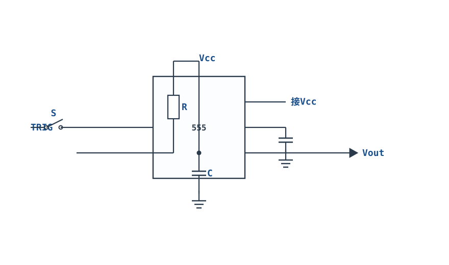
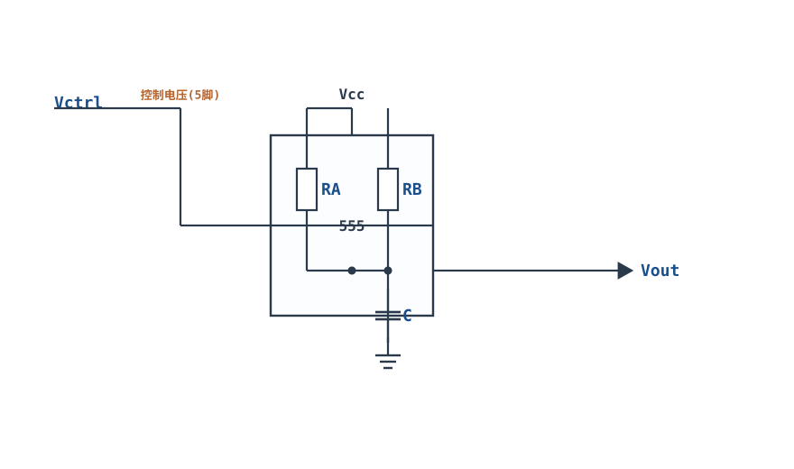
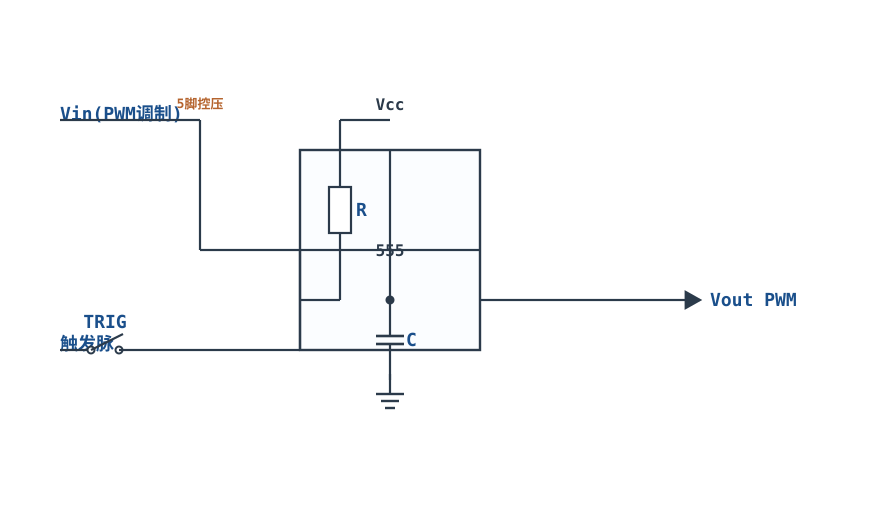
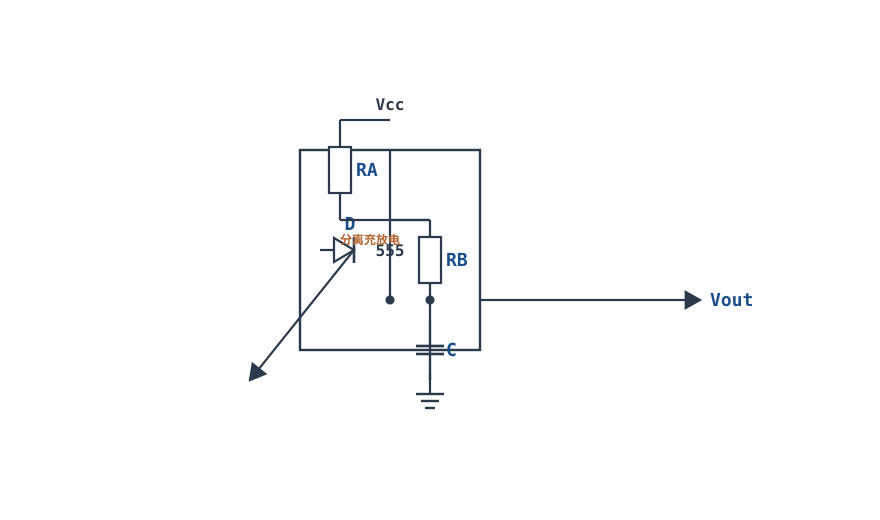

# 555 定时器典型应用 555 Timer

## 1. 设计动机

::: motivation 为什么需要 555
要产生一个固定宽度的脉冲、或让 LED 每秒闪一次、或发出 1kHz 提示音，往往不需要 MCU。**555 定时器（555 Timer）**是一颗只有 8 个脚、几毛钱、却能精确产生时间基准的经典芯片——单稳态做"定时/延时"，无稳态做"方波/振荡"，是模拟与数字之间最常用的接口器件。
:::

## 2. 原理图

**内部框图**：三个 5kΩ 电阻分压出两个阈值（$\frac{2}{3}V_{CC}$ 和 $\frac{1}{3}V_{CC}$），两个比较器控制一个 RS 触发器，触发器输出经推挽级输出，并驱动放电三极管（DIS 脚）。


**外部典型接法（无稳态）**：Vcc 经 R_A 到 DIS 脚（7），DIS 脚经 R_B 到 THRES(6)/TRIG(2) 并接电容 C 到地。

## 3. 静态分析（DC）

- 三个 5kΩ 分压把内部阈值固定为 $\frac{2}{3}V_{CC}$（上限，接 THRES 脚的比较器同相端）和 $\frac{1}{3}V_{CC}$（下限，接 TRIG 脚的比较器反相端）。
- 输出由 RS 触发器状态决定：高/低电平接近电源轨（推挽输出，可灌/拉约 200mA）。
- DIS 脚内部是一只 NPN 三极管的集电极，输出低时导通、把电容放电；输出高时截止。

## 4. 动态分析（AC / 瞬态）

**单稳态（Monostable，单触发定时）**：TRIG 脚输入一个负脉冲触发，输出变高并维持：

$$t_{high}=1.1\,R\,C$$

时间到后输出自动变低、DIS 导通把电容放光。一个触发一个固定宽度脉冲。

**无稳态（Astable，多谐振荡）**：电容在 $\frac{1}{3}V_{CC}$ 与 $\frac{2}{3}V_{CC}$ 之间反复充放电：

$$t_{high}=0.693(R_A+R_B)C,\quad t_{low}=0.693\,R_B\,C$$

$$T=0.693(R_A+2R_B)C,\qquad f=\frac{1.44}{(R_A+2R_B)C}$$

占空比（Duty Cycle）：

$$D=\frac{R_A+R_B}{R_A+2R_B}$$

下面是无稳态时电容电压（在两阈值间指数充放电）与输出方波的波形：

```echarts
{
  "tooltip": {"trigger": "axis"},
  "legend": {"data": ["电容电压 Vc","输出 Vout","上限 2/3Vcc","下限 1/3Vcc"], "bottom": 0, "textStyle": {"fontSize": 12}},
  "grid": {"left": 56, "right": 24, "top": 26, "bottom": 58},
  "xAxis": {"type": "category", "name": "时间", "data": [0,1,2,3,4,5,6,7,8,9,10,11,12,13,14,15,16,17,18,19,20], "axisLabel": {"fontSize": 10}},
  "yAxis": {"type": "value", "name": "V", "min": 0, "max": 5, "interval": 1.25, "axisLabel": {"fontSize": 11}},
  "series": [
    {"name": "电容电压 Vc", "type": "line", "smooth": true, "showSymbol": false, "lineStyle": {"width": 2.4, "color": "#1a4f8b"},
     "data": [1.67,2.0,2.3,2.55,2.78,2.95,3.1,3.2,3.28,3.32,3.33,3.0,2.75,2.55,2.38,2.25,2.13,2.03,1.95,1.88,1.82]},
    {"name": "输出 Vout", "type": "line", "step": "end", "showSymbol": false, "lineStyle": {"width": 2.4, "color": "#b5642e"},
     "data": [5,5,5,5,5,5,5,5,5,5,0,0,0,0,0,0,0,0,0,0,0]},
    {"name": "上限 2/3Vcc", "type": "line", "showSymbol": false, "lineStyle": {"width": 1.4, "type": "dashed", "color": "#b03030"},
     "data": [3.33,3.33,3.33,3.33,3.33,3.33,3.33,3.33,3.33,3.33,3.33,3.33,3.33,3.33,3.33,3.33,3.33,3.33,3.33,3.33,3.33]},
    {"name": "下限 1/3Vcc", "type": "line", "showSymbol": false, "lineStyle": {"width": 1.4, "type": "dashed", "color": "#4f9e63"},
     "data": [1.67,1.67,1.67,1.67,1.67,1.67,1.67,1.67,1.67,1.67,1.67,1.67,1.67,1.67,1.67,1.67,1.67,1.67,1.67,1.67,1.67]}
  ]
}
```

## 5. 环路分析

555 内部是一个**由阈值比较器 + 触发器构成的松弛振荡器（Relaxation Oscillator）**：电容电压在两个阈值间来回，比较器反复翻转触发器。

- 它不是线性负反馈，而是**施密特式正反馈**：一旦电容碰到上限，触发器立刻翻、DIS 导通开始放电；碰到下限又翻回来。
- 频率精度由外接 R、C 决定（±5% 量级），电容温漂直接变成频率温漂。
- 要占空比严格 50%，经典接法做不到（$R_A$ 必须 ≥0，占空比 >50%）；需在 DIS 脚并联二极管让充放电路径分开，或换 CMOS 7555。

::: advanced 进阶：占空比为什么大于 50%
无稳态中充电电流要经过 $R_A+R_B$，放电只经过 $R_B$，所以高电平时间 $0.693(R_A+R_B)C$ 必然大于低电平时间 $0.693 R_B C$，占空比 $>50\%$。想接近 50%，在 DIS 脚并联一只硅二极管：充电走 $R_A+$二极管、放电走 $R_B$，再令 $R_A\approx R_B$ 即可。
:::

## 6. 元件取值与工程权衡

- **电容选值**：定时电容 C 是精度关键。长延时（秒级）用铝电解（注意漏电、温漂）；短延时/振荡用 C0G 或薄膜。**不要用高漏电电容做长定时**——漏电会改变实际时间。
- **电阻数量级**：R 取 1kΩ~1MΩ。太大则 DIS 放电电流太小、阈值不准；太小则功耗大。
- **控制脚（5 脚）**：通常接一个 10nF 电容到地滤波，必要时可外加电压改变阈值。
- **电源去耦**：Vcc 脚就近接 100nF 去耦，否则电源纹波会调制输出频率。
- **CMOS 版 7555**：功耗低、宽电压（2~18V）、输出轨到轨，适合电池设备。

## 7. 完整设计示例

::: example 做一个 f≈1kHz、占空比≈50% 的方波发生器
1. **需求**：驱动蜂鸣器，频率约 1kHz。
2. **选 C**：取 C=10nF（C0G）。
3. **选 R_A、R_B**：先试 $R_A=1\text{k}\Omega$、$R_B=47\text{k}\Omega$。
4. **算周期**：$T=0.693(R_A+2R_B)C=0.693\times(1\text{k}+94\text{k})\times10\text{n}=0.693\times950\mu\text{s}\approx658\mu\text{s}$，$f=1/T\approx1.52\text{kHz}$。
5. **算占空比**：$D=(R_A+R_B)/(R_A+2R_B)=48/95\approx50.5\%$。
6. **调整**：若要更接近 1kHz，增大 C 到 15nF，则 $T\approx987\mu\text{s}$，$f\approx1.01\text{kHz}$。
7. **单稳态对照**：若要一个 1s 延时脉冲，$t=1.1RC=1\text{s}$，取 $C=10\mu\text{F}$，则 $R=1/(1.1\times10\mu)\approx91\text{k}\Omega$。
:::

## 8. 仿真与实验

LTspice 用 555 行为模型或搭等价比较器电路：
- 无稳态：瞬态仿真数 ms，观察电容电压指数充放电、输出方波；用频率计核对 f；
- 改变 R_B，观察频率和占空比同时变化；
- 单稳态：TRIG 脚加按键负脉冲，观察输出固定宽度高电平；
- 实物：面包板搭无稳态，接 LED+电阻，观察闪烁；接压电蜂鸣器听音调。

## 扩展与变种电路

### 扩展1：单稳态（去抖/定时）Monostable

一个触发脉冲产生一个固定宽度的输出脉冲——用于按键去抖、延时、脉冲展宽，是 555 最常用的定时形态。



::: example 工作原理/静态分析
TRIG 脚输入负脉冲后，输出变高，内部 DIS 截止，$V_{CC}$ 经 $R$ 给 $C$ 充电；当 $V_C$ 升到 $\frac{2}{3}V_{CC}$，输出自动变低、DIS 导通放光电容：

$$t_{high}=1.1\,RC$$
:::

取值：1s 延时取 $C=10\mu\text{F}$、$R=91\text{k}\Omega$；长定时用低漏电电容。

::: pitfall 触发脉太窄
触发脉冲必须比输出脉宽窄，且下次触发要等定时结束；连续触发会被"记忆"丢弃。
:::

### 扩展2：压控振荡器 VCO

在控制脚（5 脚）外加电压，改变内部上下阈值，从而用电压控制振荡频率——这是调频、频率合成的基础。



::: example 工作原理/静态分析
5 脚外加控制电压 $V_C$ 后，上限阈值变为 $V_C$、下限变为 $V_C/2$，充放电时间随之改变，频率成为 $V_C$ 的函数。
:::

取值：控制脚经 10nF 电容滤波；电压调节范围决定频率线性范围。

::: pitfall 控制脚悬空
5 脚悬空会拾取噪声，频率抖动。不用时必须接 10nF 到地。
:::

### 扩展3：脉宽调制 PWM

把单稳态的定时起点由输入信号控制，输出脉宽随控制电压变化——PWM 用于开关电源、电机调速、D 类功放。



::: example 工作原理/静态分析
周期由触发信号固定，脉宽由 5 脚控制电压决定：控制电压越高，上限阈值越高，$C$ 充到阈值的时间越长，输出脉宽越宽。
:::

取值：触发频率为载波频率；控制电压为调制信号。

::: pitfall 载波与调制带宽匹配
载波频率必须远高于调制信号最高频率，否则 PWM 解调后失真。
:::

### 扩展4：占空比可调无稳态（二极管分离充放电）Adjustable-Duty Astable

在 DIS 脚并联二极管，让充电走 $R_A$、放电走 $R_B$，两条路径分开，即可得到接近 50% 甚至任意占空比的方波。



::: example 工作原理/静态分析
$$t_{high}=0.693\,R_A C,\quad t_{low}=0.693\,R_B C,\quad D=\frac{R_A}{R_A+R_B}$$

令 $R_A\approx R_B$ 即可得 $D\approx 50\%$；调两个电阻即可连续改变占空比而频率近似不变。
:::

取值：二极管用硅开关管；频率 $f=1.44/[(R_A+R_B)C]$。

::: pitfall 二极管压降不对称
硅管 0.7V 压降会使充放电阈值略有不对称，50% 占空比需微调 $R_A,R_B$。
:::


## 9. 常见坑与故障现象

::: pitfall 常见坑
- **定时时间明显偏长/偏短**：用了漏电大的电解电容，或电阻取到 MΩ 以上。解决：换低漏电 C0G/薄膜，R 控制在 1k~1MΩ。
- **频率随温度/电压飘**：电容温漂大、电源去耦不足。解决：选温漂小电容，Vcc 就近加 100nF。
- **占空比做不到 50%**：经典无稳态必然 >50%。解决：DIS 脚并联二极管分离充放电路径。
- **输出频率不稳/抖动**：控制脚（5）悬空拾取噪声，或电源纹波大。解决：5 脚接 10nF 到地。
- **复位脚（4）没接**：悬空可能被噪声误复位，输出恒低。解决：RESET 脚接 Vcc（不用时）。
:::

## 10. 自测题

<details><summary>单稳态 555，R=100kΩ、C=10µF，输出高电平持续多久？</summary>

$t_{high}=1.1RC=1.1\times100\text{k}\times10\mu=1.1\times1\text{s}=$ **1.1s**。

</details>

<details><summary>无稳态 R_A=1kΩ、R_B=50kΩ、C=10nF，振荡频率约多少？</summary>

$T=0.693(R_A+2R_B)C=0.693\times101\text{k}\times10\text{n}\approx699\mu\text{s}$，$f=1/T\approx$ **1.43kHz**。

</details>

<details><summary>为什么经典 555 无稳态的占空比一定大于 50%？</summary>

充电要经过 $R_A+R_B$，放电只经过 $R_B$，高电平时间天然比低电平长。要 50% 必须给放电单独走捷径（二极管旁路 $R_A$）。

</details>

## 11. 参考资料

- NE555 / LC555 数据手册（Texas Instruments）
- Horowitz & Hill, *The Art of Electronics* (3rd Ed.)，555 定时器章节
- Scherz & Monk, *Practical Electronics for Inventors* (4th Ed.)，555 应用图解
