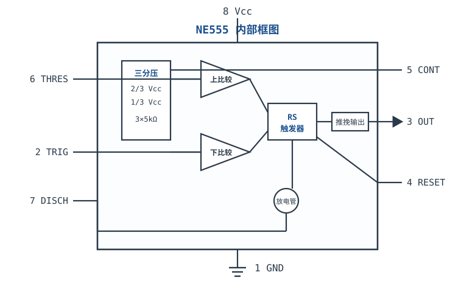
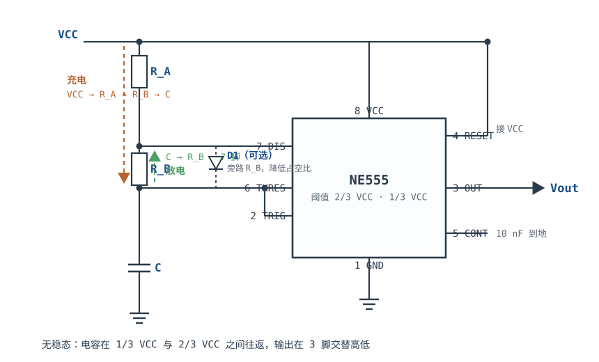

# 555 定时器典型应用 555 Timer

555 是一颗只有 8 个引脚、内部只有**两个比较器、一个 RS 触发器、一只放电管**的芯片，却几乎出现在各种需要"定时"或"方波"的地方：按键去抖、延时开关、LED 闪烁、蜂鸣器音调、PWM 调速、甚至开关电源的早期原型。

它好用的原因不是"功能多"，而是**把模拟阈值和数字记忆装进了同一个封装**：两个比较器盯住电容电压，触发器记住当前状态，放电管决定电容充还是放。你只需要在外面接一只电阻、一只电容，就能把时间常数翻译成脉冲宽度或振荡频率。

但它也有两个必须提前算清楚的硬限制：**标准无稳态接法在 $R_A>0$ 时占空比只能大于 50%**，以及**输出换向时会在电源上拉出很大的电流尖峰**。这两条不是"用法问题"，是 NE555 内部结构决定的；设计前不知道，样机上就会遇到"占空比调不到 50%"和"一接上 555，MCU 就复位"这两类经典故障。振荡器的一般原理见[振荡器：文氏桥与晶体振荡](oscillators.md)；RC 时间常数与充放电见[电容与 RC 电路](../basics/capacitor-rc.md)；数字系统对时钟与复位的要求见[时钟与复位设计](../digital/clock-reset-design.md)。

## 1. 设计动机

::: motivation 三个真实场景
**场景一：按键按一下，输出一个 100 µs 的干净脉冲。** 机械按键的抖动持续几毫秒，MCU 用软件消抖要占用中断和定时器；用 555 单稳态，$R=9.1\ \text{k}\Omega$、$C=10\ \text{nF}$，输出脉宽 $t=1.1RC=100\ \mu\text{s}$，触发一次只出一个脉冲，后级电路拿到的是干净的边沿。**单稳态的价值是"把抖动变成确定宽度"。**

**场景二：给散热风扇做 10 kHz、60% 占空比的 PWM。** 555 无稳态直接输出方波，外部只需要两个电阻、一只电容；但 $R_A$ 不能取 0（会短路放电管），取 $R_A=1\ \text{k}\Omega$、$R_B=100\ \text{k}\Omega$，占空比也只有 50.3%，而且 $R_A$ 越小，放电管和 $R_A$ 上的功耗越大。**标准接法的占空比下限是 50%（$R_A\to0$ 的极限），不是"调一调就能到"。**

**场景三：555 直接驱动一只 100 mA 的 LED，结果 MCU 偶尔复位。** 示波器看电源，输出翻转瞬间有一个几十到上百 mA、几十纳秒的尖峰，地弹把 MCU 的复位脚拉低。**555 的输出级在换向瞬间有直通电流，数据手册的静态电源电流不包含它；没有就近去耦，这个尖峰就会跑到整块板上。**
:::

把这三个场景压成一张表：

| 你想做 | 用哪个模式 | 先算 | 判据 |
|---|---|---|---|
| 定一个固定宽度的脉冲 | 单稳态 | $t=1.1RC$ | 脉宽误差在预算内，触发脉宽小于输出脉宽 |
| 产生连续方波 | 无稳态 | $f=1.44/[(R_A+2R_B)C]$ | 频率、占空比都在目标内 |
| 做 50% 方波 | 无稳态 + 二极管，或换拓扑 | 充放电路径是否分开 | 占空比误差 < 目标 |
| 驱动 LED/继电器 | 任意模式 | $I_{out}$、$V_{OH}$、封装功耗 | 不超过数据手册的电流与功耗 |
| 长延时（秒级） | 单稳态 | $t=1.1RC$、电容漏电 | $R\leq1\ \text{M}\Omega$，用低漏电电容 |
| 电源干净 | 任意模式 | 尖峰电流与去耦阻抗 | 电源纹波 < 后级容限 |

**不懂会在哪摔跤**，四个带数字的代价：

1. **以为占空比可以调到 50%。** 标准无稳态的 $D=(R_A+R_B)/(R_A+2R_B)$，$R_A>0$ 时恒大于 50%；$R_A=0$ 又会把 VCC 直接加到 DIS 脚，放电管电流失控。要 50% 必须让充放电路径分开。
2. **忽略频率误差。** 1% 电阻加 5% 电容，频率误差就有 ±6%；再叠加阈值公差和传播延迟，10 kHz 设计实际可能在 9.4~10.6 kHz。**555 不是精密时钟源。**
3. **用高漏电电解电容做长延时。** 10 µF 电解的漏电可能让 $t=1.1RC$ 偏 10% 以上，而且随温度变；秒级定时要么用薄膜电容，要么用计数器分频。
4. **不去耦。** 555 输出 100 mA 边沿在 100 nH 走线上产生 $L\,\mathrm{d}i/\mathrm{d}t$ 压降，按 200 mA/20 ns 算是 1 V 地弹——足够让同一块板上的数字电路误动作。

## 2. 定义与直观

### 2.1 内部结构：两个比较器、一个触发器、一只放电管

555 的内部可以拆成四块：

1. **分压网络**：三个 $5\ \text{k}\Omega$ 电阻串在 VCC 与 GND 之间，分出 $2/3V_{CC}$ 和 $1/3V_{CC}$ 两个阈值。5 脚（CONT）就是 $2/3V_{CC}$ 这个节点，外接电容可以滤波，外加电压可以改变阈值。
2. **两个比较器**：上比较器比较 6 脚（THRES）与 $2/3V_{CC}$，超过就复位触发器；下比较器比较 2 脚（TRIG）与 $1/3V_{CC}$，低于就置位触发器。
3. **RS 触发器**：记住当前是"高"还是"低"。上比较器置"低"，下比较器置"高"；4 脚（RESET）可以强制置低。
4. **输出级与放电管**：触发器驱动推挽输出（3 脚），同时驱动一只 NPN 放电管（7 脚，DIS）。输出低时放电管导通，把 7 脚拉到地；输出高时放电管截止。



分压网络的电流是 $V_{CC}/15\ \text{k}\Omega$：5 V 时 $333\ \mu\text{A}$，15 V 时 $1\ \text{mA}$。这部分电流是 555 静态电流的主要成分之一；CMOS 版（如 TLC555）把分压电阻做大，静态电流降到 $100\ \mu\text{A}$ 量级。

### 2.2 三种工作模式

555 的绝大多数应用都可以归到三种模式：

| 模式 | 外部接法 | 输出行为 | 典型用途 |
|---|---|---|---|
| 单稳态（Monostable） | TRIG 接触发源，7 脚经 $R$ 接 VCC，6/7 脚接 $C$ 到地 | 每来一个触发，输出高 $t=1.1RC$，然后自动回低 | 延时、脉冲展宽、按键去抖、缺相检测 |
| 无稳态（Astable） | $R_A$、$R_B$、$C$ 接成充放电回路，2/6 脚接电容 | 自由振荡，频率 $f=1.44/[(R_A+2R_B)C]$ | 方波、蜂鸣器、LED 闪烁、PWM |
| 双稳（Bistable） | TRIG 置位、THRES 复位，不接定时元件 | 触发器记忆，置位后保持到复位 | 触摸开关、比较器、去抖锁存 |

三种模式的共同点是**阈值固定为 $2/3V_{CC}$ 与 $1/3V_{CC}$**，区别只在于外部电容有没有充放电回路、以及触发信号从哪来。

### 2.3 两个阈值 + 一个记忆：水箱模型

把 555 想成一个带两只浮球开关的水箱：

- **下浮球（TRIG，$1/3V_{CC}$）**：水位低于它时，打开进水阀（输出变高、放电管关闭），开始注水。
- **上浮球（THRES，$2/3V_{CC}$）**：水位高于它时，关闭进水阀、打开排水阀（输出变低、放电管导通），开始放水。
- **记忆（RS 触发器）**：两个浮球之间没有开关，水位在中间时保持上一次的状态——这就是"迟滞"。

这个模型解释了三件事：**为什么单稳态的脉宽只由 RC 决定**（从空水箱注到上浮球的时间）、**为什么无稳态的频率由两个阈值之间的充放电时间决定**（在 $1/3V_{CC}$ 与 $2/3V_{CC}$ 之间来回）、**为什么 5 脚能改频率**（把上浮球的位置抬高或压低，两个阈值一起变）。

类比的边界：真实水箱的浮球是机械的，555 的比较器有输入偏置电流和传输延迟；水位变化很快时（高频），延迟会让实际频率低于公式值。另一个边界：水箱的进水阀是线性的，555 的放电管有饱和压降，放电终点的电压不是 0 而是几十毫伏——低频时影响很小，低电源电压、长占空比时要算进去。

### 2.4 无稳态的外部接法：充电与放电不是同一条路

无稳态的标准接法：VCC 经 $R_A$ 到 7 脚（DIS），7 脚再经 $R_B$ 到 6/2 脚（THRES/TRIG 短接），6/2 脚经电容 $C$ 到地。



关键在于**充电和放电走过的电阻不同**：

- **充电**：输出高 → 放电管截止 → 7 脚悬空 → 电流从 VCC 经 $R_A$、再经 $R_B$ 流入 $C$。充电时间常数是 $(R_A+R_B)C$。
- **放电**：输出低 → 放电管导通 → 7 脚被拉到地 → $C$ 上的电荷经 $R_B$ 流入 7 脚。放电时间常数是 $R_BC$。

充电多走了 $R_A$，所以高电平时间天然比低电平长。**这不是元件取值的问题，是 NE555 的放电路径只有一条（经过 $R_B$）造成的结构限制**；下一节把它写成公式，并说明二极管旁路怎么绕过它、以及为什么换 CMOS 版并不能自动解决。

## 3. 定量关系

### 3.1 单稳态：$t=1.1RC$ 的来历

单稳态触发后，放电管截止，$C$ 从 0 V 开始经 $R$ 向 VCC 充电（忽略放电管饱和压降和比较器偏置）：

$$V_C(t)=V_{CC}\left(1-e^{-t/(RC)}\right)$$

当 $V_C$ 达到上阈值 $2V_{CC}/3$ 时，上比较器复位触发器，输出回低、放电管导通，$C$ 迅速放电到 0。令 $V_C(t)=2V_{CC}/3$：

$$1-e^{-t/(RC)}=\frac{2}{3}\ \Longrightarrow\ e^{-t/(RC)}=\frac{1}{3}\ \Longrightarrow\ t=RC\ln3$$

$$\ln3=1.0986\ \Longrightarrow\ t\approx1.1\,RC$$

其中 $t$ 是输出高电平时间（s）；$R$ 是定时电阻（$\Omega$）；$C$ 是定时电容（F）。**$1.1$ 是 $\ln3$ 的四舍五入，不是经验系数**；要更准就用 $1.0986$。

单稳态的三个工程要点：

1. **触发脉宽必须小于输出脉宽。** 触发信号把下比较器拉低、置位触发器；如果触发一直保持低，触发器被"按住"，输出会一直高到触发释放，脉宽就不再由 $RC$ 决定。按键触发要加微分网络（如 $10\ \text{nF}$ 串 $10\ \text{k}\Omega$），把长按变成窄脉冲。
2. **触发脚要上拉。** 2 脚平时必须高于 $1/3V_{CC}$，否则会被噪声误触发；用 $10\ \text{k}\Omega$ 上拉到 VCC 是常见做法。
3. **复位脚不能悬空。** 4 脚低电平有效，悬空时可能被噪声拉低，输出一直低；不用时直接接 VCC。

### 3.2 无稳态：充放电时间与频率

充电从 $V_{CC}/3$ 到 $2V_{CC}/3$，时间常数 $(R_A+R_B)C$，终值是 $V_{CC}$：

$$V_C(t)=V_{CC}-\left(V_{CC}-\frac{V_{CC}}{3}\right)e^{-t/[(R_A+R_B)C]}=V_{CC}-\frac{2V_{CC}}{3}e^{-t/[(R_A+R_B)C]}$$

令 $V_C=2V_{CC}/3$：

$$\frac{2}{3}=1-\frac{2}{3}e^{-t_h/[(R_A+R_B)C]}\ \Longrightarrow\ e^{-t_h/[(R_A+R_B)C]}=\frac{1}{2}$$

$$t_h=(R_A+R_B)C\ln2=0.693(R_A+R_B)C$$

放电从 $2V_{CC}/3$ 到 $V_{CC}/3$，时间常数 $R_BC$，终值是 0：

$$V_C(t)=\frac{2V_{CC}}{3}e^{-t/(R_BC)}\ \Longrightarrow\ \frac{1}{3}=\frac{2}{3}e^{-t_l/(R_BC)}\ \Longrightarrow\ t_l=R_BC\ln2=0.693R_BC$$

所以周期、频率与占空比分别是

$$T=t_h+t_l=0.693(R_A+2R_B)C$$

$$f=\frac{1}{T}=\frac{1.44}{(R_A+2R_B)C}$$

$$D=\frac{t_h}{T}=\frac{R_A+R_B}{R_A+2R_B}$$

其中 $t_h$ 是高电平时间（s），$t_l$ 是低电平时间（s），$T$ 是周期（s），$f$ 是频率（Hz），$D$ 是占空比（无量纲，0~1）。**$1.44$ 是 $1/\ln2=1.4427$ 的四舍五入**；用 $1.44$ 算出来的频率比精确值低约 $0.19\%$，做预算时可以忽略，做精密设计时要写 $1/\ln2$。

把 §4.1 的设计值（$R_A=12\ \text{k}\Omega$、$R_B=24\ \text{k}\Omega$、$C=2.4\ \text{nF}$、$V_{CC}=5\ \text{V}$）代进去：电容电压在 $1.667\ \text{V}$ 与 $3.333\ \text{V}$ 之间指数充放电，输出在 3 脚交替高低，高电平 $59.89\ \mu\text{s}$、低电平 $39.93\ \mu\text{s}$、周期 $99.81\ \mu\text{s}$。下图的两条曲线就是这两个时间段的解，数据点由 §3.2 的充放电公式逐点算出：

```echarts
{
  "tooltip": {"trigger": "axis"},
  "legend": {"data": ["Vc 电容电压", "Vout 输出", "上限 2/3 VCC", "下限 1/3 VCC"], "bottom": 0, "textStyle": {"fontSize": 12}},
  "grid": {"left": 58, "right": 24, "top": 26, "bottom": 58},
  "xAxis": {"type": "category", "name": "时间 / µs", "data": ["0","2.5","5","7.5","10","12.5","15","17.5","20","22.5","25","27.4","29.9","32.4","34.9","37.4","39.9","42.4","44.9","47.4","49.9","52.4","54.9","57.4","59.9","62.4","64.9","67.4","69.9","72.4","74.9","77.4","79.9","82.3","84.8","87.3","89.8","92.3","94.8","97.3","99.8"], "axisLabel": {"fontSize": 10, "interval": 4}},
  "yAxis": {"type": "value", "name": "电压 / V", "min": 0, "max": 5.5, "interval": 1, "axisLabel": {"fontSize": 11}},
  "series": [
    {"name": "Vc 电容电压", "type": "line", "smooth": true, "showSymbol": false, "lineStyle": {"width": 2.6, "color": "#1a4f8b"},
     "data": [1.667,1.762,1.854,1.943,2.03,2.115,2.197,2.277,2.354,2.43,2.503,2.574,2.643,2.71,2.775,2.839,2.9,2.96,3.018,3.074,3.129,3.182,3.234,3.284,3.333,3.192,3.057,2.927,2.803,2.684,2.57,2.461,2.357,2.257,2.161,2.07,1.982,1.898,1.818,1.74,1.667]},
    {"name": "Vout 输出", "type": "line", "step": "end", "showSymbol": false, "lineStyle": {"width": 2.2, "color": "#b5642e"},
     "data": [5,5,5,5,5,5,5,5,5,5,5,5,5,5,5,5,5,5,5,5,5,5,5,5,0,0,0,0,0,0,0,0,0,0,0,0,0,0,0,0,5]},
    {"name": "上限 2/3 VCC", "type": "line", "showSymbol": false, "lineStyle": {"width": 1.4, "type": "dashed", "color": "#b03030"},
     "data": [3.333,3.333,3.333,3.333,3.333,3.333,3.333,3.333,3.333,3.333,3.333,3.333,3.333,3.333,3.333,3.333,3.333,3.333,3.333,3.333,3.333,3.333,3.333,3.333,3.333,3.333,3.333,3.333,3.333,3.333,3.333,3.333,3.333,3.333,3.333,3.333,3.333,3.333,3.333,3.333,3.333]},
    {"name": "下限 1/3 VCC", "type": "line", "showSymbol": false, "lineStyle": {"width": 1.4, "type": "dashed", "color": "#4f9e63"},
     "data": [1.667,1.667,1.667,1.667,1.667,1.667,1.667,1.667,1.667,1.667,1.667,1.667,1.667,1.667,1.667,1.667,1.667,1.667,1.667,1.667,1.667,1.667,1.667,1.667,1.667,1.667,1.667,1.667,1.667,1.667,1.667,1.667,1.667,1.667,1.667,1.667,1.667,1.667,1.667,1.667,1.667]}
  ]
}
```

### 3.3 为什么标准接法的占空比降不到 50%

把占空比公式改写：

$$D=\frac{R_A+R_B}{R_A+2R_B}=\frac{1}{2}+\frac{R_A}{2(R_A+2R_B)}$$

因为 $R_A>0$、$R_B>0$，第二项恒为正，所以

$$D>\frac{1}{2}\quad\text{（只要 }R_A>0\text{）}$$

而且

$$\frac{\mathrm{d}D}{\mathrm{d}R_A}=\frac{R_B}{(R_A+2R_B)^2}>0$$

$R_A$ 越大，占空比越大；$R_A\to0$ 时 $D\to50\%$，$R_A\to\infty$ 时 $D\to100\%$。**注意 $R_A=0$ 不是可用状态**：输出低时放电管把 7 脚拉到地，$R_A=0$ 等于把 VCC 直接短路到放电管，电流只受放电管和电源内阻限制，会损坏芯片。所以工程上 $R_A$ 至少取几百欧到 $1\ \text{k}\Omega$，对应的最低占空比略高于 50%。

例如 $R_B=100\ \text{k}\Omega$、$R_A=1\ \text{k}\Omega$：

$$D=\frac{1+100}{1+200}=\frac{101}{201}=50.25\%$$

要让 $D$ 到 51%，由 $D=1/2+R_A/[2(R_A+2R_B)]=0.51$ 解出 $R_A\approx0.041R_B$，即 $R_B=100\ \text{k}\Omega$ 时 $R_A\approx4.1\ \text{k}\Omega$。**占空比越接近 50%，$R_A$ 越小，放电管和 $R_A$ 上的静态功耗越大。**

**解决办法一：二极管旁路 $R_B$。** 在 7 脚与 6 脚之间接一只二极管（阳极在 7 脚、阴极在 6 脚），充电时电流走 $R_A$ 和二极管，绕过 $R_B$；放电时二极管反偏，电流仍走 $R_B$。理想情况下

$$t_h=0.693R_AC,\qquad t_l=0.693R_BC,\qquad D=\frac{R_A}{R_A+R_B},\qquad f=\frac{1.44}{(R_A+R_B)C}$$

令 $R_A=R_B$ 就得到 50%，调 $R_A/R_B$ 可以在 0~100% 之间连续改变占空比，频率近似不变。**但这组公式忽略了二极管压降**：充电的终值不是 $V_{CC}$，而是 $V_{CC}-V_D$。精确式是

$$t_h=R_AC\ln\frac{\frac{2}{3}V_{CC}-V_D}{\frac{1}{3}V_{CC}-V_D}$$

以 $V_{CC}=5\ \text{V}$、$V_D=0.7\ \text{V}$ 代入：

$$t_h=R_AC\ln\frac{3.333-0.7}{1.667-0.7}=R_AC\ln\frac{2.633}{0.967}=1.002R_AC$$

比理想的 $0.693R_AC$ 长了 **44.6%**！放电侧还要算放电管的饱和压降 $V_{CE(sat)}\approx0.1\ \text{V}$：

$$t_l=R_BC\ln\frac{\frac{2}{3}V_{CC}-V_{CE(sat)}}{\frac{1}{3}V_{CC}-V_{CE(sat)}}=R_BC\ln\frac{3.233}{1.567}=0.725R_BC$$

比理想值长 4.5%。所以 $R_A=R_B$、$V_{CC}=5\ \text{V}$ 时，实际占空比是

$$D=\frac{1.002}{1.002+0.725}=58.0\%$$

不是 50%。要真正得到 50%，得按 $V_D$ 反解 $R_A/R_B\approx0.723$，或者提高 $V_{CC}$（15 V 时 $t_h=0.771R_AC$、$t_l=0.703R_BC$，$R_A=R_B$ 时 $D=52.3\%$ ），或者用肖特基二极管（$V_D\approx0.3\ \text{V}$）减小误差。**"二极管一接就 50%"是这类电路最常见的过度简化。**

::: advanced 进阶：二极管法的完整误差预算
把二极管压降和放电管饱和压降都算进去，二极管法的周期与占空比是

$$T=R_AC\ln\frac{\frac{2}{3}V_{CC}-V_D}{\frac{1}{3}V_{CC}-V_D}+R_BC\ln\frac{\frac{2}{3}V_{CC}-V_{CE(sat)}}{\frac{1}{3}V_{CC}-V_{CE(sat)}}$$

$$D=\frac{t_h}{t_h+t_l}$$

在 $V_{CC}=5\ \text{V}$ 下，$V_D$ 每变化 $0.1\ \text{V}$，$t_h$ 变化约 $6\%$；温度每升高 $1^{\circ}\text{C}$，硅二极管的正向压降下降约 $2\ \text{mV}$，对应 $t_h$ 变化约 $0.1\%/^{\circ}\text{C}$。所以二极管法的占空比会随温度漂移，**不适合做精密 50% 时钟**；它的优势是便宜、能连续调占空比，适合 LED 调光、风扇调速这类对绝对精度不敏感的场合。

如果一定要精确 50%，有三个方向：提高 $V_{CC}$ 让 $V_D/V_{CC}$ 变小、用肖特基二极管、或者改用充放电路径天然对称的拓扑（如 CMOS 门电路构成的方波振荡器、或 MCU 的 PWM 外设）。
:::

**关于"改用 CMOS 型"的澄清。** 这里要澄清一个常见说法：**换 CMOS 555（如 TLC555）并不能自动把占空比变成 50%**。CMOS 版的内部框图与双极型相同——同样是 $2/3V_{CC}$、$1/3V_{CC}$ 两个阈值，同样是 7 脚放电管，标准三电阻接法的充放电路径没有变，$D=(R_A+R_B)/(R_A+2R_B)$ 仍然大于 50%。CMOS 版真正改善的是：静态电流（$100\ \mu\text{A}$ 量级 vs 几 mA）、输出摆幅（更接近电源轨）、最高工作频率（可到 MHz 量级）、以及放电管的饱和压降（几十 mV vs 0.1 V 量级）。**放电管饱和压降更低，会让 $t_l$ 的修正项变小，占空比略微更接近 50%，但结构上的 $R_A>0$ 限制仍在。**要精确 50%，仍然要分离充放电路径，或换用别的振荡器拓扑。

### 3.4 频率与占空比的误差来源

555 的定时精度由六类误差叠加：

| 误差源 | 典型量级 | 说明 |
|---|---|---|
| 电阻容差 | ±1%（1% 金属膜） | 直接进入 $T$，±1% |
| 电容容差 | ±1%（C0G/薄膜）~±20%（电解） | 直接进入 $T$，是最大的一项 |
| 阈值容差 | ±1%~±2% | 内部比较器与分压比，随温度和电源变 |
| 放电管饱和压降 | 0.1 V 量级（双极型） | 让 $t_l$ 偏长，低压时更明显 |
| 传播延迟 | 0.5~1 µs/次翻转 | 10 kHz（100 µs 周期）时约 1%~2% |
| 电容漏电 | 随介质与温度变 | 长延时（秒级）时不可忽略 |

把 1% 电阻和 5% 电容代进去，频率的最坏误差约

$$\frac{\Delta f}{f}\le1\%+5\%=6\%\ \text{（最坏）},\qquad \sqrt{(1\%)^2+(5\%)^2}=5.1\%\ \text{（RSS）}$$

再加上阈值和延迟，10 kHz 设计实际可能落在 $9.5\sim10.5\ \text{kHz}$。**555 的频率精度是"百分比"级，不是"ppm"级**；要 ppm 级请用晶体振荡器（见[晶振与谐振器](../components/crystal-oscillator.md)）。

### 3.5 输出驱动能力与电源电流尖峰

**输出驱动。** NE555 的输出是推挽级，数据手册给出的最大灌/拉电流约 $200\ \text{mA}$（具体以数据手册的绝对最大额定值和测试条件为准）。但"能拉 200 mA"不等于"输出是理想开关"：

- 拉电流时，高电平 $V_{OH}$ 比 VCC 低；负载电流越大，低得越多。5 V 电源、100 mA 负载时，$V_{OH}$ 可能只有 3.3 V 左右（典型量级，以数据手册的 $V_{OH}$-$I_{OH}$ 曲线为准）。
- 灌电流时，低电平 $V_{OL}$ 接近地，但仍有几十到几百 mV。
- 封装功耗 = 输出管压降 × 负载电流 + 静态功耗。15 V 电源、200 mA 输出、压降 10 V 时就是 2 W，远超 8 脚封装的自然散热能力；**高电压大电流必须外接三极管/MOSFET，不能指望 555 自己扛**。

**电源电流尖峰。** 555 的输出级在换向瞬间有两条电流路径叠加：

1. **负载电容充电**：输出从低变高时，负载电容（包括探头、电缆、MOSFET 栅极）在很短时间内被充电，电流 $I=C\,\mathrm{d}V/\mathrm{d}t$。$C=1\ \text{nF}$、5 V 边沿 50 ns，就是 $100\ \text{mA}$。
2. **推挽直通**：输出级的上管和下管在换向的极短时间内同时导通，VCC 到 GND 之间出现一条低阻通路，叠加出一个窄而高的尖峰。**这是 NE555 内部结构决定的，不是负载的问题**；数据手册的静态电源电流（几 mA）不包含它。

尖峰的危害不在 555 自己，而在**它经过电源走线和地线时产生的压降**。两条路：

$$V_{spike}=L_{trace}\frac{\mathrm{d}i}{\mathrm{d}t}\quad\text{（走线电感）},\qquad \Delta V=\frac{I\Delta t}{C_{dec}}\quad\text{（去耦电容不够）}$$

取 $L_{trace}=100\ \text{nH}$、$I=200\ \text{mA}$、边沿 20 ns：

$$V_{spike}=100\times10^{-9}\times\frac{0.2}{20\times10^{-9}}=1.0\ \text{V}$$

**1 V 的地弹足够让 3.3 V 逻辑误判。** 如果 555 的电源脚旁边只有一只 100 nF、走线 100 nH，尖峰的大部分会落在去耦电容的引线电感上；正确做法是：

- 100 nF 陶瓷电容**紧贴 1 脚和 8 脚**放置，回路面积最小；
- 再并一只 1~10 µF 的储能电容，放在电源入口，吸收更大的低频电荷；
- 555 的地与数字地单点连接，不要让 555 的放电电流穿过 MCU 的地；
- 输出串一只几十欧的电阻驱动长线/探头，减小充电电流尖峰。

## 4. 典型计算

### 4.1 算例一：10 kHz、60% 占空比的无稳态设计

**需求**：$f=10\ \text{kHz}$、$D=60\%$、VCC=5 V，用 NE555 标准无稳态接法，电阻电容取 E24 系列。

**第 1 步，由占空比定电阻比。** 由 $D=(R_A+R_B)/(R_A+2R_B)=0.6$：

$$R_A+R_B=0.6R_A+1.2R_B\ \Longrightarrow\ 0.4R_A=0.2R_B\ \Longrightarrow\ R_A=0.5R_B$$

**第 2 步，选电容、算电阻。** 取 $C=2.4\ \text{nF}$（E24，C0G 或薄膜）。由 $f=1.44/[(R_A+2R_B)C]$：

$$R_A+2R_B=\frac{1.44}{fC}=\frac{1.44}{10^4\times2.4\times10^{-9}}=\frac{1.44}{2.4\times10^{-5}}=6.0\times10^{4}\ \Omega$$

代入 $R_A=0.5R_B$：

$$0.5R_B+2R_B=2.5R_B=6.0\times10^{4}\ \Longrightarrow\ R_B=2.4\times10^{4}\ \Omega=24\ \text{k}\Omega$$

$$R_A=0.5\times24\ \text{k}\Omega=12\ \text{k}\Omega$$

$12\ \text{k}\Omega$ 和 $24\ \text{k}\Omega$ 都在 E24 系列里，不需要取整。

**第 3 步，用精确公式复算。** $1.44$ 是近似值，精确式用 $\ln2=0.693147$：

$$T=\ln2\,(R_A+2R_B)C=0.693147\times(12+48)\times10^3\times2.4\times10^{-9}$$

$$T=0.693147\times60\times10^3\times2.4\times10^{-9}=9.981\times10^{-5}\ \text{s}=99.81\ \mu\text{s}$$

$$f=\frac{1}{99.81\ \mu\text{s}}=10019\ \text{Hz}=10.019\ \text{kHz}$$

$$t_h=\ln2\,(R_A+R_B)C=0.693147\times36\times10^3\times2.4\times10^{-9}=59.89\ \mu\text{s}$$

$$t_l=\ln2\,R_BC=0.693147\times24\times10^3\times2.4\times10^{-9}=39.93\ \mu\text{s}$$

$$D=\frac{59.89}{59.89+39.93}=\frac{59.89}{99.81}=60.00\%$$

用 $1.44$ 的近似式算出来正好是 10.000 kHz，精确式是 10.019 kHz，差 $0.19\%$——**这就是 $1.44$ 与 $1/\ln2$ 的差别**，比电阻电容的容差小得多，可以忽略，但要知道它从哪来。

**第 4 步，误差校核。** 1% 电阻、5% C0G 电容：

$$\frac{\Delta f}{f}\le6\%\ \Longrightarrow\ f=10.019\ \text{kHz}\times(1\pm6\%)=9.42\sim10.62\ \text{kHz}$$

（若按 RSS 口径 5.1%，区间是 9.51~10.53 kHz；最坏情况必须用 6%，再叠上比较器阈值与传输延迟只会更宽。）

占空比只由电阻比决定，1% 电阻下 $R_A/R_B$ 变化约 ±2%，对应 $D$ 变化约 ±0.16%（绝对值），即 $59.84\%\sim60.16\%$。**频率误差主要来自电容，占空比误差主要来自电阻比。**

**第 5 步，和 10 nF 方案对比。** 如果先选更常见的 $C=10\ \text{nF}$，理想值是 $R_B=5.76\ \text{k}\Omega$、$R_A=2.88\ \text{k}\Omega$；取 E24 的 $5.6\ \text{k}\Omega$、$2.7\ \text{k}\Omega$ 后：

$$T=0.693\times(2.7+11.2)\times10^3\times10\times10^{-9}=96.33\ \mu\text{s},\qquad f=10.38\ \text{kHz}$$

偏高 3.8%。**先选电容再解电阻、并在 E24 网格里搜一遍，比"先算理想值再随便取整"更容易命中目标。** 2.4 nF 不是最常用的容值，但它让 12 kΩ/24 kΩ 这组 E24 电阻刚好落在 10 kHz、60% 上，这就是选它的理由。

**第 6 步，逐项验算**：

| 项目 | 要求 | 计算值 | 判定 |
|---|---|---|---|
| 频率 | 10 kHz | 10.019 kHz（+0.19%） | 通过（远小于 RC 容差） |
| 占空比 | 60% | 60.00% | 通过 |
| 充电时间 | — | 59.89 µs | — |
| 放电时间 | — | 39.93 µs | — |
| 放电峰值电流 | < 数据手册限值 | $3.333\ \text{V}/24\ \text{k}\Omega=139\ \mu\text{A}$ | 通过，余量很大 |
| 充电电流 | — | $(5-1.667)/36\ \text{k}\Omega=92.6\ \mu\text{A}$ | — |
| 频率误差 | 未规定，记录 | ±5.1%（1% R + 5% C） | 可接受；要更准换 1% 薄膜电容 |

**结论**：$R_A=12\ \text{k}\Omega$、$R_B=24\ \text{k}\Omega$、$C=2.4\ \text{nF}$，VCC=5 V，得到 $10.019\ \text{kHz}$、$60.00\%$ 的方波。**实际频率会落在 9.5~10.5 kHz，取决于电容容差；以上是设计值，不是实测保证。**

### 4.2 算例二：1 秒单稳态延时

**需求**：按键触发一次，输出高电平约 1 s，VCC=5 V。

**第 1 步，选电容。** 秒级延时用 $C=10\ \mu\text{F}$ 薄膜或低漏电电解（不要用普通高漏电电解）。由 $t=1.1RC$：

$$R=\frac{t}{1.1C}=\frac{1}{1.1\times10\times10^{-6}}=\frac{1}{1.1\times10^{-5}}=9.09\times10^{4}\ \Omega$$

E24 取 $91\ \text{k}\Omega$。实际延时：

$$t=1.1\times91\times10^3\times10\times10^{-6}=1.001\ \text{s}$$

**第 2 步，校核漏电。** 电容漏电相当于在 $C$ 上并了一只 $R_{leak}$。戴维南等效后，充电终值和时间常数**同时**改变：

$$V_{\infty}=V_{CC}\frac{R_{leak}}{R+R_{leak}},\qquad R_{eq}=R\parallel R_{leak},\qquad \tau=R_{eq}C$$

$$t=R_{eq}C\ln\frac{V_{\infty}}{V_{\infty}-2V_{CC}/3}$$

若 $R_{leak}=10\ \text{M}\Omega$、$R=91\ \text{k}\Omega$：$R_{eq}=90.2\ \text{k}\Omega$、$V_{\infty}=0.991V_{CC}$，$t=1.008\ \text{s}$，比 $1.1RC$ 的 $1.001\ \text{s}$ 只长 $0.7\%$。若 $R_{leak}=1\ \text{M}\Omega$：$R_{eq}=83.4\ \text{k}\Omega$、$V_{\infty}=0.917V_{CC}$，$t=1.083\ \text{s}$，长 $8.2\%$。**只把终值改小、忘了时间常数也变小，会高估漏电的影响**；但 $R_{leak}$ 再小就危险了——若 $R_{leak}=100\ \text{k}\Omega$，$V_{\infty}=0.524V_{CC}<2V_{CC}/3$，电容到不了阈值，输出会一直高。这是漏电最严重的失效模式：不是延时变长，而是定时不结束。

**第 3 步，触发与复位。** 2 脚经 $10\ \text{k}\Omega$ 上拉到 VCC，按键经 $10\ \text{nF}$ 微分到 2 脚，产生约 $100\ \mu\text{s}$ 的负脉冲（远小于 1 s 的输出脉宽）；4 脚接 VCC；5 脚接 $10\ \text{nF}$ 到地。

### 4.3 算例三：二极管法做 50% 方波，以及它的误差

**需求**：用二极管旁路 $R_B$，做 $f\approx7.2\ \text{kHz}$、$D\approx50\%$ 的方波，VCC=5 V。

**第 1 步，按理想公式取值。** 取 $R_A=R_B=10\ \text{k}\Omega$、$C=10\ \text{nF}$：

$$t_h=0.693R_AC=0.693\times10^4\times10^{-8}=69.3\ \mu\text{s}$$

$$t_l=0.693R_BC=69.3\ \mu\text{s},\qquad T=138.6\ \mu\text{s},\qquad f=7.22\ \text{kHz},\qquad D=50.0\%$$

**第 2 步，按 $V_D=0.7\ \text{V}$ 修正。** 由 §3.3 的精确式：

$$t_h=1.002R_AC=1.002\times10^4\times10^{-8}=100.2\ \mu\text{s}$$

$$t_l=0.725R_BC=0.725\times10^4\times10^{-8}=72.5\ \mu\text{s}$$

$$T=172.7\ \mu\text{s},\qquad f=5.79\ \text{kHz},\qquad D=\frac{100.2}{172.7}=58.0\%$$

**实际频率比理想值低 20%，占空比从 50% 变成 58%。** 这不是算错，是二极管压降在 5 V 电源下占了 $14\%$ 的 VCC，充电曲线被明显拉长。要回到 50%，可以把 $R_A$ 降到 $R_B$ 的 0.723 倍（E24 取 $7.5\ \text{k}\Omega$/$10\ \text{k}\Omega$，比值 0.75，实际 $D\approx50.9\%$），或把 VCC 提高到 15 V（此时 $D=52.3\%$），或换肖特基二极管（$V_D\approx0.3\ \text{V}$）。

**第 3 步，结论。** 二极管法能"把占空比从 60% 拉到 50% 附近"，但在 5 V 下**不能精确到 50%**，而且随温度漂。用它做 LED 调光、风扇调速没问题；做 50% 时钟要按 $V_D$ 修正，或者干脆换方案。

## 5. 工程含义

### 5.1 数量级表

| 量 | 典型范围 | 备注 |
|---|---|---|
| 电源电压 | 4.5~16 V（NE555），2~15 V（TLC555） | 以数据手册为准 |
| 静态电流 | 3~10 mA（NE555），约 $100\ \mu\text{A}$（TLC555） | 随电源电压升高而增大 |
| 输出电流 | 灌/拉约 $200\ \text{mA}$（NE555） | 受封装功耗限制，不是无限 |
| 定时电阻 | $1\ \text{k}\Omega\sim1\ \text{M}\Omega$ | 太小耗电、太大受偏置电流影响 |
| 定时电容 | $1\ \text{nF}\sim1000\ \mu\text{F}$ | 长延时用低漏电电容 |
| 频率范围 | 约 1 Hz~500 kHz（NE555），CMOS 可到 MHz 量级 | 高频时传播延迟不可忽略 |
| 占空比 | 50%~100%（标准无稳态） | $R_A\to0$ 的极限是 50%，不能等于 |
| 单稳脉宽 | 约 $10\ \mu\text{s}\sim$ 几分钟 | 受电容漏电与电阻上限限制 |
| 阈值 | $2/3V_{CC}$、$1/3V_{CC}$ | 5 脚外接电压可改 |

### 5.2 假设什么时候失效

1. **阈值是 $V_{CC}$ 的固定比例。** 电源从 5 V 变到 15 V，阈值跟着变，频率基本不变（这是 555 的优点）；但放电管饱和压降、二极管压降不跟着变，所以低压时误差更大。
2. **比较器是理想的。** 实际比较器有输入偏置电流（THRES/TRIG 脚）和传输延迟；前者在 $R>1\ \text{M}\Omega$ 时产生明显误差，后者在高频时把频率拉低。
3. **电容是理想的。** 电解电容有漏电、ESR 和温度系数；长延时用薄膜或 C0G，短延时用 C0G，别用 X7R 做精密定时。
4. **输出是理想开关。** 输出有导通电阻和饱和压降；大电流时封装功耗会超限，高电压时必须外加缓冲。
5. **电源是干净的。** 555 的电流尖峰会在电源阻抗上产生压降；没有就近去耦，尖峰会耦合到整块板。

### 5.3 去耦与布线

- **100 nF 紧贴 1 脚/8 脚**，走线长度控制在几毫米；这是 555 电路里最值得花时间的一处布局。
- **1~10 µF 储能电容**放在电源入口，和 100 nF 形成高低频搭配。
- **5 脚接 10 nF 到地**，不要悬空；悬空会拾取噪声，阈值抖动，频率不稳。
- **4 脚接 VCC**，不要悬空；悬空可能被噪声复位。
- **2 脚上拉 10 kΩ**，触发线远离输出线和大电流回路。
- **7 脚是放电节点**，走线要短，不要和 2/6 脚的长走线并行，避免放电尖峰耦合到触发/阈值脚。
- **输出串 22~100 Ω**驱动长线/探头，既能减小充电尖峰，也能抑制振铃。

### 5.4 什么时候不该用 555

- **需要 ppm 级频率**：用晶体振荡器或 MCU 的晶振，555 做不到。
- **需要微秒级精确脉宽**：用 MCU 定时器或专用延时芯片，555 的传播延迟和阈值公差太大。
- **需要极低功耗**：CMOS 555 的 $100\ \mu\text{A}$ 仍比 MCU 的待机电流大；用 MCU 内部定时器更省。
- **需要高可靠/安全相关**：555 没有看门狗、没有故障保护；安全回路要用带诊断的专用器件。
- **需要高频（>1 MHz）**：传播延迟和输出级损耗让 555 不合适，改用逻辑门/专用振荡器。

## 6. 常见坑

::: pitfall 常见坑
- **现象**：无稳态怎么调，占空比都在 50% 以上，调不到 50%。**原因**：充电经过 $R_A+R_B$，放电只经过 $R_B$，$D=(R_A+R_B)/(R_A+2R_B)>50\%$ 是结构决定的；$R_A=0$ 又会短路放电管。**解决**：用二极管旁路 $R_B$（注意 $V_D$ 修正），或换充放电路径对称的拓扑；不要靠"把 $R_A$ 调到很小"硬凑。
- **现象**：频率比设计值低很多，或随电源电压变。**原因**：用了高漏电/高容差的电解电容；或二极管法的 $V_D$、放电管饱和压降在低压下占比大；或 5 脚悬空拾取噪声。**解决**：换 C0G/薄膜电容；按 $V_D$ 修正公式；5 脚接 10 nF 到地；电源就近去耦。
- **现象**：单稳态输出一直高，或按一下出好几个脉冲。**原因**：触发脉冲比输出脉宽长（触发器被按住），或触发脚没有上拉/微分，按键抖动被当成多次触发。**解决**：触发加微分网络（10 nF + 10 kΩ），保证触发脉宽小于输出脉宽；2 脚上拉到 VCC；必要时加施密特整形。
- **现象**：555 一工作，旁边的 MCU 就复位或 ADC 读数跳。**原因**：输出换向的直通电流和负载电容充电电流在电源/地走线上产生尖峰，去耦不足。**解决**：100 nF 紧贴 1/8 脚，加 1~10 µF 储能，555 地与数字地单点连接，输出串 22~100 Ω。
- **现象**：555 输出带不动继电器，或芯片发烫。**原因**：继电器线圈电流超过输出能力，或高压下输出管压降×电流超过封装功耗。**解决**：外接三极管/MOSFET 驱动，555 只负责逻辑；核算封装功耗与散热。
- **现象**：长延时（几十秒）时间不准，重复上电还不一样。**原因**：电解电容漏电随温度变，$R>1\ \text{M}\Omega$ 时 THRES 输入偏置电流也产生误差。**解决**：用低漏电薄膜电容，$R\leq1\ \text{M}\Omega$；更长延时用计数器分频，不要靠更大的 RC。
:::

## 7. 自测题

<details><summary>单稳态 555，R=100 kΩ、C=10 µF，输出高电平持续多久？如果电容漏电相当于并了一只 2 MΩ 电阻，延时变成多少？</summary>

$$t=1.1RC=1.1\times100\times10^3\times10\times10^{-6}=1.1\ \text{s}$$

漏电 2 MΩ 与 100 kΩ 并联，**时间常数和终值同时变**：

$$R_{eq}=100\ \text{k}\Omega\parallel2\ \text{M}\Omega=95.24\ \text{k}\Omega,\qquad V_{\infty}=V_{CC}\frac{2\ \text{M}\Omega}{2.1\ \text{M}\Omega}=0.9524V_{CC}$$

$$\tau=R_{eq}C=95.24\ \text{k}\Omega\times10\ \mu\text{F}=0.9524\ \text{s}$$

$$t=\tau\ln\frac{V_{\infty}}{V_{\infty}-2V_{CC}/3}=0.9524\ \text{s}\times\ln\frac{0.9524}{0.9524-0.6667}=0.9524\times1.204=1.147\ \text{s}$$

**漏电让 1.1 s 变成 1.147 s，偏长 4.3%，不是 10%。** 漏电让终值下降、时间常数也下降，两个效应部分抵消；只改终值会高估误差。但如果 $R_{leak}$ 小到使 $V_{\infty}<2V_{CC}/3$，电容到不了阈值，定时会一直不结束——这才是漏电最危险的失效模式。

</details>

<details><summary>无稳态 R_A=1 kΩ、R_B=50 kΩ、C=10 nF，频率和占空比是多少？为什么在 R_A>0 时占空比只能大于 50%？</summary>

$$T=0.693(R_A+2R_B)C=0.693\times(1+100)\times10^3\times10\times10^{-9}=0.693\times1.01\times10^{-3}=700\ \mu\text{s}$$

$$f=\frac{1}{700\ \mu\text{s}}=1.43\ \text{kHz}$$

$$D=\frac{R_A+R_B}{R_A+2R_B}=\frac{1+50}{1+100}=\frac{51}{101}=50.5\%$$

占空比大于 50% 的原因：充电经过 $R_A+R_B$，放电只经过 $R_B$，高电平时间天然更长。代数上

$$D=\frac{1}{2}+\frac{R_A}{2(R_A+2R_B)}>\frac{1}{2}\quad(R_A>0)$$

$R_A\to0$ 时 $D\to50\%$，但 $R_A=0$ 会短路放电管，不可用。

</details>

<details><summary>设计 10 kHz、60% 占空比的无稳态：C=2.4 nF，求 R_A、R_B，并用精确公式复算频率与占空比。</summary>

由 $D=0.6$ 得 $R_A=0.5R_B$。由 $f=1.44/[(R_A+2R_B)C]$：

$$R_A+2R_B=\frac{1.44}{10^4\times2.4\times10^{-9}}=6.0\times10^4\ \Omega$$

$$2.5R_B=6.0\times10^4\ \Longrightarrow\ R_B=24\ \text{k}\Omega,\qquad R_A=12\ \text{k}\Omega$$

精确复算：

$$T=\ln2\times(12+48)\times10^3\times2.4\times10^{-9}=99.81\ \mu\text{s}$$

$$f=10.019\ \text{kHz},\qquad D=\frac{12+24}{12+48}=60.00\%$$

用 $1.44$ 的近似式得到 10.000 kHz，精确式 10.019 kHz，差 0.19%。

</details>

<details><summary>为什么说"换 CMOS 555 就能做到 50% 占空比"不准确？CMOS 版真正改善了什么？</summary>

CMOS 555（如 TLC555）的内部框图与双极型相同：同样是 $2/3V_{CC}$、$1/3V_{CC}$ 两个阈值，同样的 7 脚放电管，标准三电阻接法的充放电路径没有变，所以

$$D=\frac{R_A+R_B}{R_A+2R_B}>\frac{1}{2}$$

仍然成立。CMOS 版真正改善的是静态电流（$100\ \mu\text{A}$ 量级 vs 几 mA）、输出摆幅（更接近电源轨）、最高频率（MHz 量级）和放电管饱和压降（几十 mV vs 0.1 V 量级）。放电管饱和压降更低会让 $t_l$ 的修正项变小，占空比略微更接近 50%，但结构限制仍在。要精确 50%，仍需二极管分离充放电路径或换拓扑。

</details>

<details><summary>555 输出在 5 V 下驱动 1 nF 负载、边沿 50 ns，充电电流多大？100 nF 去耦电容上的电压跌落多少？如果走线电感 100 nH、尖峰 200 mA/20 ns，地弹多大？</summary>

充电电流：

$$I=C\frac{\mathrm{d}V}{\mathrm{d}t}=1\times10^{-9}\times\frac{5}{50\times10^{-9}}=0.1\ \text{A}=100\ \text{mA}$$

100 nF 去耦电容上的跌落（假设电流全部由电容提供、持续时间 50 ns）：

$$\Delta V=\frac{I\Delta t}{C_{dec}}=\frac{0.1\times50\times10^{-9}}{100\times10^{-9}}=0.05\ \text{V}=50\ \text{mV}$$

走线电感引起的地弹：

$$V=L\frac{\mathrm{d}i}{\mathrm{d}t}=100\times10^{-9}\times\frac{0.2}{20\times10^{-9}}=1.0\ \text{V}$$

**50 mV 的电容跌落可以接受，1 V 的地弹不能。** 所以去耦电容要就近、回路要短；只加电容不减小回路面积，效果有限。

</details>

<details><summary>单稳态的触发脉冲为什么必须比输出脉宽窄？如果按键一直按住会怎样？</summary>

触发信号把下比较器拉低、置位触发器。如果触发一直保持低，触发器被"按住"，输出会一直保持高，电容继续充到 $2V_{CC}/3$ 以上；直到触发释放，上比较器才把触发器复位，输出马上变低。**实际脉宽变成"按住时间 + 很小的延迟"，而不是"按住时间 + 1.1RC"**——按住期间电容早就充过了阈值，释放后不会再等一个完整的 $RC$ 充电过程。

按键一直按住时，输出会一直高，后级看到的是一个超长脉冲，而不是"按一次出一个固定宽度脉冲"。解决：触发加微分网络（如 10 nF 串 10 kΩ），把长按变成窄脉冲；并确认触发脉宽小于输出脉宽。

</details>

<details><summary>555 的阈值是 2/3 VCC 和 1/3 VCC。用 5 V 电源、3.3 V 逻辑直接驱动 TRIG 和 THRES 脚，为什么可能不可靠？</summary>

TRIG 的阈值是 $1/3V_{CC}=1.667\ \text{V}$，3.3 V 逻辑的高电平远高于它，置位没问题；但 THRES 的阈值是 $2/3V_{CC}=3.333\ \text{V}$，3.3 V 逻辑的高电平只有 3.3 V，**比阈值低 33 mV**，无法可靠复位。双稳模式下这会表现为"能置位、不能复位"。

解决：用 5 V 逻辑、加电平转换/比较器，或核对 CMOS 555 数据手册的 $V_{IH}$/$V_{IL}$（CMOS 版的阈值通常仍按电源比例，未必能解决 3.3 V 驱动问题）。**先看数据手册的输入阈值，不要假设"3.3 V 逻辑直接驱动 5 V 的 555 没问题"。**

</details>

## 8. 参考资料

- **TI, *NE555 SA555 SE555 Precision Timers* datasheet（SLFS022）**：内部框图、$2/3V_{CC}$ 与 $1/3V_{CC}$ 阈值、输出驱动电流、DIS 放电管、静态电源电流与应用注意事项；本章 §2.1、§3.5 的器件参数按该数据手册。<https://www.ti.com/lit/ds/symlink/ne555.pdf>
- **TI, *TLC555 LinCMOS Timer* datasheet（SLFS043）**：CMOS 版的静态电流、输出摆幅、最高频率与无稳态公式；本章 §3.3 的 CMOS 澄清与 §5.1 的数量级按该数据手册。<https://www.ti.com/lit/ds/symlink/tlc555.pdf>
- **Horowitz & Hill, *The Art of Electronics*（3rd ed.），Chapter 7 *Oscillators and Timers***：555 单稳/无稳、占空比限制、电源去耦与输出驱动；本章 §3.3、§3.5 的工程做法参考该书。
- **Scherz & Monk, *Practical Electronics for Inventors*（4th ed.），555 Timer 一章**：三种模式的外部接法与取值；本章 §2.2、§4.2 的接法与该书口径一致。
- **Walter G. Jung, *IC Timer Cookbook***：555 的工程应用、占空比与频率误差、输出级注意事项；本章 §3.4、§5.3 的误差与布局建议参考该书。
- **Sedra & Smith, *Microelectronic Circuits*（8th ed.），*Signal Generators and Waveform-Shaping Circuits***：单稳态与无稳态多谐振荡器的阈值分析；本章 §3.1、§3.2 的充放电推导与该书一致。
