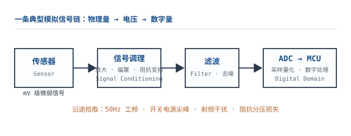
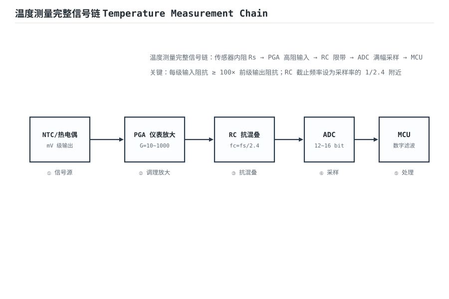

# 模拟信号与信号链概述 Analog Signal Chain

现实世界的物理量——温度、压力、光照、声音——是连续的模拟量。传感器把它们变成 mV 级、µA 级或 pC 级的电信号，而 MCU/ADC 只认识数字。中间这一段"模拟调理"就是本章要解决的问题：**如何把一个又小、又脏、内阻又高的信号，不失真、低噪声地送到 ADC 门口。**

很多人把信号链理解为"传感器→放大→ADC"三个方框，接上就能用。真正决定精度的，是三条预算：**噪声预算、带宽预算、阻抗预算**。三条预算里任何一条算错，后面用再高位数的 ADC、再好的数字滤波都救不回来——因为信息在进入 ADC 之前就已经丢了。这一章的主线是"把链路当成一个级联系统"：每一级有自己的增益、噪声、带宽、输入/输出阻抗，级联后的总噪声由 Friis 公式决定，总带宽由最窄的一级决定，总误差由最大的那一项决定。

本章用一个完整的热电偶链路收尾：10µV/°C、源阻抗 100Ω、放大 1000 倍、12 位 3.3V/1kSPS ADC，算总噪声、有效位数，并回答"要不要斩波"。传感器件的物理与选型见[仪表放大器（三运放）](instrumentation-amplifier.md)、[V/I、I/V 转换与传感器接口](vi-iv-converter.md)；噪声的完整理论见[噪声：电压噪声、电流噪声与计算](noise.md)；ADC 参考与电源见[线性稳压与基准源](linear-regulator-reference.md)。

## 1. 设计动机

::: motivation 四个真实场景
**场景一：热电偶直接接 12 位 ADC。** 10µV/°C 的灵敏度，300°C 满量程只有 3mV；12 位、3.3V ADC 的 1 LSB 是 0.806mV。直接采样，3mV 只占 3.7 个码，**相当于把 12 位 ADC 当 2 位用**，温度分辨率约 80°C。先放大 1000 倍，3mV 变成 3V，才用满量程。

**场景二：放大 1000 倍，但第一级用通用运放。** 通用精密运放的失调 25µV，折算到热电偶端是 2.5°C；温漂 0.5µV/°C，环境变 20°C 就是 10µV=1°C。**噪声可能只有 0.02°C，失调和漂移却是 1~2.5°C**——这就是为什么热电偶前端经常要斩波/自校准。

**场景三：ADC 前加 10kΩ 串联电阻和 10pF 采样电容。** 12 位建立需要 $9.01\tau$，$\tau=10\text{k}\Omega\times10\text{pF}=100\text{ns}$，$9.01\tau=901\text{ns}$；如果 ADC 的采样保持窗口只有 1µs，刚好够；换成 20kΩ 就 $1.8\mu\text{s}$，建立不完，读数偏低且随信号变。**ADC 驱动不是"接上就行"，它有自己的时间常数。**

**场景四：50Hz 工频通过长线进来。** 热电偶两根线像天线，1V 的共模干扰、CMRR=100dB 时折合 10µV，正好是 1°C。**信号链的精度不是由运放单独决定的，是由"源阻抗、共模、屏蔽、接地、ADC 驱动"共同决定的。**
:::

| 你想确认 | 先算 | 判据（工程经验值） |
|---|---|---|
| 增益够不够 | 信号满幅 / ADC 满量程 | 用满 70%~90% 量程 |
| 噪声够不够 | 输入 rms 与 1 LSB 折合 | 总噪声 < 1 LSB |
| 带宽够不够 | 信号带宽 / 噪声带宽 / GBW | GBW ≥ 10× 闭环带宽 |
| 驱动能力够不够 | $Z_{in}\ge100R_s$、ADC 建立时间 | 建立误差 < 1/2 LSB |
| 共模/偏置 | $I_BR_b$、$V_{cm}/CMRR$ | 折合误差 < 1/10 目标精度 |
| 要不要斩波 | 失调漂移 × 温升 vs 目标精度 | 漂移误差 < 1/3 预算 |

**不算会摔在哪**，四个带数字的代价：

1. **不放大直接采。** 3mV 信号只占 3.7 个码，量化误差 0.806mV 折合 80°C；放大 1000 倍后，1 LSB 折合 0.08°C，差 1000 倍。
2. **把增益放在第二级。** 第一级是缓冲/低增益，第二级才放大 1000 倍；第一级的噪声和失调被同样放大，第二级的噪声也直接叠加。Friis 公式给出的噪声系数差 5.6dB（见 2.4 节）。
3. **忽略 1/f 噪声。** 只按 1kHz 的 $e_n$ 算白噪声，0.1~10Hz 的 1/f 分量可能是白噪声的 5 倍；直流测量里，1/f 和漂移才是主角。
4. **ADC 驱动 RC 太大。** 10kΩ 源 + 10pF 采样电容，1µs 窗口只够 9 个时间常数；20kΩ 就不够，读数偏低且随通道切换变。**ADC 的输入不是"高阻"，它在采样瞬间是一个电容。**

## 2. 定义与直观

### 2.1 链路的四段



| 级 | 任务 | 关键参数 | 典型器件/电路 |
|---|---|---|---|
| 传感器 Sensor | 物理量→电信号 | 灵敏度、源阻抗、共模、输出范围 | 热电偶、应变片、光电二极管、电桥 |
| 调理 Conditioning | 放大、电平搬移、阻抗变换 | 增益、噪声、失调、CMRR、GBW | 仪放、斩波运放、PGA、跟随器 |
| 滤波 Filter | 限带、抗混叠、去工频 | 截止频率、阶数、Q | RC、Sallen-Key、LC |
| 驱动/采样 Driver + ADC | 低阻驱动采样电容、量化 | 建立时间、电荷注入、参考 | 运放缓冲、RC、SAR/ΔΣ ADC |

**每一级都要回答两个问题**：上一级带得动我吗？我带得动下一级吗？前者是输入阻抗/偏置电流，后者是输出阻抗/建立时间。信号链的绝大多数"玄学问题"，都能归到这两个问题之一。

### 2.2 传感器模型：戴维南等效

任何传感器在小信号下都可以等效成"电压源 $V_s$ 串源阻抗 $R_s$"：

- **热电偶**：$V_s=10\,\mu\text{V}/^{\circ}\text{C}$（示例值，实际按分度表），$R_s$ 几十~几百 Ω；
- **应变片电桥**：$V_s$ 满幅几 mV，$R_s$ 350Ω~10kΩ；
- **光电二极管**：电流源 $I_s$ 并结电容，$R_s$ 极大，用 TIA 转换；
- **NTC 分压**：$R_s$ 由分压电阻决定，几 kΩ~几十 kΩ；
- **压电片**：$V_s$ 与频率有关，$R_s$ 极高、电容几十 nF。

源阻抗决定三件事：**热噪声**（$\sqrt{4kTR_s}$）、**偏置电流误差**（$I_BR_s$）、**输入电容极点**（$1/(2\pi R_sC_{in})$）。100Ω 的源，热噪声只有 1.29nV/√Hz，但偏置电流 1nA 就有 0.1µV；1MΩ 的源，热噪声 128.7nV/√Hz，偏置电流 1nA 就是 1mV。**同一个运放，源阻抗不同，误差机制完全不同。** 输入端的过压/浪涌保护见[二极管电路：整流、滤波、限幅、钳位](diode-circuits.md)。

### 2.3 三条预算：噪声、带宽、阻抗



**噪声预算**：把每一级的噪声折算到输入端，按平方和开根（RSS）。总输入噪声要小于 1 LSB 折合到输入的值，通常留 1/2~1/3 的余量。

**带宽预算**：信号带宽 $f_s/2$（奈奎斯特）决定最低带宽；抗混叠滤波器的截止频率要低于奈奎斯特，阶数要按干扰强度定；第一级的 GBW 要大于"增益 × 闭环带宽"的 10 倍以上。

**阻抗预算**：后级输入阻抗 ≥ 100× 前级输出阻抗（1% 分压损失）；ADC 的采样电容/电荷注入要求驱动源在采样窗口内建立到 1/2 LSB；偏置电流在源阻抗/偏置电阻上的压降要小于 1/10 目标精度。

三条预算是**互相拉扯**的：增大增益改善噪声占比，但可能饱和；降低带宽降噪声，但建立变慢；提高输入阻抗降负载效应，但偏置电流/噪声变大。**信号链设计就是在这三条线之间找一个都能过的点。**

### 2.4 为什么总增益放在第一级：Friis 公式

级联系统的噪声系数：

$$F_{total}=F_1+\frac{F_2-1}{G_1}+\frac{F_3-1}{G_1G_2}+\cdots$$

其中 $F_i$ 是第 $i$ 级的噪声系数（功率比，无量纲）；$G_i$ 是第 $i$ 级的功率增益（无量纲）。换成 dB：

$$NF_{total}(\text{dB})=10\lg F_{total}$$

**第一级的噪声直接进总账，第二级以后的噪声要除以第一级的增益。** 这就是"总增益放第一级"的定量原因。

以第一级 $NF_1=3\text{dB}$（$F_1=2$）、第二级 $NF_2=10\text{dB}$（$F_2=10$）为例：

- 增益放第一级（$G_1=1000$）：$F=2+(10-1)/1000=2.009$，$NF=3.03\text{dB}$；
- 增益放第二级（$G_1=1$）：$F=2+(10-1)/1=11$，$NF=10.41\text{dB}$。

差 7.4dB。**同样的两级、同样的器件，只因为增益位置不同，总噪声系数差 7.4dB。** 如果第一级增益只有 10 倍，$F=2+9/10=2.9$，$NF=4.62\text{dB}$，仍比 3.03dB 差 1.6dB。

把本章热电偶的实际参数代入：$e_n=2\text{nV}/\sqrt{\text{Hz}}$、$i_n=1\text{pA}/\sqrt{\text{Hz}}$、$R_s=100\Omega$。300K 时 $4kTR_s=1.656\times10^{-18}\text{V}^2/\text{Hz}$：

$$F=1+\frac{(2\times10^{-9})^2+(10^{-12}\times100)^2}{1.656\times10^{-18}}=1+\frac{4.01\times10^{-18}}{1.656\times10^{-18}}=3.42$$

$$NF=10\lg3.42=5.34\text{dB}$$

若第一级增益 1000、第二级 $NF=10\text{dB}$，总 $NF=10\lg(3.42+9/1000)=5.35\text{dB}$；若增益放第二级（$G_1=1$），总 $NF=10\lg(3.42+9)=10.94\text{dB}$，差 5.6dB。**这就是"增益放第一级"在本链路里的具体收益。**

第一级增益也不能无限大：它会放大第一级的失调、共模误差和输入噪声，可能让后级饱和；而且第一级的带宽/压摆率要够。**"增益放第一级"的正确表述是：在不让第一级饱和、带宽够用的前提下，尽量把增益放第一级。**

### 2.5 类比：接力赛与水管

::: analogy 信号链像一场接力赛
每一棒是一个放大器：第一棒把"微弱但干净"的信号加速，交给第二棒；第二棒再加一点速，但它的"手抖"（噪声）只有除以第一棒的速度才影响总成绩。**第一棒慢，后面再快也没用；第一棒抖，后面全跟着抖。**

也可以把链路想成水管：传感器是水源（压力低、流量小），放大器是增压泵，滤波器是滤沙器，ADC 是流量计。水源压力太弱、管路太细（阻抗不匹配）、途中混进泥沙（噪声），流量计读到的数就是错的。**每一级都要先问：上一级带得动吗？下一级需要什么？**

类比的边界：接力赛的"手抖"不会随温度漂移，放大器的失调会；水管的"泥沙"不会混叠，ADC 的采样会。混叠和漂移是信号链特有的，不能只靠"级联"直觉。
:::

## 3. 定量关系

### 3.1 信号幅度、增益与量程

传感器满幅：

$$V_{s,FS}=S\cdot x_{FS}$$

其中 $S$ 是灵敏度（V/单位物理量）；$x_{FS}$ 是满量程物理量；$V_{s,FS}$ 是满幅电压（V）。热电偶 $S=10\,\mu\text{V}/^{\circ}\text{C}$、$x_{FS}=300^{\circ}\text{C}$ 时 $V_{s,FS}=3\text{mV}$。

所需增益：

$$G=\frac{V_{ADC,FS}\times\eta}{V_{s,FS}}$$

其中 $V_{ADC,FS}$ 是 ADC 满量程（V）；$\eta$ 是量程利用率（0.7~0.9，留余量）；$G$ 是无量纲增益。3.3V、$\eta=0.9$、3mV 时 $G=990$，取 1000。

ADC 折合到输入的分辨率：

$$\text{LSB}_{in}=\frac{V_{ADC,FS}}{2^N G}$$

其中 $N$ 是 ADC 位数。3.3V、12 位、G=1000 时 $\text{LSB}_{in}=0.806\text{mV}/1000=0.806\,\mu\text{V}$，对应 $0.0806^{\circ}\text{C}$。

### 3.2 噪声：谱密度、带宽与 RSS

电阻热噪声密度：

$$e_{n,R}=\sqrt{4kTR}$$

其中 $k=1.380649\times10^{-23}\text{J/K}$；$T$ 是绝对温度（K）；$R$ 是电阻（$\Omega$）；$e_{n,R}$ 单位 $\text{V}/\sqrt{\text{Hz}}$。300K 时 100Ω 是 1.29nV/√Hz，1kΩ 是 4.07nV/√Hz，10kΩ 是 12.9nV/√Hz。

白噪声在带宽内的 rms：

$$V_{n,rms}=e_n\sqrt{BW_n}$$

其中 $BW_n$ 是等效噪声带宽（Hz）。一阶低通的 $BW_n=(\pi/2)f_c\approx1.571f_c$；二阶巴特沃斯的 $BW_n\approx1.11f_c$；四阶约 1.03f_c。**系数随阶数变，报告里必须写清用的是哪一个**，详见[噪声：电压噪声、电流噪声与计算](noise.md)。

1/f 噪声的积分：

$$E_{1/f}=e_{nw}\sqrt{f_{ce}\ln\frac{f_2}{f_1}}$$

其中 $e_{nw}$ 是白噪声平台密度（$\text{V}/\sqrt{\text{Hz}}$）；$f_{ce}$ 是 1/f 拐点（Hz）；$f_1$、$f_2$ 是积分频带（Hz）。$e_{nw}=2\text{nV}/\sqrt{\text{Hz}}$、$f_{ce}=10\text{Hz}$、0.1~400Hz 时：

$$E_{1/f}=2\times10^{-9}\sqrt{10\ln\frac{400}{0.1}}=2\times10^{-9}\times9.11=18.2\text{nV rms}$$

与白噪声 $2\text{nV}\times\sqrt{444}=42.1\text{nV}$ 合成，得到 45.9nV。

多源合成按 RSS：

$$V_{n,total}=\sqrt{V_{n,1}^2+V_{n,2}^2+\cdots+V_{n,m}^2}$$

**电压噪声不能直接相加**；只有完全相关的源才按电压相加。不同电阻的热噪声、运放的 $e_n$ 与电阻噪声都互不相干。

噪声系数：

$$NF=1+\frac{e_n^2+(i_nR_s)^2}{4kTR_s},\qquad NF(\text{dB})=10\lg NF$$

其中 $e_n$ 是运放输入电压噪声密度（$\text{V}/\sqrt{\text{Hz}}$）；$i_n$ 是输入电流噪声密度（$\text{A}/\sqrt{\text{Hz}}$）；$R_s$ 是源阻抗（$\Omega$）。注意 $NF$ 是功率比，用 $10\lg$；电压比才用 $20\lg$。

### 3.3 级联噪声与 Friis

把每一级的输入参考噪声折算到总输入：

$$V_{n,in,total}^2=V_{n,1}^2+\frac{V_{n,2}^2}{G_1^2}+\frac{V_{n,3}^2}{G_1^2G_2^2}+\cdots$$

其中 $V_{n,i}$ 是第 $i$ 级的输入参考噪声（V rms）；$G_i$ 是电压增益（无量纲）。这个式子和 Friis 是同一件事的两种写法：**后级噪声除以它前面所有级增益的乘积。**

如果第一级增益 1000、第二级输入噪声 100µV，则第二级折合到总输入只有 0.1µV；如果第一级增益 1，第二级的 100µV 原样进总账。**第一级增益是"噪声防火墙"。**

### 3.4 带宽、GBW 与压摆率

闭环带宽：

$$f_{cl}\approx\frac{GBW}{1+R_f/R_1}=\frac{GBW}{1/\beta}$$

其中 $GBW$ 是增益带宽积（Hz）；$1/\beta$ 是噪声增益（无量纲）。增益 1000 时，$GBW=1\text{MHz}$ 的运放闭环带宽只有 1kHz；要 10kHz 带宽，GBW 至少 10MHz。

压摆率：

$$SR\ge2\pi f_{max}V_p$$

其中 $SR$ 是压摆率（V/s）；$f_{max}$ 是最高信号频率（Hz）；$V_p$ 是峰值电压（V）。输出 3V 峰值、1kHz 时 $SR\ge2\pi\times10^3\times3=0.019\text{V}/\mu\text{s}$；10kHz 时 0.19V/µs。热电偶信号很慢，SR 不是瓶颈；但 ADC 驱动/多路切换的阶跃需要按建立时间算。GBW、压摆率与建立时间的完整讨论见[带宽 GBP、压摆率与建立时间](gbp-slew-rate.md)。

### 3.5 阻抗、偏置电流与负载效应

分压损失：

$$\frac{V_{in}}{V_s}=\frac{Z_{in}}{R_s+Z_{in}}$$

要求 $\ge99\%$（1% 损失）时，$Z_{in}\ge99R_s$，工程上取 100 倍。反相放大的输入阻抗是 $R_1$，不是无穷大，见[理想模型五假设与虚短、虚断](ideal-opamp.md)；同相/跟随器的输入阻抗是共模输入电阻（GΩ 级）。

偏置电流误差：

$$V_{err,IB}=I_BR_{eq}$$

其中 $I_B$ 是输入偏置电流（A）；$R_{eq}$ 是输入端对地的等效电阻（$\Omega$）。$I_B=1\text{nA}$、$R_{eq}=100\text{k}\Omega$ 时误差 100µV；对 10µV/°C 的热电偶是 10°C。**高阻源必须选低 $I_B$ 器件（JFET/CMOS/斩波），或降低 $R_{eq}$。**

输入电容极点：

$$f_{p,in}=\frac{1}{2\pi R_sC_{in}}$$

$R_s=100\text{k}\Omega$、$C_{in}=5\text{pF}$ 时 $f_{p,in}=318\text{kHz}$；$R_s=1\text{M}\Omega$ 时 31.8kHz，可能吃掉相位裕度。

### 3.6 ADC 驱动：采样、电荷注入与建立时间

SAR ADC 的输入端在采样瞬间等效为一个采样电容 $C_s$（几 pF~几十 pF）和一个开关电阻。驱动源要在采样窗口 $t_{acq}$ 内把 $C_s$ 充到 1/2 LSB 以内：

$$t_{acq}\ge(N+1)\ln2\cdot R_{src}C_s$$

其中 $N$ 是位数；$R_{src}$ 是驱动源阻抗（$\Omega$）；$C_s$ 是采样电容（F）。12 位时 $(N+1)\ln2=13\times0.693=9.01$，即 9 个时间常数。

电荷注入：采样开关关断时会把一小撮电荷 $Q_{inj}$ 注入采样电容/外部电容，产生台阶：

$$\Delta V_{inj}=\frac{Q_{inj}}{C_{ext}}$$

其中 $Q_{inj}$ 单位 C；$C_{ext}$ 是 ADC 引脚处的外部电容（F）。$Q_{inj}=1\text{pC}$、$C_{ext}=1\text{nF}$ 时 $\Delta V=1\text{mV}$，对 12 位、3.3V 是 1.24 LSB。外部电容越大，台阶越小，但建立越慢；要在这对矛盾里选 $R_{series}C_{ext}$。

抗混叠滤波器的截止频率与阶数：

$$f_c\le\frac{f_s}{2.4}\quad\text{（起点）},\qquad |H(f)|=\frac{1}{\sqrt{1+(f/f_c)^{2n}}}$$

其中 $f_s$ 是采样率（Hz）；$n$ 是阶数；$|H(f)|$ 是幅频响应。二阶巴特沃斯在 $f=f_c$ 处 −3dB，在 $f=2f_c$ 处约 −12dB，在 $f=10f_c$ 处约 −40dB；要 12 位（约 −72dB）的抗混叠，二阶远远不够，通常要四阶以上或更低的 $f_c$。$f_c=f_s/2.4$ 只是"起点"，不是"达标线"。

### 3.7 有效位数 ENOB 与误差预算

理想 ADC 的量化信噪比：

$$SNR_{ideal}=6.02N+1.76\text{ dB}$$

有效位数：

$$ENOB=\frac{SINAD-1.76}{6.02}$$

其中 $SINAD$ 是信号与噪声+失真比（dB）。工程上如果只算噪声（不含失真），可以用

$$SNR=20\lg\frac{V_{FS,rms}}{V_{n,total,rms}},\qquad V_{FS,rms}=\frac{V_{FS}}{2\sqrt2}$$

其中 $V_{FS}$ 是满量程峰峰值（V）；$V_{n,total,rms}$ 是总噪声 rms（V，含 ADC 量化噪声）。12 位、3.3V 的量化噪声是 $1\text{LSB}/\sqrt{12}=0.806/3.464=0.233\text{mV rms}$。

总误差预算要把**噪声、失调、增益误差、参考误差、INL**分开列，不能只算噪声；噪声可以用平均压低，失调/增益误差不能（除非校准）。

### 3.8 适用条件与失效边界

- **小信号线性模型**：传感器、运放都假设线性；大信号/饱和/斩波瞬时状态要单独分析。
- **噪声不相关**：RSS 假设各噪声源独立；同一噪声源经过两条路径可能相关，不能 RSS。
- **带宽系数**：$BW_n$ 依赖滤波器阶数/拓扑，不能拿一阶的 1.571 套所有系统。
- **ADC 输入模型**：SAR 的采样电容/开关电阻随型号变，必须查数据手册；ΔΣ 的输入是开关电容负载，连续时间模型不适用。
- **共模/隔离**：热电偶、电桥的共模电压可能超出运放 ICMR；浮空源需要偏置电流回路，接地源可能形成地环路。
- **冷端/参考**：热电偶的冷端补偿、ADC 的参考误差是"系统误差"，不能靠平均消除。

## 4. 典型计算

### 4.1 算例一：热电偶 0~300°C 完整链路

**需求与假设**：

| 项目 | 数值/假设 |
|---|---|
| 传感器 | 热电偶，$10\,\mu\text{V}/^{\circ}\text{C}$（示例灵敏度，实际按分度表），$R_s=100\Omega$ |
| 量程 | 0~300°C → 0~3mV |
| 增益 | 1000 → 0~3V |
| ADC | 12 位、3.3V、1kSPS，$C_s=10\text{pF}$、$t_{acq}=1\,\mu\text{s}$（示例值，以数据手册为准） |
| 抗混叠 | 二阶巴特沃斯，$f_c=400\text{Hz}$，$BW_n=1.11f_c=444\text{Hz}$ |
| 第一级 | 低噪声精密运放（示例假设，以数据手册为准）：$e_n=2\text{nV}/\sqrt{\text{Hz}}$、$f_{ce}=10\text{Hz}$、$I_B=1\text{nA}$、$V_{OS}=25\,\mu\text{V}$、漂移 $0.5\,\mu\text{V}/^{\circ}\text{C}$、GBW=10MHz |
| 反馈 | $R_1=100\Omega$、$R_f=99.9\text{k}\Omega$，噪声增益 1000 |
| 保护 | 输入串 1kΩ + 钳位二极管（可选） |
| 环境 | 25°C ±10°C |

**第 1 步：信号与分辨率。**

$$V_{s,FS}=10\,\mu\text{V}/^{\circ}\text{C}\times300^{\circ}\text{C}=3.0\text{mV}$$

$$V_{out,FS}=3.0\text{mV}\times1000=3.0\text{V}$$

ADC 1 LSB：

$$\text{LSB}=\frac{3.3}{4096}=0.806\text{mV}$$

折合到输入：

$$\text{LSB}_{in}=\frac{0.806\text{mV}}{1000}=0.806\,\mu\text{V}=0.0806^{\circ}\text{C}$$

信号用满量程的 $3.0/3.3=90.9\%$，留 0.3V 余量。

**第 2 步：带宽与噪声带宽。** 二阶巴特沃斯：

$$BW_n=1.11f_c=1.11\times400=444\text{Hz},\qquad \sqrt{BW_n}=21.07$$

**第 3 步：各噪声分项（输入参考）。**

源电阻：

$$e_{n,Rs}=\sqrt{4\times1.380649\times10^{-23}\times300\times100}=1.287\text{nV}/\sqrt{\text{Hz}}$$

$$V_{n,Rs}=1.287\times21.07=27.1\text{nV rms}$$

运放白噪声：

$$V_{n,white}=2\times21.07=42.1\text{nV rms}$$

运放 1/f：

$$V_{n,1/f}=2\sqrt{10\ln\frac{400}{0.1}}=18.2\text{nV rms}$$

运放合计：

$$V_{n,amp}=\sqrt{42.1^2+18.2^2}=45.9\text{nV rms}$$

反馈网络（$R_1\parallel R_f\approx99.9\Omega$）：

$$V_{n,fb}=1.287\times21.07=27.1\text{nV rms}$$

保护电阻 1kΩ（如果加）：

$$V_{n,prot}=4.07\times21.07=85.8\text{nV rms}$$

总噪声（含保护电阻）：

$$V_{n,in}=\sqrt{27.1^2+45.9^2+27.1^2+85.8^2}=104.6\text{nV rms}$$

不含保护电阻时：

$$V_{n,in}=\sqrt{27.1^2+45.9^2+27.1^2}=59.8\text{nV rms}$$

```echarts
{
  "animation": false,
  "tooltip": {"trigger": "axis"},
  "grid": {"left": 66, "right": 26, "top": 30, "bottom": 58},
  "xAxis": {"type": "category", "name": "噪声分项", "nameLocation": "middle", "nameGap": 36, "data": ["源电阻", "运放白噪声", "运放 1/f", "反馈网络", "保护电阻 1k"], "axisLabel": {"fontSize": 10, "interval": 0}},
  "yAxis": {"type": "value", "name": "输入 rms / nV", "nameLocation": "middle", "nameGap": 44, "min": 0, "max": 100, "interval": 20, "axisLabel": {"fontSize": 11}},
  "series": [
    {"name": "输入参考噪声", "type": "bar", "barWidth": "46%", "itemStyle": {"color": "#1a4f8b"},
     "data": [27.1, 42.1, 18.2, 27.1, 85.8]}
  ]
}
```

上图的柱高是各分项的输入参考 rms（nV），**总噪声按平方和开根，不是柱高相加**：不含保护电阻 59.8nV，含 1kΩ 保护电阻 104.6nV。保护电阻的热噪声（4.07nV/√Hz）比 2nV/√Hz 的运放还大，是这一版预算里的主导项；要么把保护电阻降到 100Ω 级并用 TVS 吸收浪涌能量，要么接受这 0.0105°C 的噪声。

**第 4 步：折合温度与输出噪声。**

$$T_{n}=\frac{59.8\text{nV}}{10\,\mu\text{V}/^{\circ}\text{C}}=0.0060^{\circ}\text{C rms}$$

含保护电阻：

$$T_{n}=\frac{104.6\text{nV}}{10\,\mu\text{V}/^{\circ}\text{C}}=0.0105^{\circ}\text{C rms}$$

输出噪声：

$$V_{n,out}=59.8\text{nV}\times1000=59.8\,\mu\text{V rms}$$

**第 5 步：量化噪声与 ENOB。**

$$V_{q}=\frac{0.806\text{mV}}{\sqrt{12}}=0.233\text{mV rms}$$

总输出噪声：

$$V_{n,total}=\sqrt{59.8^2+232.6^2}=240.2\,\mu\text{V rms}$$

满量程正弦 rms：

$$V_{FS,rms}=\frac{3.3}{2\sqrt2}=1.167\text{V}$$

$$SNR=20\lg\frac{1.167}{240.2\times10^{-6}}=73.7\text{dB}$$

$$ENOB=\frac{73.7-1.76}{6.02}=11.95$$

**这套链路的模拟噪声只占 0.006°C，ENOB 11.95 位，基本是量化极限。** 看起来已经够了，但下一步会看到真正的瓶颈。

**第 6 步：失调与漂移。** $V_{OS}=25\,\mu\text{V}$ 折合：

$$\frac{25\,\mu\text{V}}{10\,\mu\text{V}/^{\circ}\text{C}}=2.5^{\circ}\text{C}$$

漂移 $0.5\,\mu\text{V}/^{\circ}\text{C}$，环境变 10°C：

$$\frac{0.5\times10}{10}=0.5^{\circ}\text{C}$$

**噪声 0.006°C，失调 2.5°C，漂移 0.5°C——失调是噪声的 400 多倍，漂移是 80 多倍。** 不校准/不斩波，12 位 ADC 的精度根本发挥不出来。

**第 7 步：要不要斩波？** 方案 B：斩波稳零运放（示例值，以数据手册为准），$e_n=20\text{nV}/\sqrt{\text{Hz}}$（无 1/f）、$V_{OS}=5\,\mu\text{V}$、漂移 $0.02\,\mu\text{V}/^{\circ}\text{C}$。

噪声：

$$V_{n,amp}=20\times21.07=421.4\text{nV rms}$$

总输入噪声：

$$V_{n,in}=\sqrt{27.1^2+421.4^2+27.1^2}=423.2\text{nV rms}$$

$$T_n=0.0423^{\circ}\text{C rms}$$

输出噪声 423.2µV；与量化 232.6µV 合成：

$$V_{n,total}=\sqrt{423.2^2+232.6^2}=482.9\,\mu\text{V rms}$$

$$SNR=20\lg\frac{1.167}{482.9\times10^{-6}}=67.7\text{dB},\qquad ENOB=10.95$$

失调/漂移：

$$\frac{5\,\mu\text{V}}{10\,\mu\text{V}/^{\circ}\text{C}}=0.5^{\circ}\text{C},\qquad \frac{0.02\times10}{10}=0.02^{\circ}\text{C}$$

**结论**：如果要求 0.1°C 级、且环境温度会变，**必须斩波/自校准**：低噪声运放的漂移 0.5°C 无法接受；斩波把漂移压到 0.02°C，代价是噪声从 0.006°C 升到 0.042°C、ENOB 从 11.95 降到 10.95。如果只要求 0.5°C、且在恒温下一点校准，低噪声运放也够；但"12 位分辨率"不等于"12 位精度"。

**第 8 步：带宽、GBW 与压摆率。** 闭环带宽 1kHz、增益 1000；按 10 倍余量：

$$GBW\ge10\times1000\times1\text{kHz}=10\text{MHz}$$

选 10MHz，留 10 倍余量（信号带宽实际被 400Hz 抗混叠滤波器限制，10 倍是给建立/相位留的）。压摆率：3V 阶跃在 10µs 内完成：

$$SR\ge\frac{3\text{V}}{10\,\mu\text{s}}=0.3\text{V}/\mu\text{s}$$

选 1V/µs 以上。

**第 9 步：偏置电流与输入阻抗。** 热电偶浮空，需要偏置电流回路。取 100kΩ 到地：

$$V_{err,IB}=1\text{nA}\times100\text{k}\Omega=100\,\mu\text{V}=10^{\circ}\text{C}$$

太大。换 $I_B=50\text{pA}$ 的 CMOS/斩波运放：

$$V_{err,IB}=50\text{pA}\times100\text{k}\Omega=5\,\mu\text{V}=0.5^{\circ}\text{C}$$

可接受（可校准）。如果坚持 1nA 的运放，偏置电阻要降到 10kΩ：

$$V_{err,IB}=1\text{nA}\times10\text{k}\Omega=10\,\mu\text{V}=1^{\circ}\text{C}$$

但 10kΩ 对 100Ω 源是 1% 的负载，增益误差 1%，需要校准。**偏置电阻、源阻抗、$I_B$ 三者要一起选。**

这里有一个真实的器件取舍：2nV/√Hz 级的低噪声双极输入，$I_B$ 往往是 nA 级；要同时做到 2nV 和 50pA 很难。实际设计只有两条路：接受 1nA 的偏置误差（100µV=10°C，必须校准/调零），或者换 CMOS/斩波输入（$I_B$ 降到 pA，但 $e_n$ 升到 20nV 级，回到方案 B）。**"低噪声"和"低偏置电流"在源阻抗 100Ω 时不是同一个优化方向**；先看哪一项在误差预算里占主导，再选器件。

**第 10 步：ADC 驱动。** 采样电容 10pF、外部 1nF、串联 50Ω：

$$\tau=50\times1\times10^{-9}=50\text{ns},\qquad 9.01\tau=450\text{ns}<1\,\mu\text{s}$$

建立够。电荷注入 1pC 在 1nF 上产生 1mV（1.24 LSB），在 450ns 内基本建立；如果外部电容降到 100pF，台阶 10mV（12.4 LSB），但建立时间变快——**台阶和建立时间是一对矛盾，1nF/50Ω 是折中**。

抗混叠：$f_c=400\text{Hz}$、二阶，$R=10\text{k}\Omega$、$C=39\text{nF}$：

$$f_c=\frac{1}{2\pi\times10^4\times39\times10^{-9}}=408\text{Hz}$$

二阶在 1kHz 处衰减：

$$|H(1\text{k})|=\frac{1}{\sqrt{1+(1000/408)^4}}=0.158\Rightarrow-16\text{dB}$$

在 10kHz 处约 −56dB。**如果现场有 10kHz、1V 的开关干扰，−56dB 后还有 1.6mV，超过 1 LSB；要用四阶或更低 $f_c$。** $f_c=f_s/2.4$ 只是起点。

注意：10kΩ/39nF 的抗混叠滤波器**不能直接接到 ADC 引脚**——10kΩ 源阻抗会让采样电容建立不完、电荷注入也吸收不了。正确顺序是"滤波 → 缓冲/驱动 → 50Ω + 1nF → ADC"，50Ω 隔离运放与采样电容，1nF 吸收电荷注入；缓冲级要选能驱动容性负载、输出摆幅到 3.3V 的运放，见[供电轨、输出摆幅与 Rail-to-Rail](supply-rails.md)。

**第 11 步：总误差预算。**

| 项目 | 折合输入 | 折合温度 | 备注 |
|---|---|---|---|
| 模拟噪声（低噪声方案） | 59.8nV rms | 0.006°C | 可平均 |
| 量化噪声 | 0.233mV/1000=233nV | 0.023°C | 不可平均 |
| 失调（未校准） | 25µV | 2.5°C | 可校准 |
| 漂移（10°C） | 5µV | 0.5°C | 难校准 |
| 偏置电流（50pA×100k） | 5µV | 0.5°C | 可校准 |
| 参考误差 0.1% | 3.3mV/1000=3.3µV | 0.33°C | 可校准 |
| 冷端补偿误差 0.5°C | — | 0.5°C | 系统误差 |

**结论**：在 25°C 校准后，主要误差是漂移 0.5°C、偏置 0.5°C、冷端 0.5°C、参考 0.33°C；要 0.1°C 级，必须斩波 + 低漂移基准 + 冷端补偿 + 定期校准。**噪声不是瓶颈，系统误差才是。**

### 4.2 算例二：直采 vs 放大

**直采**：3mV 信号、12 位 3.3V ADC：

$$\frac{3\text{mV}}{0.806\text{mV}}=3.72\text{LSB}$$

有效分辨率约：

$$\log_2 3.72=1.9\text{ 位}$$

**放大 1000 倍**：

$$\frac{3\text{V}}{0.806\text{mV}}=3722\text{LSB}\approx2^{11.86}$$

有效分辨率约 11.9 位。**同样的 ADC，只因为加了 1000 倍增益，有效分辨率从 1.9 位变成 11.9 位。** 这就是第一级增益的价值。

### 4.3 算例三：ADC 驱动的建立时间

**源阻抗 10kΩ、采样电容 10pF、采样窗口 1µs**：

$$\tau=10^4\times10\times10^{-12}=100\text{ns}$$

12 位需要：

$$t=9.01\tau=901\text{ns}<1\,\mu\text{s}$$

刚好够，余量 10%。**源阻抗 20kΩ**：

$$t=9.01\times200\text{ns}=1.80\,\mu\text{s}>1\,\mu\text{s}$$

建立不完，读数偏低。**结论**：12 位、1µs 窗口下，驱动源阻抗要 <11kΩ（留 10% 余量），最好 <1kΩ；高阻源必须加缓冲。


## 5. 工程含义

### 5.1 数量级表

| 传感器/环节 | 满幅 | 源阻抗 | 典型增益 | 关键噪声/误差 |
|---|---|---|---|---|
| 热电偶 | 10µV/°C，0~3mV | 10~500Ω | 100~1000 | 失调/漂移、冷端 |
| 应变片电桥 | 1~10mV | 350Ω~10kΩ | 100~1000 | 共模、电阻匹配 |
| 光电二极管 | pA~µA | 极高（电流源） | TIA 10k~10MΩ | 电流噪声、结电容 |
| NTC 分压 | 0.1~3V | 1~100kΩ | 1~10 | 自热、线性化 |
| 压电/加速度计 | mV~V | 高阻/容性 | 1~100 | 电缆噪声、电荷放大 |
| ADC 驱动 | — | 输出 <100Ω | 1 | 建立时间、电荷注入 |

如果链路的末端是喇叭、电机这类低阻大电流负载，末级不是"再放大一级"，而是功率输出级：效率、散热与 SOA 见[功率放大：甲类、乙类、甲乙类与推挽](power-amplifiers.md)。

### 5.2 链路预算模板

| 项目 | 符号 | 数值 | 判据 |
|---|---|---|---|
| 信号满幅 | $V_{s,FS}$ | 3mV | — |
| 增益 | $G$ | 1000 | 用满 70~90% 量程 |
| 输入噪声 | $V_{n,in}$ | 59.8nV | < 1 LSB/2 |
| 噪声带宽 | $BW_n$ | 444Hz | 按滤波器阶数 |
| 闭环带宽 | $f_{cl}$ | 1kHz | ≥ 信号带宽 |
| GBW | $GBW$ | 10MHz | ≥10× $Gf_{cl}$ |
| 输入阻抗 | $Z_{in}$ | >1GΩ | ≥100× $R_s$ |
| 偏置误差 | $I_BR_b$ | 5µV | 可校准；不校准则 <1/10 目标 |
| ADC 建立 | $9.01\tau$ | 450ns | < $t_{acq}$ |
| 总误差 | — | 0.5~2.5°C | 按系统要求 |

### 5.3 布局、接地与屏蔽

- **小信号走线短**：热电偶/电桥的引线用双绞/屏蔽，屏蔽层单端接地；信号线与电源线分开走，避免平行。
- **星形/单点接地**：模拟地、数字地、功率地分开，在 ADC 的 AGND 单点汇合；地环路是 50Hz 共模的主要来源。
- **保护环**：高阻/低电流节点（pH、光电二极管）加 guard ring，驱动到同电位，减少漏电流。
- **ADC 去耦**：VREF/AVDD 就近 100nF+1µF，参考单独滤波；数字接口线远离模拟输入。
- **冷端等温**：热电偶的冷端/接线端子等温，冷端传感器靠近端子；温度梯度是 CJC 的主要误差。
- **斩波噪声**：斩波频率的纹波/电荷注入要滤波，输入 RC 与斩波频率匹配；不要让斩波尖峰混叠到信号带内。

### 5.4 模型什么时候不够用

- **传感器非线性**：热电偶的分度表是非线性的，10µV/°C 只是小范围斜率；宽温区要查表/多项式。
- **共模/隔离**：浮空源、接地源、长线共模；CMRR 不是无限大，超过 ICMR 会失效。
- **1/f 与漂移**：直流测量的主角，不能用白噪声模型；斩波/自校准/斩波频率选择要单独算。
- **ADC 输入模型**：SAR 的开关电容、ΔΣ 的输入电流、参考的负载效应；数据手册的建立时间曲线比公式更准。
- **EMI/混叠**：强干扰源（开关电源、变频器）会通过空间/地耦合进来，滤波器只能压带外，压不了带内。
- **系统误差**：参考、冷端、增益误差、INL 不能用平均消除，必须校准。

## 6. 常见坑

::: pitfall 常见坑
- **现象**：传感器直接接 ADC，读数跳、分辨率差。**原因**：信号太小、源阻抗太高，量化步长浪费；ADC 采样电容对高阻源建立不完。**解决**：先放大到 70~90% 量程，加缓冲/驱动；按 $9.01\tau$ 核建立时间。
- **现象**：放大后噪声很大，换低噪声运放也没用。**原因**：增益放在第二级，第一级的噪声/失调被放大；或第一级源阻抗/保护电阻的热噪声主导。**解决**：把增益放第一级（Friis），降低源阻抗/保护电阻，按 RSS 分项找主导项。
- **现象**：直流测量读数随温度漂，噪声却很小。**原因**：只算了白噪声，忽略了失调漂移和 1/f；通用运放 $V_{OS}$ 25µV 对 10µV/°C 是 2.5°C。**解决**：用斩波/自校准运放，或定期短路输入校准；按 4.1 节的失调/漂移预算选器件。
- **现象**：抗混叠用了 $f_c=f_s/2.4$ 的二阶 RC，还是有高频干扰混进来。**原因**：二阶在奈奎斯特附近只有几 dB 衰减，强干扰会混叠；$f_c=f_s/2.4$ 只是起点。**解决**：按干扰频率/幅度算需要的衰减，选四阶或更低 $f_c$；必要时加 LC/屏蔽。
- **现象**：多通道切换后读数不准，通道间串扰。**原因**：ADC 采样电容的电荷注入/残余电荷没有建立完；多路开关的 $R_{on}$ 与源阻抗分压。**解决**：每通道加缓冲/RC，增加采样时间，或选带 PGIA 的 ADC；按电荷注入 $\Delta V=Q/C$ 核。
- **现象**：热电偶读数整体偏几度，重复性却很好。**原因**：冷端补偿误差/接线端子温度梯度；或参考电压误差（0.1%=0.33°C）；或增益电阻容差。**解决**：冷端等温+独立温度传感器；用 0.1% 电阻/低漂移基准；做两点校准。
:::

## 7. 自测题

<details><summary>热电偶 10µV/°C、0~300°C、放大 1000 倍、12 位 3.3V ADC。信号满幅、ADC 1 LSB 折合输入、折合温度各多少？</summary>

$$V_{s,FS}=10\,\mu\text{V}/^{\circ}\text{C}\times300=3.0\text{mV}$$

$$V_{out}=3.0\text{mV}\times1000=3.0\text{V}$$

$$\text{LSB}=\frac{3.3}{4096}=0.806\text{mV}$$

$$\text{LSB}_{in}=\frac{0.806\text{mV}}{1000}=0.806\,\mu\text{V}$$

$$\frac{0.806\,\mu\text{V}}{10\,\mu\text{V}/^{\circ}\text{C}}=0.0806^{\circ}\text{C}$$

信号用满 90.9%，留 0.3V 余量。

</details>

<details><summary>源 100Ω、$e_n=2nV/\sqrt{Hz}$、$f_{ce}=10Hz$、$BW_n=444Hz$。源噪声、运放白噪声、1/f、总噪声各多少？</summary>

源：

$$e_{n,Rs}=\sqrt{4kT\times100}=1.287\text{nV}/\sqrt{\text{Hz}},\qquad V_{n,Rs}=1.287\times21.07=27.1\text{nV}$$

白噪声：

$$V_{n,white}=2\times21.07=42.1\text{nV}$$

1/f：

$$V_{n,1/f}=2\sqrt{10\ln(400/0.1)}=2\sqrt{82.94}=18.2\text{nV}$$

运放合计：

$$V_{n,amp}=\sqrt{42.1^2+18.2^2}=45.9\text{nV}$$

总噪声（含反馈 27.1nV）：

$$V_{n,in}=\sqrt{27.1^2+45.9^2+27.1^2}=59.8\text{nV rms}$$

折合温度 0.006°C rms。

</details>

<details><summary>第一级 $NF_1=3dB$、第二级 $NF_2=10dB$。增益放第一级（$G_1=1000$）和放第二级（$G_1=1$）的总噪声系数各多少？差多少 dB？</summary>

$F_1=2$、$F_2=10$。

增益放第一级：

$$F=2+\frac{10-1}{1000}=2.009,\qquad NF=10\lg2.009=3.03\text{dB}$$

增益放第二级：

$$F=2+\frac{10-1}{1}=11,\qquad NF=10\lg11=10.41\text{dB}$$

差 7.38dB。第一级增益是"噪声防火墙"，后级噪声要除以前级增益。

</details>

<details><summary>12 位 ADC、3.3V，量化噪声 rms 多少？若模拟前端噪声 59.8µV rms，总噪声、SNR、ENOB 各多少？</summary>

量化噪声：

$$V_q=\frac{0.806\text{mV}}{\sqrt{12}}=0.233\text{mV rms}$$

总噪声：

$$V_{n,total}=\sqrt{0.0598^2+0.2326^2}=0.2402\text{mV rms}$$

满量程正弦 rms：

$$V_{FS,rms}=\frac{3.3}{2\sqrt2}=1.167\text{V}$$

$$SNR=20\lg\frac{1.167}{0.2402\times10^{-3}}=73.7\text{dB}$$

$$ENOB=\frac{73.7-1.76}{6.02}=11.95$$

模拟噪声只占很小一部分，ENOB 基本是量化极限；真实精度受失调/漂移/参考限制。

</details>

<details><summary>热电偶 $I_B=1nA$、偏置电阻 100kΩ，偏置电流误差多少？折合温度多少？换 50pA 呢？</summary>

$$V_{err}=1\text{nA}\times100\text{k}\Omega=100\,\mu\text{V}$$

$$\frac{100\,\mu\text{V}}{10\,\mu\text{V}/^{\circ}\text{C}}=10^{\circ}\text{C}$$

换 50pA：

$$V_{err}=50\text{pA}\times100\text{k}\Omega=5\,\mu\text{V}=0.5^{\circ}\text{C}$$

可校准但需低 $I_B$ 器件；或者把偏置电阻降到 10kΩ（1nA→10µV=1°C），代价是 1% 的源负载误差。

</details>

<details><summary>10kΩ 源、10pF 采样电容、1µs 采样窗口，12 位建立够不够？20kΩ 呢？结论是什么？</summary>

12 位需要 $9.01\tau$：

$$\tau=10\text{k}\Omega\times10\text{pF}=100\text{ns},\qquad t=901\text{ns}<1\,\mu\text{s}$$

刚好够（余量 10%）。20kΩ：

$$\tau=200\text{ns},\qquad t=1.80\,\mu\text{s}>1\,\mu\text{s}$$

不够，读数偏低且随信号变。结论：12 位、1µs 窗口下驱动源阻抗最好 <1kΩ，至少 <11kΩ；高阻源必须加缓冲。

</details>

## 8. 参考资料

- **TI, *Op Amps for Everyone*（SLOD006B）Chapter 10 *Op Amp Noise Theory and Applications*、Chapter 11 *Understanding Op Amp Parameters***：噪声模型、噪声增益、带宽与参数测试条件；本章 3.2、3.4 节的口径按该章。<https://archive.org/details/TexasInstruments-TI-ApplicationsandSeminars-OpAmpsForEveryoneDesignReference2000OCR>
- **TI, *Noise Analysis in Operational Amplifier Circuits*（SLVA043B）**：分项噪声预算、源阻抗与噪声系数、$R_{s,opt}$ 的推导；本章 3.2、3.3 节的 NF 与级联算法按该文。<https://www.ti.com/lit/an/slva043b/slva043b.pdf>
- **Analog Devices, MT-047 *Op Amp Noise***：噪声来源、输入参考噪声模型、$e_n$/$i_n$ 谱密度曲线读法；本章 2.2、3.2 节的噪声模型按该文。<https://www.analog.com/media/en/training-seminars/tutorials/MT-047.pdf>
- **Analog Devices, MT-048 *Op Amp Noise Relationships（1/f Noise, RMS Noise, and Equivalent Noise Bandwidth）***：1/f 积分、RMS 换算与噪声带宽系数；本章 3.2 节的 $E_{1/f}$ 与 $BW_n$ 按该文。<https://www.analog.com/media/en/training-seminars/tutorials/MT-048.pdf>
- **Analog Devices, MT-049 *Op Amp Total Output Noise Calculations for Single-Pole System***：把 $e_n$、$i_n$、源阻抗、反馈网络逐项折算到输出再 RSS 的标准算法；本章 3.3、4.1 节的分项表按该文。<https://www.analog.com/media/en/training-seminars/tutorials/MT-049.pdf>
- **TI, INA128 数据手册**：增益公式 $G=1+50\text{k}\Omega/R_G$、*CMRR vs Gain* 表、输入偏置电流与共模范围；本章 2.1、5.1 节的仪放/传感器接口参考该手册。<https://www.ti.com/lit/ds/symlink/ina128.pdf>
- **Analog Devices, MT-031 *Grounding Data Converters and Solving the Mystery of AGND and DGND***：数据转换器的接地、回流与混合信号布局；本章 5.3 节的星形/单点接地按该文。
