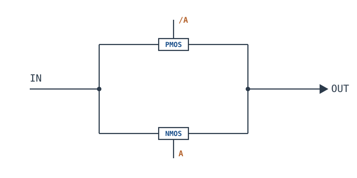
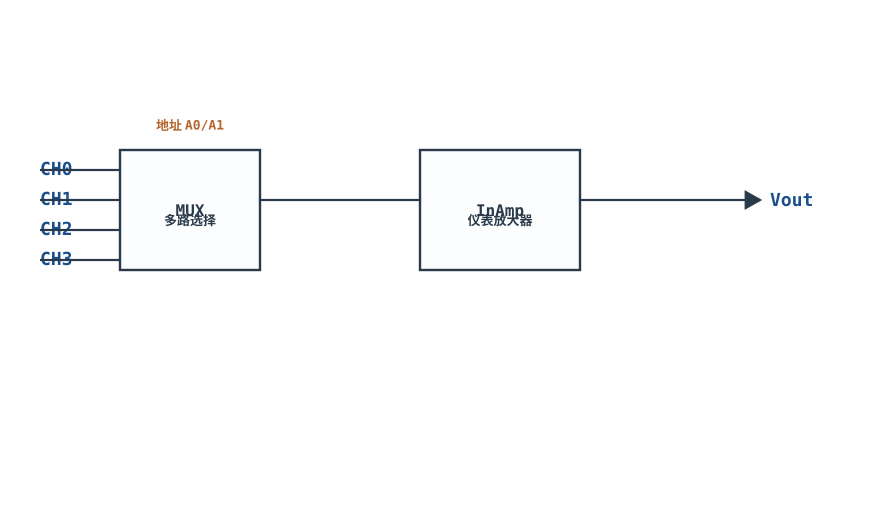
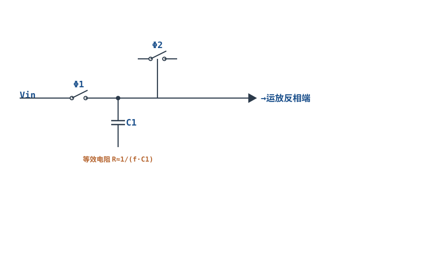
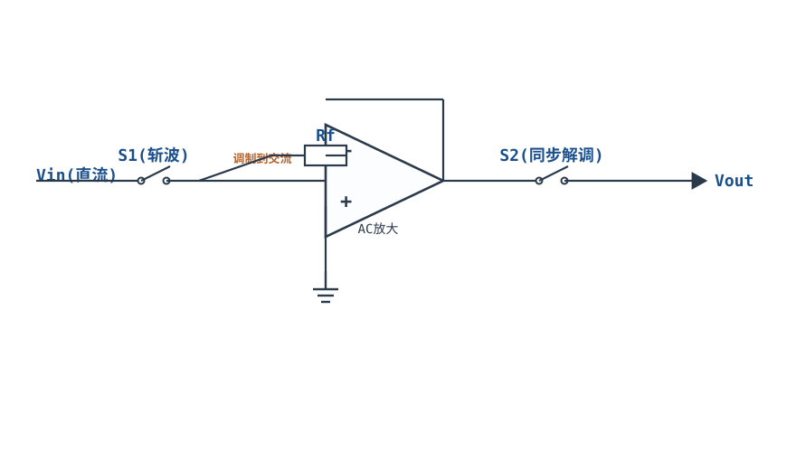
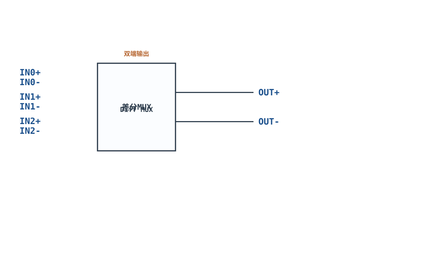

# 模拟开关与多路复用 Analog Switch & MUX

## 1. 设计动机

::: motivation 为什么需要模拟开关
数字开关（逻辑门）只能传 0/1，但很多时候我们要用数字信号去"接通/切断"一个**模拟信号通路**：ADC 前端轮询多路传感器、增益切换、信号路由、采样保持。**模拟开关（Analog Switch）**就是压控的、能双向通过模拟电压的电子开关；把多个开关按树形组合，就是**多路复用器（MUX，Multiplexer）**——一根输出线上选通多路输入中的一路。
:::

## 2. 原理图

**CMOS 传输门（Transmission Gate）**：NMOS 与 PMOS 并联，由一对互补控制信号驱动，在整个信号幅度范围内保持低导通电阻。



**4 选 1 MUX**：四个开关的输出端接在一起，由地址译码选通其中一路到公共输出。

## 3. 静态分析（DC）

- 开关**导通（ON）**时，等效为一个小电阻 $R_{on}$，信号可双向通过；
- 开关**断开（OFF）**时，等效为极大电阻（MΩ~GΩ）+ 微小漏电流 $I_{off}$；
- 传输门的优势：NMOS 传不好弱高电平、PMOS 传不好弱低电平，二者并联后整个轨到轨范围都低阻导通。
- 静态误差主要来自 $R_{on}$ 与负载分压、以及漏电流在源电阻上的压降。

## 4. 动态分析（AC / 瞬态）

- **导通电阻 $R_{on}$**：典型 1Ω~100Ω，好的器件在整个信号范围内基本平坦；
- **带宽**：$R_{on}$ 与负载/寄生电容决定 $f_{-3dB}=1/(2\pi R_{on}C_L)$，通常几十 MHz；
- **电荷注入（Charge Injection）**：开关断开瞬间，沟道电荷 $Q$ 注入采样电容，产生电压尖峰 $\Delta V=Q/C$；
- **关断隔离（Off-Isolation）与串扰（Crosstalk）**：断开通道对导通通道的信号泄漏，dB 表示。

下面是典型 $R_{on}$ 随输入信号电压的变化（在靠近电源轨时 $R_{on}$ 会抬升）：

```echarts
{
  "tooltip": {"trigger": "axis"},
  "legend": {"data": ["典型 Ron"], "bottom": 0, "textStyle": {"fontSize": 13}},
  "grid": {"left": 56, "right": 24, "top": 26, "bottom": 50},
  "xAxis": {"type": "value", "name": "信号电压 Vin (V)，0~3.3V", "min": 0, "max": 3.3, "axisLabel": {"fontSize": 11}},
  "yAxis": {"type": "value", "name": "Ron (Ω)", "min": 0, "max": 60, "axisLabel": {"fontSize": 11}},
  "series": [
    {"name": "典型 Ron", "type": "line", "smooth": true, "showSymbol": true, "lineStyle": {"width": 2.6, "color": "#1a4f8b"},
     "data": [[0,45],[0.3,18],[0.8,12],[1.5,10],[2.2,11],[2.8,15],[3.3,40]]}
  ]
}
```

## 5. 环路分析

模拟开关本身不含反馈环路，它是一个**受控电阻**。但它接在信号链里会引入误差源：

- **分压误差**：导通时 $R_{on}$ 与后级输入阻抗 $R_L$ 分压，$V_{out}=V_{in}\cdot R_L/(R_{on}+R_L)$。要误差小，需 $R_{on}\ll R_L$。
- **建立时间**：开关切换后，$R_{on}$ 给采样电容充电需时间 $\tau=R_{on}C$，ADC 采样前要等它稳定。
- **串扰**：MUX 相邻通道的寄生电容把高速信号耦合过去，高阻节点更敏感。

::: advanced 进阶：为什么 $R_{on}$ 在信号靠近电源轨时变大
NMOS 在 $V_{in}$ 接近 $V_{DD}$ 时 $V_{GS}$ 变小、沟道夹断，电阻飙升；PMOS 在 $V_{in}$ 接近 0 时同理。并联互补后，二者"接力"：信号中段一个管强导通、靠近某一轨另一个管顶上，整体 $R_{on}$ 在中间平坦、两端略抬升。选器件时要看 datasheet 的 Ron-vs-Vin 曲线，而不是只看典型值。
:::

## 6. 元件取值与工程权衡

- **$R_{on}$**：按负载分压误差选。后级是高阻（运放缓冲）时几十Ω即可；低阻负载要选 <5Ω。
- **带宽**：信号频率 × 10 < $f_{-3dB}$，留裕量。
- **电荷注入**：采样保持/精密采样场景选带"零注入"或先断后通（Break-Before-Make）的器件，或增大保持电容 $C$ 压低 $\Delta V=Q/C$。
- **供电范围**：模拟信号幅度必须落在开关供电轨之内；轨到轨开关可 0~Vcc 全范围。
- **通道数与吞吐率**：MUX 通道越多，寄生电容越大、带宽越低。
- **先断后通（BBM）**：多路切换时防止两通道瞬间短接。

## 7. 完整设计示例

::: example 为 12bit ADC 前端选 MUX
1. **需求**：8 路 0~3.3V 传感器，源内阻 1kΩ，后级运放输入阻抗 1MΩ，要求通道间误差 <0.1%。
2. **算允许 Ron**：分压误差 $\approx R_{on}/R_{in}$（$R_{in}$ 为后级阻抗），$0.1\%=0.001$，允许 $R_{on}<0.001\times1\text{M}\Omega=1\text{k}\Omega$，留裕量选 $R_{on}<100\Omega$。
3. **带宽**：信号最高 10kHz，选 $f_{-3dB}>1\text{MHz}$ 的 MUX。
4. **电荷注入**：ADC 采样电容约 20pF，选 Q<1pC 的低注入开关，$\Delta V=Q/C=1\text{pC}/20\text{pF}=50\text{mV}$——偏大；改选 Q<0.1pC 或加缓冲跟随器。
5. **选型**：选单电源 3.3V、8 通道、$R_{on}<50\Omega$、带 BBM 的 CMOS MUX（如 ADG708 类）。
6. **验算**：$R_{on}=50\Omega$ 时分压误差 $50/1\text{M}=0.005\%$，远小于 0.1%。
:::

## 8. 仿真与实验

LTspice 用开关行为模型：
- 控制脚加数字方波，观察信号通断；
- 测导通时输出与输入差值，换算 $R_{on}$；
- 切换瞬间观察输出尖峰（电荷注入），换低注入器件对比；
- MUX：选通不同通道，观察输出在各路间切换、未选通通道几乎无输出（隔离度）。

## 扩展与变种电路

### 扩展1：多路复用+仪表放大器 Mux + InAmp

MUX 选通多路传感器，后接仪表放大器放大小信号——多通道数据采集（ECG、应变片、温度轮询）的标准链路。



::: example 工作原理/静态分析
MUX 的 $R_{on}$ 与 InAmp 输入阻抗分压：$V_{out}/V_{in}=R_{in}/(R_{on}+R_{in})$。要误差小需 $R_{on}\ll R_{in}$。
:::

取值：选 $R_{on}<100\Omega$ 的 MUX；InAmp 输入阻抗 $>100\text{M}\Omega$。

::: pitfall Ron 分压误差
$R_{on}$ 与源电阻、后级阻抗分压引入增益误差。后级必须高输入阻抗。
:::

### 扩展2：开关电容可编程增益 Switched-Capacitor Gain

用两相时钟控制的开关给电容反复充放电，等效为一个"电阻"，其等效阻值 $R\approx 1/(fC)$——可用频率编程增益。



::: example 工作原理/静态分析
每周期把 $Q=C_1 V$ 搬运一次，等效平均电流 $I=f C_1 V$，故等效电阻：

$$R_{eq}=\frac{V}{I}=\frac{1}{f C_1}$$

改变时钟频率 $f$ 即可"编程"等效电阻与放大器增益。
:::

取值：时钟频率需远高于信号频率（≥10 倍），否则混叠。

::: pitfall 时钟馈通
开关时钟会通过寄生电容馈到信号路径，产生毛刺。选低注入开关、加抗混叠滤波。
:::

### 扩展3：模拟开关做斩波稳定 Chopper Stabilization

用开关把直流信号"斩"成交流，经交流放大后再同步解调——把低频/直流失调与 1/f 噪声搬到高频滤掉，实现零失调放大。



::: example 工作原理/静态分析
输入开关以固定频率把直流信号调制到交流频率；交流级只放大这个交流（不放大运放自身的低频失调）；输出开关同步解调回直流，失调与 1/f 噪声落在调制频带之外被滤除。
:::

取值：斩波频率取几 kHz~几十 kHz；输出需低通滤除斩波纹波。

::: pitfall 输出纹波
斩波开关在输出留下与斩波频率相同的纹波，后级必须加低通滤波。
:::

### 扩展4：双刀差分多路复用 Differential Mux

同时选通一对差分信号的正端与负端——用于差分传感器（应变片、热电偶、InAmp 前端）的多路切换。



::: example 工作原理/静态分析
正端负端同步切换，保证差分对对称。两通道的 $R_{on}$ 失配会变成共模误差，需选通道间 $R_{on}$ 匹配的器件。
:::

取值：选差分结构 MUX；通道间 $R_{on}$ 匹配度优先于绝对阻值。

::: pitfall 通道间 Ron 失配
正负端 $R_{on}$ 不等会把共模电压转化为差分误差。选高对称性器件。
:::


## 9. 常见坑与故障现象

::: pitfall 常见坑
- **信号幅度超出开关供电轨**：输出失真/锁死，甚至损坏器件。解决：开关供电覆盖信号全幅，选轨到轨型号。
- **导通电阻导致分压误差**：后级阻抗低时信号被衰减。解决：选低 $R_{on}$ 开关，或后级加缓冲。
- **采样瞬间电压尖峰**：电荷注入引起误码。解决：选低注入开关、增大保持电容、先断后通。
- **通道间串扰**：高速通道信号窜入相邻通道。解决：降低后级阻抗、PCB 上隔离走线、选高隔离度器件。
- **先通后断导致两通道短接**：切换瞬间两路信号互相拉。解决：选 Break-Before-Make 器件。
:::

## 10. 自测题

<details><summary>模拟开关 Ron=50Ω，后级负载 10kΩ，导通时信号分压误差约多少？</summary>

$V_{out}/V_{in}=R_L/(R_{on}+R_L)=10000/10050\approx0.995$，误差约 **0.5%**（衰减 0.5%）。要更小误差需选更低 Ron 或更高阻抗负载。

</details>

<details><summary>什么是电荷注入？它对采样保持电路有什么影响？</summary>

开关断开时，沟道里存储的电荷 $Q$ 被挤进采样节点，在电容上产生电压跳变 $\Delta V=Q/C$。这会让采样值出现固定/随信号变化的误差，精密 ADC 系统必须选低电荷注入开关或增大电容。

</details>

<details><summary>NMOS 和 PMOS 单独做开关各有什么短板？为什么并联成传输门？</summary>

NMOS 传弱高电平差（靠近 VDD 时 $V_{GS}$ 不足），PMOS 传弱低电平差（靠近 0 时）。二者并联互补驱动，正好"接力"覆盖整个 0~VDD 范围，使导通电阻在全幅内都低。

</details>

## 11. 参考资料

- Horowitz & Hill, *The Art of Electronics* (3rd Ed.)，模拟开关与传输门
- P. Wilson, *The Circuit Designer's Companion* (3rd Ed.)，模拟开关工程要点
- TI / ADI 模拟开关与 MUX 数据手册（ADG7xx、CD405x 等）
