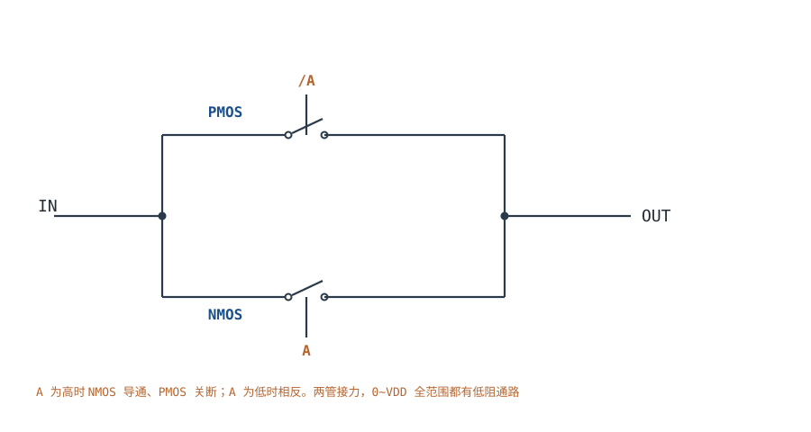
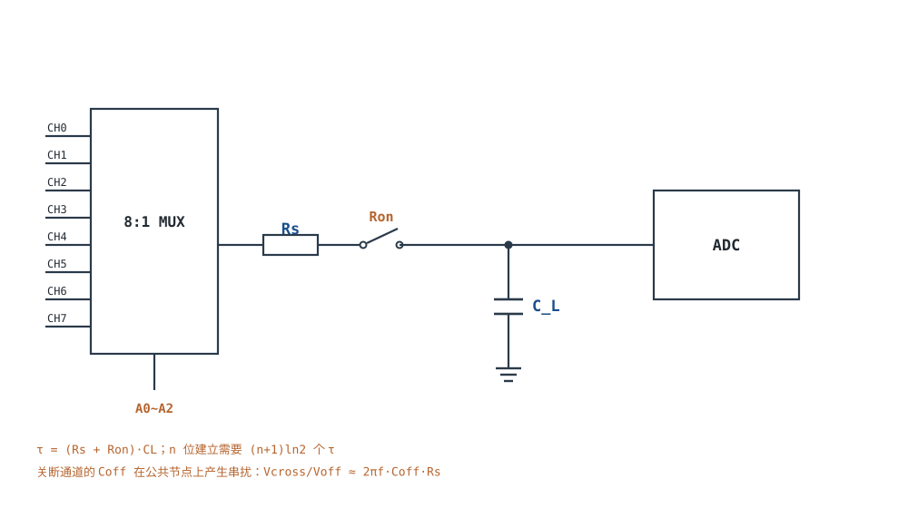

# 模拟开关与多路复用 Analog Switch & MUX

数字开关只传 0/1，模拟开关要传"任意电压"。它没有理想开关那种"通就是导线、断就是开路"的性质：导通时是一个随信号电压变化的电阻 $R_{on}$，断开时是一个带漏电和寄生电容的隔离墙，切换的瞬间还会把栅极上的电荷"甩"进信号节点。这三件事分别对应三个误差：**分压误差与失真**、**漏电与串扰**、**电荷注入与建立时间**。

本章的主线是"把开关当成一个会变的电阻 + 一个电荷源"，然后按信号链的顺序算账：$R_{on}$ 和它的平坦度怎么变成失真（§3.2），$R_{on}C$ 怎么决定多路切换后的建立时间（§3.3），电荷注入怎么决定采样精度（§3.4），关断通道的寄生电容怎么变成串扰（§3.5）。最后用一个"8 通道、12 位 ADC、10kΩ 源、1µs 采样窗口"的完整算例把四项误差一次算清——结论是：**这个需求用裸 MUX 满足不了，必须加缓冲或降低源阻抗。**

相关章节：[精密整流、峰值检测与采样保持](precision-rectifier-peak-samplehold.md)给采样保持的孔径与 droop，[V/I、I/V 转换与传感器接口](vi-iv-converter.md)给多路光电二极管的切换，[单电源电路与电平偏置搬移](single-supply-biasing.md)给开关信号范围的偏置，[稳定性：伯德图、相位裕度与补偿](stability-bode.md)给后级缓冲器的容性负载稳定性。

**本章约定**：$R_{on}$ 是导通电阻（$\Omega$）；$\Delta R_{on}$ 是 $R_{on}$ 在整个信号范围内的变化量（$\Omega$）；$R_s$ 是源内阻（$\Omega$）；$C_L$ 是负载/采样电容（F）；$C_{off}$ 是关断通道到输出节点的寄生电容（F）；$Q_{inj}$ 是开关断开时注入的电荷（C）；$t_{on}$、$t_{off}$ 是开通/关断时间（s）；$t_s$ 是建立时间（s）；$n$ 是 ADC 位数。**本章的开关工作在"通/断"两种状态，不是线性放大，虚短、虚断都不适用**；分析方法是"分压 + 电荷守恒 + RC 建立"，与[理想模型五假设与虚短、虚断](ideal-opamp.md)的线性分析是两套工具。

## 1. 设计动机

::: motivation 三个真实场景
**场景一：8 通道 12 位 ADC，切换后第一次采样总是偏 29 个 LSB。** 源内阻 10kΩ、MUX 的 $R_{on}=100\Omega$、ADC 采样电容 20pF、采样窗口 1µs。时间常数 $\tau=(10\text{k}+100)\times20\text{p}=202\text{ns}$，1µs 只有 4.95τ，误差 $e^{-4.95}=0.71\%$，对 12 位就是 29 个 LSB。**通道切换后的第一个采样点永远不准，第二个才准**——很多数据采集系统把这条当成"正常现象"，其实是建立时间不够。

**场景二：$R_{on}$ 随信号变 20Ω，10kΩ 负载下 THD 只有 −66dB。** 模拟开关的 $R_{on}$ 在靠近电源轨时抬升，整个信号范围内变化 20Ω。它与 10kΩ 的负载分压，分压比随信号变，产生二次谐波。估算 $HD2=\Delta R_{on}/(4R_L)=20/(4\times10^4)=0.05\%$，约 −66dB；负载降到 1kΩ 时变成 0.5%（−46dB）。**同样的开关，后级阻抗不同，失真差 20dB。**

**场景三：采样保持的开关注入 1pC，20pF 电容上跳 50mV。** 1pC 的电荷注入到 20pF 的保持电容，$\Delta V=Q/C=50\text{mV}$，对 3.3V、12 位 ADC 是 62 个 LSB。**电荷注入比运放失调大两个数量级，是采样精度的第一杀手。**
:::

| 你想确认 | 先算/先查 | 判据（工程经验值） |
|---|---|---|
| 分压误差多大 | $R_{on}/(R_{on}+R_L)$ | 误差 < 目标精度的 1/3 |
| 失真多大 | $HD2\approx\Delta R_{on}/(4R_L)$ | THD < −80dB（12 位以上） |
| 建立时间够不够 | $t_s=(n+1)\ln2\cdot(R_s+R_{on})C_L$ | $t_s$ < 采样窗口的 1/2 |
| 电荷注入多大 | $\Delta V=Q_{inj}/C_L$ | $\Delta V$ < 0.5 LSB |
| 串扰多大 | $V_{cross}/V_{off}\approx2\pi fC_{off}R_s$ | < 0.5 LSB |
| 漏电多大 | $\Delta V=I_{off}R_s$ | < 0.5 LSB |
| 先断后通有没有 | 数据手册 BBM 参数 | 切换瞬间不能两路短接 |

**不算这四笔账会摔在哪**，四个带数字的代价：

1. **把 MUX 当理想开关。** 10kΩ 源、100Ω 开关、20pF 电容，τ=202ns；12 位要 9τ=1.82µs，1µs 窗口只有 4.95τ，误差 0.71%（29 LSB）。**不是 ADC 不准，是前端没建立。**
2. **忽略 $R_{on}$ 平坦度。** 只看典型 $R_{on}=10\Omega$，不看它在信号两端抬到 40Ω；20Ω 的变化在 1kΩ 负载上就是 0.5% 的增益变化，THD 只有 −46dB。
3. **忽略电荷注入。** 1pC 注入 20pF 是 50mV（62 LSB）；选 $Q<0.1\text{pC}$ 的开关才能压到 6 LSB，仍不满足 12 位。
4. **忽略关断通道的电容。** 0.1pF 的关断电容在 1MHz、10kΩ 节点上产生 0.63% 的串扰（−44dB），比数据手册的 −80dB 差 36dB——**手册的隔离度是在 50Ω 源/负载下测的，你的节点阻抗是 10kΩ。**

## 2. 定义与直观

### 2.1 模拟开关是什么：一对互补的传输门

CMOS 模拟开关的核心是 **NMOS 与 PMOS 并联的传输门（transmission gate）**：NMOS 擅长传低电平（$V_{GS}$ 足够大），PMOS 擅长传高电平；两者并联、栅极用互补信号驱动，整个 0~$V_{DD}$ 范围内都有一条低阻通路。

单管为什么不行：NMOS 的栅极接 $V_{DD}$、源极跟随信号，当信号接近 $V_{DD}$ 时 $V_{GS}=V_{DD}-V_{in}$ 变小，沟道夹断，$R_{on}$ 飙升；PMOS 在信号接近 0V 时同理。并联后两个管子"接力"：信号低时 NMOS 强、信号高时 PMOS 强，中间段两个都导通，$R_{on}$ 曲线在两端抬升、中间平坦。

### 2.2 六个关键参数

| 参数 | 符号 | 典型量级 | 对电路的影响 |
|---|---|---|---|
| 导通电阻 | $R_{on}$ | 1~100Ω（低压 CMOS）；100~1000Ω（CD405x 系列） | 分压误差、建立时间、带宽 |
| 导通电阻平坦度 | $\Delta R_{on}$ | 5~50Ω（全信号范围） | 失真（THD） |
| 电荷注入 | $Q_{inj}$ | 0.1~20pC | 采样误差、毛刺 |
| 关断漏电 | $I_{off}$ | 0.01~10nA（25°C，每 10°C 翻倍） | 高阻节点的直流误差 |
| 开关时间 | $t_{on}$、$t_{off}$ | 5~200ns | 建立时间、通道切换速度 |
| 关断隔离/串扰 | $C_{off}$、dB | 0.05~1pF；−60~−100dB（50Ω 条件） | 多通道串扰 |

**六个参数里，对精度影响最大的是 $R_{on}$ 平坦度和电荷注入，而不是 $R_{on}$ 的典型值。** 典型值决定"信号衰减多少"，平坦度决定"衰减随信号变多少"（失真），电荷注入决定"采样瞬间跳多少"。

### 2.3 $R_{on}$ 为什么会带来失真

把开关看成一个电阻 $R_{on}(V)$，与后级负载 $R_L$ 分压：

$$V_{out}=V_{in}\frac{R_L}{R_L+R_{on}(V_{in})}$$

如果 $R_{on}$ 是常数，这只是一个固定的增益误差，校准就能消掉。问题是 $R_{on}$ 随 $V_{in}$ 变：信号高时 NMOS 的 $V_{GS}$ 变小、$R_{on}$ 变大；信号低时 PMOS 的 $V_{GS}$ 变小、$R_{on}$ 也变大。于是**分压比随信号瞬时变化**，输出不再是输入的线性缩放，产生谐波。

一阶估算：设 $R_{on}(V)=R_{on0}+aV$，且 $R_{on}\ll R_L$，则

$$V_{out}\approx V\left(1-\frac{R_{on0}}{R_L}-\frac{aV}{R_L}\right)=V\left(1-\frac{R_{on0}}{R_L}\right)-\frac{aV^2}{R_L}$$

二次项 $aV^2/R_L$ 对正弦输入 $V=V_p\sin\theta$ 产生二次谐波：

$$HD2\approx\frac{aV_p}{2R_L}=\frac{\Delta R_{on}}{4R_L}$$

符号与单位：$HD2$ 是二次谐波相对基波的幅度（无量纲，乘 100 得 %）；$\Delta R_{on}$ 是 $R_{on}$ 在峰峰值范围内的变化量（$\Omega$）；$R_L$ 是负载电阻（$\Omega$）。推导假设 $R_{on}$ 随 $V$ 线性变化、$R_{on}\ll R_L$、负载是纯电阻。

**关键结论**：失真与 $\Delta R_{on}/R_L$ 成正比，与 $R_{on}$ 的绝对值无关。选开关时"典型 $R_{on}$ 小"不够，要看**平坦度**；后级阻抗越低，同样的平坦度产生的失真越大。这与[噪声](noise.md)里"电阻热噪声与阻值成正比"一样，是选型时最容易只看一个数的地方。

### 2.4 多路复用的建立时间与串扰

**建立时间**：通道切换后，采样电容要通过源内阻 $R_s$ 和开关电阻 $R_{on}$ 充电，时间常数

$$\tau=(R_s+R_{on})C_L$$

从 0 建立到 $n$ 位精度（误差 <0.5 LSB），需要的指数时间常数个数是

$$k=\ln\frac{2^n}{0.5}=(n+1)\ln2$$

12 位时 $k=13\times0.693=9.01$，即 $t_s\approx9\tau$。**位数每增加 1 位，k 增加 0.693，建立时间增加约 7.7%**——16 位时 $k=11.8$，比 12 位多 31%。

**串扰**：关断通道并没有"完全断开"，它的源漏之间、封装引脚之间有 $C_{off}$，把邻道的信号耦合到公共输出节点。耦合电流 $i=2\pi fC_{off}V_{off}$，在节点阻抗 $Z_{node}\approx R_s$（低频）上产生电压：

$$\frac{V_{cross}}{V_{off}}\approx2\pi fC_{off}R_s$$

符号与单位：$V_{cross}$ 是串扰到输出节点的电压（V）；$V_{off}$ 是关断通道上的信号电压（V）；$f$ 是信号频率（Hz）；$C_{off}$ 是关断通道到输出的寄生电容（F）；$R_s$ 是源内阻与节点阻抗（$\Omega$）。**这个式子是本章最容易被忽略的一条**：数据手册的隔离度是在 50Ω 源/负载下测的，源阻抗 10kΩ 时串扰会恶化 $10\text{k}/50=200$ 倍（46dB）。

::: analogy 模拟开关像一排带缝隙的阀门
模拟开关像一排阀门：开到最大也不是"没有阻力"——阀门本身有流阻（$R_{on}$），而且流阻随水压变（$R_{on}$ 随信号变），水压高时流阻大，流量就不是压力的线性函数（失真）。关掉阀门也不是"绝对密封"：阀芯和阀座之间有缝隙（$C_{off}$），旁边管道的水压波动会渗过来（串扰）。

类比的边界：阀门的缝隙是固定的，模拟开关的"缝隙"是电容，频率越高渗得越多；阀门关得越快水锤越大（电荷注入），模拟开关关断时把栅极电荷甩进管道，产生电压毛刺。
:::

## 3. 定量关系

### 3.1 分压误差与 $R_{on}$ 平坦度

导通时开关与负载分压，增益误差

$$\varepsilon_{div}=\frac{R_{on}}{R_{on}+R_L}\approx\frac{R_{on}}{R_L}\quad(R_{on}\ll R_L)$$

对 12 位系统（0.0244% 满度），要求 $\varepsilon_{div}<0.0244\%/3=0.008\%$：$R_L=1\text{M}\Omega$ 时 $R_{on}<80\Omega$；$R_L=10\text{k}\Omega$ 时 $R_{on}<0.8\Omega$——**后级阻抗越低，对 $R_{on}$ 的要求越苛刻**。这就是为什么 MUX 后面通常跟一个高阻缓冲器。

平坦度带来的**增益变化**是

$$\frac{\Delta G}{G}\approx\frac{\Delta R_{on}}{R_L}$$

它不能靠校准消掉（因为随信号瞬时变），只能靠降低 $\Delta R_{on}$ 或提高 $R_L$。

### 3.2 失真的量级

由 §2.3，$HD2\approx\Delta R_{on}/(4R_L)$。代入典型值：

| $\Delta R_{on}$ | $R_L=1\text{k}\Omega$ | $R_L=10\text{k}\Omega$ | $R_L=100\text{k}\Omega$ |
|---|---|---|---|
| 5Ω | 0.125%（−58dB） | 0.0125%（−78dB） | 0.00125%（−98dB） |
| 20Ω | 0.5%（−46dB） | 0.05%（−66dB） | 0.005%（−86dB） |
| 50Ω | 1.25%（−38dB） | 0.125%（−58dB） | 0.0125%（−78dB） |

**读表方法**：12 位系统要 −74dB 左右的失真（1 LSB 对应 −72dB），$\Delta R_{on}=20\Omega$ 时 $R_L$ 至少要 30kΩ；如果后级是 1kΩ，必须选 $\Delta R_{on}<2\Omega$ 的开关，或加缓冲。16 位系统（−96dB）几乎必须用缓冲器把 $R_L$ 抬到 MΩ 级。

### 3.3 建立时间：位数决定倍数

$$t_s=k\tau=(n+1)\ln2\cdot(R_s+R_{on})C_L$$

| 位数 $n$ | $k=(n+1)\ln2$ | $\tau=202\text{ns}$ 时的 $t_s$ |
|---|---|---|
| 8 | 6.24 | 1.26µs |
| 12 | 9.01 | 1.82µs |
| 16 | 11.78 | 2.38µs |
| 20 | 14.55 | 2.94µs |

**注意 $\tau$ 里是 $R_s+R_{on}$，不是只有 $R_{on}$。** 源内阻 10kΩ 时，$R_{on}=100\Omega$ 只占 1%，把开关换成 10Ω 的"低阻型号"几乎不改善建立时间——**瓶颈在源内阻**。这是选型时最常见的误判：花高价买低 $R_{on}$ 的开关，却不解决 10kΩ 的源。

### 3.4 电荷注入

开关断开瞬间，沟道里存储的电荷（以及栅极通过 $C_{gd}$ 耦合的电荷）被"挤"到源漏两端，一部分进入采样电容：

$$\Delta V_{inj}=\frac{Q_{inj}}{C_L}$$

符号与单位：$\Delta V_{inj}$ 是采样电容上的电压跳变（V）；$Q_{inj}$ 是注入电荷（C）；$C_L$ 是采样电容（F）。1pC 注入 20pF 就是 50mV；对 3.3V、12 位 ADC（1 LSB=0.806mV）是 62 个 LSB。

电荷注入的难点是**它与信号有关**：沟道电荷 $Q_{ch}=WLC_{ox}(V_{GS}-V_{TH})$ 随输入电压变，所以注入量随信号变，产生非线性而不只是固定偏移。工程上的对策：

- **低注入开关**：$Q_{inj}<0.1\text{pC}$；
- **增大 $C_L$**：$\Delta V$ 按比例下降，但建立时间按 $R C$ 上升；
- **差分/底极板采样**：让注入电荷在差分对或开关的两端共模抵消；
- **dummy 开关**：用一半尺寸的互补开关吸收电荷（精度有限）；
- **先断后通（BBM）**：多路切换时避免两路瞬间短接，但不解决注入本身。

### 3.5 串扰与关断隔离

由 §2.4，串扰比 $V_{cross}/V_{off}\approx2\pi fC_{off}R_s$。代入 $C_{off}=0.1\text{pF}$、$R_s=10\text{k}\Omega$：

| 频率 | 串扰比 | dB | 对 12 位（3.3V）的 LSB |
|---|---|---|---|
| 10kHz | 0.0063% | −84dB | 0.26 |
| 100kHz | 0.063% | −64dB | 2.6 |
| 1MHz | 0.63% | −44dB | 26 |

**数据手册的 −80dB 是在 50Ω 源/负载下测的**；同样 0.1pF，10kΩ 节点上 1MHz 就是 −44dB。要改善串扰：降低节点阻抗（加缓冲）、减小 $C_{off}$（选低电容开关）、PCB 上把相邻通道的地隔离、差分传输。

### 3.6 关断漏电

关断通道的漏电 $I_{off}$ 流过导通的源阻抗，产生直流误差：

$$\Delta V_{leak}=I_{off}R_s$$

1nA 漏电、10kΩ 源是 10µV（0.012 LSB）；1MΩ 源就是 1mV（1.24 LSB）。漏电随温度每 10°C 约翻倍，85°C 时可能是 25°C 的 60 倍——**高温高阻场合，漏电会变成主要误差**。

## 4. 典型计算

### 4.1 完整算例：8 通道 12 位 ADC 前端，1µs 采样窗口够不够

**需求**：8 路传感器，源内阻 $R_s=10\text{k}\Omega$，MUX 的 $R_{on}=100\Omega$、$\Delta R_{on}=20\Omega$、$Q_{inj}=1\text{pC}$、$C_{off}=0.1\text{pF}$、$I_{off}=1\text{nA}$（均为典型量级，具体以数据手册为准）；ADC 为 12 位、3.3V（1 LSB=0.806mV），采样电容 $C_L=20\text{pF}$，采样窗口 1µs。要求误差 <1 LSB。

**第 1 步：建立时间。** 时间常数

$$\tau=(R_s+R_{on})C_L=(10^4+100)\times20\times10^{-12}=202\text{ns}$$

12 位需要 $k=9.01$ 个时间常数：

$$t_s=9.01\times202\text{ns}=1.82\mu\text{s}$$

**1µs 窗口只有 $1/0.202=4.95$ 个时间常数**，剩余误差

$$e^{-4.95}=0.708\%\quad\Rightarrow\quad 0.00708\times4096=29\ \text{LSB}$$

**结论：不满足，误差 29 LSB。** 这是"通道切换后第一个采样点"的误差；如果每个通道连续采多次，第二次开始误差可以忽略，但吞吐率下降 8 倍。

**第 2 步：加缓冲器。** 在 MUX 与 ADC 之间加一级单位增益缓冲（输入电容 2pF、输出阻抗 5Ω），采样网络变成"缓冲器输出阻抗 + ADC 内部开关电阻"，两者合计按 50Ω 估：

$$\tau=50\times(20+2)\times10^{-12}=1.1\text{ns},\qquad t_s=9.01\times1.1=9.9\text{ns}$$

1µs 绰绰有余。**代价**：缓冲器的输入偏置电流、失调和噪声进入信号链；缓冲器必须能驱动 ADC 的容性负载（看[稳定性：伯德图、相位裕度与补偿](stability-bode.md)的容性负载分析）。

**第 3 步：不加缓冲、降源阻抗。** 把 $R_s$ 从 10kΩ 降到 1kΩ：

$$\tau=(1000+100)\times20\times10^{-12}=22\text{ns},\qquad t_s=9.01\times22=198\text{ns}$$

1µs 窗口有 45 个时间常数，满足。**代价**：传感器后面要加一级缓冲/放大，或者选低输出阻抗的传感器。

**第 4 步：延长采样窗口。** 若 ADC 允许 2µs 采样，10kΩ 源也能满足（$2\mu/0.202=9.9$ 个时间常数，误差 $e^{-9.9}=5\times10^{-5}$，0.2 LSB）。**代价**：吞吐率下降。

**第 5 步：电荷注入。** $\Delta V=1\text{pC}/20\text{pF}=50\text{mV}=62$ LSB，**远大于建立误差**。即使建立完美，电荷注入也让 12 位精度不成立。对策：选 $Q_{inj}<0.01\text{pC}$ 的开关（0.62 LSB）——但这样的开关很少；或者把 $C_L$ 增大到 200pF（5mV，6.2 LSB，仍不够）；或者用差分/底极板采样；或者承认"外部 MUX 的注入被 ADC 内部采样开关主导"，在系统级校准。

**第 6 步：串扰。** 邻道信号 1V、100kHz：

$$\frac{V_{cross}}{V_{off}}=2\pi\times10^5\times0.1\times10^{-12}\times10^4=6.28\times10^{-4}=0.063\%$$

即 2.6 LSB。10kHz 时 0.26 LSB，可以接受；100kHz 时超标。**如果邻道是高频开关信号，必须加缓冲或降低节点阻抗。**

**第 7 步：漏电。** $I_{off}=1\text{nA}\times10\text{k}\Omega=10\mu\text{V}=0.012$ LSB，可忽略；85°C 时漏电 ×60 变成 0.6mV=0.74 LSB，接近预算。

**第 8 步：结论。** 这个需求用裸 MUX 满足不了：建立差 29 LSB、电荷注入差 62 LSB、100kHz 串扰差 2.6 LSB。可行的系统方案是"MUX → 缓冲器 → ADC"，缓冲器把源阻抗和电荷注入问题一起解决；代价是增加一级的失调、噪声和功耗。

### 4.2 完整算例：$R_{on}$ 平坦度决定的 THD

**需求**：MUX 后接 10kΩ 负载，$\Delta R_{on}=20\Omega$，估算 THD；若负载换成 1kΩ 呢？

**第 1 步：10kΩ 负载。**

$$HD2=\frac{\Delta R_{on}}{4R_L}=\frac{20}{4\times10^4}=5\times10^{-4}=0.05\%$$

用 dB 表示：$20\lg(5\times10^{-4})=-66\text{dB}$。

**第 2 步：1kΩ 负载。**

$$HD2=\frac{20}{4\times10^3}=5\times10^{-3}=0.5\%\quad(-46\text{dB})$$

**第 3 步：换算成位数。** 12 位系统的 1 LSB 相对满度是 $1/4096=0.0244\%$（−72dB）。0.05% 的二次谐波约 2 LSB，勉强可接受；0.5% 是 20 LSB，完全不可接受。

**第 4 步：结论。** 同样的开关，后级从 10kΩ 降到 1kΩ，THD 恶化 20dB。**要么选 $\Delta R_{on}<2\Omega$ 的开关，要么把后级阻抗抬到 100kΩ 以上。** 注意这只是二次谐波的一阶估算，实际 THD 还包含三次谐波、开关时间不对称、电荷注入的非线性，最终以实测为准。

### 4.3 完整算例：电荷注入与保持电容的权衡

**需求**：采样保持，$Q_{inj}=1\text{pC}$，要求注入误差 <0.5 LSB（12 位、3.3V）。

**第 1 步：算需要的电容。**

$$C_L\ge\frac{Q_{inj}}{\Delta V}=\frac{10^{-12}}{0.5\times0.806\times10^{-3}}=\frac{10^{-12}}{4.03\times10^{-4}}=2.48\text{nF}$$

**第 2 步：算建立时间。** $R_{on}=100\Omega$、$R_s=1\text{k}\Omega$：

$$\tau=(1000+100)\times2.48\times10^{-9}=2.73\mu\text{s},\qquad t_s=9.01\times2.73=24.6\mu\text{s}$$

**第 3 步：结论。** 把电容加大到 2.5nF 能把注入压到 0.5 LSB，但建立时间变成 24.6µs——**采样率降到 40kSPS 以下**。这就是电荷注入与速度的权衡：要么选低注入开关，要么接受慢速，要么用差分/底极板采样。

## 5. 工程含义

### 5.1 选型参数表

| 应用 | 首要参数 | 次要参数 | 典型选择 |
|---|---|---|---|
| 多通道 ADC 前端 | $R_{on}$ 平坦度、$Q_{inj}$ | $C_{off}$、BBM | 低注入、低 $C_{off}$ 的 CMOS MUX + 缓冲 |
| 采样保持 | $Q_{inj}$、$t_{off}$ | $R_{on}$、漏电 | 低注入、快速关断 |
| 音频路由 | $\Delta R_{on}$、THD | 串扰、开关时间 | 低失真音频开关 |
| 高阻传感器 | 漏电、$C_{off}$ | $R_{on}$ | 低漏电、低电容 |
| 高压/大信号 | 信号范围、$R_{on}$ | 供电、ESD | 高压 CMOS 或 JFET 开关 |

### 5.2 前端设计的四条经验

1. **先算 $R_s+R_{on}$，再谈开关。** 源内阻占主导时，换低 $R_{on}$ 开关没用；先加缓冲或降低源阻抗。
2. **12 位以上必须核算电荷注入。** $\Delta V=Q/C$ 很容易超过 1 LSB；要么选低注入开关，要么用差分/底极板采样，要么在系统级校准。
3. **串扰按实际节点阻抗算，不按手册的 50Ω。** 高阻节点上串扰会恶化几十 dB；加缓冲是根治办法。
4. **多路切换必须用 BBM。** 先断后通，避免两路瞬间短接；BBM 时间要大于开关的 $t_{off}$，否则仍有重叠。

### 5.3 布局与保护

- **MUX 的公共输出节点是敏感节点**：走线短、远离数字线、下面不要走时钟。
- **电源去耦**：$V_{DD}$ 就近 0.1µF，模拟开关对电源毛刺敏感。
- **输入保护**：信号超出 $V_{DD}$/GND 时，开关内部的 ESD 二极管会导通，可能锁死；必要时加限流电阻和肖特基钳位。
- **未用通道**：接到已知电位（地或 $V_{DD}/2$），不要悬空，否则会通过 $C_{off}$ 注入噪声。
- **地平面**：模拟开关的"地"要干净，数字控制信号的回流不要穿过模拟区。

### 5.4 什么时候模型不够用

- **高频（>10MHz）**：封装寄生电感、引脚电容开始主导，$R_{on}$ 不再是纯电阻，要用 S 参数或厂商模型。
- **大信号**：$R_{on}$ 的平坦度在接近轨时急剧变差，线性模型失效，必须看 $R_{on}$-vs-$V_{in}$ 曲线。
- **高温**：漏电每 10°C 翻倍，85°C 以上高阻节点的漏电误差可能超过建立误差。
- **电荷注入**：$Q_{inj}$ 随信号、电源、温度变，数据手册只给典型值，精密设计要实测。
- **多通道同时切换**：多个通道的注入电荷会在公共节点叠加，最坏情况是单通道的 N 倍。

## 6. 常见坑

::: pitfall 常见坑
- **现象**：多路采集时，通道切换后的第一个采样点总是偏，第二个就正常。**原因**：建立时间不够，$(R_s+R_{on})C_L$ 的时间常数太大，1µs 窗口只有几个 τ。**解决**：按 $t_s=(n+1)\ln2\cdot(R_s+R_{on})C_L$ 重算；加缓冲、降源阻抗或延长采样窗口。
- **现象**：MUX 输出接低阻负载后失真明显，THD 只有 −46dB。**原因**：$R_{on}$ 随信号变化，与低阻负载分压产生二次谐波，$HD2\approx\Delta R_{on}/(4R_L)$。**解决**：提高后级阻抗（加缓冲）、选 $\Delta R_{on}$ 更小的开关；按 §3.2 的表核算。
- **现象**：采样值每次比实际高几十 mV，且随输入变。**原因**：开关断开时的电荷注入 $\Delta V=Q_{inj}/C_L$。**解决**：选低注入开关、增大 $C_L$（权衡建立时间）、差分/底极板采样。
- **现象**：相邻通道的高频信号窜入当前通道，数据手册标 −80dB 但实测只有 −44dB。**原因**：数据手册的隔离度是在 50Ω 源/负载下测的，实际节点阻抗 10kΩ，串扰按 $2\pi fC_{off}R_s$ 恶化。**解决**：降低节点阻抗（缓冲）、选低 $C_{off}$ 开关、PCB 隔离、差分传输。
- **现象**：高温时高阻传感器的读数漂移。**原因**：关断漏电每 10°C 翻倍，$I_{off}R_s$ 产生直流误差。**解决**：降低源阻抗、选低漏电开关、做温度补偿；85°C 以上要重新核算。
- **现象**：切换瞬间两路信号互相拉，输出出现毛刺甚至过流。**原因**：开关是"先通后断"（make-before-break），两通道瞬间短接。**解决**：选带 BBM 的 MUX；确认 BBM 时间大于 $t_{off}$；必要时在软件上增加切换后的等待。
:::

## 7. 自测题

$R_s=10\text{k}\Omega$、$R_{on}=100\Omega$、$C_L=20\text{pF}$，12 位建立需要多久？1µs 窗口的误差是多少个 LSB？

$\tau=(10^4+100)\times20\times10^{-12}=202\text{ns}$。

12 位需要 $k=(12+1)\ln2=9.01$ 个时间常数，$t_s=9.01\times202\text{ns}=1.82\mu\text{s}$。

1µs 只有 $1/0.202=4.95$ 个 τ，误差 $e^{-4.95}=0.708\%$，即 $0.00708\times4096=29$ 个 LSB。**不满足。**

$\Delta R_{on}=20\Omega$、负载 10kΩ，二次谐波大约多少 dB？负载 1kΩ 呢？

$$HD2=\frac{\Delta R_{on}}{4R_L}=\frac{20}{4\times10^4}=0.05\%$$

$20\lg(0.0005)=-66\text{dB}$。

1kΩ 时 $HD2=20/(4\times10^3)=0.5\%$，$20\lg(0.005)=-46\text{dB}$。

12 位系统的 1 LSB 约 −72dB，所以 10kΩ 时勉强、1kΩ 时完全不行。

开关电荷注入 1pC、采样电容 20pF，误差是多少 mV？多少个 12 位 LSB（3.3V）？

$\Delta V=Q/C=1\text{pC}/20\text{pF}=50\text{mV}$。

1 LSB $=3.3/4096=0.806\text{mV}$，所以 $50/0.806=62$ 个 LSB。

要压到 0.5 LSB（0.403mV），需要 $C\ge1\text{pC}/0.403\text{mV}=2.48\text{nF}$，但建立时间会变成几十 µs。

$C_{off}=0.1\text{pF}$、$R_s=10\text{k}\Omega$，100kHz 时串扰多少 dB？为什么和数据手册的 −80dB 差这么多？

$$\frac{V_{cross}}{V_{off}}=2\pi\times10^5\times0.1\times10^{-12}\times10^4=6.28\times10^{-4}=0.063\%$$

$20\lg(6.28\times10^{-4})=-64\text{dB}$。

数据手册的 −80dB 是在 50Ω 源/负载下测的；串扰正比于节点阻抗，10kΩ 是 50Ω 的 200 倍（+46dB），所以从 −80dB 恶化到 −64dB 左右。**串扰必须按实际节点阻抗算。**

为什么 NMOS 和 PMOS 要并联成传输门？单管各有什么问题？

NMOS 在信号接近 $V_{DD}$ 时 $V_{GS}=V_{DD}-V_{in}$ 变小，沟道夹断，$R_{on}$ 急剧上升；PMOS 在信号接近 0V 时同理。两者并联、栅极互补驱动后，信号低时 NMOS 强、信号高时 PMOS 强，整个 0~$V_{DD}$ 范围内都保持低阻。

代价是芯片面积、寄生电容和电荷注入都增加（两个管子都要注入），所以低注入场合反而要小心传输门的总注入量。

多路切换时"先断后通"（BBM）解决什么问题？它和电荷注入是一回事吗？

BBM 解决的是"切换瞬间两个通道同时导通、互相短接"的问题：如果先通后断，两路信号源会通过开关直接连在一起，产生大电流、毛刺，甚至损坏。BBM 保证先断开旧通道、再接通新通道。

它不解决电荷注入。电荷注入是开关断开时沟道电荷进入采样节点，是精度问题；BBM 是切换时序问题。两者要分别处理。

## 8. 参考资料

- **Analog Devices, MT-088 *Analog Switches and Multiplexers*（Mini Tutorial）**：模拟开关的参数定义、$R_{on}$ 平坦度、电荷注入、关断隔离与串扰；本章 §2.2 的六参数表与 §3.4 的注入模型按该文整理。<https://www.analog.com/media/en/training-seminars/tutorials/MT-088.pdf>
- **Analog Devices, MT-035 *Op Amp Inputs, Outputs, Single-Supply, and Rail-to-Rail Issues***：开关信号范围与后级共模/摆幅的配合；本章 §5.1 的选型边界参照该文。<https://www.analog.com/media/en/training-seminars/tutorials/MT-035.pdf>
- **Analog Devices, ADG708/ADG709 数据手册**：8 通道 CMOS MUX 的 $R_{on}$、$R_{on}$ 平坦度、电荷注入、关断隔离与串扰参数；本章 §4.1 的典型值按该类器件量级取值（具体以所选型号数据手册为准）。
- **TI, CD4051B 数据手册**：8 通道模拟多路复用器的导通电阻、关断漏电与传输特性；本章 §2.2 的"100~1000Ω"量级参照该系列。
- **Horowitz & Hill, *The Art of Electronics*（3rd ed.）**：传输门、模拟开关与采样电路相关小节；本章 §2.1 的互补传输门原理与该书一致。
