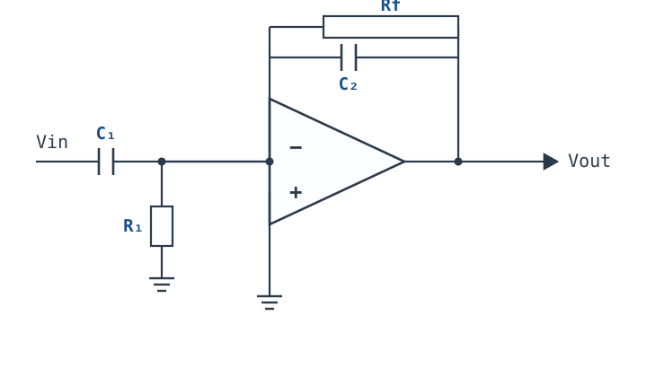
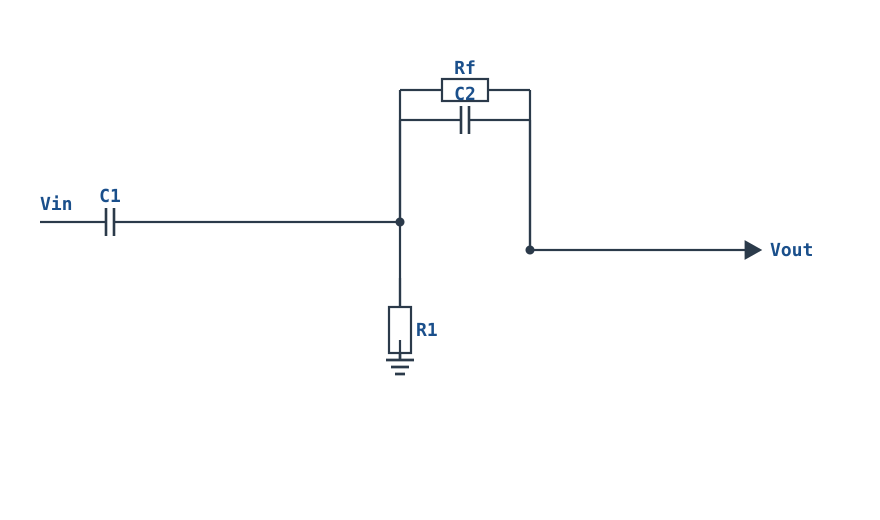
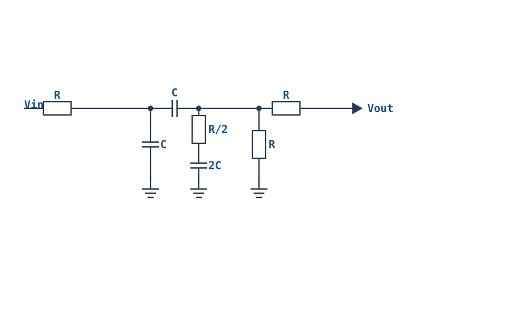
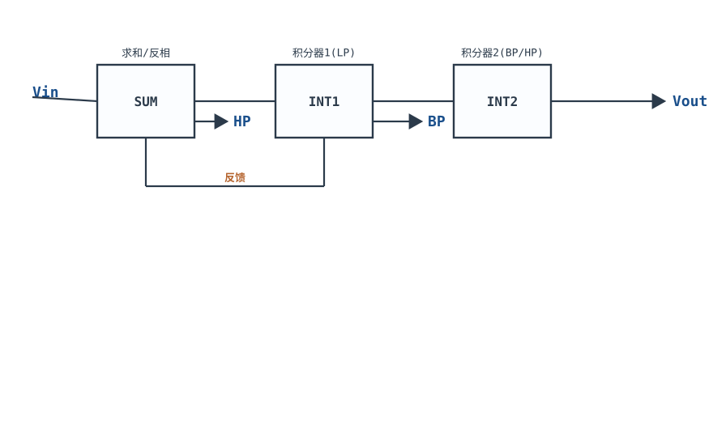
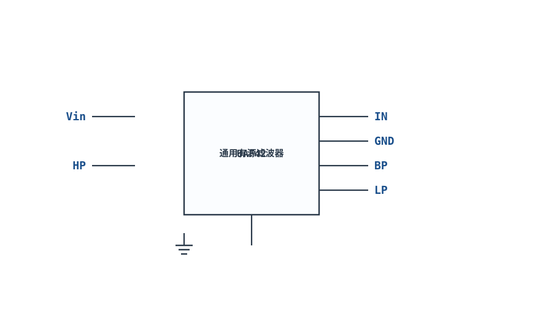

# 带通与带阻滤波器入门 Bandpass & Bandstop

## 1. 设计动机

::: motivation 为什么需要这两种滤波器
前面的低通/高通只切一刀：要么砍低频、要么砍高频。但现实里常遇到"只关心中间一段频率"或"只掐掉某一个频率"的需求：
- 心电/生理信号里要提取 0.5~40Hz 的一段，滤掉其他一切——**带通（Bandpass）**；
- 测量放大器总被 50Hz 工频干扰，其他频率都想要——**带阻/陷波（Bandstop / Notch）**，专门挖掉 50Hz 这个坑。

带通和带阻是低通、高通的组合产物，但有自己的关键参数：中心频率、带宽、Q 值。
:::

## 2. 原理图

**多路反馈型带通（MFB Bandpass）**：一个运放、两个电容、三个电阻，同相端接地，输入经 C1 到反相端，反馈臂 Rf 与 C2，反相端还经 R1 接地。



**双 T 型陷波（Twin-T Notch）**：三组 R、C 组成 T 型网络，在特定频率形成很深的凹陷，常用来掐 50/60Hz 工频。

## 3. 静态分析（DC）

- 带通 MFB：直流下两个电容都开路，信号进不来、反馈也不通，直流增益为 0——带通天然隔断直流，不需要额外隔直。
- 双 T 陷波：直流电阻直通，直流信号可通过（陷波只挡交流窄带）。
- 运放同相端接地，反相端虚地。

## 4. 动态分析（AC / 瞬态）

**关键参数**：

- **中心频率 $f_0$（Center Frequency）**：带通峰值点 / 带阻凹陷点；
- **带宽 $BW$（Bandwidth）**：增益从峰值掉 3dB 的两点间频率差；
- **品质因数 $Q$**：$Q=\dfrac{f_0}{BW}$。Q 越高，带通越"瘦"（选频越尖），陷波的坑越窄越深。

MFB 带通取等值 $R$、$C$ 时：

$$f_0=\frac{1}{2\pi RC},\qquad Q=\frac{1}{3}\sqrt{\frac{R_f}{R}},\qquad \text{通带增益 }|H_0|=\frac{R_f}{2R}$$

带通与带阻的归一化幅频特性（横轴 $f/f_0$，Q≈10 的窄带）：

```echarts
{
  "tooltip": {"trigger": "axis"},
  "legend": {"data": ["带通 Bandpass","带阻/陷波 Notch"], "bottom": 0, "textStyle": {"fontSize": 13}},
  "grid": {"left": 56, "right": 24, "top": 26, "bottom": 58},
  "xAxis": {"type": "category", "name": "f/f₀", "data": ["0.01","0.1","0.5","1","2","5","10","100"], "axisLabel": {"fontSize": 10}},
  "yAxis": {"type": "value", "name": "dB", "min": -45, "max": 5, "interval": 10, "axisLabel": {"fontSize": 11}},
  "series": [
    {"name": "带通 Bandpass", "type": "line", "smooth": true, "showSymbol": true, "lineStyle": {"width": 2.6, "color": "#1a4f8b"},
     "data": [-40, -3, -0.5, 0, -0.3, -1.4, -3, -40]},
    {"name": "带阻/陷波 Notch", "type": "line", "smooth": true, "showSymbol": true, "lineStyle": {"width": 2.6, "color": "#b5642e"},
     "data": [0, 0, -0.5, -40, -0.5, 0, 0, 0]}
  ]
}
```

## 5. 环路分析

- **带通 MFB 的稳定性**：它是带两个电容的反相结构，环路在 $f_0$ 附近相移变化剧烈。$Q$ 不能做得太高（MFB 一般 Q<10），Q 太高等于在 $f_0$ 附近环路增益放大太多、相移接近 180°，容易自激。
- **双 T 陷波的 Q**：无源双 T 的 Q 只有约 1/4，坑宽而浅；为了让坑又窄又深，通常把双 T 接到一个增益略小于 1 的同相放大器上（正反馈抬 Q），但正反馈过头同样会在 $f_0$ 起振——这是陷波设计最常见的自激点。
- **高 Q 需求**：Q>10 或要独立调 $f_0$ 与 Q 时，改用**状态可变滤波器（State-Variable, SVF）**或双二阶（Biquad）结构。

::: advanced 进阶：Q 与带宽的关系
对二阶带通，$BW=f_0/Q$。Q=10 时带宽是中心频率的 1/10；Q=100 时只有 1/100。窄带选频（如 50Hz 检测、载波解调）要高 Q，但高 Q 滤波器对元件精度敏感、起振风险大、建立时间长（约 $Q/f_0$）。工程上够用就好，不要盲目追高 Q。
:::

## 6. 元件取值与工程权衡

- **先定 $f_0$ 再选 C**：kHz 级取 C=1nF~100nF，反算 $R=1/(2\pi f_0 C)$。
- **Q 由电阻比决定**：MFB 里 $Q\propto\sqrt{R_f/R}$，调 $R_f$ 同时改变增益和 Q，二者耦合——这是 MFB 的局限。
- **电容精度**：$f_0$ 直接挂在 RC 乘积上，选 C0G/NP0、1% 电阻。
- **陷波用电阻网络**：双 T 要严格匹配（R、R、R/2 与 C、C、2C），失配会让凹陷变浅、偏移。
- **电源与运放带宽**：$f_0$ 远小于运放 GBP（≥100 倍），高 Q 时要求更高。

## 7. 完整设计示例

::: example 设计一个 f0=1kHz、Q=10 的 MFB 带通
1. **需求**：只通过 1kHz 附近 ±100Hz 的信号，增益约 5 倍。
2. **选电容**：取 C=10nF（C0G）。
3. **算 R**：$R=1/(2\pi f_0 C)=1/(2\pi\times1\text{k}\times10\text{n})\approx15.9\text{k}\Omega$，取 15.8kΩ（1%）。
4. **算 Rf**：$Q=\frac{1}{3}\sqrt{R_f/R}=10\Rightarrow\sqrt{R_f/R}=30\Rightarrow R_f=900 R\approx14.2\text{M}\Omega$——阻值过大，偏置电流和噪声问题严重。
5. **取舍**：说明 MFB 不适合做 Q=10。改设计：降 Q 到 5（$R_f=225 R\approx3.6\text{M}\Omega$）仍偏大；实用做法是选 Q=1~2（$R_f=9R\approx140\text{k}\Omega$），或换状态可变结构。本例取 Q=1.5，$R_f\approx(4.5)^2 R\approx320\text{k}\Omega$，通带增益 $R_f/(2R)\approx10$。
6. **验算**：$f_0\approx1\text{kHz}$，$BW=f_0/Q\approx670\text{Hz}$。
:::

## 8. 仿真与实验

LTspice 搭建 MFB 带通：
- AC 扫描 10Hz~100kHz，伯德图应在 1kHz 出现单峰、两侧下降，形似山头；
- 输入扫频正弦，用示波器观察输出在 1kHz 最大、偏离后衰减；
- 双 T 陷波：输入 50Hz 正弦，观察输出被压到很小；输入 100Hz，输出几乎不受影响；
- 故意把陷波放大器增益调到接近 1，观察 50Hz 处起振。

## 扩展与变种电路

### 扩展1：MFB 带通滤波器 MFB Bandpass

用一个运放、两个电容、三个电阻实现窄带选频——中心频率处增益最大，两侧衰减，是最经典的带通实现。



::: example 工作原理/静态分析
等值 $R,C$ 时：

$$f_0=\frac{1}{2\pi RC},\qquad Q=\frac{1}{3}\sqrt{\frac{R_f}{R}},\qquad |H_0|=\frac{R_f}{2R}$$

中心频率 $f_0$ 处输出最大，$Q=f_0/BW$ 决定带宽宽窄。
:::

取值：$Q$ 控制在 1~10；$Q$ 过高会把 $R_f$ 推到 MΩ 级，偏置与噪声问题严重。

::: pitfall Q 过高电阻过大
$Q=10$ 时 $R_f\approx 900R$，阻值过大导致偏置电流失调、噪声放大。高 Q（>10）应改用状态可变结构。
:::

### 扩展2：双 T 工频陷波 Twin-T Notch

三组 R、C 组成对称 T 型网络，在 $f_0$ 处形成极深的凹陷——专门掐掉 50/60Hz 工频，其余频率几乎无损通过。



::: example 工作原理/静态分析
$$f_0=\frac{1}{2\pi RC}$$

网络需严格匹配 $R,R,R/2$ 与 $C,C,2C$。无源双 T 的 $Q\approx 1/4$，坑宽而浅；为加深凹陷，常把它接在增益略小于 1 的同相放大器上（正反馈抬 Q）。
:::

取值：工频 $f_0=50\text{Hz}$ 时取 $C=100\text{nF}$，$R\approx 31.8\text{k}\Omega$；元件用 1% 同批次。

::: pitfall 正反馈过头自激
抬 Q 用的同相放大器增益若超过 1，会在 $f_0$ 处满足振荡条件，输出恒有 50Hz 振荡。增益必须 <1 并留裕量。
:::

### 扩展3：状态变量滤波器 State-Variable

用两个积分器加一个求和运放，同时输出低通、带通、高通三种响应——一个电路顶三个滤波器，且 $f_0$ 与 $Q$ 可独立调节。



::: example 工作原理/静态分析
求和级对 $V_{in}$、LP、BP 按权重求和；第一个积分器输出 LP、第二个输出 HP，反推得 BP。$f_0$ 由积分器 $RC$ 设定，$Q$ 由求和权重设定，二者解耦。
:::

取值：适合 $Q>10$ 的窄带选频；建立时间约 $Q/f_0$，高 Q 时响应慢。

::: pitfall 建立时间长
高 Q 状态可变滤波器对阶跃输入要很久才稳定，ADC 采样前需等待；在响应速度与选频性之间折中。
:::

### 扩展4：通用集成有源滤波器 Universal Active Filter

把状态可变结构集成在一颗 IC（如 UAF42）里，外接几个电阻电容即可配成低通/带通/高通，省去三颗运放的布线。



::: example 工作原理/静态分析
内部已集成两个积分电容（通常 1000pF），用户只外接电阻设定 $f_0$ 与 $Q$。引脚直接引出 HP、BP、LP，按需要取用。
:::

取值：按手册公式外接 $R_f=1/(2\pi f_0 C_{int})$；适合高精度、多输出场合。

::: pitfall 集成电容固定
内置积分电容固定，换频率范围时需按手册选外接电阻；不要自行更改内部电容引脚配置。
:::


## 9. 常见坑与故障现象

::: pitfall 常见坑
- **MFB 把 Q 算得过高，电阻取到 MΩ 级**：偏置电流失调、噪声、漏电流问题全出来。解决：Q 控制在 1~10，高 Q 换 SVF。
- **双 T 陷波增益调过头，电路自激**：现象是输出恒有 50Hz（或 f0）振荡，输入接不接都有。原因是正反馈把 Q 推到无穷。解决：严格限制放大器增益 <1 并留裕量。
- **带通直流工作点异常**：误以为像放大器一样直流有增益。带通直流增益为 0，输出静态应在 0（或偏置点），若输出漂移说明运放本身失调。
- **元件失配导致 f0 偏移、凹陷变浅**：双 T 不匹配最常见。解决：用同批次 1% 电阻、C0G 电容。
- **高 Q 滤波器建立时间太长**：阶跃输入后输出要很久才稳定，ADC 采样来不及。解决：在响应速度与选频性之间折中。
:::

## 10. 自测题

<details><summary>带通 f0=1kHz、Q=10，它的 −3dB 带宽是多少 Hz？</summary>

$BW=f_0/Q=1000/10=$ **100Hz**，即约 950Hz~1050Hz 之间的信号能通过。

</details>

<details><summary>带通和带阻的幅频形状有什么关系？把带通输出反相叠加在原信号上会得到什么？</summary>

二者关于通带幅度"镜像"：带通在 f0 处是峰，带阻在 f0 处是坑。理想情况下，带通信号与带阻信号相加等于全通信号（原信号）——这正是状态可变滤波器同时输出带通、带阻、低通、高通的原理。

</details>

<details><summary>想滤除 50Hz 工频但保留 100Hz 以上信号，该用带通还是带阻？f0 取多少？</summary>

用**带阻（陷波）**，f0=50Hz，只掐掉 50Hz 附近一小段，其余频率（包括 100Hz）保留。带通会只留中间一段、把 100Hz 以上也砍掉，不符合需求。

</details>

## 11. 参考资料

- Sergio Franco, *Design with Operational Amplifiers* (4th Ed.)，带通/带阻与状态可变滤波器
- TI, *Op Amps for Everyone* (SLOD006B)，多路反馈滤波器
- CircuitLab, *Ultimate Electronics*（Twin-T 与 MFB 在线仿真）
