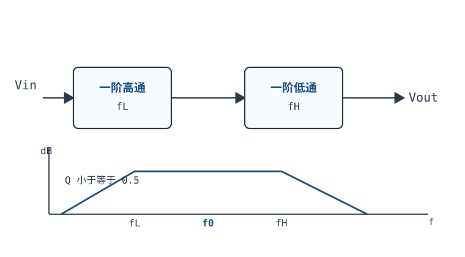
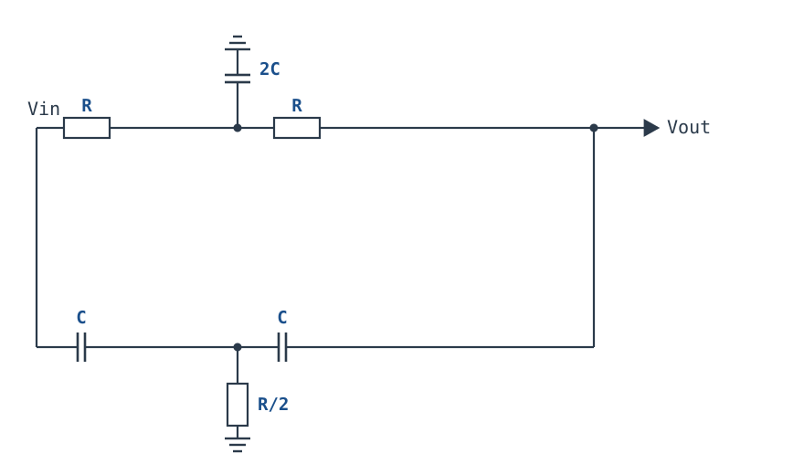

# 带通与带阻滤波器入门 Bandpass & Bandstop

## 1. 设计动机

::: motivation 只留一段、只掐一个频率
低通和高通各切一刀：低通留低频、砍高频，高通反过来。现实里更常见的是“只要中间一段”或“只掐掉某一个频率”：

- 心电、脑电等生理信号只关心 0.5 Hz~40 Hz 这一段，50 Hz 工频和更高的肌电噪声都要挡掉——这是**带通（band-pass）**；
- 测量放大器被 50 Hz 工频干扰，但 1 Hz~1 kHz 的有用信号都想保留——这是**带阻（band-stop）**；带阻窄到只挖掉 50 Hz 附近一小段时，就叫**陷波（notch）**；
- 音频分频要把 2 kHz 以上和以下分开，通信接收机要选出某个载波附近的一段，都是带通。

带通和带阻不是“低通 + 高通随便串起来”就能做好的。它们有三个必须一起算的参数：中心频率 $f_0$、带宽 $BW$、品质因数 $Q=f_0/BW$。Q 太低，带太宽，干扰漏进来；Q 太高，带太窄，元件容差、建立时间、相位失真全都上来；陷波器的 Q 还直接决定“坑有多深、坑底有多窄”。这一章把这三件事拆成可复算的数字：先给 $f_0$、$BW$、$Q$ 的口径，再比较四种实现（一阶高通 + 一阶低通级联、高 Q 的 Sallen-Key 节、多路反馈 MFB、双 T 陷波），最后用 1 kHz/Q=10 的带通和 50 Hz 双 T 陷波各走一遍完整设计。
:::

带通的“窄带选频”与谐振章的 $Q$、$BW$、阻尼比口径完全一致，先读 [RLC 电路与谐振](../basics/rlc-resonance.md) 的 §3.2、§3.3 会省很多事；Sallen-Key 节的推导见[二阶滤波器 Sallen-Key 与 Q 值](sallen-key-filters.md)；一阶节的基础见[一阶低通与高通](first-order-filters.md)。

## 2. 定义与直观：带通、带阻与三个参数

### 2.1 带通与带阻的定义

**带通滤波器（band-pass filter）**让 $f_0$ 附近的一段频率通过，低于和高于这段的频率都被衰减；它的幅频曲线像一个山头，山顶在 $f_0$，两侧各有一个 $-3\ \text{dB}$ 点。**带阻滤波器（band-stop filter）**相反：只衰减 $f_0$ 附近的一段，其余频率通过；窄带带阻就是陷波，曲线像一个坑。

三个参数的定义：

- **中心频率 $f_0$**：带通的峰值点、带阻的凹陷点，单位 Hz；
- **带宽 $BW$**：相对峰值（带通）或相对通带（带阻）下降 $3\ \text{dB}$ 的两个频率之差，单位 Hz；
- **品质因数 $Q$**：$Q=f_0/BW$，无量纲。$Q$ 越高，带越窄、选择性越强。

对二阶带通，$f_0$ 与两个半功率点的关系不是算术平均，而是**几何平均**：

$$f_0=\sqrt{f_{lo}f_{hi}},\qquad BW=f_{hi}-f_{lo}=\frac{f_0}{Q}$$

两个半功率点的精确位置是

$$f_{hi,lo}=f_0\left(\sqrt{1+\frac{1}{4Q^2}}\pm\frac{1}{2Q}\right)$$

$Q=10$、$f_0=1\ \text{kHz}$ 时：$\sqrt{1+1/400}=1.00125$，$1/(2Q)=0.05$，所以 $f_{hi}=1051.25\ \text{Hz}$、$f_{lo}=951.25\ \text{Hz}$，$BW=100.0\ \text{Hz}$，$Q=1000/100=10$。算术近似 $f_0\pm BW/2$ 给出 1050/950，与精确值各差 1.25 Hz；$Q=10$ 时误差只占带宽的 1.25%，工程上够用；$Q<3$ 时误差明显，要老老实实解二次方程。

### 2.2 半功率点、几何对称与 $Q$

“$-3\ \text{dB}$”就是半功率点：电压幅度降到峰值的 $1/\sqrt2=0.7071$，功率减半。带通的幅频曲线关于 $f_0$ **几何对称**——$f_{lo}$ 与 $f_{hi}$ 的乘积严格等于 $f_0^2$，而不是以 $f_0$ 为算术中心。低 Q 时这个差别很大：$Q=1$ 时 $f_{hi}=1.618f_0$、$f_{lo}=0.618f_0$，算术平均是 $1.118f_0$，比 $f_0$ 高 11.8%；用 $f_0\pm BW/2$ 去标定带边，低 Q 时会明显偏。

$Q$ 还可以写成阻尼比的形式：$\zeta=1/(2Q)$。$\zeta<1$ 是欠阻尼，带通有选频峰；$\zeta=1$（$Q=0.5$）是临界阻尼，带宽 $2f_0$；$\zeta>1$（$Q<0.5$）是过阻尼，带宽更宽、选择性更差。**Q=0.5 是“两个实极点”带通的上限**，这一点下一节会反复用到。

### 2.3 两条实现路线：实极点与复极点

带通的极点可以是一对实极点，也可以是一对共轭复极点：

- **实极点**：两个一阶节（高通 + 低通）级联，分母是两个实系数一阶因式的乘积，$Q\leq0.5$。两个转折频率相等时峰值最低，为 $-6.02\ \text{dB}$；分得越开，平台越高、越宽。这种带通适合宽带选频、抗混叠、音频分频。
- **复极点**：二阶节本身有共轭极点，$Q>0.5$。峰值可以高于 0 dB，带边更陡，适合窄带选频、载波提取、弱信号检测。Sallen-Key、MFB、状态变量都属于这一类。



一阶高通 + 一阶低通的级联是最直观的带通：低端由高通挡住，高端由低通挡住，中间形成一段平台。它的传递函数是

$$H(s)=\frac{s/\omega_L}{1+s/\omega_L}\cdot\frac{1}{1+s/\omega_H}$$

峰值在 $f_0=\sqrt{f_Lf_H}$，峰值增益为 $r/(1+r)$（$r=f_H/f_L$）。$f_L=f_H$ 时 $r=1$，峰值 $0.5$，即 $-6.02\ \text{dB}$；$r=4$ 时峰值 $0.8$，即 $-1.94\ \text{dB}$，平台更宽。无论 $r$ 取多少，分母都是两个实极点，$Q\leq0.5$；**想用两个一阶节做 Q=10 是不可能的**，这是后面选择高 Q 节的出发点。

带阻的经典实现是**双 T 网络（twin-T）**：两个 T 型网络并联，一个由 $R$、$R$、$2C$ 组成，另一个由 $C$、$C$、$R/2$ 组成，在 $f_0$ 处两条通路的电流正好抵消，输出出现很深的凹陷。



双 T 的优点是只用无源元件、陷波点可以很深；缺点是**必须精确匹配**才能深，而且无源双 T 的 $Q$ 只有 1/4，坑的 $-3\ \text{dB}$ 带宽很宽。这两点会在 §3.5、§3.6 用数字展开。

## 3. 定量关系：$f_0$、$BW$、$Q$ 与四种实现

### 3.1 二阶带通的标准形式

任何二阶带通都可以写成

$$H(s)=\frac{H_0\frac{\omega_0}{Q}s}{s^2+\frac{\omega_0}{Q}s+\omega_0^2}$$

其中 $H_0$ 是中心频率处的峰值增益（无量纲），$\omega_0=2\pi f_0$（$\text{rad/s}$），$Q$ 是品质因数，$\zeta=1/(2Q)$。在 $s=j\omega_0$ 处 $|H|=H_0$；半功率点满足 $|H|=H_0/\sqrt2$，解出 §2.1 的 $f_{hi,lo}$，并严格得到 $BW=f_0/Q$。

符号与单位：

| 符号 | 含义 | 单位 | 备注 |
|---|---|---|---|
| $f_0$ | 中心频率 | Hz | 带通峰值 / 带阻凹陷 |
| $BW$ | $-3\ \text{dB}$ 带宽 | Hz | $BW=f_0/Q$，二阶带通精确成立 |
| $Q$ | 品质因数 | 无量纲 | $Q=f_0/BW$；与阻尼比 $\zeta=1/(2Q)$ |
| $H_0$ | 中心频率增益 | 无量纲 | 带通峰值；带阻通带增益通常为 1 |
| $\omega_0$ | 中心角频率 | $\text{rad/s}$ | $\omega_0=2\pi f_0$ |

归一化带通幅频（以峰值 $H_0$ 为 0 dB，横轴 $f/f_0$，数据由 $|H|/H_0=1/\sqrt{1+Q^2(x-1/x)^2}$ 逐点计算）：

```echarts
{
  "tooltip": {"trigger": "axis"},
  "legend": {"data": ["Q=1", "Q=5", "Q=10"], "bottom": 0, "textStyle": {"fontSize": 12}},
  "grid": {"left": 58, "right": 26, "top": 26, "bottom": 58},
  "xAxis": {"type": "log", "name": "f / f0", "nameLocation": "middle", "nameGap": 30, "min": 0.5, "max": 2, "axisLabel": {"fontSize": 11}},
  "yAxis": {"type": "value", "name": "dB", "nameLocation": "middle", "nameGap": 42, "min": -25, "max": 2, "interval": 5, "axisLabel": {"fontSize": 11}},
  "series": [
    {"name": "Q=1", "type": "line", "smooth": true, "showSymbol": false, "lineStyle": {"width": 2.2, "color": "#8a9aa8"},
     "data": [[0.5,-5.12],[0.7,-1.85],[0.8,-0.8],[0.9,-0.19],[0.95,-0.05],[1,0],[1.05,-0.04],[1.1,-0.16],[1.2,-0.55],[1.5,-2.29],[2,-5.12]]},
    {"name": "Q=5", "type": "line", "smooth": true, "showSymbol": false, "lineStyle": {"width": 2.4, "color": "#b5642e"},
     "data": [[0.5,-17.58],[0.7,-11.54],[0.8,-7.83],[0.9,-3.25],[0.95,-1.02],[1,0],[1.05,-0.93],[1.1,-2.81],[1.2,-6.4],[1.5,-12.64],[2,-17.58]]},
    {"name": "Q=10", "type": "line", "smooth": true, "showSymbol": false, "lineStyle": {"width": 2.6, "color": "#1a4f8b"},
     "data": [[0.5,-23.54],[0.7,-17.33],[0.8,-13.27],[0.9,-7.37],[0.95,-3.12],[1,0],[1.05,-2.91],[1.1,-6.67],[1.2,-11.6],[1.5,-18.48],[2,-23.54]]}
  ]
}
```

**适用条件**：单谐振、二阶、线性时不变；带阻的 $Q$ 用 $-3\ \text{dB}$ 定义时，双 T 的 $Q=1/4$，与带通的 $Q=f_0/BW$ 同一口径。**失效边界**：多阶节级联时，总的 $-3\ \text{dB}$ 带宽不是单节 $BW$ 的简单相加；高 Q 时节间的轻微失配会让总响应明显不对称。

### 3.2 一阶高通 + 一阶低通的级联

把一节高通和一节低通级联（级间用缓冲器隔离），传递函数是

$$H(s)=\frac{s/\omega_L}{1+s/\omega_L}\cdot\frac{1}{1+s/\omega_H}$$

令 $x=f/f_0$、$r=f_H/f_L$，则 $f_0=\sqrt{f_Lf_H}$，归一化幅度的平方为

$$|H(x)|^2=\frac{x^2r}{(1+x^2r)(1+x^2/r)}$$

在 $x=1$ 处

$$|H(1)|=\frac{r}{1+r}$$

$r=1$ 时 $|H|=0.5$（$-6.02\ \text{dB}$）；$r=4$ 时 $|H|=0.8$（$-1.94\ \text{dB}$）。求 $-3\ \text{dB}$ 点（相对峰值）会得到一个关于 $x^2$ 的二次方程；对 $r=1$，解得 $x=0.4142$ 与 $2.4142$，$BW=2f_0$，$Q=0.5$。对 $r>1$，带宽更宽，$Q<0.5$。

| $r=f_H/f_L$ | 峰值增益 | 峰值 dB | $Q=f_0/BW$（数值解） |
|---|---|---|---|
| 1 | 0.500 | $-6.02$ | 0.500 |
| 2 | 0.667 | $-3.52$ | 0.471 |
| 4 | 0.800 | $-1.94$ | 0.400 |
| 10 | 0.909 | $-0.83$ | 0.287 |

结论：**两个实极点的带通，Q 永远不超过 0.5**。要做 Q=10 的窄带，必须让极点变成共轭复极点，也就是引入正反馈或谐振网络。下面三种结构都能做到。

### 3.3 高 Q 节：Sallen-Key 高通 + 低通

Sallen-Key 高通节（$R_1=R_2=R$、$C_1=C_2=C$、增益 $K=1+R_b/R_a$）的传递函数是

$$H_{HP}(s)=\frac{K(sRC)^2}{1+(3-K)sRC+(sRC)^2}$$

与标准二阶形式对照：

$$f_0=\frac{1}{2\pi RC},\qquad Q=\frac{1}{3-K}$$

中心频率处的增益是 $|H_{HP}(f_0)|=KQ$；高频通带增益是 $K$。$Q=10$ 要求 $K=2.9$，此时中心频率处比高频通带高 $20\lg Q=20\ \text{dB}$，峰值增益 $KQ=29$（$29.2\ \text{dB}$）。这个节的 $-3\ \text{dB}$ 点（相对峰值）仍是

$$f_{hi,lo}=f_0\left(\sqrt{1+\frac{1}{4Q^2}}\pm\frac{1}{2Q}\right)$$

$f_0=1\ \text{kHz}$、$Q=10$ 时是 951.25 Hz 与 1051.25 Hz，带宽 100 Hz。

单靠高通节只能得到“高通 + 一个 20 dB 的峰”，还不是带通；在后面再串一节低通，把高端压下去，就得到带通。低通节取巴特沃斯（$Q=0.707$、$K=1.586$）、截止频率也放在 $f_0$，它在 $f_0$ 处的增益是 $KQ=1.121$（相对直流增益 $-3\ \text{dB}$）。两节级联后的峰值是 $29\times1.121=32.5$（$30.2\ \text{dB}$），$-3\ \text{dB}$ 带宽约 99.5 Hz，$Q\approx10.05$——低通节在带边只多加了一点衰减，带通形状基本由高 Q 高通节决定。

这个 4 阶带通的优点是：两节都是标准 Sallen-Key，元件少、公式熟；缺点是：高 Q 节的 $K$ 离稳定边界 $K=3$ 只有 0.1，1% 的增益电阻就能把 Q 从 10 推到 16 或 7，带宽和峰值都跟着变。高 Q 的代价在 §5 展开。

### 3.4 MFB 带通的设计式

**多路反馈（multiple feedback, MFB）带通**用一个反相运放、两只电容、三只电阻实现二阶带通，适合需要反相输出、Q 在 1~10 的场合。按 TI 的 MFB 带通设计式（两只电容取等值 $C$，中心频率增益 $H_0$，目标角频率 $\omega_0$）：

$$R_1=\frac{Q}{H_0\omega_0C},\qquad R_2=\frac{Q}{(2Q^2-H_0)\omega_0C},\qquad R_3=\frac{2Q}{\omega_0C}$$

三只电阻的分工是：$R_1$ 定增益，$R_3$ 定中心频率与 Q 的量级，$R_2$ 把 Q 和增益“拧”在一起。代入 $f_0=1\ \text{kHz}$、$Q=10$、$H_0=1$、$C=10\ \text{nF}$：

$$R_1=\frac{10}{1\times6283.2\times10^{-8}}=159.15\ \text{k}\Omega$$

$$R_2=\frac{10}{(200-1)\times6283.2\times10^{-8}}=799.8\ \Omega$$

$$R_3=\frac{20}{6283.2\times10^{-8}}=318.31\ \text{k}\Omega$$

校验中心增益：$H_0=R_3/(2R_1)=318.31/(2\times159.15)=1.00$。电阻比 $R_3/R_2=398$，也就是说 Q=10 的 MFB 带通要同时用 800 $\Omega$ 和 318 k$\Omega$ 的电阻，偏置电流、噪声和寄生电容都会来捣乱。把 Q 降到 1：$R_1=R_2=15.92\ \text{k}\Omega$、$R_3=31.83\ \text{k}\Omega$，电阻比只有 2，好做得多。**MFB 的 Q 与增益耦合、Q 高时电阻跨度大**，这是它不如 Sallen-Key 常用的原因；具体拓扑与元件编号以所引应用笔记的图为准，不同教材的编号可能不同。

### 3.5 双 T 陷波：传递函数与 $Q=1/4$

双 T 网络由两个 T 并联而成：

- 上 T：$R_1=R_2=R$，并联臂 $C_3=2C$；
- 下 T：$C_1=C_2=C$，并联臂 $R_3=R/2$。

在输出开路（或接高阻缓冲）时，节点方程消去两个内部节点，得到

$$H(s)=\frac{s^2+\omega_0^2}{s^2+4\omega_0s+\omega_0^2},\qquad \omega_0=\frac{1}{RC},\qquad f_0=\frac{1}{2\pi RC}$$

在 $s=j\omega_0$ 处分子为零，输出理论上完全抵消；分母的 $s$ 项系数是 $4\omega_0$，与标准形式 $s^2+(\omega_0/Q)s+\omega_0^2$ 对照，得

$$Q=\frac14$$

这就是无源双 T 的 $Q$ 只有 0.25 的来源。它的 $-3\ \text{dB}$ 带宽是 $4f_0$：令 $|H|=1/\sqrt2$，有 $(1-x^2)^2=16x^2$，解得 $x=\sqrt5-2=0.2361$ 与 $x=2+\sqrt5=4.236$，带宽 $(4.236-0.236)f_0=4f_0$，$Q=f_0/BW=0.25$。**注意：$-3\ \text{dB}$ 带宽很宽，不等于陷波很宽**；坑底很窄，只是两侧回到 0 dB 的过程很慢。

### 3.6 失配与陷波深度

理想双 T 在 $f_0$ 处的零点是**二阶零点**，深度理论无穷大；实际深度由元件匹配决定。设相对失配为 $\delta$（例如 1% 写成 0.01），在最坏失配组合下，陷波点的残余幅度近似为

$$|H_{\min}|\approx0.25\delta,\qquad \text{深度}\approx20\lg(0.25\delta)\ \text{dB}$$

复算 $\delta=0.01$：$|H_{\min}|=0.0025$，$20\lg(0.0025)=-52.0\ \text{dB}$；$\delta=0.001$：$-72.0\ \text{dB}$；$\delta=0.05$：$-38.1\ \text{dB}$。数值解（按 §3.5 的节点方程）给出 1% 时 $-52.15\ \text{dB}$、0.1% 时 $-72.05\ \text{dB}$、5% 时 $-38.62\ \text{dB}$，与近似式在 1 dB 内吻合。

失配的“杀伤力”并不平均：

| 失配（1%） | 陷波深度 | 说明 |
|---|---|---|
| $R_3$ 与 $C_3$ 反向 1% | $-52.1\ \text{dB}$ | 最敏感，两个 T 的时间常数直接错开 |
| $C_3$ 单独 +1% | $-58.1\ \text{dB}$ | 并联臂电容单边偏 |
| $R_1$ 单独 +1% | $-64.2\ \text{dB}$ | 上 T 的串联电阻单边偏 |
| $R_1$ 与 $R_2$ 反向 1% | $-98.1\ \text{dB}$ | 两个串联电阻的失配部分抵消 |
| $C_1$ 与 $C_2$ 反向 1% | $-143\ \text{dB}$ | 下 T 的串联电容失配部分抵消 |
| 所有元件同向 +1% | $-139\ \text{dB}$ | 只移动 $f_0$，匹配关系不变 |

结论：**双 T 的深度主要由两个 T 的“时间常数匹配”决定，尤其是并联臂 $R_3$、$C_3$**；串联元件的同向漂移只移动 $f_0$，不一定变浅。要深陷波，先保 $R_3$、$C_3$ 的精度和温度系数，再谈其他。

::: advanced 进阶：双 T 的节点方程
设上 T 内部节点 A、下 T 内部节点 B，输出节点 V。输入为 1，输出开路：

$$\frac{1-V_A}{R}=\frac{V_A-V}{R}+s(2C)V_A$$

$$\frac{1-V_B}{1/(sC)}=\frac{V_B-V}{1/(sC)}+\frac{V_B}{R/2}$$

$$\frac{V_A-V}{R}+(V_B-V)sC=0$$

第一式整理得 $V_A=(1+V)/(2+2sRC)$；第二式整理得 $V_B=sRC(1+V)/(2+2sRC)$；代入第三式，消去 $V_A$、$V_B$，即得 $H(s)=(1+s^2R^2C^2)/(1+4sRC+s^2R^2C^2)$。分子在 $s=\pm j/(RC)$ 处为零，正是陷波点；分母的 $4sRC$ 给出 $Q=1/4$。
:::

### 3.7 几种实现怎么选

| 实现 | 运放数 | 可达 $Q$ | 优点 | 代价 |
|---|---|---|---|---|
| 一阶高通 + 一阶低通 | 2（或 0，无源） | $\leq0.5$ | 最简单、最稳、宽带宽 | 做不了窄带 |
| Sallen-Key 高 Q 节 + 低通 | 2 | 5~20 | 元件少、公式熟、同相 | 高 Q 时 $K$ 贴近边界，容差敏感 |
| MFB 带通 | 1 | 1~10 | 单运放、可反相 | Q 与增益耦合，高 Q 电阻跨度大 |
| 双 T 陷波 | 0~1 | 固定 0.25（无源） | 陷波深、元件少 | 必须精确匹配，$-3\ \text{dB}$ 带宽宽 |
| 状态变量 / 双二阶 | 2~3 | 高，可调 | $f_0$ 与 $Q$ 独立 | 元件多、功耗大 |

## 4. 典型计算：1 kHz 带通与 50 Hz 陷波

### 4.1 1 kHz、Q=10 带通的完整设计

**需求**：$f_0=1\ \text{kHz}$、$Q=10$（$BW=100\ \text{Hz}$），峰值增益尽量接近 10，单电源或双电源均可。选“Sallen-Key 高通节 + Sallen-Key 低通节”的两运放方案：高通节定 Q 和低端，低通节压高端。

**第 1 步：高通节。** 取 $C=10\ \text{nF}$，由 $f_0=1/(2\pi RC)$ 得

$$R=\frac{1}{2\pi\times10^3\times10\times10^{-9}}=15.915\ \text{k}\Omega$$

取 E96 的 **15.8 k$\Omega$**。要 $Q=10$，由 $Q=1/(3-K)$ 得 $K=3-0.1=2.9$；取 $R_a=10\ \text{k}\Omega$、$R_b=19\ \text{k}\Omega$，$K=1+19/10=2.9$。实际 $f_0=1/(2\pi\times15.8\text{k}\times10\text{n})=1007.3\ \text{Hz}$，Q 标称 10。

**第 2 步：低通节。** 同样取 $C=10\ \text{nF}$、$R=15.8\ \text{k}\Omega$，$f_0$ 也是 1007.3 Hz；取巴特沃斯 $Q=0.707$，$K=1.586$，$R_b/R_a=0.586$，取 $R_a=10\ \text{k}\Omega$、$R_b=5.9\ \text{k}\Omega$（实际 $K=1.59$，$Q=1/(3-1.59)=0.709$）。

**第 3 步：整体响应。** 两节级联的峰值在 1007.3 Hz 附近，峰值增益

$$|H|_{\max}=K_{HP}Q_{HP}\times K_{LP}Q_{LP}=2.9\times10\times1.59\times0.709=32.7$$

即 $30.29\ \text{dB}$。数值扫描得到 $-3\ \text{dB}$ 点 958.46 Hz 与 1058.66 Hz：

$$BW=1058.66-958.46=100.2\ \text{Hz},\qquad Q_{\text{实际}}=\frac{1007.3}{100.2}=10.05$$

几乎正好是目标。低通节在带边只多加约 0.3 dB 的衰减，所以总带宽没有明显变窄。

**第 4 步：把增益缩到 10。** 峰值 32.7 太高，在输出加一级分压：$R_{top}=10\ \text{k}\Omega$、$R_{bot}=4.42\ \text{k}\Omega$，分压比

$$\frac{4.42}{10+4.42}=0.3065,\qquad 32.7\times0.3065=10.02$$

取 E96 的 10 k$\Omega$ 与 4.42 k$\Omega$ 即可。分压级要放在低通节之后，避免改变前两节的负载。

**第 5 步：容差。** 高 Q 节的 $K$ 由 $R_b/R_a=1.9$ 定；两只 1% 电阻的最坏比值是 $1.9\times(1.01/0.99)=1.938$ 或 $1.9\times(0.99/1.01)=1.862$，对应 $K=2.938$ 或 $2.862$：

$$Q_{HP}=\frac{1}{3-K}=16.23\ \text{或}\ 7.27$$

整体 $-3\ \text{dB}$ 带宽随之变成 61.9 Hz 或 137.3 Hz，峰值变成 34.61 dB 或 27.41 dB。**1% 电阻不足以把 Q=10 做准**；至少要 0.1% 电阻或微调，或者换用 $f_0$ 与 Q 解耦的状态变量结构。

**第 6 步：阻带与建立时间。** 在 100 Hz 与 10 kHz（各偏离一个十倍频程）处，数值扫描给出 $|H|=0.0465$，即 $-26.66\ \text{dB}$；相对峰值 $30.29\ \text{dB}$，衰减 $56.95\ \text{dB}$。高 Q 节的包络时间常数 $\tau=2Q/\omega_0$：

$$\tau=\frac{2\times10}{2\pi\times1007.3}=3.16\ \text{ms}$$

按 $e^{-t/\tau}$ 衰减到 1% 需要 $4.605\tau=14.55\ \text{ms}$，到 0.1% 需要 $6.908\tau=21.83\ \text{ms}$。ADC 在滤波器后面采样，必须等这段时间，否则前一个事件的长振铃会串到下一个采样。

::: example 1 kHz、Q=10 带通的最终取值
- 高通节：$R_1=R_2=15.8\ \text{k}\Omega$，$C_1=C_2=10\ \text{nF}$，$R_a=10\ \text{k}\Omega$，$R_b=19\ \text{k}\Omega$（$K=2.9$，$Q=10$）；
- 低通节：$R_1=R_2=15.8\ \text{k}\Omega$，$C_1=C_2=10\ \text{nF}$，$R_a=10\ \text{k}\Omega$，$R_b=5.9\ \text{k}\Omega$（$K=1.59$，$Q=0.709$）；
- 输出分压：10 k$\Omega$ / 4.42 k$\Omega$，峰值增益约 10；
- 标称：$f_0=1007\ \text{Hz}$，$BW=100.2\ \text{Hz}$，$Q=10.05$，峰值 10.0（缩放后）；
- 1% 电阻最坏：$BW=61.9\ \text{Hz}\sim137.3\ \text{Hz}$，峰值 7.2~16.5（缩放后）；要保指标，增益电阻用 0.1%。
:::

### 4.2 50 Hz 双 T 陷波

**需求**：掐掉 50 Hz 工频，保留 1 Hz~1 kHz 的其他信号；陷波越深越好，元件用常见值。取 $f_0=50\ \text{Hz}$，由 $f_0=1/(2\pi RC)$ 先选 $C=100\ \text{nF}$：

$$R=\frac{1}{2\pi\times50\times100\times10^{-9}}=31.83\ \text{k}\Omega$$

取 E96 的 **31.6 k$\Omega$**；$R_3=R/2=15.8\ \text{k}\Omega$；$C_3=2C=200\ \text{nF}$（两只 100 nF 并联）。实际

$$f_0=\frac{1}{2\pi\times31.6\text{k}\times100\text{n}}=50.365\ \text{Hz}$$

与 50 Hz 差 0.73%，在 1% 元件容差内。

**理想深度**：双 T 在 $f_0$ 处是二阶零点，理论上 $|H|=0$，深度无穷大。实际深度由匹配决定。按 §3.6 的近似式，1% 失配（最坏组合）给出

$$|H_{\min}|\approx0.25\times0.01=2.5\times10^{-3},\qquad 20\lg(2.5\times10^{-3})=-52.0\ \text{dB}$$

数值解给出 $-52.15\ \text{dB}$。在 50 Hz 处（不是精确的 50.365 Hz）残余 $|H|=0.00443$，即 $-47.07\ \text{dB}$；在 100 Hz 处 $|H|=0.347$，即 $-9.20\ \text{dB}$——**陷波只压 50 Hz，几乎不压 100 Hz 的二次谐波**。

**带宽**：双 T 的 $Q=1/4$，$-3\ \text{dB}$ 带宽 $BW=4f_0=201.5\ \text{Hz}$，从约 11.9 Hz 到 213.4 Hz。也就是说，虽然 50 Hz 处很深，但从 12 Hz 到 213 Hz 的整段都被“压了一半”，这对 1 Hz~1 kHz 的信号不是没有代价；如果只要 50 Hz 这一点，双 T 的宽带衰减可能比想象中大。

**失配深度表**（数值解，最坏组合）：

| 相对失配 $\delta$ | $|H_{\min}|$ | 深度 |
|---|---|---|
| 0.1% | $2.47\times10^{-4}$ | $-72.1\ \text{dB}$ |
| 0.5% | $1.24\times10^{-3}$ | $-58.1\ \text{dB}$ |
| 1% | $2.47\times10^{-3}$ | $-52.2\ \text{dB}$ |
| 2% | $4.88\times10^{-3}$ | $-46.2\ \text{dB}$ |
| 5% | $1.17\times10^{-2}$ | $-38.6\ \text{dB}$ |

下图把理想双 T 的深零用 $-60\ \text{dB}$ 的数值下限截断，方便与 1% 失配的 $-52\ \text{dB}$ 对比；实际理想匹配时理论上是零，图中 $-60\ \text{dB}$ 只是绘图下限。

```echarts
{
  "tooltip": {"trigger": "axis"},
  "legend": {"data": ["理想（数值下限 -60 dB）", "1% 最坏失配"], "bottom": 0, "textStyle": {"fontSize": 12}},
  "grid": {"left": 58, "right": 26, "top": 26, "bottom": 58},
  "xAxis": {"type": "log", "name": "f / f0", "nameLocation": "middle", "nameGap": 30, "min": 0.5, "max": 2, "axisLabel": {"fontSize": 11}},
  "yAxis": {"type": "value", "name": "dB", "nameLocation": "middle", "nameGap": 42, "min": -65, "max": 0, "interval": 10, "axisLabel": {"fontSize": 11}},
  "series": [
    {"name": "理想（数值下限 -60 dB）", "type": "line", "smooth": true, "showSymbol": false, "lineStyle": {"width": 2.2, "color": "#8a9aa8", "type": "dashed"},
     "data": [[0.5,-9.09],[0.7,-14.93],[0.8,-19.03],[0.9,-25.56],[0.95,-31.82],[1,-60],[1.05,-32.25],[1.1,-26.43],[1.2,-20.79],[1.5,-13.81],[2,-9.09]]},
    {"name": "1% 最坏失配", "type": "line", "smooth": true, "showSymbol": false, "lineStyle": {"width": 2.6, "color": "#b03030"},
     "data": [[0.5,-9.11],[0.7,-14.95],[0.8,-19.05],[0.9,-25.57],[0.95,-31.78],[1,-52.15],[1.05,-32.25],[1.1,-26.45],[1.2,-20.82],[1.5,-13.83],[2,-9.11]]}
  ]
}
```

要做 $-60\ \text{dB}$ 以上的陷波，元件匹配要到 0.5% 以内；要做 $-70\ \text{dB}$，要到 0.1% 以内。普通 1% 电阻 + 1% 电容在最坏组合下只能到约 $-52\ \text{dB}$，这是“为什么双 T 必须精确匹配”的定量答案。

::: pitfall 双 T 的“坑”比想象中宽
现象：50 Hz 处确实压得很深，但 20 Hz、100 Hz 的信号也明显变小，示波器上看波形整体幅度下降。原因：双 T 的 $Q=1/4$，$-3\ \text{dB}$ 带宽是 $4f_0=200\ \text{Hz}$，从 12 Hz 起就开始衰减；深坑只集中在 $f_0$ 附近很窄的一段。解决：如果只需要压 50 Hz、不想动 20 Hz，先用有源陷波（正反馈抬 Q）或后接高通/低通把不需要的频段再修；不要指望无源双 T 既深又窄。
:::

### 4.3 验算与容差汇总

| 指标 | 1 kHz 带通 | 50 Hz 双 T |
|---|---|---|
| 标称 $f_0$ | 1007.3 Hz | 50.365 Hz |
| 标称 $BW$ | 100.2 Hz | 201.5 Hz（$-3\ \text{dB}$） |
| 标称 $Q$ | 10.05 | 0.25 |
| 峰值 / 凹陷 | 30.29 dB（缩放前） | 理论 $\infty$，1% 失配 $-52.2\ \text{dB}$ |
| 1% 元件最坏 | $BW$ 61.9~137.3 Hz | 深度 $-52.2\ \text{dB}$ |
| 主要敏感元件 | 高 Q 节的 $R_b/R_a$ | $R_3$、$C_3$ 的匹配 |
| 建立 / 群时延 | 1% 建立 14.55 ms | 陷波附近相位急转，宽带信号会失真 |

## 5. 工程含义：Q、容差与建立时间

### 5.1 Q 的代价：建立时间与噪声

高 Q 带通的窄带是用“能量在 $f_0$ 附近存得更久”换来的。二阶带通的包络时间常数是

$$\tau=\frac{2Q}{\omega_0}=\frac{Q}{\pi f_0}$$

$Q=10$、$f_0=1\ \text{kHz}$ 时 $\tau=3.18\ \text{ms}$；1% 建立约 $4.6\tau=14.6\ \text{ms}$，0.1% 建立约 $6.9\tau=21.9\ \text{ms}$。这还没算运放压摆率和 ADC 的采样保持。**窄带滤波器的“响应快”和“选频准”是直接矛盾的**：要窄带就得等，要快就得放宽带宽。

噪声带宽也随 Q 变化。理想二阶带通的等效噪声带宽是 $(\pi/2)f_0/Q$ 量级；Q 越高，噪声带宽越窄，白噪声进得越少——这是高 Q 的好处。但 1/f 噪声和运放失调不会被窄带滤掉，反而可能因为高增益在带内更突出。

### 5.2 元件容差与调谐

- **带通的 Q**：高 Q 节的 $Q=1/(3-K)$，$S_K^Q=KQ$；$Q=10$ 时 1% 的 $K$ 误差就是 29% 的 Q 误差。增益电阻至少 0.1%，或在 $R_b$ 上串微调电位器，装好后用频率扫描调 $BW$。
- **带通的 $f_0$**：由 $RC$ 乘积定，1% 电阻 + 1% 电容最坏约 2% 的频率误差；高 Q 时 2% 的 $f_0$ 偏移可能已经超出 $BW$ 的 20%，必须校准。
- **双 T 的深度**：$R_3$、$C_3$ 的匹配最关键；用 0.1% 电阻、1% C0G/薄膜电容，或在 $R_3$ 上并联微调。串联 $R_1/R_2$、$C_1/C_2$ 的同向漂移只移动 $f_0$，不一定变浅；但它们的**反向**失配也会降低深度（表 §3.6）。
- **温度**：C0G 的温漂约 $\pm30\ \text{ppm}/^{\circ}\text{C}$（典型量级，以数据手册为准），薄膜电容通常也在同一量级；X7R 的容值随温度和直流偏压变化，不能用于深陷波。

### 5.3 源阻抗、负载与缓冲

双 T 是无源网络，它的输入阻抗约为 $R$（50 Hz 设计里是 31.6 k$\Omega$），输出阻抗也约为 $R$。如果信号源内阻不可忽略，它会与 $R_1$ 串联，改变上 T 的时间常数；如果后级输入阻抗不高，它会与 $R_2$ 并联，改变下 T 的分压。两种情况都会让陷波变浅、$f_0$ 偏移。实用做法是：**前面加低阻缓冲，后面加高阻缓冲（电压跟随器）**；缓冲器的输入电容要小，否则与 $R$ 形成额外极点。

带通的输入阻抗由第一节决定：Sallen-Key 高通的输入阻抗在低频很高、在高频接近 $R$；MFB 的输入阻抗约为 $R_1$。前级输出阻抗要远小于这些值，否则带边形状会变。

单电源工作时，两节的同相端都要偏置到 $V_{cc}/2$；高 Q 节的偏置电阻会与 $R_2$ 并联，改变 $Q$ 和 $f_0$，要把偏置网络并进节点方程，不能只在输入端串一只耦合电容了事。

### 5.4 工频干扰与谐波

50 Hz 陷波只压基波，100 Hz、150 Hz 的谐波仍在。工频干扰通常是非正弦的，含有 3、5、7 次谐波；只用一个 50 Hz 陷波，残余的 100 Hz 纹波可能仍有几毫伏。对策：

- 用 50 Hz + 100 Hz + 150 Hz 的**梳状陷波**（多个双 T 级联），或先低通再陷波；
- 从源头解决：屏蔽、双绞、共模扼流、隔离放大器；陷波是最后一道，不是第一道；
- 注意陷波器的相位：50 Hz 附近的相位急转，宽带信号（如心电的 QRS 波）经过陷波后波形会失真；诊断级心电常用“线性相位”或“最小相位”权衡，不能只看幅度。

::: advanced 进阶：有源双 T 与 Q 提升
无源双 T 的 $Q=1/4$。把双 T 接进一个增益略小于 1 的正反馈环路，等效 Q 近似提高为

$$Q\approx\frac{Q_0}{1-K}=\frac{0.25}{1-K}\quad(K<1)$$

$K=0.9$ 时 $Q\approx2.5$，$K=0.99$ 时 $Q\approx25$。$K$ 越接近 1，坑越窄越深，但 $K\geq1$ 会满足振荡条件，输出自激；同时 $K$ 的稳定性直接决定陷波深度，$K$ 漂 0.1% 就可能把 $-60\ \text{dB}$ 的坑抬到 $-40\ \text{dB}$。有源双 T 适合“固定频率、出厂校准”的场合，不适合用 1% 电阻随便搭。
:::

## 6. 常见坑

::: pitfall 六个高频坑（现象 → 原因 → 解决）
- **现象**：用一阶高通 + 一阶低通级联做 1 kHz、Q=10 的带通，实测带宽 2 kHz，峰值只有 $-6\ \text{dB}$。**原因**：两个实极点的带通 $Q\leq0.5$，无论怎么调转折频率都做不出 Q=10；$f_L=f_H$ 时 $Q=0.5$、峰值 $-6.02\ \text{dB}$。**解决**：改用有复极点的高 Q 节（Sallen-Key 高通、MFB、状态变量），一阶节只用来做宽带或后级修形。
- **现象**：双 T 用 1% 电阻电容，50 Hz 处只压到 $-50\ \text{dB}$，达不到设计的 $-80\ \text{dB}$。**原因**：双 T 的深度由两个 T 的时间常数匹配决定，1% 失配的最坏组合约 $-52\ \text{dB}$；$R_3$、$C_3$ 最敏感。**解决**：$R_3$、$C_3$ 用 0.1%、同批次、低温漂元件，或在 $R_3$ 上加微调；用网络分析仪实测陷波深度。
- **现象**：50 Hz 陷波装好后，100 Hz 的工频谐波仍然很大。**原因**：陷波只压基波，100 Hz 在双 T 的 $-9.2\ \text{dB}$ 处，几乎没被压。**解决**：加 100 Hz/150 Hz 陷波或先低通；从屏蔽、共模扼流等源头治理。
- **现象**：Q=10 的带通，1% 电阻装出来带宽从 100 Hz 变成 60 Hz 或 140 Hz。**原因**：$Q=1/(3-K)$，$S_K^Q=KQ=29$，1% 的 $K$ 误差就是 29% 的 Q 误差。**解决**：增益电阻用 0.1% 或微调；或换 $f_0$、$Q$ 解耦的状态变量/双二阶结构。
- **现象**：窄带滤波器输出很久才稳定，ADC 采到的第一个点总是错的。**原因**：高 Q 的包络时间常数 $\tau=2Q/\omega_0$，1% 建立要 $4.6\tau$；Q=10、1 kHz 时约 14.6 ms。**解决**：采样前等待至少 5 倍时间常数，或在滤波器后加采样保持；不要用“上电即采”的时序。
- **现象**：双 T 接上信号源和后级后，陷波变浅、$f_0$ 偏移。**原因**：源内阻与 $R_1$ 串联、负载与 $R_2$ 并联，改变了两个 T 的时间常数。**解决**：前后各加缓冲（电压跟随器），缓冲器输入电容要小；双 T 的 $R$ 取 10 k$\Omega$~100 k$\Omega$，不要用 M$\Omega$ 级。
:::

## 7. 自测题

<details><summary>带通 f0=1 kHz、Q=10，求 -3 dB 带宽、精确半功率点，以及用 f0±BW/2 近似带来的误差。</summary>

$$BW=\frac{f_0}{Q}=\frac{1000}{10}=100\ \text{Hz}$$

精确半功率点：

$$f_{hi,lo}=1000\left(\sqrt{1+\frac{1}{400}}\pm\frac{1}{20}\right)=1000(1.00125\pm0.05)$$

即 1051.25 Hz 与 951.25 Hz。算术近似 1050/950 与精确值各差 1.25 Hz，占带宽 1.25%；$Q=10$ 时工程上可用，低 Q 时误差会明显变大。

</details>

<details><summary>为什么一阶高通 + 一阶低通的级联做不出 Q=10？它的 Q 最大是多少？</summary>

两个一阶节的极点都是实数，分母是两个实系数一阶因式的乘积，写成标准二阶形式时 $Q\leq0.5$。$f_L=f_H$ 时 $Q=0.5$、峰值 $-6.02\ \text{dB}$；$f_L$ 与 $f_H$ 分得越开，$Q$ 越小、平台越宽。要 Q>0.5，必须让极点成为共轭复极点，也就是引入正反馈或谐振网络（Sallen-Key、MFB、状态变量）。

</details>

<details><summary>双 T 陷波取 R=31.6 kΩ、C=100 nF、R3=15.8 kΩ、C3=200 nF，求 f0、-3 dB 带宽和 Q。1% 失配下陷波深度大约多少？</summary>

$$f_0=\frac{1}{2\pi\times31.6\text{k}\times100\text{n}}=50.365\ \text{Hz}$$

$$BW=4f_0=201.5\ \text{Hz},\qquad Q=\frac{f_0}{BW}=0.25$$

1% 最坏失配：$|H_{\min}|\approx0.25\times0.01=2.5\times10^{-3}$，深度

$$20\lg(2.5\times10^{-3})=-52.0\ \text{dB}$$

数值解约 $-52.2\ \text{dB}$。要 $-70\ \text{dB}$，失配要小到 0.1% 量级。

</details>

<details><summary>50 Hz 双 T 陷波对 100 Hz 的抑制是多少？如果工频干扰含 100 Hz 谐波，该怎么办？</summary>

双 T 的传递函数在 $x=2$（100 Hz 对 50 Hz）处：

$$|H|=\frac{|1-4|}{\sqrt{(1-4)^2+16\times4}}=\frac{3}{\sqrt{9+64}}=\frac{3}{8.544}=0.351$$

即约 $-9.1\ \text{dB}$（数值解 $-9.20\ \text{dB}$），几乎不抑制。工频谐波要用 100 Hz/150 Hz 陷波、梳状滤波或低通；从源头用屏蔽、共模扼流、隔离放大器更有效。

</details>

<details><summary>1 kHz、Q=10 的带通，高 Q 节的 K 取多少？若增益电阻是 1%，带宽的最坏范围是多少？</summary>

$Q=1/(3-K)=10$，$K=2.9$，$R_b/R_a=1.9$。

1% 电阻比值最坏 $1.9\times1.01/0.99=1.938$ 或 $1.9\times0.99/1.01=1.862$，$K=2.938$ 或 $2.862$：

$$Q=\frac{1}{3-K}=16.23\ \text{或}\ 7.27$$

带宽 $BW=f_0/Q$ 约 62 Hz 或 137 Hz（数值扫描 61.9~137.3 Hz）。要保 100 Hz±10%，增益电阻至少 0.1%。

</details>

<details><summary>Q=10、f0=1 kHz 的带通，1% 建立时间大约多少？为什么窄带滤波器不能“又快又准”？</summary>

包络时间常数

$$\tau=\frac{2Q}{\omega_0}=\frac{20}{2\pi\times1000}=3.18\ \text{ms}$$

1% 建立约 $4.6\tau=14.6\ \text{ms}$，0.1% 约 $6.9\tau=21.9\ \text{ms}$。高 Q 意味着能量在 $f_0$ 附近存得久，建立时间与 Q 成正比；要窄带就必须等，要快就得放宽带宽，两者不能同时最优。

</details>

## 8. 参考资料

- TI, *Op Amps for Everyone*（SLOD006B），Chapter 16 *Active Filter Design Techniques*：多路反馈带通、双 T 陷波、Sallen-Key 带通的结构与设计表。<https://archive.org/details/TexasInstruments-TI-ApplicationsandSeminars-OpAmpsForEveryoneDesignReference2000OCR>
- TI, *Active Filter Design Techniques*（SLOA088）：MFB 带通的 $R_1$、$R_2$、$R_3$ 设计式与中心增益、Q 的对应关系。
- Analog Devices, MT-210 *Analog Filters*（Mini Tutorial）：带通/带阻的频响、Q 与带宽、双 T 网络的数量级讨论。<https://www.analog.com/media/en/training-seminars/tutorials/MT-210.pdf>
- Sergio Franco, *Design with Operational Amplifiers and Analog Integrated Systems*（4th ed.），*Filter Circuits* 一章：带通、带阻、双 T 与状态变量滤波器的传递函数和设计方法。
- 邱关源《电路》，电路的频率响应一章：谐振、品质因数、通频带与半功率点的定义；本章的 $Q=f_0/BW$ 与几何对称口径与该书一致。
- Sedra and Smith, *Microelectronic Circuits*（8th ed.），*Active Filters* 部分：双二阶（biquad）、状态变量与双 T 的结构，以及高 Q 对元件灵敏度的讨论。
