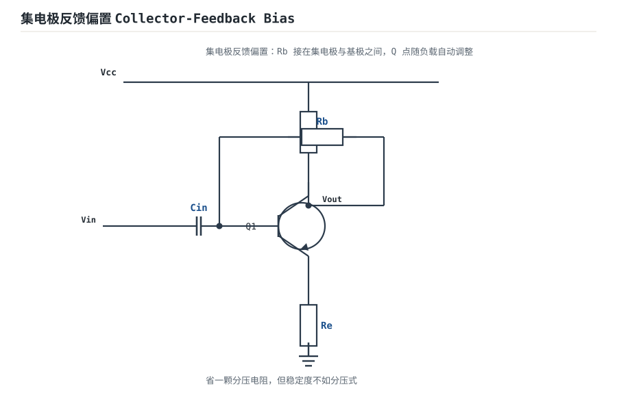
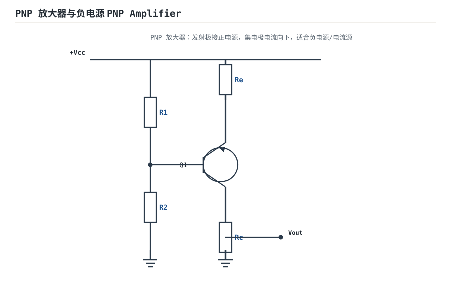
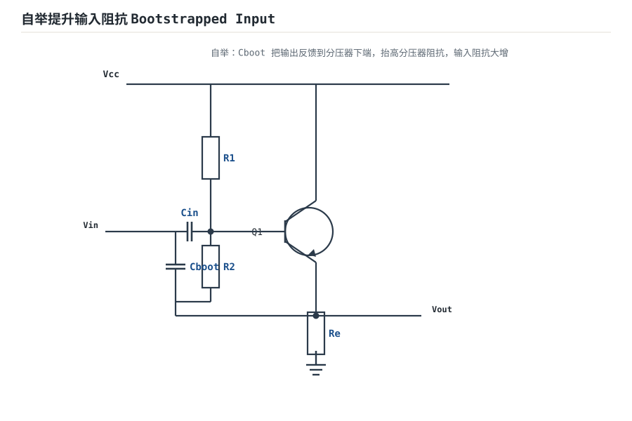

# BJT 三种放大组态与静态工作点 BJT Amplifier Configurations

BJT（双极型晶体管）有三个极：基极 B、集电极 C、发射极 E。输入回路和输出回路共用哪个极，就叫"共某极"。**共射（CE）、共集（CC，射极跟随器）、共基（CB）**三种组态，增益、输入阻抗、输出阻抗性格完全不同，选型本质就是在三者之间做权衡。

## 1. 设计动机

::: motivation 为什么要先定静态工作点
BJT 是非线性器件：只有让它在直流下处于"放大区"（发射结正偏、集电结反偏），小信号才会被线性放大。这个直流偏置点（Q 点）设得太高管子饱和、太低截止，信号就被削波。**先直流、后交流**，是分立放大设计的铁律。
:::

## 2. 原理图

最常用的是**分压偏置共射放大电路**：R1/R2 分压定基极电位，Re 稳定工作点，Cin/Cout 隔直通交。


## 3. 静态分析（DC）

电容开路，只算直流：

1. 基极电位由 R1/R2 分压近似决定：$V_B\approx V_{cc}\cdot R_2/(R_1+R_2)$（当流过 R1/R2 的电流远大于基极电流）。
2. 发射极电位：$V_E=V_B-V_{BE}\approx V_B-0.7\text{V}$。
3. 发射极电流：$I_E=V_E/R_e$。
4. 集电极电位：$V_C=V_{cc}-I_C R_c\approx V_{cc}-I_E R_c$。
5. 工作点判定：要让 $V_C>V_E$（集电结反偏）且不饱和，一般取 $V_C$ 在 $V_{cc}$ 的中点附近，输出摆幅最大。

## 4. 动态分析（AC / 瞬态）

共射放大的核心结论（小信号、中频区）：

$$A_v=\frac{v_{out}}{v_{in}}\approx -\frac{R_c\parallel R_L}{r_e}\quad,\quad r_e=\frac{25\text{mV}}{I_E}$$

负号表示输出与输入**反相** 180°。$r_e$ 是发射极小信号电阻，由静态电流决定——这就是为什么 Q 点要先算准。下面是输入 0.1V、增益 −10 时的反相放大波形：

```echarts
{
  "tooltip": {"trigger": "axis"},
  "legend": {"data": ["v_in（基极）", "v_out（集电极）"], "bottom": 0, "textStyle": {"fontSize": 13}},
  "grid": {"left": 56, "right": 24, "top": 26, "bottom": 56},
  "xAxis": {"type": "category", "name": "角度", "data": [0,30,60,90,120,150,180,210,240,270,300,330,360], "axisLabel": {"fontSize": 11}},
  "yAxis": {"type": "value", "name": "V", "min": -6, "max": 6, "axisLabel": {"fontSize": 11}},
  "series": [
    {"name": "v_in（基极）", "type": "line", "smooth": true, "showSymbol": false, "lineStyle": {"width": 2.4, "color": "#1a4f8b"},
     "data": [0,0.05,0.087,0.1,0.087,0.05,0,-0.05,-0.087,-0.1,-0.087,-0.05,0]},
    {"name": "v_out（集电极）", "type": "line", "smooth": true, "showSymbol": false, "lineStyle": {"width": 2.6, "color": "#b5642e"},
     "data": [0,-0.5,-0.87,-1,-0.87,-0.5,0,0.5,0.87,1,0.87,0.5,0]}
  ]
}
```

### 三种组态对比

| 组态 | 增益 $A_v$ | 输入阻抗 | 输出阻抗 | 用途 |
|---|---|---|---|---|
| 共射 CE | 大（反相） | 中（kΩ~几十k） | 高 | 主放大级 |
| 共集 CC（射随） | ≈1（同相） | **高** | **低** | 缓冲/驱动级 |
| 共基 CB | 大（同相） | **低** | 高 | 高频/电流缓冲 |

::: analogy 三种组态像变速箱
共射是"直接挂挡"——扭矩大（增益大）但顿挫（反相、输入阻抗一般）；共集是"离合器"——不放大但顺滑（高入低出），专门隔离前后级；共基是"高速挡"——输入低阻适合高频电流输入。
:::

## 5. 环路分析（反馈与稳定性直觉）

分压偏置电路里的 $R_e$ 其实是一个**直流电流负反馈**：温度升高 → $I_C$ 增大 → $V_E$ 升高 → $V_{BE}$ 减小 → $I_B$ 回落 → $I_C$ 被拉回来。这就是它能稳定 Q 点的原因。

- **结论**：$R_e$ 越大，直流工作点越稳，但交流增益被 $R_e$ 拖累下降。工程上常用旁路电容 $C_e$ 把 $R_e$ 的交流成分短路掉，做到"直流稳、交流不减益"。
- 共射电路本身高频会因密勒效应和结电容产生附加相移，多级级联时可能自激——这是后面反馈稳定性章节要展开的主题。

::: advanced 进阶：Re 的直流负反馈推导
设温度升高使 $I_C$ 增加 $\Delta I_C$，则 $V_E=(I_B+I_C)R_e\approx I_C R_e$ 同步升高，而 $V_{BE}=V_B-V_E$ 被迫下降。由 $I_C=I_S\exp(V_{BE}/V_T)$，$V_{BE}$ 的微小下降按指数关系抑制 $I_C$ 的增长。这就是 $V_{BE}$ 负反馈稳 Q 点的完整链路。$R_e$ 上的直流负反馈越强，Q 点对 β、温度的敏感度越低。
:::

## 6. 元件取值与工程权衡

- **R1/R2 分压电流**：取 $I_{div}\approx 10\,I_B$，才能让 $V_B$ 不受基极电流影响；太大则 $V_B$ 不稳，太小则耗电。
- **Re 数量级**：一般 $V_E$ 取 1~3V（约为 $V_{cc}$ 的 10%~20%），兼顾稳 Q 点与输出摆幅。
- **Rc**：由目标增益 $A_v=-R_c/r_e$ 反推；受 $V_{cc}$ 与静态压降约束。
- **Cin/Cout**：按最低工作频率 $f_L$ 取 $C=1/(2\pi f_L R_{source})$，常用 1µF~10µF。

## 7. 完整设计示例

::: example 设计一个增益 −10、Vcc=12V 的共射放大
1. **需求**：负载开路，$A_v=-10$，工作点居中。
2. **定 IE**：取 $V_E=2V$，$I_E=1mA$（功耗低、$r_e=25\Omega$ 适中）。
3. **算 Re**：$R_e=2V/1mA=2k\Omega$（取 E96 标准值 2k）。
4. **算 Rc**：$|A_v|=R_c/r_e\Rightarrow R_c=10\times25=250\Omega$？太小。实际还要考虑 $V_C$ 居中：取 $V_C=V_{cc}/2=6V$，则 $R_c=(12-6)/1mA=6k\Omega$，实际增益 $=-6000/25=-240$。要 −10 就得在发射极加未旁路电阻或改用分压网络。
5. **修正**：为得到 −10 且 Q 点居中，让 $R_c=2.5k\Omega$（$V_C=9.5V$ 偏上）并在 $R_e$ 旁串一个小的未旁路电阻 $R_e'=r_e(|A_v|-1)\approx225\Omega$。
6. **验算**：$A_v=-R_c/(r_e+R_e')=-2500/(25+225)=-10$，$\checkmark$。
:::

## 8. 仿真与实验

LTspice 用 2N3904 模型：

- 先做 DC 工作点分析，核对 $V_B,V_E,V_C$ 与手算是否一致。
- 瞬态：1kHz/10mV 正弦输入，观察输出反相放大、有无削波。
- 扫描温度从 −40℃ 到 125℃，对比"有 Re"与"无 Re"两种电路 Q 点漂移幅度。
- 把输入信号逐步加大，观察输出何时出现底部（饱和）或顶部（截止）削波。

## 扩展与变种电路

### 扩展1：分压式偏置稳定工作点 Voltage-Divider Bias

**定位**：用 R1/R2 分压 + Re 直流负反馈把 Q 点锁死，是分立放大最稳的偏置——与主电路同源，这里聚焦"为什么它能稳"。


::: example 工作原理 / 静态分析
基极电位由分压固定：$V_B\approx V_{cc}R_2/(R_1+R_2)$。发射极 $V_E=V_B-0.7\text{V}$，$I_E=V_E/R_e$。

温度升高 → $I_C$ 升 → $V_E$ 升 → $V_{BE}$ 降 → $I_B$ 回落 → $I_C$ 被拉回。这就是 Re 的直流负反馈稳 Q 点。
:::

设计要点：分压电流取 $I_{div}\approx 10\,I_B$；$V_E$ 取 $V_{cc}$ 的 10%~20%。

::: pitfall 分压偏置专属坑
- **分压电流太小**：$I_{div}$ 接近 $I_B$ 时 $V_B$ 随 β、温度漂移，Q 点乱跑。$I_{div}$ 至少取 $10I_B$。
:::

### 扩展2：集电极反馈偏置 Collector-Feedback Bias

**定位**：省一颗分压电阻，把基极电阻接到集电极而非 Vcc——与分压式的差异是元件更少但稳定度略低。



::: example 工作原理 / 静态分析
$R_b$ 跨在集电极与基极之间：$I_C$ 升 → $V_C$ 降 → $V_{CE}$ 降 → 基极电流被拉低 → $I_C$ 回落。同样是直流负反馈稳 Q 点。

$$V_C=V_{cc}-(I_C+I_B)R_c\approx V_{cc}-I_C R_c$$
:::

设计要点：元件少、适合简易电路；稳定度不如分压式，β 离散大时 Q 点飘。

::: pitfall 集电极反馈专属坑
- **增益高时工作点漂移**：$R_b$ 同时是反馈电阻，高增益下 Q 点对 β 敏感。要稳 Q 点还是用分压式。
:::

### 扩展3：共基极放大 Common-Base Amplifier

**定位**：基极交流接地、输入从发射极进、集电极出——与共射的差异是同相、输入阻抗低、高频特性好。


::: example 工作原理 / 静态分析
基极经 $C_b$ 交流接地，输入在发射极：

$$A_v=\frac{R_c}{r_e}\quad(\text{同相})\quad,\quad Z_{in}\approx r_e=\frac{25\text{mV}}{I_E}$$

输入阻抗低（几十~几百 $\Omega$），适合高频/电流输入。
:::

设计要点：高频混频、电流缓冲；输入低阻是缺点也是特点（匹配 50Ω 高频源）。

::: pitfall 共基极专属坑
- **高阻信号源被分压**：$Z_{in}\approx r_e$ 很低，高内阻传感器接进去信号被严重衰减。共基极只适合低阻/高频源。
:::

### 扩展4：PNP 放大器与负电源 PNP Amplifier

**定位**：PNP 发射极接正电源、集电极电流向下，适合负电源/电流源方向——与 NPN 的差异是电源极性与电流方向相反。



::: example 工作原理 / 静态分析
PNP：发射结正偏要求 $V_E>V_B$，电流从发射极流入、集电极流出。$V_{out}$ 取自集电极电阻下端，信号反相放大。

$V_E=V_{cc}$，$V_C=I_C R_c$（到地），工作点计算与 NPN 对称、电压极性反。
:::

设计要点：做电平位移、负电源稳压、电流镜像；注意发射极接正轨。

::: pitfall PNP 专属坑
- **电源极性接反**：PNP 发射极要接正电源，按 NPN 习惯接会反偏截止。核对发射极箭头方向（指向基极）。
:::

### 扩展5：射极跟随缓冲 Emitter Follower Buffer

**定位**：集电极接 Vcc、输出从发射极取，电压增益≈1、高入低出——与共射的差异是不反相、不放大电压，只做阻抗变换。


::: example 工作原理 / 静态分析
$$A_v=\frac{R_e}{r_e+R_e}\approx 1\quad,\quad V_{out}=V_{in}-V_{BE}$$

输入阻抗高、输出阻抗低，隔离高阻前级与低阻负载。
:::

设计要点：做驱动级/缓冲；$V_{out}$ 比 $V_{in}$ 低一个 $V_{BE}$（0.7V）。

::: pitfall 射随专属坑
- **直流损失 0.7V**：射随输出比基极低 $V_{BE}$，单电源大信号摆幅时底部被削。算摆幅时要留这个压降。
:::

### 扩展6：自举提升输入阻抗 Bootstrapped Input

**定位**：用自举电容把输出反馈到分压器下端，等效抬高分压器阻抗——与普通射随的差异是输入阻抗再上一个量级。



::: example 工作原理 / 静态分析
$C_{boot}$ 把发射极输出（≈输入电压）馈到 $R_2$ 下端，使 $R_2$ 两端交流电压近似为零，等效阻抗大增：

$$Z_{in(boot)}\approx \beta r_\pi \parallel R_{div(eff)}\gg R_1\parallel R_2$$
:::

设计要点：高输入阻抗前置放大；$C_{boot}$ 要足够大保证低频自举有效。

::: pitfall 自举专属坑
- **自举电容太小**：低频段 $C_{boot}$ 阻抗大，反馈跟不上，输入阻抗跌回普通值。按最低工作频率取 $R C\gg 1/f_L$。
:::

## 9. 常见坑与故障现象

::: pitfall 常见坑
- **Q 点设错导致削波**：输出波形一半被削平，多半是工作点太靠近饱和区或截止区，调整 R1/R2 分压把 $V_C$ 拉回中点。
- **忘记旁路电容 Ce**：增益从几百暴跌到 $-R_c/R_e\approx -3$，还以为管子坏了。需要交流增益时 Ce 必须加。
- **共射输出相位搞反**：示波器看到输出和输入同相，先查是不是把集电极/发射极看反了——共射必反相。
- **基极分压电流太小**：$V_B$ 随 β、温度漂移，Q 点乱跑。$I_{div}$ 至少取 $10I_B$。
:::

## 10. 自测题

<details><summary>共射放大 IE=1mA，r_e 等于多少？</summary>

$r_e=25mV/I_E=25/1=25\Omega$。这是后续算增益的核心小信号参数。
</details>

<details><summary>共集电极（射随器）的电压增益大约是多少？为什么常用作缓冲？</summary>

$A_v\approx1$（略小于 1，同相）。它输入阻抗高、输出阻抗低，能把高内阻信号源与低阻负载隔离开，不让负载分压衰减信号。
</details>

<details><summary>输出正半周被削顶，说明 Q 点偏在饱和区还是截止区？怎么调？</summary>
共射中集电极输出反相：输入负半周对应输出正半周。输出被削顶（正方向削）说明管子在输入负半周时进入了截止区——Q 点偏低。调大基极电流（减小上偏电阻 R1），把工作点上移。
</details>

## 11. 参考资料

- Sedra/Smith《Microelectronic Circuits》8e，BJT 放大组态章
- Gray/Hurst/Lewis/Meyer《Analysis and Design of Analog Integrated Circuits》5e
- [CircuitLab Ultimate Electronics Textbook](https://www.circuitlab.com/textbook/)——放大器交互图解
