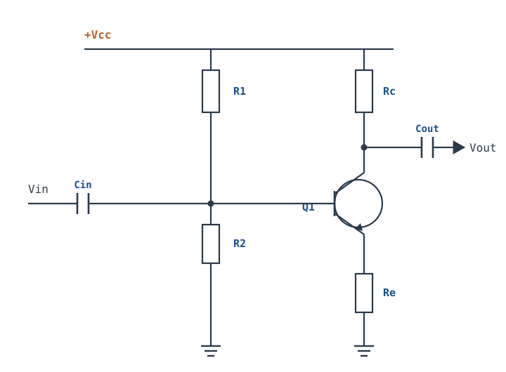
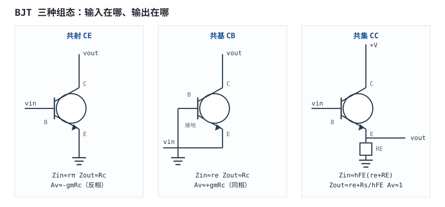
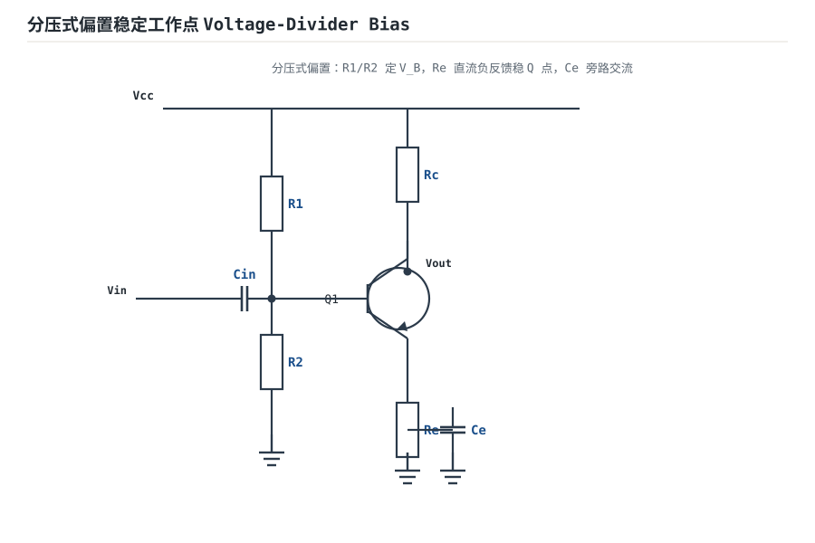
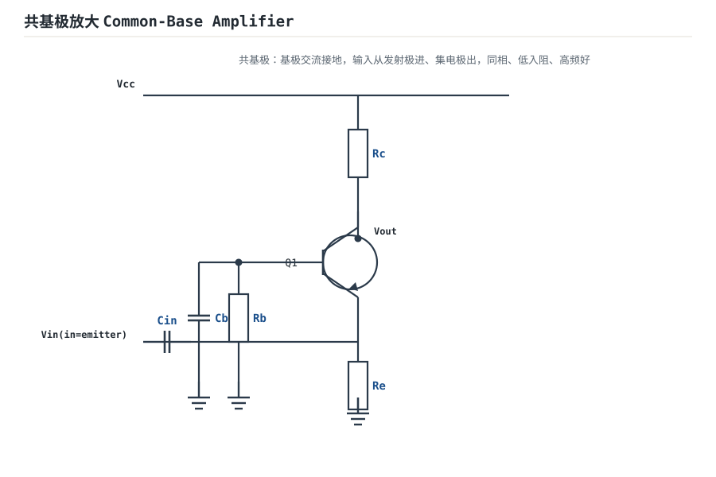
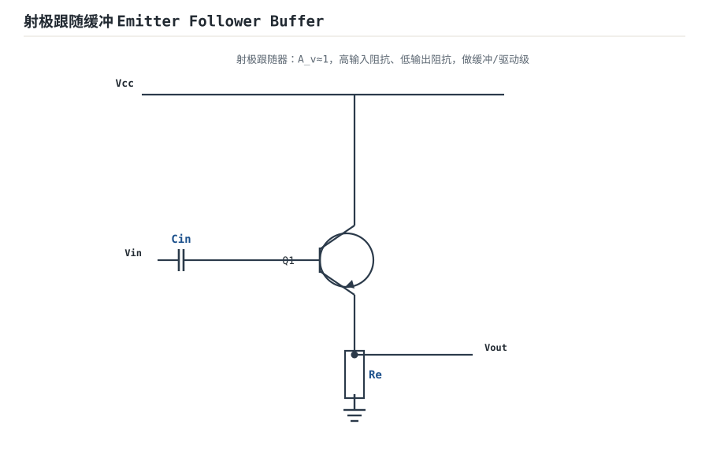

# BJT 三种放大组态与静态工作点 BJT Amplifier Configurations

BJT 有三个端子：基极 B、集电极 C、发射极 E。放大电路必须有一个输入端口和一个输出端口，而三个端子只能拿出两个做端口，于是"哪个端子作为公共端"就定义了三种基本组态：**共射（CE，common-emitter）、共集（CC，common-collector，又叫射极跟随器）、共基（CB，common-base）**。三种组态的电压增益、电流增益、输入阻抗、输出阻抗性格完全不同，选型本质上是在这四组数之间做权衡。

但组态只是"骨架"，真正决定电路能不能工作的是**静态工作点（quiescent point，Q 点）**。Q 点设高了，管子进饱和；设低了，进截止；β 和温度一变，Q 点还会自己跑。这一章的主线是：先用分压偏置把 Q 点钉住，再用小信号参数把三种组态的阻抗与增益算成一张可比较的表，然后处理温度稳定性和米勒效应，最后从一个真实需求出发——增益 −10、输入阻抗 10kΩ、带宽 100kHz——把偏置、增益、输入阻抗、米勒电容一路算到电阻取值和验算。

## 1. 设计动机

::: motivation 三个真实场景
**场景一：麦克风前置级带不动。** 驻极体麦克风经过一定衰减后，源阻抗约 10kΩ，要求放大 10 倍、带宽不低于 100kHz。直接用旁路射极的共射级，输入阻抗只有 $r_\pi\parallel R_B\approx4.2$kΩ，源阻抗和输入阻抗一分压，真正到基极的信号只剩 30%，增益和噪声都达不到要求。正确做法是加未旁路的射极电阻 $R_E'$，把输入阻抗抬到 19kΩ，同时把增益从 200 降到 10。

**场景二：批量生产时 Q 点乱跑。** 同一型号的 BJT，$h_{FE}$ 可能从 100 到 300，$V_{BE}$ 还有约 −2mV/°C 的温度系数。如果基极用一颗电阻直接从 $V_{CC}$ 接到基极，β 翻倍时 $I_C$ 也近似翻倍：一批管子冷机正常，另一批热机就饱和。分压偏置加射极电阻，把 β 从 100 变到 200 引起的 $I_C$ 变化压到 6% 左右，这就是它能成为分立放大标准偏置的原因。

**场景三：高增益共射级带宽不够。** 同一个共射级，旁路射极时增益约 213，输入极点只有 121kHz；1MHz 时增益跌到约 25 倍，比低频低 18.5dB。把射极电阻改成未旁路、增益降到 10 之后，输入极点升到 601kHz，带宽反而够了。**增益和带宽不是两个独立的旋钮，米勒电容把它们绑在一起。**
:::

把常见任务压成一张表：

| 你遇到的问题 | 先算什么 | 判据 |
|---|---|---|
| 输出波形一半被削平 | $V_{CEQ}$、$I_{CQ}R_L'$ | Q 点是否在放大区中部 |
| 换一批管子 Q 点就变 | $I_C$ 对 $\beta$ 的敏感度 | 分压电流是否远大于 $I_B$ |
| 增益与设计值差很多 | $A_v\approx-R_L'/(r_e+R_E')$ | 射极电阻是否被旁路 |
| 输入阻抗不够 | $R_{in}=R_B\parallel[r_\pi+(\beta_{ac}+1)R_E']$ | 偏置网络是否成为瓶颈 |
| 高频增益掉得快 | $C_{in}=C_\pi+(1+\vert A_v\vert)C_\mu$ | 输入极点是否覆盖工作频率 |
| 带不动负载 | $R_{out}$ 与 $R_L$ 的分压 | 是否需要共集缓冲 |

**不懂会在哪摔跤**，四个带数字的代价：

1. **只按增益选 $R_C$。** 想让旁路共射级增益为 10，需要 $R_C\approx10r_e=257\,\Omega$；此时 $V_C$ 停在 11.75V，输出向上只能摆 0.25V，向下能摆约 9.4V，波形严重不对称。正确做法是保留较大的 $R_C$，用 $R_E'$ 把增益压到 10，同时把 Q 点留在中间。
2. **分压电流取得太小。** 若 $I_{div}=2I_B$，β 变化 2 倍会让 $V_B$ 变化约 50%，$I_C$ 跟着变；批量生产时一半的板子 Q 点不对。$I_{div}\geq10I_B$ 是下限，不是推荐值。
3. **忽略米勒电容。** 增益 200、$C_\mu=2$pF 时，输入电容被放大到约 434pF，输入极点 121kHz；如果按"没有电容"设计，以为能到几 MHz，实际只有 100kHz 的 1.2 倍。
4. **把射极旁路电容接错。** 想让 $R_E'$ 起交流退化作用，却把旁路电容并在 $R_E'$ 两端，增益从 10 跳回 200，输出立刻削顶；或者旁路电容太小，低频增益掉到 $-R_C/(R_E+R_E')$，只有 3 倍左右。

## 2. 定义与直观

### 2.1 三个端子、三种组态

放大电路的输入端口和输出端口各用两个端子，BJT 只有三个端子，所以必有一个端子被输入和输出共用。按公共端命名：

| 组态 | 输入 | 输出 | 公共端 | 电压增益 | 电流增益 | 相位 |
|---|---|---|---|---|---|---|
| 共射 CE | 基极 B | 集电极 C | 发射极 E | 大，负 | $\beta_{ac}$ | 反相 180° |
| 共集 CC | 基极 B | 发射极 E | 集电极 C | 略小于 1，正 | $\beta_{ac}+1$ | 同相 |
| 共基 CB | 发射极 E | 集电极 C | 基极 B | 大，正 | $\alpha\approx1$ | 同相 |



共射级是最常用的电压放大级：信号从基极进、从集电极出，发射极交流接地。共集级把集电极接电源（交流地）、从发射极取输出，输出电压跟着输入走，所以叫**射极跟随器（emitter follower）**。共基级把基极交流接地、信号从发射极进、从集电极出，输入阻抗很低，适合高频和电流输入。



### 2.2 组态为什么决定"性格"

三种组态的性格差异，可以用"输入看进去是哪个电阻、输出看回来是哪个电阻"来记：

- **共射**：输入看进去是 $r_\pi$（kΩ 级），输出看回来是 $R_C\parallel r_o$（kΩ 级）。电压增益大、反相，输入输出阻抗都是"中等"，适合做电压放大。
- **共集**：输入看进去是 $r_\pi+(\beta_{ac}+1)R_E$（百 kΩ 级），输出看回来是 $r_e+R_S'/(\beta_{ac}+1)$（几十 Ω 级）。电压增益略小于 1、同相，输入高、输出低，适合做缓冲。
- **共基**：输入看进去是 $r_e$（几十 Ω 级），输出看回来是 $R_C\parallel r_o$（kΩ 级）。电压增益大、同相，输入低、输出高，适合高频、低阻源和电流缓冲。

::: analogy 三种组态像三种接口
共射像"电压放大器"接口：输入阻抗中等、输出阻抗高，能把小电压放大，但带不动重负载。共集像"缓冲器"接口：输入阻抗高、输出阻抗低，自己不放大电压，只负责把高阻源和低阻负载隔开。共基像"电流导管"接口：输入阻抗极低，电流几乎原样从发射极流到集电极，适合高频和 50Ω 系统。选组态就是选接口，先看源阻抗和负载阻抗，再看增益和相位。
:::

### 2.3 符号与约定

| 符号 | 含义 | 单位 | 备注 |
|---|---|---|---|
| $I_{CQ}$、$V_{CEQ}$ | 静态集电极电流、静态集射电压 | A、V | 大写 + 下标 Q |
| $i_c$、$v_{be}$ | 集电极电流、基射电压的增量 | A、V | 小写，交流量 |
| $h_{FE}$ | 直流电流放大倍数 | 无量纲 | 数据手册给范围，按最小值设计 |
| $\beta_{ac}$ | 交流电流放大倍数 | 无量纲 | 小信号参数，与 $h_{FE}$ 区分 |
| $g_m$ | 跨导 | S | $g_m=I_{CQ}/V_T$ |
| $r_\pi$ | 基极-发射极输入电阻 | $\Omega$ | $r_\pi=\beta_{ac}/g_m$ |
| $r_e$ | 发射极小信号电阻 | $\Omega$ | $r_e=V_T/I_E$ |
| $r_o$ | 输出电阻 | $\Omega$ | $r_o=V_A/I_{CQ}$ |
| $R_{in}$、$R_{out}$ | 输入、输出阻抗 | $\Omega$ | 含偏置网络时另行说明 |
| $A_v$ | 中频电压增益 | 无量纲 | 负号表示反相 |

小信号参数的定义、推导和失效边界见[小信号模型与增益、输入输出阻抗](small-signal-model.md)；本章直接引用 $g_m=I_{CQ}/V_T$、$r_\pi=\beta_{ac}/g_m$、$r_e=V_T/I_E$、$r_o=V_A/I_{CQ}$ 这四个结论，不再重复推导。**为行文简洁，下文正文里的"β"均指 $\beta_{ac}$，公式中一律写 $\beta_{ac}$；直流电流放大倍数写 $h_{FE}$。**

## 3. 定量关系

### 3.1 静态工作点：先直流、后交流

画直流等效电路时，电容开路、电感短路，交流源置零。分压偏置共射级的直流回路可以化成戴维南等效：

$$V_{TH}=V_{CC}\frac{R_2}{R_1+R_2},\qquad R_{TH}=R_1\parallel R_2$$

其中 $V_{TH}$ 是基极戴维南电压（V），$R_{TH}$ 是戴维南电阻（$\Omega$），$V_{CC}$ 是电源电压（V）。基极回路满足：

$$V_{TH}=I_BR_{TH}+V_{BE}+I_ER_E$$

把 $I_E=(\beta_{ac}+1)I_B$、$I_C=\beta_{ac}I_B$ 代入，解出：

$$I_B=\frac{V_{TH}-V_{BE}}{R_{TH}+(\beta_{ac}+1)R_E},\qquad I_C=\beta_{ac}I_B$$

其中 $V_{BE}$ 是导通时的基射压降（V，硅管约 0.6~0.8V，随电流上升），$R_E$ 是发射极直流电阻（$\Omega$）。集射电压：

$$V_{CE}=V_{CC}-I_CR_C-I_ER_E$$

放大区的判据是 $V_{CE}>V_{CE(sat)}$（典型 0.1~0.3V）且 $V_{BE}$ 正偏。**不要用"$V_C$ 是否大于 $V_E$"代替 $V_{CE}$ 判据**；$V_C>V_E$ 只是必要条件，还要留出饱和压降和输出摆幅的余量。

**算例（本章后续设计用的电路）**：$V_{CC}=12$V，$R_1=100$kΩ，$R_2=30$kΩ，$R_C=6.2$kΩ，$R_E=1.5$kΩ，$R_E'=510\,\Omega$，$V_{BE}=0.7$V。直流下 $R_E$ 与 $R_E'$ 串联，总发射极电阻 $R_{E,tot}=2.01$kΩ。

$$V_{TH}=12\times\frac{30}{130}=2.769\ \text{V},\qquad R_{TH}=100\text{k}\parallel30\text{k}=23.08\ \text{k}\Omega$$

$\beta_{ac}=200$ 时：

$$I_C=200\times\frac{2.769-0.7}{23.08\text{k}+201\times2.01\text{k}}=\frac{413.8}{427.1\text{k}}=0.969\ \text{mA}$$

$$I_E=0.969\text{mA}\times1.005=0.974\ \text{mA},\qquad V_E=0.974\text{mA}\times2.01\text{k}=1.957\ \text{V}$$

$$V_C=12-0.969\text{mA}\times6.2\text{k}=5.992\ \text{V},\qquad V_{CE}=5.992-1.957=4.035\ \text{V}$$

$\beta_{ac}=100$ 时：

$$I_C=100\times\frac{2.069}{23.08\text{k}+101\times2.01\text{k}}=\frac{206.9}{226.1\text{k}}=0.915\ \text{mA}$$

$$V_E=0.915\text{mA}\times1.01\times2.01\text{k}=1.858\ \text{V},\qquad V_C=12-0.915\text{mA}\times6.2\text{k}=6.326\ \text{V}$$

$$V_{CE}=6.326-1.858=4.468\ \text{V}$$

两种 β 下 $V_{CE}$ 都在 4V 以上，远离饱和区；$I_C$ 只差 5.9%，说明射极电阻的负反馈起了作用。**如果去掉 $R_E$ 和 $R_E'$，同样的分压网络会让 $I_C$ 随 β 成比例变化，β 从 100 到 200 时 $I_C$ 直接翻倍，$V_C$ 会撞到电源轨。**

**输出摆幅**：交流负载是 $R_C\parallel R_L\parallel r_o$。以 $R_L=100$kΩ、$r_o\approx103$kΩ 为例，$R_L'=5.53$kΩ。输出向上的最大摆幅受截止限制，约 $I_{CQ}R_L'=0.969\text{mA}\times5.53\text{k}=5.36$V；向下的最大摆幅受饱和限制，约 $V_{CEQ}-V_{CE(sat)}=4.035-0.3=3.73$V。**对称输出摆幅取两者较小值 3.73V**；要更大摆幅，应把 Q 点下移（减小 $R_C$ 或加大 $I_C$），而不是一味加大 $R_C$。

### 3.2 温度稳定性与分压偏置判据

BJT 的 Q 点对温度敏感，来源有三条：$V_{BE}$ 约 −2mV/°C、$I_S$ 随温度指数增长、$\beta_{ac}$ 随温度变化。三条里最要命的是第一条：固定 $V_{BE}$ 时，温度每升 1°C，$I_C$ 约涨 8%，30°C 就是 10 倍。射极电阻的作用是把"电压驱动"变成"电流反馈"：

$$V_{BE}=V_B-I_ER_E\quad\Rightarrow\quad \Delta I_E\approx\frac{\Delta V_{BE}}{R_E+r_e}$$

其中 $r_e=V_T/I_E$ 是发射结的小信号电阻（$\Omega$）。这个式子的意思是：$V_{BE}$ 变化同样的量，射极电阻越大，电流变化越小。以 $R_{E,tot}=2.01$kΩ、$I_E=0.974$mA（$r_e=26.5\,\Omega$）为例：

$$\frac{\Delta I_E}{\Delta V_{BE}}=\frac{1}{2010+26.5}=0.491\ \text{mA/V}$$

$V_{BE}$ 温度系数 −2mV/°C 时，$\Delta I_E=0.491\text{mA/V}\times2\text{mV}/^{\circ}\text{C}=0.982\,\mu\text{A}/^{\circ}\text{C}$，相对 $I_E=0.974$mA 是 0.101%/°C。若把射极电阻全部去掉（$R_E=R_E'=0$），同样的 $V_{BE}$ 变化直接加在 $r_e=26.5\,\Omega$ 上：

$$\frac{\Delta I_E}{\Delta V_{BE}}=\frac{1}{26.5}=37.7\ \text{mA/V}\quad\Rightarrow\quad 7.74\%/^{\circ}\text{C}$$

两者相差约 77 倍。**这就是"射极电阻用电压余量换温度稳定性"的定量版本。**

**分压偏置的第二个作用**是让 $V_B$ 不受 $I_B$ 影响。戴维南等效给出：

$$V_B=V_{TH}-I_BR_{TH}$$

若分压电流 $I_{div}=V_{CC}/(R_1+R_2)$ 远大于 $I_B$，第二项可以忽略，$V_B$ 由电阻比决定。$I_B$ 对 $V_B$ 的负载效应是 $\Delta V_B=I_BR_{TH}$，相对误差：

$$\frac{\Delta V_B}{V_{TH}}=\frac{I_BR_{TH}}{V_{TH}}=\frac{I_BR_1}{V_{CC}}$$

把 $I_{div}=V_{CC}/(R_1+R_2)$ 代入，得到：

$$\frac{\Delta V_B}{V_{TH}}=\frac{I_B}{I_{div}}\cdot\frac{1}{1+R_2/R_1}$$

当 $R_2/R_1$ 不大时，$I_{div}\geq10I_B$ 对应 $V_B$ 的相对误差小于 10%，这就是 **$I_{div}\geq10I_B$** 的来历。

但这个"10 倍"只是 $V_B$ 的误差，不是 $I_E$ 的误差。因为 $V_E=V_B-V_{BE}$，而 $V_E$ 通常只有 1~3V，$V_B$ 却有 2~4V，所以同样的 $V_B$ 误差在 $V_E$ 上会被放大 $V_B/V_E$ 倍。把上面的 $V_B$ 误差换成 $I_E$ 误差，近似得到更严格的判据：

$$I_{div}\geq10I_B\cdot\frac{V_B}{V_E}$$

以 $V_B=2.56$V、$V_E=1.86$V 为例，$V_B/V_E=1.38$，严格判据是 $I_{div}\geq13.8I_B$。本章设计取 $I_{div}=92.3\,\mu\text{A}$，$\beta_{ac}=100$ 时 $I_B=9.15\,\mu\text{A}$，比值 10.1；看起来刚好踩线，但实际 $I_C$ 从 β=200 到 β=100 只变了 5.9%，因为射极电阻的负反馈把剩余误差又压小了一部分。**结论：10 倍是起点，不是终点；设计完要把 β 的最小值和最大值代回去，算实际的 $I_C$、$V_{CE}$ 变化。**

| $\beta_{ac}$ | $I_B$ | $I_C$ | $V_E$ | $V_C$ | $V_{CE}$ | $I_{div}/I_B$ |
|---|---|---|---|---|---|---|
| 200 | 4.85µA | 0.969mA | 1.957V | 5.992V | 4.035V | 19.0 |
| 100 | 9.15µA | 0.915mA | 1.858V | 6.326V | 4.468V | 10.1 |

温度补偿还有两种常见做法：**二极管补偿**（用与 BJT 同材质的二极管产生 −2mV/°C 的偏置电压，抵消 $V_{BE}$ 漂移）和**电流镜偏置**（用电流源强制 $I_C$，让 $g_m$ 只随 $V_T$ 缓慢变化）。分立电路里最常用的还是分压偏置加射极电阻；集成电路里电流镜更常见。



### 3.3 三种组态的定量对比

为了公平比较，三种组态用同一组偏置和小信号参数：$I_{CQ}=1$mA、$\beta_{ac}=200$、$V_A=100$V、$V_T=25.85$mV、$R_C=6.2$kΩ、$R_L=100$kΩ、$R_B=R_1\parallel R_2=23.08$kΩ、$R_S=10$kΩ；共集级的 $R_E=2$kΩ 与 $R_L$ 并联。先算公共的小信号参数：

$$g_m=\frac{1\text{mA}}{25.85\text{mV}}=38.69\ \text{mS},\qquad r_\pi=\frac{200}{38.69\text{mS}}=5.17\ \text{k}\Omega$$

$$r_e=\frac{25.85\text{mV}}{1.005\text{mA}}=25.72\ \Omega,\qquad r_o=\frac{100\text{V}}{1\text{mA}}=100\ \text{k}\Omega$$

$$R_L'=R_C\parallel R_L\parallel r_o=6.2\text{k}\parallel100\text{k}\parallel100\text{k}=5.516\ \text{k}\Omega$$

**共射 CE**（发射极旁路，无退化）：

$$A_v=-g_mR_L'=-38.69\text{mS}\times5.516\text{k}\Omega=-213.4$$

$$R_{in}=r_\pi\parallel R_B=5.17\text{k}\parallel23.08\text{k}=4.22\ \text{k}\Omega,\qquad R_{out}=R_C\parallel r_o=6.2\text{k}\parallel100\text{k}=5.84\ \text{k}\Omega$$

**共基 CB**（基极交流接地，输入在发射极）：

$$A_v=+g_mR_L'=+213.4,\qquad R_{in}\approx r_e=25.72\ \Omega$$

$$R_{out}=R_C\parallel r_o=5.84\ \text{k}\Omega,\qquad \alpha=\frac{\beta_{ac}}{\beta_{ac}+1}=\frac{200}{201}=0.995$$

**共集 CC**（射极跟随，$R_E'=R_E\parallel R_L=2\text{k}\parallel100\text{k}=1.961$kΩ）：

$$A_v=\frac{g_mR_E'}{1+g_mR_E'}=\frac{38.69\text{mS}\times1.961\text{k}}{1+38.69\text{mS}\times1.961\text{k}}=\frac{75.87}{76.87}=0.987$$

$$R_{in}=r_\pi+(\beta_{ac}+1)R_E'=5.17\text{k}+201\times1.961\text{k}=399.3\ \text{k}\Omega$$

$$R_{out}=r_e+\frac{R_S\parallel R_B}{\beta_{ac}+1}=25.72+\frac{10\text{k}\parallel23.08\text{k}}{201}=25.72+34.77=60.5\ \Omega$$

含偏置网络时，共集的输入阻抗是 $399.3\text{k}\parallel23.08\text{k}=21.82$kΩ，共射是 4.22kΩ；共集仍然高 5 倍多，但已经不是"几百 kΩ"了。**偏置网络会吃掉高输入阻抗，这是共集缓冲级最常见的落差。**

| 组态 | $A_v$（含负载） | $R_{in}$（含偏置） | $R_{out}$ | 电流增益 | 相位 | 最适合 |
|---|---|---|---|---|---|---|
| 共射 CE | −213.4 | 4.22kΩ | 5.84kΩ | 200 | 反相 | 电压放大 |
| 共基 CB | +213.4 | 25.72Ω | 5.84kΩ | 0.995 | 同相 | 高频、低阻源、电流缓冲 |
| 共集 CC | 0.987 | 21.82kΩ | 60.5Ω | 201 | 同相 | 电压缓冲、驱动重负载 |

**为什么共基的输入阻抗是 $r_e$ 而不是 $r_\pi$？** 因为输入信号加在发射极，基极交流接地；从发射极看进去，看到的是发射结的小信号电阻 $r_e$，而基极电流只通过 $r_\pi$ 分流，折算到发射极要除以 $\beta_{ac}+1$。共基的电流增益接近 1，电压增益由 $R_C/r_e$ 决定，所以它适合"低阻源、要高电压增益、高频"的场合。**共基的代价是输入阻抗太低**：接 50Ω 源时，$25.7\,\Omega$ 的输入阻抗会分掉约 34% 的信号。





### 3.4 增益带宽与米勒效应

共射级的基极与集电极之间有一个结电容 $C_\mu$。输出反相放大 $A_v$ 倍，$C_\mu$ 两端的电压摆幅是输入摆幅的 $(1+\vert A_v\vert)$ 倍，从输入端看进去等效为：

$$C_{in}=C_\pi+(1+\vert A_v\vert)C_\mu$$

其中 $C_\pi$ 是基射结电容（F），$C_\mu$ 是基集结电容（F）。**这个 $(1+\vert A_v\vert)$ 就是米勒倍增（Miller multiplication）**。输入回路的时间常数和主极点：

$$R_{eq}=R_S\parallel R_B\parallel R_{in,base},\qquad f_H=\frac{1}{2\pi R_{eq}C_{in}}$$

其中 $R_{in,base}$ 是管子基极看进去的电阻（共射无退化时就是 $r_\pi$），$R_{eq}$ 是电容 $C_{in}$ 看到的总电阻（$\Omega$）。把 $C_{in}$ 的表达式代入，并假设 $g_mR_L'\gg1$、米勒项主导：

$$\vert A_v\vert f_H=\frac{g_mR_L'}{2\pi R_{eq}[C_\pi+(1+g_mR_L')C_\mu]}\approx\frac{1}{2\pi R_{eq}C_\mu}$$

**这就是"增益带宽积（GBW）近似为常数"的来历**：加大 $R_C$ 提高增益，同时 $C_{in}$ 按比例变大，$f_H$ 按比例下降，乘积基本不变。注意它成立的条件是：输入网络（$R_{eq}$）不变、米勒项远大于 $C_\pi$、$g_mR_L'\gg1$。换组态、加退化、改变偏置网络，这个"常数"就不成立了。

用本章的电路做两组对比。先取旁路射极、$R_C=6.2$kΩ 的共射级：$A_v=-213.4$，$R_{eq}=10\text{k}\parallel23.08\text{k}\parallel5.17\text{k}=2.96$kΩ。设 $f_T=300$MHz、$C_\mu=2$pF（示例假设），由 $f_T=g_m/[2\pi(C_\pi+C_\mu)]$ 得 $C_\pi+C_\mu=20.53$pF，$C_\pi=18.53$pF。

$$C_{in}=18.53\text{pF}+(1+213.4)\times2\text{pF}=447.3\ \text{pF}$$

$$f_H=\frac{1}{2\pi\times2.96\text{k}\times447.3\text{pF}}=120.2\ \text{kHz}$$

$$\vert A_v\vert f_H=213.4\times120.2\text{kHz}=25.7\ \text{MHz}$$

把 $R_C$ 减半到 3.1kΩ，增益约 109.5，$C_{in}$ 降到约 239pF，$f_H$ 升到约 220kHz，乘积约 24.1MHz，基本不变。**这就是 GBW 近似：增益换带宽，乘积守恒。**

再看本章设计的退化共射级：$A_v=-10.27$，$C_{in}=40.4$pF，$R_{eq}=6.55$kΩ，$f_H=601$kHz。此时 $g_mR_L'=10.27$ 不满足"远大于 1"，$C_\pi$ 与米勒项同量级，GBW 近似不成立；但低增益让 $C_{in}$ 小、$R_{eq}$ 大，带宽反而从 120kHz 升到 601kHz。**退化不是"按 GBW 常数换带宽"，它同时改变了输入电阻和米勒电容，是三件事一起变。**

| 电路 | $\vert A_v\vert$ | $C_{in}$ | $R_{eq}$ | $f_H$ | $\vert A_v\vert f_H$ |
|---|---|---|---|---|---|
| 共射，旁路射极，$R_C=6.2$k | 213.4 | 447.3pF | 2.96kΩ | 120.2kHz | 25.7MHz |
| 共射，旁路射极，$R_C=3.1$k | 109.5 | 238.9pF | 2.96kΩ | 220.3kHz | 24.1MHz |
| 共射，退化 $R_E'=510\,\Omega$ | 10.27 | 40.4pF | 6.55kΩ | 601kHz | 6.2MHz |

**高频设计的三条结论**：第一，共射级增益越高，米勒电容越大、带宽越低；第二，要同时要增益和带宽，用 cascode（共射-共基级联）把集电极电压摆幅压在共基管上，基本消除米勒倍增；第三，共集级电压增益接近 1，没有米勒倍增，但它的输出极点由 $R_E\parallel R_L$ 和结电容决定，重负载时仍会限带。增益带宽积、压摆率和建立时间的系统计算见[带宽 GBP、压摆率与建立时间](gbp-slew-rate.md)。

## 4. 典型计算：设计一个增益 −10、输入阻抗 10kΩ、带宽 100kHz 的共射级

### 4.1 需求与假设

| 项目 | 要求/假设 | 说明 |
|---|---|---|
| 电源 | $V_{CC}=12$V | 单电源 |
| 负载 | $R_L=100$kΩ | 轻载，便于先算电压增益 |
| 中频增益 | $\vert A_v\vert=10$，误差 ±5% | 反相 |
| 输入阻抗 | $Z_{in}\geq10$kΩ | 含偏置网络 |
| 带宽 | $f_H\geq100$kHz | 上限 −3dB 频率 |
| 源阻抗 | $R_S=10$kΩ | 麦克风前置级的典型量级 |
| 管子 | $h_{FE,min}=100$，$\beta_{ac}=200$（典型） | 小信号 NPN |
| 厄利电压 | $V_A=100$V | 示例假设 |
| 高频参数 | $C_\mu=2$pF，$f_T=300$MHz | 示例假设，典型小信号管量级 |
| 低频 | $f_L\leq20$Hz | 由耦合、旁路电容决定 |

### 4.2 第 1 步：选静态电流

取 $I_{CQ}\approx1$mA。理由有三条：$g_m=38.7$mS，$r_e=25.7\,\Omega$，增益公式里的 $r_e$ 只占 $R_E'$ 的 5%，温度和 β 的影响被压小；$r_\pi=5.17$kΩ，输入阻抗有基础；功耗 $12\text{V}\times1\text{mA}=12$mW，小信号管无需散热。若取 0.1mA，$r_\pi$ 升到 51.7kΩ、输入阻抗更容易达标，但 $g_m$ 只有 3.87mS，要达到增益 10 需要更大的 $R_C$ 或更小的 $R_E'$，输出摆幅和噪声都更紧张。**1mA 是这个指标下的折中点。**

### 4.3 第 2 步：定发射极电阻与偏置

取 $V_E\approx2$V（约为 $V_{CC}$ 的 17%），则总发射极电阻：

$$R_{E,tot}=\frac{V_E}{I_E}\approx\frac{2\text{V}}{1\text{mA}}=2\ \text{k}\Omega$$

把 $2$kΩ 拆成两部分：未旁路的 $R_E'=510\,\Omega$ 和旁路的 $R_E=1.5$kΩ，总 2.01kΩ。$R_E'$ 负责交流退化，把增益压到 10 附近并扩大线性范围；$R_E$ 负责直流负反馈，用旁路电容 $C_E$ 在交流上短路掉，避免它把增益压得更低。基础图里的发射极电阻 $R_e$ 在本设计里就是 $R_E+R_E'$ 的串联，$C_E$ 只并在 $R_E$ 两端，其余连接不变。

基极电位 $V_B=V_E+V_{BE}\approx2.0+0.7=2.7$V。取分压电流 $I_{div}\approx10I_B$（按 $h_{FE,min}=100$ 算，$I_B\approx9.7\,\mu\text{A}$），则 $I_{div}\approx97\,\mu\text{A}$，分压总电阻约 $12\text{V}/97\,\mu\text{A}=124$kΩ。选标准值 $R_1=100$kΩ、$R_2=30$kΩ：

$$V_{TH}=12\times\frac{30}{130}=2.769\ \text{V},\qquad R_{TH}=100\text{k}\parallel30\text{k}=23.08\ \text{k}\Omega$$

$$I_{div}=\frac{12}{130\text{k}}=92.3\ \mu\text{A}$$

$\beta_{ac}=100$ 时 $I_B=9.15\,\mu\text{A}$，$I_{div}/I_B=10.1$，刚好满足 §3.2 的下限。实际 $V_B=V_{TH}-I_BR_{TH}=2.769-9.15\,\mu\text{A}\times23.08\text{k}=2.558$V，$V_E=1.858$V，$I_C=0.915$mA；$\beta_{ac}=200$ 时 $I_C=0.969$mA。两个值都和设计目标 1mA 相差不到 9%，可以接受。若要求更准，把 $R_2$ 略减或把 $R_E$ 略减；本章保留标准值，用验算表说明偏差。

### 4.4 第 3 步：由增益定 $R_C$

退化共射级的增益近似为：

$$A_v\approx-\frac{R_L'}{r_e+R_E'},\qquad R_L'=R_C\parallel R_L\parallel r_o$$

其中 $R_L'$ 是交流负载（$\Omega$），$r_e$ 是发射极小信号电阻（$\Omega$），$R_E'$ 是未旁路的射极电阻（$\Omega$）。要 $\vert A_v\vert=10$，先估 $r_e\approx26\,\Omega$、$R_E'=510\,\Omega$，则需要 $R_L'\approx10\times(26+510)=5.36$kΩ。取 $R_C=6.2$kΩ，$R_L'=6.2\text{k}\parallel100\text{k}\parallel103\text{k}=5.53$kΩ，实际增益：

$$A_v=-\frac{5.53\text{k}}{26.5+510}=-10.30$$

与目标 −10 差 2.9%，在 ±5% 内。精确式（含 $r_o$）为：

$$A_v=-\frac{g_mR_L'}{1+g_mR_E'+(R_E'+R_L')/r_o}$$

代入 $g_m=37.49$mS、$R_L'=5.525$kΩ、$R_E'=510\,\Omega$、$r_o=103.2$kΩ：

$$A_v=-\frac{37.49\text{mS}\times5.525\text{k}}{1+37.49\text{mS}\times510+(510+5525)/103.2\text{k}}=-\frac{207.1}{1+19.12+0.0585}=-10.27$$

近似式与精确式只差 0.2%，说明 $r_o$ 在这个电路里是次要项；但**不能因此省掉 $r_o$**，当 $R_C$ 接近 $r_o$ 时它会变成主要项。

**为什么不直接用旁路射极、把 $R_C$ 降到 257Ω 来得到增益 10？** 因为 $V_C=12-1\text{mA}\times257\,\Omega=11.74$V，输出向上只能摆 $1\text{mA}\times(257\parallel100\text{k})\approx0.257$V，向下能摆约 9.4V，波形严重不对称；而且输入阻抗只有 $r_\pi\parallel R_B=4.2$kΩ，达不到 10kΩ。**退化电阻同时解决增益精度、输入阻抗和输出摆幅三个问题，代价是增益带宽积。**

### 4.5 第 4 步：验算输入、输出阻抗

输入阻抗（含偏置网络）：

$$R_{in,base}=r_\pi+(\beta_{ac}+1)R_E'$$

$$Z_{in}=R_B\parallel R_{in,base}=R_1\parallel R_2\parallel R_{in,base}$$

$\beta_{ac}=200$ 时：$r_\pi=5.34$kΩ，$R_{in,base}=5.34\text{k}+201\times0.510\text{k}=107.8$kΩ，$Z_{in}=23.08\text{k}\parallel107.8\text{k}=19.0$kΩ。

$\beta_{ac}=100$ 时：$r_\pi=2.82$kΩ，$R_{in,base}=2.82\text{k}+101\times0.510\text{k}=54.3$kΩ，$Z_{in}=23.08\text{k}\parallel54.3\text{k}=16.2$kΩ。

两种 β 下都大于 10kΩ，满足要求，且有余量。输出阻抗：

$$R_{out}\approx R_C\parallel[r_o(1+g_mR_E')]=6.2\text{k}\parallel[103.2\text{k}\times(1+19.12)]=6.2\text{k}\parallel2.08\text{M}=6.18\ \text{k}\Omega$$

$R_{out}$ 主要由 $R_C$ 决定，退化把 $r_o$ 抬高了约 20 倍，但 $R_C$ 仍然并联主导。**如果负载是 10kΩ 而不是 100kΩ，$R_L'$ 会降到约 3.8kΩ，增益跌到约 7，这时要么加共集缓冲，要么重新设计 $R_C$。**

### 4.6 第 5 步：验算输出摆幅与线性度

交流负载 $R_L'=5.53$kΩ，静态电流 $0.969$mA：

$$V_{swing,cutoff}=I_{CQ}R_L'=0.969\text{mA}\times5.53\text{k}=5.36\ \text{V}$$

$$V_{swing,sat}=V_{CEQ}-V_{CE(sat)}=4.035-0.3=3.73\ \text{V}$$

对称摆幅取 3.73V，对应最大输入峰值：

$$v_{in,max}=\frac{3.73\text{V}}{10.27}=363\ \text{mV}$$

输入 100mV 峰值时，输出 1.03V 峰值，离 3.73V 的限幅点还有 3.6 倍余量；输入 350mV 时输出 3.59V，接近 3.73V 的饱和限幅，到 363mV 左右开始削顶。线性度方面，退化把基射结的电压摆幅压到 $v_{in}\times r_e/(r_e+R_E')=100\text{mV}\times26.5/536.5=4.9$mV，HD2 约 $4.9\text{mV}/(4V_T)=4.7\%$；如果没有退化，100mV 直接加在 $r_e$ 上，HD2 约 96.7%，早已不能算线性放大。**这就是"用增益换线性度"的具体数字。**

```echarts
{
  "tooltip": {"trigger": "axis"},
  "legend": {"data": ["v_in（基极）", "v_out（集电极）"], "bottom": 0, "textStyle": {"fontSize": 13}},
  "grid": {"left": 56, "right": 24, "top": 26, "bottom": 56},
  "xAxis": {"type": "category", "name": "角度", "data": [0,30,60,90,120,150,180,210,240,270,300,330,360], "axisLabel": {"fontSize": 11}},
  "yAxis": {"type": "value", "name": "V", "min": -1.5, "max": 1.5, "axisLabel": {"fontSize": 11}},
  "series": [
    {"name": "v_in（基极）", "type": "line", "smooth": true, "showSymbol": false, "lineStyle": {"width": 2.4, "color": "#1a4f8b"},
     "data": [0,0.05,0.0866,0.1,0.0866,0.05,0,-0.05,-0.0866,-0.1,-0.0866,-0.05,0]},
    {"name": "v_out（集电极）", "type": "line", "smooth": true, "showSymbol": false, "lineStyle": {"width": 2.6, "color": "#b5642e"},
     "data": [0,-0.514,-0.889,-1.027,-0.889,-0.514,0,0.514,0.889,1.027,0.889,0.514,0]}
  ]
}
```

图中输入 0.1V 峰值、输出 1.027V 峰值，增益 −10.27，相位差 180°。输出摆幅没有超出 3.73V 的限幅点，所以波形是干净的反相正弦；把输入加到 350mV，输出峰值 3.59V，接近饱和限幅，到 363mV 左右底部开始被压平。

### 4.7 第 6 步：米勒电容与带宽验算

由 $f_T=300$MHz 反推总电容：

$$C_\pi+C_\mu=\frac{g_m}{2\pi f_T}=\frac{37.49\times10^{-3}}{2\pi\times300\times10^6}=19.89\ \text{pF}$$

$$C_\pi=19.89\text{pF}-2\text{pF}=17.89\ \text{pF}$$

米勒输入电容：

$$C_{in}=C_\pi+(1+\vert A_v\vert)C_\mu=17.89\text{pF}+(1+10.27)\times2\text{pF}=40.4\ \text{pF}$$

输入回路的等效电阻：

$$R_{eq}=R_S\parallel R_B\parallel R_{in,base}=10\text{k}\parallel23.08\text{k}\parallel107.8\text{k}=6.55\ \text{k}\Omega$$

$$f_H=\frac{1}{2\pi R_{eq}C_{in}}=\frac{1}{2\pi\times6.55\text{k}\times40.4\text{pF}}=601\ \text{kHz}$$

601kHz 是要求 100kHz 的 6 倍，余量充足。若把 $R_E'$ 旁路掉，增益变成 207，$C_{in}$ 变成 434pF，$R_{eq}$ 变成 3.02kΩ，$f_H$ 只有 121kHz——仍然大于 100kHz，但只剩 1.2 倍余量，而且增益不是 10，说明"旁路射极"这条路的增益和输入阻抗都不满足要求。**退化把增益从 207 降到 10，同时把 $f_H$ 从 121kHz 抬到 601kHz，代价是 GBW 从 25.1MHz 降到 6.2MHz；这是用多余的带宽换增益精度和输入阻抗。**

### 4.8 第 7 步：耦合与旁路电容

按 $f_L=20$Hz 计算下限频率，电容取值要让容抗远小于它串联的电阻：

$$C_{in}\geq\frac{1}{2\pi f_L(R_S+Z_{in})}=\frac{1}{2\pi\times20\times(10\text{k}+19.0\text{k})}=0.27\ \mu\text{F}$$

取 1µF，实际输入高通截止频率 $1/(2\pi\times29.0\text{k}\times1\,\mu\text{F})=5.5$Hz。

$$C_{out}\geq\frac{1}{2\pi f_L(R_{out}+R_L)}=\frac{1}{2\pi\times20\times(6.18\text{k}+100\text{k})}=74.9\ \text{nF}$$

取 1µF，实际截止频率 $1/(2\pi\times106.2\text{k}\times1\,\mu\text{F})=1.5$Hz，余量很大。

旁路电容 $C_E$ 只并在 $R_E=1.5$kΩ 两端，$R_E'=510\,\Omega$ 保持未旁路。$C_E$ 看到的电阻约为 $R_E\parallel[r_e+R_S'/(\beta_{ac}+1)]$，其中 $R_S'=R_S\parallel R_B=6.98$kΩ：

$$R_{C_E}\approx1.5\text{k}\parallel\left(26.5+\frac{6.98\text{k}}{201}\right)=1.5\text{k}\parallel61.2=58.9\ \Omega$$

$$C_E\geq\frac{1}{2\pi f_L R_{C_E}}=\frac{1}{2\pi\times20\times58.9}=135\ \mu\text{F}$$

取 220µF，实际截止频率 $1/(2\pi\times58.9\times220\,\mu\text{F})=12.3$Hz。三个下限频率（5.5Hz、1.5Hz、12.3Hz）都低于 20Hz，系统的下限由 $C_E$ 决定，约 12Hz。

### 4.9 第 8 步：选值与最终验算

| 元件 | 取值 | 依据 | 备注 |
|---|---|---|---|
| $R_1$ | 100kΩ | 分压比 0.231，$I_{div}=92.3\,\mu$A | 1% 或 5% |
| $R_2$ | 30kΩ | 与 $R_1$ 分压定 $V_B$ | 1% 或 5% |
| $R_C$ | 6.2kΩ | 增益与摆幅折中 | 1% 金属膜 |
| $R_E$ | 1.5kΩ | 直流负反馈，$C_E$ 旁路 | 1% 或 5% |
| $R_E'$ | 510Ω | 交流退化，定增益与线性度 | 1% 金属膜 |
| $C_{in}$ | 1µF | 输入高通，$f_L\leq20$Hz | 薄膜或 C0G |
| $C_{out}$ | 1µF | 输出高通 | 薄膜或 C0G |
| $C_E$ | 220µF | 射极旁路，$f_L\leq20$Hz | 电解，注意极性 |

| 验算项 | $\beta_{ac}=200$ | $\beta_{ac}=100$ | 判定 |
|---|---|---|---|
| $I_C$ | 0.969mA | 0.915mA | 与 1mA 偏差 <9% |
| $V_{CE}$ | 4.035V | 4.468V | 远离饱和 |
| $A_v$ | −10.27 | −10.27 | 目标 −10±5% |
| $Z_{in}$ | 19.0kΩ | 16.2kΩ | ≥10kΩ |
| $R_{out}$ | 6.18kΩ | 6.18kΩ | 由 $R_C$ 主导 |
| 对称摆幅 | 3.73V | 4.17V | 输入 100mV 时余量 ≥3.6 倍 |
| $f_H$ | 601kHz | 约 650kHz | ≥100kHz |
| $f_L$ | 约 12Hz | 约 12Hz | ≤20Hz |

**增益误差**：$R_C$ 和 $R_E'$ 用 1% 电阻，$I_C$ 在 β=100~200 间变化 5.9%，$r_e$ 随之变化约 5%，增益最坏情况约 $10.27\times(1\pm0.03)=9.96\sim10.58$，在 ±5% 内。若用 5% 电阻，$R_C$ 和 $R_E'$ 的容差各 ±5%，增益误差可能到 ±10%，不满足要求；**这个电路的关键电阻必须用 1% 金属膜，偏置分压可以用 5%。** 电阻的精度、温漂与 E 系列取值见[电阻器全解：材质、精度、功率、温漂](../components/resistors.md)和[贴片封装与 E 系列标准值](../components/smd-packages-e-series.md)。

**源阻抗的影响**：上面的 $A_v=-10.27$ 是基极到集电极的增益。若按源电压 $v_s$ 算，$R_S=10$kΩ 与 $Z_{in}=19.0$kΩ 分压，源到输出的增益为：

$$A_{vs}=A_v\cdot\frac{Z_{in}}{R_S+Z_{in}}=-10.27\times\frac{19.0}{10+19.0}=-6.73$$

$\beta_{ac}=100$ 时 $Z_{in}=16.2$kΩ，$A_{vs}=-10.27\times16.2/(10+16.2)=-6.35$。题目说的"增益 −10"按输入端口定义，所以设计成立；如果指标是"源到输出 −10"，要么把 $R_S$ 降到 1kΩ 以下，要么把 $Z_{in}$ 再提高一个量级。**增益指标一定要写清参考点，否则差 35% 都算不清。**

### 4.10 算例二：负载从 100kΩ 降到 10kΩ

把 $R_L$ 从 100kΩ 改成 10kΩ，其余不变。新的交流负载：

$$R_L'=R_C\parallel R_L\parallel r_o=6.2\text{k}\parallel10\text{k}\parallel103.2\text{k}=3.69\ \text{k}\Omega$$

$$A_v=-\frac{3.69\text{k}}{26.5+510}=-6.88$$

增益从 −10.27 掉到 −6.88，下降 33%，不满足 −10±5% 的要求。输入阻抗和偏置不变（$Z_{in}=19.0$kΩ，$I_C=0.969$mA），输出摆幅变为：

$$V_{swing,cutoff}=0.969\text{mA}\times3.69\text{k}=3.58\ \text{V},\qquad V_{swing,sat}=4.035-0.3=3.73\ \text{V}$$

对称摆幅 3.58V，最大输入 $3.58/6.88=520$mV。**增益掉了，但最大输入反而变大，因为增益和摆幅是同一组 $R_L'$ 的两个结果。**

要恢复增益 10，需要 $R_L'=10\times(26.5+510)=5.37$kΩ。在 10kΩ 负载下反解 $R_C$：

$$\frac{1}{R_C}=\frac{1}{5.37\text{k}}-\frac{1}{10\text{k}}-\frac{1}{103.2\text{k}}\ \Rightarrow\ R_C=13.0\ \text{k}\Omega$$

但 $V_C=12-0.969\text{mA}\times13.0\text{k}=-0.6$V，管子直接饱和——**在 12V、1mA 的条件下，单级共射无法同时满足增益 10 和 10kΩ 负载。** 解决办法有三个：加一级共集缓冲，把 10kΩ 负载与集电极隔开；降低 $I_C$ 重新设计（$R_C$ 的电压降变小，但 $g_m$ 和输入阻抗会变）；或者改用能带重负载的推挽输出级。这个算例说明：**设计指标之间会互相打架，算到"无解"也是设计的一部分。**

## 5. 工程含义

### 5.1 偏置设计的数量级

| 参数 | 经验范围 | 本章取值 | 依据 |
|---|---|---|---|
| $V_E$ | $V_{CC}$ 的 10%~20% | 1.86~1.96V（16%） | 稳 Q 点与摆幅折中 |
| $I_{div}$ | $10I_B$~$20I_B$ | 10.1~19.0 倍 | $V_B$ 不被 $I_B$ 拉低 |
| $V_{CEQ}$ | $V_{CC}$ 的 30%~50% | 4.0~4.5V（36%） | 兼顾饱和与截止摆幅 |
| $R_E'$ | $r_e$ 的 5~20 倍 | 510Ω（19 倍） | 增益稳定、线性度 |
| $R_C$ | 由增益和摆幅反推 | 6.2kΩ | $I_CR_C\approx6$V |
| $C_E$ | $1/(2\pi f_L R_{C_E})$ 的 2~5 倍 | 220µF（1.6 倍） | 下限频率 12Hz |

这些是"起点量级"，不是标准答案。$V_E$ 取小了，温度稳定性差；取大了，输出摆幅小。$R_E'$ 取小了，增益对 $r_e$、$I_C$、温度都敏感；取大了，增益和带宽都下降。**每次改动都要把 β 的最小值、最大值和温度极值代回去验算。**

### 5.2 三种组态怎么选

| 需求 | 首选组态 | 原因 | 注意 |
|---|---|---|---|
| 电压放大、反相 | 共射 CE | 电压增益大，输入阻抗中等 | 米勒效应限制带宽 |
| 驱动低阻负载、隔离前后级 | 共集 CC | 输入高、输出低，电压增益≈1 | 输出比输入低一个 $V_{BE}$ |
| 高频、低阻源、电流缓冲 | 共基 CB | 输入阻抗低，无米勒倍增 | 输入阻抗只有 $r_e$ |
| 高增益 + 宽带宽 | 共射-共基 cascode | 共基管压住集电极摆幅，抑制米勒 | 多一只管子、多一个偏置 |
| 高输入阻抗 | 共集或达林顿 | $r_\pi+(\beta_{ac}+1)R_E$ | 偏置网络会并联掉一部分 |

**共射是"主力"，共集是"缓冲"，共基是"高频/低阻接口"。** 实际放大器很少只用一种组态：常见的前置级是共射（或差分对），中间加共集缓冲，输出再加共集推挽；高频前端则用共基或 cascode。组态的选择不是"哪个最好"，而是"源阻抗、负载阻抗、增益、带宽四个条件哪个最紧"。

### 5.3 温度、β 与批量一致性

本章设计在 β=100~200 之间 $I_C$ 变化 5.9%、$A_v$ 几乎不变（−10.27 对 −10.27），这是射极退化的功劳。如果换成旁路射极、且偏置点仍选在 0.9mA，β 翻倍时 $I_C$ 会近似翻到 1.8mA，增益和 Q 点都跟着变。**批量生产时，先按 $h_{FE,min}$ 设计偏置，再按 $h_{FE,max}$ 验算饱和余量；不要按典型值设计，也不要用"筛管子"代替负反馈。**

温度方面，本章电路在 $R_{E,tot}=2.01$kΩ 下，$V_{BE}$ 的 −2mV/°C 只引起约 0.1%/°C 的 $I_E$ 漂移；从 −40°C 到 85°C，$I_E$ 变化约 12.5%，$V_{CE}$ 仍在放大区。若把射极电阻全部去掉，同样的温漂会让 $I_C$ 变几倍，Q 点无法维持。**温度验算不是可选项，尤其是车载、工业和户外设备。**

### 5.4 米勒效应与布板

米勒电容不只存在于管子内部，布板寄生电容、探头电容、负载电容都会并联到输入或输出节点，把 $f_H$ 往下拉。本章算出的 601kHz 是"管子 + 电阻"的乐观值；实际布板后，输入节点多 2~5pF、输出节点多 5~10pF，$f_H$ 可能掉 10%~30%。**高频原型要用短引线、缩小输入节点面积、把 $R_C$ 靠近集电极；测量时用低电容探头（≤10pF），否则测到的带宽是你自己的探头带宽。** 布板与接地的系统方法见[模拟、数字、电源分区布线](../pcb/analog-digital-power-routing.md)，测量方法见[示波器：探头、触发、带宽与接地](../practice/oscilloscope.md)。

### 5.5 从单管到运放内部

运放内部的第一级就是差分对（两个共射级共用发射极电流源），第二级通常是共射或共集，输出级是互补共集。本章的三种组态、偏置稳定性和米勒效应，是读运放内部结构图的基础：差分对把"共射"变成"差分共射"，电流源代替 $R_C$ 提高共模抑制和增益，米勒补偿电容跨接在第二级输入输出之间，用的正是 $(1+\vert A_v\vert)C_\mu$ 这条规律。后续的[运放概述：符号、封装与引脚](opamp-overview.md)、[开环、闭环增益与负反馈本质](open-loop-feedback.md)和[稳定性：伯德图、相位裕度与补偿](stability-bode.md)会反复用到本章的结论。

## 6. 常见坑

::: pitfall 常见坑
- **Q 点太靠近饱和或截止**：现象——输出波形一边被削平，输入加大时削得更厉害。原因——$V_{CEQ}$ 太低（饱和）或 $V_C$ 太靠近 $V_{CC}$（截止），输出摆幅不对称。解决——先测 $V_C$、$V_E$、$V_{CE}$，把 $V_{CEQ}$ 调到 $V_{CC}$ 的 30%~50%；调 $R_1/R_2$ 改 $I_C$，或调 $R_C$ 改 $V_C$，每次改完重算摆幅。

- **忘了旁路电容或接错位置**：现象——增益只有 $-R_C/(R_E+R_E')\approx-3$，与设计的 −10 差很多；或者增益突然变成 −200、波形削顶。原因——$C_E$ 没接、容量太小，或者错并在 $R_E'$ 两端把退化短路了。解决——$C_E$ 只并在 $R_E$ 两端，$R_E'$ 保持未旁路；按 $f_L$ 算容量，用示波器看射极交流电压是否被旁路。

- **分压电流太小**：现象——换一批 β 不同的管子，$V_B$、$V_C$ 就变，Q 点跟着跑。原因——$I_{div}$ 与 $I_B$ 同量级，$V_B=V_{TH}-I_BR_{TH}$ 的第二项不可忽略。解决——把 $I_{div}$ 提高到 $10I_B$ 以上（严格时按 $10I_B\cdot V_B/V_E$），并把 β 的最小值、最大值代回算 $I_C$、$V_{CE}$。

- **共射输出相位看反**：现象——示波器上输出与输入同相，以为电路没放大。原因——共射是反相的；如果看到同相，多半是探头接在发射极（射随）或触发/通道设置反了。解决——确认集电极取输出、发射极交流接地；共射看反相，共集/共基看同相。

- **忽略米勒电容**：现象——低频增益正常，高频比仿真或手算低很多，相位对不上。原因——$C_\mu$ 被放大 $(1+\vert A_v\vert)$ 倍，输入极点被拉低。解决——高频计算加 $C_{in}=C_\pi+(1+\vert A_v\vert)C_\mu$，用 $f_H=1/(2\pi R_{eq}C_{in})$ 估主极点；要更高带宽就降低增益、降低 $R_S$，或用 cascode。

- **用共射直接驱动重负载**：现象——空载增益 −200，接 10kΩ 负载后掉到 −7，输出幅度不够。原因——$R_L$ 与 $R_C$、$r_o$ 并联，把 $R_L'$ 拉低；共射输出阻抗高，带载能力差。解决——加一级共集缓冲，或重新设计 $R_C$ 与 $I_C$；不要指望高增益共射级直接驱动低阻负载。
:::

## 7. 自测题

<details><summary>本章设计电路：$V_{CC}=12$V、$R_1=100$kΩ、$R_2=30$kΩ、$R_C=6.2$kΩ、$R_E=1.5$kΩ、$R_E'=510\,\Omega$、$V_{BE}=0.7$V、$\beta_{ac}=200$。求 $I_C$、$V_E$、$V_C$、$V_{CE}$，并判断是否在放大区。</summary>

先求戴维南等效：

$$V_{TH}=12\times\frac{30}{130}=2.769\ \text{V},\qquad R_{TH}=100\text{k}\parallel30\text{k}=23.08\ \text{k}\Omega$$

总发射极电阻 $R_{E,tot}=1.5\text{k}+0.51\text{k}=2.01$kΩ。基极电流：

$$I_B=\frac{2.769-0.7}{23.08\text{k}+201\times2.01\text{k}}=\frac{2.069}{427.1\text{k}}=4.845\ \mu\text{A}$$

$$I_C=200\times4.845\,\mu\text{A}=0.969\ \text{mA},\qquad I_E=201\times4.845\,\mu\text{A}=0.974\ \text{mA}$$

$$V_E=0.974\text{mA}\times2.01\text{k}=1.957\ \text{V},\qquad V_C=12-0.969\text{mA}\times6.2\text{k}=5.992\ \text{V}$$

$$V_{CE}=5.992-1.957=4.035\ \text{V}$$

$V_{CE}=4.035\text{V}>V_{CE(sat)}\approx0.3$V，发射结正偏，管子工作在放大区。$V_{CEQ}$ 约为 $V_{CC}$ 的 34%，输出向下可摆约 3.7V，向上可摆约 5.4V，对称摆幅 3.7V。

</details>

<details><summary>同一组偏置下，$I_{CQ}=1$mA、$\beta_{ac}=200$、$R_C=6.2$kΩ、$R_L=100$kΩ，求共射、共基、共集三种组态的 $A_v$、$R_{in}$、$R_{out}$（共集 $R_E=2$kΩ，$R_S=10$kΩ，$R_B=23.08$kΩ）。</summary>

公共参数：

$$g_m=38.69\ \text{mS},\quad r_\pi=5.17\ \text{k}\Omega,\quad r_e=25.72\ \Omega,\quad r_o=100\ \text{k}\Omega$$

$$R_L'=6.2\text{k}\parallel100\text{k}\parallel100\text{k}=5.516\ \text{k}\Omega$$

共射：

$$A_v=-g_mR_L'=-213.4,\quad R_{in}=5.17\text{k}\parallel23.08\text{k}=4.22\ \text{k}\Omega,\quad R_{out}=6.2\text{k}\parallel100\text{k}=5.84\ \text{k}\Omega$$

共基：

$$A_v=+g_mR_L'=+213.4,\quad R_{in}=r_e=25.72\,\Omega,\quad R_{out}=5.84\ \text{k}\Omega$$

共集（$R_E'=2\text{k}\parallel100\text{k}=1.961$kΩ）：

$$A_v=\frac{38.69\text{mS}\times1.961\text{k}}{1+38.69\text{mS}\times1.961\text{k}}=0.987$$

$$R_{in}=5.17\text{k}+201\times1.961\text{k}=399.3\ \text{k}\Omega,\quad Z_{in}=399.3\text{k}\parallel23.08\text{k}=21.82\ \text{k}\Omega$$

$$R_{out}=25.72+\frac{10\text{k}\parallel23.08\text{k}}{201}=25.72+34.77=60.5\ \Omega$$

结论：共射增益大但输入阻抗中等；共基输入阻抗最低、增益与共射相同且同相；共集增益≈1，输入高、输出低。

</details>

<details><summary>为什么分压偏置要求 $I_{div}\geq10I_B$？如果 $I_{div}=2I_B$，$V_B$ 会偏多少？</summary>

戴维南等效下：

$$V_B=V_{TH}-I_BR_{TH}$$

所以 $\Delta V_B=I_BR_{TH}$。用 $I_{div}=V_{CC}/(R_1+R_2)$ 归一化：

$$\frac{\Delta V_B}{V_{TH}}=\frac{I_BR_{TH}}{V_{TH}}=\frac{I_BR_1}{V_{CC}}=\frac{I_B}{I_{div}}\cdot\frac{1}{1+R_2/R_1}$$

当 $R_2/R_1$ 不大时，$k=I_{div}/I_B=10$ 对应 $V_B$ 误差小于 10%，$k=2$ 对应约 50%（这是保守估计，实际还会被 $1+R_2/R_1$ 除小）。但 $V_E=V_B-V_{BE}$，$V_B$ 的绝对误差在 $V_E$ 上会被放大 $V_B/V_E$ 倍；以 $V_B=2.56$V、$V_E=1.86$V 为例，$k=10$ 对应的 $I_E$ 误差上限约 13.8%，$k=2$ 时上限约 69%。所以 10 倍是下限，严格设计要按 $10I_B\cdot V_B/V_E$ 取，并把 β 的极值代回验算。

</details>

<details><summary>共射级 $\vert A_v\vert=100$、$C_\pi=18$pF、$C_\mu=2$pF、$R_{eq}=3$kΩ，求 $C_{in}$、$f_H$；1MHz 时增益还剩多少？</summary>

$$C_{in}=18\text{pF}+(1+100)\times2\text{pF}=220\ \text{pF}$$

$$f_H=\frac{1}{2\pi\times3\text{k}\times220\text{pF}}=241\ \text{kHz}$$

1MHz 时 $f/f_H=4.15$，单极点幅度因子：

$$\frac{1}{\sqrt{1+4.15^2}}=0.234$$

增益从 100 降到 23.4，下降 12.6dB，相位滞后 $\arctan(4.15)=76.5^\circ$。这说明"增益 100、主极点 241kHz"的级在 1MHz 已经不能用了；要覆盖 1MHz，要么把增益降到 20 以下，要么用 cascode 把米勒电容消掉。

</details>

<details><summary>如果把 $R_E'=510\,\Omega$ 旁路掉，增益、输入阻抗、带宽各变成多少？为什么不能这么做？</summary>

旁路后 $R_E'=0$，增益：

$$A_v\approx-g_mR_L'=-38.69\text{mS}\times5.516\text{k}=-213.4$$

输入阻抗：

$$Z_{in}=r_\pi\parallel R_B=5.17\text{k}\parallel23.08\text{k}=4.22\ \text{k}\Omega$$

带宽：$C_{in}=18.53+(1+213.4)\times2=447.3$pF，$R_{eq}=10\text{k}\parallel23.08\text{k}\parallel5.17\text{k}=2.96$kΩ，$f_H=120.2$kHz。

三个指标里，增益从 10 变成 213（不是目标值），输入阻抗从 19kΩ 掉到 4.22kΩ（不满足 10kΩ），带宽虽然还有 120kHz，但只剩 1.2 倍余量。**旁路 $R_E'$ 等于放弃增益精度、输入阻抗和线性度，只保留一个用不上的高增益，所以不能这么做。** 要保留高增益又想要带宽，应该用 cascode，而不是把退化电阻短路。

</details>

<details><summary>本章电路的 $R_{E,tot}=2.01$kΩ、$I_E=0.974$mA。温度升高 20°C，$V_{BE}$ 变化 −2mV/°C，估算 $I_E$ 变化多少；如果去掉 $R_E$，又是多少？</summary>

有 $R_E$ 时，$V_{BE}$ 变化引起的电流变化由 $R_{E,tot}+r_e$ 决定：

$$\Delta I_E=\frac{2\text{mV}/^{\circ}\text{C}\times20^{\circ}\text{C}}{2010+26.5}=\frac{40\text{mV}}{2036.5}=19.6\ \mu\text{A}$$

相对变化：

$$\frac{19.6\,\mu\text{A}}{974\,\mu\text{A}}=2.0\%$$

去掉射极电阻时，同样的 $V_{BE}$ 变化直接加在 $r_e=26.5\,\Omega$ 上：

$$\Delta I_E=\frac{40\text{mV}}{26.5}=1.51\ \text{mA}$$

相对变化约 155%，Q 点直接跑出放大区。**这就是射极电阻用约 2V 的电压余量，换约 77 倍温度稳定性的定量对比。**

</details>

## 8. 参考资料

- **Sedra and Smith, Microelectronic Circuits, 8th ed.**：*Bipolar Junction Transistors* 一章的 *DC Analysis* 与 *Biasing* 部分给出分压偏置、β 敏感度和温度稳定性；*BJT Amplifiers* 一章给出三种组态的输入输出阻抗、增益与频率响应。本章 §3.1、§3.2、§3.3 的公式与口径按该书整理。
- **Horowitz and Hill, The Art of Electronics, 3rd ed.**：Chapter 2 *Bipolar Transistors* 讲分压偏置、射极跟随、共射放大器与工程取值；本章 §4 的设计流程和"按最小值设计"的思路参考该书。
- **Razavi, Fundamentals of Microelectronics, 2nd ed.**：Chapter 5 *Bipolar Amplifiers* 讲偏置、三种组态、米勒效应与频率响应；本章 §3.4 的米勒倍增和 GBW 推导参考该书。
- **Gray, Hurst, Lewis and Meyer, Analysis and Design of Analog Integrated Circuits, 5th ed.**：Chapter 1 *Models for Integrated-Circuit Active Devices* 给出 $g_m$、$r_\pi$、$r_o$ 和温度模型；本章 §3.3 的小信号参数按该书定义。
- **onsemi, 2N3904 数据手册**：*Electrical Characteristics* 表给出 hFE 分档、$C_{obo}$、$f_T$ 的测试条件与量级；本章 §4 的 $C_\mu=2$pF、$f_T=300$MHz 是示例假设，具体型号以数据手册为准。<https://www.onsemi.com/pdf/datasheet/2n3904-d.pdf>
