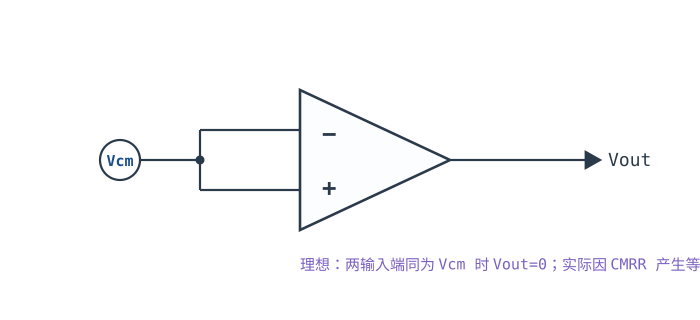
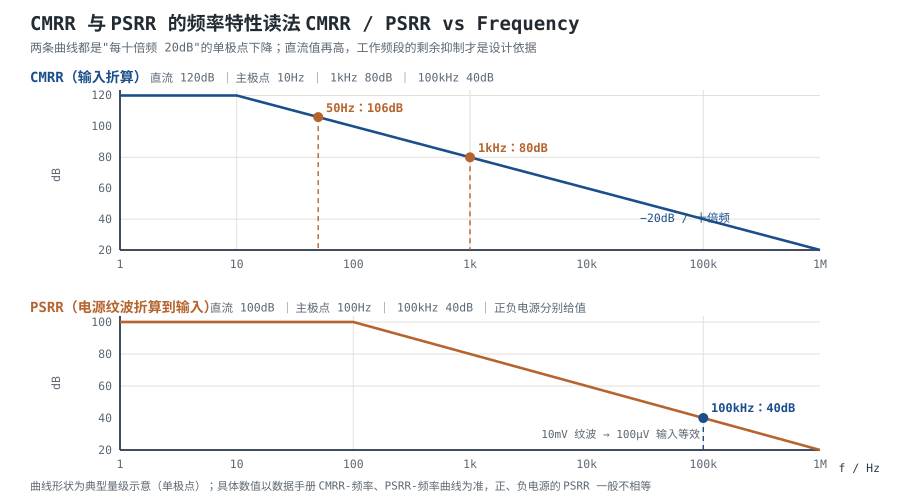
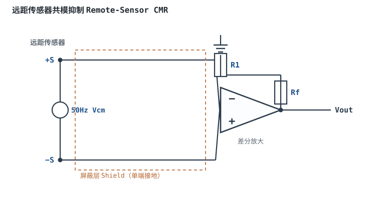

# 共模范围、CMRR 与 PSRR Common-Mode Range, CMRR & PSRR

理想运放只放大两个输入端的差值。真实器件做不到这么干净：它对"两个输入端共同的对地电平"（共模）有残留响应，对"电源脚上的波动"也有残留响应。这两条泄漏通道分别用 **CMRR（共模抑制比）** 和 **PSRR（电源抑制比）** 描述，两者都是**电压比**，所以换算 dB 一律用 $20\lg$，不是 $10\lg$。

本章要建立的不是"CMRR 越大越好"这种正确但没用的结论，而是四件可以算的事：**器件 CMRR 与电路 CMRR 差在哪里**、**电阻精度为什么常常才是瓶颈**、**频率升高后曲线怎么读**、**电源纹波折算到输入端还剩多少**。最后用一个 $G=100$、带 2V/50Hz 共模干扰与 10mV/100kHz 电源纹波的差分放大算例，把三个误差源合成到输出端。

**本章约定**：$G$ 或 $A_{CL}$ 是闭环差模增益，$\beta$ 是反馈系数（**不是**三极管的电流放大倍数），噪声增益为 $1/\beta$，$T=A_{OL}\beta$；$V_{cm}$ 是输入共模电压，$V_{id}$ 是差模电压；$A_{cm}$ 是共模增益，$A_{OL}$ 是开环差模增益；$V_{OS}$、$I_B$、$I_{OS}$ 见[失调电压、偏置电流与漂移](offset-bias.md)。符号口径与[运放概述：符号、封装与引脚](opamp-overview.md)一致。

## 1. 设计动机

::: motivation 三个真实场景
**场景一：2V 的 50Hz 共模，变成 8.9mV 的输出误差。** 桥式传感器的两根引线各带 2V 的工频共模，用 $G=100$ 的差分放大读出。器件 CMRR 在低频是 120dB，但四个电阻只有 0.1% 精度，电路级 CMRR 被压到 88dB。合成后 $2\text{V}\times100/2.24\times10^{4}=8.9$ mV，对 12 位、5V 量程 ADC（1 LSB=1.22mV）是 7.3 个码——**误差不是来自运放，而是来自四只电阻的匹配**。

**场景二：开关电源的 10mV 纹波，原样出现在输出端。** 模拟前级用 DC-DC 供电，100kHz 开关频率处有 10mV 纹波。器件 PSRR 在 100kHz 已经掉到 40dB（直流时是 100dB），折算到输入是 $10\text{mV}/100=100\ \mu$V，再乘 100 倍增益就是 10mV——和被测信号同一个量级。而且 100kHz 落在 ADC 采样带宽内，会被采样、混叠到低频。

**场景三：共模超了 0.1V，输出锁死。** 5V 单电源器件，输入共模范围 −0.1~3.5V。信号共模被前级抬到 3.6V，超上限 0.1V。输入级截止，输出贴在正轨不动。**CMRR 再高也救不了——CMRR 说的是"抑制得好不好"，共模范围说的是"能不能工作"，两件事。**
:::

| 你想确认 | 先算/先查 | 判据（工程经验值） |
|---|---|---|
| 共模会不会变成误差 | $V_{cm}/CMRR$，再乘噪声增益 | 折算误差 < 目标精度的 1/3 |
| 电路 CMRR 的上限 | 电阻匹配 $(1+G)/(4\delta)$ | 0.1% 电阻 + $G=100$ → 约 88dB |
| 工作频段还有多少 CMRR | 查 CMRR-频率曲线 | 按**工作频率**取值，不按直流值 |
| 电源纹波会不会漏进来 | $V_{ripple}/PSRR$，再乘增益 | 折算纹波 < 1 LSB |
| 共模是否在允许范围 | $V_{cm}\pm V_{id}/2$ 与 ICMR | 两端各留 0.1~0.2V 余量 |
| 两根线源阻抗是否平衡 | $\Delta R_s/R_{in}$ | 不平衡引入的误差 < 目标精度 |

**不做这三个预算会摔在哪**，四个带数字的代价：

1. **拿直流 CMRR 当工作值。** 数据手册首页写 120dB，实际工作在 1kHz，CMRR 只剩 80dB。同样 1V 共模、$G=100$：直流下 $1\ \mu\text{V}\times100=0.1$ mV，1kHz 下 $100\ \mu\text{V}\times100=10$ mV，**差 100 倍**。
2. **忽略电阻匹配。** 四只 1% 电阻、$G=100$，电路 CMRR 只有 $(1+100)/(4\times0.01)=2525$，即 68dB。2V 共模 → $2\times100/2525=79$ mV 输出误差，比 0.1% 电阻的 8.9mV 差 9 倍。
3. **用开关电源直接供模拟前级。** 10mV/100kHz 纹波、PSRR 40dB → 输出 10mV；若信号满量程只有 2V，这是 0.5% 的固定纹波，且随开关频率漂移。
4. **共模越界当"精度问题"处理。** 输出锁死或反相时，再怎么调零、换精密电阻都没用；先量共模，再谈精度。

## 2. 定义与直观

### 2.1 共模与差模：唯一分解

任意两个输入电压都可以唯一地分解成差模与共模两部分：

$$V_{id}=V_+-V_-,\qquad V_{cm}=\frac{V_++V_-}{2}$$

反过来也成立：

$$V_+=V_{cm}+\frac{V_{id}}{2},\qquad V_-=V_{cm}-\frac{V_{id}}{2}$$

符号与单位：$V_{id}$ 是差模电压（V），要被放大的有用信号；$V_{cm}$ 是共模电压（V），是"两根线共同的绝对电平"，理想情况下完全不被放大。

**这个分解说明一件关键的事**：共模不是"干扰信号"，它是信号的**直流或低频基线**。传感器桥路的 2.5V 共模、长线拾取的 2V 工频、热电偶所处的环境电位，都属于共模。运放能不能工作，取决于这个基线落在输入共模范围内；工作得好不好，取决于 CMRR。

### 2.2 CMRR 的两种定义：器件级与电路级

**定义 A（器件级，输入折算）**：运放自身的差模增益与共模增益之比，

$$CMRR=\left|\frac{A_{OL}}{A_{cm}}\right|,\qquad CMRR(\text{dB})=20\lg CMRR$$

它等价于一句更好用的话：**共模电压每变化 $\Delta V_{cm}$，折算到输入端的失调变化是**

$$\Delta V_{OS}=\frac{\Delta V_{cm}}{CMRR}$$

数据手册给的就是这个定义，测试条件通常是"输入共模从某个下限扫到上限，测输出变化，再除以闭环增益折算到输入"。

**定义 B（电路级）**：整个放大电路的差模增益与共模增益之比，

$$CMRR_{circ}=\left|\frac{G_{dm}}{G_{cm}}\right|$$

其中 $G_{dm}$ 是你设计的差模增益（例如 100），$G_{cm}$ 是整个电路对共模的实际增益（通常远小于 1）。输出端的共模误差就是

$$V_{OUT,cm}=V_{cm}\,G_{cm}=\frac{V_{cm}\,G_{dm}}{CMRR_{circ}}$$

**两者的差别是全章的骨架**：器件级只包含芯片内部的不对称；电路级还包含**外部电阻失配、源阻抗不平衡、PCB 寄生**。工程上真正决定精度的是电路级，而它往往比器件级差 30dB 以上。

**测量方法**（两种定义都能测，但接法不同）：

- **器件级**：接成单位增益跟随器（$1/\beta=1$），两输入端短接后加一个缓慢变化的共模电压（例如 0→4V 扫一遍），记录输出变化 $\Delta V_{OUT}$；折算到输入 $\Delta V_{OS}=\Delta V_{OUT}$，再算 $CMRR=\Delta V_{cm}/\Delta V_{OS}$。用直流扫容易受温漂干扰，可改用 1~10Hz 的低频交流共模，只读输出中的交流分量。
- **电路级**：把差分放大器的两个输入端接在一起，加同一个共模电压，测输出变化；再单独加一个已知差模电压，测出差模增益。两者之比就是 $CMRR_{circ}$。这个方法直接反映"装在板子上的这个电路"的真实抑制能力，是验收测试应该用的。

### 2.3 PSRR：电源纹波怎么变成输入误差

**电源抑制比（PSRR）** 描述电源电压变化折算到输入端的等效失调：

$$PSRR_+=\frac{\Delta V_+}{\Delta V_{OS}},\qquad PSRR_-=\frac{\Delta V_-}{\Delta V_{OS}},\qquad PSRR(\text{dB})=20\lg PSRR$$

**正、负电源要分别给值**，而且通常不相等：正电源的抑制往往比负电源好，因为内部偏置电路对正轨的依赖更直接。工程上取两者中较小的那个来算预算。

把纹波折算到输入端：

$$V_{err,ripple}=\frac{V_{ripple}}{PSRR}$$

再乘噪声增益 $1/\beta$ 得到输出纹波：

$$V_{OUT,ripple}=\frac{V_{ripple}}{PSRR}\cdot\frac{1}{\beta}$$

符号与单位：$V_{ripple}$ 是电源纹波峰值（V），$PSRR$ 是工作频率处的抑制比（无量纲），$1/\beta$ 是噪声增益（无量纲）。

**PSRR 也随频率下降**，原因和 CMRR 相同：内部节点到输入端的寄生通路在高频容性导通，同时开环增益滚降让"抑制"失去环路支撑。所以直流 100dB 的器件，在 100kHz 可能只剩 40dB——**这个数字才是开关电源场合要用的**。

### 2.4 共模范围（ICMR）与 CMRR 是两件事

| 指标 | 回答的问题 | 越界的后果 | 查什么 |
|---|---|---|---|
| 输入共模范围 ICMR | 这个共模电平下器件**能不能工作** | 输入级截止、增益塌陷、相位反转、输出锁死 | Input Common-Mode Voltage Range 表 |
| 共模抑制比 CMRR | 工作时共模**被压掉多少** | 输出出现一个可算的直流/交流误差 | CMRR-频率曲线 |
| 电源抑制比 PSRR | 电源波动**被压掉多少** | 输出叠加纹波 | PSRR-频率曲线（正负各一条） |

一个常见的误判：看到 CMRR=120dB，就以为"共模多大都无所谓"。事实是**共模先要落在 ICMR 内**，CMRR 才谈得上；越界后抑制能力直接归零。

## 3. 定量关系

### 3.1 从共模到输出：一条乘法链

把 §2.2 的定义 A 与噪声增益接起来，得到最常用的一条预算式：

$$V_{OUT,cm}=\frac{V_{cm}}{CMRR}\cdot\frac{1}{\beta}$$

符号与单位：$V_{OUT,cm}$ 是输出端的共模误差（V）；$V_{cm}$ 是输入共模电压（V）；$CMRR$ 无量纲；$1/\beta$ 是噪声增益（无量纲）。

**注意是噪声增益，不是信号增益**：反相放大对共模误差的放大倍数也是 $1+R_f/R_1$，不是 $R_f/R_1$。这一条在[开环、闭环增益与负反馈本质](open-loop-feedback.md)的误差预算表里已经列过，这里只是把它用在共模上。

### 3.2 电路级 CMRR：电阻匹配才是瓶颈

四电阻差分放大器的输出可以写成（$a=R_2/R_1$ 是反相侧电阻比，$b=R_2'/R_1'$ 是同相侧电阻比）：

$$V_{OUT}=\frac{b(1+a)}{1+b}V_+ - a V_-$$

理想匹配 $a=b$ 时 $V_{OUT}=a(V_+-V_-)$。一旦失配，令 $V_+=V_-=V_{cm}$，得到共模增益

$$A_{cm}=\frac{b-a}{1+b}$$

差模增益近似 $A_d\approx a$，于是

$$CMRR_{circ}=\frac{A_d}{A_{cm}}\approx\frac{a(1+b)}{b-a}\approx\frac{1+G}{4\delta}$$

其中 $G\approx a$ 是设计增益（无量纲），$\delta$ 是四只电阻的**相对容差**（如 0.1% → $\delta=0.001$）。系数 4 来自最坏情况：四只电阻各偏向相反方向时，$b-a$ 的相对偏差可以累加到 $4a\delta$。

| 电阻容差 $\delta$ | $G=1$ 的电路 CMRR | $G=10$ | $G=100$ | $G=1000$ |
|---|---|---|---|---|
| 1%（0.01） | 50（34dB） | 275（48.8dB） | 2525（68dB） | 25025（88dB） |
| 0.1%（0.001） | 500（54dB） | 2750（68.8dB） | 25250（88dB） | 250250（108dB） |
| 0.01%（0.0001） | 5000（74dB） | 27500（88.8dB） | 252500（108dB） | — |

**这张表要背下来的部分**：$G=1$ 时，1% 电阻只能给到 34dB；同样 1% 电阻、$G=100$ 时能到 68dB。**增益越高，电阻失配的相对影响越小**——这是差分放大器"高增益更容易做好共模抑制"的定量原因。注意表中的数都是**最坏情况**，实际批次按统计分布会好一些（典型好 6dB 量级），但设计必须按最坏情况。

### 3.3 两个 CMRR 怎么合成

器件 CMRR 与电阻失配产生的 CMRR 是两个**独立的共模误差源**：一个来自芯片内部，一个来自外部网络。它们在输入端表现为两个电压相加，所以

$$\frac{1}{CMRR_{total}}=\frac{1}{CMRR_{op}}+\frac{1}{CMRR_{res}}$$

**注意是倒数相加，不是直接相加，也不是取较小值。** 当两者相差 10 倍以上时，小的那个几乎决定结果；当两者相等时，合成值只有各自的 1/2，即比任一个都低 6 dB；相差 2:1 时约低 3.5 dB。

### 3.4 CMRR 随频率下降：曲线怎么读

数据手册的 CMRR-频率曲线通常是"直流平台 + 单极点下降"的形状：

$$CMRR(f)=\frac{CMRR_0}{\sqrt{1+(f/f_p)^2}}$$

其中 $CMRR_0$ 是直流值（无量纲），$f_p$ 是 CMRR 开始下降的拐点频率（Hz）。$f\gg f_p$ 时按**每十倍频 20dB** 下降。

读图的三个要点：

1. **横轴是对数频率**，两个刻度之间的中点不是算术中点。1kHz 与 10kHz 之间那一段，对应的是 2k、5k 这些实际频点。
2. **只读你的工作频段**。工频干扰看 50/60Hz，音频看 20Hz~20kHz，开关电源纹波看开关频率及其谐波。
3. **典型曲线不是保证值**。数据手册通常只给 typical 曲线，min 值在表里另给。设计按 min 值，曲线用来判断趋势。

拿本章的曲线算一遍：$CMRR_0=120$ dB、$f_p=10$ Hz。

- 50Hz：$CMRR=120-20\lg(50/10)=120-14.0=106$ dB；
- 1kHz：$CMRR=120-20\lg(1000/10)=120-40=80$ dB；
- 10kHz：$120-60=60$ dB；
- 100kHz：$120-80=40$ dB。

**每十倍频掉 20dB 的含义是：频率翻 10 倍，共模误差翻 10 倍。** 这就是场景一里"直流 0.1mV、1kHz 10mV"的来源。

### 3.5 PSRR 的合成与频率

PSRR 的预算式和 CMRR 完全同构，只是误差源换成电源纹波。三条工程规则：

1. **正负电源分别算，取较差的那个。** 若 $PSRR_+=100$ dB、$PSRR_-=80$ dB，按 80dB 算。
2. **按纹波频率取值。** 线性电源的纹波在 100Hz，开关电源在几十 kHz~几 MHz，两者对应的 PSRR 可能差 40dB。
3. **去耦电容和 LC 滤波是"前置的 PSRR"。** 在电源脚前把纹波从 10mV 压到 1mV，等效于把 PSRR 提高 20dB，而且不占运放的带宽预算。

还要注意一个容易忽略的耦合路径：**PSRR 描述的是"电源脚到输出"，不包括"电源到输入网络"**。如果偏置分压电阻直接挂在脏电源上，纹波会经分压网络进到同相端，这条路径不受 PSRR 保护。所以偏置网络要单独滤波，或改用基准。

### 3.6 适用条件与失效边界

1. **曲线是典型值**：CMRR/PSRR 的 min 值比典型值差 10~20dB 是常见的（典型量级，以数据手册为准），预算按 min。
2. **测试条件不同**：CMRR 与共模电平有关（在 ICMR 两端会恶化），PSRR 与负载、增益有关。数据手册的曲线是在某个固定增益、固定负载下测的。
3. **共模越界后公式全部失效**：此时不是"CMRR 变小"，而是输入级不工作。
4. **高频时闭环增益也在滚降**：用"输入折算 × 噪声增益"算高频纹波会高估，因为噪声增益在 $f_{cl}$ 以上按 −20dB/十倍频下降（见 §4.2 第 6 步）。
5. **源阻抗不平衡会额外引入共模→差模转换**：两根输入线的源阻抗相差 $\Delta R_s$ 时，转换比约 $\Delta R_s/R_{in}$，其中 $R_{in}$ 是输入电阻。

## 4. 典型计算

### 4.1 算例一：1V 共模在直流与 1kHz 下各造成多少输出误差

**已知**：器件 CMRR 曲线为 §3.4 的形状（$CMRR_0=120$ dB、$f_p=10$ Hz），接成 $G=100$ 的差分放大，输入共模 1V。求直流与 1kHz 下的输入等效误差与输出误差。

**第 1 步：直流。** $CMRR=10^{120/20}=10^6$：

$$V_{err,DC}=\frac{1}{10^6}=1\ \mu\text{V},\qquad V_{OUT,DC}=1\ \mu\text{V}\times100=0.1\ \text{mV}$$

**第 2 步：1kHz。** $CMRR=10^{80/20}=10^4$：

$$V_{err,1k}=\frac{1}{10^4}=100\ \mu\text{V},\qquad V_{OUT,1k}=100\ \mu\text{V}\times100=10\ \text{mV}$$

**第 3 步：对比。** 共模电压没变、电路没变，频率从直流到 1kHz，输出误差从 0.1mV 变成 10mV，**放大 100 倍**：

$$\frac{10\ \text{mV}}{0.1\ \text{mV}}=100$$

对 12 位、5V ADC（1 LSB=1.22mV）：0.1mV 是 0.08 个码，可以忽略；10mV 是 8.2 个码，**不能忽略**。**结论：CMRR 必须按工作频率取值，直流值没有任何参考意义。**

### 4.2 算例二（完整）：2V/50Hz 共模 + 10mV/100kHz 纹波，输出端到底有多少干扰

**已知**：

- 差分放大，$G=100$，四只 0.1% 薄膜电阻（$\delta=0.001$）；
- 器件 CMRR：直流 120dB，$f_p=10$ Hz（所以 50Hz 处 106dB）；
- 器件 PSRR：正电源直流 100dB，$f_p=100$ Hz（所以 100kHz 处 40dB），负电源按同样量级取；
- 输入：差分信号 0~20mV，叠加 2V/50Hz 共模干扰；
- 电源：10mV/100kHz 纹波；
- 运放 GBW=1MHz，所以闭环带宽 $f_{cl}\approx GBW/G=1\text{MHz}/100=10$ kHz。

求 50Hz 共模与 100kHz 纹波在输出端各产生多少干扰，并判断是否需要额外措施。

**第 1 步：电阻失配决定的电路 CMRR。** 由 §3.2：

$$CMRR_{res}=\frac{1+G}{4\delta}=\frac{1+100}{4\times0.001}=25250\ (\text{即}\ 88.0\ \text{dB})$$

**第 2 步：器件在 50Hz 的 CMRR。** 由 §3.4：

$$CMRR_{op}(50\text{Hz})=10^{106/20}=2.0\times10^{5}\ (\text{即}\ 106\ \text{dB})$$

**第 3 步：合成电路 CMRR。** 由 §3.3：

$$\frac{1}{CMRR_{total}}=\frac{1}{2.0\times10^{5}}+\frac{1}{25250}=5.0\times10^{-6}+3.96\times10^{-5}=4.46\times10^{-5}$$

$$CMRR_{total}=\frac{1}{4.46\times10^{-5}}=2.24\times10^{4}\ (\text{即}\ 87.0\ \text{dB})$$

**第 4 步：50Hz 共模的输出干扰。**

$$V_{OUT,50\text{Hz}}=\frac{V_{cm}\,G}{CMRR_{total}}=\frac{2\times100}{2.24\times10^{4}}=8.92\ \text{mV}$$

折算到输入是 $8.92/100=89.2\ \mu$V。对 12 位、5V ADC 是 $8.92/1.22=7.3$ 个码。

**第 5 步：100kHz 纹波折算到输入。**

$$V_{err,ripple}=\frac{V_{ripple}}{PSRR}=\frac{10\ \text{mV}}{10^{40/20}}=\frac{10}{100}=100\ \mu\text{V}$$

**第 6 步：纹波到输出。** 按"输入折算 × 噪声增益"的**上界**：

$$V_{OUT,ripple}=100\ \mu\text{V}\times100=10\ \text{mV}$$

但这里要修一刀：$f_{cl}=10$ kHz，100kHz 已经是 $f_{cl}$ 的 10 倍，噪声增益在 $f_{cl}$ 以上按 −20dB/十倍频下降，所以 100kHz 处的实际增益约 $100/10=10$：

$$V_{OUT,ripple}\approx100\ \mu\text{V}\times10=1.0\ \text{mV}$$

**两个值（1mV 与 10mV）都要写在预算里**：1mV 是线性模型下的估计，10mV 是最坏上界；实际取决于 PSRR 曲线是在什么增益下测的，以实测为准。

**第 7 步：合成。** 两个干扰频率不同（50Hz 与 100kHz），不会简单相加，按幅值合成取上界：

$$8.92\ \text{mV}+1.0\sim10\ \text{mV}=9.9\sim18.9\ \text{mV}$$

**第 8 步：判断。** 差模满量程输出是 $20\ \text{mV}\times100=2.0$ V。50Hz 共模误差占 $8.92/2000=0.45\%$，纹波占 $1/2000=0.05\%$ 到 $10/2000=0.5\%$。对 12 位（1 LSB=1.22mV）而言，50Hz 项 7.3 个码、纹波项 0.8~8.2 个码，**两者都不能忽略**。

**第 9 步：先改哪个？** 把电阻从 0.1% 换到 0.01%（$\delta=10^{-4}$）：

$$CMRR_{res}=\frac{101}{4\times10^{-4}}=252500\ (108\ \text{dB})$$

合成后 $CMRR_{total}\approx 1/(5\times10^{-6}+3.96\times10^{-6})=1.1\times10^{5}$，50Hz 误差降到 $200/1.1\times10^{5}=1.8$ mV，**改善 5 倍**。再把电源纹波从 10mV 压到 1mV（加 LC 或 LDO），纹波项降到 0.1~1mV。**两条措施都是"改外部"，不需要换运放**——这就是 §5.2 的误差排序要讲的事。

### 4.3 算例三：同样 2V 共模，1% 电阻会把误差放大到多少

**已知**：条件同 §4.2，只把电阻容差换成 1%（$\delta=0.01$）。

**第 1 步：电路 CMRR。**

$$CMRR_{res}=\frac{101}{4\times0.01}=2525\ (68.0\ \text{dB})$$

**第 2 步：合成。**

$$\frac{1}{CMRR_{total}}=\frac{1}{2.0\times10^{5}}+\frac{1}{2525}=5.0\times10^{-6}+3.96\times10^{-4}=4.01\times10^{-4}$$

$$CMRR_{total}=2.49\times10^{3}\ (67.9\ \text{dB})$$

**第 3 步：输出干扰。**

$$V_{OUT,50\text{Hz}}=\frac{2\times100}{2.49\times10^{3}}=80.2\ \text{mV}$$

是 0.1% 电阻（8.92mV）的 9.0 倍。**换运放把 CMRR 从 106dB 提到 120dB 只能改善不到 0.1dB——瓶颈完全在电阻上。** 所以差分放大器的选型顺序是：先定电阻精度，再定运放 CMRR。

### 4.4 算例四：共模越界的判定

**已知**：5V 单电源器件，ICMR = −0.1~3.5V；信号共模 3.3V，差模 $\pm0.3$ V。判断是否越界。

**第 1 步：两个输入端的实际电压。**

$$V_+=3.3+\frac{0.3}{2}=3.45\ \text{V},\qquad V_-=3.3-\frac{0.3}{2}=3.15\ \text{V}$$

**第 2 步：共模本身。** $V_{cm}=3.3$ V，还在 3.5V 以内，看似安全。

**第 3 步：但输入端已经到 3.45V。** 差分对是按**每个输入端**的绝对电压工作的。若器件规格是"$V_{cm}$ 范围 −0.1~3.5V"，3.45V 仍在范围内；但若规格写的是"每个输入端的电压范围"，高端 3.45V 只剩 0.05V 余量，稍一漂移就越界。**查规格时一定要看清是"共模电压范围"还是"输入电压范围"**——两者在小差模时几乎相同，大差模时会差出 $V_{id}/2$。

**第 4 步：改法。** 把共模从 3.3V 降到 2.5V（例如前级分压或电平搬移），两个输入端变成 2.35~2.65V，余量 0.85V。或者换输入共模能到正轨的 RRI 器件（见[供电轨、输出摆幅与 Rail-to-Rail](supply-rails.md)）。

## 5. 工程含义

### 5.1 数量级表：先建立直觉

| 指标 | 通用运放 | 精密运放 | 仪表放大器 | 备注 |
|---|---|---|---|---|
| CMRR（直流） | 70~90dB | 110~140dB | 100~120dB | 越高越贵 |
| CMRR（1kHz） | 60~80dB | 90~110dB | 90~110dB | 按曲线取值 |
| CMRR（100kHz） | 40~60dB | 60~80dB | 60~80dB | 开关电源频段 |
| PSRR（直流） | 80~100dB | 100~130dB | 90~110dB | 正负分别给 |
| PSRR（100kHz） | 30~50dB | 40~60dB | 40~60dB | 纹波频段 |
| 输入共模范围 | 视器件，常到不了正轨 | 通常含负轨 | 受内部拓扑限制 | 查表 |

这些是**典型量级**，具体型号以数据手册为准。表的作用是让你在选型前知道"大概在哪个数量级"。

### 5.2 误差排序：先算电阻，再算器件

按"改起来最便宜、影响最大"排序：

1. **电阻匹配**（如果用了分立差分网络）：$(1+G)/(4\delta)$，改电阻精度立竿见影。
2. **器件 CMRR 在工作频率的值**：查曲线，不查首页。
3. **PSRR 在纹波频率的值**：正负各一条，取较差。
4. **源阻抗不平衡**：$\Delta R_s/R_{in}$，高阻源场合才显著。
5. **共模范围**：这是"能不能工作"的门槛，放在最前面做排除法。

差分放大器与仪表放大器的具体拓扑与取值见[差分放大器](differential-amplifier.md)与[仪表放大器](instrumentation-amplifier.md)。仪表放大器把匹配电阻做在芯片内部（激光修调），电路级 CMRR 通常等于器件 CMRR；但它对**源阻抗不平衡**仍然敏感，且 CMRR 随增益变化——典型规律是增益越高 CMRR 越好（$G=1$ 时最差），选型时查数据手册的 CMRR vs Gain 表。

### 5.3 布线：把共模挡在进入运放之前

- **双绞**：两根信号线绞合，环路面积减小，磁场拾取按面积下降；绞距越小越好。
- **屏蔽单端接地**：屏蔽层只在接收端接地，避免两端地电位差驱动屏蔽层环流（见 §6 第 4 条）。
- **驱动屏蔽（driven shield）**：把屏蔽层接到一个跟随共模的缓冲输出，使芯线与屏蔽层之间没有电位差，等效把电缆电容"中和"掉。高阻源、长电缆场合常用。
- **保护环（guard ring）**：在 PCB 上把高阻输入节点用一圈低阻环围起来，环接到与输入等电位的缓冲点，切断表面漏电流。见[失调电压、偏置电流与漂移](offset-bias.md)。
- **星形接地/单点接地**：模拟地与数字地、功率地分开走，在 ADC 或电源入口单点汇合，避免地电流在信号回路上产生压降——地压降就是共模。

上面每一条都在做同一件事：**在共模进入运放之前把它减小**。共模从 2V 降到 0.2V，等效于把 CMRR 提高了 20dB，而且不花运放的钱。

### 5.4 电源：把 PSRR 的缺口补上

- **LDO 后级**：开关电源 + LDO 是模拟前级的标准组合，LDO 在 100kHz 的抑制通常还有 40~60dB（以器件手册为准）。
- **LC/π 型滤波**：在运放电源脚前串磁珠或小电感 + 电容，把开关频率的纹波压下去；注意 LC 的谐振与阻尼。
- **去耦电容**：每个电源脚就近 100nF，双电源正负各一只；大容量储能电容放在电源入口。
- **偏置网络单独滤波**：分压电阻上的纹波会直接进同相端，不受 PSRR 保护；加 RC 或改用基准。

### 5.5 测量：怎么证明设计有效

- **CMRR**：短接两输入、加低频共模、测输出交流分量；扫频得到 $CMRR(f)$。注意共模幅度要小（几十 mV~1V），避免把输入级推出线性区。
- **PSRR**：在电源上叠加已知幅度的交流（用变压器注入或专用注入网络），测输出；正负电源分别做。频率从 10Hz 扫到 1MHz。
- **共模范围**：直流扫共模，同时监视输出的线性度；输出开始偏离线性或反向的点就是边界。
- **验收判据**：把实测值与 §3 的预算值比较，差 10dB 以上要查布线与电阻。

### 5.6 失效边界

- **曲线外推**：数据手册只给到 1MHz，工作在 10MHz 时不能线性外推。
- **共模接近轨**：CMRR 在 ICMR 两端明显恶化，曲线上的平台段不适用。
- **大信号**：CMRR/PSRR 是小信号参数，输出接近饱和时环路增益下降，抑制能力同步变差。
- **温度**：电阻的温漂不匹配（TCR 不同）会让 CMRR 随温度变化，精密场合要用同批次、同 TCR 的电阻网络。
- **PCB 漏电与污染**：高阻节点上的漏电流等效为共模/差模误差，清洗与三防漆是必要手段。

## 6. 常见坑

::: pitfall 常见坑
- **现象**：电路 CMRR 实测只有 60dB，运放标称 120dB。**原因**：四只电阻是 1% 精度，$(1+G)/(4\delta)$ 决定了上限只有 68dB 量级；运放的 120dB 根本用不上。**解决**：先按 §3.2 算电阻决定的上限，换 0.1%/0.01% 电阻或电阻网络，或改用内部修调的仪表放大器。
- **现象**：直流测试正常，一加 50Hz 共模干扰输出就抖。**原因**：按直流 CMRR 选型，工作频率处 CMRR 已经掉了 30~40dB。**解决**：查 CMRR-频率曲线，按 50Hz 取值重算；必要时加共模扼流圈或提高输入阻抗。
- **现象**：模拟前级输出叠加 100kHz 纹波，示波器上很干净、ADC 读数却跳。**原因**：纹波在 PSRR 很差的频段进入，且落在采样带宽内被混叠。**解决**：LDO 后级 + LC 滤波 + 就近去耦；必要时降低采样率或加抗混叠滤波。
- **现象**：加了屏蔽线，50Hz 干扰反而变大。**原因**：屏蔽层两端接地，两地电位差驱动屏蔽层环流，屏蔽层变成拾取天线。**解决**：屏蔽层在接收端单端接地，现场侧悬空或经小电容接机壳；信号线双绞。
- **现象**：共模电压"看起来在范围内"，输出却锁死或反相。**原因**：规格写的是共模范围，实际输入端电压已经到 $V_{cm}\pm V_{id}/2$，大差模时越界。**解决**：按每个输入端的绝对电压核对规格；降低共模、减小差模或换 RRI 器件。
- **现象**：同一块板，换一批电阻后 CMRR 变差。**原因**：电阻的 TCR 不匹配，温度变化时比值漂移；或用了不同批次、不同封装的电阻。**解决**：用同批次、同 TCR 的电阻网络（薄膜网络或集成差分放大器），并在装配后做温度循环验证。
:::

## 7. 自测题

CMRR=100dB 时，1V 共模折算到输入端是多少？如果闭环增益是 50，输出误差多少？

$$CMRR=10^{100/20}=10^{5}$$

$$V_{err}=\frac{1\ \text{V}}{10^{5}}=10\ \mu\text{V}$$

$$V_{OUT,err}=10\ \mu\text{V}\times50=0.5\ \text{mV}$$

注意乘的是噪声增益。如果这是反相放大（信号增益 50、噪声增益 51），应按 51 算，差别 2%。

四只 0.1% 电阻组成 $G=10$ 的差分放大，电路 CMRR 最坏是多少？如果换成 1% 呢？

用 $(1+G)/(4\delta)$：

0.1%：$\delta=0.001$，$CMRR=(1+10)/(4\times0.001)=11/0.004=2750$（68.8dB）。

1%：$\delta=0.01$，$CMRR=11/0.04=275$（48.8dB）。

**差 20dB，也就是共模误差差 10 倍。** 注意 $G=10$ 时即使 0.1% 电阻也只能到 68.8dB，远低于运放自身的 120dB——**电阻永远是分立差分网络的瓶颈**。

器件 CMRR 直流 120dB、10Hz 主极点，1kHz 处 CMRR 是多少？1V 共模在 1kHz 造成多少输入等效误差？

$$CMRR(1\text{k})=120-20\lg\frac{1000}{10}=120-40=80\ \text{dB}$$

$$CMRR=10^{80/20}=10^{4}$$

$$V_{err}=\frac{1\ \text{V}}{10^{4}}=100\ \mu\text{V}$$

是直流值（1µV）的 100 倍。**频率翻 10 倍，误差翻 10 倍**，这就是"每十倍频 20dB"的实际含义。

PSRR=40dB、电源纹波 20mV/200kHz、闭环增益 100。折算到输入的纹波是多少？如果 $f_{cl}=5$kHz，输出纹波大概多少？

$$PSRR=10^{40/20}=100$$

$$V_{err}=\frac{20\ \text{mV}}{100}=200\ \mu\text{V}$$

按满噪声增益：$200\ \mu\text{V}\times100=20$ mV（上界）。

但 200kHz 是 $f_{cl}=5$kHz 的 40 倍，噪声增益已按 −20dB/十倍频下降约 $20\lg40=32$ dB，即增益约 $100/40=2.5$：

$$V_{OUT}\approx200\ \mu\text{V}\times2.5=0.5\ \text{mV}$$

**两个值都要写进预算**：0.5mV 是线性估计，20mV 是最坏上界，实际以实测为准。

为什么"共模电压在范围内"不等于"输入端电压在范围内"？什么情况下会差出很多？

共模电压是两个输入端的平均值 $V_{cm}=(V_++V_-)/2$，而差分对是按**每个输入端**的绝对电压工作的。两个输入端的电压是

$$V_+=V_{cm}+\frac{V_{id}}{2},\qquad V_-=V_{cm}-\frac{V_{id}}{2}$$

差模越大，两个端点离共模越远。差模 $\pm0.3$V 时，输入端与共模差 0.15V；差模 $\pm2$V 时差 1V。**小差模时两者几乎相同，大差模时必须按端点电压核对规格。**

CMRR 与 PSRR 的 dB 为什么用 20lg 而不是 10lg？120dB 对应多少倍？

因为两者都是**电压比**（输出电压/输入电压、等效输入电压/电源电压变化），不是功率比。电压比的 dB 定义是 $20\lg$，功率比才是 $10\lg$。若把电压比按 $10\lg$ 算，120dB 会被误算成 $10^{12}$ 而不是 $10^{6}$，差一百万倍。

$$120\ \text{dB}=10^{120/20}=10^{6}$$

常用换算：20dB=10、40dB=100、60dB=1000、80dB=$10^4$、100dB=$10^5$、120dB=$10^6$。**每 20dB 翻 10 倍**。

## 8. 参考资料

- **Analog Devices, MT-042 *Op Amp Common-Mode Rejection Ratio (CMRR)***：共模/差模定义、CMRR 的输入折算与测试方法；本章 §2.2 的两种定义与 §5.5 的测量方法按该文。<https://www.analog.com/media/en/training-seminars/tutorials/MT-042.pdf>
- **Analog Devices, MT-043 *Op Amp Power Supply Rejection Ratio (PSRR) and Supply Voltages***：PSRR 定义、正负电源分别给值与频率特性；本章 §2.3、§3.5 的 PSRR 口径按该文。<https://www.analog.com/media/en/training-seminars/tutorials/MT-043.pdf>
- **Analog Devices, MT-035 *Op Amp Inputs, Outputs, Single-Supply & Rail-to-Rail Issues***：输入共模范围的边界与越界失效；本章 §2.4、§4.4 的 ICMR 讨论参考该文。<https://www.analog.com/media/en/training-seminars/tutorials/MT-035.pdf>
- **Analog Devices, Analog Dialogue《A Deeper Look into Difference Amplifiers》**：四电阻差分网络的 CMRR 与电阻匹配的关系；本章 §3.2 的 $(1+G)/(4\delta)$ 与该文的最坏情况分析一致。<https://www.analog.com/en/resources/analog-dialogue/articles/deeper-look-into-difference-amplifiers.html>
- **TI, *Op Amps for Everyone*（SLOD006B）**：Chapter 11 *Understanding Op Amp Parameters* 给 CMRR、PSRR 的定义与测试条件；本章 §2.2、§3.6 的"参数带条件"来自该章。
- **TI, INA128 数据手册**：*CMRR vs Gain* 表与增益公式 $G=1+50\ \text{k}\Omega/R_G$，说明仪表放大器的 CMRR 随增益提高；本章 §5.2 的选型规律参考该手册。<https://www.ti.com/lit/ds/symlink/ina128.pdf>
