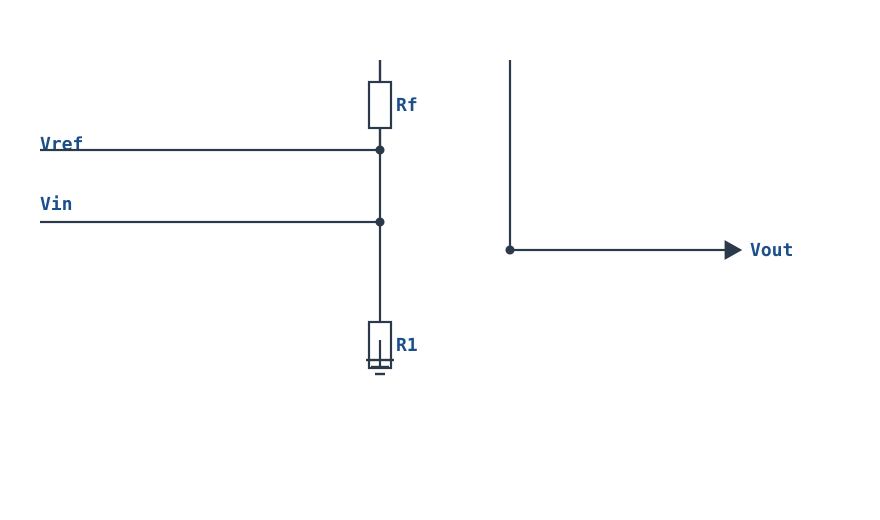
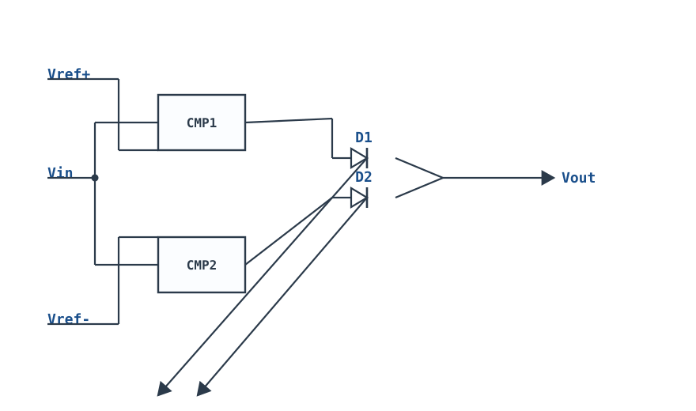
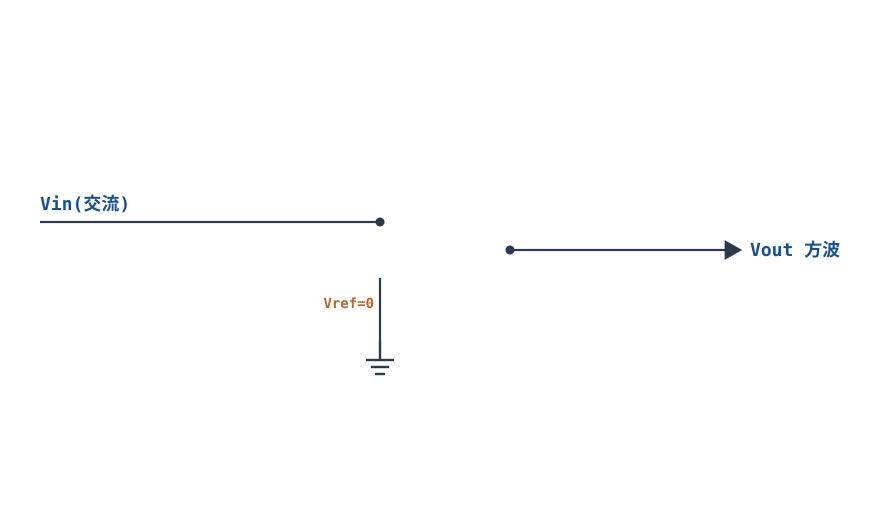

# 比较器与迟滞比较器 Comparator & Hysteresis

## 1. 设计动机

::: motivation 为什么需要比较器
很多时候我们要回答的不是"信号有多大"，而是"信号过没过某个门槛"：温度到没到阈值、电池电压低不低、按键有没有按下、过流保护触不触发。这就是**比较器（Comparator）**——把输入电压和一个参考电压比大小，输出是高/低两种电平（数字信号）。

但开环比较器有个麻烦：输入信号在阈值附近带噪声时，输出会来回跳个不停。加一点**正反馈（Positive Feedback）**，让"上门槛"和"下门槛"错开，就得到**迟滞比较器（Hysteresis / Schmitt Trigger）**——抗抖动、干净利落。
:::

## 2. 原理图

**反相输入迟滞比较器**：Vin 接反相端（−），同相端（+）由输出经 Rf、经 R1 分压（参考 Vref 接在分压点上）。


## 3. 静态分析（DC）

- 比较器**没有负反馈**，运放/比较器工作在开环，增益极高：只要 $V_-$ 略大于 $V_+$，输出就打到负向轨 $V_{OL}$；反之打到正向轨 $V_{OH}$。
- 同相端电压 $V_+$ 由输出电平决定：
  $V_+=\dfrac{R_f\,V_{ref}+R_1\,V_{out}}{R_1+R_f}$。
- 当 $V_{out}=V_{OH}$ 时，$V_+=V_{T+}$（上门限）；当 $V_{out}=V_{OL}$ 时，$V_+=V_{T-}$（下门限）。这就是两个阈值的由来。

## 4. 动态分析（AC / 瞬态）

两个阈值（门限）为：

$$V_{T+}=\frac{R_f V_{ref}+R_1 V_{OH}}{R_1+R_f},\qquad V_{T-}=\frac{R_f V_{ref}+R_1 V_{OL}}{R_1+R_f}$$

**迟滞窗口（Hysteresis）**：

$$\Delta V=V_{T+}-V_{T-}=\frac{R_1}{R_1+R_f}(V_{OH}-V_{OL})$$

- 输入**上升**时：只有越过上门限 $V_{T+}$，输出才翻转；
- 输入**下降**时：只有越过下门限 $V_{T-}$，输出才翻转；
- 中间窗口内输出保持原状态——噪声只要不超过 $\Delta V$，就不会引起误翻转。

下面是幅度 2.5V 正弦输入、上门限 +1.5V、下门限 −1.0V 时的输入输出波形：

```echarts
{
  "tooltip": {"trigger": "axis"},
  "legend": {"data": ["Vin 正弦","Vout 比较输出","上门限 VT+","下门限 VT-"], "bottom": 0, "textStyle": {"fontSize": 12}},
  "grid": {"left": 56, "right": 24, "top": 26, "bottom": 58},
  "xAxis": {"type": "category", "name": "角度°", "data": [0,15,30,45,60,75,90,105,120,135,150,165,180,195,210,225,240,255,270,285,300,315,330,345,360], "axisLabel": {"fontSize": 9}},
  "yAxis": {"type": "value", "name": "V", "min": -6, "max": 6, "interval": 3, "axisLabel": {"fontSize": 11}},
  "series": [
    {"name": "Vin 正弦", "type": "line", "smooth": true, "showSymbol": false, "lineStyle": {"width": 2.4, "color": "#1a4f8b"},
     "data": [0,0.65,1.25,1.77,2.17,2.41,2.5,2.41,2.17,1.77,1.25,0.65,0,-0.65,-1.25,-1.77,-2.17,-2.41,-2.5,-2.41,-2.17,-1.77,-1.25,-0.65,0]},
    {"name": "Vout 比较输出", "type": "line", "step": "end", "showSymbol": false, "lineStyle": {"width": 2.4, "color": "#b5642e"},
     "data": [5,5,5,-5,-5,-5,-5,-5,-5,-5,-5,-5,-5,-5,5,5,5,5,5,5,5,5,5,5,5]},
    {"name": "上门限 VT+", "type": "line", "showSymbol": false, "lineStyle": {"width": 1.5, "type": "dashed", "color": "#b03030"},
     "data": [1.5,1.5,1.5,1.5,1.5,1.5,1.5,1.5,1.5,1.5,1.5,1.5,1.5,1.5,1.5,1.5,1.5,1.5,1.5,1.5,1.5,1.5,1.5,1.5,1.5]},
    {"name": "下门限 VT-", "type": "line", "showSymbol": false, "lineStyle": {"width": 1.5, "type": "dashed", "color": "#4f9e63"},
     "data": [-1,-1,-1,-1,-1,-1,-1,-1,-1,-1,-1,-1,-1,-1,-1,-1,-1,-1,-1,-1,-1,-1,-1,-1,-1]}
  ]
}
```

## 5. 环路分析

迟滞比较器用的是**正反馈**——与放大器的负反馈目的相反：

- 负反馈让输出跟随输入、增益稳定；正反馈让输出一到阈值就"雪崩式"跳变，加速翻转、提高抗噪。
- 反馈系数 $\beta=R_1/(R_1+R_f)$。环路增益 $A_{OL}\beta$ 越大，跳变越干脆；这与放大器追求稳定是两套逻辑——比较器就是要它"啪"一下翻过去。
- 窗口 $\Delta V$ 由 $\beta$ 和输出摆幅决定：$\beta$ 越大（R1 大）窗口越宽，但太宽会降低灵敏度；工程上取窗口为噪声幅度的 2~3 倍。

::: advanced 进阶：为什么不能拿运放当比较器随便用
比较器专用 IC（如 LM339、LMV331）专为开环设计：输出是数字电平、有输出锁存/选通、翻转快（ns 级）、输入共模范围大。拿普通运放当比较器有三个隐患：①运放内部补偿针对负反馈，开环翻转很慢，且在饱和恢复时延迟大；②某些运放输入级有"相位反转（Phase Reversal）"，输入超出共模范围时输出反而跳反；③长时间饱和可能导致输入级击穿或输出锁死。因此需要比较功能时应选专用比较器。
:::

## 6. 元件取值与工程权衡

- **窗口 $\Delta V$ 设计**：先估噪声幅度，取 $\Delta V\approx(2\text{~}3)\times$ 噪声峰峰值。窗口太窄抗不住噪，太宽灵敏度差。
- **Rf、R1 数量级**：取 10k~1MΩ。同相端高阻抗易拾取噪声，分压电阻不宜过大。
- **输出摆幅**：专用比较器常是开集电极/开漏（Open-Collector），需上拉电阻到目标逻辑电平（如 3.3V）。
- **参考 Vref**：可用分压、基准源（TL431、电压基准）或另一路 DAC 设定。
- **响应速度**：高频翻转选带推挽输出、传播延迟 ns 级的比较器型号。

## 7. 完整设计示例

::: example 设计一个上门限 +2.0V、下门限 +1.5V 的电池监测迟滞比较器
1. **需求**：5V 供电，监测某点电压，>2.0V 输出高（正常），<1.5V 输出低（告警），中间保持。
2. **定 Vref**：取 Vref=1.8V（比如基准源）。输出摆幅 $V_{OH}=5\text{V}$、$V_{OL}=0\text{V}$。
3. **算窗口**：$\Delta V=V_{T+}-V_{T-}=0.5\text{V}$。
4. **算电阻比**：$\Delta V=\dfrac{R_1}{R_1+R_f}(V_{OH}-V_{OL})=\dfrac{R_1}{R_1+R_f}\times5=0.5$，得 $R_1/(R_1+R_f)=0.1$，即 $R_f=9R_1$。
5. **选值**：取 $R_1=10\text{k}\Omega$，则 $R_f=91\text{k}\Omega$（标准 91kΩ）。
6. **验算**：$V_{T+}=(R_f V_{ref}+R_1 V_{OH})/(R_1+R_f)=(91\text{k}\times1.8+10\text{k}\times5)/101\text{k}\approx(163.8+50)/101\approx2.12\text{V}$；$V_{T-}=(91\text{k}\times1.8+0)/101\text{k}\approx1.62\text{V}$。窗口约 0.5V，接近设计目标；若要精确 2.0/1.5，微调 Vref 或电阻。
:::

## 8. 仿真与实验

LTspice 中用比较器模型（如 LM339 行为模型）或通用运放开环：
- 输入串加噪声的正弦源，观察开环比较器输出在阈值附近密集抖动；
- 接成迟滞电路后，输出变成干净的方波，抖动消失；
- 改变 Rf 观察窗口宽度变化；
- 示波器测传播延迟：输入阶跃到输出翻转的时间。

## 扩展与变种电路

### 扩展1：反相输入施密特 Inverting Schmitt

输入信号接反相端，同相端由输出经 $R_f$ 反馈、经 $R_1$ 接地形成两个错开的阈值——这是迟滞比较器的标准反相形态。



::: example 工作原理/静态分析
$$V_{T+}=\frac{R_f V_{ref}+R_1 V_{OH}}{R_1+R_f},\quad V_{T-}=\frac{R_f V_{ref}+R_1 V_{OL}}{R_1+R_f}$$

迟滞窗口 $\Delta V=\dfrac{R_1}{R_1+R_f}(V_{OH}-V_{OL})$，噪声只要小于 $\Delta V$ 就不会引起误翻转。
:::

取值：窗口取噪声峰峰值的 2~3 倍；$R_1,R_f$ 取 10k~1MΩ。

::: pitfall 同相端高阻拾噪
分压节点像天线，$R_1,R_f$ 过大会拾取噪声。减小阻值，或在同相端加小电容（注意别拖慢反馈）。
:::

### 扩展2：窗口（双限）比较器 Window Comparator

用两个比较器检测输入是否落在 $V_{ref+}$ 与 $V_{ref-}$ 之间——越出窗口才动作，常用于电池过压/欠压双限保护。



::: example 工作原理/静态分析
当 $V_{in}>V_{ref+}$ 或 $V_{in}<V_{ref-}$ 时，对应比较器输出有效，经二极管线或（OR）输出高；中间窗口内输出低。
:::

取值：上限下限由两个基准分压设定；二极管用快恢复管避免延迟。

::: pitfall 二极管压降误差
线或二极管的正向压降会抬高输出低电平，数字后级若识别阈值苛刻，需加缓冲或开集输出。
:::

### 扩展3：比较器 RC 方波振荡器 Comparator Astable

把迟滞比较器与 RC 充放电组合，无需外部输入就自己输出方波——这是松弛振荡器的最简形态。


::: example 工作原理/静态分析
电容 $C$ 在两个阈值 $\pm\beta V_{out}$ 之间指数充放电：

$$T=2RC\ln\frac{1+\beta}{1-\beta},\qquad \beta=\frac{R_1}{R_1+R_f}$$

输出在阈值处反复翻转，形成方波。
:::

```echarts
{
  "tooltip": {"trigger": "axis"},
  "legend": {"data": ["Vc 充放电","Vout 方波","上限","下限"], "bottom": 0, "textStyle": {"fontSize": 12}},
  "grid": {"left": 56, "right": 24, "top": 26, "bottom": 58},
  "xAxis": {"type": "category", "name": "时间", "data": [0,1,2,3,4,5,6,7,8,9,10,11,12], "axisLabel": {"fontSize": 10}},
  "yAxis": {"type": "value", "name": "V", "min": -6, "max": 6, "interval": 3, "axisLabel": {"fontSize": 11}},
  "series": [
    {"name": "Vc 充放电", "type": "line", "smooth": true, "showSymbol": false, "lineStyle": {"width": 2.4, "color": "#1a4f8b"}, "data": [-1,-0.3,0.5,1.3,2.1,2.7,3,2.3,1.5,0.7,-0.1,-0.8,-1]},
    {"name": "Vout 方波", "type": "line", "step": "end", "showSymbol": false, "lineStyle": {"width": 2.4, "color": "#b5642e"}, "data": [5,5,5,5,5,5,-5,-5,-5,-5,-5,-5,5]},
    {"name": "上限", "type": "line", "showSymbol": false, "lineStyle": {"width": 1.3, "type": "dashed", "color": "#b03030"}, "data": [3,3,3,3,3,3,3,3,3,3,3,3,3]},
    {"name": "下限", "type": "line", "showSymbol": false, "lineStyle": {"width": 1.3, "type": "dashed", "color": "#4f9e63"}, "data": [-3,-3,-3,-3,-3,-3,-3,-3,-3,-3,-3,-3,-3]}
  ]
}
```

取值：$R,C$ 按所需频率取；$\beta$ 决定频率与波形对称性。

::: pitfall 输出摆幅随电源
方波幅度由比较器输出高/低电平决定，电源波动会直接改变阈值与频率；需要稳定频率时用稳压供电。
:::

### 扩展4：零交叉检测器 Zero-Crossing Detector

参考电压设为 0，比较器检测交流信号何时穿过零点——输出与输入同频的方波，用于过零检测、相位测量、晶闸管同步。



::: example 工作原理/静态分析
$V_{in}>0$ 时输出打向低轨，$V_{in}<0$ 时打向高轨，输出在每个零点翻转。加小迟滞可避免零点噪声引起的抖动。
:::

取值：用专用比较器（翻转快）；弱信号输入需加迟滞或前置放大。

::: pitfall 零点抖动
纯开环零交叉检测在零点附近噪声会让输出反复跳。加小窗口迟滞（几十 mV）即可出干净方波。
:::


## 9. 常见坑与故障现象

::: pitfall 常见坑
- **开环比较器在阈值附近输出乱跳**：现象是噪声让输出反复高低切换。原因是没有迟滞。解决：加正反馈 Rf，设合适窗口。
- **拿普通运放当比较器，翻转慢/输出锁死**：现象是输入过阈后输出很久才变，或卡在一个状态不动。原因是运放补偿/饱和恢复慢、相位反转。解决：换专用比较器 IC。
- **开集电极比较器忘了上拉电阻**：输出一直是高阻，量不到高电平。解决：输出加上拉电阻到逻辑电源。
- **窗口设计太宽，灵敏度不够**：信号变化幅度小于窗口时输出永远不翻转。解决：按噪声水平折中窗口。
- **同相端高阻抗拾取噪声**：分压节点像天线。解决：减小 R1/Rf 阻值，或在同相端加小电容（注意别让反馈太慢）。
:::

## 10. 自测题

<details><summary>反相迟滞比较器 Vref=0、R1=10kΩ、Rf=90kΩ，输出摆幅 ±10V，两个门限各是多少？</summary>

$\Delta V=\dfrac{R_1}{R_1+R_f}(V_{OH}-V_{OL})=\dfrac{10}{100}\times20=2\text{V}$。Vref=0 时门限对称：$V_{T+}=+1\text{V}$、$V_{T-}=-1\text{V}$（窗口 2V， centered at 0）。

</details>

<details><summary>为什么迟滞能抗噪声？窗口应该比噪声大还是小？</summary>

因为输出翻转点随输出当前状态而变（上门限/下门限错开），阈值附近来回扰动时，只要扰动幅度小于窗口，输出就不会重复翻转。窗口应比噪声峰峰值略大（约 2~3 倍），太小抗不住噪，太大则灵敏度下降。

</details>

<details><summary>比较器和运放都能"比大小"，为什么正式产品里还要用专用比较器？</summary>

专用比较器为开环优化：翻转快、输出是标准数字电平（常开集电极）、有锁存/选通、无运放补偿带来的慢恢复和相位反转问题。运放开环工作既慢又可能不稳定或损坏，只适合临时测试。

</details>

## 11. 参考资料

- TI, *Op Amps for Everyone* (SLOD006B)，比较器与迟滞电路
- Horowitz & Hill, *The Art of Electronics* (3rd Ed.)，比较器与施密特触发器
- R. Pease, *Troubleshooting Analog Circuits*，比较器常见怪问题
