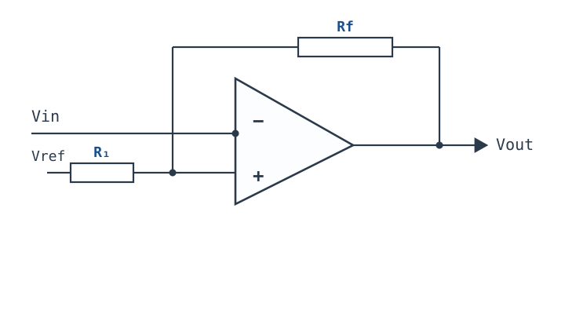
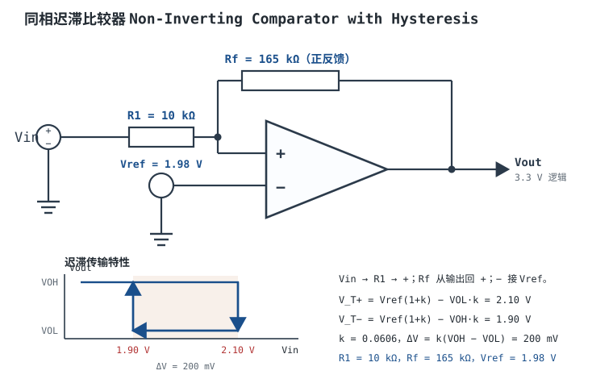

# 比较器与迟滞比较器 Comparator & Hysteresis

比较器是"1 位 ADC"：它不回答"信号有多大"，只回答"过没过门槛"。这个功能简单到可以用一只运放开环实现，但**能用运放做**和**该用比较器做**是两件事——比较器没有内部补偿、输出是逻辑电平、速度按传播延迟标定；运放有补偿、输出是模拟摆幅、速度按压摆率标定。把两者混用，轻则翻转慢、输出电平不对，重则输出锁死或相位反转。

迟滞（Hysteresis）解决的是另一个问题：**单一阈值加噪声，输出必然在阈值附近来回抖**。加一只正反馈电阻，把"上门限"和"下门限"错开，噪声只要小于窗口就不会引起误翻转。本章先讲比较器与运放的五点差异，再算清"噪声下抖多少"，然后给出**同相**与**反相**两种迟滞拓扑的精确公式（两者的窗口系数不一样，这是最容易套错的地方），最后设计一个 3.3 V 逻辑、阈值 2 V、迟滞 200 mV 的同相迟滞比较器，并说明为什么必须先定输出类型（推挽还是开漏）再算电阻。

**本章约定**：$V_{OH}$、$V_{OL}$ 是输出高、低电平（V）；$V_{ref}$ 是参考电压（V）；$V_{T+}$、$V_{T-}$ 是上门限、下门限（V）；$\Delta V$ 是迟滞窗口（V）；$R_1$ 是输入/参考支路电阻，$R_f$ 是正反馈电阻（$\Omega$）；$k=R_1/R_f$；$\beta=R_1/(R_1+R_f)$ 是环路反馈系数（**不是**三极管的电流放大倍数，也**不是**窗口系数）；$\sigma_n$ 是输入参考噪声 rms（V）；$B$ 是噪声带宽（Hz）。**本章的电路工作在开环或正反馈，虚短与虚断都不成立**——负反馈前提见[理想模型五假设与虚短、虚断](ideal-opamp.md)，这里一条都用不上；比较器的分析方法是"输出饱和 + 阈值比较"，不是"虚地 + 电流守恒"。

## 1. 设计动机

::: motivation 三个真实场景
**场景一：温度开关在阈值附近"哒哒哒"。** NTC 分压后灵敏度 $10\ \text{mV}/^{\circ}\text{C}$，温度以 $1^{\circ}\text{C}/\text{s}$ 缓慢上升，叠加 $5\ \text{mV p-p}$ 的工频/开关噪声（$\sigma_n\approx0.76\ \text{mV}$），阈值设在 25°C。开环比较器在阈值附近停留的时间里，输入噪声会反复穿过单一阈值：按 §3.2 的估计，$\sigma_n=1\ \text{mV}$、$B=1\ \text{MHz}$ 时阈值上的翻转率约 $5.8\times10^5/\text{s}$，输出在阈值附近以几十万次每秒的频率抖动，机械继电器会发出"哒哒"的抖动声，后级计数器会把这串脉冲全部计进去。加 20 mV 迟滞（对应 2°C）后，噪声要跨过 20 mV 才能翻转，而噪声只有 0.76 mV，抖动消失。**迟滞不是"提高精度"，是"用一点精度换稳定"。**

**场景二：电池欠压告警被负载瞬变误触发。** 3.3 V 轨、阈值 3.0 V 的欠压检测，电机启动瞬间轨电压跌 150 mV 再恢复。没有迟滞时，每次负载阶跃都产生一次告警脉冲；加 100 mV 迟滞（3.0 V 触发、3.1 V 释放）后，150 mV 的瞬变只触发一次、不反复。**窗口要大于瞬变幅度，否则告警本身就是噪声源。**

**场景三：拿运放当比较器，1 MHz 方波变成"圆角波"。** 用一只 GBW=1 MHz、SR=0.5 V/µs 的通用运放开环比较 1 MHz 方波：3.3 V 边沿需要 $3.3/0.5=6.6\ \mu\text{s}$，比信号周期（1 µs）还长；输出既到不了逻辑高电平，也没有确定的传播延迟。换专用比较器（传播延迟几十 ns 量级）后波形干净。**运放的开环增益再高，也补不回压摆率和饱和恢复。**
:::

| 你想确认 | 先算/先查 | 判据（工程经验值） |
|---|---|---|
| 阈值准不准 | $V_{ref}$、$V_{OS}$、电阻容差 | 阈值误差 < 目标精度的 1/3 |
| 噪声会不会抖 | $\sigma_n$ 与 $\Delta V$ 比 | $\Delta V\ge10\sigma_n$（约 1.5 倍峰峰值） |
| 窗口够不够 | 负载瞬变/噪声峰峰值 | 窗口 > 最大瞬变 + 噪声峰峰值 |
| 窗口会不会太大 | 窗口与被测量程比 | 窗口损失 < 量程的 5%~10% |
| 输出电平对不对 | $V_{OH}$、$V_{OL}$ 与逻辑阈值 | 高电平 ≥ 0.7×逻辑电源，低电平 ≤ 0.3×逻辑电源 |
| 翻转够不够快 | 传播延迟与过驱动 | 延迟 < 信号周期的 1/10 |
| 参考带不带得动 | 分压戴维南电阻 × $I_B$ | 参考误差 < 窗口的 1/10 |

**不算会摔在哪**，四个带数字的代价：

1. **没有迟滞。** 阈值上的翻转率量级是 $0.58B$（§3.2）；$B=1\ \text{MHz}$ 就是每秒几十万次，任何机械继电器、计数器、MCU 中断都受不了。
2. **迟滞套错公式。** 同相拓扑窗口是 $k(V_{OH}-V_{OL})$（$k=R_1/R_f$），反相拓扑是 $\frac{R_1}{R_1+R_f}(V_{OH}-V_{OL})$。同样 $R_1=10\ \text{k}\Omega$、$R_f=165\ \text{k}\Omega$、3.3 V 输出，同相是 200 mV，反相只有 188.6 mV，差 6.1%（正好是 $1+k$ 倍）。把公式混用，窗口就偏。
3. **忽略输出电平。** 按 $V_{OH}=3.3\ \text{V}$、$V_{OL}=0$ 算出的 200 mV，在 $V_{OL}=0.2\ \text{V}$ 的实际器件上只有 187.9 mV；开漏输出上拉到 5 V 时 $V_{OH}=5\ \text{V}$，同样电阻的窗口变成 303 mV，而且 5 V 高电平会打坏 3.3 V 逻辑输入。
4. **参考分压阻抗太高。** 两只 1 MΩ 电阻分压得到 2 V 参考，戴维南电阻 500 kΩ；输入偏置电流 100 nA 就是 $50\ \text{mV}$ 的阈值偏移，和 200 mV 窗口同量级。**参考要低阻，或者加缓冲。**

## 2. 定义与直观

### 2.1 比较器是什么：一位量化器

比较器把两个输入电压比大小，输出只有两种状态：

$$V_{out}=\begin{cases}V_{OH}, & V_+-V_-\gt0\\ V_{OL}, & V_+-V_-\lt0\end{cases}$$

理想比较器的传输特性是一个阶跃；真实比较器有有限增益 $A_{OL}$，过渡区宽度是 $(V_{OH}-V_{OL})/A_{OL}$。**这个宽度非常小**：$A_{OL}=10^5$、摆幅 3.3 V 时只有 $33\ \mu\text{V}$。也就是说，只要输入差超过几十 µV，输出就已经贴到电源轨，中间没有"线性放大区"。这就是为什么比较器不能用虚短分析：**它的正常工作状态就是饱和。**

输出电平有两种结构，必须先分清：

- **推挽（push-pull）**：内部有上拉和下拉两只管子，$V_{OH}\approx V_{CC}-0.1\sim0.2\ \text{V}$、$V_{OL}\approx0.1\sim0.3\ \text{V}$（典型量级，以数据手册为准）；不需要外部上拉，但不能线与。
- **开集/开漏（open-collector/open-drain）**：只有下拉管，$V_{OL}$ 由灌电流决定，$V_{OH}$ 由外部上拉电阻和上拉电源决定；必须加上拉，上拉到哪里，高电平就是哪里。

### 2.2 比较器与运放的五点差异

| 维度 | 运放 | 比较器 |
|---|---|---|
| 内部补偿与速度 | 主极点补偿，为单位增益稳定设计，PM 45°~70° | 无补偿或只做很小的补偿，追求传播延迟；不保证闭环稳定 |
| 输出级 | 模拟摆幅，线性区内工作 | 逻辑电平：推挽或开集/开漏，直接驱动数字输入 |
| 输入级与规格 | 失调修调、CMRR/PSRR 曲线、输入共模范围 | 输入范围 + 相位反转警告，$V_{OS}$ 通常更大且少修调 |
| 线性放大能力 | 可以闭环做放大、滤波、积分 | 不能做线性放大：无补偿、开环增益/相位未定义、失调大 |
| 关键规格 | GBW、SR、PM、$e_n$、CMRR | 传播延迟 $t_{pd}$、过驱动、输出电平、输入范围、内置迟滞 |

**关于"输入范围限制"要纠正一句**：专用比较器的输入共模范围不一定比运放窄，很多器件含负轨、甚至 rail-to-rail；真正的差异不是"范围更小"，而是**它把输入范围当成"能不能判决"的开关量规格，运放把它当成"误差有多大"的线性规格**。比较器输入越界的后果往往是相位反转（输出朝反方向跳）或锁死，而不是"误差变大"；运放越界则可能反相、增益塌陷。两者都要查数据手册的 Input Common-Mode Voltage Range，但比较器还要多查一行 Phase Reversal。

**"不能做线性放大"的三条硬理由**：① 没有主极点补偿，接成负反馈后相位裕度未知，很容易振荡；② 数据手册不保证线性区的增益、失真、噪声，只保证判决；③ 输出级在饱和区，离开饱和的恢复时间没有规格。所以"用运放做比较器"是"慢一点、电平不对"，"用比较器做放大器"是"根本不保证工作"。

### 2.3 为什么开环比较器会在噪声下抖动

设输入信号缓慢上升，叠加输入参考噪声，噪声 rms 为 $\sigma_n$。在单一阈值附近，噪声的每一次上下穿越都会让输出翻转。定量地看两层：

**第一层：单次判决的错误概率。** 输入过驱动为 $V_{od}=|V_{in}-V_{ref}|$ 时，噪声让判决出错的概率是高斯尾概率：

$$P_{err}=Q\left(\frac{V_{od}}{\sigma_n}\right)=\frac{1}{2}\operatorname{erfc}\left(\frac{V_{od}}{\sigma_n\sqrt{2}}\right)$$

$V_{od}=0$ 时 $P_{err}=0.5$；$V_{od}=3\sigma_n$ 时 $1.35\times10^{-3}$；$V_{od}=5\sigma_n$ 时 $2.87\times10^{-7}$。**只要输入停在阈值上，输出就有一半时间"猜错"。**

**第二层：单位时间的翻转次数。** 对带限高斯噪声，单位时间内向上穿越电平 $L$ 的平均次数可以用 Rice 公式估计：

$$\nu\approx0.58\,B\exp\left(-\frac{L^2}{2\sigma_n^2}\right)$$

其中 $B$ 是噪声带宽（Hz），$L$ 是阈值到信号电平的距离（V）。系数 0.58 来自"砖墙带限 + 高斯"的近似，量级正确，精确值随噪声谱形状变。$B=1\ \text{MHz}$ 时：

| $L/\sigma_n$ | 翻转率 $\nu$（次/秒） | 说明 |
|---|---|---|
| 0 | $5.8\times10^5$ | 输入正停在阈值上 |
| 1 | $3.5\times10^5$ | 噪声比过驱动大 |
| 2 | $7.85\times10^4$ | 仍然很密 |
| 3 | $6.4\times10^3$ | 每次过零都可能抖 |
| 5 | 2.2 | 基本干净 |
| 10 | $1.1\times10^{-16}$ | 实际上不会发生 |

**这张表要背下来的部分**：要让误翻转率降到 1 次/秒以下，在 $B=1\ \text{MHz}$ 时需要 $L\ge5.15\sigma_n$，也就是迟滞窗口 $\Delta V=2L\ge10.3\sigma_n$。工程上取 $\Delta V\ge10\sigma_n$（约 1.5 倍峰峰值）是合理下限；要求更高时取 $15\sim20\sigma_n$。

**迟滞为什么能解决？** 因为阈值随输出状态移动：输出高时用上门限，输出低时用下门限。噪声只要小于窗口，就无法把输出"推回"另一个状态——**不是噪声消失了，是判决门限跟着状态走了。** 这也是为什么"加滤波"和"加迟滞"不能互相替代：滤波降低 $\sigma_n$，迟滞提高判决门限的距离，两者乘起来才是抗扰度。

::: analogy 迟滞像门闩
普通的门（单一阈值）被风一吹就来回晃；门闩（迟滞）要求你先推开一段距离，门才会"咔"地弹到另一边，弹过去以后，同样的风就推不回来了。窗口就是门闩的深度：太浅，风一吹就开；太深，人手推不动（灵敏度不够）。

类比的边界：门闩的深度是机械固定的，迟滞窗口却随输出电平（$V_{OH}-V_{OL}$）和电阻比变化；电源电压一变，窗口跟着变。所以"设计好的窗口"必须按实际输出电平核算，不能照抄标称值。
:::

### 2.4 迟滞的实现：一只正反馈电阻

迟滞的本质是**正反馈**：把输出的一部分送回同相端，让输出状态"帮助"自己保持。两种基本接法：

- **同相迟滞（输入接同相端）**：$V_{in}$ 经 $R_1$ 接 $+$，输出经 $R_f$ 接 $+$，$-$ 接 $V_{ref}$。输入升高到上门限时输出翻高，输出变高又把 $+$ 端抬高，阈值随之上移；输入回落到下门限时输出翻低，$+$ 端随之下移。
- **反相迟滞（输入接反相端）**：$V_{in}$ 接 $-$，$+$ 端由 $V_{ref}$ 经 $R_1$、输出经 $R_f$ 分压。输出状态改变时，$+$ 端的参考电平跟着改变，形成两个阈值。

两种接法的传输特性都是一个**顺时针的矩形环**：横轴输入、纵轴输出，环的宽度就是迟滞窗口。环内的输入变化不改变输出，环外的输入才触发翻转。**注意方向**：同相拓扑输入升高时输出升高（同相），反相拓扑输入升高时输出降低（反相）——"同相/反相"说的是输入到输出的极性，不是反馈的极性；两者的反馈都是正反馈。

正反馈要"翻得干脆"，需要环路增益大于 1：

$$A_{OL}\beta>1,\qquad \beta=\frac{R_1}{R_1+R_f}$$

其中 $A_{OL}$ 是比较器的开环增益（$10^4\sim10^6$），$\beta$ 是反馈系数。$\beta$ 很小（$R_f\gg R_1$）时环路增益仍可能大于 1，因为 $A_{OL}$ 很大；但如果 $\beta$ 太小、节点电容又大，再生过程会变慢，可能在翻转完成前输入已经走出窗口，表现为"抖动"或"双脉冲"。

## 3. 定量关系

### 3.1 开环判决需要多大差模电压

输出从 $V_{OL}$ 翻到 $V_{OH}$ 所需的输入差是

$$\Delta V_{in,min}=\frac{V_{OH}-V_{OL}}{A_{OL}}$$

$A_{OL}=10^5$、摆幅 3.3 V 时是 $33\ \mu\text{V}$。**这个数说明两件事**：① 比较器的"线性区"只有几十 µV，任何 mV 级的过驱动都已经饱和；② 输入失调 $V_{OS}$（典型 1~10 mV）比线性区大几十倍，所以比较器的阈值误差主要由 $V_{OS}$、参考误差、电阻容差决定，不是由增益决定。

阈值误差的预算式：

$$\Delta V_{T}=\sqrt{V_{OS}^2+\left(\Delta V_{ref}\right)^2+\left(\Delta V_{R}\right)^2}$$

其中 $\Delta V_R$ 是电阻比容差折算到阈值的误差，$\Delta V_{ref}$ 是参考电压误差。三项独立时按 RSS 合成；做保证书时按最坏和。**注意 $V_{OS}$ 同时移动上门限和下门限，不改变窗口宽度；电阻比和 $V_{OH}/V_{OL}$ 才改变窗口。**

### 3.2 噪声、误翻转率与窗口下限

§2.3 已经给出两条结论，这里写成设计式：

$$P_{err}=Q\left(\frac{V_{od}}{\sigma_n}\right),\qquad \nu\approx0.58B\exp\left(-\frac{L^2}{2\sigma_n^2}\right)$$

要让翻转率不超过目标 $\nu_0$：

$$L\ge\sigma_n\sqrt{2\ln\frac{0.58B}{\nu_0}},\qquad \Delta V=2L\ge2\sigma_n\sqrt{2\ln\frac{0.58B}{\nu_0}}$$

复算：$B=1\ \text{MHz}$、$\nu_0=1/\text{s}$：

$$\Delta V\ge2\sigma_n\sqrt{2\ln\left(5.8\times10^5\right)}=2\sigma_n\sqrt{26.54}=10.30\sigma_n$$

若 $\sigma_n=1\ \text{mV}$，窗口至少 10.3 mV；若 $\sigma_n=5\ \text{mV}$，至少 51.5 mV。**这就是"窗口取噪声峰峰值 2~3 倍"这句话的定量来源**：高斯噪声的峰峰值约 $6.6\sigma_n$，$10.3\sigma_n$ 正好是 1.56 倍峰峰值，取 2~3 倍是留了余量。

还要注意：$\sigma_n$ 是**输入参考**噪声，要把运放/比较器的 $e_n$、源阻抗热噪声、电源纹波折算到输入端一起算（方法见[噪声：电压噪声、电流噪声与计算](noise.md)）。窗口只对"输入端看到的噪声"有效，对输出端耦合进来的干扰无效——后者要靠布局解决（§5.2）。

### 3.3 同相迟滞：窗口 $k(V_{OH}-V_{OL})$，$k=R_1/R_f$

**电路**：$V_{in}$ 经 $R_1$ 接 $+$，输出经 $R_f$ 接 $+$，$-$ 接 $V_{ref}$。

对 $+$ 节点列 KCL（**这里没有虚断**，只是节点电流守恒）：

$$\frac{V_+-V_{in}}{R_1}+\frac{V_+-V_{out}}{R_f}=0$$

整理得

$$V_+=\frac{V_{in}R_f+V_{out}R_1}{R_1+R_f}$$

比较器在 $V_+=V_{ref}$ 时翻转，解出输入电压：

$$V_{in}=V_{ref}\left(1+\frac{R_1}{R_f}\right)-V_{out}\frac{R_1}{R_f}$$

令 $k=R_1/R_f$。输出低（$V_{OL}$）时对应**上门限**（输入上升、输出从低翻高）：

$$V_{T+}=V_{ref}(1+k)-V_{OL}k$$

输出高（$V_{OH}$）时对应**下门限**（输入下降、输出从高翻低）：

$$V_{T-}=V_{ref}(1+k)-V_{OH}k$$

窗口与中心：

$$\Delta V=V_{T+}-V_{T-}=k\left(V_{OH}-V_{OL}\right)$$

$$V_{center}=V_{ref}(1+k)-\frac{k\left(V_{OH}+V_{OL}\right)}{2}$$

符号与单位：$k$ 无量纲；$V_{ref}$、$V_{OH}$、$V_{OL}$、$V_{T\pm}$、$\Delta V$、$V_{center}$ 单位 V。**窗口只由 $k$ 和输出摆幅决定，与 $V_{ref}$ 无关；$V_{ref}$ 决定窗口的中心。** 这是设计时"先定窗口、再定中心"的依据。

### 3.4 反相迟滞：窗口 $\frac{R_1}{R_1+R_f}(V_{OH}-V_{OL})$

**电路**：$V_{in}$ 接 $-$，$+$ 端由 $V_{ref}$ 经 $R_1$、输出经 $R_f$ 分压。

对 $+$ 节点列 KCL：

$$\frac{V_+-V_{ref}}{R_1}+\frac{V_+-V_{out}}{R_f}=0$$

$$V_+=\frac{V_{ref}R_f+V_{out}R_1}{R_1+R_f}$$

比较器在 $V_{in}=V_+$ 时翻转。输出高时 $+$ 端电平高，对应**高门限**；输出低时对应**低门限**：

$$V_{T,H}=\frac{V_{ref}R_f+V_{OH}R_1}{R_1+R_f},\qquad V_{T,L}=\frac{V_{ref}R_f+V_{OL}R_1}{R_1+R_f}$$

窗口与中心：

$$\Delta V=V_{T,H}-V_{T,L}=\frac{R_1}{R_1+R_f}\left(V_{OH}-V_{OL}\right)$$

$$V_{center}=\frac{V_{ref}+k\left(V_{OH}+V_{OL}\right)/2}{1+k},\qquad k=\frac{R_1}{R_f}$$

**方向**：输入上升、越过 $V_{T,H}$ 时，输出从高翻低；输入下降、越过 $V_{T,L}$ 时，输出从低翻高。所以反相拓扑的"高门限"对应"输出从高变低"，和同相拓扑的"上门限"含义相反，写规格时要注明是"输入上升沿的阈值"还是"输出高电平时的阈值"。

### 3.5 两种拓扑的对比：β 不是窗口系数

| 项目 | 同相迟滞 | 反相迟滞 |
|---|---|---|
| 输入接法 | $V_{in}$ 经 $R_1$ 接 $+$ | $V_{in}$ 接 $-$ |
| 参考接法 | $-$ 接 $V_{ref}$ | $V_{ref}$ 经 $R_1$ 接 $+$ |
| 窗口 $\Delta V$ | $k(V_{OH}-V_{OL})$，$k=R_1/R_f$ | $\frac{R_1}{R_1+R_f}(V_{OH}-V_{OL})$ |
| 中心 $V_{center}$ | $V_{ref}(1+k)-\frac{k(V_{OH}+V_{OL})}{2}$ | $\frac{V_{ref}+k(V_{OH}+V_{OL})/2}{1+k}$ |
| 环路反馈系数 $\beta$ | $\frac{R_1}{R_1+R_f}$ | $\frac{R_1}{R_1+R_f}$ |
| 相同 $R_1=10\ \text{k}\Omega$、$R_f=165\ \text{k}\Omega$、3.3 V | 200.0 mV | 188.6 mV |
| 中心 =2.000 V 所需的 $V_{ref}$ | 1.980 V | 2.021 V |
| 输入升高时输出 | 升高（同相） | 降低（反相） |

**这张表最重要的一行是 $\beta$**：两种拓扑的 $\beta$ 都是 $R_1/(R_1+R_f)=0.0571$，但窗口一个 200 mV、一个 188.6 mV。原因：同相拓扑里 $R_1$ 串在输入源上，输入源对交流是低阻，窗口由 $R_1$ 与 $R_f$ 的**电流分配**决定，系数是 $R_1/R_f$；反相拓扑里 $R_1$ 接的是固定参考，$+$ 端是 $R_1$、$R_f$ 的**电压分压**，系数是 $R_1/(R_1+R_f)$。两者差 $1+k$ 倍。

**工程口诀**：同相拓扑"窗口看 $R_1/R_f$"，反相拓扑"窗口看分压比"；**任何"窗口 $=\beta\Delta V$"的写法只对反相拓扑成立，套到同相拓扑上会小 $1/(1+k)$ 倍。**

### 3.6 取整、容差与"先定输出电平"

**第一步永远是定输出电平**，因为窗口公式里的 $V_{OH}-V_{OL}$ 是实际值，不是标称电源：

- 推挽输出：$V_{OH}=V_{CC}-V_{drop}$（轻载 0.05~0.2 V）、$V_{OL}=0.05\sim0.3\ \text{V}$；重载时 $V_{OL}$ 更大，窗口变小。
- 开漏输出：$V_{OH}=V_{pullup}-I_{pullup}R_{pullup}$（空载时约等于上拉电源）、$V_{OL}$ 由灌电流与内部导通电阻决定；上拉电源必须等于逻辑电源，否则电平不兼容。
- 上拉电阻还决定上升时间 $t_r\approx2.2R_{pullup}C_{load}$：$R_{pullup}=100\ \text{k}\Omega$、$C_{load}=50\ \text{pF}$ 时 $t_r=11\ \mu\text{s}$，边沿太慢会让比较器在过渡区停留过久，增加抖动风险。

**取整顺序**：

1. 由 $\Delta V$ 与 $V_{OH}-V_{OL}$ 算出所需 $k$；
2. 选 $R_1$（兼顾源阻抗、偏置电流、节点阻抗），再算 $R_f=R_1/k$；
3. 取最近的 E96 值，反算实际 $k$ 与窗口；
4. 由目标中心算 $V_{ref}$，再算参考分压；
5. 用实际 $V_{OH}$、$V_{OL}$、电阻容差复算上下门限；
6. 检查 $V_{ref}$ 是否在比较器的输入共模范围内。

**容差预算**：$k$ 的相对误差约为两只电阻容差之和（1% 电阻最坏 ±2%），窗口误差同比例；$V_{OH}-V_{OL}$ 的误差（电源、负载、温度）直接乘进窗口。**200 mV 的目标窗口，实际可能在 185~215 mV 之间；如果系统要求 ±5%，必须用 0.1% 电阻并核算输出电平。**

### 3.7 适用条件与失效边界

1. **输出必须在两种饱和态之间**：比较器没有线性区可用；如果电路要求"输出跟随输入"，这不是比较器，应该用运放。
2. **输入必须在共模范围内**：越界可能相位反转或锁死；查 Input Common-Mode Voltage Range 与 Phase Reversal 两行。
3. **正反馈必须真的正反馈**：同相端接反馈、反相端接参考；接反了就是负反馈，比较器会变成（不稳定的）放大器。
4. **窗口不能吃掉分辨率**：窗口占量程的比例要小于系统允许的迟滞误差；温度开关的 2°C 窗口在 ±0.5°C 精度的系统里就太大了。
5. **参考必须低阻**：分压电阻 × 输入偏置电流 < 窗口的 1/10；否则加缓冲或换低 $I_B$ 器件。
6. **速度要按过驱动算**：传播延迟随过驱动减小而增大；数据手册的 $t_{pd}$ 通常是在几十 mV 过驱动下测的，1 mV 过驱动可能慢几倍。

## 4. 典型计算

### 4.1 完整设计：3.3 V 逻辑、阈值 2 V、迟滞 200 mV 的同相迟滞比较器

**需求**：3.3 V 单电源，输入缓慢变化的模拟电压；输出接 3.3 V CMOS 逻辑；中心阈值 2.000 V；迟滞窗口 200 mV；窗口容差目标 ±10%。

**第 1 步：确定输出电平。** 选推挽输出比较器，$V_{OH}\approx3.3\ \text{V}$、$V_{OL}\approx0\ \text{V}$（先按理想值设计，第 9 步用实际值复算）。摆幅 $V_{OH}-V_{OL}=3.3\ \text{V}$。

**第 2 步：算电阻比 $k$。**

$$k=\frac{\Delta V}{V_{OH}-V_{OL}}=\frac{0.200}{3.3}=0.060606$$

**第 3 步：选电阻。** 取 $R_1=10.0\ \text{k}\Omega$（E96），则

$$R_f=\frac{R_1}{k}=\frac{10.0\ \text{k}\Omega}{0.060606}=165.0\ \text{k}\Omega$$

165 kΩ 正好是 E96 值。反算：

$$k=\frac{10}{165}=0.060606,\qquad \Delta V=0.060606\times3.3=0.2000\ \text{V}$$

**第 4 步：算参考电压，使中心落在 2.000 V。** 由中心公式反解：

$$V_{ref}=\frac{V_{center}+k\left(V_{OH}+V_{OL}\right)/2}{1+k}=\frac{2.000+0.060606\times1.65}{1.060606}=\frac{2.1000}{1.060606}=1.9800\ \text{V}$$

**第 5 步：验算两个门限。**

$$V_{T+}=1.9800\times1.060606-0\times0.060606=2.1000\ \text{V}$$

$$V_{T-}=2.1000-3.3\times0.060606=2.1000-0.2000=1.9000\ \text{V}$$

中心 $(2.1000+1.9000)/2=2.0000\ \text{V}$，窗口 200.0 mV。✓

**第 6 步：如果只有 2.000 V 基准怎么办？** 用 $V_{ref}=2.000\ \text{V}$，窗口不变，中心移动：

$$V_{T+}=2.000\times1.060606=2.1212\ \text{V},\qquad V_{T-}=2.1212-0.2000=1.9212\ \text{V}$$

中心 2.0212 V，比目标高 21.2 mV。**要么接受这 21 mV 的偏移，要么把基准做成 1.980 V；不能既用 2.000 V 基准又要求中心 2.000 V。**

**第 7 步：做 1.980 V 参考。** 从 3.3 V 分压：

$$\frac{1.980}{3.3}=0.600\quad\Rightarrow\quad \frac{R_{bottom}}{R_{top}+R_{bottom}}=0.600$$

取 $R_{top}=100\ \text{k}\Omega$、$R_{bottom}=150\ \text{k}\Omega$：

$$V_{ref}=3.3\times\frac{150}{250}=1.980\ \text{V}$$

戴维南电阻 $100\ \text{k}\Omega\parallel150\ \text{k}\Omega=60\ \text{k}\Omega$，分压电流 $3.3/250\ \text{k}\Omega=13.2\ \mu\text{A}$，功耗 $43.6\ \mu\text{W}$。输入偏置电流 1 nA 时阈值偏移 $1\ \text{nA}\times60\ \text{k}\Omega=60\ \mu\text{V}$；100 nA 时 $6\ \text{mV}$。并 100 nF 到地，参考噪声被滤到 $1/(2\pi\times60\ \text{k}\Omega\times100\ \text{nF})=26.5\ \text{Hz}$ 以下；上电建立时间约 $6\times60\ \text{k}\Omega\times100\ \text{nF}=36\ \text{ms}$，可以接受。

**第 8 步：源阻抗的影响。** 若信号源内阻 $R_s=1\ \text{k}\Omega$，它串在 $R_1$ 上，等效 $R_1'=11\ \text{k}\Omega$：

$$k'=\frac{11}{165}=0.066667,\qquad \Delta V'=0.066667\times3.3=0.2200\ \text{V}$$

$$V_{T+}'=1.980\times1.066667=2.1120\ \text{V},\qquad V_{T-}'=2.1120-0.2200=1.8920\ \text{V}$$

窗口从 200 mV 变成 220 mV（+10%），中心从 2.000 V 变成 2.002 V。**要保证窗口误差小于 1%，源阻抗应小于 $R_1/100=100\ \Omega$**；源阻抗不可控时，先把 $R_1$ 加大（例如 100 kΩ），或加一级缓冲。

**第 9 步：用实际输出电平复算。** 若 $V_{OH}=3.2\ \text{V}$、$V_{OL}=0.2\ \text{V}$，摆幅只有 3.0 V：

$$\Delta V=0.060606\times3.0=0.1818\ \text{V}$$

比目标小 9.1%。要保住 200 mV，应把 $k$ 提到 $0.200/3.0=0.066667$，即 $R_f=R_1/k=150\ \text{k}\Omega$；此时中心也要重算：

$$V_{ref}=\frac{2.000+0.066667\times(3.2+0.2)/2}{1.066667}=\frac{2.000+0.1133}{1.066667}=1.9812\ \text{V}$$

**这就是"先定输出电平"的原因**：输出摆幅差 0.3 V，窗口就差 9%，参考还要跟着动。

**第 10 步：输出类型的选择。** 这个设计用推挽输出最省事：$V_{OH}$ 由 3.3 V 电源决定，不需要上拉，边沿快。若改用开漏输出：

- 上拉到 3.3 V：$V_{OH}\approx3.3\ \text{V}$，但上升沿由 $R_{pullup}C_{load}$ 决定；$R_{pullup}=10\ \text{k}\Omega$、$C_{load}=50\ \text{pF}$ 时 $t_r\approx1.1\ \mu\text{s}$，对缓慢信号够用，对 MHz 信号太慢。
- 上拉到 5 V：$V_{OH}=5\ \text{V}$，窗口变成 $0.060606\times5=303\ \text{mV}$（偏大 51%），而且 5 V 高电平直接打 3.3 V 逻辑输入，超出绝对最大额定值。**必须上拉到 3.3 V，或换推挽器件。**
- 开漏的 $V_{OL}$ 随灌电流变化：$V_{OH}=3.3\ \text{V}$ 时，$V_{OL}=0.3\ \text{V}$ 会让窗口再小 9%。

**第 11 步：校验抖动余量。** 输入参考噪声 $\sigma_n=1\ \text{mV}$ 时，窗口 200 mV 对应 $L=100\ \text{mV}=100\sigma_n$，按 §3.2 的公式，翻转率是 $0.58\times10^6\times e^{-5000}\approx0$。**余量非常大**；真正需要担心的是输出到输入的寄生耦合（§5.2），不是输入噪声。

**第 12 步：结果表。**

| 项目 | 目标 | 实际（理想输出） | 实际（$V_{OL}=0.2\ \text{V}$） |
|---|---|---|---|
| $R_1$ | — | 10.0 kΩ | 10.0 kΩ |
| $R_f$ | — | 165 kΩ | 150 kΩ（重算后） |
| $V_{ref}$ | — | 1.980 V | 1.981 V |
| 上门限 | 2.100 V | 2.100 V | 2.100 V |
| 下门限 | 1.900 V | 1.900 V | 1.900 V |
| 窗口 | 200 mV | 200.0 mV | 200.0 mV |

### 4.2 算例二：同样的电阻，换成反相拓扑

**已知**：$R_1=10\ \text{k}\Omega$、$R_f=165\ \text{k}\Omega$、$V_{OH}=3.3\ \text{V}$、$V_{OL}=0$，要求中心 2.000 V。比较同相与反相两种接法。

**第 1 步：反相窗口。**

$$\Delta V=\frac{R_1}{R_1+R_f}(V_{OH}-V_{OL})=\frac{10}{175}\times3.3=0.18857\ \text{V}=188.6\ \text{mV}$$

比同相的 200.0 mV 小 5.7%（比值 $1/(1+k)=0.9429$）。

**第 2 步：反相中心对应的 $V_{ref}$。**

$$V_{ref}=V_{center}(1+k)-\frac{k(V_{OH}+V_{OL})}{2}=2.000\times1.060606-0.060606\times1.65=2.1212-0.1000=2.0212\ \text{V}$$

**第 3 步：验算门限。**

$$V_{T,H}=\frac{2.0212\times165+3.3\times10}{175}=\frac{333.50+33.00}{175}=2.0943\ \text{V}$$

$$V_{T,L}=\frac{333.50+0}{175}=1.9057\ \text{V}$$

中心 $(2.0943+1.9057)/2=2.0000\ \text{V}$，窗口 188.6 mV。✓

**结论**：同样两只电阻、同样目标中心，反相拓扑的窗口小 11.4 mV，参考要高 41.2 mV。**选拓扑时先定"输入接哪一端"，再按对应公式算；不要拿同相的 200 mV 直接套反相。**

### 4.3 算例三：噪声下需要多大窗口

**已知**：输入参考噪声 $\sigma_n=2\ \text{mV}$、噪声带宽 $B=500\ \text{kHz}$，要求误翻转率不超过 1 次/秒。求最小窗口；若 $\sigma_n$ 降到 0.5 mV 呢？

**第 1 步：套公式。**

$$\Delta V\ge2\sigma_n\sqrt{2\ln\frac{0.58B}{\nu_0}}=2\times2\times10^{-3}\times\sqrt{2\ln\left(2.9\times10^5\right)}$$

$$\sqrt{2\ln\left(2.9\times10^5\right)}=\sqrt{2\times12.577}=\sqrt{25.15}=5.015$$

$$\Delta V\ge2\times2\times10^{-3}\times5.015=20.06\ \text{mV}$$

**第 2 步：$\sigma_n=0.5\ \text{mV}$ 时。**

$$\Delta V\ge2\times0.5\times10^{-3}\times5.015=5.02\ \text{mV}$$

**结论**：窗口下限正比于 $\sigma_n$；把噪声压 4 倍，窗口下限也降 4 倍。**先降噪声（滤波、屏蔽、降低带宽），再定窗口，比单纯加大窗口更划算**——窗口大了，灵敏度、精度、响应速度都要付代价。

### 4.4 算例四：上拉电阻与边沿时间

**已知**：开漏比较器，$R_{pullup}=10\ \text{k}\Omega$、负载电容 $C_{load}=50\ \text{pF}$、上拉 3.3 V。求上升时间；若改成 100 kΩ 呢？

**第 1 步：10 kΩ。**

$$t_r\approx2.2R_{pullup}C_{load}=2.2\times10^4\times50\times10^{-12}=1.1\times10^{-6}\ \text{s}=1.1\ \mu\text{s}$$

**第 2 步：100 kΩ。**

$$t_r=2.2\times10^5\times50\times10^{-12}=1.1\times10^{-5}\ \text{s}=11\ \mu\text{s}$$

**第 3 步：对迟滞的影响。** 边沿变慢，输出在过渡区停留时间变长，正反馈把 $+$ 端"拉回"的速度也变慢；如果输入在这段时间里继续变化，可能产生双脉冲。经验上要求 $t_r$ 小于输入穿越窗口时间（$\Delta V/v_{in}$）的 1/3~1/2。**100 kΩ 上拉 + 50 pF 负载只适合缓慢的直流信号；快速信号用 1~10 kΩ 上拉，或换推挽输出。**

## 5. 工程含义

### 5.1 取值与选型

| 项目 | 典型取值 | 依据与代价 |
|---|---|---|
| $R_1$ | 1~100 kΩ | 太小费电、加载信号源；太大易拾噪、偏置电流误差大 |
| $R_f$ | $R_1/k$，10 kΩ~1 MΩ | 由窗口定；太大节点阻抗高、再生慢 |
| $V_{ref}$ | 基准 IC 或低阻分压 | 分压戴维南电阻 × $I_B$ < 窗口的 1/10 |
| 上拉电阻 | 1~10 kΩ（开漏） | 太小费电、$V_{OL}$ 变大；太大边沿慢 |
| 输出类型 | 推挽优先；线与用开漏 | 推挽快、电平固定；开漏灵活但要上拉 |
| 比较器速度 | $t_{pd}$ < 信号沿的 1/10 | 过驱动越小，$t_{pd}$ 越大 |
| 内置迟滞 | 有则用，无则外加 | 内置迟滞省电阻，但窗口固定、温漂未知 |

### 5.2 比较器"振荡"的五个原因与排查

| 原因 | 现象 | 机理 | 解决 |
|---|---|---|---|
| 无迟滞/窗口不足 | 阈值附近密集翻转 | 单一阈值 + 噪声，见 §3.2 | 加正反馈，$\Delta V\ge10\sigma_n$ |
| 输出到输入寄生耦合 | 高频脉冲、双脉冲 | 输出边沿经 $C_{par}$ 注入高阻 $+$ 节点，形成额外正反馈 | 缩短反馈走线、降低 $R_1$、$R_f$ 的阻值、地平面隔离、输入端串小电阻 |
| 地/参考反弹 | 每次翻转伴随一次误翻转 | 输出电流流过共享地阻抗，参考跟着跳 | 单点接地、参考单独去耦、缓冲参考 |
| 容性负载/长线 | 边沿振铃后再次过阈 | 传输线反射、容性负载与输出阻抗谐振 | 串联 22~100 Ω、端接、缩短线 |
| 输入越界/相位反转 | 输出反向或锁死 | 输入级饱和，相位反转 | 限制输入范围、钳位、选 RRI 器件 |

**寄生耦合的定量感觉**：输出边沿 3.3 V/10 ns，反馈节点到输出的寄生电容 1 pF，注入电流 $C\,dV/dt=1\times10^{-12}\times3.3/10\times10^{-9}=330\ \mu\text{A}$；$+$ 节点阻抗 $R_1\parallel R_f=9.43\ \text{k}\Omega$，瞬态电压 $330\ \mu\text{A}\times9.43\ \text{k}\Omega=3.1\ \text{V}$——足以把节点"顶"过阈值。**这不是"比较器坏了"，是布局把正反馈接了两遍。** 解决方向：缩短 $R_f$ 走线、把 $R_1/R_f$ 取小、在 $+$ 节点并小电容（但要核算对边沿的影响）、用地平面把输出与输入隔开。

### 5.3 布局

- **$+$ 节点越小越好**：$R_1$、$R_f$、比较器输入脚围成的环路面积最小化；不要在 $+$ 节点下方走数字线。
- **反馈走线短而直**：$R_f$ 紧靠比较器输出与 $+$ 脚；避免与输入线并行。
- **参考与地去耦**：参考分压并 100 nF；比较器电源脚 100 nF + 10 µF；模拟地与数字地单点汇合。
- **输入保护**：输入可能超出电源范围时，串限流电阻 + 肖特基钳位到电源轨；注意钳位二极管的漏电会改变高阻节点的阈值。
- **输出隔离**：长线、容性负载串 22~100 Ω；驱动继电器/LED 时用三极管或 MOS，不要让比较器直接灌大电流。

### 5.4 测量

- **测阈值**：输入加缓慢三角波（周期 > 10 倍窗口穿越时间），示波器 XY 模式看传输特性；读出两个翻转点。
- **测抖动**：输入固定在阈值上，用计数器数输出翻转；或把输入放在阈值 ±$1\sigma_n$ 处，观察 1 分钟内翻转次数。
- **测传播延迟**：输入加不同过驱动的阶跃，测输入到输出的延迟；过驱动 5 mV 与 50 mV 的延迟可能差几倍。
- **测输出电平**：在额定灌/拉电流下测 $V_{OH}$、$V_{OL}$；空载值不能用于窗口计算。
- **测参考**：用高阻探头测参考节点，确认纹波与噪声；探头电容可能让参考瞬间失稳，测前先确认。

### 5.5 失效边界

- **输入超范围**：相位反转、锁死、甚至损坏；查绝对最大额定值与 Phase Reversal。
- **输出短路/大电容**：开漏输出灌电流过大时 $V_{OL}$ 升高，窗口变小；推挽输出短路可能过热。
- **电源时序**：输入先于电源上电时，可能经输入保护二极管灌电流；加限流或时序控制。
- **温度**：$V_{OS}$、$I_B$、输出电平都随温度变；宽温设计要按最坏温度复算窗口。
- **长期稳定性**：比较器的内置迟滞、参考分压的电阻漂移都会让阈值随时间变；精密场合用基准 IC 与低温漂电阻。

## 6. 常见坑

::: pitfall 常见坑
- **现象**：用运放做比较器，输出翻转慢、电平不够、偶尔锁死。**原因**：运放有主极点补偿，压摆率和饱和恢复慢；输出是模拟摆幅，不是逻辑电平；部分运放输入越界会相位反转。**解决**：换专用比较器（推挽或开漏按需选）；必须用运放时，选无补偿/高速型并加外部钳位，但仍不保证逻辑电平。
- **现象**：开漏比较器输出一直是高阻，量不到高电平。**原因**：忘了上拉电阻，或上拉到了错误的电源。**解决**：上拉到逻辑电源（3.3 V 逻辑就上拉 3.3 V），阻值按 $t_r\approx2.2R_{pullup}C_{load}$ 选；上拉到 5 V 会打坏 3.3 V 输入。
- **现象**：按同相公式算的 200 mV 窗口，实际只有 189 mV。**原因**：电路其实是反相拓扑，窗口系数是 $R_1/(R_1+R_f)$，不是 $R_1/R_f$；两者差 $1+k$ 倍。**解决**：先确认输入接 $+$ 还是 $-$，再套对应公式；用实测传输特性复核。
- **现象**：按标称 3.3 V 算好的窗口，换一批器件后偏小 10%。**原因**：$V_{OH}$ 只有 3.2 V、$V_{OL}$ 有 0.2 V，实际摆幅 3.0 V；开漏上拉还受负载影响。**解决**：用数据手册与实际负载下的 $V_{OH}$、$V_{OL}$ 复算；窗口容差写进规格。
- **现象**：传感器内阻 1 kΩ 接上后，窗口从 200 mV 变成 220 mV。**原因**：源阻抗串进 $R_1$，等效 $k$ 变大。**解决**：保证 $R_s<R_1/100$，或把 $R_s$ 计入 $R_1$ 重算；高阻源先加缓冲。
- **现象**：参考用两只 1 MΩ 电阻分压，阈值随温度漂几十 mV。**原因**：戴维南电阻 500 kΩ × 输入偏置电流（100 nA 级）= 几十 mV；分压比还随电阻温漂变。**解决**：降低分压电阻（10 kΩ 量级）、加缓冲、或改用基准 IC。
- **现象**：比较器在输出翻转瞬间出现双脉冲，示波器上像"振铃"。**原因**：输出到 $+$ 节点的寄生电容把边沿耦合回来，形成额外的正反馈；节点阻抗越高越严重。**解决**：缩短 $R_f$ 走线、降低 $R_1/R_f$、地平面隔离、输入端串小电阻；必要时在 $+$ 节点并小电容并复核边沿。
- **现象**：迟滞加到 500 mV，系统对 100 mV 的故障不报警。**原因**：窗口吃掉了故障信号；迟滞是"抗噪"手段，不是"越高越好"。**解决**：按 $\Delta V\ge10\sigma_n$ 取下限，按"最小故障信号"取上限，两者取交集；不够就降噪声或放大信号。
:::

## 7. 自测题

同相迟滞：$V_{OH}=3.3\ \text{V}$、$V_{OL}=0$、$R_1=10\ \text{k}\Omega$、$R_f=100\ \text{k}\Omega$、$V_{ref}=2.0\ \text{V}$。两个门限、窗口、中心各是多少？

$$k=\frac{10}{100}=0.1$$

$$V_{T+}=2.0\times(1+0.1)-0\times0.1=2.20\ \text{V}$$

$$V_{T-}=2.20-3.3\times0.1=2.20-0.33=1.87\ \text{V}$$

$$\Delta V=0.1\times3.3=0.33\ \text{V}=330\ \text{mV}$$

$$V_{center}=\frac{2.20+1.87}{2}=2.035\ \text{V}$$

**窗口 330 mV，中心比 $V_{ref}$ 高 35 mV**——中心不等于 $V_{ref}$：中心公式是 $V_{ref}(1+k)-k\cdot V_{mid}=2.2-0.1\times1.65=2.035\ \text{V}$，$V_{ref}$ 先被放大 $(1+k)$ 倍，再减掉输出平均电平的 $k$ 倍，两项不相等。

反相迟滞：同样 $R_1=10\ \text{k}\Omega$、$R_f=100\ \text{k}\Omega$、$V_{ref}=2.0\ \text{V}$、$V_{OH}=3.3\ \text{V}$、$V_{OL}=0$。窗口与两个门限是多少？和同相比差多少？

$$\Delta V=\frac{10}{110}\times3.3=0.300\ \text{V}=300\ \text{mV}$$

$$V_{T,H}=\frac{2.0\times100+3.3\times10}{110}=\frac{200+33}{110}=2.118\ \text{V}$$

$$V_{T,L}=\frac{200+0}{110}=1.818\ \text{V}$$

中心 $(2.118+1.818)/2=1.968\ \text{V}$。

**同相窗口 330 mV，反相窗口 300 mV，比值 $330/300=1.1=1+k$**；中心也不同（2.035 V 对 1.968 V）。**同样电阻、同样参考，换拓扑窗口和中心都变。**

设计一个 3.3 V 逻辑、中心 1.5 V、迟滞 100 mV 的同相迟滞比较器。取 $R_1=10\ \text{k}\Omega$，求 $R_f$ 与 $V_{ref}$。

$$k=\frac{0.100}{3.3}=0.030303$$

$$R_f=\frac{R_1}{k}=\frac{10\ \text{k}\Omega}{0.030303}=330\ \text{k}\Omega$$

$$V_{ref}=\frac{1.5+0.030303\times1.65}{1.030303}=\frac{1.5+0.0500}{1.030303}=1.5049\ \text{V}$$

验算：

$$V_{T+}=1.5049\times1.030303=1.5505\ \text{V},\qquad V_{T-}=1.5505-0.100=1.4505\ \text{V}$$

中心 1.5005 V，窗口 100 mV。**注意 $V_{ref}\approx1.505\ \text{V}$ 比目标中心高约 5 mV**：中心公式里 $V_{ref}$ 先乘 $(1+k)$ 得到约 1.55 V，再被输出平均电平拉低 $k\times1.65=50\ \text{mV}$；要让中心正好 1.5 V，$V_{ref}$ 就得取 1.505 V 左右，而不是 1.5 V。

输入噪声 $\sigma_n=2\ \text{mV}$、噪声带宽 $B=500\ \text{kHz}$，要求误翻转率不超过 1 次/秒。最小迟滞窗口是多少？

$$\Delta V\ge2\sigma_n\sqrt{2\ln\frac{0.58B}{\nu_0}}$$

$$0.58B=0.58\times5\times10^5=2.9\times10^5$$

$$\sqrt{2\ln\left(2.9\times10^5\right)}=\sqrt{2\times12.577}=5.015$$

$$\Delta V\ge2\times2\times10^{-3}\times5.015=20.06\ \text{mV}$$

**取 20 mV 是理论下限，工程上取 30~50 mV 留余量。** 如果 $\sigma_n$ 能从 2 mV 降到 0.5 mV，窗口下限也降到 5 mV。

开漏比较器上拉到 5 V，输出接 3.3 V 逻辑，会有什么问题？如果上拉到 3.3 V 呢？

上拉到 5 V 有两个问题：① 高电平 5 V 超过 3.3 V 逻辑输入的绝对最大额定值，可能损坏输入级或经保护二极管灌电流；② 迟滞窗口变成 $k(V_{OH}-V_{OL})=k\times5$，同样电阻下比 3.3 V 时大 51.5%，阈值全部偏移。**不能这样接。**

上拉到 3.3 V：高电平约 3.3 V，逻辑兼容；窗口按 3.3 V 算。但上升沿由 $R_{pullup}C_{load}$ 决定，$100\ \text{k}\Omega$ 上拉 + 50 pF 时 $t_r=11\ \mu\text{s}$，快速信号要用 1~10 kΩ 或换推挽输出。

为什么"虚短"不能用在比较器上？比较器的输出从高翻低时，两个输入端电压差是多少？

虚短的前提是**负反馈闭合、输出在线性区、环路增益足够大**。比较器工作在开环或正反馈，输出在 $V_{OH}$ 与 $V_{OL}$ 之间饱和，没有任何机制让两个输入端等电位；翻转瞬间输入差约为 0（计入失调则约 $\pm V_{OS}$），翻转前后可以大到 mV 甚至更大——**没有负反馈把它钳在零**。用"虚短"算比较器，等于假设一个不存在的负反馈。

正确的方法：写出同相端/反相端的节点电压，令两者相等求阈值（§3.3、§3.4），再用输出状态判断方向。

比较器的迟滞窗口越大越好吗？上限由什么决定？

不是。下限由噪声决定（$\Delta V\ge10\sigma_n$），上限由**最小需要检测的信号变化**决定：

- 温度开关：窗口 2°C 意味着温度必须回差 2°C 才释放，若系统要求 ±0.5°C 精度，窗口就太大了。
- 欠压告警：窗口 100 mV 意味着恢复点比触发点高 100 mV，若负载瞬变只有 50 mV，窗口足够；若故障导致的跌落只有 80 mV，窗口 100 mV 会漏报。
- 窗口比较器：上下限之间的"正常区"越宽，能检测的异常范围越小；这里的"窗口"指正常区宽度，和迟滞窗口不是一回事。

工程做法：先算噪声下限，再算"最小故障信号/允许回差"上限，两者取交集；交集为空就降噪声、放大信号或换方案。

## 8. 参考资料

- **Analog Devices, MT-084 *Using Op Amps as Comparators***：运放与比较器的差异、开环使用的风险、输出电平与速度的取舍。本章 §2.2 的五点差异与 §6 的"运放当比较器"坑按该文。<https://www.analog.com/media/en/training-seminars/tutorials/MT-084.pdf>
- **Analog Devices, MT-035 *Op Amp Inputs, Outputs, Single-Supply, and Rail-to-Rail Issues***：输入共模范围、输出摆幅、单电源接口与逻辑电平匹配。本章 §2.2、§3.7 的输入/输出边界参考该文。<https://www.analog.com/media/en/training-seminars/tutorials/MT-035.pdf>
- **TI, LM393 数据手册**：开集电极输出结构、上拉电阻、输入共模范围与比较器应用说明；本章 §2.1、§4.1 第 10 步的开漏/上拉讨论按该手册的输出结构与电气特性表。<https://www.ti.com/lit/ds/symlink/lm393.pdf>
- **TI, TLV3201 数据手册**：推挽输出比较器的输出电平、传播延迟与过驱动关系；本章 §3.1、§3.7 的传播延迟口径参考该手册的 Switching Characteristics 表。<https://www.ti.com/lit/ds/symlink/tlv3201.pdf>
- **Sergio Franco, *Design with Operational Amplifiers and Analog Integrated Systems*（4th ed.）**：Chapter 9 *Nonlinear Circuits* 给比较器、施密特触发器、正反馈与迟滞的完整分析；本章 §2.4、§3.3、§3.4 的推导与该章一致。
