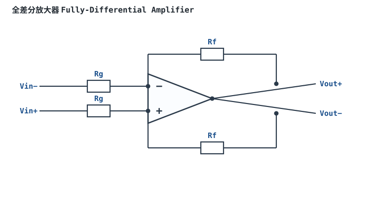
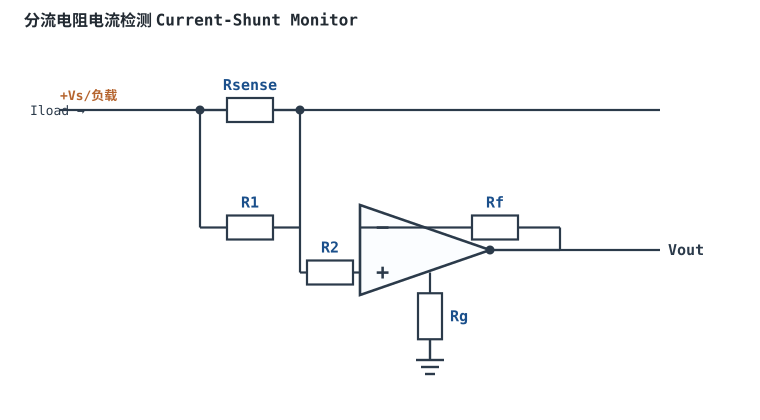
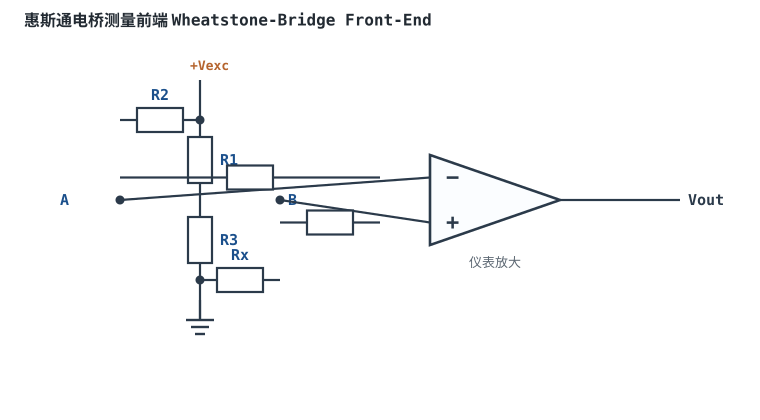

# 差分放大器与电阻匹配 Difference Amplifier

## 1. 设计动机

::: motivation 为什么需要这个电路
传感器输出常是两根线之间的**差值**，而两根线上叠加了同样的工频/共模干扰。我们只想放大差值、抑制共模。差分放大器用四个电阻，把 $V_{out}$ 做成 $(V_2-V_1)$ 的放大。它也是 [仪表放大器](instrumentation-amplifier.md) 的第二级。
:::

## 2. 原理图


## 3. 静态分析（DC）

由叠加原理：反相通道贡献 $V_{out,1}=-V_1\cdot R_f/R_1$；同相通道先分压 $V_+=V_2\cdot R_g/(R_2+R_g)$，再按同相放大 $V_{out,2}=V_+(1+R_f/R_1)$。

当四个电阻**精确匹配** $R_1=R_2$、$R_f=R_g$ 时：

$$V_{out}=\frac{R_f}{R_1}(V_2-V_1)$$

即只放大差值，共模 $V_1=V_2$ 时输出为 0。

## 4. 动态分析（AC / 瞬态）

匹配理想时传递函数 $G=R_f/R_1$，对差模信号同相放大、对共模信号增益为 0。下面是 $V_2$ 比 $V_1$ 高 0.2V 时的输出（G=10）：

```echarts
{
  "tooltip": {"trigger": "axis"},
  "legend": {"data": ["V1", "V2", "Vout=10(V2−V1)"], "bottom": 0, "textStyle": {"fontSize": 12}},
  "grid": {"left": 56, "right": 24, "top": 26, "bottom": 58},
  "xAxis": {"type": "category", "name": "角度", "data": [0,30,60,90,120,150,180,210,240,270,300,330,360], "axisLabel": {"fontSize": 11}},
  "yAxis": {"type": "value", "name": "电压 V", "min": -3, "max": 5, "interval": 2, "axisLabel": {"fontSize": 11}},
  "series": [
    {"name": "V1", "type": "line", "smooth": true, "showSymbol": false, "lineStyle": {"width": 2.2, "color": "#1a4f8b"},
     "data": [2,2.1,2.17,2.2,2.17,2.1,2,1.9,1.83,1.8,1.83,1.9,2]},
    {"name": "V2", "type": "line", "smooth": true, "showSymbol": false, "lineStyle": {"width": 2.2, "color": "#7a5fc0"},
     "data": [2.2,2.3,2.37,2.4,2.37,2.3,2.2,2.1,2.03,2.0,2.03,2.1,2.2]},
    {"name": "Vout=10(V2−V1)", "type": "line", "smooth": true, "showSymbol": false, "lineStyle": {"width": 2.6, "color": "#b5642e"},
     "data": [2,2,2,2,2,2,2,2,2,2,2,2,2]}
  ]
}
```

## 5. 环路分析

单运放差分级本质是反相+同相叠加，反馈系数仍由 Rf/R₁ 决定；纯电阻反馈相位裕度通常足够。

::: advanced 进阶：电阻失配对 CMRR 的定量限制
即使运放本身 CMRR 无穷大，四个电阻不匹配也会限制整个电路的 CMRR。设电阻相对精度为 $\delta$（如 1%），可推得电阻网络贡献的 CMRR 近似为：

$$CMRR_{R}\approx \frac{1+G}{4\delta}\qquad(G=R_f/R_1)$$

举例：G=1、用 1% 电阻 $\delta=0.01$，则 $CMRR_R\approx2/(4\times0.01)=50$，即 **34dB**；用 0.1% 电阻则约 54dB。这远低于运放自身的 100dB。也就是说，**电路 CMRR 往往被电阻精度卡死，而不是运放**。要高 CMRR，要么用 0.01% 精密电阻/集成电阻网络，要么用三运放 [仪表放大器](instrumentation-amplifier.md)（后级电阻出厂激光修调）。
:::

## 6. 元件取值与工程权衡

- **匹配是第一要务**：电阻精度直接决定 CMRR。普通 1% 电阻只能做到约 34~40dB CMRR，精密应用选 0.1% 以上或集成匹配网络。
- **增益与 CMRR 折中**：G 增大，$CMRR_R$ 略升，但共模输入范围、噪声也变化。
- **阻值**：R₁/R₂ 取 kΩ 级，兼顾偏置电流与噪声。

## 7. 完整设计示例

::: example 把 ±0.5V 差分信号转单端
1. **需求**：传感器差分输出 ±0.5V，含 2V 共模，要放大成 0~5V 单端给 ADC。
2. **增益**：$G=R_f/R_1=5$。
3. **取值**：R₁=R₂=10kΩ，Rf=Rg=50kΩ；为 CMRR 选 0.1% 精密电阻。
4. **验算**：差模 0.5V → 输出 2.5V；共模 2V 被抑制。
5. **注意**：共模 2V 必须在运放输入共模范围内，选 RRI 运放。
:::

## 8. 仿真与实验

LTspice 给两输入端加同样的 1V 直流（共模），测输出应为 0；故意把 Rf 换成 1% 误差值，观察输出残留共模误差，验证失配与 CMRR 的关系。

## 扩展与变种电路

### 扩展1：全差分放大器 Fully-Differential Amplifier

输出是一对互补信号（Vout+ 与 Vout−），摆幅互为镜像，常用单端转差分驱动 ADC。



::: example 工作原理与静态分析
- 差分输出 $V_{out+}-V_{out-}=G(V_{in+}-V_{in-})$，两输出关于共模电压 VOCM 对称摆动。
- VOCM 引脚设定输出共模电平（常接 ADC 输入范围中点）。
- 关键：两对 Rg/Rf 对称匹配；抗干扰能力强（双端传输共模噪声被抑制）。
:::

取值数量级：Rg/Rf=10k/100k；与单端差分对比：输出也是双端，适合差分 ADC。适用：高速 ADC 驱动、差分链路；不适用：单端接地系统。

::: pitfall VOCM 不接导致输出共模乱漂
- **现象**：输出直流共模不在预期中点，ADC 采样超范围。
- **原因**：VOCM 引脚悬空，输出共模无确定偏置。
- **解决**：VOCM 接到 ADC 要求的共模基准，必要时加去耦。
:::

### 扩展2：分流电阻电流检测 Current-Shunt Monitor

在被测回路串一只小分流电阻 Rsense，用差分放大器测其两端压降，按欧姆律换算电流。



::: example 工作原理与静态分析
- $V_{sense}=I_{load}\cdot R_{sense}$，差分放大后 $V_{out}=G\cdot V_{sense}$。
- Rsense 取 mΩ 级减小功耗与压降；共模电压可能很高（高端检测），需选高共模范围/电平位移型监控器。
- 匹配电阻决定 CMRR，高端检测共模远超运放电源时要用专用电流检测放大器。
:::

取值数量级：Rsense=10mΩ~100mΩ、G=20~100；与"串电流表"对比：隔离、小功耗、易进 ADC。适用：电源电流监测、电池管理；不适用：大电流小压降且高共模的场合需专用芯片。

::: pitfall 高端检测共模电压超出运放范围
- **现象**：测高端电流时输出饱和/失真。
- **原因**：Rsense 在正电源侧，运放输入共模等于电源电压，超出普通运放共模范围。
- **解决**：选高共模/电平位移专用电流检测放大器，或改低端检测（地侧）。
:::

### 扩展3：双运放差分放大器 Two-Op-Amp Difference

只用两个运放实现差分放大，比三运放仪表放大器省一个运放，输入阻抗高、增益可调。


::: example 工作原理与静态分析
- 两输入端均为高阻同相输入，增益 $G=1+R_f/R_g$（外接电阻比设定）。
- 共模抑制由电阻匹配决定，结构比单运放四电阻差分输入阻抗更高。
- 限制：共模输入范围与输出摆幅受两运放配合约束，CMRR 仍逊于三运放 In-Amp。
:::

取值数量级：Rg/Rf=10k/100k；与单运放差分对比：输入阻抗高；与三运放 In-Amp 对比：省一个运放但 CMRR 略低。适用：中等精度差分前端；不适用：极高 CMRR。

::: pitfall 共模范围算错导致输出削波
- **现象**：差分信号不大却输出削顶。
- **原因**：双运放结构对共模输入范围要求更苛刻，信号共模超出范围。
- **解决**：核算两输入端共模与输出摆幅，选 RRI 器件。
:::

### 扩展4：惠斯通电桥测量前端 Wheatstone-Bridge Front-End

桥式传感器（应变、压力）输出 mV 级差分叠加在大共模上，前端用仪表放大器取差值。



::: example 工作原理与静态分析
- 平衡时 $V_A=V_B$，输出 0；被测变化使一臂电阻变化，$\Delta V\approx V_{exc}\cdot \Delta R/(4R)$。
- 前端高输入阻抗、高 CMRR，把 mV 级失衡放大到 ADC 量程。
- 关键：激励电压 Vexc 稳定，共模约 Vexc/2 需在输入范围。
:::

取值数量级：桥输出 mV 级、G=100~1000；与单端放大对比：抑制桥共模。适用：称重、压力、应变；不适用：不需要差分的普通传感器。

::: pitfall 桥路引线电阻叠加进测量误差
- **现象**：远距离桥路读数随引线/温度飘。
- **原因**：引线电阻串入桥臂，改变了失衡灵敏度。
- **解决**：用四线/六线制远端检测，或在仪表放大器侧补导线电阻。
:::

## 9. 常见坑

::: pitfall 常见坑
- **用普通 1% 电阻指望高 CMRR**：共模抑制比被电阻失配限制到 ~34dB，工频干扰大量泄漏。高 CMRR 场景必须用精密匹配电阻或专用仪表放大器。
- **共模电压超出输入范围**：差分信号叠加的共模分量可能很高（如电桥上的共模），超出运放共模范围就失真。查共模输入范围并选 RRI。
:::

## 10. 自测题

<details><summary>G=1、用 1% 电阻，电路的 CMRR 大约被限制在多少？</summary>

$CMRR_R\approx(1+G)/(4\delta)=2/(4\times0.01)=50$，约 **34dB**。这说明电阻精度往往才是 CMRR 的瓶颈。

</details>

<details><summary>为什么差分放大要强调 R₁=R₂、Rf=Rg？不匹配会怎样？</summary>

不匹配时共模增益不为零，共模信号按 $1/CMRR_R$ 泄漏到输出，且该误差随电阻精度恶化。匹配是差分电路实现减法、抑制共模的前提。

</details>

## 11. 参考资料

- A Deeper Look into Difference Amplifiers（ADI, Harry Holt）
- Op Amps for Everyone（TI, SLOD006B）
