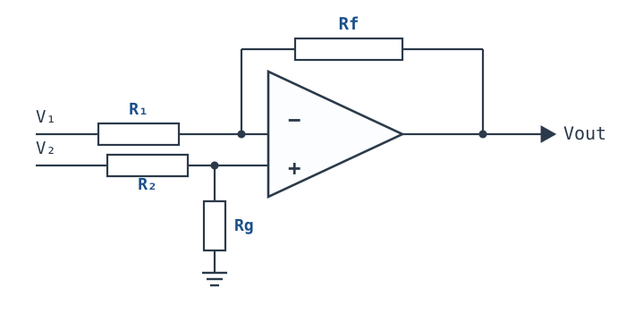
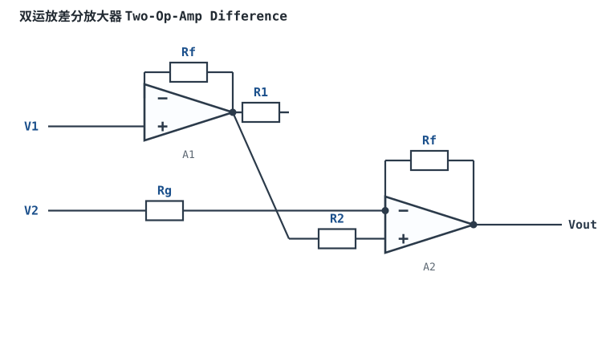

# 差分放大器与电阻匹配 Difference Amplifier

差分放大器（difference amplifier）用一只运放和四只电阻，把两个输入端之间的差值放大成单端输出。电路简单到几乎不需要推导，但它的精度几乎完全由四只电阻的匹配决定：同样一颗标称 120dB CMRR 的运放，配上 1% 电阻，$G=10$ 时电路 CMRR 只有 48.8dB；换成 0.01% 电阻能到 88.8dB，却又被 100Ω 的源阻抗失配拉回 60.8dB。本章要建立的是"电阻容差 → 电路 CMRR → 输出误差"这条可以逐项复算的账，而不是背一个增益公式。

**本章约定**：$G$ 或 $A_{CL}$ 是闭环差模增益；$R_1$ 是反相输入电阻，$R_f$ 是反馈电阻，$R_2$ 是同相输入电阻，$R_g$ 是同相端下地电阻；匹配时 $R_f/R_1=R_g/R_2=G$。$V_{id}=V_2-V_1$ 是差模电压，$V_{cm}=(V_1+V_2)/2$ 是共模电压；$\delta$ 是单只电阻的相对容差（1% 即 $\delta=0.01$）。$CMRR$ 是电压比，分贝一律用 $20\lg$。$\beta$ 是反馈系数（**不是**三极管的电流放大倍数），噪声增益 $1/\beta$，环路增益 $T=A_{OL}\beta$。符号口径与[共模范围、CMRR 与 PSRR](cmrr-psrr.md)、[理想模型五假设与虚短、虚断](ideal-opamp.md)一致。

## 1. 设计动机

::: motivation 三个真实场景
**场景一：2V 工频共模，1% 电阻，72.7mV 误差。** 传感器差分输出 $\pm0.2\text{V}$，两根线上叠着 2V/50Hz 的共模，用 $G=10$ 的差分放大读出。运放自身 CMRR 在 50Hz 有 100dB，但四只 1% 电阻把电路 CMRR 压到 48.8dB。输出误差 $2\times10/275=72.7\text{mV}$，对 12 位、5V 量程 ADC（1 LSB $=1.22\text{mV}$）是 59.6 个码——**误差不是运放造成的，是四只电阻的匹配造成的**。

**场景二：10kΩ 源阻抗，增益只剩一半。** 四电阻减法器的差模输入电阻只有 $R_1+R_2=20\text{k}\Omega$。传感器每根线带 10kΩ 内阻，相当于 20kΩ 与 20kΩ 串联分压，送到运放的差模信号只剩一半，增益从 10 掉到 5，$20\lg0.5=-6.02\text{dB}$。换低内阻源立刻正常，于是很容易误判成"运放坏了"。

**场景三：0.01% 电阻，被 100Ω 源失配打回 60.8dB。** 把四只电阻换成 0.01%，电阻决定的 CMRR 本来有 88.8dB；但两根线的源阻抗相差 100Ω，共模到差模的转换比约 $\Delta R_s/R_1=0.01$，等效 CMRR 只有 $(1+10)/0.01=1100$，即 60.8dB。源失配单独就把输出误差从 0.73mV 拉到 18.2mV，与电阻项合成后是 18.9mV——**精密电阻的钱，被源阻抗失配吃掉了 28dB**。
:::

| 你想确认 | 先算/先查 | 判据（工程经验值） |
|---|---|---|
| 共模会不会变成误差 | $V_{cm}\cdot G/CMRR_{res}$ | 折算误差 < 目标精度的 1/3 |
| 电阻决定的 CMRR 上限 | $(1+G)/(4\delta)$ | 1% + $G=10$ → 48.8dB |
| 源阻抗失配会不会更差 | $(1+G)/(\Delta R_s/R_1)$ | 与电阻项同一量级时就要配平 |
| 输入阻抗够不够 | $R_{id}=R_1+R_2$ | $R_{id}\ge100R_s$（误差 ≤1%） |
| 运放输入端共模有多高 | $V_{cm}\cdot G/(1+G)$ | 落在 ICMR 内并留 0.1~0.2V |
| 闭环带宽够不够 | $GBW/(1+G)$ | $f_{cl}\ge10\times$ 最高信号频率 |
| 增益误差与 CMRR 是不是一回事 | 增益 $\pm2\delta$，CMRR $(1+G)/(4\delta)$ | 两个账本分开算 |

**不算这笔账会摔在哪**，四个带数字的代价：

1. **用 1% 电阻指望 80dB CMRR。** $G=10$ 时 $(1+10)/(4\times0.01)=275$，只有 48.8dB；2V 共模变成 72.7mV 输出误差，比 1% 电阻的增益误差（$\pm2$%，即 $\pm40\text{mV}$）还大。
2. **只换精密电阻，不配平源阻抗。** 0.01% 电阻给出 88.8dB，100Ω 源失配把它拉回 60.8dB；合成输出误差 18.9mV，是 0.01% 电阻单独作用时（0.73mV）的 26 倍。
3. **把反相输入阻抗当成无穷大。** 10kΩ 源阻抗与 10kΩ 的 $R_1$ 串联，$G=10$ 实际只剩 5；如果源阻抗 1MΩ，信号只剩 1%，增益误差 $-40.1\text{dB}$。
4. **忽略电阻的 TCR 匹配。** 两只电阻的 TCR 相差 50ppm/°C，温升 50°C 就是 0.25% 的比值漂移；$G=10$ 时仅这一项就把 CMRR 限制在 $(1+10)/0.0025=4400$，即 72.9dB——即使用了 0.01% 电阻也保不住。

## 2. 定义与直观

### 2.1 原理图：四只电阻搭出的减法器

电路的四个电阻分成两条支路：$V_1$ 经 $R_1$ 送到反相端，$R_f$ 把输出接回反相端；$V_2$ 经 $R_2$ 送到同相端，$R_g$ 从同相端下地。它做的是"同相放大 $V_2$ 的一小部分，再减去反相放大的 $V_1$"。

**一句话定义**：在运放理想、四只电阻满足 $R_f/R_1=R_g/R_2=G$ 的条件下，

$$V_{OUT}=G\,(V_2-V_1)$$

其中 $G$ 是无量纲的差模增益，$V_1$、$V_2$ 是两个输入端的对地电压（V）。这个式子只放大了差值，共模 $V_1=V_2$ 时输出为 0。

**匹配条件不能写成 $R_1=R_2$、$R_f=R_g$ 就完了**：它要求的是两个**比值**相等，即 $R_f/R_1=R_g/R_2$。四只电阻同时增大或缩小同一个倍数，比值不变，减法关系仍然成立；这是"比值比绝对值重要"的第一层含义。

### 2.2 叠加：两个通道相加

先用叠加定理把两个输入分开算，再相加。

**只有 $V_1$ 作用（$V_2=0$）**：同相端经 $R_2$ 接地、$R_g$ 下地，$V_+=0$；反相端是虚地。$V_1$ 经 $R_1$ 的电流全部流过 $R_f$，所以

$$V_{OUT,1}=-\frac{R_f}{R_1}V_1=-aV_1,\qquad a=\frac{R_f}{R_1}$$

**只有 $V_2$ 作用（$V_1=0$）**：同相端先分压，

$$V_+ = V_2\frac{R_g}{R_2+R_g}=V_2\frac{b}{1+b},\qquad b=\frac{R_g}{R_2}$$

再按同相放大 $1+R_f/R_1=1+a$：

$$V_{OUT,2}=V_2\frac{b(1+a)}{1+b}$$

**叠加**：

$$V_{OUT}=V_{OUT,2}+V_{OUT,1}=\frac{b(1+a)}{1+b}V_2-aV_1$$

这就是四电阻减法器的一般式。当 $a=b=G$ 时，$\frac{b(1+a)}{1+b}=\frac{G(1+G)}{1+G}=G$，于是 $V_{OUT}=G(V_2-V_1)$，回到理想减法器。

**符号与单位**：$a$、$b$ 是两个无量纲的电阻比；$V_1$、$V_2$、$V_{OUT}$ 单位都是 V。式子的适用条件是运放理想（$A_{OL}\to\infty$、输入不取电流、输出未饱和），且电阻是纯电阻（低频）。高频时 $R_f$ 的寄生电容、运放的输入电容都会让 $a$、$b$ 变成复数，这个式子要按阻抗重新写。

### 2.3 共模与差模：减法器减掉了什么

任意两个输入电压都可以唯一分解成差模与共模：

$$V_{id}=V_2-V_1,\qquad V_{cm}=\frac{V_1+V_2}{2}$$

反过来，$V_2=V_{cm}+V_{id}/2$，$V_1=V_{cm}-V_{id}/2$。把这两式代进一般式，得到

$$V_{OUT}=A_dV_{id}+A_{cm}V_{cm}$$

其中差模增益 $A_d$ 与共模增益 $A_{cm}$ 分别由 $a$、$b$ 决定。理想匹配时 $A_{cm}=0$，输出只剩 $A_dV_{id}$；一旦 $a\ne b$，$A_{cm}$ 就不再为零，共模会按这个增益泄漏到输出。

**这就是"匹配"的全部意义**：运放只放大两个输入端之间的电压差，它管不了外部电阻网络是否把共模转成了差模。共模转差模这件事发生在电阻网络里，运放只是被动地放大结果。**电路级 CMRR 的分母是电阻网络，不是运放。**

### 2.4 输入阻抗：两根线看到的不是无穷大

很多人把"运放输入阻抗无穷大"直接搬到差分放大器上，这是错的。四电阻网络的输入阻抗由电阻决定：

**差模输入电阻**（两根线之间，源浮空）：

$$R_{id}=R_1+R_2=2R_1\quad(\text{匹配时})$$

推导要点：源浮空时，从一根线流进的电流必须从另一根线流出；虚短让两个输入端等电位，两个输入电阻在差模通路里串联，所以是 $R_1+R_2$。

**共模输入电阻**（两个输入端短接后对地）：

$$R_{icm}=\frac{R_1(1+G)}{2}$$

推导要点：把两个输入端都接到 $V_{cm}$，同相端电压被分压到 $V_+=V_{cm}\cdot G/(1+G)$；每个输入电阻上的电流是 $V_{cm}/[R_1(1+G)]$，两路合计 $2V_{cm}/[R_1(1+G)]$，所以等效到地的电阻是 $R_1(1+G)/2$。单看每个输入端对地则是 $R_1(1+G)$。

取 $R_1=R_2=10\text{k}\Omega$、$G=10$：$R_{id}=20\text{k}\Omega$，$R_{icm}=55\text{k}\Omega$，每个输入端对地 110kΩ。**这两个数都不高**，而且差模输入电阻只有 20kΩ——它远低于运放自身的输入电阻（双极输入典型 $10^6\sim10^8\Omega$，JFET/CMOS 输入 $10^{12}\Omega$ 以上，典型量级，以数据手册为准）。源阻抗一大，信号先被这个电阻分掉，后面的 CMRR 算得再准也没用。

### 2.5 符号对齐：与 CMRR 章的 $a$、$b$ 记法

[共模范围、CMRR 与 PSRR](cmrr-psrr.md) 用的是另一套字母：把反相侧电阻比记作 $a=R_2/R_1$、同相侧记作 $b=R_2'/R_1'$，并给出

$$V_{OUT}=\frac{b(1+a)}{1+b}V_+-aV_-,\qquad A_{cm}=\frac{b-a}{1+b}$$

本章的 $a=R_f/R_1$、$b=R_g/R_2$ 与它一一对应：反相侧的"反馈/输入"比就是 $a$，同相侧的"下地/输入"比就是 $b$。两套写法的共同点是**只看两个比值**，不看单只电阻的绝对值。后文所有 $(1+G)/(4\delta)$ 的推导都建立在这个对应关系上，结论与 CMRR 章一致。

## 3. 定量关系

### 3.1 一般增益式与匹配条件

把 §2.2 的一般式写成"差模项 + 共模项"：

$$V_{OUT}=\frac{1}{2}\left[a+\frac{b(1+a)}{1+b}\right]V_{id}+\left[\frac{b(1+a)}{1+b}-a\right]V_{cm}$$

差模增益：

$$A_d=\frac{1}{2}\left[a+\frac{b(1+a)}{1+b}\right]$$

共模增益：

$$A_{cm}=\frac{b(1+a)}{1+b}-a=\frac{b-a}{1+b}$$

**符号与单位**：$A_d$、$A_{cm}$ 无量纲；$a$、$b$ 无量纲；$V_{id}$、$V_{cm}$ 单位 V。适用条件同 §2.2。匹配时 $a=b=G$，$A_d=G$、$A_{cm}=0$；失配时 $A_d$ 近似不变，$A_{cm}$ 正比于 $b-a$。

### 3.2 失配如何变成共模增益

设 $b=a(1+\varepsilon)$，$\varepsilon$ 是两个比值的相对失配。代入 $A_{cm}$：

$$A_{cm}=\frac{a(1+\varepsilon)-a}{1+a(1+\varepsilon)}=\frac{a\varepsilon}{1+a(1+\varepsilon)}\approx\frac{G\varepsilon}{1+G}$$

电路 CMRR 是差模增益与共模增益之比：

$$CMRR_{circ}=\frac{A_d}{A_{cm}}\approx\frac{G(1+G)}{G\varepsilon}=\frac{1+G}{\varepsilon}$$

**关键在 $\varepsilon$ 的最大值**。四只电阻各带 $\pm\delta$ 的容差，最坏情况这样叠：

| 电阻 | 最坏偏差 | 对 $a=R_f/R_1$ 的影响 |
|---|---|---|
| $R_f$ | $+\delta$ | $a$ 偏大 $\delta$ |
| $R_1$ | $-\delta$ | 分母偏小，$a$ 再偏大 $\delta$ |
| 合计 | — | $a$ 最坏偏大 $2\delta$ |

同理，$b=R_g/R_2$ 在 $R_g$ 偏小、$R_2$ 偏大时最坏偏小 $2\delta$。两个比值朝相反方向偏，$b/a-1$ 的最坏值就是 $4\delta$。于是

$$CMRR_{res}\approx\frac{1+G}{4\delta}$$

**系数 4 的来历就是"两个比值各偏 $2\delta$，再反向叠加"**。如果只有一只电阻偏离 $\delta$、其余三只精确，最坏失配是 $\delta$，不是 $4\delta$；如果四只电阻是同一网络、出厂按比值修调，失配应取网络的"比值容差"，也不一定是 $4\delta$。**$4\delta$ 是四只独立电阻、最坏方向组合时的保守上限**，不是任何情况下都成立的恒等式。

| 电阻容差 $\delta$ | $G=1$ | $G=10$ | $G=100$ |
|---|---|---|---|
| 1%（0.01） | 50（34.0dB） | 275（48.8dB） | 2525（68.0dB） |
| 0.1%（0.001） | 500（54.0dB） | 2750（68.8dB） | 25250（88.0dB） |
| 0.01%（0.0001） | 5000（74.0dB） | 27500（88.8dB） | 252500（108.0dB） |

这张表与 CMRR 章的 $(1+G)/(4\delta)$ 表逐格一致；表中的数是**最坏情况**，实际批次按统计分布通常好 6dB 量级（典型量级，以实测为准），但设计必须按最坏情况。**增益越高，同样的电阻容差给出的 CMRR 越高**：因为共模增益 $\approx G\varepsilon/(1+G)$ 在 $G\gg1$ 时趋于 $\varepsilon$，而差模增益 $G$ 还在长。

### 3.3 增益误差与 CMRR 是两个账本

同一组电阻容差会同时产生两种误差，但它们走的是不同路径：

| 误差 | 最坏值 | 能不能校准 | 随什么变化 |
|---|---|---|---|
| 增益误差 | $\pm2\delta$（1% 电阻 → $\pm2$%） | 能，直流两点校准 | 随增益设置与温度 |
| 共模泄漏 | $V_{cm}\cdot G/CMRR_{res}$，$CMRR_{res}=(1+G)/(4\delta)$ | 不能，随共模频率/幅度变 | 随共模电压与频率变 |

**这就是"比值匹配比绝对值更重要"的第二层含义**：增益误差可以用校准消掉，共模泄漏不能；而共模泄漏只取决于两个比值的**相对**失配，不取决于电阻的绝对阻值。四只电阻同时按同一比例偏 1%，两个比值都不变，CMRR 不变；一只电阻偏 1%、另一只只偏 0.1%，比值变了，CMRR 才变。

工程上的正确买法是：

- 买**比值容差**小的电阻网络（例如 0.01% 比值、1% 绝对值），而不是买四只绝对值很准但 TCR 不同的分立电阻；
- 四只电阻用同一批次、同一 TCR、同一封装，最好在同一网络里，让温度漂移按同一比例走；
- 绝对阻值只需满足输入阻抗、噪声、功耗的要求，不需要为 CMRR 付钱。

### 3.4 源阻抗不平衡：共模直接变差模

上面的 $4\delta$ 只算了电阻本身。真实源也有内阻，两根线的源阻抗不可能完全相等。设 $V_1$ 那根线多了 $\Delta R_s$，则

$$a'=\frac{R_f}{R_1+\Delta R_s}\approx a\left(1-\frac{\Delta R_s}{R_1}\right)$$

$b$ 不变，于是 $\varepsilon\approx\Delta R_s/R_1$，等效 CMRR 为

$$CMRR_{\Delta Rs}\approx\frac{1+G}{\Delta R_s/R_1}$$

取 $R_1=10\text{k}\Omega$、$G=10$：

| 源阻抗失配 $\Delta R_s$ | $\varepsilon$ | 等效 CMRR | 2V 共模的输出误差 |
|---|---|---|---|
| 0（理想） | 0 | 由电阻决定 | 由电阻决定 |
| 4Ω | $4\times10^{-4}$ | 27500（88.8dB） | 0.73mV |
| 10Ω | $1\times10^{-3}$ | 11000（80.8dB） | 1.82mV |
| 100Ω | $1\times10^{-2}$ | 1100（60.8dB） | 18.2mV |
| 1kΩ | $0.1$ | 110（40.8dB） | 182mV |

**这张表是本章最该记住的东西**：电阻本身给到 88.8dB 时，源阻抗只能失配 4Ω，否则 CMRR 立刻掉下来。100Ω 的失配（一个接插件、一段不同长度的引线、一个没配平的端接电阻）就能吃掉 28dB。**所以"换 0.01% 电阻"必须和"配平源阻抗"一起做，否则钱白花。**

源阻抗不平衡还有第二条路径：输入偏置电流在两根线的直流电阻上产生不同的压降。设 $I_B=100\text{nA}$、$\Delta R_s=100\Omega$，差模误差 $I_B\Delta R_s=10\mu\text{V}$，被 $G=10$ 放大到 0.1mV——比 CMRR 路径的 18.2mV 小得多；但当 $\Delta R_s$ 到 10kΩ 时，这一项就是 10mV，不能忽略。两条路径要分开算，不要混成一个"CMRR"。

### 3.5 噪声增益、带宽与频率

四电阻减法器对差模信号的增益是 $G=R_f/R_1$，但反馈系数是

$$\beta=\frac{R_1}{R_1+R_f}=\frac{1}{1+G}$$

所以噪声增益是 $1/\beta=1+G=11$，不是 10。闭环带宽近似

$$f_{cl}\approx\frac{GBW}{1/\beta}=\frac{GBW}{1+G}$$

取 $GBW=1\text{MHz}$、$G=10$：$f_{cl}=1\text{MHz}/11=90.9\text{kHz}$。**这和[理想模型五假设与虚短、虚断](ideal-opamp.md)里反相放大的 $\beta=R_1/(R_1+R_f)$ 是同一个数**，因为从反相端看进去的反馈网络完全一样；差分结构只是多了一个同相通道，没有改变噪声增益。

CMRR 也随频率下降：运放自身的 CMRR 从直流的 100dB 降到 10kHz 的 80dB（典型量级，以数据手册曲线为准）。它和电阻决定的 CMRR 按倒数相加：

$$\frac{1}{CMRR_{total}}=\frac{1}{CMRR_{res}}+\frac{1}{CMRR_{op}(f)}$$

1% 电阻时 $CMRR_{res}=48.8\text{dB}$，运放到 10kHz 还有 80dB，合成仍是 48.6dB——电阻完全主导；0.01% 电阻时 $CMRR_{res}=88.8\text{dB}$，10kHz 处运放只有 80dB，合成掉到 77.3dB——**瓶颈从电阻换到了运放**。这就是为什么精密差分前端既要挑电阻，也要看运放的 CMRR-频率曲线。

### 3.6 共模范围：运放输入端看到多少共模

电阻网络会把共模分压后再送到运放输入端。匹配时两个输入端等电位：

$$V_+=V_-=V_{cm}\frac{R_g}{R_2+R_g}=V_{cm}\frac{G}{1+G}$$

取 $G=10$：运放输入端看到 $0.909V_{cm}$。2V 共模 → 1.82V；4V 共模 → 3.64V。**后一个数在 5V 单电源、ICMR 上限 3.5V 的器件上已经越界**，输出会锁死或反相。注意这是"运放输入端"的电压，不是"信号源"的共模；电阻分压让你误以为共模被"衰减"了，但 0.909 倍并不是安全的裕量。

输出端也有共模误差：$V_{OUT,cm}=V_{cm}\cdot A_{cm}$。1% 电阻、2V 共模时是 72.7mV；这个误差叠加在差模信号上，既占摆幅，又会被后级 ADC 采到。**共模范围是"能不能工作"的门槛，CMRR 是"工作得好不好"的指标，两件事要分开查。**

如果后级是 0~5V 单极性 ADC，而电路用双电源、输出以 0V 为中心，需要把 $R_g$ 的下端从地改接到 2.5V 基准，把输出整体抬到 2.5V；这时共模抑制的计算不变，但基准的噪声和温漂会直接加到输出上，基准要单独滤波。

### 3.7 适用条件与失效边界

1. **运放理想、输出在线性区**：虚短要求负反馈闭合、输出未饱和；输出撞轨后 §3.1 的式子全部失效。
2. **电阻是纯电阻、低频**：高频时寄生电容让 $a$、$b$ 带相移，CMRR 还会随频率额外下降。
3. **四只电阻独立、各带 $\pm\delta$**：$(1+G)/(4\delta)$ 是这种条件下的最坏情况；用电阻网络时按网络的比值容差算。
4. **源阻抗远小于 $R_1$**：$\Delta R_s/R_1$ 要小于目标 CMRR 的倒数；否则源失配主导。
5. **共模在 ICMR 内**：$0.909V_{cm}$ 要落在运放输入共模范围内，并留 0.1~0.2V 余量。
6. **增益不要太高**：$G$ 越大，$R_f/R_1$ 越大，电阻热噪声和偏置电流误差也越大；$G=100$ 时 $R_f=1\text{M}\Omega$（若 $R_1=10\text{k}\Omega$），噪声和带宽都要重算。

## 4. 典型计算

### 4.1 算例一：$G=10$、1% 电阻，最坏 CMRR 与 2V/50Hz 输出误差

**已知**：$R_1=R_2=10\text{k}\Omega$、$R_f=R_g=100\text{k}\Omega$，所以 $G=10$；四只电阻都是 1%（$\delta=0.01$）；输入差模 $\pm0.2\text{V}$，共模 2V/50Hz；运放自身 CMRR 在 50Hz 为 100dB（典型量级，以数据手册为准）；后级是 12 位、5V 量程 ADC。

**第 1 步：确认增益与匹配。**

$$G=\frac{R_f}{R_1}=\frac{100}{10}=10,\qquad \frac{R_g}{R_2}=\frac{100}{10}=10$$

两组比值相等，理想共模增益为 0。

**第 2 步：电阻决定的 CMRR。**

$$CMRR_{res}=\frac{1+G}{4\delta}=\frac{1+10}{4\times0.01}=\frac{11}{0.04}=275$$

$$CMRR_{res}(\text{dB})=20\lg275=48.8\ \text{dB}$$

**第 3 步：2V 共模的输出误差。** 先算共模增益：

$$A_{cm}=\frac{G\cdot4\delta}{1+G}=\frac{10\times0.04}{11}=0.03636$$

$$V_{OUT,cm}=V_{cm}\cdot A_{cm}=2\times0.03636=72.7\ \text{mV}$$

也可以直接用 CMRR：$V_{OUT,cm}=V_{cm}G/CMRR_{res}=2\times10/275=72.7\text{mV}$，两式一致。

**第 4 步：折算到输入端与 ADC 码数。** 输入等效误差 $72.7/10=7.27\text{mV}$。12 位、5V 量程的 1 LSB 是

$$\text{1 LSB}=\frac{5}{2^{12}}=\frac{5}{4096}=1.22\ \text{mV}$$

$$N=\frac{72.7}{1.22}=59.6\ \text{个码}$$

差模满量程输出是 $0.2\times10=2.0\text{V}$，72.7mV 占 $72.7/2000=0.036$，即 3.6%。**这个误差比 1% 电阻的增益误差（$\pm2$%，即 $\pm40\text{mV}$）还大，而且它是 50Hz 交流，不能被直流校准消掉。**

**第 5 步：把运放自身 CMRR 合进去。** 100dB 即 $10^5$：

$$\frac{1}{CMRR_{total}}=\frac{1}{275}+\frac{1}{10^5}=3.636\times10^{-3}+1.0\times10^{-5}=3.646\times10^{-3}$$

$$CMRR_{total}=274.2\ (48.76\ \text{dB})$$

输出误差 $20/274.2=72.9\text{mV}$。**运放从 100dB 提到无穷大，输出只从 72.9mV 降到 72.7mV——在 1% 电阻面前，运放的 CMRR 完全用不上。**

**第 6 步：换 0.1% 与 0.01% 电阻。**

- 0.1%：$CMRR_{res}=11/(4\times0.001)=2750$（68.8dB）；合成 $2676$（68.6dB）；输出 $20/2676=7.47\text{mV}$，6.1 个码。
- 0.01%：$CMRR_{res}=11/(4\times0.0001)=27500$（88.8dB）；合成 $21569$（86.7dB）；输出 $20/21569=0.927\text{mV}$，0.76 个码。

| 电阻容差 | $CMRR_{res}$ | 合成 CMRR（含 100dB 运放） | 2V 共模输出误差 | 折合 12 位码数 |
|---|---|---|---|---|
| 1% | 275（48.8dB） | 274（48.8dB） | 72.9mV | 59.6 |
| 0.1% | 2750（68.8dB） | 2676（68.6dB） | 7.47mV | 6.1 |
| 0.01% | 27500（88.8dB） | 21569（86.7dB） | 0.927mV | 0.76 |

**第 7 步：结论。** 1% 时电阻是唯一瓶颈；0.01% 时运放的 100dB 已经和电阻的 88.8dB 同量级，合成掉到 86.7dB——**再买更准的电阻之前，先确认运放和源阻抗配得上**。

### 4.2 算例二：源阻抗 1kΩ、10kΩ、1MΩ，信号被分掉多少

**已知**：同 §4.1 的 $R_1=R_2=10\text{k}\Omega$、$G=10$，所以 $R_{id}=20\text{k}\Omega$；每根线的源阻抗 $R_s$ 相等；运放 $I_B=100\text{nA}$、$I_{OS}=20\text{nA}$（典型量级，以数据手册为准）；两侧直流电阻已配平，残余失调按 $I_{OS}(R_1\parallel R_f)$ 估。

**第 1 步：差模分压。** 浮空源每根线带 $R_s$，差模通路总串联电阻 $2R_s$：

$$V_{id,amp}=V_{id}\frac{R_{id}}{R_{id}+2R_s}=V_{id}\frac{20}{20+2R_s}$$

**第 2 步：三档源阻抗。**

| 每根线 $R_s$ | 分压比 | 增益损失 | $I_B R_s$（单边） | $I_{OS}(R_1\parallel R_f)$ | 结论 |
|---|---|---|---|---|---|
| 1kΩ | $20/22=0.909$ | −0.83dB | 0.10mV | 0.18mV | 增益误差 9%，可校准；偏置 0.1mV |
| 10kΩ | $20/40=0.500$ | −6.02dB | 1.0mV | 0.18mV | 增益掉一半，必须校准或加缓冲 |
| 1MΩ | $20/2020=0.0099$ | −40.1dB | 100mV | 0.18mV | 不可用，偏置电流已让输出饱和 |

$R_1\parallel R_f=10\text{k}\Omega\parallel100\text{k}\Omega=9.09\text{k}\Omega$，所以 $I_{OS}$ 项是 $20\text{nA}\times9.09\text{k}\Omega=0.18\text{mV}$，被放大 10 倍是 1.8mV。

**第 3 步：1MΩ 时到底发生了什么。** 分压只剩 0.99%，$0.2\text{V}$ 的差模到运放输入端只剩 1.98mV；同时 $I_B\times1\text{M}\Omega=0.1\text{V}$ 的共模直流压降，经电阻网络和 CMRR 变成输出误差，运放早就饱和了。**这不是"精度变差"，是电路根本不适合高阻源。**

**结论**：四电阻减法器的源阻抗上限大约在 $R_1/100$ 量级。$R_1=10\text{k}\Omega$ 时，源阻抗超过 1kΩ 就要认真算分压和偏置电流；超过 10kΩ 基本不能直接用。要高阻测量，换[仪表放大器（三运放）](instrumentation-amplifier.md)，或者在前级加跟随器缓冲。

### 4.3 算例三：0.01% 电阻也救不了 100Ω 源阻抗失配

**已知**：$R_1=10\text{k}\Omega$、$G=10$，四只 0.01% 电阻，$CMRR_{res}=27500$（88.8dB）；$V_1$ 线比 $V_2$ 线多 100Ω 源阻抗；共模 2V/50Hz。

**第 1 步：源失配的等效 CMRR。**

$$\varepsilon=\frac{\Delta R_s}{R_1}=\frac{100}{10^4}=0.01$$

$$CMRR_{\Delta Rs}=\frac{1+G}{\varepsilon}=\frac{11}{0.01}=1100\ (60.8\ \text{dB})$$

**第 2 步：合成。** 电阻项 88.8dB（27500）与源失配项 60.8dB（1100）倒数相加：

$$\frac{1}{CMRR_{total}}=\frac{1}{27500}+\frac{1}{1100}=3.636\times10^{-5}+9.091\times10^{-4}=9.455\times10^{-4}$$

$$CMRR_{total}=1058\ (60.5\ \text{dB})$$

**第 3 步：输出误差。**

$$V_{OUT,cm}=\frac{2\times10}{1058}=18.9\ \text{mV}$$

比 0.01% 电阻单独作用时的 0.73mV 大 26 倍；比 1% 电阻的 72.7mV 只小 3.8 倍。**换了 100 倍精度的电阻，只换来 3.8 倍改善，因为瓶颈已经变成源阻抗。**

**第 4 步：要多高的源匹配才能保住 88.8dB？** 要求 $CMRR_{\Delta Rs}\ge27500$：

$$\frac{11}{\Delta R_s/10^4}\ge27500\quad\Rightarrow\quad\Delta R_s\le\frac{11\times10^4}{27500}=4.0\ \Omega$$

**4Ω**——这就是"0.01% 电阻 + 10kΩ 输入电阻"对源匹配的要求。普通接插件、导线电阻、传感器内阻的批次差异都远大于 4Ω，所以**分立四电阻减法器很难真正用满 0.01% 电阻的 CMRR**。这不是电阻的错，是拓扑的输入阻抗太低。

### 4.4 算例四：带宽与频率把瓶颈换到运放

**已知**：同 §4.1，运放 GBW=1MHz、直流 CMRR=100dB；设 CMRR 从 50Hz 的 100dB 降到 1kHz 的 90dB、10kHz 的 80dB（典型量级，以数据手册曲线为准）；比较 1% 与 0.01% 电阻在三个频点的合成 CMRR 与 2V 共模输出误差。

**第 1 步：闭环带宽。**

$$f_{cl}=\frac{GBW}{1+G}=\frac{10^6}{11}=90.9\ \text{kHz}$$

**第 2 步：逐频点合成。**

| 频率 | 运放 CMRR | 1% 电阻合成 | 1% 输出误差 | 0.01% 电阻合成 | 0.01% 输出误差 |
|---|---|---|---|---|---|
| 50Hz | 100dB | 48.8dB | 72.9mV | 86.7dB | 0.93mV |
| 1kHz | 90dB | 48.7dB | 73.4mV | 83.4dB | 1.36mV |
| 10kHz | 80dB | 48.6dB | 74.7mV | 77.3dB | 2.73mV |

10kHz 处 0.01% 的合成 CMRR 从 88.8dB 掉到 77.3dB，输出误差从 0.73mV 涨到 2.73mV——**电阻没变、运放没换，只是频率高了，瓶颈就从电阻换成了运放**。1% 的情况几乎不变，因为 48.8dB 的电阻项远低于 80dB 的运放项。

**第 3 步：这对设计意味着什么。** 如果目标是在 10kHz 处仍有 80dB 的 CMRR，0.01% 电阻 + 这只运放刚好在边缘（77.3dB），需要换 CMRR 更好的运放，或者把信号带宽限制在 1kHz 以内。**CMRR 必须按工作频率取值，不能拿直流 100dB 当全程指标。**

### 4.5 算例五：从需求到选型，四电阻减法器还是 INA

**需求**：差模 $\pm20\text{mV}$，共模 2V/50Hz，增益 10，源阻抗每根线 1kΩ（两根线失配不超过 1%，即 10Ω），后级 12 位、5V ADC，要求共模误差 <1 LSB（1.22mV）。

**方案 A：四电阻、1% 电阻。**

$$CMRR_{res}=275\ (48.8\ \text{dB}),\qquad V_{OUT,cm}=\frac{20}{275}=72.7\ \text{mV}=59.6\ \text{LSB}$$

不满足，差 60 倍。

**方案 B：四电阻、0.01% 电阻。**

电阻项 $CMRR_{res}=27500$（88.8dB），单独看输出 0.73mV（0.6 LSB），似乎够；但 1kΩ 源失配 10Ω 给出

$$CMRR_{\Delta Rs}=\frac{11}{10/10^4}=\frac{11}{0.001}=11000\ (80.8\ \text{dB})$$

$$\frac{1}{CMRR_{total}}=\frac{1}{27500}+\frac{1}{11000}+\frac{1}{10^5}=3.636\times10^{-5}+9.091\times10^{-5}+1.0\times10^{-5}=1.373\times10^{-4}$$

$$CMRR_{total}=7284\ (77.2\ \text{dB}),\qquad V_{OUT,cm}=\frac{20}{7284}=2.75\ \text{mV}=2.25\ \text{LSB}$$

仍不满足 1 LSB。要压到 1.22mV 以下，需要源失配小于约 1.6Ω：

$$\frac{1}{CMRR_{total}}\ge\frac{1}{16393}=6.10\times10^{-5},\qquad \frac{1}{CMRR_{\Delta Rs}}\le6.10\times10^{-5}-3.636\times10^{-5}-1.0\times10^{-5}=1.46\times10^{-5}$$

$$CMRR_{\Delta Rs}\ge6.83\times10^{4},\qquad \Delta R_s\le\frac{11\times10^{4}}{6.83\times10^{4}}=1.6\ \Omega$$

这个要求比 4Ω 还严。或者加一次系统校准——但共模是 50Hz 交流，校准只能去掉直流部分，交流泄漏仍在。

**方案 C：仪表放大器。** 输入阻抗 GΩ 级，1kΩ 源的分压可以忽略；CMRR 按 100dB 估：

$$V_{OUT,cm}=\frac{2\times10}{10^5}=0.20\ \text{mV}=0.16\ \text{LSB}$$

源失配 10Ω 主要通过 $I_B\Delta R_s$ 产生失调：$10\text{nA}\times10\Omega=0.1\mu\text{V}$，放大 100 倍是 10µV，可以忽略。

| 方案 | 电阻/器件 | 合成 CMRR | 2V 共模输出 | 12 位码数 | 结论 |
|---|---|---|---|---|---|
| A | 四电阻 1% | 48.8dB | 72.7mV | 59.6 | 不可用 |
| B | 四电阻 0.01% | 77.2dB | 2.75mV | 2.25 | 勉强，源匹配要 <1.6Ω |
| C | INA（100dB） | 100dB | 0.20mV | 0.16 | 满足，成本更高 |

**结论**：源阻抗 1kΩ、目标 1 LSB 时，四电阻减法器要么用 0.01% 电阻并把源匹配做到 1.6Ω 以内，要么换 INA。**0.01% 电阻 + 普通接插件的组合，钱花了但指标没拿到**；INA 贵，但它把"源阻抗匹配"这个不可控项从 CMRR 预算里拿掉了。

## 5. 工程含义

### 5.1 数量级表：先看电阻，再看源，最后看运放

| 电阻容差 $\delta$ | $G=10$ 的 $CMRR_{res}$ | 保持该 CMRR 的源失配预算（$R_1=10\text{k}\Omega$） | 典型应用 |
|---|---|---|---|
| 1% | 48.8dB | 400Ω | 低阻源、粗略监测、成本敏感 |
| 0.1% | 68.8dB | 40Ω | 一般工业测量、12 位以下 |
| 0.01% | 88.8dB | 4Ω | 精密测量，且源必须配平/校准 |
| 电阻网络 0.01% 比值 + 1% 绝对值 | 88.8dB | 4Ω | 比值准、绝对阻值不必准，首选 |

这张表把三件事放在一起：**电阻精度决定上限，源失配决定实际能拿到多少，运放 CMRR 决定高频还剩多少**。设计时按这个顺序查，不要先挑运放。

### 5.2 选型顺序：先电阻，后运放

1. **定源阻抗与失配**：源阻抗要小于 $R_1/100$；失配要满足 $(1+G)/(\Delta R_s/R_1)$ 大于目标 CMRR。源失配不可控时，直接考虑 INA。
2. **定电阻容差**：按 $(1+G)/(4\delta)$ 反算 $\delta$。注意买"比值容差"，不是"绝对值容差"。
3. **定运放 CMRR**：按工作频率查曲线，与电阻项倒数相加；当两者相差 10 倍以内时，合成值比小的那个还低约 3dB。
4. **定共模范围**：$0.909V_{cm}$ 落在 ICMR 内，留 0.1~0.2V 余量；输出摆幅也要算上共模误差。
5. **定带宽**：$f_{cl}=GBW/(1+G)$，至少是最高信号频率的 10 倍。
6. **最后看成本**：0.01% 网络 + 源匹配/校准的总成本，可能已经超过一颗集成 INA。

### 5.3 变种：双运放差分，输入阻抗高一点，但 CMRR 仍受电阻限制

用两只运放做差分（图给出一种接法），可以得到比四电阻结构更高的输入阻抗；代价是多一只运放，而且 CMRR 仍然由外部电阻的匹配和两只运放的一致性决定。它的共模范围受两只运放输出摆幅的联合约束，通常比单运放四电阻结构更窄。**它是"四电阻"和"三运放 INA"之间的折中，不是高 CMRR 的捷径。**

### 5.4 什么时候必须换成 INA

出现下面任意一条，四电阻减法器就不该继续用了：

- 源阻抗超过 $R_1/100$（例如 $R_1=10\text{k}\Omega$ 时源阻抗 >1kΩ）；
- 目标 CMRR 超过 80dB，而源失配只能控制在几十欧；
- 共模电压接近电源轨或超过运放 ICMR；
- 需要可调增益，而调 $R_f$ 会同时破坏匹配；
- 传感器是电桥、热电偶、ECG 这类"小差分 + 大共模 + 不低源阻抗"的组合。

仪表放大器把高阻输入缓冲和增益分配做在两极里，第二级的匹配电阻做在芯片内部（激光修调），CMRR 通常比同价位分立方案高 10~40dB（取决于分立电阻的精度）；代价是成本、共模范围（第一级输出会被共模推走）和带宽。具体结构与设计见[仪表放大器（三运放）](instrumentation-amplifier.md)。

### 5.5 布局与测量：把"匹配"落到板子上

- **用电阻网络**：同一封装、同一基板、同一 TCR 的四只电阻，比值温漂比四只分立电阻小一个量级；绝对阻值不必苛求。
- **两条输入路径对称**：等长、等宽、同样的过孔数、同样的端接；不对称的走线就是 $\Delta R_s$。
- **Kelvin 接法**：源和电阻网络的连接点单独引出，避免引线电阻进入比值。
- **保护环/清洗**：高阻节点上的漏电流会变成共模/差模误差；助焊剂残留、潮湿、指纹都会让 CMRR 随湿度漂。
- **测量方法**：两输入端短接后加低频共模（几十 mV~1V），测输出交流分量；再单独加已知差模，测差模增益；两者之比就是电路 CMRR。换一只电阻、加 100Ω 源电阻再测一次，就能把"电阻项"和"源失配项"分开。
- **验收判据**：实测 CMRR 与 $(1+G)/(4\delta)$ 的预算差 10dB 以上，先查电阻批次/源匹配/走线，不要先换运放。

## 6. 常见坑

::: pitfall 常见坑
- **现象**：四只 1% 电阻、$G=10$，实测 CMRR 只有 48dB 左右，运放标称 120dB。**原因**：$(1+G)/(4\delta)=275$ 已经把电路 CMRR 限死在 48.8dB，运放的 120dB 根本用不上。**解决**：先按 $(1+G)/(4\delta)$ 算电阻上限；要更高 CMRR 就换比值容差更小的网络，或改用 INA。
- **现象**：换了 0.01% 电阻，CMRR 只从 48dB 改善到 60dB，远不到 88dB。**原因**：100Ω 的源阻抗失配把等效 CMRR 拉到 60.8dB；电阻再准也没用。**解决**：先测两根线的源阻抗并配平到 4Ω 以内，或改用高输入阻抗的 INA。
- **现象**：接上 10kΩ 内阻的传感器，增益只有设计值的一半，换低阻源就正常。**原因**：差模输入电阻只有 $R_1+R_2=20\text{k}\Omega$，源阻抗与它串联分压。**解决**：按 $R_{id}/(R_{id}+2R_s)$ 重算增益；加跟随器缓冲，或改用 INA。
- **现象**：2V 共模"看起来在范围内"，输出却锁死/削顶。**原因**：运放输入端看到的是 $0.909V_{cm}=1.82\text{V}$，若 ICMR 上限只有 3.5V，4V 共模时就是 3.64V，已经越界。**解决**：按 $V_{cm}G/(1+G)$ 核对 ICMR；降低共模、换 RRI 器件，或改用 INA。
- **现象**：同一块板，换一批电阻后 CMRR 变差，或者温度一升高 CMRR 就掉。**原因**：电阻的 TCR 不匹配，温升把比值拉偏；或用了不同批次、不同封装的电阻。**解决**：用同批次、同 TCR 的电阻网络；按 $\Delta TCR\cdot\Delta T$ 估算比值漂移，再反算 CMRR。
- **现象**：用四电阻减法器测 48V 高端电流，输出饱和或运放损坏。**原因**：共模 48V 远超运放电源和 ICMR；四电阻网络还会把共模分压后加到输入端，但输入端本身已经过压。**解决**：改用专用电流检测放大器（高共模、内部匹配电阻），或改低端检测；不要用普通运放硬扛。
:::

## 7. 自测题

$G=10$、四只 1% 电阻，电路 CMRR 最坏是多少 dB？2V 共模在输出端产生多少误差？

$$CMRR_{res}=\frac{1+G}{4\delta}=\frac{11}{4\times0.01}=275$$

$$20\lg275=48.8\ \text{dB}$$

$$V_{OUT,cm}=\frac{V_{cm}G}{CMRR_{res}}=\frac{2\times10}{275}=72.7\ \text{mV}$$

折算到输入是 7.27mV。对 12 位、5V ADC（1 LSB=1.22mV）是 59.6 个码。**注意：这个误差比 1% 电阻的增益误差（±2%，即 ±40mV）还大，而且不能被直流校准消掉。**

为什么 $(1+G)/(4\delta)$ 里是 $4\delta$，不是 $\delta$ 或 $2\delta$？

因为 CMRR 取决于两个**比值** $a=R_f/R_1$ 与 $b=R_g/R_2$ 的相对失配 $\varepsilon=b/a-1$，而每个比值由两只电阻相除得到。

$R_f$ 偏 $+\delta$、$R_1$ 偏 $-\delta$ 时，$a$ 最坏偏大 $2\delta$；同理 $b$ 最坏偏小 $2\delta$。两个比值朝相反方向偏，$\varepsilon$ 的最坏值就是 $2\delta+2\delta=4\delta$。

$$CMRR_{circ}=\frac{1+G}{\varepsilon}\quad\Rightarrow\quad CMRR_{res}=\frac{1+G}{4\delta}$$

如果只换一只电阻、其余三只不变，最坏失配是 $\delta$；如果用比值修调的电阻网络，按网络的比值容差算，也不是 $4\delta$。**$4\delta$ 是"四只独立电阻、最坏方向组合"的保守上限。**

$R_1=R_2=10\text{k}\Omega$、$G=10$，差模输入电阻和共模输入电阻各是多少？源阻抗每根线 10kΩ 时，增益掉多少？

差模输入电阻：

$$R_{id}=R_1+R_2=10\text{k}\Omega+10\text{k}\Omega=20\text{k}\Omega$$

共模输入电阻（两输入端短接后对地）：

$$R_{icm}=\frac{R_1(1+G)}{2}=\frac{10\text{k}\Omega\times11}{2}=55\text{k}\Omega$$

每个输入端对地是 $R_1(1+G)=110\text{k}\Omega$。

源阻抗每根线 10kΩ 时，差模通路的串联电阻是 20kΩ：

$$\frac{V_{id,amp}}{V_{id}}=\frac{20}{20+20}=0.5\quad\Rightarrow\quad 20\lg0.5=-6.02\ \text{dB}$$

增益从 10 掉到 5。**四电阻减法器的输入阻抗不是无穷大，高阻源必须先缓冲。**

四只 0.01% 电阻、$G=10$、$R_1=10\text{k}\Omega$，源阻抗失配 100Ω。等效 CMRR 是多少？要保住 88.8dB，源失配必须小于多少？

$$\varepsilon=\frac{\Delta R_s}{R_1}=\frac{100}{10^4}=0.01$$

$$CMRR_{\Delta Rs}=\frac{1+G}{\varepsilon}=\frac{11}{0.01}=1100\ (60.8\ \text{dB})$$

与电阻项的 27500（88.8dB）合成后约 1058（60.5dB），2V 共模输出误差约 18.9mV。

要保住 88.8dB：

$$\Delta R_s\le\frac{(1+G)R_1}{CMRR_{res}}=\frac{11\times10^4}{27500}=4.0\ \Omega$$

**4Ω 的源匹配要求，普通接插件和引线很难保证；这就是分立四电阻减法器用不满 0.01% 电阻的原因。**

同相放大与差分放大的噪声增益分别是多少？$G=10$ 时差分放大的闭环带宽为什么是 $GBW/11$ 而不是 $GBW/10$？

同相放大：$\beta=R_1/(R_1+R_f)$，噪声增益 $1/\beta=1+R_f/R_1=G=10$。

差分放大：从反相端看进去的反馈网络与反相放大相同，$\beta=R_1/(R_1+R_f)=1/11$，噪声增益 $1/\beta=11$。所以

$$f_{cl}=\frac{GBW}{1/\beta}=\frac{1\text{MHz}}{11}=90.9\ \text{kHz}$$

不是 100kHz。**信号增益是 10，噪声增益是 11；带宽、噪声、稳定性都按噪声增益算。** 这和多加一个同相通道无关——同相通道不改变反相端的反馈系数。

为什么"把四只电阻都换成 0.01%"不一定能把 CMRR 提到 88.8dB？列出至少三个会把它拉低的因素。

至少有三个：

1. **源阻抗失配**：$\Delta R_s/R_1$ 直接变成 $\varepsilon$；100Ω 失配就把 88.8dB 拉到 60.8dB（$R_1=10\text{k}\Omega$）。
2. **运放自身 CMRR 与频率**：0.01% 电阻给 88.8dB，运放 50Hz 只有 100dB、10kHz 只有 80dB；10kHz 合成掉到 77.3dB。
3. **电阻的 TCR 不匹配**：TCR 差 50ppm/°C、温升 50°C，就是 0.25% 的比值漂移，CMRR 限制在 72.9dB。
4. 还有 PCB 漏电、走线不对称、接插件接触电阻、电阻网络的寄生电感/电容等。

**所以 CMRR 是一个系统指标，不是"电阻精度"一个参数；换电阻之前先把源、运放、温度、布局四项都算一遍。**

## 8. 参考资料

- **Analog Devices, Analog Dialogue《A Deeper Look into Difference Amplifiers》（Harry Holt）**：四电阻差分网络的共模增益、电阻失配与最坏情况误差分析；本章 §3.2 的 $(1+G)/(4\delta)$ 与该文的最坏情况分析一致。<https://www.analog.com/en/resources/analog-dialogue/articles/deeper-look-into-difference-amplifiers.html>
- **Analog Devices, MT-042 *Op Amp Common-Mode Rejection Ratio (CMRR)***：CMRR 的输入折算、器件级与电路级定义、测试方法；本章 §2.3、§3.5 的口径按该文。<https://www.analog.com/media/en/training-seminars/tutorials/MT-042.pdf>
- **TI, *Op Amps for Everyone*（SLOD006B），Chapter 11 *Understanding Op Amp Parameters***：CMRR、输入共模范围与测试条件；本章 §3.6、§3.7 的"参数带条件"来自该章。<https://www.ti.com/lit/an/slod006b/slod006b.pdf>
- **TI, INA128 数据手册**：*CMRR vs Gain* 表、增益公式 $G=1+50\ \text{k}\Omega/R_G$ 与输入偏置电流规格；本章 §4.5、§5.4 的 INA 对照按该手册。<https://www.ti.com/lit/ds/symlink/ina128.pdf>
- **Sergio Franco, *Design with Operational Amplifiers and Analog Integrated Systems*（4th ed.），Chapter 2 *Circuits with Resistive Feedback***：差分放大器、输入电阻与共模增益的推导；本章 §2.2、§2.4 的推导顺序与该章一致。
- **Sedra & Smith, *Microelectronic Circuits*（8th ed.），Chapter 2 *Operational Amplifiers***：差模/共模分解、CMRR 定义与差分放大器；本章 §2.3、§3.1 的符号与该章一致。
