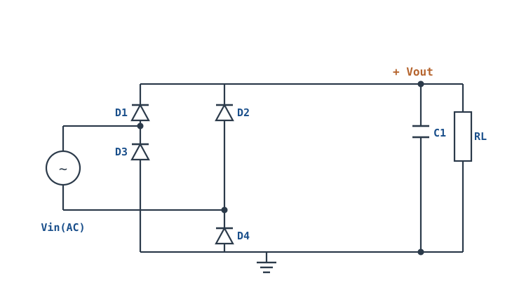
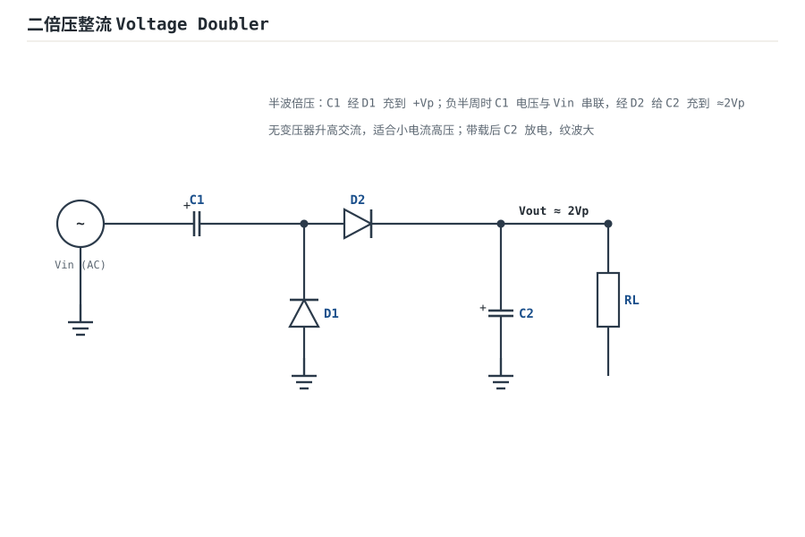
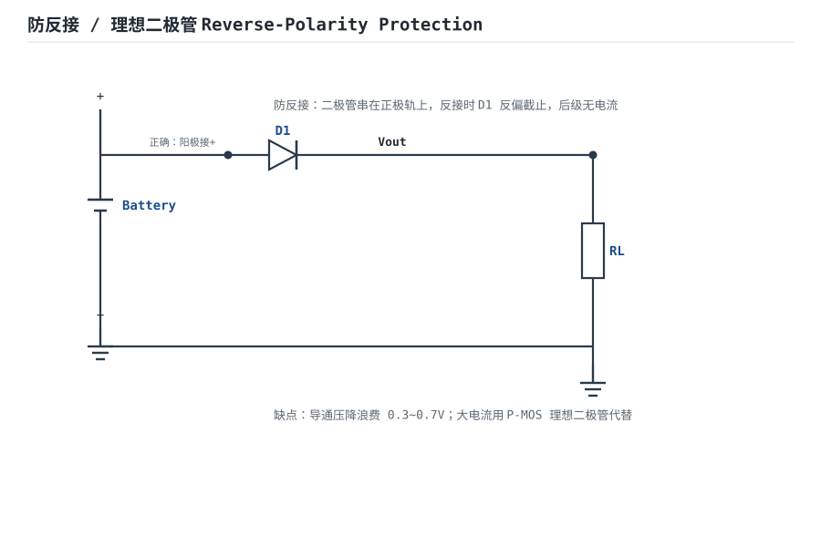
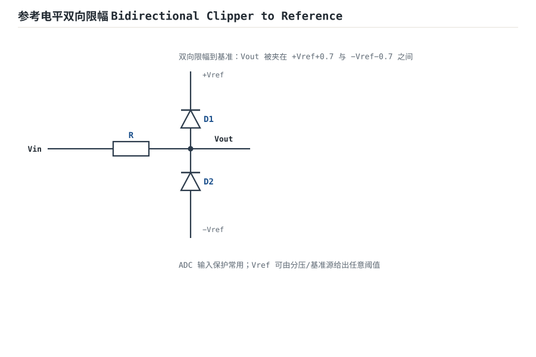
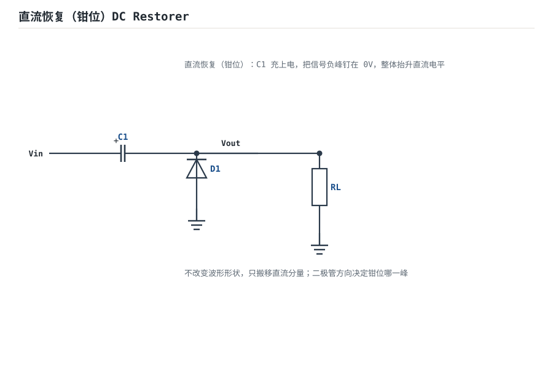
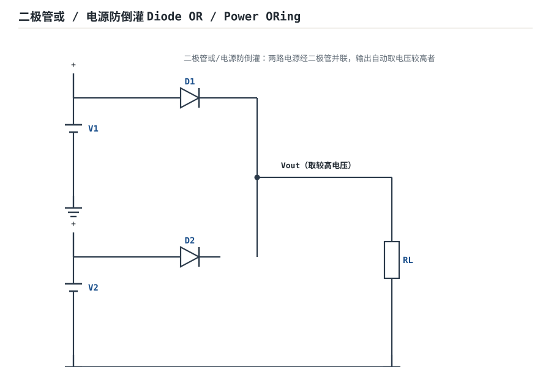

# 二极管电路：整流、滤波、限幅、钳位 Diode Circuits

二极管（Diode）只让电流单向通过，是模拟电路里最基础的"单向阀门"。本章讲它四类最常用的工程用法：**整流（把交流变直流）、滤波（把馒头波抹平）、限幅（把信号顶在阈值内）、钳位（把信号一端钉在固定电平）**。

## 1. 设计动机

::: motivation 为什么需要这些电路
墙上插座送来的是 220V/50Hz 交流电，而单片机、传感器、运放都需要稳定直流。第一步就是用二极管把交流"掰成"单方向——这就是整流。反过来，传感器来的信号可能叠一个负尖峰，会打坏 ADC 输入脚，需要二极管把它"限"在安全范围内。二极管电路是电源入口和信号保护的基本功。
:::

## 2. 原理图



这是最经典的**桥式整流（Bridge Rectifier）+ 电容滤波**电路：交流输入在桥的两个对角，直流输出在另外两个对角，C1 是储能滤波电容，RL 是负载。

## 3. 静态分析（DC）

理想二极管模型（正向导通压降 0V、反向截止电流 0A）下：

- **正半周（A 正 B 负）**：电流走 A→D1→上轨→RL→下轨→D4→B。D1、D4 导通；D2、D3 反偏截止。
- **负半周（B 正 A 负）**：电流走 B→D2→上轨→RL→下轨→D3→A。D2、D3 导通；D1、D4 截止。

无论哪个半周，流过 RL 的电流方向都相同——输出被"翻转拼接"成了单方向馒头波。加滤波电容后，电容在导通半周充电、在截止半周向负载放电，输出趋于一条直线。

实际硅管正向导通压降 $V_F\approx 0.7\text{V}$（肖特基约 0.3V），每半周有**两只二极管串联导通**，所以输出峰值比交流峰值低约 $2V_F\approx 1.4\text{V}$。

## 4. 动态分析（AC / 瞬态）

不加电容时输出是"全波馒头波"；加了储能电容后，输出变成带纹波的直流。传递关系的结论是：

$$V_{out(DC)}\approx \sqrt{2}\,V_{in(rms)} - 2V_F - \frac{V_{ripple}}{2}$$

纹波峰峰值近似为：

$$V_{ripple}\approx \frac{I_{load}}{2f\cdot C}$$

其中 $f$ 是交流输入频率（50Hz 市电全波整流后为 100Hz），$I_{load}=V_{out}/R_L$。下面是整流后（未滤波）与电容滤波后的输出波形对比：

```echarts
{
  "tooltip": {"trigger": "axis"},
  "legend": {"data": ["未滤波（馒头波）", "电容滤波后（带纹波）"], "bottom": 0, "textStyle": {"fontSize": 13}},
  "grid": {"left": 56, "right": 24, "top": 30, "bottom": 56},
  "xAxis": {"type": "category", "name": "时间 ms", "data": [0,5,10,15,20,25,30,35,40,45,50,55,60], "axisLabel": {"fontSize": 11}},
  "yAxis": {"type": "value", "name": "Vout V", "min": 0, "max": 16, "axisLabel": {"fontSize": 11}},
  "series": [
    {"name": "未滤波（馒头波）", "type": "line", "smooth": true, "showSymbol": false, "lineStyle": {"width": 2.4, "color": "#1a4f8b"},
     "data": [0,5.5,11.3,15,11.3,5.5,0,5.5,11.3,15,11.3,5.5,0]},
    {"name": "电容滤波后（带纹波）", "type": "line", "smooth": true, "showSymbol": false, "lineStyle": {"width": 2.6, "color": "#b5642e"},
     "data": [14.2,14.6,15,14.5,14.0,14.4,14.9,14.4,13.9,14.3,14.8,14.3,13.8]}
  ]
}
```

## 5. 导电回路分析

整流桥没有反馈环路，但它有两条交替导通的**电流回路**，选型时要关注的是每只二极管承受的反向电压峰值（PIV, Peak Inverse Voltage）与平均电流。

- 全波桥式整流中，每只截止二极管承受的反向峰值电压为 $PIV\approx \sqrt{2}\,V_{in(rms)}$。
- 每只二极管只在半个周期导通，平均整流电流约为负载电流的一半。

::: advanced 进阶：PIV 推导
当 D1、D4 导通时，D2 的阳极接 B（负峰值 $-\sqrt2 V_p$）、阴极被 D1 钳在 A（正峰值 $+\sqrt2 V_p$），两端电压差约 $2\sqrt2 V_p$；扣除一只导通管压降后近似 $\sqrt2 V_p$ 量级。选型时要求二极管反向耐压 $\ge 1.5\sim 2$ 倍该值留余量。同样可推得半波整流与中心抽头全波整流的 PIV 各为 $2\sqrt2 V_p$，这是不同拓扑选型的关键差异。
:::

## 6. 元件取值与工程权衡

- **滤波电容 C**：越大纹波越小，但成本、体积、上电冲击电流越大。常见取值：负载电流每 100mA 配 470~1000µF。耐压要留 1.3~1.5 倍余量（如 12V 输出选 25V 电容）。
- **整流管电流定额**：按负载最大电流的 1.5~2 倍选；开关电源前级注意快恢复/肖特基。
- **不加电容时**：输出是馒头波，只能给对纹波不敏感的负载（如小电机、灯泡）用。

## 7. 完整设计示例

::: example 设计一个 12V/0.5A 直流前级
1. **需求**：市电 220V/50Hz 经变压器降到交流 12V（有效值），整流滤波后给后级稳压供电。
2. **算峰值**：交流峰值 $=12\times\sqrt2\approx 17\text{V}$，扣除 $2V_F\approx1.4\text{V}$，充电峰值约 15.6V。
3. **选电容**：负载 0.5A，按 $1000\mu\text{F}/100mA$ 取 $C=4700\mu\text{F}$，耐压选 25V。纹波 $V_r\approx I/(2fC)=0.5/(100\times4700\mu)\approx 1.06\text{V}$。
4. **算输出直流**：约 $15.6-0.5\approx 15\text{V}$（带载），正好满足后级 12V LDO 的压差要求。
5. **选二极管**：PIV $\approx\sqrt2\times12\approx17\text{V}$，留余量选 1N4007（1000V/1A）。
6. **验算**：上电后测 C1 两端应为 14~16V 直流，纹波峰峰值约 1V，符合。
:::

::: pitfall 顺带说：限幅与钳位
- **限幅（Clipper）**：二极管+电阻把信号正负峰削在 $\pm0.7V$（或叠加基准后的任意阈值），常用于 ADC 输入保护。
- **钳位（Clamper）**：二极管+电容把信号的某一个峰值钉在 0V（或基准），用于恢复直流分量。
- 二者区别：限幅切幅度，钳位移电平。
:::

## 8. 仿真与实验

在 LTspice 中搭桥式整流电路：

- 交流源 12V(rms)/50Hz，四只 1N4148/1N4007，RL=24Ω（约 0.5A）。
- 先不接 C1，瞬态仿真看馒头波；再并上 4700µF，观察纹波随负载电流变化。
- 把 RL 断开（空载），看输出被充到接近 $\sqrt2\times12\approx17V$——验证"空载电压升高"这一常见现象。
- 把某只二极管反接，观察短路冒烟级故障（仿真里只看电流飙升）。

## 扩展与变种电路

### 扩展1：二倍压整流 Voltage Doubler

**定位**：无变压器把交流升到约 2 倍峰值直流——与桥式整流的关键差异是不用变压器/次级绕组，靠电容泵浦，代价是带载能力弱。



::: example 工作原理 / 静态分析
正半周：$V_{in}$ 经 D1 对 $C_1$ 充电到 $+V_p$（左负右正）。负半周：$C_1$ 上的电压与 $V_{in}$ 串联叠加，经 D2 对 $C_2$ 充电。稳态下

$$V_{out}\approx 2V_p - 2V_F\approx 2\sqrt2\,V_{in(rms)}$$

带载时 $C_2$ 放电，纹波 $V_{ripple}\approx I_{load}/(fC_2)$。
:::

设计要点：$C_1,C_2$ 取 $1\,\mu\text{F}\sim 10\,\mu\text{F}$，耐压 $\ge 2V_p$；适合小电流高压（如负离子、CRT 加速极）。不适合大电流负载。

::: pitfall 倍压电路专属坑
- **带载电压暴跌**：空载测 2 倍压，一接负载就掉到接近 1 倍——$C_2$ 太小、负载电流太大。倍压电路输出阻抗高，只能给 pA~mA 级负载。
:::

### 扩展2：二极防反接/理想二极管 Reverse-Polarity Protection

**定位**：串在电源正极轨上防止接反烧后级——与主整流桥的差异是它不做整流，只做单向"门卫"。



::: example 工作原理 / 静态分析
正确接法时 D1 正偏导通，输出 $V_{out}=V_{in}-V_F$；电源接反时 D1 反偏截止，后级无电流。

- 硅管 $V_F\approx 0.7\text{V}$，肖特基 $V_F\approx 0.3\text{V}$。
- 大电流时肖特基功耗 $P=V_F I$ 显著，改用 P-MOS 理想二极管（$R_{DS(on)}$ 上压降毫伏级）。
:::

设计要点：选管按最大持续电流 $I_{max}$ 与反向耐压（$\ge$ 最大供电电压 1.5 倍）。

::: pitfall 防反接专属坑
- **大电流用硅二极管发热**：1A 负载在 0.7V 上耗散 0.7W，手心烫手。电池供电设备改用肖特基或 P-MOS 理想二极管控制器。
:::

### 扩展3：参考电平双向限幅 Bidirectional Clipper to Reference

**定位**：把信号正负峰同时夹在两个基准电平之间——与普通 $\pm0.7\text{V}$ 限幅的差异是阈值由外部 $V_{ref}$ 任意设定。



::: example 工作原理 / 静态分析
- 正峰：$V_{out}>+V_{ref}+V_F$ 时 D1 导通，把正峰钳在 $+V_{ref}+0.7\text{V}$。
- 负峰：$V_{out}<-V_{ref}-V_F$ 时 D2 导通，把负峰钳在 $-V_{ref}-0.7\text{V}$。

输出被夹在区间 $[-V_{ref}-0.7,\ +V_{ref}+0.7]$ 内。
:::

设计要点：串阻 $R$ 限制二极管电流；常用于 ADC 输入保护，$V_{ref}$ 由精密基准给出。

::: pitfall 双向限幅专属坑
- **限幅后信号失真却当线性用**：限幅是非线性，削峰部分的信息永久丢失。它只做保护/整形，不能用于要求线性放大的环节。
:::

### 扩展4：直流恢复（钳位）DC Restorer

**定位**：把信号某一个峰值钉在固定电平（如 0V），整体搬移直流分量——与限幅的差异是"切幅度"变"移电平"，波形形状不变。



::: example 工作原理 / 静态分析
$C_1$ 隔直并被充电：负半周峰值时 D1 导通，把负峰钳在 0V，$C_1$ 充电到 $V_p$。此后输出 $V_{out}=V_{in}+V_p$，负峰恒为 0、正峰为 $2V_p$。

直流电平被搬到 0 附近，交流摆幅形状保持不变。
:::

设计要点：$R_L C_1$ 时间常数 $\gg$ 信号周期；电视/示波器耦合、自动电平恢复常用。

::: pitfall 钳位电路专属坑
- **二极管方向决定钳位峰**：想钳负峰却把 D1 接反，结果钳了正峰、输出直流方向相反。画完顺着电流方向核对三角箭头。
:::

### 扩展5：二极管或/电源防倒灌 Diode OR / Power ORing

**定位**：两路电源并联取较高者供电，低电压一路不向高电压倒灌电流——与 OR 逻辑门同构。



::: example 工作原理 / 静态分析
两路输入各经二极管（阳极接各自电源、阴极共接），输出自动取电压较高者：

$$V_{out}=\max(V_1,V_2)-V_F$$

电压较低那路的二极管反偏，电流不流入它。
:::

设计要点：用肖特基降低压降；大电流/电池无缝切换改用理想二极管 ORing 控制器。

::: pitfall 电源 ORing 专属坑
- **低压路被灌电流损坏**：漏掉任一二极管，或用普通硅管在压差大时，低电压电源被反充。两路必须各串一只独立二极管，且方向核对。
:::

## 9. 常见坑与故障现象

::: pitfall 常见坑
- **滤波电容耐压不够**：220V 整流后空载电压能冲到 $\sqrt2\times$ 交流有效值，16V 电容在 12V 交流后级极易鼓包。必须按空载峰值选耐压。
- **空载电压偏高误判**：断开负载测到 17V 以为稳压失效，其实是整流滤波的正常特性——带载后才跌回 15V 左右。
- **限幅二极管方向接反**：本该保护 ADC 的二极管把信号短路到地，输出恒为 0。画完一定要顺着电流方向再核对一遍三角箭头。
- **大电容上电冲击电流**：上电瞬间电容相当于短路，整流管和保险丝要能扛住浪涌，必要时串 NTC 限流电阻。
:::

## 10. 自测题

<details><summary>交流输入 15V(rms)，桥式整流，空载时输出直流约多少伏？</summary>

$\sqrt2\times15\approx 21.2V$，扣除两只导通管约 1.4V，空载约 **19~20V**。空载时电容充到峰值且无放电。
</details>

<details><summary>负载电流 1A，全波整流 100Hz，要把纹波压到 0.2V 以下，滤波电容至少多大？</summary>

由 $V_r\approx I/(2fC)$，$C\ge I/(2fV_r)=1/(2\times100\times0.2)=25000\mu\text{F}$。实际选 22000~33000µF，并注意 ESR。
</details>

<details><summary>四只二极管里有一只虚焊开路，输出会变成什么样？</summary>
变成半波整流：只剩半个周期导通，纹波频率从 100Hz 降为 50Hz，纹波幅度大约翻倍，带载能力减半。
</details>

## 11. 参考资料

- [Lessons In Electric Circuits · Semiconductors (Kuphaldt)](https://www.ibiblio.org/kuphaldt/electricCircuits/)——整流/限幅/钳位图解
- Sedra/Smith《Microelectronic Circuits》8e，二极管应用章
- Boylestad《Electronic Devices and Circuit Theory》11e，整流电路章
