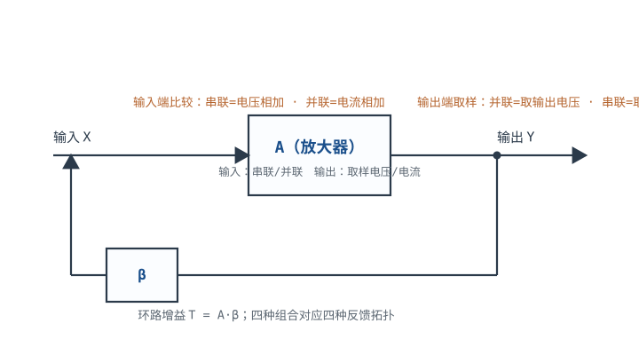
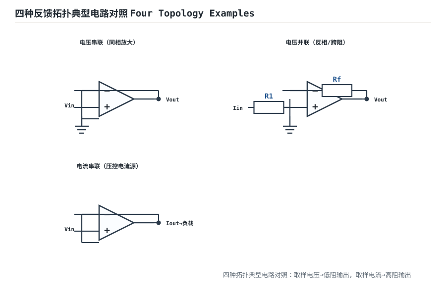

# 反馈四拓扑与环路增益 Feedback Topologies & Loop Gain

负反馈不是"一根反馈线"那么简单。看输出端**取样什么**（电压 or 电流），看输入端**怎么求和**（串联电压相加 or 并联电流相加），两者组合出四种反馈拓扑。选哪种，直接决定电路的输入阻抗、输出阻抗和能处理的量纲。这是运放理论里最讲透的一章。

## 1. 设计动机

::: motivation 为什么要分四种拓扑
同样一颗运放，反馈接在不同位置，电路性格天差地别：你想让它"吃电压、出电压"（放大传感器电压），还是"吃电流、出电压"（跨阻放大光电二极管），还是"吃电压、出电流"（驱动 LED）？拓扑选错，要么带不动负载，要么信号被分压衰减。分清四种接法，才知道什么时候该用哪种电路。
:::

## 2. 原理图



## 3. 四种拓扑结论

| 拓扑 | 输出取样 | 输入求和 | 闭环量纲 | 输入阻抗 | 输出阻抗 | 典型电路 |
|---|---|---|---|---|---|---|
| 电压串联 | 电压 | 电压(串联) | V→V | **高** | **低** | 同相放大 |
| 电压并联 | 电压 | 电流(并联) | I→V | **低** | **低** | 反相放大/跨阻 |
| 电流串联 | 电流 | 电压(串联) | V→I | **高** | **高** | 压控电流源 |
| 电流并联 | 电流 | 电流(并联) | I→I | **低** | **高** | 电流放大 |

记忆口诀：**输出取样电压→输出阻抗变低（稳电压）；取样电流→输出阻抗变高（稳电流）。输入串联→输入阻抗变高；并联→输入阻抗变低。**

::: analogy 四种拓扑像四种接头
取样电压像"电压表并联测电压"（不影响原电路）；取样电流像"电流表串联进回路"。串联求和像"两个电压源串起来加"；并联求和像"两根水管汇到一个节点（电流相加）"。接错管子的口径，水流就不对。
:::

## 4. 环路增益 T = Aβ

四种拓扑都能写成同一个闭环方程：$G=A/(1+A\beta)$，其中 $T=A\beta$ 是环路增益。区别只在 A 和 β 的量纲随拓扑变：

- 电压串联：A、β 都是无量纲电压比；
- 电压并联：A 是跨阻（V/A）、β 是跨导（A/V），量纲相乘仍无量纲。

## 5. 环路增益的物理意义

$T$ 越大，闭环性能越接近理想：增益越稳、带宽越宽、阻抗越理想。但 $T$ 是频率的函数——高频滚降后 $T$ 变小，电路性能退化。**测环路增益就是测这个电路"到底有多反馈"。**

```echarts
{
  "tooltip": {"trigger": "axis"},
  "legend": {"data": ["环路增益 |T| dB（浅反馈 β=0.1）", "环路增益 |T| dB（深反馈 β=1）"], "bottom": 0, "textStyle": {"fontSize": 12.5}},
  "grid": {"left": 60, "right": 24, "top": 30, "bottom": 56},
  "xAxis": {"type": "category", "name": "频率 Hz（对数）", "data": ["1","10","100","1k","10k","100k","1M"], "axisLabel": {"fontSize": 11}},
  "yAxis": {"type": "value", "name": "|T| dB", "min": -10, "max": 100, "axisLabel": {"fontSize": 11}},
  "series": [
    {"name": "环路增益 |T| dB（浅反馈 β=0.1）", "type": "line", "smooth": true, "showSymbol": false, "lineStyle": {"width": 2.4, "color": "#1a4f8b"},
     "data": [60,60,59,50,30,10,-10]},
    {"name": "环路增益 |T| dB（深反馈 β=1）", "type": "line", "smooth": true, "showSymbol": false, "lineStyle": {"width": 2.6, "color": "#b5642e"},
     "data": [80,80,79,70,50,30,10]}
  ]
}
```

上图说明：同一运放，反馈越深（β 越大），环路增益 $T=A\beta$ 越高、$|T|$ 过 0dB 的交界频率越靠后——可用闭环带宽越宽。这正是"负反馈扩展带宽"的定量图像。

::: advanced 进阶：四种拓扑的闭环公式推导
以电压串联为例：输出取样电压 $\beta V_{out}$，输入与之串联相减 $V_{id}=V_{in}-\beta V_{out}$，$V_{out}=A V_{id}$，联立得 $V_{out}/V_{in}=A/(1+A\beta)$。电压并联中求和点是反相端节点，用 KCL：$I_{in}=V_{out}/R_f$，推导类似但量纲为跨阻。四种拓扑结构完全对称，只是把"电压量"和"电流量"互换。输出阻抗：电压负反馈把输出阻抗除以 $(1+T)$；电流负反馈把输出阻抗乘以 $(1+T)$——这就是"稳电压用电压反馈、稳电流用电流反馈"的定量依据。
:::

## 6. 数值算例

::: example 反相放大器是哪种拓扑？
反相放大：输入电流经 R1 汇入反相端（**并联电流求和**），输出电压经 Rf 送回（**取样输出电压**）→ 电压并联负反馈。所以它输入阻抗低（≈R1）、输出阻抗低。要高输入阻抗的电压放大，就改用同相放大器（电压串联）。
:::

## 扩展与变种电路

### 扩展1：四种反馈拓扑典型电路对照 Four Topology Examples

**定位**：把抽象四拓扑落到四个具体电路，一眼看清"取样电压/电流 × 串联/并联求和"对应的真实接法。



::: example 工作原理 / 静态分析
- 电压串联：同相放大——取样输出电压、串联求和，高入低出。
- 电压并联：反相/跨阻——取样电压、并联电流求和，低入低出。
- 电流串联：压控电流源（VCCS）——取样输出电流、串联求和，高入高出。
- 电流并联：电流放大——取样电流、并联求和，低入高出。

记忆：取样电压→输出阻抗变低（稳电压）；取样电流→输出阻抗变高（稳电流）。
:::

设计要点：高阻电压源选电压串联；光电二极管转电流选电压并联；驱动 LED 选电流串联。

::: pitfall 四拓扑专属坑
- **反相当高输入阻抗用**：反相放大是电压并联反馈，入阻 $\approx R_1$，高内阻传感器被分压。高阻源要用同相（电压串联）。
:::

## 7. 常见坑

::: pitfall 常见坑
- **反相放大当高输入阻抗用**：它是电压并联反馈，输入阻抗≈R1，高内阻传感器会被分压。高阻抗信号源要用同相放大。
- **电流输出负载要求高阻**：电流串联/并联反馈才稳电流；电压反馈下负载一变电流就变。
- **β 网络把直流也反馈了**：交流耦合不当可能破坏直流工作点，单电源电路要单独设计偏置通路。
:::

## 8. 自测题

<details><summary>要放大一个高内阻传感器的电压信号，该选哪种反馈拓扑？</summary>
电压串联（同相放大器）——输入阻抗高不衰减信号，输出阻抗低带得动后级。
</details>

<details><summary>光电二极管输出电流要转成电压，用哪种拓扑？</summary>
电压并联（跨阻放大器）——反相端虚地，二极管电流全部流过反馈电阻，输出 $V=-I\times R_f$。
</details>

<details><summary>电流负反馈为什么让输出阻抗变高？</summary>
它取样的是输出电流，强行把电流稳住——即使负载变化电流也不变，这在等效电路上就表现为输出阻抗变大（恒流源内阻无穷大）。
</details>

## 9. 参考资料

- Sergio Franco《Design with Operational Amplifiers》4e，Feedback Topologies 章
- TI SLOD006B《Op Amps for Everyone》
- [MIT Roberge, Operational Amplifiers](https://web.mit.edu/klund/www/books/op2e.html)
