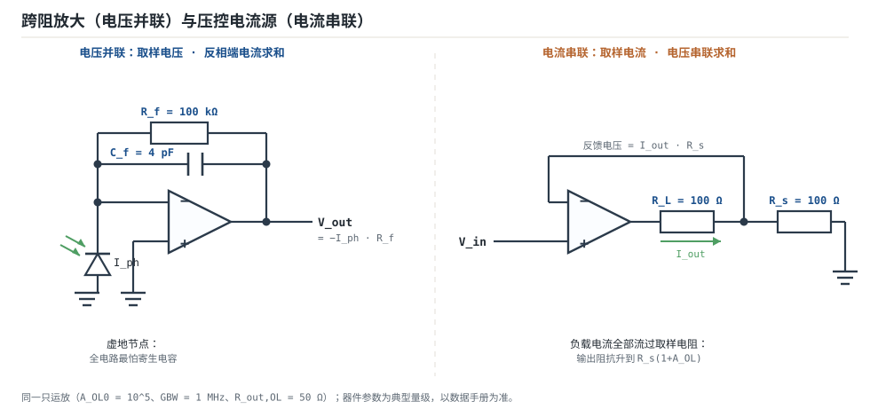

# 反馈四拓扑与环路增益 Feedback Topologies & Loop Gain

负反馈（negative feedback）在电路上只开两个接口：一个在输出端，一个在输入端。输出端的接口问"我把什么量送回去"——取样电压还是取样电流；输入端的接口问"我把送回来的量跟谁比"——电压串联相减还是电流并联相加。每个问题两个答案，组合起来就是四种**反馈拓扑**（feedback topology）。

四种拓扑决定的不是"增益公式好不好看"，而是三件硬指标：**输入电阻、输出电阻、以及闭环增益对哪些元件敏感**。同一只运放，接成同相放大时输入电阻可以做到 10 TΩ 量级，接成反相放大时输入电阻只有 $R_1$——两者差九个数量级，而"运放输入阻抗无穷大"这句话只对前者成立。

**本章约定**（与整篇运放章节一致）：开环增益 $A_{OL}$、闭环增益 $A_{CL}$（下文也写 $G$）、反馈系数 $\beta$（**不是**三极管的电流放大倍数）、环路增益 $T=A_{OL}\beta$、噪声增益 $1/\beta$、增益带宽积 GBW、相位裕度 PM、增益裕度 GM。本章的 $\beta$ 与 $T$ 除非特别说明都指**运放层**的定义：$\beta$ 无量纲、$T$ 无量纲、$T=A_{OL}\beta$。拓扑层的 $A$ 与 $\beta$ 可以带量纲，见 §3.1——把这两套记法混用，是本章最容易出错的地方。

本章要办三件事：① 给出一套能落到具体电路上的判别流程，而不是背四句口诀；② 把四种拓扑对 $R_{in}$、$R_{out}$ 的影响记成可复算的倍数，并指出教材公式在什么情况下会差一个量级；③ 用两个完整算例（光电二极管跨阻放大、压控电流源）把 $T$、$A_{CL}$、$R_{out}$ 一次算到底，最后解开一个高频混淆点："电流反馈型运放的带宽不随增益变化"说的到底是什么。

三章地基见[运放概述：符号、封装与引脚](opamp-overview.md)、[理想模型五假设与虚短、虚断](ideal-opamp.md)、[开环、闭环增益与负反馈本质](open-loop-feedback.md)；相移累积导致的自激与补偿见[稳定性：伯德图、相位裕度与补偿](stability-bode.md)。本章的 $T$ 与那三章完全同一口径。

## 1. 设计动机

::: motivation 三个真实场景
**场景一：光电二极管前置放大照抄反相放大公式。** 光电二极管电流 $I_{ph}=10\ \mu\text{A}$、结电容 $C_d=10\ \text{pF}$、并联电阻 $R_{sh}=10\ \text{M}\Omega$，用 $R_f=100\ \text{k}\Omega$ 接成跨阻放大。按反相放大的写法 $V_{OUT}=-I_{ph}R_f=-1.0\ \text{V}$，数字看起来对，于是画完就投板。但这个电路的反馈系数 $\beta\approx1$（对纯电流源），噪声增益也是 1，穿越频率因此被推到 383 kHz、几乎用满 GBW=1 MHz——**这恰恰是最容易振荡的接法**：$C_d$ 与 $R_f$ 在 160.7 kHz 造出一个极点，相位裕度只剩 22.8°，输出会在 400 kHz 附近振铃。公式没错，错在没判拓扑。

**场景二：用同相放大驱动 LED 做恒流。** 同相放大稳住的是输出电压：$V_{OUT}=10\times V_{IN}$ 与负载无关，所以流过 LED 的电流 $I=V_{OUT}/R_L$ 随 $R_L$ 反比变化。$R_L$ 从 100 Ω 变成 50 Ω，电流从 10 mA 翻到 20 mA。要"稳电流"，取样对象必须从电压换成电流——这是拓扑问题，不是增益问题。

**场景三：1 MΩ 高阻传感器接反相放大。** $R_1=10\ \text{k}\Omega$、$R_f=100\ \text{k}\Omega$，设计增益 −10。实际信号源内阻 1 MΩ 与 $R_1$ 串联分压，增益变成 $-100/(1010)=-0.099$，比设计值低 $20\lg(0.0099)=-40.1\ \text{dB}$——信号还没进运放就只剩 1%。
:::

| 你想确认 | 先算 | 判据（工程经验值） |
|---|---|---|
| 高阻源会不会被分压 | 该拓扑的 $R_{in}$ 与源内阻 $R_s$ | $R_{in}\ge100R_s$（误差 ≤1%） |
| 带载会不会掉增益 | $R_{out,CL}$ 与 $R_L$ | $R_{out,CL}\le R_L/100$ |
| 输出稳的是电压还是电流 | 取样对象 | 要稳电压用电压取样，要稳电流用电流取样 |
| 增益准不准 | $T=A_{OL}\beta$ | $T\ge100$ → 误差 ≤1% |
| 带宽够不够 | $f_{cl}=GBW/(1/\beta)$ | $f_{cl}\ge10\times$ 最高信号频率 |
| 会不会自激 | $\beta$ 是否带相移、PM | PM ≥ 45°（推荐 60°） |

**不判拓扑会摔在哪**，四个带数字的代价：

1. **把反相当高阻输入用。** $R_s=1\ \text{M}\Omega$、$R_1=10\ \text{k}\Omega$、$R_f=100\ \text{k}\Omega$：增益 $-100/(10+1000)=-0.099$，相对 −10 差 −40.1 dB。
2. **把电压取样当电流源用。** $V_{OUT}=1\ \text{V}$ 固定，$R_L$ 从 100 Ω 变 50 Ω，电流从 10 mA 变 20 mA，误差 100%。
3. **把跨阻放大当反相放大算噪声增益。** 反相放大的 $1/\beta=1+R_f/R_1=11$；跨阻放大的源是 $R_{sh}=10\ \text{M}\Omega$ 并着 $C_d$ 的电流源，$\beta=R_{sh}/(R_{sh}+R_f)=0.9901$，$1/\beta=1.010$——噪声增益接近 1，$f_c$ 接近 GBW=1 MHz，$C_d$ 造出的第二极点（160.7 kHz）正好落在穿越频率附近，PM 只有 22.8°。
4. **忘了 $\beta$ 里有负载。** 压控电流源的 $\beta=R_s/(R_s+R_L)$，$R_L$ 从 100 Ω 变 1 kΩ，$T=A_{OL}\beta$ 从 $5\times10^4$ 掉到 9091，增益误差从 $1/(1+5\times10^4)=0.0020\%$ 变成 $1/(1+9091)=0.0110\%$。

## 2. 定义与直观

### 2.1 两个问题，四个格子

四种拓扑的命名规则只有一条：**先说输出取样什么，再说输入怎么比较**。

- **输出端**：反馈网络并在输出节点上、取的是输出电压 → **电压取样**（voltage sensing）；反馈网络串在输出回路里、取的是输出电流 → **电流取样**（current sensing）。
- **输入端**：反馈量与输入信号在同一回路里串联相减 → **串联求和**（series mixing，电压求和）；两者在同一节点上电流相加 → **并联求和**（shunt mixing，电流求和）。

| 中文名 | 英文（输入在前） | 输出取样 | 输入比较 | 闭环量纲 | 典型电路 |
|---|---|---|---|---|---|
| 电压串联 | series-shunt | 电压 | 电压（串联） | V→V | 同相放大、跟随器 |
| 电压并联 | shunt-shunt | 电压 | 电流（并联） | I→V 或 V→V | 反相放大、跨阻放大 |
| 电流串联 | series-series | 电流 | 电压（串联） | V→I | 压控电流源（VCCS） |
| 电流并联 | shunt-series | 电流 | 电流（并联） | I→I | 电流放大器 |

**"闭环量纲"这一列要特别小心**：它描述的是**反馈环内前向通路的量纲**，不是信号源接进来的量纲。反相放大接的是电压源、出的是电压（V→V），但它的基本放大器被看成跨阻型（把流入求和节点的电流变成输出电压），所以它在表里归到"电压并联"。判拓扑看的是"反馈环怎么闭合"，不是"信号长什么样"。


### 2.2 判别法：两道闸门与两次交叉验证

教科书给的判据是"输出端短路/开路、输入端短路"。这两句话本身没错，但**操作定义必须写清楚**，否则反相放大一定会被判错。

**闸门一：输出端开路（让 $i_{out}=0$，即把负载断开）。**

- 反馈消失（$V_-$ 不再跟着输出动）→ **电流取样**：反馈量正比于输出电流，没有电流就没有反馈。
- 反馈仍在 → **电压取样**：反馈量正比于输出电压，负载断不断与它无关。

**交叉验证：把输出端对地短路（$v_{out}=0$）。** 反馈消失 → 电压取样；反馈仍在（短路电流仍流过取样电阻）→ 电流取样。

**闸门二：输入端短路（把接收输入信号的那个运放端子对地短路，同时移走信号源）。**

- 反馈量被这条短路线旁路、运放输入端再也拿不到误差 → **并联求和**：反馈是**电流**，它与输入信号在同一个节点上相加，短路把这个节点钉死，电流就白流了。
- 反馈量仍完整地加在另一个端子上 → **串联求和**：反馈是**电压**，它与输入信号在不同端子上串联相减，短路一个端子不影响另一个。

**交叉验证：列方程。** 在输入端写 KCL（电流相加）就是并联，写 KVL（回路电压相减）就是串联。

::: pitfall 判别法最常见的误用
把"输入端短路"理解成"把信号源短路"（例如把反相放大里 $R_1$ 的左端接地）。这时反馈电流仍经 $R_f\to$ 反相端 $\to R_1\to$ 地流动，反相端电压不为零，反馈**没有**消失，于是反相放大被误判成"串联"。正确的操作是短路**运放接收输入信号的那个端子**：反相放大的输入接在反相端，短路反相端，$R_f$ 的反馈电流被短路线旁路，反馈才真正消失。
:::

把两道闸门用到四个具体电路上：

| 电路 | 输出端开路（$i_o=0$） | 输出判定 | 输入端短路 | 输入判定 | 结论 |
|---|---|---|---|---|---|
| 同相放大 | $R_f$、$R_1$ 仍从 $V_{OUT}$ 取电压送到反相端 | 电压取样 | 短路同相端，反相端的反馈电压仍在 | 串联 | 电压串联 |
| 反相放大 | $R_f$ 仍接在输出与反相端之间 | 电压取样 | 短路反相端，$R_f$ 的反馈电流被旁路 | 并联 | 电压并联 |
| 跨阻放大（TIA） | $R_f$ 仍接在输出与反相端之间 | 电压取样 | 短路反相端，光电流与反馈电流一起被旁路 | 并联 | 电压并联 |
| 压控电流源（VCCS） | 无电流流过取样电阻 $R_s$，反馈电压归零 | 电流取样 | 短路同相端，反相端仍由 $R_s$ 上的电压驱动 | 串联 | 电流串联 |


### 2.3 中英文名字的顺序正好相反

中文"电压串联"是**先输出后输入**（先取样电压、再串联求和）；英文 series-shunt 是**先输入后输出**（先串联、再并联取样）。所以：

- 电压串联 = series-shunt（输入串联、输出并联取电压）
- 电压并联 = shunt-shunt
- 电流串联 = series-series
- 电流并联 = shunt-series

记忆法：**中文先说出"取什么"，英文先说出"怎么比"。** 两套名字都对，混着背一定出错；写文档时建议同时给出中英文，评审时才不会歧义。

### 2.4 类比：四种接头

::: analogy 四种接头
把反馈网络想成一根管子，它要从输出端"接"一个量出来，再"接"回输入端。

- **电压取样**像电压表并联在输出两端：它测的是两点之间的压差，负载断不断都能测。
- **电流取样**像电流表串进输出回路：回路一断，读数立刻归零。
- **串联求和**像两个电压源首尾相接：极性对了就相减，接反了就相加（正反馈）。
- **并联求和**像两根水管汇进同一个节点：流量相加，节点的压力由下游决定。

类比的边界有两处：① 真实的电表会分流/分压，而理想反馈网络不取电流——但运放的反馈网络**确实会加载**（$R_f$ 与源阻抗分压，§3.5），这一点电表类比帮不上忙；② 水管里"压力"和"流量"不能同时钉死，电路里"电压取样"和"电流取样"也只能选一个，选错就是场景二那种"稳了电压丢了电流"。
:::

## 3. 定量关系

### 3.1 四种拓扑的量纲账本

四种拓扑共用同一个闭环公式，区别只在 $A$ 与 $\beta$ 的量纲：

$$A_{CL}=\frac{A}{1+A\beta}=\frac{A}{1+T},\qquad T=A\beta\ \text{（无量纲）}$$

| 拓扑 | 前向增益 $A$ | 反馈系数 $\beta$ | 理想 $A_{CL}=1/\beta$ |
|---|---|---|---|
| 电压串联 | V/V，无量纲 | V/V，无量纲 | 无量纲（电压比） |
| 电压并联 | V/A，单位 $\Omega$（跨阻） | A/V，单位 S（跨导） | 单位 $\Omega$（跨阻） |
| 电流串联 | A/V，单位 S（跨导） | V/A，单位 $\Omega$（跨阻） | 单位 S（跨导） |
| 电流并联 | A/A，无量纲 | A/A，无量纲 | 无量纲（电流比） |

**为什么 $T$ 永远无量纲**：输入怎么比较决定了 $\beta$ 的"分母"是什么量，输出取什么决定了 $A$ 的"分子"是什么量，两者量纲相乘必然抵消。这条性质让四种拓扑可以共用同一套稳定性判据（PM、GM），不必为每种拓扑另立一套。

**为什么 $1/\beta$ 就是理想闭环增益**：当 $T\to\infty$ 时 $A_{CL}\to1/\beta$，而 $1/\beta$ 恰好是"反馈网络要求的输出—输入比例"。所以设计时先由需求定 $1/\beta$（想要多大增益），再由 $T$ 定精度（能有多准）。

### 3.2 两套 β：拓扑层的 β 与运放层的 β

这是本章最容易混的地方，必须一次说清。

**运放层（本章与前三章统一使用）**：$\beta$ 是反馈网络把输出送回反相端的**比例**，无量纲，$0<\beta\le1$；$T=A_{OL}\beta$ 是运放自己的环路增益。同相放大 $\beta=R_1/(R_1+R_f)$；反相放大也是 $\beta=R_1/(R_1+R_f)$（$\beta$ 永远是正数，负号来自输入网络，不来自 $\beta$）。

**拓扑层（教材讲四种组态时使用）**：$A$ 与 $\beta$ 允许带量纲，$1/\beta$ 直接是理想闭环增益。跨阻放大的 $\beta_{topo}=1/R_f$（单位 S），因为前向通路是跨阻；压控电流源的 $\beta_{topo}=R_s$（单位 $\Omega$），因为前向通路是跨导。

两者的关系是：**$\beta_{topo}$ 是"反馈量/输出量"，而运放层 $\beta$ 是"送回反相端的电压/输出电压"**。对纯电阻网络、且运放输入不取电流时，两者只差一个前向通路的量纲折算：

- 同相放大：$\beta_{topo}=\beta=R_1/(R_1+R_f)$，两种记法数值相同。
- 反相放大：$\beta_{topo}=1/R_f$（跨导），而 $\beta=R_1/(R_1+R_f)$；$1/\beta_{topo}=R_f$ 是跨阻增益，$1/\beta=1+R_f/R_1$ 是噪声增益，**两者不是同一个数**。
- 跨阻放大：$\beta_{topo}=1/Z_f$，$\beta=Z_s/(Z_s+Z_f)$；当源是理想电流源（$Z_s\to\infty$）时 $\beta\to1$，$T\to A_{OL}$。
- 压控电流源：$\beta_{topo}=R_s$，$\beta=R_s/(R_s+R_L)$；$\beta$ 里含 $R_L$，所以 $T$ 随负载变。

**工程建议**：算 $T$、算带宽、算稳定性时一律用运放层 $\beta$（前三章的公式可以直接套）；只有在"选拓扑、判断阻抗往哪走"时才用拓扑层的量纲视角。混用的典型后果是把 $T$ 算错成 $A_{OL}R_f$ 这种量纲都不对的式子。

### 3.3 输入电阻与输出电阻：该乘还是该除

| 拓扑 | $R_{in}$ | $R_{out}$ | 本章算例的具体数字 |
|---|---|---|---|
| 电压串联 | $\times(1+T)$ | $\div(1+T)$ | $1\ \text{G}\Omega\to10.0\ \text{T}\Omega$；$50\ \Omega\to5.0\ \text{m}\Omega$ |
| 电压并联 | $\div(1+T)$，但常被串联的 $R_1$ 掩盖 | $\div(1+T)$ | $R_{in}\approx R_1=10\ \text{k}\Omega$；$50\ \Omega\to5.5\ \text{m}\Omega$ |
| 电流串联 | $\times(1+T)$ | $\times(1+T)$ | $R_{out}=R_s(1+A_{OL})+R_{out,OL}=10.0\ \text{M}\Omega$ |
| 电流并联 | $\div(1+T)$ | $\times(1+T)$ | 数值随实现方式变化，方向不变 |

四个数字的复算（取 $A_{OL0}=10^5$、$R_{out,OL}=50\ \Omega$、$R_{icm}=1\ \text{G}\Omega$）：

- 同相放大（$\beta=0.1$，$T_0=10^4$）：$R_{in}=R_{icm}(1+T_0)=10^9\times(1+10^4)=1.0001\times10^{13}\ \Omega=10.0\ \text{T}\Omega$；$R_{out}=50/(1+10^4)=4.9995\times10^{-3}\ \Omega=5.0\ \text{m}\Omega$。
- 反相放大（$R_1=10\ \text{k}\Omega$、$R_f=100\ \text{k}\Omega$，$\beta=0.0909$，$T_0=9091$）：精确式 $R_{in}=R_1+R_f/(1+A_{OL})=10^4+10^5/(1+10^5)=10^4+1.0\ \Omega\approx10\ \text{k}\Omega$；$R_{out}=50/(1+9091)=5.5\times10^{-3}\ \Omega=5.5\ \text{m}\Omega$。
- 压控电流源（$R_s=100\ \Omega$、$A_{OL}=10^5$）：见 §4.2 的推导，$R_{out}=R_s(1+A_{OL})+R_{out,OL}=100\times100001+50=1.000015\times10^{7}\ \Omega=10.0\ \text{M}\Omega$。

::: advanced 进阶：四个 (1+T) 规则的推导
**输出电阻（电压取样）。** 在输出端加测试电压 $V_t$、量注入电流 $I_t$，输入端接地。反馈网络把 $\beta V_t$ 送回反相端，误差电压 $-TV_t$，受控源输出 $-TV_t$，于是 $I_t=(V_t+TV_t)/R_{out,OL}$，得 $R_{out,CL}=R_{out,OL}/(1+T)$。前提：反馈网络对输出的加载可以忽略。

**输出电阻（电流取样）。** 把负载换成测试源 $V_t$，此时反馈网络只剩取样电阻 $R_s$，$\beta=1$、$T=A_{OL}$。列 KCL：流过 $R_s$ 的电流就是 $I_t$，所以 $V_-=I_tR_s$；运放输出 $V_p=-A_{OL}I_tR_s-I_tR_{out,OL}$；$V_t=V_p-V_-=-I_t\left[R_s(1+A_{OL})+R_{out,OL}\right]$。取绝对值即 $R_{out,CL}=R_s(1+A_{OL})+R_{out,OL}$。

**注意**：教材写的"电流反馈把 $R_{out}$ 乘以 $(1+T)$"用的是 $R_{out,OL}$ 作基数，得到 $50\times(1+10^4)=0.5\ \text{M}\Omega$；而负载实际看到的是 $10.0\ \text{M}\Omega$，差 20 倍。差别来自取样电阻 $R_s$ 串在环内、本身就变成了输出电阻的一部分——**基数到底是 $R_{out,OL}$ 还是 $R_s+R_{out,OL}$，取决于负载断在哪里**。工程上按"测试源换掉负载后重新列 KCL"算一次，比套公式可靠。

**输入电阻（串联）。** 信号加在同相端，反馈把反相端"抬"到几乎与同相端同电位（自举），信号源看到的电阻被放大 $(1+T)$ 倍：$R_{in,CL}=R_{icm}(1+T)$。实际受 PCB 漏电、保护环与输入电容限制，量不到 TΩ 级。

**输入电阻（并联）。** 反相端是虚地，信号源看到的是 $R_1$ 到地；精确推导（保留 $A_{OL}$）给出 $R_{in}=R_1+R_f/(1+A_{OL})$。$A_{OL}=10^5$、$R_f=100\ \text{k}\Omega$ 时第二项只有 1 Ω，所以 $R_{in}\approx R_1$ 这条近似在很宽的范围内够用。
:::

### 3.4 四种接法的 β、1/β 与 A_CL

同样一只运放、同样"想要 10 倍"，四种接法的 $\beta$ 与理想闭环量完全不同：

| 电路 | 拓扑 | 运放层 $\beta$（无量纲） | 拓扑层理想闭环量 $1/\beta_{topo}$ | 实际 $A_{CL}$ |
|---|---|---|---|---|
| 同相放大 | 电压串联 | $R_1/(R_1+R_f)$ | $1+R_f/R_1$（V/V） | $1/\beta\cdot T/(1+T)$ |
| 反相放大 | 电压并联 | $R_1/(R_1+R_f)$ | $R_f/R_1$（V/V） | $-(R_f/R_1)\cdot T/(1+T)$ |
| 跨阻放大 | 电压并联 | $Z_s/(Z_s+Z_f)\to1$ | $Z_f$（$\Omega$） | $-Z_f\cdot T/(1+T)$ |
| 压控电流源 | 电流串联 | $R_s/(R_s+R_L)$ | $1/R_s$（S） | $(1/R_s)\cdot T/(1+T)$ |

**第 3 列与第 4 列不是同一个东西**：第 3 列是运放层 $\beta$（无量纲，决定 $T$ 与带宽），第 4 列是拓扑层 $1/\beta_{topo}$（带量纲，就是理想闭环增益）。压控电流源这一行最典型：运放层 $1/\beta=(R_s+R_L)/R_s$（本例 $200/100=2$，决定带宽 500 kHz），拓扑层 $1/\beta_{topo}=1/R_s=10\ \text{mA/V}$（决定闭环跨导）——两个数都对，用途不同。

**反相放大这一行有两个"增益"，必须分开记**：信号增益是 $R_f/R_1=10$，而 $1/\beta=1+R_f/R_1=11$ 是噪声增益。噪声增益决定闭环带宽（$f_{cl}=GBW/11=90.9\ \text{kHz}$）、输出噪声和稳定性，信号增益只决定输入到输出的比例。把两者当同一个数，带宽会高估 10%，噪声会低估 10%。

**跨阻放大这一行的 $\beta\approx1$** 是它的性格来源：反馈网络没有分压，环路上没有衰减，所以 $T$ 几乎等于 $A_{OL}$，$f_c$ 几乎顶到 GBW。好处是带宽大，坏处是任何一点额外相移都会直接吃掉 PM——这就是 §4.1 要算的东西。

**压控电流源这一行的 $\beta$ 里有 $R_L$**，意味着环路增益随负载变化：负载越轻（$R_L$ 越大），$\beta$ 越小，$T$ 越小，精度越差。这是"电流源输出阻抗高、但精度随负载漂"的根源。

### 3.5 适用条件与失效边界

1. **$\beta$ 是实数**：纯电阻反馈网络在低频可以这么看。反馈网络一旦带电容（积分器、滤波器、跨阻放大的 $C_d$），$\beta$ 自带相移，$T$ 的相位要按 $\beta(s)$ 重算。
2. **反馈网络不加载信号源**：反相放大的 $R_1$ 会与源内阻分压；跨阻放大的 $C_d$ 会与 $R_f$ 分压。源阻抗与反馈元件可比时，$1/\beta$ 的数值要重新算。
3. **负反馈真的闭合**：反馈回反相端、输出在线性区。接错端或输出撞轨时，$T$ 的定义失效，本章所有公式不再适用（判据见[理想模型五假设与虚短、虚断](ideal-opamp.md)）。
4. **$|T|\gg1$**：$A_{CL}=1/\beta$ 只在 $|T|\gg1$ 时成立；高频时 $|T|$ 下降，增益跌落、相移出现，$f_{cl}$ 之后的闭环增益跟着开环曲线走。
5. **运放层与拓扑层不混用**：见 §3.2。量纲混用不会报错，只会算出一个数量级不对的结果。

## 4. 典型计算

### 4.1 算例一：光电二极管跨阻放大——判拓扑、算 T、$A_{CL}$、$R_{out}$ 与稳定性

**已知**：运放 $A_{OL0}=10^5$、主极点 $f_p=10\ \text{Hz}$（GBW=1 MHz）、$R_{out,OL}=50\ \Omega$；光电二极管 $I_{ph}=10\ \mu\text{A}$、$C_d=10\ \text{pF}$、$R_{sh}=10\ \text{M}\Omega$；$R_f=100\ \text{k}\Omega$。求拓扑、$T$、$A_{CL}$、$R_{out,CL}$、相位裕度，并给出补偿方案。（器件参数为典型量级，以数据手册为准。）



**第 1 步：判拓扑。** 输出端开路（断开负载）：$R_f$ 仍接在输出与反相端之间，反馈电压照旧存在 → **电压取样**。输入端短路（把反相端对地短路）：光电流与 $R_f$ 的反馈电流都被短路线旁路，运放输入端拿不到误差 → **并联求和**。结论：**电压并联**（shunt-shunt），与"跨阻放大 = 电压并联"一致。

**第 2 步：反馈系数与直流环路增益。** 源阻抗是 $R_{sh}$ 与 $C_d$ 的并联，直流下只有 $R_{sh}$：

$$\beta_{DC}=\frac{R_{sh}}{R_{sh}+R_f}=\frac{10\ \text{M}\Omega}{10\ \text{M}\Omega+100\ \text{k}\Omega}=\frac{10}{10.1}=0.990099$$

$$T_0=A_{OL0}\beta_{DC}=10^5\times0.990099=9.901\times10^4$$

**第 3 步：闭环跨阻与输出电压。**

$$A_{CL}=-R_f\cdot\frac{T_0}{1+T_0}=-100\ \text{k}\Omega\times\frac{9.901\times10^4}{1+9.901\times10^4}=-100\ \text{k}\Omega\times0.9999899=-99.999\ \text{k}\Omega$$

$$V_{OUT}=A_{CL}\cdot I_{ph}=-99.999\ \text{k}\Omega\times10\ \mu\text{A}=-0.99999\ \text{V}$$

相对理想值 $-I_{ph}R_f=-1.0000\ \text{V}$，误差 $-1/(1+T_0)=-1.010\times10^{-5}=-0.0010\%$。

**第 4 步：输出电阻。** 电压取样，$\div(1+T)$：

$$R_{out,CL}=\frac{R_{out,OL}}{1+T_0}=\frac{50\ \Omega}{1+9.901\times10^4}=5.05\times10^{-4}\ \Omega=0.505\ \text{m}\Omega$$

这个数字说明：**电压并联的输出阻抗低到可以忽略**，接 10 kΩ 后级的分压误差是 $0.505\ \text{m}\Omega/10\ \text{k}\Omega=5.05\times10^{-8}$，完全不用管。

**第 5 步：交流通路与相位裕度（无补偿）。** $C_d$ 与 $R_f$ 造出 $\beta$ 的极点：

$$f_{p\beta}=\frac{1}{2\pi(R_{sh}\parallel R_f)C_d}=\frac{1}{2\pi\times9.901\times10^4\ \Omega\times10\times10^{-12}\ \text{F}}=160.7\ \text{kHz}$$

环路增益 $T(s)=A_{OL}(s)\beta(s)$ 在 $160.7\ \text{kHz}$ 之后按 $-40\ \text{dB/}$ 十倍频滚降，穿越频率解 $|T(f_c)|=1$ 得 $f_c=383.1\ \text{kHz}$。此处

$$\angle T=-90.0^{\circ}-\arctan\frac{383.1\ \text{kHz}}{160.7\ \text{kHz}}=-90.0^{\circ}-67.2^{\circ}=-157.2^{\circ}$$

$$PM=180^{\circ}+\angle T=180^{\circ}-157.2^{\circ}=22.8^{\circ}$$

$PM=22.8^{\circ}$ 意味着闭环频响峰值约 $1/(2\zeta\sqrt{1-\zeta^2})$，取 $\zeta\approx PM/100=0.228$：$1/(2\times0.228\times0.9737)=2.25$，即 $+7.0\ \text{dB}$ 的峰化——时域上是大振铃。**不改电路，这个前置放大器不能用。**

**第 6 步：按公式选补偿电容。** 跨阻放大的经典补偿把 $\beta$ 的极点用零点抵消，取

$$C_f=\sqrt{\frac{C_d}{2\pi R_f\cdot GBW}}=\sqrt{\frac{10\times10^{-12}\ \text{F}}{2\pi\times10^5\ \Omega\times10^6\ \text{Hz}}}=\sqrt{1.5915\times10^{-23}\ \text{F}^2}=3.99\ \text{pF}$$

取标称值 $C_f=4\ \text{pF}$。此时

$$f_z=\frac{1}{2\pi R_fC_f}=\frac{1}{2\pi\times10^5\times4\times10^{-12}}=397.9\ \text{kHz}$$

$$f_{p\beta}'=\frac{1}{2\pi(R_{sh}\parallel R_f)(C_d+C_f)}=\frac{1}{2\pi\times9.901\times10^4\times14\times10^{-12}}=114.8\ \text{kHz}$$

**第 7 步：补偿后的 PM。** 在 $f_c'=391.1\ \text{kHz}$ 处

$$\angle T=-90.0^{\circ}+\arctan\frac{391.1}{397.9}-\arctan\frac{391.1}{114.8}=-90.0^{\circ}+44.5^{\circ}-73.6^{\circ}=-119.1^{\circ}$$

$$PM=180^{\circ}-119.1^{\circ}=60.9^{\circ}$$

**第 8 步：代价。** 闭环 $-3\ \text{dB}$ 带宽按 $f_{-3\text{dB}}\approx\sqrt{GBW/\left[2\pi R_f(C_d+C_f)\right]}$：

- 无补偿：$\sqrt{10^6/(2\pi\times10^5\times10\times10^{-12})}=398.9\ \text{kHz}$（PM 只有 22.8°，这个 $-3\ \text{dB}$ 点已经没有意义）。
- $C_f=4\ \text{pF}$：$\sqrt{10^6/(2\pi\times10^5\times14\times10^{-12})}=337.2\ \text{kHz}$。

**用 15% 的带宽（$398.9\to337.2\ \text{kHz}$）换 38° 的相位裕度**，这就是跨阻放大补偿的全部交易。汇总：

| 项目 | 无补偿 | $C_f=4\ \text{pF}$ | 公式 |
|---|---|---|---|
| $\beta$ 极点 | 160.7 kHz | 114.8 kHz | $1/[2\pi(R_{sh}\parallel R_f)(C_d+C_f)]$ |
| $\beta$ 零点 | — | 397.9 kHz | $1/(2\pi R_fC_f)$ |
| 穿越频率 | 383.1 kHz | 391.1 kHz | 解 $\lvert T\rvert=1$ |
| 相位裕度 | 22.8° | 60.9° | $180^{\circ}+\angle T(f_c)$ |
| 闭环带宽 | 398.9 kHz | 337.2 kHz | $\sqrt{GBW/[2\pi R_f(C_d+C_f)]}$ |

### 4.2 算例二：压控电流源（电流串联）的 T、$A_{CL}$、$R_{out}$

**电路**（对应上图右半）：输入 $V_{IN}$ 接同相端；输出经负载 $R_L$ 接到取样节点，$R_s$ 从取样节点接地；取样节点直接接反相端。反馈取样的是流过 $R_s$（也就是流过负载）的电流，反馈电压与输入电压在不同端子上串联相减 → **电流串联**。

**已知**：$V_{IN}=1\ \text{V}$、$R_s=100\ \Omega$、$R_L=100\ \Omega$、$A_{OL}=10^5$、$R_{out,OL}=50\ \Omega$。

**第 1 步：反馈系数与环路增益。** $R_s$ 与 $R_L$ 对输出电压分压，取到 $R_s$ 上的比例就是运放层 $\beta$：

$$\beta=\frac{R_s}{R_s+R_L}=\frac{100\ \Omega}{200\ \Omega}=0.5,\qquad T=A_{OL}\beta=10^5\times0.5=5\times10^4$$

**第 2 步：闭环跨导与输出电流。** 理想值 $1/R_s=1/100\ \Omega=10\ \text{mA/V}$：

$$A_{CL}=\frac{1}{R_s}\cdot\frac{T}{1+T}=10\ \text{mA/V}\times\frac{5\times10^4}{1+5\times10^4}=9.99980\ \text{mA/V}$$

$$I_{OUT}=A_{CL}\cdot V_{IN}=9.99980\ \text{mA/V}\times1\ \text{V}=9.99980\ \text{mA}$$

相对理想值 10 mA 的误差 $-1/(1+T)=-2.0\times10^{-5}=-0.0020\%$。闭式解 $I_{OUT}=V_{IN}/[R_s+(R_s+R_L)/A_{OL}]=1/(100+0.002)=9.99980\ \text{mA}$，两式一致。

**第 3 步：输出电阻。** 把负载换成测试源，反馈网络只剩 $R_s$，$\beta=1$、$T=A_{OL}=10^5$：

$$R_{out}=R_s(1+A_{OL})+R_{out,OL}=100\ \Omega\times(1+10^5)+50\ \Omega=1.000015\times10^7\ \Omega=10.0\ \text{M}\Omega$$

**注意这里的陷阱**：如果套"电流反馈把 $R_{out,OL}$ 乘以 $(1+T)$"，会算出 $50\ \Omega\times(1+10^5)=5.0\ \text{M}\Omega$，比正确值小一半；如果连 $\beta$ 都用 $0.5$ 代入，会算出 $50\times(1+5\times10^4)=2.5\ \text{M}\Omega$，差 4 倍。**原因是取样电阻 $R_s$ 串在环路里，它自己就构成了输出电阻的主体。**

**第 4 步：负载敏感度。** $\beta$ 含 $R_L$，所以 $T$ 随负载变：

| $R_L$ | $\beta=R_s/(R_s+R_L)$ | $T=A_{OL}\beta$ | $I_{OUT}$ | 负载电压 |
|---|---|---|---|---|
| 10 Ω | 0.9091 | $9.091\times10^4$ | 9.99989 mA | 1.100 V |
| 100 Ω | 0.5000 | $5.000\times10^4$ | 9.99980 mA | 2.000 V |
| 1 kΩ | 0.0909 | $9.091\times10^3$ | 9.99890 mA | 10.999 V |

负载变化 100 倍，电流只变 $0.00099\ \text{mA}$（相对 $1.0\times10^{-4}$），这就是 $10\ \text{M}\Omega$ 输出电阻的表现：等效电流源内阻越高，负载变化引起的电流误差越小。代价是负载电压不能超过运放摆幅——1 kΩ 时负载电压已到 11 V，接近 ±15 V 供电的边界。

### 4.3 算例三：同一只运放、同样"10 倍"，四种接法的账本

把上面两个算例与同相/反相放大放在一起，同一只运放（$A_{OL0}=10^5$、GBW=1 MHz、$R_{out,OL}=50\ \Omega$、$R_{icm}=1\ \text{G}\Omega$）：

| 接法 | 拓扑 | $R_{in}$ | $R_{out}$ | 噪声增益 $1/\beta$ | $f_{cl}=GBW/(1/\beta)$ |
|---|---|---|---|---|---|
| 同相放大 10× | 电压串联 | $10.0\ \text{T}\Omega$ | $5.0\ \text{m}\Omega$ | 10.0 | 100.0 kHz |
| 反相放大 −10× | 电压并联 | $\approx R_1=10\ \text{k}\Omega$ | $5.5\ \text{m}\Omega$ | 11.0 | 90.9 kHz |
| 跨阻放大 | 电压并联 | $\approx0$（虚地） | $0.505\ \text{m}\Omega$ | 1.01 | 990.1 kHz |
| 压控电流源 | 电流串联 | $10.0\ \text{T}\Omega$ | $10.0\ \text{M}\Omega$ | 2.0 | 500.0 kHz |

复算：$10^6/10=100.0\ \text{kHz}$；$10^6/11=90.9\ \text{kHz}$；$10^6/1.01=990.1\ \text{kHz}$；$10^6/2=500.0\ \text{kHz}$。

同一只运放（$A_{OL0}=10^5$、主极点 10 Hz、GBW=1 MHz）在两种反馈深度下的环路增益，把"带宽由噪声增益决定"画出来就是穿过 0 dB 的那个点：

```echarts
{
  "tooltip": {"trigger": "axis"},
  "legend": {"data": ["|T| dB（β = 0.1，噪声增益 10）", "|T| dB（β = 1，噪声增益 1）"], "bottom": 0, "textStyle": {"fontSize": 12.5}},
  "grid": {"left": 64, "right": 24, "top": 30, "bottom": 56},
  "xAxis": {"type": "category", "name": "频率 / Hz（对数刻度）", "data": ["10", "100", "1k", "10k", "100k", "1M"], "axisLabel": {"fontSize": 11}},
  "yAxis": {"type": "value", "name": "|T| / dB", "min": -30, "max": 110, "axisLabel": {"fontSize": 11}},
  "series": [
    {"name": "|T| dB（β = 0.1，噪声增益 10）", "type": "line", "showSymbol": true, "symbolSize": 5, "lineStyle": {"width": 2.6, "color": "#1a4f8b"}, "itemStyle": {"color": "#1a4f8b"},
     "data": [76.99, 59.96, 40.0, 20.0, 0.0, -20.0]},
    {"name": "|T| dB（β = 1，噪声增益 1）", "type": "line", "showSymbol": true, "symbolSize": 5, "lineStyle": {"width": 2.6, "color": "#b5642e"}, "itemStyle": {"color": "#b5642e"},
     "data": [96.99, 79.96, 60.0, 40.0, 20.0, 0.0]}
  ]
}
```

两条曲线在 100 kHz 与 1 MHz 分别穿过 0 dB，正好是表中 $\beta=0.1$（$1/\beta=10$）与 $\beta=1$ 的 $f_{cl}$；曲线斜率都是 $-20\ \text{dB/}$ 十倍频，说明它们只差一个常数 $1/\beta$——**负反馈扩展带宽的全部机制就是这个交点往外移**。图中数值按 $|T(f)|=10^5\beta/\sqrt{1+(f/10)^2}$ 逐点计算：例如 $f=100\ \text{kHz}$、$\beta=0.1$ 时 $|T|=10^4/\sqrt{1+10^8}\approx10^4/10^4=1$，即 0 dB。

回到上面那张账本表，要读出三条结论：

1. **输入电阻由输入比较方式决定**，与增益无关。同相/电流串联可以到 TΩ，并联型只有 $R_1$ 或虚地。
2. **输出电阻由取样方式决定**，与增益无关。电压取样都在 mΩ 级，电流取样在 MΩ 级。
3. **带宽由噪声增益决定**，既不是信号增益也不是拓扑名。跨阻放大的噪声增益接近 1，所以带宽最大、也最危险。

### 4.4 为什么"电流反馈型"运放的带宽不随增益变化

这里要拆开一个高频混淆：**"电流取样"是拓扑属性，用电压反馈（VFB）运放也能实现；"电流反馈型运放"（current-feedback amplifier，CFB）是器件类别，内部结构完全不同。** 带宽不随增益变化说的是后者，不是前者。

CFB 的反相输入端是一个单位增益缓冲器的输出，阻抗极低；误差以**电流**形式注入，再由内部跨阻级 $Z_T(s)$ 转成电压。反馈网络 $R_f$、$R_g$ 对这个节点构成电流分压，环路增益只有

$$T(s)=\frac{Z_T(s)}{R_f},\qquad Z_T(s)=\frac{R_T}{1+sR_TC_T}$$

其中 $R_T$ 是开环跨阻（$\Omega$）、$C_T$ 是内部补偿电容（F）。穿越条件 $|T|=1$ 即 $|Z_T|=R_f$，在 $f\gg1/(2\pi R_TC_T)$ 时 $|Z_T|\approx1/(2\pi fC_T)$，于是

$$f_c\approx\frac{1}{2\pi R_fC_T}$$

**分母里只有 $R_f$，没有增益。** 取 $R_T=1\ \text{M}\Omega$、$C_T=2\ \text{pF}$（设定值，仅用于演示；真实器件以数据手册为准）、$R_f=1\ \text{k}\Omega$：

$$f_c=\frac{1}{2\pi\times10^3\ \Omega\times2\times10^{-12}\ \text{F}}=7.958\times10^7\ \text{Hz}=79.6\ \text{MHz}$$

| 闭环增益 | $R_g=R_f/(G-1)$ | $f_c$（CFB） | 同 GBW 的 VFB |
|---|---|---|---|
| 2 | 1.00 kΩ | 79.6 MHz | 39.8 MHz |
| 10 | 111 Ω | 79.6 MHz | 7.96 MHz |
| 100 | 10.1 Ω | 79.6 MHz | 0.796 MHz |

增益从 2 变到 100（50 倍），CFB 的带宽几乎不动，而 VFB 按 $GBW/G$ 掉 50 倍。代价写在数据手册里：$R_f$ 必须在厂商规定的范围内（太小 → $f_c$ 太高 → 相位裕度不够；太大 → 带宽浪费），反相端不能直接并电容（那会破坏电流求和节点的稳定性），直流精度也通常不如精密 VFB。**记住一句话：CFB 用 $R_f$ 定带宽、用 $R_f/R_g$ 定增益，两个旋钮分开；VFB 只有一个旋钮 $GBW$，增益和带宽必须互相让。**

## 5. 工程含义

### 5.1 选拓扑的三问

1. **信号源是什么？** 电压源（传感器、DAC 输出）→ 优先电压串联（高输入阻抗）；电流源（光电二极管、CT 互感器）→ 电压并联（虚地，电流全部进反馈网络）。
2. **负载要什么？** 要稳定电压 → 电压取样；要稳定电流（LED、线圈、电化学）→ 电流取样。
3. **精度和带宽谁优先？** 高精度 → 提高 $T$（降增益、分级、选高 $A_{OL}$ 器件）；高带宽 → 降噪声增益，同时准备补偿（见 §4.1 的 $C_f$）。

三问的答案冲突时，先保"信号完整性"（不被分压、不削顶），再保"稳定性"（PM ≥ 45°），最后才优化精度与带宽。

### 5.2 数量级表

| 量 | 电压串联 | 电压并联 | 电流串联 | 电流并联 |
|---|---|---|---|---|
| $R_{in}$ | $R_{icm}(1+T)$，TΩ 级 | $R_1$，kΩ 级 | $R_{icm}(1+T)$，TΩ 级 | 低，$\Omega\sim\text{k}\Omega$ |
| $R_{out}$ | $R_{out,OL}/(1+T)$，mΩ 级 | 同左，mΩ 级 | $R_s(1+T)$，MΩ 级 | 同左，MΩ 级 |
| 噪声增益 $1/\beta$ | $1+R_f/R_1$ | $1+R_f/R_1$ 或 $\approx1$（TIA） | $(R_s+R_L)/R_s$ | 由分流比决定 |
| 典型 $T_0$ | $10^3\sim10^5$ | $10^3\sim10^5$ | $10^2\sim10^5$ | $10^2\sim10^4$ |

这些都是**典型量级**，具体数值由器件 $A_{OL}$、GBW、$R_{out,OL}$ 与外部电阻决定，以数据手册为准。

### 5.3 布线：虚地节点是"最脏"的节点

- **跨阻放大的反相端是全场阻抗最高、最容易拾噪的节点**：$C_d$、运放输入电容、PCB 焊盘电容全部并在这一点上，直接改变 $\beta$ 的极点位置。走线要短、焊盘要小，必要时加保护环（guard ring）并把它驱动到同电位。
- **$C_f$ 用低漂移、低吸附的电容**（C0G/NP0 或聚丙烯），不要用 X7R：容值随电压/温度变化会让 PM 漂，批次之间振荡与否不一致。
- **反馈电阻的取值**：$R_f$ 越大，跨阻增益越大，但 $C_d$ 造成的极点越低、噪声越大；$R_f$ 越小，带宽越好但 $C_f$ 要相应加大。先在 $R_f$、带宽、噪声之间定一个折中，再算 $C_f$。
- **电流取样的取样电阻要 Kelvin 接法**：$R_s$ 上的电压就是反馈量，引线电阻和焊点电阻直接进环路，几 mΩ 的引线在 100 Ω 取样电阻上就是百分之几的增益误差。

### 5.4 模型什么时候不够用

- **源阻抗与反馈元件可比**：$C_d$ 与 $R_f$ 分压改变 $\beta$，必须按 $\beta(s)$ 重算（§4.1）。
- **负载在环内**：VCCS 的 $\beta$ 含 $R_L$，$T$ 与精度随负载变，不能用一个 $T$ 值概算。
- **频率接近 $f_c$**：单极点近似失效，第二极点、输出电阻、输入电容都要进模型。
- **大信号**：输出电流限、压摆率、摆幅都会先于小信号模型失效。
- **多路求和/差分**：多路输入的节点阻抗互相加载，$\beta$ 不再是单路的分压比。

## 6. 常见坑

::: pitfall 常见坑
- **现象**：反相放大接 1 MΩ 高阻传感器，增益只有设计值的 1%，换低阻源立刻正常。**原因**：反相放大是电压并联，输入电阻 $\approx R_1=10\ \text{k}\Omega$，源内阻与 $R_1$ 串联分压，增益从 −10 掉到 $-100/1010=-0.099$。**解决**：高阻源改用同相放大（电压串联）或先加一级跟随器；也可以加大 $R_1$，但要同时核算噪声、偏置电流误差与带宽。
- **现象**：判拓扑时把反相放大判成"电流串联"，理由是"把输入短路后反馈还在"。**原因**：短路的是信号源接点而不是运放的输入端子，反馈电流经 $R_1$ 仍能流到反相端。**解决**：按 §2.2 的操作定义，短路**接收输入信号的运放端子**；再用节点法写一次 KCL 交叉验证。
- **现象**：反相放大算带宽用 $GBW/10$，实测只有 90.9 kHz。**原因**：把信号增益当成了噪声增益。反相的 $\beta=R_1/(R_1+R_f)=10/110=0.0909$，$1/\beta=11$。**解决**：带宽、噪声、稳定性一律按 $1/\beta$ 算；信号增益与噪声增益差 1 这件事只在同相组态才消失。
- **现象**：压控电流源算输出电阻得 2.5 MΩ，实测负载调整率对应 10 MΩ。**原因**：套了 $R_{out,OL}(1+T)$ 且把 $\beta=0.5$ 代进去；实际取样电阻 $R_s$ 串在环内，输出电阻主体是 $R_s(1+A_{OL})$。**解决**：把负载换成测试源重新列 KCL（§3.3 进阶），或直接用 $R_s(1+A_{OL})+R_{out,OL}$。
- **现象**：跨阻放大输出在几百 kHz 上持续振铃，示波器上看像"运放坏了"。**原因**：$C_d$ 与 $R_f$ 造出 $\beta$ 极点（本例 160.7 kHz），PM 只剩 22.8°；噪声增益又接近 1，$f_c$ 顶到 GBW 附近。**解决**：按 $C_f=\sqrt{C_d/(2\pi R_f\cdot GBW)}$ 加反馈电容（本例 3.99 pF → 取 4 pF），PM 回到 60.9°；同时确认 $C_f$ 用 C0G/NP0。
- **现象**：把 CFB 运放"带宽不随增益变"的结论套到普通 VFB 运放上，设计增益 100 时以为还能有 79 MHz。**原因**：混淆了"电流取样拓扑"与"电流反馈型器件"。VFB 的 $f_{cl}=GBW/(1/\beta)$，增益 100 时只剩 $1/100$。**解决**：先确认器件是 VFB 还是 CFB，再选带宽公式；CFB 的 $R_f$ 必须按数据手册推荐值取，不能随手改。
:::

## 7. 自测题

<details><summary>同相放大 $R_1=10\ \text{k}\Omega$、$R_f=90\ \text{k}\Omega$，运放 $A_{OL0}=10^5$、$R_{icm}=1\ \text{G}\Omega$、$R_{out,OL}=50\ \Omega$。求拓扑、$T_0$、$R_{in}$、$R_{out}$。如果把信号源内阻加到 10 kΩ，增益误差多少？</summary>

拓扑：输入接同相端、反馈接反相端，两者不在同一端子 → 串联求和；输出开路时反馈仍存在 → 电压取样。**电压串联**。

$$\beta=\frac{R_1}{R_1+R_f}=\frac{10}{100}=0.1,\qquad T_0=A_{OL0}\beta=10^5\times0.1=10^4$$

$$R_{in}=R_{icm}(1+T_0)=10^9\times(1+10^4)=1.0001\times10^{13}\ \Omega=10.0\ \text{T}\Omega$$

$$R_{out}=\frac{R_{out,OL}}{1+T_0}=\frac{50}{1+10^4}=4.9995\times10^{-3}\ \Omega=5.0\ \text{m}\Omega$$

源内阻 10 kΩ 与 $R_{in}=10\ \text{T}\Omega$ 分压：$10^{13}/(10^{13}+10^4)=1-1.0\times10^{-9}$，增益误差约 $10^{-7}\%$，可以忽略。**同样 10 kΩ 源内阻，反相放大会掉 6 dB（源内阻与 $R_1$ 分压），同相放大几乎无影响——差别全部来自输入电阻。**

</details>

<details><summary>反相放大 $R_1=10\ \text{k}\Omega$、$R_f=100\ \text{k}\Omega$，$A_{OL0}=10^5$。求 $T_0$、噪声增益、闭环带宽、直流增益误差。为什么带宽不是 $GBW/10$？</summary>

$$\beta=\frac{R_1}{R_1+R_f}=\frac{10}{110}=0.090909,\qquad T_0=10^5\times0.090909=9091$$

$$\frac{1}{\beta}=1+\frac{R_f}{R_1}=11.0,\qquad f_{cl}=\frac{GBW}{1/\beta}=\frac{1\ \text{MHz}}{11}=90.9\ \text{kHz}$$

直流增益误差 $1/(1+T_0)=1/9092=1.1\times10^{-4}=0.011\%$。

带宽不是 $GBW/10=100\ \text{kHz}$：$10$ 是**信号增益** $R_f/R_1$，而决定环路的是**噪声增益** $1/\beta=11$。反相组态的输入网络让噪声增益比信号增益大 1，这 1 在增益 100 以上时可以忽略，在增益 10 时就是 10% 的带宽。

</details>

<details><summary>压控电流源 $R_s=100\ \Omega$、$R_L=100\ \Omega$、$A_{OL}=10^5$。求 $T$、闭环跨导、输出电流（$V_{IN}=1\ \text{V}$）与输出电阻。若 $R_L$ 换成 1 kΩ，电流变多少？</summary>

$$\beta=\frac{R_s}{R_s+R_L}=\frac{100}{200}=0.5,\qquad T=10^5\times0.5=5\times10^4$$

$$A_{CL}=\frac{1}{R_s}\cdot\frac{T}{1+T}=\frac{1}{100}\times\frac{5\times10^4}{5\times10^4+1}=9.9998\times10^{-3}\ \text{S}=9.9998\ \text{mA/V}$$

$$I_{OUT}=9.9998\ \text{mA/V}\times1\ \text{V}=9.9998\ \text{mA}$$

$$R_{out}=R_s(1+A_{OL})+R_{out,OL}=100\times(1+10^5)+50=1.000015\times10^7\ \Omega=10.0\ \text{M}\Omega$$

$R_L=1\ \text{k}\Omega$ 时 $\beta=100/1100=0.0909$，$T=9091$，$I_{OUT}=1/[100+1100/10^5]=9.99890\ \text{mA}$。负载变 10 倍、电流只变 $0.0009\ \text{mA}$（$9\times10^{-5}$ 相对变化），这就是 10 MΩ 输出电阻的含义；但负载电压升到 11 V，要先核对运放摆幅。

</details>

<details><summary>为什么"电流取样"和"电流反馈型运放"不是一回事？分别用什么公式描述它们的带宽？</summary>

**电流取样**是反馈拓扑：反馈网络串在输出回路里，取输出电流。用普通 VFB 运放就能实现，环路增益仍是 $T=A_{OL}\beta$、带宽仍是 $f_{cl}=GBW/(1/\beta)$，其中 $\beta$ 由取样电阻与负载分压决定（例：$R_s/(R_s+R_L)$）。

**电流反馈型运放（CFB）** 是器件：反相端是低阻缓冲器输出，误差以电流注入，环路增益 $T=Z_T/R_f$，穿越频率 $f_c\approx1/(2\pi R_fC_T)$，与闭环增益无关。

所以两者很容易被混为一谈：真正带宽不变的是 CFB 器件；电流取样拓扑的带宽照样按 $GBW/(1/\beta)$ 走，而且 $\beta$ 还随负载变，负载一变带宽也变。

</details>

<details><summary>跨阻放大 $R_f=100\ \text{k}\Omega$、$C_d=10\ \text{pF}$、$R_{sh}=10\ \text{M}\Omega$、GBW=1 MHz。求噪声增益、$\beta$ 极点、无补偿时的穿越频率与 PM，并说明为什么这个电路的输入电阻近似为 0。</summary>

$$\beta_{DC}=\frac{10\ \text{M}\Omega}{10\ \text{M}\Omega+100\ \text{k}\Omega}=0.9901,\qquad \frac{1}{\beta}=1.010$$

$$f_{p\beta}=\frac{1}{2\pi\times(10\ \text{M}\Omega\parallel100\ \text{k}\Omega)\times10\ \text{pF}}=\frac{1}{2\pi\times9.901\times10^4\times10^{-11}}=160.7\ \text{kHz}$$

解 $|T(f_c)|=1$ 得 $f_c=383.1\ \text{kHz}$，$\angle T=-90^{\circ}-\arctan(383.1/160.7)=-157.2^{\circ}$，$PM=22.8^{\circ}$。

输入电阻近似为 0 的原因：反相端是虚地（电压取样 + 并联求和的必然结果），信号源是电流源，它看到的是一个"电流全部被 $R_f$ 吸走、端电压几乎不动"的节点。所以跨阻放大能把光电二极管的电流几乎全部收进反馈网络，这也是它比"先接电阻再放大"优越的原因——后者会让 $C_d$ 与电阻形成低频极点。

</details>

<details><summary>用"输出端开路"和"输入端短路"两道闸门，判定反相放大器属于哪种拓扑。如果把信号源短路（而不是短路反相端），会得到什么错误结论？</summary>

**输出端开路（$i_o=0$）**：$R_f$ 仍接在输出与反相端之间，反馈电压照旧存在 → 电压取样。

**输入端短路（把反相端对地短路）**：$R_f$ 的反馈电流经短路线入地，反相端被钉在 0 V，运放输入端拿不到误差 → 并联求和。

结论：**电压并联**。

若把 $R_1$ 左端（信号源接点）短路：反馈电流仍经 $R_f\to$ 反相端 $\to R_1\to$ 地流动，反相端出现 $I_fR_1$ 的电压，反馈**没有**消失，于是会误判成"串联"。判别法的关键是短路运放的输入端子，而不是短路信号源。

</details>

## 8. 参考资料

- **TI, *Op Amps for Everyone*（SLOD006B）**：*Feedback and Stability Theory* 一节给四种反馈组态、环路增益与闭环增益公式；*Development of the Non-Ideal Op Amp Equations* 一节给有限增益、有限输入/输出阻抗的修正。本章 §3.1~§3.4 的符号与推导顺序按该书整理。<https://archive.org/details/TexasInstruments-TI-ApplicationsandSeminars-OpAmpsForEveryoneDesignReference2000OCR>
- **Analog Devices, MT-032 *Ideal Voltage Feedback (VFB) Op Amp Model***：反馈框图、开环增益与闭环传递函数；本章 §3.1 的 $A_{CL}=A/(1+A\beta)$ 与 §3.2 的两套 $\beta$ 口径参考该文。<https://www.analog.com/media/en/training-seminars/tutorials/MT-032.pdf>
- **Analog Devices, MT-033 *Voltage Feedback Op Amp Gain and Bandwidth***：噪声增益 $1/\beta$、闭环带宽与增益带宽积的关系；本章 §4.3 的带宽账本与 §4.4 的 VFB 对照按该文。<https://www.analog.com/media/en/training-seminars/tutorials/MT-033.pdf>
- **Sergio Franco, *Design with Operational Amplifiers and Analog Integrated Systems*（4th ed.）**：*Circuits with Resistive Feedback* 一章给输入电阻、输出电阻的完整推导与 (1+T) 规则的适用前提；本章 §3.3 的四个复算与该章一致。
- **Sedra & Smith, *Microelectronic Circuits*（8th ed.）**：*Feedback* 一章系统讲四种反馈组态的量纲、$A_{CL}=1/\beta$ 与输入/输出电阻的放大/缩小规则；本章 §2.1、§3.1 的术语与该章对齐。
- **童诗白、华成英《模拟电子技术基础》**：「放大电路中的反馈」一章讲四种组态的判别方法、深度负反馈与自激振荡条件；本章 §2.2 的"输出端开路/输入端短路"判别法与教材口径一致，操作定义按运放电路做了细化。
