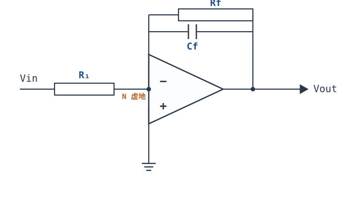
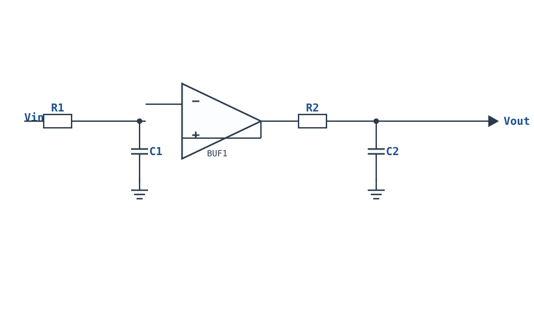
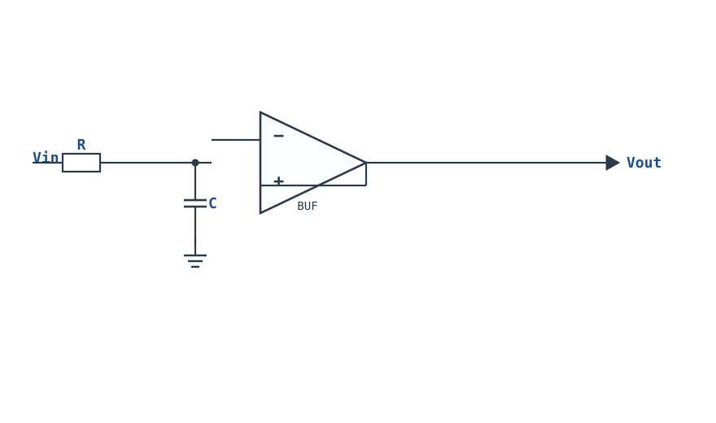
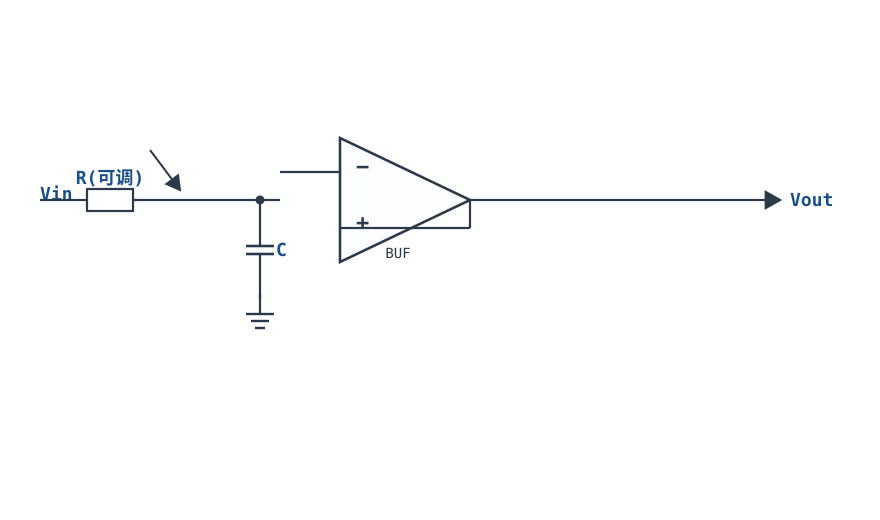
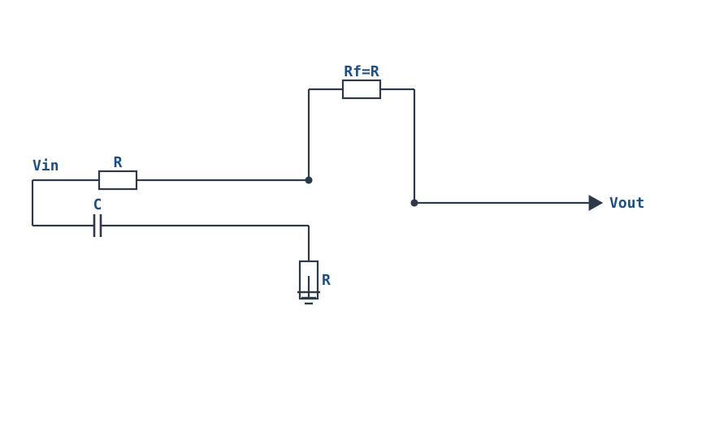

# 有源滤波：一阶低通与高通 First-Order LPF / HPF

## 1. 设计动机

::: motivation 为什么需要有源滤波器
传感器里既有我们要的信号，也有我们不想要的东西：温度漂移（直流慢变）、工频 50Hz 干扰、开关电源尖峰、ADC 采样混叠。**滤波器（Filter）就是让需要的频率通过、把不需要的频率挡在门外的电路。**

只用电阻电容也能滤波（无源 RC），但无源信号带负载就衰减、又不能放大。把 RC 网络放进运放反馈回路里，就得到**有源滤波器（Active Filter）**：增益可控、输出阻抗低、带负载能力强，是信号链里最常用的一级。
:::

一阶（First-Order）是最简单的有源滤波器——传递函数分母/分子里只有一个 $s$ 项，幅频曲线在截止频率外以 −20dB/十倍频程的斜率滚降。

## 2. 原理图

**反相型一阶低通滤波器**：反馈臂是 Rf 与 Cf 并联。



把输入电容 C 与 R1 位置对调（输入臂串 C、反馈臂只留 Rf），就得到一阶高通滤波器。

## 3. 静态分析（DC）

- **低通**：直流下电容 Cf 开路，反馈臂只剩 Rf，电路退化为反相比例放大器，直流增益 $H_0=-Rf/R_1$，输出静态点由输入直流与失调决定。
- **高通**：直流下输入电容 C 开路，信号无法进入，增益为 0——这正是高通"隔断直流"的本意。
- 同相端接地，反相端虚地 $V_-\approx0$。

## 4. 动态分析（AC / 瞬态）

**一阶低通传递函数**（反馈阻抗 $Z_f=R_f\parallel\frac{1}{sC_f}$，输入阻抗 $Z_{in}=R_1$）：

$$H(s)=-\frac{Z_f}{Z_{in}}=-\frac{R_f/R_1}{1+sR_f C_f}$$

- 通带（$f\ll f_c$）增益 $H_0=-R_f/R_1$（常数）；
- 截止角频率 $\omega_c=1/(R_f C_f)$，截止频率 $f_c=\dfrac{1}{2\pi R_f C_f}$；
- 在 $f=f_c$ 处，$|H|=|H_0|/\sqrt{2}$，即比通带**低 3dB**，这就是 **−3dB 截止频率（Cutoff Frequency）**；
- $f\gg f_c$ 后以 −20dB/十倍频程滚降。

**一阶高通传递函数**（输入臂 $Z_{in}=R_1+1/(sC)$）：

$$H(s)=-\frac{R_f}{R_1+\frac{1}{sC}}=-\frac{R_f}{R_1}\cdot\frac{sR_1 C}{1+sR_1 C},\qquad f_c=\frac{1}{2\pi R_1 C}$$

通带在高频（$f\gg f_c$），低于 $f_c$ 以 +20dB/十倍频程速率被衰减。

两种滤波器的归一化幅频特性（横轴为 $f/f_c$）：

```echarts
{
  "tooltip": {"trigger": "axis"},
  "legend": {"data": ["低通 LPF", "高通 HPF"], "bottom": 0, "textStyle": {"fontSize": 13}},
  "grid": {"left": 56, "right": 24, "top": 26, "bottom": 58},
  "xAxis": {"type": "category", "name": "f/fc", "data": ["0.01","0.1","0.5","1","2","5","10","100"], "axisLabel": {"fontSize": 10}},
  "yAxis": {"type": "value", "name": "增益 dB", "min": -45, "max": 5, "interval": 10, "axisLabel": {"fontSize": 11}},
  "series": [
    {"name": "低通 LPF", "type": "line", "smooth": true, "showSymbol": true, "lineStyle": {"width": 2.6, "color": "#1a4f8b"},
     "data": [0, 0, -1, -3, -7, -14, -20, -40]},
    {"name": "高通 HPF", "type": "line", "smooth": true, "showSymbol": true, "lineStyle": {"width": 2.6, "color": "#b5642e"},
     "data": [-40, -20, -14, -3, -1, 0, 0, 0]}
  ]
}
```

## 5. 环路分析

一阶有源滤波器仍是**电压并联负反馈**，$G=-Z_f/Z_{in}$。

- 反馈电容 Cf 引入一个 90° 相位滞后，与运放自身的主极点叠加；好在一阶滤波器在通带内环路增益大、在高频环路增益已经随 Cf 下降，相位裕度通常足够，不易自激。
- **与积分器的关系**：当 $R_f\to\infty$（去掉 Rf），一阶低通就退化为[积分器](integrator-differentiator.md)，直流增益无穷大、输出漂移——这也是为什么实用低通必须保留 Rf。
- 稳定性注意：Cf 太大、R1 太小，或容性负载时，高频额外相移仍可能引起自激，表现为输出叠加高频振荡。

::: advanced 进阶：−3dB 是怎么来的
一阶低通 $|H|=|H_0|/\sqrt{1+(f/f_c)^2}$。令 $|H|=|H_0|/\sqrt{2}$，则 $1+(f/f_c)^2=2$，即 $f=f_c$。此时功率减半（电压幅度 $1/\sqrt2$），对应 $20\log_{10}(1/\sqrt2)=-3.01\text{dB}$。工程上说"带宽"通常指 −3dB 带宽。
:::

## 6. 元件取值与工程权衡

- **先定 $f_c$，再选 R、C**：$f_c=1/(2\pi RC)$。C 取标准值（如 1nF、10nF、100nF、1µF），再反算 $R=1/(2\pi f_c C)$。
- **R 的数量级**：取 1kΩ~100kΩ 之间的标准值。R 太小信号源负担重；R 太大偏置电流失调和噪声问题凸显。
- **电容精度/材质**：截止频率直接挂在 R、C 乘积上，普通 ±20% 电容会让 $f_c$ 偏 20%。选 **C0G/NP0（±5% 或 ±1%）**；电解电容温漂大，只用于直流阻断。
- **增益 Rf/R1**：低通的 Rf 同时决定通带增益和截止频率，二者耦合；想独立调增益与截止频率，改用二阶 Sallen-Key 结构（见下一章）。
- **噪声**：滤波器第一级的电阻热噪声会被后续电路放大，高频滤波器 R 不宜过大。

## 7. 完整设计示例

::: example 设计一个通带增益 10 倍、截止 1kHz 的低通
1. **需求**：放大 10 倍，且滤除 1kHz 以上噪声（−3dB 点在 1kHz）。
2. **定增益**：$R_f/R_1=10$。取 $R_1=10\text{k}\Omega$，则 $R_f=100\text{k}\Omega$。
3. **定 Cf**：$f_c=1\text{kHz}=1/(2\pi R_f C_f)$，$C_f=1/(2\pi\times100\text{k}\times1\text{k})\approx1.59\text{nF}$，取标准值 1.5nF（C0G）。
4. **验算**：实际 $f_c=1/(2\pi\times100\text{k}\times1.5\text{nF})\approx1.06\text{kHz}$，误差 6%，可接受；通带增益 $20\log10=20\text{dB}$。
5. **供电**：若输出含负半周用双电源；单电源需加 Vcc/2 偏置。
:::

## 8. 仿真与实验

LTspice 中用通用运放、双电源 ±15V 搭建：
- 输入接 AC 扫描源（AC sweep，10Hz~1MHz，十倍频程 10 点），运行 AC 分析，画出输出幅度伯德图；
- 在 1kHz 处读数应为通带值的 0.707 倍（−3dB），10kHz 处比通带低约 20dB；
- 换 10kHz 正弦输入，观察输出幅度明显衰减、相位滞后约 90°（远高于 $f_c$ 时）；
- 示波器同时看输入输出，观察通带内（100Hz）几乎等幅反相、阻带内（10kHz）输出变小。

## 扩展与变种电路

### 扩展1：多级一阶级联 Cascaded First-Order

单级一阶只有 −20dB/十倍频程滚降。把两级一阶用缓冲器隔开级联，即可在不引入二阶 Q 峰的情况下做到 −40dB/十倍频程。



::: example 工作原理/静态分析
两级相同一阶级联（级间缓冲隔离负载）：

$$|H(f)|=\frac{1}{1+(f/f_c)^2},\qquad f_{-3dB}\text{ 需按级联系数修正}$$

缓冲器（电压跟随器）输入阻抗高、输出阻抗低，避免两级 RC 互相负载。
:::

```echarts
{
  "tooltip": {"trigger": "axis"},
  "legend": {"data": ["单级一阶","两级级联"], "bottom": 0, "textStyle": {"fontSize": 13}},
  "grid": {"left": 56, "right": 24, "top": 26, "bottom": 50},
  "xAxis": {"type": "category", "name": "f/fc", "data": ["0.1","0.5","1","2","5","10"], "axisLabel": {"fontSize": 11}},
  "yAxis": {"type": "value", "name": "dB", "min": -45, "max": 3, "interval": 10, "axisLabel": {"fontSize": 11}},
  "series": [
    {"name": "单级一阶", "type": "line", "smooth": true, "showSymbol": true, "lineStyle": {"width": 2.4, "color": "#6b7a8a"}, "data": [0,-1,-3,-7,-14,-20]},
    {"name": "两级级联", "type": "line", "smooth": true, "showSymbol": true, "lineStyle": {"width": 2.6, "color": "#1a4f8b"}, "data": [0,-0.3,-6,-14,-28,-40]}
  ]
}
```

取值：两级 $R,C$ 用同值 1% 元件。与 Sallen-Key 相比，级联无 Q 峰、更稳定，但过渡带不如二阶陡。

::: pitfall 级联未缓冲
两级 RC 直接相连时，第二级会成为第一级的负载，实际截止频率与滚降都偏离计算。级间必须加电压跟随缓冲。
:::

### 扩展2：电压跟随缓冲 RC Buffered RC

无源 RC 低通本身会被后级输入阻抗衰减。在 RC 后加一级电压跟随器，就能保持原截止频率且低阻输出。



::: example 工作原理/静态分析
传递函数与无源 RC 相同：$H(s)=\dfrac{1}{1+sRC}$，$f_c=\dfrac{1}{2\pi RC}$。缓冲器把 RC 节点与负载隔离，输出阻抗接近 0，带任何后级都不衰减。
:::

取值：$R$ 取 10k~100k，$C$ 按 $f_c$ 反算。适合传感器输出直接接 ADC 前的抗混叠第一级。

::: pitfall 共模范围
单电源下，RC 节点电压必须落在运放输入共模范围内；非轨到轨运放处理接近 0V 的节点会失真。
:::

### 扩展3：电位器可调截止频率 Tunable fc

把 RC 里的电阻换成电位器，即可现场调节截止频率——用于需要现场摸索滤波效果的实验电路。



::: example 工作原理/静态分析
$f_c=\dfrac{1}{2\pi R_{eff}C}$，旋转电位器改变 $R_{eff}$，$f_c$ 在 $1/(2\pi R_{max}C)\sim 1/(2\pi R_{min}C)$ 之间连续可调。
:::

取值：电位器取 10k~100k，串一个固定电阻防止调到 0 时 $f_c$ 无穷大。

::: pitfall 调到 0 频率失控
电位器直接调到 0 时 $f_c\to\infty$，滤波失效且节点悬空。必须串最小固定电阻限位。
:::

### 扩展4：一阶全通（相位校正）First-Order All-Pass

全通滤波器幅频平坦（所有频率等幅通过），只对不同频率施加不同相移，用于相位补偿、延迟均衡。



::: example 工作原理/静态分析
$$H(s)=-\frac{1-sRC}{1+sRC},\qquad |H|=1,\quad \phi(\omega)=-2\arctan(\omega RC)$$

在 $\omega_0=1/(RC)$ 处相移 $-90^{\circ}$，低频趋近 0、高频趋近 $-180^{\circ}$。增益恒为 1，只改相位。
:::

取值：$R_f=R$；$R,C$ 按需要校正的相位频率点选取。

::: pitfall 只改相位不改幅度
全通滤波器不衰减任何频率，不能当低通用；误用它来"滤噪声"会发现幅度毫无变化。
:::


## 9. 常见坑与故障现象

::: pitfall 常见坑
- **电容材质选错，截止频率飘移**：用普通陶瓷/电解电容，$f_c$ 随温度、随电压偏差很大。解决：选 C0G/NP0 或薄膜电容，精度要求高时 R、C 都用 1%。
- **把低通当积分器用却忘了 Rf**：去掉 Rf 后直流增益无穷大，输出漂移撞轨。低通必须保留反馈电阻 Rf。
- **Rf/R1 增益与 fc 耦合，调不动**：改 Rf 会同时改变增益和截止频率。需要独立调参时换二阶 Sallen-Key 或多路反馈 MFB 结构。
- **单电源下交流信号负半周被削**：一阶滤波器输出含负电压分量，单电源供电需偏置在 Vcc/2。
- **通带内增益比设计值小很多**：信号源内阻与 R1 分压，或下一级输入阻抗太低把信号衰减。前级输出阻抗要远小于后级输入阻抗。
:::

## 10. 自测题

<details><summary>一阶低通 $R_f=100\text{k}\Omega$、$C_f=1.59\text{nF}$，−3dB 截止频率是多少？在 10kHz 处增益比通带低多少 dB？</summary>

$f_c=1/(2\pi R_f C_f)=1/(2\pi\times100\text{k}\times1.59\text{nF})\approx$ **1kHz**。10kHz 是 $f_c$ 的 10 倍，一阶以 −20dB/十倍频程滚降，故 10kHz 处比通带低约 **20dB**。

</details>

<details><summary>为什么说"−3dB 频率"就是带宽？它对应电压幅度和功率分别是多少？</summary>

$-3\text{dB}=20\log_{10}(1/\sqrt2)$，对应电压幅度为通带的 $1/\sqrt2\approx0.707$，功率为 $1/2$（功率减半点）。工程上把功率下降一半处的频率定义为带宽边界。

</details>

<details><summary>想让一个信号"通过 100Hz 以上、隔断直流和慢变漂移"，该用低通还是高通？截止频率取多少？</summary>

用**高通滤波器**，$f_c$ 取 100Hz，让 100Hz 以上通过、以下衰减。它自然隔断直流（DC 增益为 0），适合做交流耦合放大的隔直级。

</details>

## 11. 参考资料

- TI, *Op Amps for Everyone* (SLOD006B)，一阶有源滤波章节
- Sergio Franco, *Design with Operational Amplifiers* (4th Ed.)，一阶滤波器与传递函数
- CircuitLab, *Ultimate Electronics: Practical Circuit Design and Analysis*（在线可交互教材）
