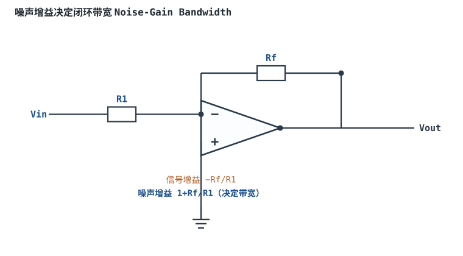

# 带宽 GBP、压摆率与建立时间

## 1. 定义与物理来源

理想运放带宽无限，实际运放有一个主极点（主补偿电容），开环增益随频率升高以 −20dB/十倍频下降。

- **增益带宽积（GBP, Gain-Bandwidth Product）**：开环增益降到 0dB 时的频率（单位增益带宽）。GBP 近似常数：闭环增益越大，可用带宽越窄，$f_c = GBP / G_{closed}$。
- **压摆率（SR, Slew Rate）**：输出电压每秒能变化的最大速率，单位 V/µs。它由内部补偿电容的充放电电流上限决定，与小信号带宽无关。
- **建立时间（Settling Time）**：输出从阶跃开始到进入并保持在指定误差带（如 0.1%/0.01%）内的时间。

物理来源：为保证稳定（见 [稳定性：伯德图、相位裕度与补偿](../opamp/stability-bode.md)），运放内部加了大补偿电容。该电容充电电流有限，既限制了小信号带宽，也限制了大信号摆动速度。


## 2. 典型数量级

| 参数 | 通用运放 | 高速运放 |
|---|---|---|
| GBP | 1~10 MHz | 100 MHz~1 GHz |
| SR | 0.5~20 V/µs | 100~数千 V/µs |
| 建立时间（到 0.1%） | 1~10 µs | 100 ns~1 µs |

## 3. 在电路中的后果与测量

**小信号行为由 GBP 决定**：闭环增益为 $G$ 时，闭环带宽 $f_{-3dB}=GBP/G$。

```echarts
{
  "tooltip": {"trigger": "axis"},
  "legend": {"data": ["开环增益 Aol", "闭环增益 G=100", "闭环增益 G=10"], "bottom": 0, "textStyle": {"fontSize": 12}},
  "grid": {"left": 56, "right": 24, "top": 26, "bottom": 58},
  "xAxis": {"type": "category", "name": "频率 Hz（对数示意）", "data": ["10","100","1k","10k","100k","1M","10M"], "axisLabel": {"fontSize": 11}},
  "yAxis": {"type": "value", "name": "增益 dB", "min": 0, "max": 110, "interval": 20, "axisLabel": {"fontSize": 11}},
  "series": [
    {"name": "开环增益 Aol", "type": "line", "smooth": true, "showSymbol": false, "lineStyle": {"width": 2.4, "color": "#7a5fc0"},
     "data": [100,100,97,77,57,37,17]},
    {"name": "闭环增益 G=100", "type": "line", "smooth": true, "showSymbol": false, "lineStyle": {"width": 2.4, "color": "#1a4f8b"},
     "data": [40,40,40,37,20,3,0]},
    {"name": "闭环增益 G=10", "type": "line", "smooth": true, "showSymbol": false, "lineStyle": {"width": 2.4, "color": "#b5642e"},
     "data": [20,20,20,20,20,17,0]}
  ]
}
```

**大信号行为由 SR 决定**：当输出摆幅大、频率高时，要求的输出斜率 $2\pi f V_p$ 超过 SR，输出正弦波被"压"成三角波（斜率受限于 SR），产生失真。满功率带宽 $f_{FP} = SR / (2\pi V_p)$。

## 4. 计算示例

::: example 判断一个正弦输出会不会被压摆率限制
1. **需求**：运放输出 $V_p=2\text{V}$（峰值）、$f=100\text{kHz}$ 正弦波。
2. **算所需压摆率**：正弦波最大斜率 $=2\pi f V_p = 2\pi\times100\text{k}\times2 \approx 1.26\text{V}/\mu\text{s}$。
3. **选型**：选 SR=1V/µs 的通用运放不够（1.26>1），会失真；选 SR=10V/µs 运放留足裕量。
4. **小信号带宽校验**：若闭环增益 G=100，运放 GBP=1MHz，则闭环带宽 $f_c=1\text{MHz}/100=10\text{kHz}$，远小于信号 100kHz——即使 SR 够，小信号增益也已跌到 1/10。结论：该增益下带宽不足，需换 GBP≥10MHz 的运放。
:::

::: advanced 进阶：小信号与大信号的区别
GBP 限制的是"小信号"（输出幅度小、线性区）；SR 限制的是"大信号"（幅度大）。一个电路可能小信号带宽足够，但大信号因 SR 不足而失真。判断时两个条件都要算：信号频率 < GBP/G，且所需斜率 < SR。ADC 采样前的缓冲还要看建立时间是否短于采样窗口。
:::

## 扩展与变种电路

### 扩展1：噪声增益决定闭环带宽 Noise-Gain Bandwidth

反相放大器的信号增益是 $-R_f/R_1$，但决定失调、噪声与闭环带宽的是**噪声增益** $1+R_f/R_1$——即使信号增益做成衰减，带宽仍按噪声增益算。



::: example 工作原理与静态分析
- 闭环 $-3$dB 带宽 $f_c=GBP/G_n$，其中噪声增益 $G_n=1+R_f/R_1$。
- 反相电路信号增益 $G_s=-R_f/R_1$，与 $G_n$ 差 1；同相电路 $G_s=G_n$。
- 失调 $V_{out,os}=V_{os}\cdot G_n$、输出噪声也按 $G_n$ 放大，与信号增益无关。
- 例如 $R_f/R_1=9$：信号增益 −9，噪声增益 10，带宽按 10 算而非 9。
:::

取值数量级：R1/Rf 取 kΩ~百 kΩ；与"按信号增益估带宽"对比：反相电路必须按噪声增益留带宽裕量。适用：反相衰减器、反相放大器设计；不适用：把单位增益带宽直接当信号带宽。

::: pitfall 反相衰减器以为带宽很宽却高频掉增益
- **现象**：信号增益 −0.5（衰减），但频率升高后增益早早滚降。
- **原因**：噪声增益仍是 $1+R_f/R_1=1.5$，带宽 $f_c=GBP/1.5$，并未因信号衰减而变宽。
- **解决**：按噪声增益查带宽，需要宽带就选 GBP 更大的运放。
:::

## 5. 常见坑

::: pitfall 常见坑
- **只看 GBP 不看 SR**：数据手册 GBP=10MHz 很诱人，但 SR 可能只有 5V/µs，放大 1MHz 大信号照样三角波失真。音频/高速链路必须同时核算 SR。
- **高增益时忽略闭环带宽**：GBP=1MHz、增益 1000 倍时闭环带宽只剩 1kHz，音频都过不了。增益越高，越要选 GBP 大的运放。
- **驱动 ADC 不看建立时间**：ADC 采样窗口内输出没建立到位，采样值就错。高速 ADC 要选"建立时间满足"的专用缓冲运放，而不是只看带宽。
:::

## 6. 自测题

<details><summary>GBP=1MHz 的运放接成噪声增益 100，闭环 −3dB 带宽约多少？</summary>

$f_c = GBP / G_n = 1\text{MHz}/100 =$ **10kHz**。

</details>

<details><summary>要输出 1V 峰值、1MHz 正弦波，至少需要多大压摆率的运放？</summary>

所需斜率 $=2\pi f V_p = 2\pi\times1\text{MHz}\times1\text{V}\approx 6.3\text{V}/\mu\text{s}$，选 SR ≥ 10V/µs（留裕量）的运放。

</details>

## 7. 参考资料

- Op Amps for Everyone（TI, SLOD006B），频率响应与压摆率章节
- MT-049（ADI），噪声带宽与建立时间
- Design with Operational Amplifiers（Sergio Franco）
