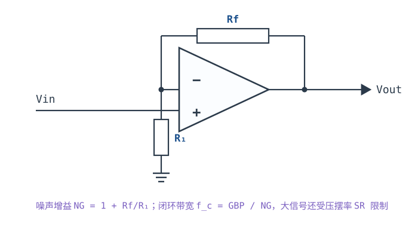
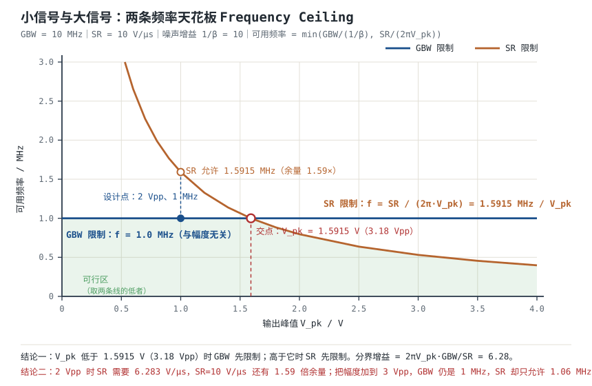

# 带宽 GBP、压摆率与建立时间 Gain-Bandwidth Product, Slew Rate & Settling Time

运放的数据手册第一页通常写着两个数：**GBW=10 MHz**、**SR=10 V/µs**。很多人只记住第一个，然后按"闭环增益 10，带宽就是 1 MHz"设计；等到输出摆到 2 Vpp、频率刚过 1 MHz，波形却变成了三角波。问题不在 GBW，在 SR——**GBW 描述小信号能跟多快，SR 描述大信号能跑多快，两者是两条独立的天花板**。

本章把这两条天花板画在同一张图上：先讲清 GBW 的定义与"增益×带宽恒定"的适用边界（单极点、线性反馈、小信号、电压反馈型）；再讲 SR 的物理来源与全功率带宽 $f_{FPBW}=SR/(2\pi V_{pk})$；然后用同一只 GBW=10 MHz、SR=10 V/µs 的运放，在 $G=10$、输出 2 Vpp 的条件下算出两条限制各自的可用频率，给出具体分界；最后把建立时间拆成**压摆、线性建立、振铃**三段，算出一个 1% 建立时间。

**本章约定**：$GBW$ 是增益带宽积（Hz），$f_T$ 是单位增益频率（$|A_{OL}|=1$ 的频率，Hz）；$A_{OL0}$ 是直流开环增益，$f_p$ 是主极点（Hz）；$\beta$ 是反馈系数（**不是**三极管的电流放大倍数），$1/\beta$ 是噪声增益，$T=A_{OL}\beta$ 是环路增益；$SR$ 是压摆率（V/s，常用 V/µs）；$f_c$ 是闭环 $-3\ \text{dB}$ 带宽（Hz）；$V_{pk}$ 是输出正弦峰值（V），$V_{pp}$ 是峰峰值（V）；$t_s$ 是建立时间（s），$\varepsilon$ 是相对误差带。符号口径与[开环、闭环增益与负反馈本质](open-loop-feedback.md)、[稳定性：伯德图、相位裕度与补偿](stability-bode.md)一致。以下推导默认**负反馈闭合、输出在线性区（虚短与虚断成立）**；开环、正反馈、输出饱和三种状态都不适用（前提见[理想模型五假设与虚短、虚断](ideal-opamp.md)）。

## 1. 设计动机

::: motivation 三个真实场景
**场景一：GBW=10 MHz、G=100，想放 200 kHz 的信号。** 按 $f_c=GBW/(1/\beta)=10\ \text{MHz}/100=100\ \text{kHz}$，200 kHz 已经在 $-3\ \text{dB}$ 点之外一倍频。实际增益不是 100，而是 $100/\sqrt{1+(200/100)^2}=100/2.236=44.7$，掉了 7.0 dB，而且相移 $-63.4^{\circ}$。**"GBW 够不够"要拿最高信号频率乘噪声增益去比，不是拿信号增益。**

**场景二：同一只运放接成跟随器，输出 3 Vpp、2 MHz。** GBW 说 $f_c=10\ \text{MHz}$，2 MHz 看起来绰绰有余；但 3 Vpp 对应 $V_{pk}=1.5\ \text{V}$，所需压摆率 $2\pi\times2\ \text{MHz}\times1.5\ \text{V}=18.85\ \text{V}/\mu\text{s}$，而 SR 只有 10 V/µs。输出被压成三角波，幅度也掉到 $SR/(2\pi f)=0.796\ \text{V}$ 峰值（1.59 Vpp）。**低增益、大摆幅的电路，SR 往往先撞墙。**

**场景三：16 位、1 MSPS 的 ADC 驱动，采样窗口 500 ns。** 要求建立到 0.001%（16 位约 $1.5\times10^{-5}$）。用 $G=10$、$f_c=1\ \text{MHz}$ 的运放，线性建立时间 $t=\tau\ln(1/\varepsilon)$ 就要 $159\ \text{ns}\times11.5=1.83\ \mu\text{s}$，还没算压摆和振铃。**只看 GBW 选 ADC 缓冲，是最常见的"能跑但精度不够"来源。**
:::

| 你想确认 | 先算 | 判据（工程经验值） |
|---|---|---|
| 小信号带宽够不够 | $f_c=GBW/(1/\beta)$ | 最高信号频率 ≤ $0.1\sim0.2f_c$（幅度误差 ≤0.1~0.2 dB） |
| 大信号会不会失真 | $2\pi fV_{pk}$ 与 $SR$ 比 | 所需斜率 ≤ $0.5SR$，留 2 倍余量 |
| 全功率带宽多少 | $f_{FPBW}=SR/(2\pi V_{pk})$ | 工作频率 < $f_{FPBW}$ |
| 建立时间够不够 | $t_{slew}+\tau\ln(1/\varepsilon)$ | 小于采样窗口的 1/2~1/3 |
| 会不会振铃 | 相位裕度 PM | PM ≥ 45°，推荐 60° |
| 换器件后还稳不稳 | $f_c$、$f_{p2}$、PM | 换料必须重算，不能只看 GBW |
| 全功率带宽能否外推 | 数据手册 SR 的测试条件 | 电源、负载、温度变了要重测 |

**不算会摔在哪**，四个带数字的代价：

1. **用信号增益算带宽。** 反相 $G=-10$（$R_1=10\ \text{k}\Omega$、$R_f=100\ \text{k}\Omega$）的噪声增益是 11，$f_c=10\ \text{MHz}/11=909\ \text{kHz}$，不是 1 MHz；差 9.1%，在 900 kHz 附近就是 0.4 dB 的额外误差。
2. **忽略 SR。** 10 MHz 的运放、SR 只有 10 V/µs，在 $G=1$、3 Vpp、2 MHz 时输出已经是三角波；此时 GBW 还有 5 倍余量，**余量全在错误的那条轴上**。
3. **把 $f_c$ 当"平坦带宽"。** $f_c$ 是 $-3\ \text{dB}$ 点，幅度已经掉到 70.7%；要 1% 幅度误差，只能用 $0.143f_c$；要 0.1 dB，只能用 $0.153f_c$。
4. **建立时间只算线性段。** 2 V 阶跃、SR=10 V/µs 的压摆段就有 200 ns，和 $\tau=159\ \text{ns}$ 同量级；只算 $4.6\tau=733\ \text{ns}$ 会把总时间低估 27%。

## 2. 定义与直观

### 2.1 GBW：开环幅频曲线上的"增益×频率"

通用电压反馈运放的开环响应可以用单极点近似：

$$A_{OL}(f)=\frac{A_{OL0}}{1+jf/f_p}$$

在 $f\gg f_p$ 的频段，幅值近似为

$$|A_{OL}(f)|\approx\frac{A_{OL0}f_p}{f}=\frac{GBW}{f}$$

其中 $GBW=A_{OL0}f_p$（Hz）。**GBW 的定义是这条 $-20\ \text{dB/}$十倍频渐近线上的"增益×频率"常数**，不是"某个增益下的带宽"。当 $|A_{OL}|=1$ 时对应的频率叫单位增益频率 $f_T$；单极点模型下 $GBW=f_T$，真实运放因为第二极点，两者并不完全相等，数据手册通常只给其中一个。

数量级：$A_{OL0}=10^5$（100 dB）、$f_p=10\ \text{Hz}$ 时 $GBW=10^5\times10=1\ \text{MHz}$；若 $A_{OL0}=10^6$（120 dB）、$GBW=10\ \text{MHz}$，则 $f_p=GBW/A_{OL0}=10\ \text{Hz}$。**同样的 GBW，$A_{OL0}$ 越高，主极点越低，低频增益越大**——这就是"高增益、低带宽"与"低增益、高带宽"是同一只运放的两面。

### 2.2 闭环带宽：噪声增益决定，不是信号增益

把 $A_{OL}(f)$ 代入闭环增益 $G=A_{OL}/(1+A_{OL}\beta)$，闭环也是单极点，极点从 $f_p$ 移到

$$f_c=f_p(1+T_0)=f_p(1+A_{OL0}\beta)\approx A_{OL0}f_p\beta=GBW\cdot\beta=\frac{GBW}{1/\beta}$$

其中 $T_0=A_{OL0}\beta$ 是直流环路增益。**"增益×带宽恒定"的准确说法是：噪声增益 $1/\beta$ 与闭环 $-3\ \text{dB}$ 带宽 $f_c$ 的乘积等于 GBW。** 信号增益不参与这个乘积。

这条差别在反相组态上最明显：信号增益 $-R_f/R_1$，噪声增益 $1+R_f/R_1$，两者差 1。同样标称"增益 10"：

| 组态 | $R_1$ | $R_f$ | 信号增益 | 噪声增益 $1/\beta$ | $f_c$（GBW=10 MHz） |
|---|---|---|---|---|---|
| 同相 | $10\ \text{k}\Omega$ | $90\ \text{k}\Omega$ | $+10$ | 10 | 1.000 MHz |
| 反相 | $10\ \text{k}\Omega$ | $100\ \text{k}\Omega$ | $-10$ | 11 | 0.909 MHz |
| 反相衰减 | $10\ \text{k}\Omega$ | $5\ \text{k}\Omega$ | $-0.5$ | 1.5 | 6.667 MHz |

最后一行值得注意：信号增益只有 $-0.5$（衰减），带宽却按 1.5 算，不是按 0.5 算。**衰减器不会因为"信号变小"而获得更宽的带宽。**

### 2.3 "增益×带宽恒定"的适用边界

这句话不是定理，是一组条件下的近似。五条边界，缺一条就要重算：

1. **单极点开环**：$-20\ \text{dB/}$十倍频的直线只有一段；接近第二极点后，$|A_{OL}|$ 掉得比 $1/f$ 快，$f_c$ 小于 $GBW\cdot\beta$。GBW=10 MHz、第二极点 1 MHz 时，$G=1$ 的 $f_c$ 被推到约 3.08 MHz（不是 10 MHz），PM 只剩约 18°（推导见[稳定性：伯德图、相位裕度与补偿](stability-bode.md)）。
2. **反馈网络是线性的、实数 $\beta$**：电阻网络在低频是实数；反馈里带电容（积分器、滤波器）时 $\beta$ 本身随频率变，$f_c$ 要按 $\beta(s)$ 重算。
3. **小信号、输出在线性区**：压摆、饱和、输出限流都会让等效环路增益塌陷；大信号下"带宽"这个词本身要换成"全功率带宽"。
4. **电压反馈型（VFB）器件**：电流反馈型（CFA）的带宽由反馈电阻决定，与增益几乎无关，"增益×带宽恒定"不成立。
5. **噪声增益不低于器件的最小稳定增益**：去补偿（decompensated）运放标称"增益 ≥5 稳定"，接成 $G=1$ 会振荡；此时谈带宽没有意义。

### 2.4 SR：输出能跑多快，由内部电流上限决定

**压摆率（Slew Rate，SR）** 是输出电压的最大变化速率：

$$SR=\left.\frac{dV_{out}}{dt}\right|_{max}\quad\left[\text{V}/\mu\text{s}\ \text{或}\ \text{V/s}\right]$$

物理来源：运放内部有一只补偿电容 $C_c$（为保证单位增益稳定而加），输入端一有大差模电压，输入级的所有尾电流都去给 $C_c$ 充电，充电电流有上限 $I_{max}$：

$$SR=\frac{I_{max}}{C_c}$$

这个式子和 GBW 是同一个 $C_c$ 的两个侧面。对经典两级运放，$GBW=g_{m1}/(2\pi C_c)$，所以

$$SR=2\pi\cdot GBW\cdot\frac{I_{max}}{g_{m1}}$$

**SR 与 GBW 不是独立的两个参数**：它们的比值由输入级的"电流/跨导"比决定。双极差分对的 $I_{max}/g_{m1}\approx2V_T\approx51.7\ \text{mV}$（300 K），对应约 $0.325\ \text{V}/\mu\text{s}$ 每 MHz GBW；CMOS 输入级的 $I_{max}/g_{m1}\approx V_{ov}$（过驱动电压，0.1~0.5 V），可以做出更高的 SR/GBW 比。本章用的 10 MHz/10 V/µs 对应 $1\ \text{V}/\mu\text{s}$ 每 MHz，是双极极限的 3.1 倍，说明它用了发射极退化、CMOS 输入或更大的尾电流——**看到"高 GBW 低 SR"的器件，多半是低功耗设计；看到"低 GBW 高 SR"，多半是牺牲了增益或噪声。**

### 2.5 全功率带宽：正弦不畸变的上限

正弦输出 $V_{out}(t)=V_{pk}\sin(2\pi ft)$ 的斜率是

$$\frac{dV_{out}}{dt}=2\pi fV_{pk}\cos(2\pi ft)$$

最大值出现在过零点：

$$\left|\frac{dV_{out}}{dt}\right|_{max}=2\pi fV_{pk}$$

要求这个最大值不超过 SR，得到**全功率带宽（Full-Power Bandwidth）**：

$$f_{FPBW}=\frac{SR}{2\pi V_{pk}}$$

符号与单位：$SR$ 单位 V/s（代入时把 V/µs 换成 $10^6$ V/s）；$V_{pk}$ 单位 V；$f_{FPBW}$ 单位 Hz。**注意 $V_{pk}$ 是峰值，不是峰峰值**：3 Vpp 对应 $V_{pk}=1.5\ \text{V}$。数据手册里有的写"$V_{pp}$"，有的写"$V_{pk}$"，差 2 倍，是常见错误来源。

### 2.6 大信号看 SR、小信号看 GBW：两条天花板取低的

一个正弦输出要同时满足两个条件：

$$f\le\frac{GBW}{1/\beta}\quad\text{（小信号，幅度不掉太多）}\qquad f\le\frac{SR}{2\pi V_{pk}}\quad\text{（大信号，不被压摆压成三角波）}$$

所以可用频率是

$$f_{max}=\min\left(\frac{GBW}{1/\beta},\ \frac{SR}{2\pi V_{pk}}\right)$$

两条曲线的交点给出了"什么时候谁主导"。令两者相等：

$$V_{pk}^{*}=\frac{SR\cdot(1/\beta)}{2\pi\cdot GBW}$$

- $V_{pk}<V_{pk}^{*}$：GBW 限制更紧（小信号主导）。
- $V_{pk}>V_{pk}^{*}$：SR 限制更紧（大信号主导）。

**这个分界点不是一个固定频率，而是"输出幅度—频率"平面上的一条双曲线与一条水平线的交点**。§4.1 用同一只运放算出具体数值，§4.2 说明它怎么随增益移动。

### 2.7 建立时间的三个成分

建立时间 $t_s$ 是输出从阶跃开始、到进入并保持在误差带 $\pm\varepsilon V_{step}$ 内的时间。它由三段组成：

1. **压摆段**：输出以 SR 匀速爬升，$t_{slew}=\Delta V/SR$。这一段运放处于大信号非线性状态，反馈"来不及"控制。
2. **线性建立段**：压摆结束后，环路重新闭合，输出按一阶（或二阶）指数逼近终值，$t_{lin}=\tau\ln(1/\varepsilon)$，$\tau=1/(2\pi f_c)$。
3. **振铃段**：相位裕度不足时，输出在终值附近振荡，要等多个周期才进入误差带；PM=60° 时过冲约 9.5%，1% 误差带的建立时间约 $4.6/(\zeta\omega_n)$，比一阶估计长。

工程预算：

$$t_s\approx t_{slew}+t_{lin}+t_{ring}$$

其中 $t_{ring}$ 只在 PM<65° 时显著；PM≥65° 时可以近似并入 $t_{lin}$。**三段都要算，哪一段主导取决于阶跃幅度、SR、$f_c$ 和 PM**，不能只看 GBW。

::: analogy 三条车道
把信号想成一辆车，GBW 是"最高车速"（小信号能跑多快），SR 是"油门到底的加速度"（从静止提速有多快），建立时间是"从出发到稳稳停进车位"的总时间。短距离、小幅度：加速度（SR）决定；长距离、小幅度：最高车速（GBW）决定；车位很窄（误差带小）：还要看悬挂（PM）会不会来回晃。

类比的边界：车速和加速度在车里是独立的，在运放里都由同一个补偿电容 $C_c$ 决定（$GBW=g_{m1}/2\pi C_c$、$SR=I_{max}/C_c$），所以换一只运放时两个参数会同向或反向变化，不能单独"调高一个"。
:::

## 3. 定量关系

### 3.1 幅频、相频与"可用带宽"的三种口径

单极点开环：

$$|A_{OL}(f)|=\frac{A_{OL0}}{\sqrt{1+(f/f_p)^2}},\qquad \angle A_{OL}(f)=-\arctan\frac{f}{f_p}$$

闭环 $-3\ \text{dB}$ 带宽 $f_c\approx GBW\cdot\beta$。但"可用带宽"有四种口径，数值差很多：

| 口径 | 幅度相对低频 | $f/f_c$ | 说明 |
|---|---|---|---|
| $-3\ \text{dB}$ | 0.707（−3.01 dB） | 1.000 | 数据手册的"带宽" |
| −1 dB | 0.891 | 0.509 | 一般信号链 |
| −0.1 dB | 0.989 | 0.153 | 精密测量、ADC 驱动 |
| 1% 幅度误差 | 0.990 | 0.143 | 常写的"1% 平坦度" |

复算 1% 一行：$1/\sqrt{1+(f/f_c)^2}=0.99$ → $1+(f/f_c)^2=1.0203$ → $f/f_c=\sqrt{0.0203}=0.1425$。0.1 dB 一行：$10^{-0.1/20}=0.9886$ → $f/f_c=\sqrt{1/0.9886^2-1}=0.1526$。

**所以"$f_c=1\ \text{MHz}$"不等于"1 MHz 内增益平坦"**：1% 平坦度只能用 143 kHz，0.1 dB 只能用 153 kHz。规格书要写清口径。

### 3.2 反相组态与噪声增益

反相组态：

$$G_{inv}=-\frac{R_f}{R_1}\cdot\frac{T}{1+T},\qquad \beta=\frac{R_1}{R_1+R_f},\qquad \frac{1}{\beta}=1+\frac{R_f}{R_1}$$

闭环带宽仍按 $f_c=GBW/(1/\beta)$，**不是 $GBW/(R_f/R_1)$**。同相组态两者相等；反相组态差 1，低增益时相对误差最大：$R_f/R_1=1$（信号增益 −1）时噪声增益 2，按信号增益算会高估 1 倍（实际带宽只有一半）。

失调、噪声、CMRR、PSRR 也都按噪声增益放大（见[失调电压、偏置电流与漂移](offset-bias.md)与[共模范围、CMRR 与 PSRR](cmrr-psrr.md)），所以**一张预算表里统一用噪声增益，能同时避免四类错误**。

### 3.3 SR 的测试条件与温度影响

数据手册的 SR 通常标注测试条件：单位增益、指定负载（如 $2\ \text{k}\Omega$）、指定电源（如 $\pm15\ \text{V}$）、输入大阶跃（如 10 V）。**换条件必须重算**：

- **负载变重**：输出级电流被负载分走，给 $C_c$ 充电的电流减少，SR 下降；重载时 SR 可能只有标称值的 50%~70%（典型量级，以数据手册曲线为准）。
- **电源降低**：输入级的尾电流随电源下降，SR 同比下降；3.3 V 单电源的 SR 往往明显低于 $\pm15\ \text{V}$ 时的值。
- **温度升高**：双极输入的 $g_m$ 下降、尾电流变化，SR 可能下降；具体趋势看手册曲线。
- **输入过驱动量**：SR 是"大差模"下的极限；过驱动只有几十 mV 时，输出还没进入完全压摆状态，实际斜率小于 SR。**用 SR 算建立时间时，要确认阶跃足够大、运放真的进入了压摆。**

### 3.4 建立时间的定量拆解

**压摆段**：

$$t_{slew}=\frac{\Delta V}{SR}$$

其中 $\Delta V$ 是输出阶跃幅度（V），SR 单位 V/s。$\Delta V=2\ \text{V}$、SR=$10\ \text{V}/\mu\text{s}$ 时 $t_{slew}=0.2\ \mu\text{s}$。

**线性段**：一阶闭环的时间常数

$$\tau=\frac{1}{2\pi f_c}=\frac{1}{2\pi\cdot GBW\cdot\beta}$$

建立到相对误差 $\varepsilon$：

$$t_{lin}=\tau\ln\frac{1}{\varepsilon}$$

$\varepsilon=1\%$ → $4.605\tau$；0.1% → $6.908\tau$；0.01% → $9.210\tau$；0.001% → $11.513\tau$。这些系数要背下来。

**振铃段**：二阶系统的 1% 建立时间近似

$$t_{ring}\approx\frac{4.6}{\zeta\omega_n},\qquad \zeta\approx\frac{PM}{100},\qquad \omega_n\approx\frac{2\pi f_c}{x},\qquad x=\sqrt{\sqrt{1+4\zeta^4}-2\zeta^2}$$

PM=60° 时 $\zeta=0.6$、$x=0.7157$、$f_n=1.397f_c$，$t_{ring}\approx0.873\ \mu\text{s}$（$f_c=1\ \text{MHz}$）。PM=45° 时 $\zeta=0.45$、$x=0.8209$、$f_n=1.218f_c$，$t_{ring}\approx1.34\ \mu\text{s}$，比一阶估计长约 83%。**PM 不只是"稳不稳"的指标，它直接进建立时间预算。**

### 3.5 适用条件与失效边界

1. **小信号参数**：GBW、$f_c$、$\tau$ 都是小信号量；大信号要叠加 SR 与饱和恢复。
2. **单极点**：第二极点让 $f_c<GBW\cdot\beta$，相位裕度下降；容性负载、长走线都会引入第二极点（见[稳定性：伯德图、相位裕度与补偿](stability-bode.md)）。
3. **线性反馈**：$\beta$ 必须是实数、与幅度无关；二极管、非线性电阻、光耦反馈都不满足。
4. **输出未饱和**：撞轨后 $T$ 的定义失效，建立时间要加上饱和恢复时间（可能几 µs）。
5. **数据手册条件**：SR、GBW、建立时间都有测试条件（增益、负载、电源、温度），换条件要重算或重测。
6. **器件类型**：CFA 的带宽由反馈电阻决定；去补偿运放有最小稳定增益；这两类不能直接套 $GBW/(1/\beta)$。

## 4. 典型计算

### 4.1 完整算例：GBW=10 MHz、SR=10 V/µs、G=10、输出 2 Vpp

**已知**：$GBW=10\ \text{MHz}$、$A_{OL0}=10^6$（120 dB，所以 $f_p=10\ \text{Hz}$）、$SR=10\ \text{V}/\mu\text{s}=10^7\ \text{V/s}$；同相 $G=10$（$R_1=10\ \text{k}\Omega$、$R_f=90\ \text{k}\Omega$，$\beta=0.1$、$1/\beta=10$）；输出正弦 2 Vpp，即 $V_{pk}=1\ \text{V}$。求可用最大频率，以及 2 V 阶跃的 1% 建立时间。

**第 1 步：小信号带宽。**

$$\frac{1}{\beta}=1+\frac{90}{10}=10,\qquad f_c=\frac{GBW}{1/\beta}=\frac{10\ \text{MHz}}{10}=1.0\ \text{MHz}$$

$$\tau=\frac{1}{2\pi f_c}=\frac{1}{2\pi\times10^6}=1.5915\times10^{-7}\ \text{s}=159.15\ \text{ns}$$

**第 2 步：SR 允许的频率（$V_{pk}=1\ \text{V}$）。**

$$f_{FPBW}=\frac{SR}{2\pi V_{pk}}=\frac{10^7}{2\pi\times1}=1.5915\times10^6\ \text{Hz}=1.5915\ \text{MHz}$$

**第 3 步：取低的。**

$$f_{max}=\min(1.0\ \text{MHz},\ 1.5915\ \text{MHz})=1.0\ \text{MHz}$$

**结论：这只运放在 $G=10$、2 Vpp 下，可用频率由 GBW 决定，是 1 MHz；SR 在 1 MHz 只需要 $2\pi\times10^6\times1=6.283\ \text{V}/\mu\text{s}$，还有 $10/6.283=1.59$ 倍（4.04 dB）余量。** 如果只看到"10 MHz、10 V/µs"就以为能跑 10 MHz，会差 10 倍。**注意 1 MHz 是 $-3\ \text{dB}$ 点：同样的输入在 1 MHz 处输出会掉到 $2/\sqrt{2}=1.414\ \text{Vpp}$。** 如果要求 1 MHz 处幅度误差 ≤1%，按 §3.1 的 $0.1425f_c$ 口径需要 $f_c\ge1/0.1425=7.02\ \text{MHz}$，即 $GBW\ge70.2\ \text{MHz}$——"能跑到 1 MHz"和"1 MHz 内平坦"是两个规格。

**第 4 步：分界幅度。** 在 $f=f_c=1\ \text{MHz}$ 处，SR 允许的最大峰值幅度是

$$V_{pk}^{*}=\frac{SR}{2\pi f_c}=\frac{10^7}{2\pi\times10^6}=1.5915\ \text{V}$$

即 3.183 Vpp。**输出幅度低于 3.18 Vpp 时 GBW 先限制；高于 3.18 Vpp 时 SR 先限制。** 本题的 2 Vpp 在分界点以下，所以是"小信号"工况。

**第 5 步：压摆段。**

$$t_{slew}=\frac{\Delta V}{SR}=\frac{2\ \text{V}}{10\ \text{V}/\mu\text{s}}=0.200\ \mu\text{s}$$

**第 6 步：线性建立段（1%）。**

$$t_{lin}=4.605\tau=4.605\times159.15\ \text{ns}=733.0\ \text{ns}$$

**第 7 步：一阶预算合计。**

$$t_s\approx t_{slew}+t_{lin}=200+733=933\ \text{ns}\approx0.93\ \mu\text{s}$$

**第 8 步：加上振铃（PM=60°）。**

$$\zeta=0.6,\qquad x=\sqrt{\sqrt{1+4\times0.6^4}-2\times0.6^2}=\sqrt{1.2322-0.72}=0.7157$$

$$f_n=\frac{f_c}{x}=\frac{1.0\ \text{MHz}}{0.7157}=1.397\ \text{MHz}$$

$$t_{ring}\approx\frac{4.6}{\zeta\cdot2\pi f_n}=\frac{4.6}{0.6\times2\pi\times1.397\times10^6}=8.73\times10^{-7}\ \text{s}=0.873\ \mu\text{s}$$

$$t_s\approx0.200+0.873=1.073\ \mu\text{s}\approx1.07\ \mu\text{s}$$

**结论：1% 建立时间按一阶估是 0.93 µs，按 PM=60° 的二阶估是 1.07 µs，工程上取 1.1 µs 并留 30% 余量。** 两段的量级说明一件事：**在这个电路里，压摆段（200 ns）和线性段（733 ns）都不能忽略**；只算其中一段，误差都在 20%~80%。

**第 9 步：如果阶跃只有 0.2 V 呢？** $t_{slew}=0.2/10=20\ \text{ns}$，$t_s\approx20+733=753\ \text{ns}$——压摆段只占 2.7%，此时"小信号看 GBW"成立。**同一个电路，阶跃幅度决定哪一段主导**，这也是为什么数据手册的建立时间要注明阶跃幅度。

### 4.2 算例二：同一只运放，增益从 1 变到 100

**已知**：同 §4.1 的运放（GBW=10 MHz、SR=10 V/µs），输出仍为 2 Vpp（$V_{pk}=1\ \text{V}$）。分别求 $G=1$、10、100 时的可用频率。

**第 1 步：$G=1$（跟随器）。**

$$f_{GBW}=\frac{10\ \text{MHz}}{1}=10\ \text{MHz},\qquad f_{SR}=1.5915\ \text{MHz}$$

$$f_{max}=\min(10\ \text{MHz},\ 1.5915\ \text{MHz})=1.5915\ \text{MHz}$$

**SR 主导。** 10 MHz 的 GBW 在 1.59 MHz 的大信号下派不上用场。

**第 2 步：$G=10$。** $f_{GBW}=1.0\ \text{MHz}$，$f_{SR}=1.5915\ \text{MHz}$，$f_{max}=1.0\ \text{MHz}$，**GBW 主导**（§4.1）。

**第 3 步：$G=100$。**

$$f_{GBW}=\frac{10\ \text{MHz}}{100}=100\ \text{kHz},\qquad f_{max}=\min(100\ \text{kHz},\ 1.5915\ \text{MHz})=100\ \text{kHz}$$

**GBW 主导**，SR 余量 15.9 倍。

**第 4 步：分界增益。** 令 $f_{GBW}=f_{SR}$：

$$\frac{GBW}{1/\beta}=\frac{SR}{2\pi V_{pk}}\quad\Rightarrow\quad \frac{1}{\beta}=\frac{2\pi V_{pk}\cdot GBW}{SR}=\frac{2\pi\times1\times10^7}{10^7}=6.283$$

**噪声增益小于 6.28 时 SR 主导；大于 6.28 时 GBW 主导。** 这和"低增益容易压摆受限、高增益容易带宽受限"的直觉一致，但给出了具体数字：

| 噪声增益 $1/\beta$ | $f_{GBW}$ | $f_{SR}$（$V_{pk}=1\ \text{V}$） | $f_{max}$ | 谁主导 |
|---|---|---|---|---|
| 1 | 10 MHz | 1.5915 MHz | 1.5915 MHz | SR |
| 6.28 | 1.5915 MHz | 1.5915 MHz | 1.5915 MHz | 临界 |
| 10 | 1.0 MHz | 1.5915 MHz | 1.0 MHz | GBW |
| 100 | 100 kHz | 1.5915 MHz | 100 kHz | GBW |

**这张表要背下来的部分**：分界增益只由 $2\pi V_{pk}GBW/SR$ 决定；本章的运放在 1 V 峰值下是 6.28。输出电压越大，分界增益越高（$V_{pk}=2\ \text{V}$ 时 12.57），SR 主导的范围越宽。

### 4.3 算例三：跟随器 3 Vpp、2 MHz 的压摆失真

**已知**：$G=1$、$V_{pp}=3\ \text{V}$（$V_{pk}=1.5\ \text{V}$）、$f=2\ \text{MHz}$、SR=10 V/µs。判断是否压摆受限，并求该幅度下的全功率带宽与受限后的输出幅度。

**第 1 步：所需斜率。**

$$\left|\frac{dV}{dt}\right|_{max}=2\pi fV_{pk}=2\pi\times2\times10^6\times1.5=1.885\times10^7\ \text{V/s}=18.85\ \text{V}/\mu\text{s}$$

**第 2 步：与 SR 比。**

$$\frac{18.85}{10}=1.885>1$$

**压摆受限**，输出不能保持正弦，波形被"削"成三角波，且幅度下降。

**第 3 步：该幅度下的全功率带宽。**

$$f_{FPBW}=\frac{10^7}{2\pi\times1.5}=1.061\times10^6\ \text{Hz}=1.061\ \text{MHz}$$

**第 4 步：2 MHz 下 SR 允许的最大幅度。**

$$V_{pk,max}=\frac{SR}{2\pi f}=\frac{10^7}{2\pi\times2\times10^6}=0.7958\ \text{V}$$

即 1.592 Vpp，只有想要的 3 Vpp 的 53%。**这就是"GBW 明明够、波形却不对"的定量解释：GBW 的余量（10 MHz / 2 MHz = 5 倍）救不了 SR 的缺口（1.885 倍）。**

**第 5 步：要保住 3 Vpp、2 MHz，需要多大 SR？**

$$SR_{req}=2\pi\times2\times10^6\times1.5=1.885\times10^7\ \text{V/s}=18.85\ \text{V}/\mu\text{s}$$

选 SR≥30 V/µs 的器件（留 1.6 倍余量），同时核对 GBW 是否仍 ≥ 2 MHz（跟随器下 GBW 需求就是 2 MHz，很容易满足）。**这就是"低增益大摆幅"电路选型时 SR 优先的原因。**

## 5. 工程含义

### 5.1 数量级表：先建立直觉

| 参数 | 通用运放 | 精密/低功耗 | 高速运放 | 备注 |
|---|---|---|---|---|
| GBW | 1~10 MHz | 0.1~2 MHz | 100 MHz~数 GHz | 与功耗强相关 |
| SR | 0.5~20 V/µs | 0.05~1 V/µs | 100~数千 V/µs | 与 GBW 同向但非正比 |
| SR/GBW | 0.3~1 V/µs 每 MHz | 0.1~0.5 | 1~10 | 双极约 0.325 起 |
| 建立到 0.1% | 1~10 µs | 10~100 µs | 10~500 ns | 测试条件特定 |
| 全功率带宽（2 Vpp） | 0.1~3 MHz | 0.01~0.2 MHz | 10~500 MHz | $SR/(2\pi V_{pk})$ |

这些是**典型量级**，具体型号以数据手册为准。表的作用是选型前知道"大概在哪个数量级"，不是替代计算。

### 5.2 选型顺序：先算两条天花板，再选器件

1. **定信号幅度与频率**：$V_{pk}$、$f_{max}$、允许的幅度误差（−3 dB 还是 0.1 dB）。
2. **算 GBW 需求**：$GBW\ge f_{max}\times(1/\beta)/k$，$k$ 是平坦度系数（1% 误差取 0.143，−3 dB 取 1）。
3. **算 SR 需求**：$SR\ge2\pi f_{max}V_{pk}\times2$（留 2 倍余量）。
4. **算建立时间**：$t_{slew}+4.6\tau$（1%）或 $t_{slew}+6.9\tau$（0.1%），加 PM 振铃修正。
5. **算稳定性**：$f_c$、第二极点、容性负载、PM（见[稳定性：伯德图、相位裕度与补偿](stability-bode.md)）。
6. **算噪声**：带宽越宽噪声越大，GBW 不是越大越好（见[噪声：电压噪声、电流噪声与计算](noise.md)）。
7. **最后看功耗、封装、价格**。

### 5.3 布局、测量与数据手册的坑

- **测量 SR**：输入大阶跃（如 1 V→4 V），示波器看输出边沿的线性段斜率；探头电容、负载电容会改变结果，要在实际负载下测。
- **测量建立时间**：用差分探头或"减法电路"把终值减掉，放大误差带；普通探头 + 8 位示波器看不到 0.01% 的建立。
- **测量带宽**：小信号（10~100 mV）扫频，避免压摆；大信号扫描得到的是"全功率带宽"，两者不是一回事。
- **数据手册的 SR 条件**：单位增益、指定负载、指定电源；换条件必须重测，不能外推。
- **容性负载**：探头、电缆、ADC 采样电容都是容性负载，会把第二极点拉低、PM 拉低，实测带宽和建立时间都可能比手册差。
- **电源与去耦**：大信号翻转时的电源电流尖峰会在去耦不当时变成振铃，看起来像"运放不稳定"。

### 5.4 与其他参数的关系

- **带宽与噪声**：噪声带宽随 $f_c$ 上升，$V_n\propto\sqrt{f_c}$；把 GBW 提高 4 倍，噪声涨 2 倍（+6 dB）。**低噪声与高带宽是一对矛盾。**
- **带宽与功耗**：GBW 大致正比于输入级尾电流，速度快通常更费电。
- **SR 与噪声**：提高 SR 通常要加大尾电流，输入级的 $g_m$ 与噪声都会变；不是"SR 越高越好"。
- **建立时间与 PM**：PM 从 60° 降到 45°，1% 建立时间从 $4.6/(\zeta\omega_n)$ 增加约 53%；稳定性余量直接换成时间。
- **全功率带宽与输出摆幅**：$f_{FPBW}\propto1/V_{pk}$；输出摆幅减半，全功率带宽翻倍。

## 6. 常见坑

::: pitfall 常见坑
- **现象**：反相放大标称增益 −10，实测带宽只有 909 kHz，按 $GBW/10$ 算应该是 1 MHz。**原因**：反相的噪声增益是 $1+R_f/R_1=11$，不是信号增益 10；带宽、噪声、失调、CMRR 全部按噪声增益算。**解决**：预算表统一用 $1/\beta$；反相衰减器尤其要注意，信号增益 0.5 时噪声增益仍可能是 1.5。
- **现象**：GBW=10 MHz 的运放，跟随器输出 3 Vpp、2 MHz，波形变成三角波。**原因**：所需压摆率 $2\pi fV_{pk}=18.85\ \text{V}/\mu\text{s}$ 超过 SR=10 V/µs；GBW 的 5 倍余量救不了 SR。**解决**：先算 $2\pi fV_{pk}$ 与 SR 的比；大摆幅低增益场合按 SR 选型，或降低输出幅度/频率。
- **现象**：$f_c=1\ \text{MHz}$，以为 1 MHz 内增益平坦，实测 200 kHz 就掉了 1%。**原因**：$f_c$ 是 $-3\ \text{dB}$ 点，1% 幅度误差只能用 $0.143f_c$，0.1 dB 只能用 $0.153f_c$。**解决**：规格书写清平坦度口径；按 $f/f_c=\sqrt{10^{\delta/10}-1}$ 反算可用频率（$\delta$ 为允许的 dB 误差）。
- **现象**：按 $4.6\tau$ 算建立时间，实测比预算长一倍。**原因**：只算线性段，漏了压摆段（2 V 阶跃、10 V/µs 就是 200 ns）和振铃段（PM=45° 时 $t_{ring}\approx1.34\ \mu\text{s}$）。**解决**：三段分别算再相加；用实际阶跃幅度和实测 PM。
- **现象**：换了一颗 GBW 更高的运放，建立时间反而变长。**原因**：新器件 SR 更低、PM 更差、或容性负载下的第二极点更低；GBW 只是三段里的一段。**解决**：换料时把 SR、PM、$R_{out,OL}$ 一起核对，按完整建立时间预算选型。
- **现象**：数据手册写 SR=20 V/µs，实测只有 12 V/µs。**原因**：手册条件是 $\pm15\ \text{V}$、$2\ \text{k}\Omega$ 负载、单位增益；实际用 3.3 V 单电源、重载、高温，SR 下降。**解决**：按实际电源/负载/温度重测或查曲线；不要把手册的 SR 当保证值直接外推。
- **现象**：以为 GBW 是运放的固定常数，任何增益下都成立。**原因**：单极点、线性反馈、小信号、VFB、最小稳定增益这些条件缺一不可；CFA 的带宽由反馈电阻决定，去补偿运放有最小稳定增益。**解决**：先确认器件类型与反馈网络；多极点时按实际环路增益曲线算 $f_c$（见[稳定性：伯德图、相位裕度与补偿](stability-bode.md)）。
:::

## 7. 自测题

GBW=10 MHz、同相增益 10、输出 2 Vpp。小信号带宽与 SR（10 V/µs）允许的频率各是多少？哪个先限制？

小信号：

$$f_c=\frac{GBW}{1/\beta}=\frac{10\ \text{MHz}}{10}=1.0\ \text{MHz}$$

SR（$V_{pk}=1\ \text{V}$）：

$$f_{FPBW}=\frac{10^7}{2\pi\times1}=1.5915\ \text{MHz}$$

取低：$f_{max}=1.0\ \text{MHz}$，**GBW 先限制**。在 1 MHz 处所需 SR 是 $2\pi\times10^6\times1=6.283\ \text{V}/\mu\text{s}$，SR 余量 $10/6.283=1.59$ 倍。

同一只运放接成跟随器，输出 2 Vpp。可用频率是多少？如果输出改成 4 Vpp 呢？

$G=1$：$f_{GBW}=10\ \text{MHz}$，$f_{SR}=1.5915\ \text{MHz}$（$V_{pk}=1\ \text{V}$），所以 $f_{max}=1.5915\ \text{MHz}$，**SR 主导**。

4 Vpp（$V_{pk}=2\ \text{V}$）：

$$f_{SR}=\frac{10^7}{2\pi\times2}=795.8\ \text{kHz}$$

$f_{max}=795.8\ \text{kHz}$。**输出幅度翻倍，全功率带宽减半**，这就是 $f_{FPBW}\propto1/V_{pk}$。

$f_c=1\ \text{MHz}$ 的闭环，要求幅度误差不超过 1%，最高能用多少频率？0.1 dB 呢？

1%：

$$\frac{1}{\sqrt{1+(f/f_c)^2}}=0.99\ \Rightarrow\ f/f_c=\sqrt{1/0.99^2-1}=0.1425$$

$$f=0.1425\times1\ \text{MHz}=142.5\ \text{kHz}$$

0.1 dB：

$$10^{-0.1/20}=0.9886\ \Rightarrow\ f/f_c=\sqrt{1/0.9886^2-1}=0.1526$$

$$f=152.6\ \text{kHz}$$

**$f_c$ 是 $-3\ \text{dB}$ 点，不是平坦带宽；1% 平坦度只能用约 1/7 的带宽。**

2 V 阶跃、$f_c=1\ \text{MHz}$、SR=10 V/µs、PM=60°。1% 建立时间按一阶和二阶分别估多少？

一阶：

$$\tau=\frac{1}{2\pi\times10^6}=159.15\ \text{ns},\qquad t_{lin}=4.605\tau=733\ \text{ns}$$

$$t_{slew}=\frac{2}{10\ \text{V}/\mu\text{s}}=200\ \text{ns}$$

$$t_s\approx200+733=933\ \text{ns}$$

二阶（PM=60°、$\zeta=0.6$）：

$$x=\sqrt{\sqrt{1+4\times0.6^4}-2\times0.6^2}=0.7157,\qquad f_n=\frac{1\ \text{MHz}}{0.7157}=1.397\ \text{MHz}$$

$$t_{ring}\approx\frac{4.6}{0.6\times2\pi\times1.397\times10^6}=873\ \text{ns}$$

$$t_s\approx200+873=1073\ \text{ns}\approx1.07\ \mu\text{s}$$

**两段都不能忽略：压摆 200 ns 占 19%，线性/振铃占 81%。**

3 Vpp、2 MHz 的正弦，需要多大压摆率？SR=10 V/µs 的运放能输出多大幅度？

$$SR_{req}=2\pi\times2\times10^6\times1.5=1.885\times10^7\ \text{V/s}=18.85\ \text{V}/\mu\text{s}$$

SR=10 V/µs 时：

$$V_{pk,max}=\frac{10^7}{2\pi\times2\times10^6}=0.7958\ \text{V}$$

即 1.592 Vpp，只有 3 Vpp 的 53%。**波形被压成三角波，不是"幅度小一点"那么简单，谐波失真会急剧上升。**

为什么"增益×带宽恒定"对电流反馈型（CFA）运放不成立？对反相衰减器又该怎么算？

CFA 的反馈是电流模式，闭环带宽主要由**反馈电阻 $R_f$** 与内部补偿电容决定，与噪声增益几乎无关；改变增益（改 $R_1$）时带宽基本不变，所以"增益×带宽=常数"不成立。选型要查数据手册的"带宽 vs 增益"曲线与推荐的 $R_f$。

反相衰减器（信号增益 $-R_f/R_1$）仍按噪声增益 $1+R_f/R_1$ 算带宽。例：$R_1=10\ \text{k}\Omega$、$R_f=5\ \text{k}\Omega$，信号增益 $-0.5$，噪声增益 1.5，GBW=10 MHz 时 $f_c=6.667\ \text{MHz}$，不是 $10\ \text{MHz}/0.5=20\ \text{MHz}$。**衰减不会让带宽变宽。**

## 8. 参考资料

- **Analog Devices, MT-033 *Voltage Feedback Op Amp Gain and Bandwidth***：开环增益、噪声增益、闭环带宽与 GBW 的关系，以及"增益×带宽"的适用条件。本章 §2.1、§2.2、§3.2 的口径按该文。<https://www.analog.com/media/en/training-seminars/tutorials/MT-033.pdf>
- **Analog Devices, MT-046 *Op Amp Settling Time***：建立时间的定义、误差带、压摆与线性段的区分、测试条件。本章 §2.7、§3.4、§4.1 的三段拆解参考该文。<https://www.analog.com/media/en/training-seminars/tutorials/MT-046.pdf>
- **TI, *Op Amps for Everyone*（SLOD006B）**：Chapter 5 *Feedback and Stability Theory* 给环路增益与闭环带宽；Chapter 6 *Development of the Non-Ideal Op Amp Equations* 给有限带宽、压摆率与非线性修正。本章 §2.3、§3.5 的边界条件与该书一致。<https://www.ti.com/lit/an/slod006b/slod006b.pdf>
- **Sergio Franco, *Design with Operational Amplifiers and Analog Integrated Systems*（4th ed.）**：Chapter 1 *Operational Amplifier Fundamentals* 与 Chapter 8 *Stability* 给带宽、压摆率、建立时间与相位裕度的完整推导；本章 §3.4 的振铃估计与该书一致。
- **Sedra & Smith, *Microelectronic Circuits*（8th ed.）**：*Frequency Response* 一章讲主极点、单位增益频率、压摆率与全功率带宽；本章 §2.4、§2.5 的物理来源与该章一致。
