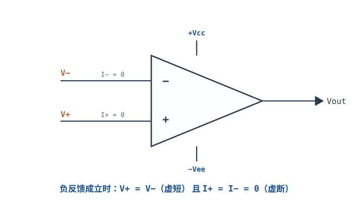
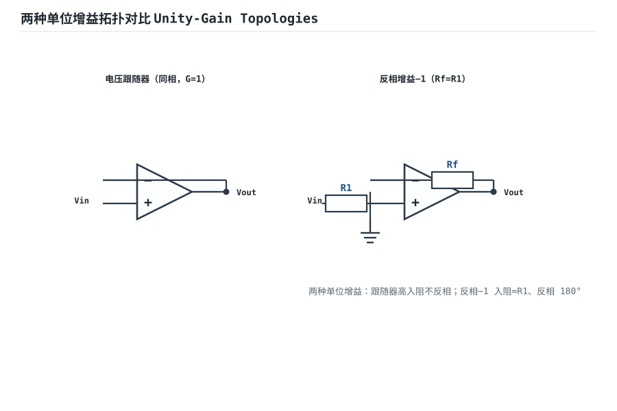

# 理想模型五假设与虚短、虚断 Ideal Op-Amp Model

真实运放有几十个参数：开环增益、输入阻抗、输出阻抗、带宽、失调、偏置电流、共模抑制比……如果每次分析电路都把它们全代进去，方程会长到没人愿意解。工程上的做法是先用**理想运放模型**把电路结构算清楚，再回头逐项检查哪些假设在这个工况下会破、破了以后误差多大。这是误差预算的标准流程，也是本章的写法。

理想模型的核心不是"假装运放完美"，而是**把五条假设当成五个误差项**。其中两条推出来的结论——**虚短**与**虚断**——是后面所有运放电路分析的起点。但这两条**只在负反馈成立时才有意义**，而且是近似、不是定理。本章会把前提、推导、数值边界一次写清，再用三种拓扑的输入阻抗对比和一次源阻抗误差估算，把"理想模型什么时候够用"变成可复算的数字。

## 1. 设计动机

::: motivation 三个真实场景
**场景一：反相放大的输入阻抗不是无穷大。** 用 $R_1=10\text{k}\Omega$、$R_f=100\text{k}\Omega$ 做 −10 倍放大，信号源内阻也是 10kΩ。很多人默认"运放输入阻抗无穷大，源内阻无所谓"，实际反相端的虚地让输入阻抗就等于 $R_1=10\text{k}\Omega$；源内阻与 $R_1$ 串联分压，增益从 −10 掉到 −5，整整低 6dB。信号还没进运放就被衰减了一半。

**场景二：同相端一只 10kΩ 电阻，输出偏了 10mV。** 同相放大 10 倍，信号源内阻 10kΩ，运放输入偏置电流 100nA。偏置电流在源内阻上产生 $100\text{nA}\times10\text{k}\Omega=1\text{mV}$ 的压降，被放大 10 倍就是 10mV。12 位、5V 量程的 ADC 一个 LSB 是 1.22mV，这 10mV 相当于 8 个 LSB——而且它随温度漂。

**场景三：把虚短用在比较器上。** 开环比较器，同相端 2.5V、反相端 2.4V。有人按"虚短"认为两端会相等，于是算出输出 0V；实际输出贴着正电源轨，两端差 0.1V。虚短的前提是负反馈把误差"压"到零，开环时没有任何机制保证这一点。
:::

| 你想确认 | 先算 | 判据（工程经验值） |
|---|---|---|
| 反相放大接高阻源会不会掉增益 | $Z_{in}=R_1$ 与源内阻分压 | 源内阻 ≤ $R_1/100$ 时误差 ≤1% |
| 同相端偏置电流误差多大 | $I_BR_s$ 与 $I_{OS}R$ | 输入误差 < 满量程的 1/10 |
| 共模电压会不会变成误差 | $V_{cm}/CMRR$ | 折算误差 < 目标精度 |
| 输出能不能带载 | $R_{out,CL}=R_{out,OL}/(1+T)$ | 负载分压误差 <1% |
| 有限增益影响多大 | $T=A_{OL}\beta$ | $T\ge100$ → 增益误差 ≤1% |
| 虚短还能不能用 | 负反馈是否闭合、输出是否饱和 | 输出在线性区、$\lvert T\rvert\gg1$ |

**不算会摔在哪**，四个带数字的代价：

1. **反相输入阻抗按无穷大算。** 10kΩ 源内阻 + 10kΩ 输入阻抗，分压比 $10/(10+10)=0.5$，增益从 −10 变 −5，误差 100%（−6.02dB）。
2. **偏置电流被忽略。** 100nA × 10kΩ = 1mV，放大 10 倍 = 10mV；对 5V/12 位 ADC，10mV/1.22mV ≈ 8.2 个 LSB。
3. **虚短用在开环。** 开环增益 $10^5$、输出 3.5V 时，输入端只需要 $3.5/10^5=35\mu\text{V}$ 的差值就饱和；比较器两个输入端差 0.1V 是正常状态，不是"虚短失效"，而是"虚短从来就不适用"。
4. **输出阻抗按 0 算。** 开环输出阻抗 100Ω、环路增益 $T=10$，闭环输出阻抗 $100/(1+10)=9.1\Omega$；带 1kΩ 负载就是 0.9% 的增益损失，带 100Ω 负载掉 8.3%。

## 2. 定义与直观

### 2.1 五条假设推出什么

理想运放模型的五条假设（开环增益无限、输入阻抗无限、输出阻抗为零、带宽无限、零失调零噪声）在[运放概述：符号、封装与引脚](opamp-overview.md)里已经逐条列出。这里只关心它们**各自推出什么可用的结论**：

| 假设 | 推出的结论 | 在电路分析里怎么用 |
|---|---|---|
| $A_{OL}\to\infty$ | $V_{err}=V_+-V_-\to0$（有负反馈时） | 虚短：两个输入端等电位 |
| $R_{in}\to\infty$ | $I_+=I_-=0$ | 虚断：输入端不取电流 |
| $R_{out}\to0$ | 输出是理想电压源 | 输出节点电压不受负载影响 |
| 带宽无限 | $A_{OL}$ 不随频率变、无相移 | 先按直流算增益，再单独核算带宽 |
| 零失调、零噪声 | 没有直流误差与噪声 | 先算信号增益，再叠加误差项 |

**注意第一行的括号**：$V_{err}\to0$ 不是运放端子的固有属性，而是"无限增益 + 负反馈"共同作用的结果。没有负反馈，$A_{OL}$ 再大也不能保证 $V_{err}=0$——它只会把任意小的 $V_{err}$ 放大到饱和。

### 2.2 虚短：把"无限增益"翻译成电压约束

在负反馈闭合、输出没有饱和的前提下，输出 $V_{OUT}$ 是有限值，而

$$V_{err}=V_+-V_-=\frac{V_{OUT}}{A_{OL}}$$

当 $A_{OL}\to\infty$ 时 $V_{err}\to0$，即 $V_+=V_-$。这就是**虚短（Virtual Short）**：两个输入端电位相等，但之间没有真实导线，也没有电流从一端流向另一端。

"虚短"是近似，近似程度可以直接算：$A_{OL}=10^5$、输出 1V 时 $V_{err}=1/10^5=10\mu\text{V}$；输出 3.5V 时 $V_{err}=35\mu\text{V}$。**相对于 mV 级的信号，10~35µV 确实可以忽略；相对于 µV 级的精密信号，它就不能忽略了。** 这就是"虚短"的适用边界——不是"永远为零"，而是"小到可以并按信号量级判断"。

### 2.3 虚断：把"无限输入阻抗"翻译成电流约束

理想输入阻抗无穷大，所以两个输入端都不取电流：

$$I_+=I_-=0$$

这就是**虚断（Virtual Open）**：输入端像断开一样不吸收电流，但电压仍然被"虚短"约束着。

真实运放的输入端一定要取一点电流（输入偏置电流 $I_B$），典型值：双极输入 10nA~1µA，JFET 输入 1~50pA，CMOS 输入 1pA~1nA（典型量级，以数据手册为准）。**虚断是否成立，取决于 $I_B$ 在外部电阻上产生的压降是否远小于信号**。同样是 100nA 的偏置电流，流过 100Ω 只有 10µV，可以忽略；流过 1MΩ 就是 0.1V，完全不能忽略。

### 2.4 前提：负反馈成立、输出未饱和、环路增益足够大

虚短和虚断不是无条件成立的。使用前必须确认三条：

1. **负反馈闭合。** 输出通过某个网络回到**反相输入端**，且环路极性是负的（$1+A_{OL}\beta$ 在分母，而不是 $1-A_{OL}\beta$）。
2. **输出没有饱和。** 输出电压在 $[V_{EE}+V_{drop-},V_{CC}-V_{drop+}]$ 之内，运放仍工作在线性区。
3. **环路增益足够大。** $|T|=|A_{OL}\beta|\gg1$，且工作频率远低于 $|T|$ 降到 1 的频率。高频时 $A_{OL}$ 滚降，虚短的误差 $V_{OUT}/|A_{OL}|$ 会变大。

**为什么开环时不成立？** 开环时 $V_{err}$ 由外部电路决定，运放只能把它放大：$V_{OUT}=A_{OL}V_{err}$。只要 $|V_{err}|>V_{sat}/A_{OL}$（例如 $3.5\text{V}/10^5=35\mu\text{V}$），输出就饱和。此时两个输入端的电压差可能是 0.1V、1V，甚至更大——没有任何机制把它拉回零。**开环时"虚短"不是近似变差，而是根本不成立。**

**为什么正反馈时不成立？** 把反馈接到同相端，设反馈系数为 $\beta$、输入为 $V_{IN}$、反相端接地，则 $V_+=V_{IN}+\beta V_{OUT}$，$V_{OUT}=A_{OL}(V_+ - 0)$，联立得

$$V_{OUT}=\frac{A_{OL}}{1-A_{OL}\beta}V_{IN}$$

分母是 $1-A_{OL}\beta$，不是 $1+A_{OL}\beta$。当 $A_{OL}\beta\to1$ 时增益趋于无穷，任何微小扰动都会被放大到饱和并"锁"在电源轨上——这就是正反馈的再生（regenerative）行为，也是施密特触发器、振荡器的工作原理，但绝不是线性放大。

**输出饱和时最危险。** 负反馈电路在输出撞轨后，环路看起来还是闭合的，$V_{err}=V_{sat}/A_{OL}$ 仍然只有 35µV 左右，"虚短似乎还成立"，但输出已经不再响应输入。这时候用虚短算出来的结果可能完全错误，因为运放已经进入非线性区。**判断依据不是"两个输入端电压差不多"，而是"输出是否还在摆幅内"。**

### 2.5 类比：被按住的弹簧

::: analogy 虚短像一只被反馈按住的弹簧
把两个输入端想象成一根弹簧的两端，弹簧想把它们推开（差值被放大成输出）。负反馈像一只手：输出一偏，手就把弹簧往反方向按，直到两端几乎重合。按得越紧（$A_{OL}\beta$ 越大），两端越接近。

类比的边界：手是按在"反相端"上的，一旦反馈接错到同相端，手就变成"往外推"，弹簧会"啪"地弹到极限（饱和）；一旦输出撞到电源轨，手也按不动了。**虚短是"被按住"的状态，不是弹簧本身的属性。**
:::

### 2.6 共模与差模：运放只放大"差"，但"共模"决定它能不能工作

任意两个输入电压都可以分解成差模与共模两部分：

$$V_{id}=V_+-V_-,\qquad V_{cm}=\frac{V_++V_-}{2}$$

理想运放只放大 $V_{id}$，完全忽略 $V_{cm}$：

$$V_{OUT}=A_{OL}V_{id}$$

真实运放对共模也有一定的放大能力 $A_{cm}$，用**共模抑制比**衡量：

$$CMRR=\left|\frac{A_{OL}}{A_{cm}}\right|,\qquad CMRR(\text{dB})=20\lg CMRR$$

共模电压折算到输入端的误差是

$$V_{err,cm}=\frac{V_{cm}}{CMRR}$$

例如 $CMRR=80\text{dB}=10^4$、$V_{cm}=2.5\text{V}$，则 $V_{err,cm}=2.5/10^4=250\mu\text{V}$。这个误差会被闭环增益继续放大：增益 10 时输出误差 2.5mV。

还要区分两个容易混淆的输入电阻：

- **差分输入电阻 $R_{id}$**：两个输入端之间的电阻，决定差模信号源看到多大负载。
- **共模输入电阻 $R_{icm}$**：每个输入端对地的电阻，决定共模信号源看到多大负载，也决定偏置电流的直流通路。

数据手册通常分别给出这两个值（或给出输入偏置电流与输入阻抗曲线）。同相放大时信号加在 $+$ 端，源看到的是 $R_{icm}$；反相放大时信号加在 $-$ 端，源看到的是 $R_1$ 加虚地——这就是下一节输入阻抗推导要讲清楚的事。

## 3. 定量关系

### 3.1 反相放大器：增益、虚地与输入阻抗

**电路**：$V_{IN}$ 经 $R_1$ 接反相端，$R_f$ 从输出接回反相端，同相端接地。

**前提**：负反馈闭合（$R_f$ 回到 $-$ 端）、输出未饱和、$|T|\gg1$。

**推导**：在前提下用虚短，$V_-=V_+=0$（**虚地**）；用虚断，$I_-=0$，所以流过 $R_1$ 的电流全部流过 $R_f$：

$$\frac{V_{IN}-0}{R_1}=\frac{0-V_{OUT}}{R_f}$$

整理得

$$G_{inv}=\frac{V_{OUT}}{V_{IN}}=-\frac{R_f}{R_1}$$

符号与单位：$G_{inv}$ 是反相闭环增益（无量纲，负号表示反相 180°）；$R_1$、$R_f$ 单位 Ω。**这个结果里没有 $A_{OL}$**——只要 $|T|\gg1$，增益就只由电阻比决定，这正是负反馈的价值。

**输入阻抗**：因为反相端是虚地，信号源看到的负载就是 $R_1$ 到地：

$$Z_{in,inv}\approx R_1$$

这是本章最重要的一条纠正：**反相放大的输入阻抗等于 $R_1$，不是无穷大。** 精确式（有限 $A_{OL}$）稍后给。

### 3.2 同相放大器与跟随器

**同相放大器**：$V_{IN}$ 直接接同相端，$R_1$ 从反相端接地，$R_f$ 从输出接回反相端。

**前提**同上。用虚断，$I_-=0$，所以 $R_1$ 与 $R_f$ 是同一电流的串联分压；用虚短，$V_-=V_+=V_{IN}$：

$$V_-=V_{OUT}\frac{R_1}{R_1+R_f}=V_{IN}\quad\Rightarrow\quad G_{noninv}=\frac{V_{OUT}}{V_{IN}}=1+\frac{R_f}{R_1}$$

**电压跟随器**：$R_f=0$、$R_1\to\infty$（开路），同相端接输入、输出直接接回反相端：

$$G_{follower}=1$$

跟随器的价值不在增益，而在**阻抗变换**：输入阻抗极高（近似 $R_{icm}$），输出阻抗极低（$R_{out,OL}/(1+T)$），适合做缓冲级。

三种拓扑的对比：

| 拓扑 | 增益（理想） | 输入阻抗（理想） | 输出阻抗（理想） | 输入端共模电压 |
|---|---|---|---|---|
| 反相 | $-R_f/R_1$ | $R_1$ | 0 | 近似 0（虚地） |
| 同相 | $1+R_f/R_1$ | $\infty$（实际 $R_{icm}$） | 0 | 等于 $V_{IN}$ |
| 跟随器 | 1 | $\infty$（实际 $R_{icm}$） | 0 | 等于 $V_{IN}$ |

### 3.3 输入阻抗的完整推导

**反相组态**。在输入端加测试电压 $V_t$，量输入电流 $I_{in}$。反相端电压 $V_-=-V_{OUT}/A_{OL}$（因为 $V_{OUT}=A_{OL}(0-V_-)$）。对反相端列 KCL：

$$\frac{V_--V_t}{R_1}+\frac{V_--V_{OUT}}{R_f}=0,\qquad V_{OUT}=-A_{OL}V_-$$

代入并整理：

$$V_-\left(\frac{1}{R_1}+\frac{1+A_{OL}}{R_f}\right)=\frac{V_t}{R_1}$$

$$Z_{in,inv}=\frac{V_t}{I_{in}}=R_1+\frac{R_f}{1+A_{OL}}$$

其中 $I_{in}=(V_t-V_-)/R_1$。取 $R_1=10\text{k}\Omega$、$R_f=100\text{k}\Omega$、$A_{OL}=10^5$：

$$Z_{in,inv}=10^4+\frac{10^5}{1+10^5}=10^4+0.99999\approx10.001\ \text{k}\Omega$$

比 $R_1$ 只大 1Ω。**结论：反相输入阻抗 ≈ $R_1$，与运放的开环增益几乎无关。**

**同相组态**。信号接在 $+$ 端，运放输入端不取电流（理想），反馈网络由输出驱动、不加载信号源，所以

$$Z_{in,noninv}=R_{icm}\parallel\frac{1}{j\omega C_{in}}$$

其中 $R_{icm}$ 是共模输入电阻（Ω），$C_{in}$ 是输入电容（F）。直流下 $Z_{in}\approx R_{icm}$（典型 $10^9\sim10^{15}\Omega$）；频率升高后电容项主导，$Z_{in}$ 随频率下降。**反馈电阻 $R_1$、$R_f$ 不会降低同相输入阻抗**——它们接在反相端，是输出负载，不是输入负载。

**跟随器**同同相组态，只是 $R_f=0$、$R_1$ 开路。

### 3.4 输出阻抗的推导

在输出端加测试电压 $V_t$、量输出电流 $I_t$（输入端接 0）。反馈网络把 $\beta V_t$ 送回反相端，运放的误差电压是 $V_{err}=-\beta V_t$，受控源输出 $A_{OL}V_{err}=-A_{OL}\beta V_t=-TV_t$。输出端口的电流由 $(V_t-(-TV_t))/R_{out,OL}$ 决定，所以

$$R_{out,CL}=\frac{R_{out,OL}}{1+T}$$

其中 $R_{out,OL}$ 是开环输出电阻（Ω），$T=A_{OL}\beta$。取 $R_{out,OL}=100\Omega$：

- 直流、$T=10^4$：$R_{out,CL}=100/(1+10^4)=0.009999\Omega\approx0.01\Omega$。
- 1kHz、$|T|=100$：$R_{out,CL}=100/101=0.990\Omega$。
- 100kHz、$|T|=1$：$R_{out,CL}=100/2=50\Omega$。

**输出阻抗不是常数，它随频率上升**——因为 $T$ 随频率下降。这也是运放驱动容性负载容易振铃的原因：输出阻抗与负载电容形成附加极点，把相位裕度吃掉。

### 3.5 有限增益与非理想参数的修正

理想增益只在 $T\to\infty$ 时成立。保留 $A_{OL}$ 后：

$$G_{noninv}=\frac{1+R_f/R_1}{1+\dfrac{1+R_f/R_1}{A_{OL}}}=\frac{G_{ideal}}{1+G_{ideal}/A_{OL}}$$

$$G_{inv}=-\frac{R_f}{R_1}\cdot\frac{T}{1+T},\qquad T=A_{OL}\beta,\quad\beta=\frac{R_1}{R_1+R_f}$$

相对误差约 $1/(1+T)$（低频、$T$ 近似实数时）。$A_{OL}=10^5$、目标增益 100 时 $T=10^5/100=1000$，误差 $1/1001=0.0999\%$：实际增益 $100/(1+100/10^5)=99.9001$。

**反相与同相的 $\beta$ 不一样**：同样目标增益 10，同相取 $R_1=10\text{k}\Omega$、$R_f=90\text{k}\Omega$，$\beta=0.1$；反相取 $R_1=10\text{k}\Omega$、$R_f=100\text{k}\Omega$，$\beta=10/110=0.0909$。所以反相的噪声增益是 11，不是 10——这个差别在带宽和稳定性上都会体现。

### 3.6 共模、差模与 CMRR 的定量关系

| 量 | 定义 | 单位 | 说明 |
|---|---|---|---|
| 差模电压 $V_{id}$ | $V_+-V_-$ | V | 被放大的有用信号 |
| 共模电压 $V_{cm}$ | $(V_++V_-)/2$ | V | 被抑制的"绝对电平" |
| 差模增益 $A_{OL}$ | $V_{OUT}/V_{id}$ | V/V | 数据手册的 Open-Loop Gain |
| 共模增益 $A_{cm}$ | $V_{OUT}/V_{cm}$ | V/V | 通常远小于 1 |
| 共模抑制比 $CMRR$ | $\lvert A_{OL}/A_{cm}\rvert$ | 无量纲（常用 dB） | 越大越好 |
| 输入共模范围 $V_{ICMR}$ | 允许的 $V_{cm}$ 区间 | V | 越界会反相/锁死 |

共模误差折算到输入端是 $V_{cm}/CMRR$，再乘闭环噪声增益 $1/\beta$ 得到输出误差。**注意是噪声增益，不是信号增益**：反相放大对共模误差的放大倍数也是 $1+R_f/R_1$，不是 $R_f/R_1$。

### 3.7 适用条件与失效边界

1. **负反馈必须是真的负反馈**：反馈回反相端，且环路增益 $T$ 在分母里取加号。接错端、或高频相移到 −180° 且 $|T|>1$，虚短立刻失效（见[开环、闭环增益与负反馈本质](open-loop-feedback.md)）。
2. **输出必须在线性区**：撞轨后 $V_{err}=V_{sat}/A_{OL}$ 仍然很小，但输出不再受控，"看起来虚短成立"是最危险的误判。
3. **频率不能太高**：$|T|$ 随频率下降，$V_{err}=V_{OUT}/|A_{OL}|$ 随之变大；到 $|T|\approx1$ 时虚短误差已经和信号同量级。
4. **源阻抗不能太高**：虚断假设 $I_B=0$，实际 $I_BR_s$ 会变成误差；$R_sC_{in}$ 还会引入极点。
5. **共模电压必须在范围内**：超出 $V_{ICMR}$ 时输入级截止，虚短、虚断同时失效，输出可能反相。

## 4. 典型计算

### 4.1 算例一：三种拓扑的输入阻抗数值对比

**需求**：同一只运放（$A_{OL}=10^5$、$R_{icm}=1\text{G}\Omega$、$C_{in}=5\text{pF}$、$R_{out,OL}=100\Omega$），比较反相、同相、跟随器三种接法在"目标增益 10"下的输入阻抗，以及源内阻 10kΩ 时的实际增益。

**第 1 步：反相组态。** 取 $R_1=10\text{k}\Omega$、$R_f=100\text{k}\Omega$：

$$G_{inv}=-\frac{R_f}{R_1}=-\frac{100}{10}=-10$$

$$Z_{in,inv}=R_1+\frac{R_f}{1+A_{OL}}=10^4+\frac{10^5}{10^5+1}=10^4+0.99999\approx10.001\ \text{k}\Omega$$

直流输入阻抗约 10.001kΩ，**几乎就等于 $R_1$**。

**第 2 步：同相组态。** 目标增益 10，取 $R_1=10\text{k}\Omega$、$R_f=90\text{k}\Omega$：

$$G_{noninv}=1+\frac{90}{10}=10$$

$$Z_{in,noninv}=R_{icm}\parallel\frac{1}{2\pi fC_{in}}$$

直流（$f=0$）时 $Z_{in}=1\text{G}\Omega$；10kHz 时 $1/(2\pi\times10^4\times5\times10^{-12})=3.18\text{M}\Omega$，与 1GΩ 并联后约 3.18MΩ。

**第 3 步：跟随器。** $Z_{in}$ 同同相组态，直流 1GΩ；增益 1。

**第 4 步：源内阻 10kΩ 时的实际增益。**

反相：源内阻与 $R_1$ 串联，输入电流变成 $V_{IN}/(R_s+R_1)$，等效增益

$$G_{inv,loaded}=-\frac{R_f}{R_1+R_s}=-\frac{100}{10+10}=-5.00$$

比设计的 −10 低一半，即 $20\lg(0.5)=-6.02\text{dB}$。

同相：源内阻与 $R_{icm}$ 分压，

$$V_+\approx V_{IN}\frac{10^9}{10^9+10^4}=V_{IN}\times0.99999$$

增益误差约 $0.001\%$（−0.000087dB），可以忽略。

跟随器：同样约 $0.001\%$。

**第 5 步：把源内阻换成 100kΩ 再看。**

反相：$G=-100/(10+100)=-0.909$，比 −10 低 20.8dB——信号已经被"分"到不足一成。
同相：分压比 $10^9/(10^9+10^5)=0.9999$，误差 0.01%（−0.00087dB），仍然可忽略。

**第 6 步：结论表。**

| 拓扑 | 目标增益 | $Z_{in}$（直流） | 源 10kΩ 时实际增益 | 相对误差 | 源 100kΩ 时实际增益 |
|---|---|---|---|---|---|
| 反相 | −10 | 10.001kΩ | −5.00 | −6.02dB | −0.909（−20.8dB） |
| 同相 | +10 | 1GΩ | 9.9999 | −0.001% | 9.999（−0.01%） |
| 跟随器 | +1 | 1GΩ | 0.99999 | −0.001% | 0.9999（−0.01%） |

**关键纠正**：**"运放输入阻抗无穷大"只对同相端成立。** 反相放大把输入信号经 $R_1$ 送到虚地，输入阻抗就是 $R_1$；源内阻与 $R_1$ 直接分压。高阻源要么用同相/跟随器，要么在反相放大前加一级缓冲，要么把 $R_1$ 加大（代价是电阻热噪声变大、偏置电流误差变大、带宽下降）。

### 4.2 算例二：10kΩ 源阻抗接到同相端的共模与偏置误差

**场景**：传感器桥路输出差模 0.25V、共模 2.5V，源内阻 10kΩ；用同相放大 10 倍（$R_1=10\text{k}\Omega$、$R_f=90\text{k}\Omega$）。运放参数：$I_B=100\text{nA}$、$I_{OS}=20\text{nA}$、$CMRR=80\text{dB}$、$R_{icm}=1\text{G}\Omega$。估算输出端的误差。

**第 1 步：偏置电流在两个输入端产生的电压。** 记 $I_{B+}=I_B+I_{OS}/2=110\text{nA}$、$I_{B-}=I_B-I_{OS}/2=90\text{nA}$。

同相端对地直流电阻就是源内阻 $R_s=10\text{k}\Omega$：

$$V_{+err}=I_{B+}R_s=110\times10^{-9}\times10^4=1.10\ \text{mV}$$

反相端对地直流电阻是 $R_1\parallel R_f$：

$$R_1\parallel R_f=\frac{10\times90}{10+90}=9.00\ \text{k}\Omega$$

$$V_{-err}=I_{B-}(R_1\parallel R_f)=90\times10^{-9}\times9.00\times10^3=0.81\ \text{mV}$$

**第 2 步：分解成差模与共模。** 差模部分：

$$V_{err,d}=V_{+err}-V_{-err}=1.10-0.81=0.29\ \text{mV}$$

共模部分：

$$V_{err,c}=\frac{V_{+err}+V_{-err}}{2}=\frac{1.10+0.81}{2}=0.955\ \text{mV}$$

**第 3 步：差模误差被放大。** 同相组态对输入误差的增益是 $1+R_f/R_1=10$：

$$V_{OUT,d}=10\times0.29\text{mV}=2.9\ \text{mV}$$

**第 4 步：共模部分被 CMRR 抑制。** $CMRR=80\text{dB}=10^4$，共模误差折算到输入后再放大：

$$V_{OUT,c}=10\times\frac{0.955\text{mV}}{10^4}=0.96\ \mu\text{V}$$

可以忽略。真正需要担心的是信号本身的共模 2.5V：

$$V_{OUT,cm}=10\times\frac{2.5\text{V}}{10^4}=10\times250\mu\text{V}=2.5\ \text{mV}$$

**第 5 步：合成。** 总输出误差约 $2.9+2.5=5.4\text{mV}$；输出信号是 $0.25\text{V}\times10=2.5\text{V}$，相对误差 $5.4\text{mV}/2.5\text{V}=0.22\%$。

**第 6 步：平衡电阻能救多少？** 若在反相端串一只电阻把 $R_-$ 补到 10kΩ，则 $R_-=10\text{k}\Omega$ 与 $R_s=10\text{k}\Omega$ 相等，$I_B$ 项被"平衡"掉，只剩 $I_{OS}$ 项：

$$V_{err,d}=I_{OS}\times\frac{R_s+R_-}{2}=20\text{nA}\times10\text{k}\Omega=0.20\ \text{mV}$$

输出误差 $10\times0.20=2.0\text{mV}$，比原来的 2.9mV 小 31%。**平衡电阻只能消掉 $I_B$ 项，消不掉 $I_{OS}$ 项**；要再小，只能换低 $I_B$、低 $I_{OS}$ 的器件（JFET/CMOS 输入或斩波稳零运放）。

**第 7 步：还要检查输入电容。** $R_s=10\text{k}\Omega$ 与 $C_{in}=5\text{pF}$ 形成极点：

$$f_{p,in}=\frac{1}{2\pi R_sC_{in}}=\frac{1}{2\pi\times10^4\times5\times10^{-12}}=3.18\ \text{MHz}$$

远高于闭环带宽 100kHz，影响可以忽略。若源内阻是 1MΩ，极点降到 31.8kHz，与闭环带宽同量级，会吃相位裕度——这时候要么降低源内阻，要么在反馈网络里加前馈电容补偿（见[稳定性：伯德图、相位裕度与补偿](stability-bode.md)）。

### 4.3 算例三：输出阻抗与负载的相互影响

**需求**：$R_{out,OL}=100\Omega$、$A_{OL}=10^5$、同相增益 10（$\beta=0.1$），分别求直流、1kHz、100kHz 的闭环输出阻抗，以及带 1kΩ 负载时的增益损失。

**第 1 步：各频点的 $T$。** 由[运放概述：符号、封装与引脚](opamp-overview.md)的单极点模型，$A_{OL0}=10^5$、GBW=1MHz、$f_p=10\text{Hz}$：

| 频率 | $\lvert A_{OL}\rvert$ | $\lvert T\rvert=\lvert A_{OL}\rvert\beta$ | $R_{out,CL}=100/(1+\lvert T\rvert)$ |
|---|---|---|---|
| 直流 | $10^5$ | $10^4$ | $0.010\Omega$ |
| 1kHz | 999.95 | 99.995 | $0.990\Omega$ |
| 100kHz | 10.0 | 1.0 | $50.0\Omega$ |

**第 2 步：带 1kΩ 负载的增益损失。**

$$G_{loaded}=G_{ideal}\frac{R_L}{R_L+R_{out,CL}}$$

直流：$10\times1000/1000.01=9.9999$，误差 −0.001%。
1kHz：$10\times1000/1000.99=9.990$，误差 −0.10%。
100kHz：$10\times1000/1050=9.524$，误差 −4.8%。

**结论**：低频时输出阻抗几乎为零，负载随便带；高频时输出阻抗上升到几十欧，带 1kΩ 负载就有几个百分点的损失。**"输出阻抗为零"只在 $|T|\gg1$ 的频率范围内成立。**

## 5. 工程含义

### 5.1 源阻抗与输入阻抗的匹配规则

工程上用"输入阻抗至少是源阻抗的多少倍"来判断负载效应：

| $Z_{in}/R_s$ | 分压损失 | 适用场合 |
|---|---|---|
| 10 | 9.1%（−0.83dB） | 只做定性观察、粗测 |
| 100 | 1.0%（−0.087dB） | 一般模拟信号链 |
| 1000 | 0.1%（−0.0087dB） | 精密测量、ADC 前级 |

这条规则对**同相端**适用（$Z_{in}=R_{icm}$），对**反相端不适用**——反相端的输入阻抗是 $R_1$，与运放参数无关，只能靠增大 $R_1$ 或加缓冲来改善。

### 5.2 三种拓扑怎么选

| 需求 | 推荐拓扑 | 理由 |
|---|---|---|
| 高阻源、不反相 | 同相 / 跟随器 | 输入阻抗 = $R_{icm}$，可达 GΩ 级 |
| 需要反相、求和、虚地 | 反相 | 虚地使多路信号可以独立相加 |
| 阻抗变换、隔离 | 跟随器 | 输入高阻、输出低阻 |
| 单电源、共模接近地 | 同相 + 偏置 | 反相端的虚地会限制共模范围 |
| 低噪声 | 反相（源阻抗匹配） | 反相端虚地，源阻抗不引入共模误差 |

### 5.3 共模电压与单电源

单电源电路里，同相端的共模电压就是信号本身的直流电平。如果信号在 0.1V 附近、运放的输入共模下限是 0V（轨到轨输入），可以工作；如果下限是 1.5V（非轨到轨），输入级就截止。**反相组态在这一点上有优势**：反相端是虚地，共模电压接近 0，只要运放允许 0V 共模，就能处理接近 0V 的信号。这也是单电源交流放大常用反相拓扑的原因之一。

但反相拓扑的输入阻抗等于 $R_1$，单电源低电压下 $R_1$ 不能取太大（否则偏置电流误差和噪声变大），于是输入阻抗通常只有几 kΩ 到几十 kΩ。**"共模范围"和"输入阻抗"在单电源电路里经常是一对矛盾**，选拓扑时要一起权衡。

### 5.4 噪声增益：被忽略的"另一个增益"

理想模型只讲信号增益，但反馈网络同时决定了**噪声增益** $1/\beta$：

- 同相增益 10：$\beta=0.1$，噪声增益 10。
- 反相增益 −10：$\beta=0.0909$，噪声增益 11。

噪声增益决定三件事：闭环带宽（$f_{cl}\approx GBW/(1/\beta)$）、输出噪声（运放电压噪声按噪声增益放大）、稳定性（环路增益 $T=A_{OL}\beta$）。**同样标称"增益 10"，反相电路比同相电路少 9% 的带宽、多 10% 的噪声**——这不是笔误，是 $\beta$ 的定义决定的。

### 5.5 理想模型什么时候必须修正

- **源阻抗与 $R_1$ 可比**：反相输入阻抗的分压效应必须算。
- **源阻抗 >100kΩ**：偏置电流、输入电容、PCB 漏电流都进入误差预算。
- **增益 >100 或频率接近 $f_{cl}$**：有限 $A_{OL}$ 与带宽必须算。
- **输出带重载或容性负载**：输出阻抗、电流限、稳定性必须算。
- **精密直流（µV 级）**：失调、漂移、1/f 噪声、热电偶效应全部进入预算。
- **共模电压接近电源轨**：CMRR、输入共模范围、交越失真必须算。

## 6. 常见坑

::: pitfall 常见坑
- **现象**：反相放大接上信号源，增益只有设计值的一半，换个低内阻源就正常。**原因**：把反相输入阻抗当成无穷大；实际 $Z_{in}=R_1$，源内阻与 $R_1$ 串联分压。**解决**：按 $G=-R_f/(R_1+R_s)$ 重算，或加一级跟随器缓冲，或增大 $R_1$（同时核算噪声与偏置电流误差）。
- **现象**：同相放大输出有几十 mV 的固定偏移，随温度变化。**原因**：输入偏置电流在源内阻上产生压降，或两个输入端对地电阻不匹配。**解决**：让 $R_+ \approx R_-$（平衡电阻），选低 $I_B$、低 $I_{OS}$ 的器件；注意平衡电阻只能消 $I_B$ 项，消不掉 $I_{OS}$ 项。
- **现象**：比较器/开环电路按"虚短"算，结果和实测差很远；或者运放输出锁在电源轨。**原因**：虚短只在负反馈成立时有效；开环时 $V_{err}$ 由外部电路决定，输出饱和。**解决**：先确认反馈极性（回反相端）和输出是否在线性区；比较器应用要按开环/正反馈分析，不能用虚短。
- **现象**：反相端电压测出来约 0V，于是把反相端直接接地"看看"。**原因**：把虚地当成真地。**解决**：虚地是反馈维持的近似等电位点，直接接地会短路输入信号、破坏反馈；测试时只能高阻探头轻触，不能短接。
- **现象**：单电源电路输入信号接近 0V 时输出突然反相或锁死。**原因**：输入共模电压超出 $V_{ICMR}$ 下限，输入级截止，虚短虚断同时失效。**解决**：查数据手册的 Input Common-Mode Voltage Range，抬高信号共模或换轨到轨输入器件。
- **现象**：高阻源（>1MΩ）接同相端，输出漂移、噪声大，甚至振荡。**原因**：偏置电流误差、$R_sC_{in}$ 极点、PCB 漏电流/污染。**解决**：换 JFET/CMOS 输入运放、缩短走线、加保护环（guard ring）、必要时在反馈网络加前馈电容补偿。
:::

## 7. 自测题

反相放大 $R_1=10\text{k}\Omega$、$R_f=100\text{k}\Omega$，信号源内阻 10kΩ。实际增益是多少？如果改用同相放大（$R_1=10\text{k}\Omega$、$R_f=90\text{k}\Omega$）呢？

反相：输入阻抗 $Z_{in}\approx R_1=10\text{k}\Omega$，源内阻与 $R_1$ 串联：

$$G=-\frac{R_f}{R_1+R_s}=-\frac{100}{10+10}=-5.00$$

比设计值 −10 低一半，$20\lg0.5=-6.02\text{dB}$。

同相：输入阻抗 $R_{icm}$（设 1GΩ），源内阻分压：

$$V_+=V_{IN}\frac{10^9}{10^9+10^4}=0.99999V_{IN}$$

$$G=10\times0.99999=9.9999$$

误差 −0.001%。**同样的源内阻，反相掉 6dB，同相几乎无影响——差别全部来自输入阻抗。**

同相增益 10、源内阻 10kΩ、$I_B=100\text{nA}$、$I_{OS}=20\text{nA}$、$R_1\parallel R_f=9\text{k}\Omega$。偏置电流造成的差模输入误差是多少？输出误差多少？

$I_{B+}=110\text{nA}$、$I_{B-}=90\text{nA}$。

$$V_{+err}=110\text{nA}\times10\text{k}\Omega=1.10\text{mV}$$

$$V_{-err}=90\text{nA}\times9\text{k}\Omega=0.81\text{mV}$$

差模误差：

$$V_{err,d}=1.10-0.81=0.29\text{mV}$$

输出误差（同相增益 10）：

$$V_{OUT,d}=10\times0.29\text{mV}=2.9\text{mV}$$

共模部分 $(1.10+0.81)/2=0.955\text{mV}$ 被 CMRR（80dB=10⁴）抑制到约 0.96µV，可以忽略。**注意差模误差不是 $I_BR_s=1\text{mV}$，而是被反相端的 0.81mV"抵消"后的 0.29mV。**

虚短成立需要哪三个前提？开环时 $V_{err}$ 是多少？输出饱和时为什么"看起来"虚短还成立？

三个前提：① 负反馈闭合（反馈回反相端）；② 输出在线性区、没有饱和；③ 环路增益 $|T|\gg1$，工作频率足够低。

开环时 $V_{OUT}=A_{OL}V_{err}$，只要 $|V_{err}|>V_{sat}/A_{OL}$ 输出就饱和。以 $V_{sat}=3.5\text{V}$、$A_{OL}=10^5$ 为例，门槛是 $35\mu\text{V}$；实际开环比较器的两个输入端可以差 0.1V 甚至更大。

输出饱和时，$V_{err}=V_{sat}/A_{OL}$ 仍然只有约 35µV，"两个输入端电压很接近"这个现象还在，但输出已经不再响应输入，电路进入非线性。**判断虚短是否有效，看的不是输入端电压差，而是输出是否还在摆幅内。**

正反馈时闭环增益公式是什么？为什么它会"锁死"？

设反馈接到同相端、反相端接地、反馈系数 $\beta$：

$$V_+=V_{IN}+\beta V_{OUT},\qquad V_{OUT}=A_{OL}V_+$$

联立得

$$V_{OUT}=\frac{A_{OL}}{1-A_{OL}\beta}V_{IN}$$

分母是 $1-A_{OL}\beta$。当 $A_{OL}\beta\to1$ 时分母趋于零，增益趋于无穷：任何微小扰动（噪声、失调、上电瞬态）都会被放大，直到输出撞到电源轨；撞轨后 $V_+$ 仍由输出维持，电路"锁"在这个状态，只有输入反向越过阈值才能翻回来。施密特触发器就是利用这个性质做迟滞，线性放大则必须避免。

理想运放同相端 1V、输出 2V，$A_{OL}=10^5$。反相端实际是多少？如果输出是 3.5V 呢？

由 $V_{OUT}=A_{OL}(V_+-V_-)$：

$$V_-=V_+-\frac{V_{OUT}}{A_{OL}}=1-\frac{2}{10^5}=1-20\mu\text{V}=0.99998\text{V}$$

输出 3.5V 时：

$$V_-=1-\frac{3.5}{10^5}=1-35\mu\text{V}=0.999965\text{V}$$

两个结果都"约等于 1V"，但误差从 20µV 变成 35µV。**虚短误差与输出电压成正比、与开环增益成反比**；精密电路里这个误差要和信号量级比较，不能默认它是零。

共模电压 2.5V、CMRR=80dB、同相增益 10。共模误差折合到输出是多少？如果 CMRR 只有 60dB 呢？

$CMRR=80\text{dB}=10^4$：

$$V_{err,cm}=\frac{2.5}{10^4}=250\mu\text{V},\qquad V_{OUT,cm}=10\times250\mu\text{V}=2.5\text{mV}$$

$CMRR=60\text{dB}=10^3$：

$$V_{err,cm}=\frac{2.5}{10^3}=2.5\text{mV},\qquad V_{OUT,cm}=10\times2.5\text{mV}=25\text{mV}$$

CMRR 下降 20dB，输出误差放大 10 倍。对 5V/12 位 ADC（1LSB=1.22mV），2.5mV 约 2 个 LSB，25mV 约 20 个 LSB——**共模抑制比不是"够用就行"的指标，它直接决定精度上限。**

## 8. 参考资料

- **TI, *Op Amps for Everyone*（SLOD006B）**：Chapter 3 *Development of the Ideal Op Amp Equations* 给理想模型、虚短虚断与三种基本组态的推导；Chapter 6 *Development of the Non-Ideal Op Amp Equations* 给有限增益、有限输入/输出阻抗的修正。本章 §2、§3 的推导顺序与该书一致。<https://archive.org/details/TexasInstruments-TI-ApplicationsandSeminars-OpAmpsForEveryoneDesignReference2000OCR>
- **Analog Devices, MT-032 *Ideal Voltage Feedback (VFB) Op Amp Model***：理想电压反馈运放模型、开环增益与闭环框图；本章 §2.1、§2.2 的"假设 → 结论"表格参考该文。<https://www.analog.com/media/en/training-seminars/tutorials/MT-032.pdf>
- **Analog Devices, MT-042 *Op Amp Common-Mode Rejection Ratio (CMRR)***：共模/差模定义、CMRR 的输入折算与测试方法；本章 §2.6、§3.6 的 CMRR 口径按该文。<https://www.analog.com/media/en/training-seminars/tutorials/MT-042.pdf>
- **Sergio Franco, *Design with Operational Amplifiers and Analog Integrated Systems*（4th ed.）**：Chapter 1 *Operational Amplifier Fundamentals* 与 Chapter 2 *Circuits with Resistive Feedback* 给输入电阻、输出电阻的完整推导；本章 §3.3、§3.4 的 $Z_{in}$、$R_{out,CL}$ 公式与该书一致。
- **Sedra & Smith, *Microelectronic Circuits*（8th ed.）**：Chapter 2 *Operational Amplifiers* 讲理想运放、反相/同相组态、差分与共模输入、CMRR；本章的符号与"先理想后修正"的讲法与该章一致。
- **童诗白、华成英《模拟电子技术基础》**：「集成运算放大电路」给运放内部结构与参数，「信号的运算和处理」给虚短虚断与比例运算电路；本章 §2、§3 的教材口径与该书一致。
