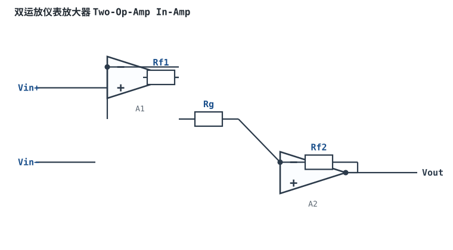
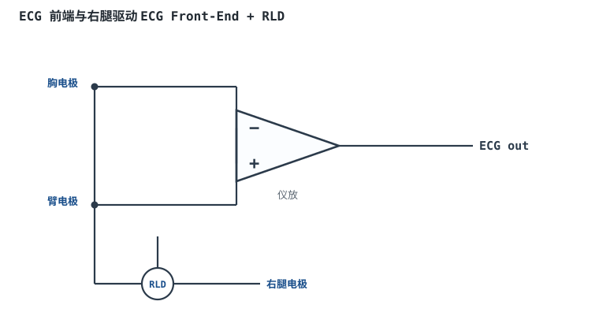
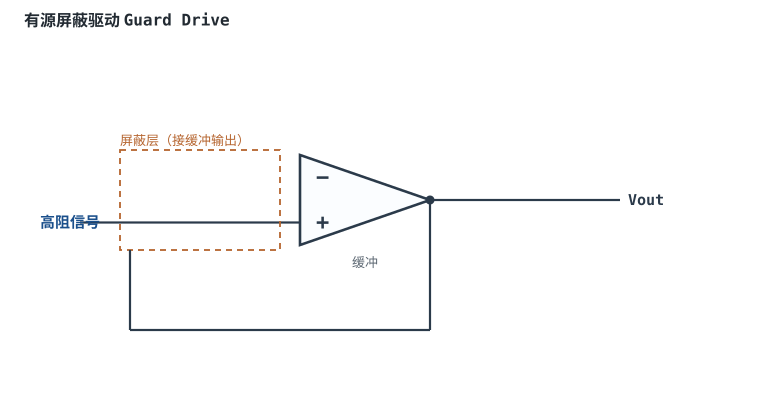

# 仪表放大器（三运放）Instrumentation Amplifier

## 1. 设计动机

::: motivation 为什么需要这个电路
[差分放大器](differential-amplifier.md) 输入阻抗不够高，且 CMRR 被四个分立电阻的精度卡死。实际传感器（电桥、热电偶、ECG）输出微弱差分信号（mV 级）叠加在大共模电压上，要求：**极高输入阻抗 + 可调增益 + 极高 CMRR**。仪表放大器（In-Amp）就是为此设计的经典结构。
:::

## 2. 原理图


## 3. 静态分析（DC）

三运放结构分两级：

- **前级 A₁、A₂**：两个同相输入运放，输入阻抗极高。两反相端之间跨接增益电阻 Rg，各自反馈电阻 Rf。由虚短，Rg 上的电压等于 $(V_{in+}-V_{in-})$，流过 Rg 和两个 Rf 的电流相同。
- **后级 A₃**：标准差分放大器，把前级的双端输出转成单端输出。

前级差模增益为 $1+2R_f/R_g$，整个电路总增益：

$$G=1+\frac{2R_f}{R_g}\quad(\text{前级})\times\quad\frac{R_f}{R_1}\quad(\text{后级})$$

集成仪表放大器只引出一个增益引脚（接 Rg），调一个电阻即可改增益。

## 4. 动态分析（AC / 瞬态）

前级对差模信号提供高增益、对共模信号增益为 1（两个运放同步跟随共模，不放大）。因此**共模信号在被后级差分之前已经"稀释"**，整个电路 CMRR 远高于单运放差分电路。

```echarts
{
  "tooltip": {"trigger": "axis"},
  "legend": {"data": ["输入差模 mV", "输出 V"], "bottom": 0, "textStyle": {"fontSize": 12}},
  "grid": {"left": 56, "right": 24, "top": 26, "bottom": 58},
  "xAxis": {"type": "category", "name": "角度", "data": [0,30,60,90,120,150,180,210,240,270,300,330,360], "axisLabel": {"fontSize": 11}},
  "yAxis": [
    {"type": "value", "name": "差模 mV", "min": -5, "max": 5, "axisLabel": {"fontSize": 11}},
    {"type": "value", "name": "输出 V", "min": -2.5, "max": 2.5, "axisLabel": {"fontSize": 11}}
  ],
  "series": [
    {"name": "输入差模 mV", "type": "line", "smooth": true, "showSymbol": false, "lineStyle": {"width": 2.2, "color": "#1a4f8b"},
     "data": [0,2.5,4.33,5,4.33,2.5,0,-2.5,-4.33,-5,-4.33,-2.5,0]},
    {"name": "输出 V", "type": "line", "smooth": true, "showSymbol": false, "yAxisIndex": 1, "lineStyle": {"width": 2.6, "color": "#b5642e"},
     "data": [0,1.25,2.17,2.5,2.17,1.25,0,-1.25,-2.17,-2.5,-2.17,-1.25,0]}
  ]
}
```

## 5. 环路分析

前级两个同相运放各自是电压串联负反馈，后级是差分反馈。集成 In-Amp 内部电阻已激光修调并补偿好，保证高 CMRR 与稳定性。

::: advanced 进阶：为什么三运放 CMRR 高
前级对共模增益为 1、对差模增益为 $1+2R_f/R_g$，相当于先把差模放大 G 倍、共模不变；后级差分再做减法。等效地，整个电路的 CMRR ≈ 前级差模增益 × 后级 CMRR，因此高增益时 CMRR 可达 120~140dB。分立搭三运放时，后级四个电阻的匹配仍是瓶颈——所以工程上直接买集成 In-Amp（电阻出厂修调），而不是自己搭。
:::

## 6. 元件取值与工程权衡

- **增益由 Rg 设定**：G 越大 Rg 越小；查数据手册"Gain vs Rg"曲线算值。
- **带宽随增益下降**：In-Amp 也有 GBP，G=100 时带宽可能只有几 kHz。
- **CMRR 随频率下降**：和运放一样，高频 CMRR 变差，查 CMRR-频率曲线。
- **集成 vs 分立**：优先选专用集成 In-Amp（如 AD620、INA系列），电阻匹配与稳定性已做好。

## 7. 完整设计示例

::: example 电桥信号放大
1. **需求**：称重电桥输出 ±10mV 差分，共模 2.5V，要放大到 ±2.5V。
2. **增益**：$G=2.5/0.01=250$。
3. **选型**：集成 In-Amp（如 AD620），按手册公式 $R_g=49.4\text{k}\Omega/(G-1)$，算得 $R_g\approx198\Omega$，取标准值。
4. **验算**：10mV×250=2.5V；共模 2.5V 在高 CMRR 下被抑制到 µV 级。
5. **注意**：共模 2.5V 需在输入共模范围内；单电源时加 REF 引脚偏置。
:::

## 8. 仿真与实验

LTspice 用三个运放搭三运放结构，前级加 Rg，后级接成差分；两输入端加同样的 1V 共模，观察输出是否近似 0，改变 Rg 观察增益变化。

## 扩展与变种电路

### 扩展1：双运放仪表放大器 Two-Op-Amp In-Amp

只用两个运放实现高输入阻抗差分放大，比三运放省一个，适合单电源、低功耗场合。



::: example 工作原理与静态分析
- 两输入端均为同相高阻输入，增益由外接 Rg 与反馈电阻比设定：$G=1+R_{f}/R_g$。
- 结构紧凑、单电源友好；CMRR 略低于三运放，共模范围受输出摆幅约束。
- 关键：电阻匹配仍决定 CMRR，精密应用优先选集成 In-Amp。
:::

取值数量级：Rg 按手册公式设定；与三运放对比：省功耗/面积，CMRR 略低。适用：电池供电、空间受限；不适用：超高 CMRR 大共模。

::: pitfall 共模输入范围算窄导致单电源失真
- **现象**：单电源下小信号输出削底。
- **原因**：双运放结构共模范围要求苛刻，信号共模靠近负轨。
- **解决**：核算共模输入范围，选 RRI 器件并抬高共模电平。
:::

### 扩展2：可编程增益仪表放大 PGA In-Amp

集成仪表放大器带数字增益选择脚，MCU 直接写寄存器切换增益，自动量程。


::: example 工作原理与静态分析
- 增益 $G=1+2R_f/R_g$，内部多路开关选不同 Rg 即不同档位。
- 内置激光修调电阻，CMRR/失调一致性好，无需外部匹配。
- 关键：增益越高带宽越窄，按信号频率反推最大可用增益。
:::

取值数量级：档位 1/10/100/1000；与外接 Rg 手动调对比：程控、一致性好。适用：自动量程数据采集；不适用：需要任意非标准增益。

::: pitfall 高增益档带宽不够快变信号失真
- **现象**：G=1000 时快信号被平滑。
- **原因**：In-Amp 也有 GBP，高增益下带宽掉到几百 Hz。
- **解决**：按信号最高频率核算 $f_c=GBP/G$，必要时降增益或换宽带型号。
:::

### 扩展3：ECG 前端与右腿驱动 ECG Front-End + RLD

心电采集用仪表放大取体表差分信号，并把共模电压反相后驱动右腿电极（RLD），压低工频干扰。



::: example 工作原理与静态分析
- 体表两电极电位含大共模（工频）与 mV 级心电差分，仪放只放大差分。
- RLD：取两电极共模平均，反相放大后驱动右腿电极，形成负反馈把体表共模压下去。
- 关键：高输入阻抗、高 CMRR、带右腿驱动与右腿限流保护。
:::

取值数量级：心电信号 0.5~5mV、G=100~1000；与普通仪放对比：多了 RLD 回路。适用：生物电采集；不适用：普通工业测量。

::: pitfall RLD 断开后工频干扰暴增
- **现象**：电极一松，输出全是 50Hz 大干扰。
- **原因**：RLD 负反馈断开，共模不再被压制。
- **解决**：保证右腿电极接触良好，加导联脱落检测。
:::

### 扩展4：有源屏蔽驱动 Guard Drive

高阻低电平测量中，输入线屏蔽层不接地，而由缓冲器驱动到信号电位，消除漏电流与电缆电容。



::: example 工作原理与静态分析
- 屏蔽层接地时，电缆漏电流经绝缘电阻流进高阻信号，产生压降误差。
- 有源屏蔽：缓冲器把屏蔽层驱动到 $V_{guard}\approx V_{signal}$，屏蔽与芯线等电位，漏流趋近于 0，等效输入阻抗大增。
- 关键：缓冲器带宽要够、稳定性要好，防止驱动屏蔽电容引起振荡。
:::

取值数量级：电缆 pF~nF 级；与接地屏蔽对比：消除漏流、减小电缆电容影响。适用：静电计、高阻传感器、pH 计；不适用：低频普通信号。

::: pitfall 驱动屏蔽电容引起自激
- **现象**：接上长屏蔽线后输出振荡。
- **原因**：屏蔽层电容被缓冲器驱动，引入额外极点。
- **解决**：缓冲输出串小电阻隔离，选容性负载稳定型号。
:::

## 9. 常见坑

::: pitfall 常见坑
- **自己用 3 个运放 + 普通电阻搭，却指望 120dB CMRR**：后级电阻失配把 CMRR 压到 60dB。高 CMRR 场景直接用集成 In-Amp。
- **增益设很高却没注意带宽**：G=1000 时 In-Amp 带宽可能只有几百 Hz，快变信号失真。按信号频率反推最大可用增益。
:::

## 10. 自测题

<details><summary>三运放仪表放大器前级对共模信号的增益是多少？为什么这能提高 CMRR？</summary>

前级对共模增益为 1（两个运放同步跟随），对差模增益为 $1+2R_f/R_g$。差模被放大、共模不放大，等效 CMRR ≈ 差模增益 × 后级 CMRR，因此远高于单运放差分电路。

</details>

<details><summary>调仪表放大器增益通常改哪个电阻？</summary>

只改两前级反相端之间的**增益电阻 Rg**（集成 In-Amp 只引出这一个增益脚），$G=1+2R_f/R_g$，Rg 越小增益越大。

</details>

## 11. 参考资料

- A Designer's Guide to Instrumentation Amplifiers（Kitchin & Counts, ADI）
- A Deeper Look into Difference Amplifiers（ADI）
