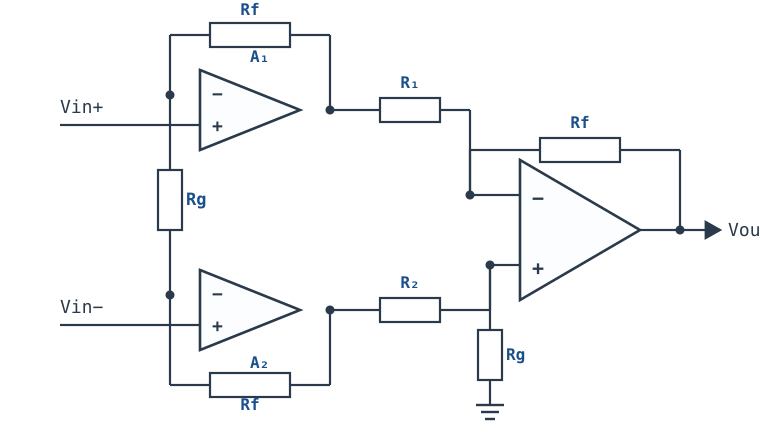
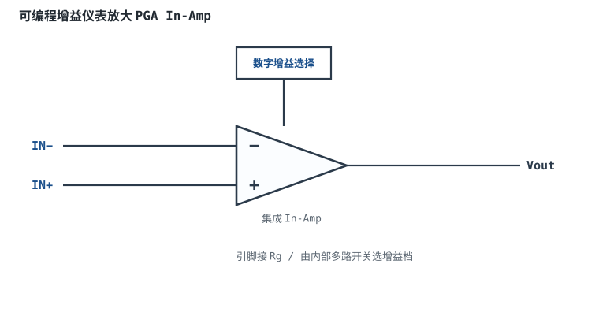

# 仪表放大器（三运放）Instrumentation Amplifier

仪表放大器（instrumentation amplifier，In-Amp）常被说成"带高阻输入缓冲的差分放大器"，这个说法只说对了一半。它真正的结构是**两级增益 + 一次减法**：第一级用两只同相输入运放提供极高的输入阻抗和大部分差模增益，第二级用一只差分放大器把双端输出变成单端，并继续抑制共模。它的核心不是增益公式，而是两个可以算的机制：**第一级的共模增益恒为 1**（共模不被放大），**第二级的共模误差折算到总输入时被第一级增益除掉**。把这两条接起来，就是 $CMRR_{total}\approx G_1\cdot CMRR_2$。理解了这条乘法链，才能把 $G=100$、带宽 10kHz、源阻抗 1kΩ 的设计一次算对。

**本章约定**：$G$ 是总闭环差模增益的**幅值**（极性由第二级接法决定，见 §2.3），$G_1$ 是第一级差模增益，$G_2$ 是第二级差模增益，$G=G_1G_2$。第一级的两只反馈电阻记作 $R$（图中标为 Rf），跨接在两个反相端之间的增益电阻记作 $R_G$（图中标为 Rg）；第二级四只电阻记作 $R_1$、$R_2$、$R_f$、$R_4$（图中分别标为 R₁、R₂、Rf、Rg）。$V_{id}=V_{in+}-V_{in-}$ 是差模电压，$V_{cm}=(V_{in+}+V_{in-})/2$ 是共模电压；$\beta$ 是反馈系数（**不是**三极管的电流放大倍数），噪声增益 $1/\beta$，环路增益 $T=A_{OL}\beta$；CMRR 是电压比，分贝一律用 $20\lg$。符号口径与[差分放大器与电阻匹配](differential-amplifier.md)、[共模范围、CMRR 与 PSRR](cmrr-psrr.md)一致。

## 1. 设计动机

::: motivation 三个真实场景
**场景一：电桥的 10mV 差分叠在 2.5V 共模上。** 5V 激励的称重电桥，满量程输出约 10mV，共模约 2.5V，源阻抗每臂 350Ω。目标增益 100，输出 1V。若用四电阻减法器，差模输入电阻只有 $2R_1$，取 $R_1=10\text{k}\Omega$ 就是 20kΩ，700Ω 的源阻抗带来约 3.4% 的增益损失；更严重的是，$G=100$ 配 0.1% 电阻时，电阻项把电路 CMRR 限到 $(1+100)/(4\times0.001)=25250$，即 88dB（把 100dB 运放合进去是 86.1dB），2.5V 共模在输出端留下 $2.5\times100/25250=9.9\text{mV}$ 的电阻项误差，合成后是 12.4mV。换成 100dB 的仪表放大器，同样 2.5V 共模只剩 2.5mV；120dB 时只剩 0.25mV。

**场景二：10kΩ 源阻抗，四电阻减法器的信号被分掉一半。** 差模输入电阻 20kΩ 与两根线各 10kΩ 的源阻抗串联，分压比 $20/(20+20)=0.5$，增益从 100 掉到 50。仪表放大器的输入是两只运放的同相端，输入阻抗在 GΩ 量级，10kΩ 源也几乎不分压；但输入偏置电流会在源阻抗上产生压降，$10\text{nA}\times10\text{k}\Omega=100\mu\text{V}$，放大 100 倍是 10mV——**高阻源并不是"接上就行"，还要看 $I_B$。**

**场景三：分立三运放配 0.1% 电阻，CMRR 只有 88.7dB，不是 120dB。** 第二级四只 0.1% 电阻给出 $CMRR_2=(1+2)/(4\times0.001)=750$（57.5dB）；第一级增益 $G_1=50$ 把它放大到 $50\times750=37500$（91.5dB）；再与运放自身的 100dB 合成，得到 88.7dB。集成 INA 把第二级电阻做在芯片内并激光修调，才能把 100~120dB 的 CMRR 做进同一颗封装——**分立搭法的瓶颈在第二级电阻，不在第一级。**
:::

| 你想确认 | 先算/先查 | 判据（工程经验值） |
|---|---|---|
| 增益怎么分配 | $G=G_1G_2$，$R_G=2R/(G_1-1)$ | 第一级拿主要增益，第二级 1~10 |
| CMRR 够不够 | $CMRR\approx G_1\cdot CMRR_2$，$CMRR_2=(1+G_2)/(4\delta_2)$ | 目标 CMRR 反算 $\delta_2$ 或 $G_1$ |
| 共模范围 | $V_{cm}\pm G_1V_{id}/2$ 与输出摆幅、ICMR | 两端各留 0.1~0.2V |
| 带宽够不够 | $f_{cl1}=GBW/[(G_1+1)/2]$，$f_{cl2}=GBW/(1+G_2)$ | 级联后 ≥10× 最高信号频率 |
| 直流误差 | $V_{OS}G+I_B\Delta R_sG+I_{OS}R_sG+V_{cm}G/CMRR$ | <1 LSB 或目标精度 |
| 源阻抗能不能接 | $I_BR_s$ 与信号幅度 | 误差 < 信号幅度的 1/10 |
| 集成还是分立 | CMRR、共模范围、成本、带宽 | 精密量产优先集成 |

**不按这条链算会摔在哪**，四个带数字的代价：

1. **以为"三运放"天然 120dB。** 分立第二级用 0.1% 电阻，$G_1=50$、$G_2=2$ 时总 CMRR 只有 91.5dB，与运放合成后 88.7dB；2V 共模在输出端是 7.35mV，对 12 位、5V ADC 是 6 个码。
2. **共模范围只查输入 ICMR。** $V_{cm}=4\text{V}$、$G_1=50$、$V_{id}=\pm20\text{mV}$ 时，第一级输出是 $4\pm0.5\text{V}$，上限 4.5V；若第一级输出摆幅只有 ±4V，输出先撞轨，输入共模却还在 ICMR 内。
3. **忽略 $R_G$ 的容差与寄生电阻。** $G_1=100$ 时 $R_G$ 只有约 500Ω，1Ω 的引线/开关电阻就是 0.2%；10Ω 的模拟开关导通电阻就是约 2%，高增益档更糟。
4. **高增益不看带宽。** $G_1=1000$ 时 $R_G=2R/999$，若 $R=24.9\text{k}\Omega$ 则 $R_G=49.8\Omega$，第一级噪声增益约 500，GBW=1MHz 时 $f_{cl1}\approx2\text{kHz}$，10kHz 信号已经被衰减。

## 2. 定义与直观

### 2.1 结构：两级分工

三运放 INA 分成两级：

- **第一级 A1、A2**：两个同相输入运放，输入阻抗极高；两只反馈电阻 $R$ 分别从各自的输出接回反相端，$R_G$ 跨接在两个反相端之间。它提供高输入阻抗和差模增益 $G_1=1+2R/R_G$，对共模的增益是 1。
- **第二级 A3**：标准四电阻差分放大器，把 A1、A2 的双端输出相减，变成单端输出，同时提供第二级增益 $G_2$。

**两级的分工不是随便定的**：第一级负责"高阻 + 放大差模"，第二级负责"相减 + 抑制共模"。第一级把差模放大 $G_1$ 倍、共模原样传下去；第二级再把共模减掉。总 CMRR 因此约等于 $G_1\cdot CMRR_2$——第一级增益越高，第二级的共模误差被除得越狠。

### 2.2 第一级：高阻输入与差模增益

设两个输入端电压为 $V_{in+}$、$V_{in-}$，两个反相端节点为 N1、N2。由虚短：

$$V_{N1}=V_{in+},\qquad V_{N2}=V_{in-},\qquad V_{N1}-V_{N2}=V_{id}$$

$R_G$ 上的电压就是 $V_{id}$，所以流过 $R_G$ 的电流是

$$I_{R_G}=\frac{V_{id}}{R_G}$$

运放输入端不取电流，这股电流只能流过两只 $R$。于是

$$V_{o1}=V_{in+}+I_{R_G}R,\qquad V_{o2}=V_{in-}-I_{R_G}R$$

两式相减：

$$V_{o1}-V_{o2}=V_{id}+2I_{R_G}R=V_{id}\left(1+\frac{2R}{R_G}\right)=G_1V_{id}$$

两式相加除以 2：

$$\frac{V_{o1}+V_{o2}}{2}=\frac{V_{in+}+V_{in-}}{2}=V_{cm}$$

**这两个结果就是整章的骨架**：

- 差模增益 $G_1=1+2R/R_G$，只由 $R$ 与 $R_G$ 的比值决定；
- 共模增益恒为 **1**，两个输出同步跟着 $V_{cm}$ 走，差模输出为 0。

注意共模增益是 1，不是 0。第一级并没有"抑制"共模，它只是**不放大**共模；共模仍然原样出现在两个输出上，等着第二级去减。**把"共模增益=1"误读成"共模被抑制"，后面所有 CMRR 账都会算错。**

第一级的输入阻抗就是两只运放的同相输入阻抗：普通双极输入运放典型 $10^6\sim10^8\Omega$，JFET/CMOS 输入可到 $10^{12}\Omega$ 以上；集成 INA 的数据手册通常把输入阻抗标成 $10^9\Omega$ 量级并联几 pF（典型量级，以数据手册为准）。信号源看到的是这个高阻，不是四电阻网络的 $2R_1$，这是 INA 能接高阻传感器的根本原因。

### 2.3 第二级：差分放大与增益分配

第二级是[差分放大器与电阻匹配](differential-amplifier.md)里的四电阻减法器。按图中接法（A1 输出经 $R_1$ 接 A3 反相端、A2 输出经 $R_2$ 接 A3 同相端），输出是

$$V_{out}=G_2(V_{o2}-V_{o1})+V_{REF},\qquad G_2=\frac{R_f}{R_1}=\frac{R_4}{R_2}$$

其中 $V_{REF}$ 是第二级下地电阻 $R_4$ 所接的参考电压；图中 $R_4$ 接地，所以 $V_{REF}=0$，很多集成 INA 把它引成 REF 引脚。匹配时它只放大 $V_{o2}-V_{o1}$，把第一级送来的共模 $V_{cm}$ 减掉。按图中接法，输出与 $V_{id}=V_{in+}-V_{in-}$ 反相；需要同相时把 A1、A2 的输出对调（或把两个输入标号对调）。以下 $G$ 均指幅值，CMRR、带宽、误差预算都不受极性问题影响。

总增益的幅值：

$$G=G_1G_2=\left(1+\frac{2R}{R_G}\right)\frac{R_f}{R_1}$$

**增益分配的原则**：第一级拿主要增益，第二级取 1~10。原因有三条：

1. **CMRR**：总 CMRR $\approx G_1\cdot CMRR_2$，$G_1$ 越大，第二级电阻失配的影响被除得越狠；
2. **噪声**：第二级的输入折算噪声会被 $G_1$ 除，第一级噪声占主导，所以第一级要高增益、低噪声；
3. **带宽与共模余量**：第一级增益太高会让第一级输出被 $V_{cm}\pm G_1V_{id}/2$ 推得更远，压缩共模范围；第二级增益低则带宽高、共模误差小。

第二级取 1~10 是折中，不是定理。具体分多少，要看 CMRR、带宽、共模范围三个约束谁先撞线（§4.2 给三种分法的数字）。

### 2.4 符号与图的对应

图里第一级和第二级都用了 Rf、Rg 这两个标号，读图时容易混。本章的对应关系如下：

| 图中标号 | 本章符号 | 作用 |
|---|---|---|
| 第一级 Rf（两只） | $R$ | 第一级反馈电阻，决定 $G_1$ |
| 第一级 Rg | $R_G$ | 增益设置电阻，跨接两反相端 |
| 第二级 R₁、R₂ | $R_1$、$R_2$ | 第二级输入电阻 |
| 第二级 Rf | $R_f$ | 第二级反馈电阻 |
| 第二级 Rg | $R_4$ | 第二级同相端下地电阻，接 REF |

**第一级只有一只 $R_G$**，不是两只。有些资料把 $R_G$ 画成两半、中间接地或接共模点，那是另一种接法；在标准三运放结构里，$R_G$ 就是跨在两个反相端之间的一只电阻，只有它的总和进入增益公式。

### 2.5 与四电阻减法器的区别

| 维度 | 四电阻减法器 | 三运放 INA |
|---|---|---|
| 差模输入电阻 | $R_1+R_2$，kΩ 级 | 运放输入阻抗，GΩ 级 |
| CMRR 瓶颈 | 四只电阻的比值匹配 | 第二级四只电阻的匹配，被 $G_1$ 放大 |
| 增益调整 | 改 $R_f$ 会破坏匹配 | 只改 $R_G$，不碰匹配网络 |
| 共模范围 | 受分压后的 ICMR 限制 | 受第一级输出摆幅、第二级 ICMR 限制 |
| 成本 | 最低 | 分立中高，集成最高 |
| 适用 | 低阻源、低精度 | 高阻源、高 CMRR、传感器前端 |

**INA 不是"四电阻减法器加两个缓冲"**：缓冲只提高输入阻抗，不提高 CMRR；INA 的 CMRR 来自"第一级放大差模、不放大共模"和"第二级相减"这两步的配合。只加缓冲、不加第一级增益，第二级的 CMRR 误差仍然原样出现在输出端。

## 3. 定量关系

### 3.1 增益公式与 $R_G$ 的定量关系

总增益：

$$G=\left(1+\frac{2R}{R_G}\right)G_2$$

反过来解 $R_G$：

$$R_G=\frac{2R}{G_1-1}=\frac{2RG_2}{G-G_2}$$

若第二级取单位增益（$G_2=1$），则 $G=1+2R/R_G$，$R_G=2R/(G-1)$。集成 INA 通常把 $R$ 做在芯片内并修调好，只引出 $R_G$ 两个引脚；不同型号的内部 $R$ 不同，所以数据手册给的是"$R_G$ 与增益"的对应表或公式。以 INA128 为例，手册给的是

$$G=1+\frac{50\ \text{k}\Omega}{R_G}$$

这里的 $50\text{k}\Omega$ 就是内部 $2R$ 的等效值；换型号必须换公式，不能把 50k 套到所有 INA 上。

**$R_G$ 的误差直接进增益**。对 $G_1=1+2R/R_G$ 求偏导：

$$\frac{\Delta G_1}{G_1}\approx\frac{G_1-1}{G_1}\cdot\frac{\Delta R_G}{R_G}$$

$G_1=50$ 时系数是 $49/50=0.98$，$R_G$ 的 0.1% 容差带来约 0.098% 的增益误差；$G_1=100$ 时系数是 0.99。**高增益时 $R_G$ 很小，引线电阻、接插件接触电阻、模拟开关导通电阻都直接串进去**：$G_1=100$、$R_G\approx500\Omega$ 时，1Ω 就是 0.2%，10Ω 就是约 2%。这是 PGA 高增益档精度变差的常见原因。

### 3.2 共模抑制的双重机制

把第一级和第二级接起来，看共模怎么走：

1. **第一级**：差模放大 $G_1$，共模增益 1。所以第二级看到的差分信号是 $G_1V_{id}$，共模仍是 $V_{cm}$。
2. **第二级**：差模放大 $G_2$，共模增益 $A_{cm2}$。它的共模误差在输出端是 $A_{cm2}V_{cm}$。
3. **折算到总输入**：输出误差除以总差模增益 $G_1G_2$：

$$V_{err,in}=\frac{A_{cm2}V_{cm}}{G_1G_2}=\frac{V_{cm}}{G_1}\cdot\frac{A_{cm2}}{G_2}=\frac{V_{cm}}{G_1\cdot CMRR_2}$$

所以总 CMRR：

$$CMRR_{total}\approx G_1\cdot CMRR_2$$

其中 $CMRR_2=G_2/A_{cm2}$ 是第二级自己的 CMRR。第二级的四只电阻失配给出（推导见[差分放大器与电阻匹配](differential-amplifier.md)）

$$CMRR_2\approx\frac{1+G_2}{4\delta_2}$$

$\delta_2$ 是第二级单只电阻的相对容差。代进去：

$$CMRR_{total}\approx\frac{G_1(1+G_2)}{4\delta_2}$$

**这就是"双重机制"**：第一级把差模放大 $G_1$ 倍、共模不放大，相当于把信噪比（差模/共模）提高了 $G_1$ 倍；第二级再做减法，它的共模误差被 $G_1$ 除。**不是第一级"抵消"了共模，而是第一级把差模放大后，第二级的共模误差相对变小了。**

把第一级自身的 CMRR、源阻抗失配也加进来，完整的倒数预算是

$$\frac{1}{CMRR_{total}}=\frac{4\delta_2}{G_1(1+G_2)}+\frac{1}{CMRR_1}+\frac{\Delta R_s}{R_{in}}$$

其中 $CMRR_1$ 是第一级自身的 CMRR（由两只运放的 CMRR 失配决定，保守取运放手册值），$R_{in}$ 是 INA 的输入电阻，$\Delta R_s$ 是两根线的源阻抗失配。**第一项是第二级电阻，第二项是运放，第三项是源阻抗**——三项倒数相加，谁最大谁主导。

| 第二级电阻容差 $\delta_2$ | $G_2=2$ 的 $CMRR_2$ | $G_1=50$ 的总 CMRR | 再合成 100dB 运放 | 2V 共模输出误差 |
|---|---|---|---|---|
| 1%（0.01） | 75（37.5dB） | 3750（71.5dB） | 3610（71.1dB） | 55.4mV |
| 0.1%（0.001） | 750（57.5dB） | 37500（91.5dB） | 27203（88.7dB） | 7.35mV |
| 0.01%（0.0001） | 7500（77.5dB） | 375000（111.5dB） | 78989（97.9dB） | 2.53mV |

**读法**：0.1% 时第二级电阻主导；0.01% 时运放的 100dB 成了新瓶颈，总 CMRR 只有 97.9dB，不是 111.5dB。**想把 CMRR 做到 100dB 以上，第二级电阻、运放 CMRR、源阻抗三项要一起看。**

### 3.3 第一级匹配到底决定什么：一个常见误解

很多资料会说"第一级的两只 $R_G$ 匹配决定 CMRR 的下限"。这句话放在标准三运放结构上并不准确，值得用两行推导拆开。

设第一级两只反馈电阻分别为 $R_{f1}$、$R_{f2}$，增益电阻仍为 $R_G$。由虚短，$R_G$ 上的电压是 $V_{id}$，电流 $I=V_{id}/R_G$ 同时流过 $R_{f1}$、$R_{f2}$，所以

$$V_{o1}-V_{o2}=V_{id}\left(1+\frac{R_{f1}+R_{f2}}{R_G}\right)$$

$$\frac{V_{o1}+V_{o2}}{2}=V_{cm}+V_{id}\frac{R_{f1}-R_{f2}}{2R_G}$$

第一式说明：$R_{f1}\ne R_{f2}$ 改变的是差模增益（由两只电阻的平均值决定），不改变"共模输入不产生差模输出"这件事。第二式说明：$R_{f1}\ne R_{f2}$ 把**差模**转成**共模**，而不是把共模转成差模。共模输入时 $V_{id}=0$，两个输出仍然只跟着 $V_{cm}$ 走，差模输出为 0。

所以第一级电阻失配的真实后果是：

1. **增益不对称**：两只 $R$ 的平均值决定 $G_1$，差值造成输出共模偏移；
2. **挤占第二级的共模余量**：$V_{id}(R_{f1}-R_{f2})/(2R_G)$ 叠加在 $V_{cm}$ 上，可能让第一级输出或第二级输入先撞轨；
3. **不是 CMRR 下限**：共模到差模的转换由两只运放自身的 CMRR 失配和源阻抗失配决定，不由 $R_G$ 的匹配决定。

代数字：$G_1=49.82$、$R_{f1}/R_{f2}$ 失配 0.1%、$V_{id}=20\text{mV}$，输出共模偏移是

$$20\text{mV}\times0.001\times\frac{49.82-1}{2}=0.49\ \text{mV}$$

第二级 CMRR 57.5dB（750）把它变成 $0.49/750=0.65\mu\text{V}$ 的输入误差，再乘 $G_2=2$ 是 1.3µV——和 5mV 的失调比可以忽略。**它影响的是余量，不是 CMRR。**

有限开环增益和 $R_{f1}/R_{f2}$ 失配还会通过两条反馈臂的环路增益差异引入二阶共模→差模项，量级远小于第二级电阻项，不改变上面的结论。真正决定 CMRR 下限的是第二级四只电阻的匹配（§3.2），以及第一级两只运放自身的 CMRR 失配。**"两只 $R_G$ 匹配决定 CMRR"只在双运放 INA 或把 $R_G$ 分成两半、分别接两个独立反馈网络的变种里成立；标准三运放里第一级只有一只 $R_G$，它的失配只影响增益总和。** 这也能解释为什么集成 INA 把力气花在第二级的修调电阻上，而不是要求用户去匹配两只 $R_G$。

### 3.4 共模范围：第一级输出会被共模推走

第一级两个输出是

$$V_{o1,2}=V_{cm}\pm\frac{G_1V_{id}}{2}$$

共模 $V_{cm}$ 原样抬在两个输出上，差模再叠加 $\pm G_1V_{id}/2$。所以共模范围不是只看输入 ICMR，而是三条约束同时满足：

1. **第一级运放输入**：$V_{cm}$ 落在两只运放的输入共模范围内；
2. **第一级输出**：$V_{cm}\pm G_1V_{id}/2$ 落在两只运放的输出摆幅内；
3. **第二级输入**：第二级也会把共模分压，A3 的输入共模是 $V_{cm}\cdot G_2/(1+G_2)$，它要落在第二级运放的输入共模范围内（有些集成 INA 的第二级是内部电路，按手册的"共模输入范围"查）。

由约束 2 可以解出允许的最大共模：

$$V_{cm,max}=V_{out,max}-\frac{G_1V_{id}}{2}$$

其中 $V_{out,max}$ 是第一级输出摆幅的上限（V），$V_{id}$ 是差模电压（V）。**增益 $G_1$ 越大、差模越大，允许的共模越小**——这就是 INA 数据手册里"共模范围随增益缩小"的 diamond plot 的来源。

集成 INA 的 REF 引脚只改变第二级输出的直流电平（$V_{out}=G_2(V_{o2}-V_{o1})+V_{REF}$），**不改变第一级输出被 $V_{cm}$ 推走这件事**。单电源 5V 供电时，把 REF 接 2.5V 可以让输出居中，但第一级输出仍然要满足 $V_{cm}\pm G_1V_{id}/2$ 在 0~5V 内；共模接近电源轨时，先撞的是第一级输出，不是 REF。

### 3.5 噪声、带宽与增益分配

第一级每只运放看到的噪声增益是

$$1/\beta_1=1+\frac{R}{R_G}=\frac{G_1+1}{2}$$

所以第一级闭环带宽：

$$f_{cl1}=\frac{GBW}{1/\beta_1}=\frac{GBW}{(G_1+1)/2}$$

第二级噪声增益 $1/\beta_2=1+G_2$，闭环带宽：

$$f_{cl2}=\frac{GBW}{1+G_2}$$

两级级联的带宽按一阶近似：

$$\frac{1}{f_{cl}}\approx\frac{1}{f_{cl1}}+\frac{1}{f_{cl2}}$$

**噪声分配**：第一级的输入折算噪声被 $G_1G_2$ 放大，第二级的输入折算噪声只被 $G_2$ 放大；折算到总输入，第二级噪声要除以 $G_1$。所以第一级增益越高，第二级噪声贡献越小，但第一级自身的噪声（运放电压噪声、$R$ 与 $R_G$ 的热噪声）会占主导。**低噪声设计要把第一级做成低噪声、适当高增益，而不是把增益全堆到第二级。**

高增益的带宽代价很直接：$G_1=1000$、$R=24.9\text{k}\Omega$ 时 $R_G=49.8\Omega$，$1/\beta_1=(1000+1)/2=500.5$，GBW=1MHz 时 $f_{cl1}=1\text{MHz}/500.5=2.0\text{kHz}$。**10kHz 的信号在这个增益下已经被衰减，光看直流增益会漏掉这条。**

### 3.6 直流误差预算

把输入端的各项误差折算到输出：

$$V_{OUT,err}\approx G\left(V_{OS}+I_B\Delta R_s+I_{OS}R_s+\frac{V_{cm}}{CMRR_{total}}\right)+V_{OUT}\frac{\Delta G}{G}$$

符号与单位：$V_{OS}$ 是输入失调电压（V）；$I_B$ 是输入偏置电流（A）；$I_{OS}$ 是输入失调电流（A）；$\Delta R_s$ 是两根线源阻抗之差（Ω）；$R_s$ 是每根线的源阻抗（Ω）；$V_{cm}$ 是共模电压（V）；$CMRR_{total}$ 无量纲；$\Delta G/G$ 是增益相对误差（无量纲）。

四个要点：

1. **$V_{OS}$ 项**：直接乘 $G$，与源阻抗无关；$G=100$、$V_{OS}=50\mu\text{V}$ 时输出 5mV。
2. **$I_B\Delta R_s$ 项**：源阻抗配平时为零；不配平时，$I_B$ 在两根线上压降不同，形成差模误差。$I_B=10\text{nA}$、$\Delta R_s=1\text{k}\Omega$ 时是 10µV，乘 100 是 1mV。
3. **$I_{OS}R_s$ 项**：即使源阻抗配平也消不掉，因为 $I_{OS}$ 是两个输入端偏置电流之差。$I_{OS}=1\text{nA}$、$R_s=1\text{k}\Omega$ 时是 1µV，乘 100 是 0.1mV。
4. **CMRR 项**：$V_{cm}/CMRR_{total}$ 再乘 $G$，是共模抑制的残余；$V_{cm}=2\text{V}$、$CMRR=27203$ 时是 7.35mV，往往是最大的一项。

**输入偏置电流必须有直流通路**：如果传感器是交流耦合的，两个输入端对地都是开的，$I_B$ 会把输入端充电到饱和。工程上要在每个输入端对地接一只电阻，或者让源本身提供直流通路；阻值按 $I_B R$ 的允许误差选，例如 $I_B=10\text{nA}$、允许 1mV 时 $R\le100\text{k}\Omega$。阻值再大，$I_B R$ 就吃不消；阻值太小，又会加载信号源、降低输入阻抗，要在偏置误差与源加载之间折中。

### 3.7 适用条件与失效边界

1. **共模范围三条约束**：输入 ICMR、第一级输出摆幅、第二级输入 ICMR，任何一条越界都会削顶或锁死。
2. **源阻抗不能太大**：$I_B R_s$ 和 $I_{OS}R_s$ 会变成失调；$R_s$ 到 MΩ 级时，要么选 FET/CMOS 输入 INA，要么加缓冲。
3. **$R_G$ 的寄生电阻**：引线、接插件、模拟开关的导通电阻直接进增益；高增益档尤其敏感。
4. **第二级电阻匹配**：分立搭法按 $(1+G_2)/(4\delta_2)$ 算；集成 INA 按手册的 CMRR vs Gain 表。
5. **带宽随增益下降**：$f_{cl1}=GBW/[(G_1+1)/2]$，高增益时可能只剩几 kHz。
6. **容性负载与稳定性**：第一级输出驱动第二级输入电容、电缆电容，可能振铃；必要时加隔离电阻或反馈电容。

## 4. 典型计算

### 4.1 设计示例：$G=100$、带宽 ≥10kHz、源阻抗 1kΩ

**需求**：差模 $\pm20\text{mV}$，共模 2V，源阻抗每根线 1kΩ（失配 ≤10Ω），总增益 100，带宽 ≥10kHz；后级 12 位、5V ADC（1 LSB=1.22mV）；要求直流误差 <1 LSB；±5V 双电源，第一级输出摆幅按 ±4V 估（典型量级，以数据手册为准）。

**第 1 步：分增益。** 取第一级 $G_1=50$、第二级 $G_2=2$。第一级反馈电阻 $R=24.9\text{k}\Omega$（0.1%），由 $R_G=2R/(G_1-1)$：

$$R_G=\frac{2\times24.9\text{k}\Omega}{50-1}=\frac{49.8\text{k}\Omega}{49}=1.016\text{k}\Omega$$

取 E96 的 $1.02\text{k}\Omega$（0.1%）。实际

$$G_1=1+\frac{2\times24.9}{1.02}=1+48.82=49.82$$

第二级取 $R_1=R_2=10\text{k}\Omega$、$R_f=R_4=20\text{k}\Omega$（均 0.1%），$G_2=20/10=2$。总增益

$$G=49.82\times2=99.65$$

相对 100 的误差 $-0.353\%$，主要来自 $R_G$ 取整；它可以用软件两点校准消掉，或在 0.4% 的电阻容差预算之外单独接受。需要硬件精确 100 时，用 0.05% 的 $R_G$ 或加微调。

**第 2 步：输入阻抗与偏置。** INA 输入阻抗在 GΩ 量级，1kΩ 源的分压可以忽略（$10^9/(10^9+10^3)=0.999999$）。设 $I_B=10\text{nA}$、$I_{OS}=1\text{nA}$（示例取值，典型量级，以数据手册为准）：

$$I_BR_s=10\text{nA}\times1\text{k}\Omega=10\mu\text{V},\qquad I_{OS}R_s=1\text{nA}\times1\text{k}\Omega=1\mu\text{V}$$

乘 100 分别是 1mV 和 0.1mV；源失配 10Ω 的 $I_B\Delta R_s=10\text{nA}\times10\Omega=0.1\mu\text{V}$，乘 100 是 0.01mV。**高阻 INA 的优势在输入阻抗，不在偏置电流；1kΩ 源时偏置项还小，到 100kΩ 源就会变成 100mV 量级。**

**第 3 步：CMRR 预算。** 第二级 0.1%：

$$CMRR_2=\frac{1+G_2}{4\delta_2}=\frac{1+2}{4\times0.001}=750\ (57.5\ \text{dB})$$

总 CMRR：

$$CMRR_{total}=G_1\cdot CMRR_2=49.82\times750=37368\ (91.45\ \text{dB})$$

再合成运放自身 100dB（取手册值，按工作频率）：

$$\frac{1}{CMRR_{total}}=\frac{1}{37368}+\frac{1}{10^5}=2.676\times10^{-5}+1.0\times10^{-5}=3.676\times10^{-5}$$

$$CMRR_{total}=27203\ (88.69\ \text{dB})$$

源阻抗失配 10Ω 的共模转换项 $\Delta R_s/R_{in}=10/10^9=10^{-8}$，即 160dB，远大于 88.7dB，可以忽略；但它的 $I_B$ 失调项按第 2 步算，是 0.01mV。

**第 4 步：直流误差。** 取 $V_{OS}=50\mu\text{V}$（示例取值，典型量级，以数据手册为准）：

$$V_{OS}G=50\mu\text{V}\times100=5.0\ \text{mV}$$

$$I_B\Delta R_sG=0.1\mu\text{V}\times100=0.01\ \text{mV}$$

$$I_{OS}R_sG=1\mu\text{V}\times100=0.10\ \text{mV}$$

$$\frac{V_{cm}G}{CMRR_{total}}=\frac{2\times100}{27203}=7.35\ \text{mV}$$

合起来：

$$V_{OUT,err}=5.0+0.01+0.10+7.35=12.46\ \text{mV}$$

对 12 位、5V ADC：

$$N=\frac{12.46}{1.22}=10.2\ \text{个码}$$

差模满量程输出 2V，12.46mV 占 0.62%。**CMRR 项 7.35mV 比 $V_{OS}$ 项 5mV 还大——要压误差，先把第二级电阻或共模降下来，而不是先换更低失调的运放。**

**第 5 步：增益误差。** 0.1% 电阻的预算：

- $R_G$ 的 0.1%：$(G_1-1)/G_1\times0.1\%=0.098\%$；
- 两只 $R$ 的 0.1%：同样 0.098%；
- 第二级 0.1%：最坏 $2\times0.1\%=0.2\%$（若用比值 0.1% 的电阻网络则按 0.1%）；
- 取整到 1.02kΩ 的 $R_G$：−0.353%。

最坏合成 $0.098+0.098+0.2+0.353=0.75\%$，输出端 2V 满量程对应 15mV。**增益误差可以用两点校准消掉，但温漂消不掉**：$R_G$ 与 $R$ 的 TCR 不匹配时，增益随温度漂；精密场合用同 TCR 的薄膜电阻。

**第 6 步：带宽。** 第一级噪声增益：

$$1/\beta_1=\frac{G_1+1}{2}=\frac{50.82}{2}=25.41$$

$$f_{cl1}=\frac{1\text{MHz}}{25.41}=39.35\ \text{kHz}$$

第二级：

$$f_{cl2}=\frac{1\text{MHz}}{1+2}=333.3\ \text{kHz}$$

级联：

$$f_{cl}\approx\frac{1}{1/(39.35\ \text{kHz})+1/(333.3\ \text{kHz})}=35.2\ \text{kHz}$$

35.2kHz > 10kHz，满足，余量 3.5 倍。有限开环增益再检查一遍：第一级 $\beta=R_G/(R+R_G)=1.02/25.92=0.03935$，$T_1=10^5\times0.03935=3935$，增益误差 $1/(1+T_1)=0.025\%$；第二级 $\beta=10/30=0.333$，$T_2=3.3\times10^4$，误差 0.003%。两项合计 0.028%，远小于 0.75% 的电阻预算。

**第 7 步：共模范围。** $V_{cm}=2\text{V}$、$G_1=49.82$、$V_{id}=\pm20\text{mV}$：

$$V_{o1,2}=2\pm\frac{49.82\times0.02}{2}=2\pm0.498=1.50\sim2.50\ \text{V}$$

在 ±4V 摆幅内。允许的最大共模：

$$V_{cm,max}=4-\frac{49.82\times0.02}{2}=4-0.498=3.50\ \text{V}$$

$V_{cm}=4\text{V}$ 时第一级输出到 4.50V，已经撞轨；此时输入共模可能还在 ICMR 内，但输出先坏。**这就是"共模范围要按第一级输出算"的具体数字。**

**第 8 步：设计汇总。**

| 项目 | 取值 | 验算 |
|---|---|---|
| 第一级 $R$ | 24.9kΩ，0.1% | $G_1=1+2R/R_G$ |
| 第一级 $R_G$ | 1.02kΩ，0.1% | $G_1=49.82$ |
| 第二级 $R_1=R_2$ | 10kΩ，0.1% | $G_2=2$ |
| 第二级 $R_f=R_4$ | 20kΩ，0.1% | $G=99.65$，−0.353% |
| 总 CMRR | 88.7dB（0.1% + 100dB 运放） | 2V 共模 → 7.35mV |
| 直流误差 | 12.46mV | 10.2 个 12 位码 |
| 带宽 | 35.2kHz | >10kHz |
| 最大共模 | 3.50V（$V_{id}=20\text{mV}$） | 第一级输出 4.0V |

### 4.2 算例二：增益分配 10/10、50/2、100/1 的取舍

同样 $R=24.9\text{k}\Omega$、第二级 0.1%、运放 100dB、GBW=1MHz，只改第一级/第二级的分法：

| $G_1/G_2$ | $R_G$ | 实际 $G_1$ | 实际 $G$ | 第二级 $CMRR_2$ | 合成 CMRR（含运放） | $f_{cl1}$ | 级联带宽 |
|---|---|---|---|---|---|---|---|
| 10/10 | 5.49kΩ | 10.07 | 100.7 | 2750（68.8dB） | 21689（86.7dB） | 180.7kHz | 60.5kHz |
| 50/2 | 1.02kΩ | 49.82 | 99.65 | 750（57.5dB） | 27203（88.7dB） | 39.35kHz | 35.2kHz |
| 100/1 | 0.505kΩ | 99.61 | 99.61 | 500（54.0dB） | 33247（90.4dB） | 19.88kHz | 19.1kHz |

**读法**：

- **10/10**：第二级增益高，$CMRR_2$ 大（68.8dB），但 $G_1$ 小，乘出来只有 86.7dB；带宽最大（60.5kHz）。适合带宽优先、CMRR 要求不高的场合。
- **50/2**：CMRR 88.7dB、带宽 35.2kHz，折中。
- **100/1**：$G_1$ 最大，CMRR 最高（90.4dB），但 $R_G$ 只有 505Ω，第一级噪声增益 50.3，带宽掉到 19.1kHz；共模余量也最小。适合 CMRR 优先、信号带宽 <10kHz 的场合。

**结论**：三种分法都能过 10kHz，但 CMRR 差 3.7dB、带宽差 3 倍。**增益分配不是"第一级越大越好"，而是按 CMRR、带宽、共模余量三个约束取折中。**

### 4.3 算例三：源阻抗不平衡，INA 与四电阻减法器差多少

**已知**：$G=100$、$V_{cm}=2\text{V}$、$I_B=10\text{nA}$、$I_{OS}=1\text{nA}$、INA 输入电阻 $R_{in}=1\text{G}\Omega$；四电阻减法器 $G=100$、$R_1=10\text{k}\Omega$、0.1% 电阻。比较源失配 $\Delta R_s=100\Omega$、1kΩ、10kΩ 时的输出误差。

**INA 的两条路径**：

$$V_{err,conv}=V_{cm}\frac{\Delta R_s}{R_{in}},\qquad V_{err,bias}=I_B\Delta R_s$$

| $\Delta R_s$ | INA 共模转换 | INA 偏置项 | INA 输出误差 | 四电阻减法器输出误差 |
|---|---|---|---|---|
| 100Ω | $2\times100/10^9=0.2\mu\text{V}$ | $10\text{nA}\times100=1\mu\text{V}$ | 约 0.22mV | 19.8mV |
| 1kΩ | 2µV | 10µV | 约 1.3mV | 198mV |
| 10kΩ | 20µV | 100µV | 约 12.1mV | 1.98V（已饱和） |

INA 的输出误差按 $G(I_B\Delta R_s+I_{OS}R_s+V_{cm}\Delta R_s/R_{in})$ 估，其中 $I_{OS}R_s=1\text{nA}\times1\text{k}\Omega=1\mu\text{V}$；四电阻减法器按 $(1+G)/(\Delta R_s/R_1)$ 的 CMRR 折算，$G=100$、$R_1=10\text{k}\Omega$。**同样 100Ω 失配，INA 是 0.22mV，四电阻减法器是 19.8mV，差约 90 倍；1kΩ 失配差约 150 倍；10kΩ 时四电阻减法器已经饱和，INA 还能工作但输出误差到了 12.1mV。**

**注意**：INA 的优势来自高输入阻抗，不是"没有偏置电流"。源阻抗到 100kΩ、$\Delta R_s=10\text{k}\Omega$ 时，$I_B\Delta R_s=100\mu\text{V}$，乘 100 是 10mV；这时要选 $I_B$ 更低的 FET/CMOS 输入 INA，或把源阻抗配平。

### 4.4 算例四：共模范围与增益的权衡

**已知**：±5V 双电源，第一级输出摆幅按 ±4V 估；$V_{id}=\pm20\text{mV}$；分别取 $G_1=50$、$G_1=100$，求允许的最大共模。

**$G_1=50$：**

$$V_{cm,max}=4-\frac{50\times0.02}{2}=4-0.5=3.5\ \text{V}$$

**$G_1=100$：**

$$V_{cm,max}=4-\frac{100\times0.02}{2}=4-1.0=3.0\ \text{V}$$

**$G_1=100$、$V_{cm}=3.5\text{V}$ 时**，第一级输出到 $3.5+1.0=4.5\text{V}$，超出 4V，削顶；此时输入共模 3.5V 可能还在运放的 ICMR 内，但输出已经坏了。

**结论**：第一级增益每翻一倍，允许的共模约减少 $G_1V_{id}/2$ 的增量。高共模、大差模的场合，要么降低 $G_1$、把增益分给第二级，要么提高电源/选输出摆幅更大的器件，要么把共模电平搬移到电源中点。**REF 引脚只搬输出直流电平，不解决第一级输出的共模推挤。**

### 4.5 算例五：集成 INA 还是分立三运放

**需求**：G=100，CMRR ≥90dB，共模 2V，源阻抗 1kΩ，带宽 ≥10kHz，年用量 1 万套。

| 方案 | CMRR | 输入阻抗 | 共模范围 | 增益误差 | 成本 | 结论 |
|---|---|---|---|---|---|---|
| 四电阻减法器 1% | 68.0dB | 20kΩ | 受分压/ICMR | ±2% | 最低 | CMRR 不够 |
| 分立三运放 0.1% | 88.7dB | GΩ | 受第一级输出摆幅 | 约 0.75% | 中 | 差 1.3dB，需校准/筛选 |
| 分立三运放 0.01% | 97.9dB | GΩ | 受第一级输出摆幅 | 约 0.4% | 中高 | 满足，但电阻成本上升 |
| 集成 INA（100~120dB） | 100~120dB | GΩ | 按手册 diamond plot | 0.1~1% | 高 | 满足，量产一致性好 |

**取舍**：

- **分立**：便宜、灵活，可以选高压运放、自定义增益网络、自己控制带宽；但 CMRR 要靠第二级电阻和第一级运放匹配，0.1% 电阻只能到 88.7dB，且批次一致性要自己筛。
- **集成**：内部电阻激光修调，CMRR、增益误差、温漂都有保证，体积小；但共模范围、带宽、增益档位受型号限制，成本高。
- **什么时候分立更合适**：共模电压超过集成 INA 的额定值（例如高压工业场合）、需要非标准增益律、用量小、或需要自己优化噪声/带宽。
- **什么时候集成更合适**：精密传感器前端、量产、CMRR/漂移是硬指标、PCB 面积紧张。

**本例**：CMRR ≥90dB、量产 1 万套，分立 0.1% 差 1.3dB，0.01% 成本接近集成；**优先选集成 INA，把第二级匹配和温漂交给芯片厂。**

## 5. 工程含义

### 5.1 数量级表

| 指标 | 四电阻减法器 | 分立三运放 | 集成 INA | 备注 |
|---|---|---|---|---|
| 输入阻抗 | $2R_1$，kΩ 级 | GΩ 级 | GΩ 级 | 高阻源只看后两者 |
| CMRR（直流） | 48~88dB（$G=10$，1%~0.01%） | 86~110dB | 100~120dB | 典型量级，以手册为准 |
| CMRR（10kHz） | 受电阻/运放限制 | 受运放/电阻限制 | 受手册曲线限制 | 按工作频率查 |
| 共模范围 | 受分压/ICMR | 受第一级输出 | 按 diamond plot | 三条约束 |
| 增益调整 | 改 $R_f$ 破坏匹配 | 改 $R_G$ | 改 $R_G$ 或程控 | 只动一个电阻 |
| 成本 | 最低 | 中 | 高 | 按量产规模摊 |
| 带宽 | $GBW/(1+G)$ | 两级级联 | 手册给 | 高增益时都下降 |

### 5.2 集成与分立的取舍

- **集成 INA 的核心价值不是"三个运放"，是"修调过的第二级电阻"**。分立搭法用 0.1% 电阻只能到 88.7dB，集成片内可以做到 100dB 以上；差的这 11dB 就是修调的钱。
- **分立的灵活性**：可以选低噪声、高压、低偏置电流的运放；可以把第一级增益做大、第二级做小；可以在第一级加保护、滤波。集成片把这些都固定了。
- **分立的坑**：两只第一级运放的 CMRR 失配、第二级四只电阻的匹配、TCR 跟踪、布局对称性，全部要自己保证；任何一项没做好，CMRR 就掉到 80dB 以下。
- **成本不是只看器件单价**：分立方案要加匹配电阻、校准工时、筛选/测试成本；量产时集成的总成本往往更低。

### 5.3 程控增益与 $R_G$ 的容差

可编程增益 INA 把多个 $R_G$ 档位做在芯片内，用模拟开关切换。增益公式变成

$$G=1+\frac{2R}{R_G+R_{on}}$$

其中 $R_{on}$ 是开关导通电阻（Ω）。$G=100$、$R_G\approx500\Omega$ 时，$R_{on}=10\Omega$ 带来 $10/510=1.96\%$ 的增益误差；$G=1000$、$R_G\approx50\Omega$ 时，同样的 10Ω 就是 $10/60=16.7\%$。**高增益档要么用低 $R_{on}$ 的开关，要么把内部 $R$ 做大、让 $R_G$ 不要太小；数据手册的增益误差表通常已经包含了 $R_{on}$，但外接 $R_G$ 的引线电阻不在里面。**

外接 $R_G$ 时，引线电阻、接插件接触电阻、焊点电阻都按同样的方式进公式。$R_G<1\text{k}\Omega$ 时，1Ω 就是 0.1%；用 Kelvin 接法，把 $R_G$ 的两端单独引到芯片引脚，避免共享走线电阻。

### 5.4 共模范围与 REF

- **diamond plot 怎么读**：横轴是输出电压（或差模输入），纵轴是共模输入；曲线围成的区域是"能工作"的范围。它的上边界通常由第一级输出摆幅决定，下边界由输入 ICMR 或输出摆幅决定，左右由电源轨决定。**按最坏共模、最大差模、最低电源电压查，不要按典型值。**
- **REF 引脚**：设定第二级输出的直流电平，$V_{out}=G_2(V_{o2}-V_{o1})+V_{REF}$。单电源 5V 时接 2.5V，让输出居中；REF 的噪声和温漂直接加到输出，必须低阻、去耦。
- **单电源输入**：共模不能接近 0V 以下；如果传感器输出是双极性，要先把共模抬到中点，或选输入共模含负轨的 INA。
- **输入偏置电流回路**：交流耦合的源要给每个输入端对地直流通路，否则 $I_B$ 会把输入端充电到饱和。

### 5.5 布局、保护与测量

- **输入保护**：传感器引线可能有 ESD/浪涌，输入端串限流电阻 + 肖特基钳位到电源轨；限流电阻会与 $I_B$ 产生失调，也会增加噪声，取值按保护等级和精度折中。
- **RFI 滤波**：输入端加 RC 低通（例如 1kΩ + 100pF，截止约 1.6MHz），抑制射频整流；两只输入端的 RC 要匹配，否则会把共模转成差模。
- **屏蔽与保护环**：高阻输入走线短、包地、必要时加 guard ring；屏蔽层单端接地，避免地环路。
- **源阻抗配平**：两根线的电阻、电容尽量对称；$\Delta R_s$ 直接进 $I_B$ 失调和 CMRR 预算。
- **测量**：两输入端短接，加低频共模（几十 mV~1V），测输出交流分量，得到电路 CMRR；加已知差模测增益；扫共模电压找输出开始偏离线性的点，就是共模范围边界。**测试时源阻抗要与实际一致**，否则测不出 $I_B\Delta R_s$ 和源失配的影响。

### 5.6 什么时候不用 INA

- **源阻抗很低、CMRR 要求不高**：四电阻减法器更便宜。
- **共模电压超过 INA 额定值**：用高压差分放大器、隔离放大器或电流检测放大器。
- **需要单端、低成本的直流放大**：普通同相/反相放大即可。
- **需要极高带宽**：INA 的两级级联带宽通常低于单运放；高速差分 ADC 驱动用全差分放大器。
- **需要电流输出/跨阻**：那是[反馈四拓扑与环路增益](feedback-topologies.md)里的其他拓扑，不是 INA。

## 6. 常见坑

::: pitfall 常见坑
- **现象**：自己用三只运放 + 0.1% 电阻搭 INA，实测 CMRR 只有 88dB，数据手册里的集成 INA 标 120dB。**原因**：第二级四只 0.1% 电阻给出 $CMRR_2=(1+G_2)/(4\delta_2)=750$（57.5dB），第一级 $G_1=50$ 乘上去只有 91.5dB，再合成运放 100dB 后 88.7dB；120dB 是集成片内部修调电阻的结果。**解决**：按 $G_1(1+G_2)/(4\delta_2)$ 算预算；要更高 CMRR 就用 0.01% 电阻/网络，或直接选集成 INA。
- **现象**：把"第一级两只 $R_G$ 匹配决定 CMRR"当成设计准则，花大价钱配对 $R_G$，CMRR 却没改善。**原因**：标准三运放第一级只有一只 $R_G$（不是两只）；它的阻值误差只改变增益总和，不产生共模到差模的转换，共模到差模的转换由运放 CMRR 失配和源阻抗失配决定。**解决**：把匹配精力放在第二级四只电阻和两条输入路径的对称性上；第一级 $R$ 的匹配用于保证增益对称和共模余量，不是 CMRR。
- **现象**：共模 3.5V "在输入范围内"，输出却削顶。**原因**：第一级输出被 $V_{cm}+G_1V_{id}/2$ 推到 4.5V，超出第一级运放的输出摆幅；输入 ICMR 和输出摆幅是两条不同的边界。**解决**：按 $V_{cm,max}=V_{out,max}-G_1V_{id}/2$ 核算；降低 $G_1$、降低共模、提高电源或选摆幅更大的器件。
- **现象**：高增益档增益误差比低增益档大很多，换电阻也没用。**原因**：$R_G$ 很小，引线电阻、接插件电阻、模拟开关 $R_{on}$ 直接串进去；$G=1000$ 时 $R_G\approx50\Omega$，10Ω 就是约 17%。**解决**：Kelvin 接法、缩短走线、选低 $R_{on}$ 的 PGA 或外接精密 $R_G$；按 $G=1+2R/(R_G+R_{on})$ 重算。
- **现象**：接 1MΩ 源，输出偏了几百 mV 甚至饱和。**原因**：$I_B\times1\text{M}\Omega$ 变成输入失调；$I_B=10\text{nA}$ 就是 10mV，乘 100 是 1V。**解决**：选 FET/CMOS 输入 INA（$I_B$ 到 pA 级），或加低偏置缓冲；同时给输入端提供直流通路。
- **现象**：G=1000 时 10kHz 信号被衰减得厉害。**原因**：第一级噪声增益 $(G_1+1)/2\approx500$，GBW=1MHz 时 $f_{cl1}\approx2\text{kHz}$；10kHz 已经在闭环带宽之外。**解决**：按 $f_{cl1}=GBW/[(G_1+1)/2]$ 反算最大增益；降增益、选更高 GBW 的 INA，或把信号带宽降到 1kHz 以内。
:::

## 7. 自测题

三运放 INA 的第一级差模增益和共模增益分别是多少？推导 $G_1=1+2R/R_G$，并说明为什么共模增益是 1 而不是 0。

由虚短，两个反相端节点 N1、N2 分别等于 $V_{in+}$、$V_{in-}$，所以 $R_G$ 上的电压是 $V_{id}$，电流 $I=V_{id}/R_G$。这股电流流过两只 $R$（运放输入端不取电流）：

$$V_{o1}=V_{in+}+IR,\qquad V_{o2}=V_{in-}-IR$$

$$V_{o1}-V_{o2}=V_{id}+2IR=V_{id}\left(1+\frac{2R}{R_G}\right)=G_1V_{id}$$

共模时 $V_{id}=0$，$I=0$，两只 $R$ 上没有压降，所以 $V_{o1}=V_{in+}=V_{cm}$、$V_{o2}=V_{in-}=V_{cm}$，共模增益是 1。**第一级没有抑制共模，只是不放大共模；共模原样进入第二级，由第二级减掉。**

为什么总 CMRR 约等于 $G_1\cdot CMRR_2$？用 $G_1=50$、$G_2=2$、第二级 0.1% 电阻、运放 100dB 算一遍。

第一级把差模放大 $G_1$、共模保持 1；第二级看到的差模是 $G_1V_{id}$、共模是 $V_{cm}$。第二级的共模误差 $A_{cm2}V_{cm}$ 折算到总输入要除以 $G_1G_2$：

$$V_{err,in}=\frac{A_{cm2}V_{cm}}{G_1G_2}=\frac{V_{cm}}{G_1\cdot CMRR_2}$$

所以 $CMRR_{total}\approx G_1\cdot CMRR_2$。

第二级 0.1%：

$$CMRR_2=\frac{1+G_2}{4\delta_2}=\frac{3}{0.004}=750\ (57.5\ \text{dB})$$

$$CMRR_{total}=50\times750=37500\ (91.5\ \text{dB})$$

与运放 100dB 合成：

$$\frac{1}{CMRR}=\frac{1}{37500}+\frac{1}{10^5}=3.667\times10^{-5}\ \Rightarrow\ CMRR=27273\ (88.7\ \text{dB})$$

**第一级增益把第二级 CMRR 放大了 50 倍（34dB）；没有这 34dB，第二级只有 57.5dB。**

标准三运放 INA 里，第一级的两只 $R_G$ 匹配决定 CMRR 下限吗？如果不是，它决定什么？

不是。标准三运放第一级只有一只 $R_G$，跨在两个反相端之间；它的阻值误差只改变增益总和，不产生共模到差模的转换。

设两只反馈电阻 $R_{f1}\ne R_{f2}$，则

$$V_{o1}-V_{o2}=V_{id}\left(1+\frac{R_{f1}+R_{f2}}{R_G}\right)$$

$$\frac{V_{o1}+V_{o2}}{2}=V_{cm}+V_{id}\frac{R_{f1}-R_{f2}}{2R_G}$$

共模输入时 $V_{id}=0$，差模输出仍为 0；$R_{f1}\ne R_{f2}$ 把**差模**转成**共模**，不是把共模转成差模。它决定的是：① 增益对称性；② 第一级输出的共模偏移，进而挤占第二级的共模余量；③ 信号相关的二阶误差（通过第二级有限 CMRR）。**CMRR 下限由第二级四只电阻的匹配、第一级两只运放的 CMRR 失配、源阻抗失配共同决定。** "两只 $R_G$ 匹配决定 CMRR"只在双运放 INA 或把 $R_G$ 分成两个独立反馈网络的变种里成立。

$G=100$、$R=24.9\text{k}\Omega$、$G_2=2$，求 $R_G$、实际增益和第一级闭环带宽（GBW=1MHz）。带宽够不够 10kHz？

$$R_G=\frac{2R}{G_1-1}=\frac{2\times24.9\text{k}\Omega}{50-1}=1.016\text{k}\Omega$$

取 1.02kΩ：

$$G_1=1+\frac{2\times24.9}{1.02}=49.82,\qquad G=49.82\times2=99.65$$

增益误差 $-0.353\%$。第一级噪声增益：

$$1/\beta_1=\frac{G_1+1}{2}=\frac{50.82}{2}=25.41$$

$$f_{cl1}=\frac{1\text{MHz}}{25.41}=39.35\ \text{kHz}$$

第二级 $f_{cl2}=1\text{MHz}/(1+2)=333.3\text{kHz}$，级联：

$$f_{cl}=\frac{1}{1/(39.35\ \text{kHz})+1/(333.3\ \text{kHz})}=35.2\ \text{kHz}$$

35.2kHz > 10kHz，够，余量 3.5 倍。

$V_{cm}=4\text{V}$、$V_{id}=\pm20\text{mV}$、$G_1=50$、第一级输出摆幅 ±4V，输出会不会削顶？最大允许共模是多少？

第一级输出：

$$V_{o1,2}=4\pm\frac{50\times0.02}{2}=4\pm0.5=3.5\sim4.5\ \text{V}$$

上限 4.5V > 4V，会削顶。最大允许共模：

$$V_{cm,max}=4-\frac{50\times0.02}{2}=4-0.5=3.5\ \text{V}$$

$V_{cm}=4\text{V}$ 时输入共模可能还在 ICMR 内，但第一级输出已经越界。**共模范围要按第一级输出算，不是只查输入 ICMR。** 若 $G_1=100$，最大共模只有 $4-1.0=3.0\text{V}$。

INA 的 CMRR 预算里，第二级 0.1% 电阻、第一级 50 倍、运放 100dB，合成 CMRR 是多少？换成 0.01% 电阻呢？瓶颈分别是谁？

0.1%：

$$CMRR_2=\frac{1+2}{4\times0.001}=750\ (57.5\ \text{dB}),\qquad CMRR_{R}=50\times750=37500\ (91.5\ \text{dB})$$

$$\frac{1}{CMRR}=\frac{1}{37500}+\frac{1}{10^5}=3.667\times10^{-5}\ \Rightarrow\ 27273\ (88.7\ \text{dB})$$

瓶颈是第二级电阻（91.5dB 低于运放 100dB），合成后 88.7dB。

0.01%：

$$CMRR_2=\frac{3}{4\times10^{-4}}=7500\ (77.5\ \text{dB}),\qquad CMRR_{R}=50\times7500=375000\ (111.5\ \text{dB})$$

$$\frac{1}{CMRR}=\frac{1}{375000}+\frac{1}{10^5}=1.267\times10^{-5}\ \Rightarrow\ 78989\ (97.9\ \text{dB})$$

瓶颈变成运放的 100dB，合成只有 97.9dB。**再换更准的电阻之前，先换 CMRR 更高的运放或集成 INA。**

## 8. 参考资料

- **Analog Devices, *A Designer's Guide to Instrumentation Amplifiers*（Kitchin & Counts, 3rd ed.），Chapter 1 与 Chapter 2**：三运放 INA 的结构、增益分配、CMRR 误差预算与共模范围；本章 §2、§3.2 的"第一级共模增益 1、总 CMRR $\approx G_1\cdot CMRR_2$"按该书的分析。
- **Analog Devices, MT-042 *Op Amp Common-Mode Rejection Ratio (CMRR)***：CMRR 的输入折算、器件级与电路级定义；本章 §3.2、§3.6 的口径按该文。<https://www.analog.com/media/en/training-seminars/tutorials/MT-042.pdf>
- **Analog Devices, MT-035 *Op Amp Inputs, Outputs, Single-Supply & Rail-to-Rail Issues***：输入共模范围、输出摆幅与单电源边界；本章 §3.4、§5.4 的共模范围讨论参考该文。<https://www.analog.com/media/en/training-seminars/tutorials/MT-035.pdf>
- **TI, INA128 数据手册**：增益公式 $G=1+50\ \text{k}\Omega/R_G$、*CMRR vs Gain* 表、输入共模范围与输入偏置电流；本章 §3.1、§3.2、§4.1 的集成 INA 对照按该手册。<https://www.ti.com/lit/ds/symlink/ina128.pdf>
- **TI, *Op Amps for Everyone*（SLOD006B），Chapter 11 *Understanding Op Amp Parameters***：CMRR 与共模范围的测试条件；本章 §3.2、§3.7 的"参数带条件"来自该章。<https://archive.org/details/TexasInstruments-TI-ApplicationsandSeminars-OpAmpsForEveryoneDesignReference2000OCR>
- **Sergio Franco, *Design with Operational Amplifiers and Analog Integrated Systems*（4th ed.），Chapter 2 *Circuits with Resistive Feedback***：差分放大器、输入电阻与共模增益；本章 §2.2、§3.3 的推导顺序与该章一致。
- **Sedra & Smith, *Microelectronic Circuits*（8th ed.），Chapter 2 *Operational Amplifiers***：差分与共模输入、CMRR 定义；本章 §2.2、§3.2 的符号与该章一致。
