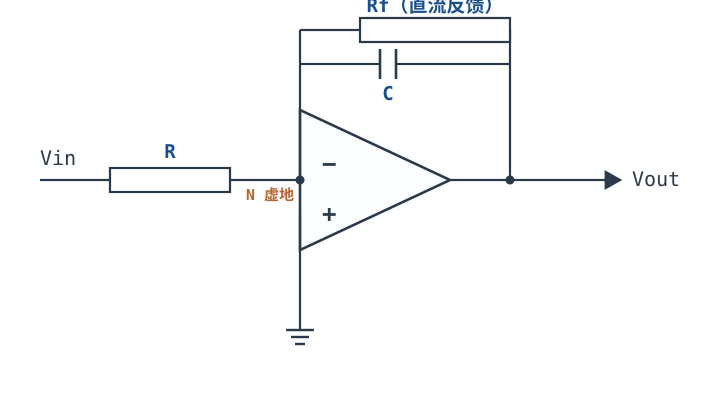
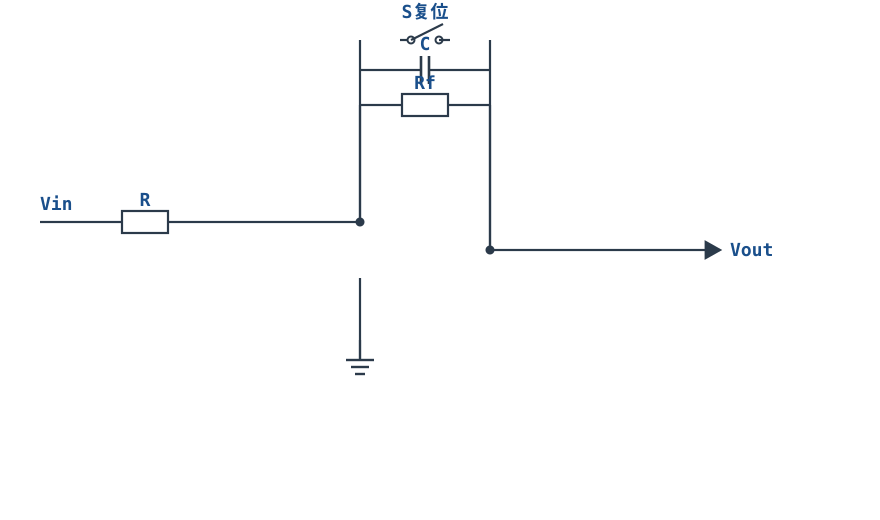
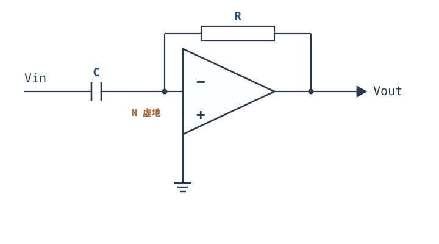
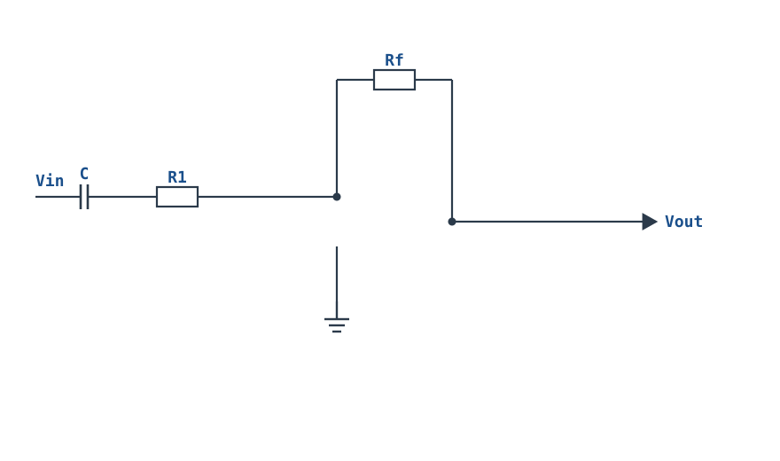

# 积分器与微分器 Integrator & Differentiator

比例放大器把信号"按固定倍数放大"，很多时候我们想要的却是信号随时间的**累积**或**变化率**：加速度积分成速度、速度再积分成位移；PID 里的积分项消除稳态误差、微分项预判趋势；给积分器送方波就得到三角波。这些功能的共同数学形态是 $1/s$ 与 $s$——把反馈臂或输入臂的电阻换成电容，就得到了。

这一章的核心结论只有一句：**积分器就是"极点落在原点的低通"，微分器就是"零点落在原点的高通"**。把它当低通看，就能立刻明白三件事：直流增益为什么无穷大、漂移为什么必然把输出顶到电源轨、为什么并联一只大电阻能"救"它；也就能明白微分器为什么"理论上可以做、实际不能直接用"——它的增益随频率无限增长，而环路却在高频先失去相位裕度。

符号沿用[运放概述：符号、封装与引脚](opamp-overview.md)与[理想模型五假设与虚短、虚断](ideal-opamp.md)：开环增益 $A_{OL}$、闭环增益 $A_{CL}$ 或 $G$、反馈系数 $\beta$（**不是**三极管的电流放大倍数）、环路增益 $T=A_{OL}\beta$、噪声增益 $1/\beta$、GBW、PM。**虚短、虚断只在负反馈成立、输出未饱和、$|T|\gg1$ 时才有意义**；积分器与微分器都靠负反馈工作，这个前提在本章尤其重要，因为它们的反馈网络里带着电容，$\beta$ 是频率的函数。

## 1. 设计动机

::: motivation 三个真实场景

**场景一：加速度计积分两次得位移，积分器自己先撞了轨。** 用一只理想积分器（$R=10\ \text{k}\Omega$、$C=10\ \text{nF}$）对加速度信号积分，没有输入时输出本该保持不动。但运放的失调电压 $1\ \text{mV}$ 与偏置电流 $25\ \text{nA}$ 一起往电容里灌电流：

$$I=\frac{V_{OS}}{R}+I_B=\frac{1\ \text{mV}}{10\ \text{k}\Omega}+25\ \text{nA}=125\ \text{nA},\qquad \frac{dV_{OUT}}{dt}=\frac{I}{C}=\frac{125\ \text{nA}}{10\ \text{nF}}=12.5\ \text{V/s}$$

±15 V 电源下只要 **1.2 s** 就撞轨。传感器还没动，输出已经贴在电源轨上了。

**场景二：微分器接上传感器，输出全是高频毛刺。** 微分器的增益 $|H|=2\pi fRC$ 随频率线性增长：$R=10\ \text{k}\Omega$、$C=10\ \text{nF}$ 时，1 MHz 处增益 628 倍。传感器电缆上拾取 1 mV 的 1 MHz 噪声，输出就是 **628 mV**；10 MHz 的 1 mV 噪声直接把输出顶到电源轨。这不是"噪声大"，是传递函数本身在放大噪声。

**场景三：PID 控制器里，积分项把输出积分到饱和。** 温度控制回路里执行器已经全开，误差仍在积累，积分电容继续充电，等温度回落时需要很长时间才能"放掉"这段积分——这就是积分饱和（wind-up）。工程上必须加复位开关或限幅，让积分器能被人为清零。

:::

| 你想确认 | 先算 | 判据（工程经验值） |
|---|---|---|
| 积分时间常数选多大 | $\tau=RC$、$f_0=1/(2\pi RC)$ | $f_0$ 落在信号频带中部，$\lvert H\rvert$ 用满量程的 1/3~2/3 |
| 漂移多久撞轨 | $(V_{OS}/R+I_B)/C$ | 无输入时 >10 倍最长工作时间 |
| 并联 $R_f$ 取多大 | $f_p=1/(2\pi R_fC)$ | $f_p\le0.1\times$ 最低信号频率 |
| 积分电容选什么 | 漏电、介质吸收、电压系数 | C0G/NP0 或薄膜，避开电解与高 K 陶瓷 |
| 微分器能不能直接用 | $\lvert H(1\ \text{MHz})\rvert=2\pi fRC$ | 高频增益 ≤ 后续电路可接受的范围 |
| 微分器稳不稳 | $\beta$ 极点 $1/(2\pi RC)$ 与 $f_c$ | PM ≥45°，否则输入串 $R_1$ |
| 需不需要复位 | 是否有"清零/重新开始"需求 | 需要就加开关，并核算电荷注入 |

**不算会摔在哪**，四条带数字的代价：

1. **不并 $R_f$ 就用积分器。** 12.5 V/s 的漂移，1.2 s 撞轨；换成 $I_B=1\ \mu\text{A}$ 的双极输入运放，漂移速率升到 $(100\ \text{nA}+1\ \mu\text{A})/10\ \text{nF}=110\ \text{V/s}$，136 ms 就撞轨。
2. **微分器直接接传感器。** 1 MHz、1 mV 的噪声被放大 628 倍；而且输入阻抗在 1 MHz 只有 $1/(2\pi\times10^6\times10\ \text{nF})=15.9\ \Omega$，50 Ω 的源内阻与它分压，信号只剩 24%。
3. **用 1% 电容算积分时间常数。** $\tau$ 直接由 $RC$ 决定，1% 电阻 + 5% 电容就是 6% 的时间常数误差，三角波幅度同比例偏差。
4. **在积分器上做"高精度直流"。** 积分器的高频噪声增益趋于 1、低频噪声增益趋于无穷，1/f 噪声与失调被一路积分，直流精度不可能靠它保证。

## 2. 定义与直观

### 2.1 一句话定义：换掉一只元件

**积分器（integrator）**：输入臂是电阻 $R$、反馈臂是电容 $C$ 的反相放大电路，输出与输入的积分成正比。

**微分器（differentiator）**：输入臂是电容 $C$、反馈臂是电阻 $R$ 的反相放大电路，输出与输入的变化率成正比。

两者都是[反相比例放大器](inverting-amplifier.md)的特例：把闭环增益公式 $-Z_f/Z_{in}$ 里的阻抗换成电容的 $1/(sC)$ 就得到了。**结构上只换了一只元件，数学上却从"常数"变成了"$1/s$ 或 $s$"**——这正是这两个电路值得单独成章的原因。

### 2.2 积分器 = 极点在原点的低通

一阶低通的传递函数是

$$H_{LP}(s)=-\frac{H_0}{1+\dfrac{s}{\omega_c}}$$

它的幅频在 $f\ll f_c$ 时是平的（增益 $H_0$），在 $f\gg f_c$ 时以 $-20\ \text{dB}/$十倍频程下降。现在让截止频率 $\omega_c\to0$、同时让直流增益 $H_0\to\infty$，并保持乘积 $H_0\omega_c$ 不变：

$$H_{LP}(s)\ \longrightarrow\ -\frac{1}{sRC}$$

**这就是积分器**：一个极点从 $f_c$ 一路搬到原点的低通。它没有"通带"，从直流开始就以 $-20\ \text{dB}/$十倍频程下降，在

$$f_0=\frac{1}{2\pi RC}$$

处 $|H|=1$（0 dB）。相位在整个频段上是 $-90^{\circ}$（加上反相拓扑的 $180^{\circ}$）。

**"原点极点"这四个字的后果**：直流增益是无穷大。任何一点点直流误差（失调、偏置电流、输入信号的直流分量）都会被当成"要一直积下去"的信号，输出必然单调爬向某一侧电源轨。这不是器件不好，是传递函数在 $s=0$ 处发散。

### 2.3 微分器 = 零点在原点的"高通"

同理，一阶高通

$$H_{HP}(s)=-\frac{s/\omega_c}{1+s/\omega_c}$$

在 $\omega_c\to\infty$ 的极限下变成

$$H_{HP}(s)\ \longrightarrow\ -sRC$$

**这就是微分器**：一个转折频率被推到无穷远的高通，于是增益永远以 $+20\ \text{dB}/$十倍频程上升，没有上限。相位在整个频段上是 $+90^{\circ}$（加上反相拓扑的 $180^{\circ}$）。

"零点在原点"的后果正好相反：**高频增益无穷大**。任何高频噪声、任何突变边沿，都会被放大到由运放摆幅决定的程度。

| | 积分器 | 微分器 |
|---|---|---|
| 传递函数 | $-1/(sRC)$ | $-sRC$ |
| 奇异点 | 极点 $s=0$ | 零点 $s=0$ |
| 幅频斜率 | $-20\ \text{dB}/$十倍频程 | $+20\ \text{dB}/$十倍频程 |
| 单位增益频率 | $f_0=1/(2\pi RC)$ | $f_0=1/(2\pi RC)$ |
| 相位（含反相） | $180^{\circ}-90^{\circ}=90^{\circ}$ | $180^{\circ}+90^{\circ}=270^{\circ}$ |
| 直流增益 | $\infty$ | 0 |
| 高频增益 | 0 | $\infty$ |
| 现实中的主要麻烦 | 漂移撞轨 | 噪声放大、稳定性 |

### 2.4 类比：水桶与水位计

::: analogy 积分器是水桶，微分器是水位计

积分器像一只**水桶**：输入是进水流量，输出是水位。流量恒定，水位就匀速上升（三角波的斜坡）；流量为零，水位应该保持——但桶底有个看不见的小孔（失调与偏置电流），水会慢慢漏掉或渗入，时间一长水位不是满了就是干了。并联 $R_f$ 相当于在桶壁开一个**受控的泄流孔**：水位越高漏得越快，于是水位被稳定在某个高度，代价是"纯积分"只对变化足够快的流量成立。

微分器像一台**水位计**：它读的是水位的变化率。水位缓慢上升，读数很小；水面上一点涟漪（高频噪声），读数就剧烈跳动。想让读数可用，必须在探头前加一个机械阻尼（串联 $R_1$）——阻尼越大读数越稳，但能跟上的变化也越慢。

类比的边界：水桶的水位不会自己"归零"，积分器也不会；想重新开始必须**主动复位**（把桶倒空），这就是复位开关的由来。水位计的阻尼会引入相位滞后，微分器的 $R_1$ 同样会在高于 $1/(2\pi R_1C)$ 的频段把"微分"变成"比例"。

:::

### 2.5 前提：这两只电路也是负反馈电路

积分器与微分器的反馈都回到反相端，属于电压并联负反馈。分析时同样要先确认三条：负反馈闭合、输出在线性区、$|T|\gg1$。区别在于这里的 $\beta$ 是频率的函数：

- **积分器**：$\beta(s)=\dfrac{Z_{in}}{Z_{in}+Z_f}=\dfrac{R}{R+\dfrac{1}{sC}}=\dfrac{sRC}{1+sRC}$。低频 $\beta\to0$（增益无穷大），高频 $\beta\to1$。
- **微分器**：$\beta(s)=\dfrac{\dfrac{1}{sC}}{\dfrac{1}{sC}+R}=\dfrac{1}{1+sRC}$。低频 $\beta\to1$，高频 $\beta\to0$。

**这两个 $\beta$ 的高频极限决定了两者的命运**：积分器在高频退化成"跟随器"（$\beta\to1$），微分器在高频环路增益一路衰减、但闭环噪声增益一路上升。第 3.6 节会把这件事算成相位裕度。

## 3. 定量关系

### 3.1 积分器的推导



前提：负反馈闭合（$C$ 与 $R_f$ 都接回反相端）、输出未饱和、$|T|\gg1$。于是反相端是虚地 $V_-\approx0$，且 $I_-=0$。

流过 $R$ 的电流全部流进电容：

$$I=\frac{V_{in}}{R},\qquad Q=\int I\,dt=\frac{1}{R}\int V_{in}\,dt$$

电容上的电压是 $Q/C$，而输出端接在电容的右侧、反相端在左侧，所以

$$V_{OUT}(t)=-\frac{Q}{C}=-\frac{1}{RC}\int V_{in}(t)\,dt+V_{OUT}(0)$$

写成拉普拉斯形式：

$$H(s)=\frac{V_{OUT}(s)}{V_{in}(s)}=-\frac{1}{sRC},\qquad |H(f)|=\frac{1}{2\pi fRC},\qquad \angle H=-90^{\circ}\ (\text{相对反相})$$

符号与单位：$R$ 单位 Ω，$C$ 单位 F，$\tau=RC$ 单位 s（时间常数）；$f_0=1/(2\pi RC)$ 单位 Hz，是 $|H|=1$ 的频率；$V_{OUT}(0)$ 是积分初值，由电容上的初始电荷决定。**积分器是有"记忆"的**，这一点和比例放大器根本不同，也是它必须配复位开关的原因。

**时域斜率**是最常用的形式：

$$\left|\frac{dV_{OUT}}{dt}\right|=\frac{|V_{in}|}{RC}$$

输入 1 V、$\tau=100\ \mu\text{s}$ 时斜率是 $10\ \text{V/ms}$，半毫秒走 5 V。

### 3.2 积分器 = 低通 + 原点极点：三个直接推论

把积分器当低通看，三条工程结论立刻出来：

**（1）直流增益无穷大 → 必须给直流一条出路。** 理想积分器在 $f=0$ 处增益发散，任何直流误差都被"积"成斜坡。并联 $R_f$ 后

$$Z_f=R_f\parallel\frac{1}{sC}=\frac{R_f}{1+sR_fC},\qquad H(s)=-\frac{Z_f}{R}=-\frac{R_f/R}{1+sR_fC}$$

电路变成一只**直流增益为 $-R_f/R$、极点位于**

$$f_p=\frac{1}{2\pi R_fC}$$

的一阶低通。当 $f\gg f_p$ 时 $|sR_fC|\gg1$，$H(s)\approx-1/(sRC)$，又回到积分器。**所以"实用积分器"= 把极点从原点搬到 $f_p$ 的低通，积分只在 $f\gg f_p$ 的频段成立。**

**（2）单位增益频率不变。** $R_f$ 只决定极点位置，不改变 $f_0$：

$$|H(f_0)|=\frac{R_f/R}{\sqrt{1+(f_0/f_p)^2}}=\frac{K}{\sqrt{1+K^2}}\approx1\quad(K=R_f/R\gg1)$$

其中 $f_0/f_p=R_f/R=K$。所以 $R_f$ 是"下限拐点"，$\tau=RC$ 是"增益刻度"，两者可以独立设计——这是实用积分器最重要的设计自由度。

**（3）高频噪声增益趋于 1。** 由 2.5 节的 $\beta(s)$，

$$\frac{1}{\beta}=\frac{1+sRC}{sRC}=1+\frac{1}{sRC}$$

当 $f\gg f_0$ 时 $1/\beta\to1$。**积分器在高频就是一个跟随器**：它的噪声增益是 1，环路表现得和单位增益缓冲器一模一样。这句话是第 3.6 节分析稳定性的钥匙。

### 3.3 实用积分器的三条修正

理想积分器在实验室里活不过一秒，工程上必须做三件事。

**修正一：反馈电容并联大电阻 $R_f$，限制直流增益。** 这是最重要的一条。取 $R_f=(10\sim1000)R$，把直流增益限制在 $10\sim1000$，输出失调变成有限值：

$$V_{OUT,DC}\approx\left(1+\frac{R_f}{R}\right)V_{OS}+I_BR_f$$

以 $R=10\ \text{k}\Omega$、$C=10\ \text{nF}$、$R_f=1\ \text{M}\Omega$、$V_{OS}=1\ \text{mV}$、$I_B=25\ \text{nA}$ 为例：$V_{OUT,DC}=101\times1\ \text{mV}+25\ \text{nA}\times1\ \text{M}\Omega=101\ \text{mV}+25\ \text{mV}=126\ \text{mV}$。相比"1.2 s 撞轨"，这是可以接受的静态误差。

**修正二：与积分电容串联一只小电阻 $R_s$，限制高频增益。** 电容在高频阻抗趋零，反馈臂在高频几乎短路，运放输出端的容性负载与自身第二极点容易引起高频振铃；串联 $R_s$ 后高频反馈阻抗被钳在 $R_s$，噪声增益在高频变成 $1+R_s/R$，不再是 1，环路穿越频率下降、PM 改善。代价是高于

$$f_s=\frac{1}{2\pi R_sC}$$

之后积分精度下降（$R_s$ 上的压降开始分走信号）。取 $R_s\le R/100$ 时 $f_s\ge100f_0$，工作在 $f_0$ 附近时影响可以忽略。

**修正三：跨接复位开关，给电容一条清零通路。** 复位开关闭合时电容被短路，电荷瞬间泄放，输出回到 0（严格说是回到运放的失调电平）。没有复位，积分器只能等 $R_fC$ 的时间常数慢慢"忘掉"历史，长常数下要等几秒甚至几十秒。**注意"串联输入电阻"这个说法属于微分器**（见 3.5 节）：积分器的输入端本来就有一只 $R$ 把电压转成电流，不需要再串；真正需要额外串联电阻的位置在反馈臂的电容一侧。



### 3.4 微分器的推导与"三个不能直接用"



前提同上。由虚地与虚断，流过电容的电流全部流过 $R$：

$$I=C\frac{dV_{in}}{dt},\qquad V_{OUT}=-IR=-RC\frac{dV_{in}}{dt}$$

$$H(s)=-sRC,\qquad |H(f)|=2\pi fRC,\qquad \angle H=+90^{\circ}\ (\text{相对反相})$$

**理想微分器可以直接写出公式，但不能直接接进电路。** 三个原因都是"零点在原点"的直接后果：

**（1）增益没有上限，噪声被无差别放大。** $|H|=2\pi fRC$ 随频率线性增长。$R=10\ \text{k}\Omega$、$C=10\ \text{nF}$ 时，$\tau=100\ \mu\text{s}$，1 MHz 处

$$|H|=2\pi\times10^6\times10^4\times10^{-8}=628.3$$

1 mV 的噪声变成 628 mV。而运放自身的输入电压噪声、电阻热噪声、电源纹波全都在这个频段里，输出几乎被噪声淹没。

**（2）输入阻抗随频率下降，信号源被越拖越重。** 输入臂是电容，$|Z_{in}|=1/(2\pi fC)$，1 MHz 时只有 $15.9\ \Omega$。信号源内阻 50 Ω 与它分压：

$$\frac{15.9}{50+15.9}=0.241$$

只剩 24% 的电流进得来，而且这个分压比随频率变化，等效于在输入端额外加了一个 $1/(2\pi\times50\times10\ \text{nF})=318\ \text{kHz}$ 的极点，把微分关系彻底破坏。**微分器的"输入阻抗"不是常数，它对信号源是一个频率相关的重负载。**

**（3）稳定性：理想微分器几乎必然振荡。** 见 3.6 节，PM 只有约 $2^{\circ}$。

### 3.5 实用微分器：串 $R_1$、并 $C_f$

修正的思路与积分器对称：**把高频增益压平、把环路穿越频率挪到 $\beta$ 极点之前**。



加入串在输入臂上的 $R_1$ 后：

$$Z_{in}=R_1+\frac{1}{sC},\qquad H(s)=-\frac{R_f}{R_1+\dfrac{1}{sC}}=-\frac{sR_fC}{1+sR_1C}$$

三个频段：

- $f\ll1/(2\pi R_1C)$：$H\approx-sR_fC$，**真微分**；
- $f\gg1/(2\pi R_1C)$：$H\approx-R_f/R_1$，增益被压平，不再随频率上升；
- 高频增益上限 $|H|_{max}=R_f/R_1$，由两只电阻的比值决定。

再在 $R_f$ 上并一只小 $C_f$，高于 $f_2=1/(2\pi R_fC_f)$ 后增益进一步以 $-20\ \text{dB}/$十倍频程下降，把残余高频噪声也压掉。最终

$$H(s)=-\frac{sR_fC}{(1+sR_1C)(1+sR_fC_f)}$$

**设计顺序**：先定微分频段上限 $f_{max}$，取

$$R_1=\frac{1}{2\pi f_{max}C}$$

再按允许的高频增益取 $R_f=R_1|H|_{max}$，最后按噪声要求决定要不要加 $C_f$（$f_2\ge3f_{max}$ 时影响最小）。

### 3.6 环路稳定性：积分器像跟随器，微分器像"反相器"

把两个电路的 $\beta(s)$ 代进 $T=A_{OL}\beta$，结论会与直觉相反，值得单独算一遍。

**积分器**：$\beta=sRC/(1+sRC)$，在 $f\gg f_0$ 时 $\beta\to1$、相位 $\to0$。所以高频环路增益 $|T|\approx|A_{OL}|$，穿越频率

$$f_c\approx\frac{GBW}{1/\beta}\bigg|_{f\gg f_0}=\frac{GBW}{1}=GBW$$

**积分器的稳定性等价于跟随器的稳定性**：单极点模型下 PM 是 $90^{\circ}$，实际取决于运放第二极点与负载电容在 $GBW$ 处贡献多少相位。积分器不是"天生比跟随器更容易振"，它就是跟随器——只不过它在低频的噪声增益很大，容易被误认为"环路增益很高所以很稳"。

**微分器**：$\beta=1/(1+sRC)$ 在 $f_\beta=1/(2\pi RC)$ 处有一个极点，之后 $\beta$ 以 $-20\ \text{dB}/$十倍频程下降。穿越频率满足

$$|T|=\frac{GBW}{f}\cdot\frac{1}{\sqrt{1+(f/f_\beta)^2}}=1$$

当 $f\gg f_\beta$ 时可近似

$$\frac{GBW}{f}\cdot\frac{f_\beta}{f}=1\ \Rightarrow\ f_c\approx\sqrt{GBW\cdot f_\beta}$$

而在 $f_c$ 处，$\beta$ 的极点已经贡献了接近 $-90^{\circ}$ 的相位，加上运放主极点的 $-90^{\circ}$，总相位接近 $-180^{\circ}$：

$$PM=180^{\circ}-90^{\circ}-\arctan\frac{f_c}{f_\beta}\approx180^{\circ}-90^{\circ}-90^{\circ}\approx0^{\circ}$$

以 $RC=100\ \mu\text{s}$、GBW=1 MHz 为例：$f_\beta=1.59\ \text{kHz}$，$f_c=\sqrt{10^6\times1591.5}=39.9\ \text{kHz}$，$PM=180^{\circ}-90^{\circ}-\arctan(39894/1591.5)=2.3^{\circ}$。**这不是"容易振"，是在实际电路里几乎必然振。** 加入 $R_1$ 后 $\beta$ 在高频被钳在 $R_1/(R_1+R_f)$，极点相位在穿越频率之前就恢复了，第 4.2 节会算出 PM 回到 $86^{\circ}$。

::: advanced 进阶：为什么"增益越高越稳"在这里不成立

直觉上"环路增益越高越稳"是把"增益"和"环路增益 $T$"混为一谈。稳定性看的是 $T$ 的相位在 $|T|=1$ 处的余量。微分器的闭环增益（噪声增益 $1/\beta=1+sRC$）随频率上升，但环路增益 $|T|=|A|/\beta$ 反而下降得更快——**穿越频率被 $\beta$ 的极点拉低，而相位滞后在穿越点已经吃满**。所以"闭环增益高"和"环路增益高"是两件事，稳定性只认后者。这个区分在[开环、闭环增益与负反馈本质](open-loop-feedback.md)里有完整讨论。

:::

### 3.7 适用条件与失效边界

1. **负反馈必须闭合。** 电容开路、虚焊、复位开关没断开，反馈都断开，输出撞轨。
2. **输出必须在线性区。** 积分器撞轨后"看起来还在积分"，但输出不再响应输入；微分器在大边沿处会瞬间饱和。
3. **$|T|\gg1$ 的频率范围。** 高于 $f_0$ 之后积分器仍近似成立，但高于 $f_c$ 后虚短失效，公式不再适用。
4. **直流必须有着落。** 积分器要有 $R_f$ 或复位开关，微分器要有输入隔直（本身就有）与反馈直流通路。
5. **电容必须是"电容"。** 电解电容的漏电与极性、高 K 陶瓷的电压系数与介质吸收，都会把"积分"变成"带记忆的漏电"。
6. **源内阻进入传递函数。** 积分器的 $R$ 与源内阻串联，直接改变 $\tau$；微分器的源内阻与 $C$ 形成额外极点。

## 4. 典型计算

### 4.1 算例一：1 kHz 方波经 $RC$ 积分后的三角波幅度与线性度

**需求**：输入为 $\pm1\ \text{V}$、1 kHz 的对称方波，用积分器得到三角波，要求峰峰值 5 V（$\pm2.5\ \text{V}$），估算幅度误差与线性度。

**第 1 步：定时间常数。** 半周期内输出变化量

$$\Delta V_{OUT}=\frac{V_{in}}{RC}\cdot\frac{T}{2}$$

要求 $\Delta V_{OUT}=5\ \text{V}$，$V_{in}=1\ \text{V}$，$T/2=0.5\ \text{ms}$：

$$RC=\frac{V_{in}T/2}{\Delta V_{OUT}}=\frac{1\times0.5\times10^{-3}}{5}=1.00\times10^{-4}\ \text{s}=100\ \mu\text{s}$$

**第 2 步：取 E96 值。** 取 $C=10\ \text{nF}$（C0G），则 $R=100\ \mu\text{s}/10\ \text{nF}=10.0\ \text{k}\Omega$（E96 有 10.0）。实际 $\tau=10.0\ \text{k}\Omega\times10\ \text{nF}=100.0\ \mu\text{s}$，精确落在设计值上，$f_0=1/(2\pi\times100\ \mu\text{s})=1591.5\ \text{Hz}$。

**第 3 步：理想积分器的幅度与斜率。** 理想积分器（无 $R_f$）的阶跃响应是完美斜坡：

$$\left|\frac{dV_{OUT}}{dt}\right|=\frac{1\ \text{V}}{100\ \mu\text{s}}=10.0\ \text{V/ms},\qquad \Delta V_{OUT}=10.0\ \text{V/ms}\times0.5\ \text{ms}=5.000\ \text{V}$$

峰峰值 5.000 V、±2.500 V，线性度是理想的 0。**理想积分器不会因为"输入是方波、时间常数有限"而产生三角波失真**——这一点与无源 RC 近似积分完全不同，也是运放积分器的价值所在。

**第 4 步：加上 $R_f=1\ \text{M}\Omega$ 后的实际波形。** 实用积分器的直流增益 $K=R_f/R=100$，时间常数 $\tau_d=R_fC=10\ \text{ms}$。稳态下，方波经一阶低通的峰峰值为

$$V_{pp}=2K V_{in}\frac{1-\beta}{1+\beta},\qquad \beta=e^{-\frac{T/2}{\tau_d}}=e^{-0.05}=0.95123$$

$$V_{pp}=2\times100\times1\times\frac{1-0.95123}{1+0.95123}=4.999\ \text{V}$$

**幅度几乎没变（$-0.02\%$）**，因为指数段的平均斜率恰好等于 $V_{in}/RC$，正负半周的"下垂"互相抵消。变的是**形状**：

- 起始斜率 $=(A+K V_{in})/\tau_d=10.25\ \text{V/ms}$，结束斜率 $=(A+K V_{in})e^{-0.05}/\tau_d=9.75\ \text{V/ms}$，**斜率变化 $4.88\%$**；
- 与理想直线相比，最大偏差出现在半周期中点附近，为 **$31.2\ \text{mV}$**，占峰峰值的 $0.625\%$。

| 指标 | 理想积分器 | 实用积分器（$R_f=1\ \text{M}\Omega$） |
|---|---|---|
| 峰峰值 | 5.000 V | 4.999 V（$-0.02\%$） |
| 斜率（开始 → 结束） | 10.00 → 10.00 V/ms | 10.25 → 9.75 V/ms（$-4.88\%$） |
| 与直线的最大偏差 | 0 | 31.2 mV（峰峰值的 0.625%） |
| 波形 | 完美三角 | 指数段拼成的"圆角三角" |
| 直流增益 | $\infty$ | 100 |

```echarts
{
  "tooltip": {"trigger": "axis"},
  "legend": {"data": ["Vin 方波（V）", "Vout 实用积分器（V）", "Vout 理想斜坡（V）"], "bottom": 0, "textStyle": {"fontSize": 12}},
  "grid": {"left": 58, "right": 26, "top": 30, "bottom": 62},
  "xAxis": {"type": "category", "name": "时间 / ms", "data": [0,0.1,0.2,0.3,0.4,0.5,0.6,0.7,0.8,0.9,1.0,1.1,1.2,1.3,1.4,1.5,1.6,1.7,1.8,1.9,2.0], "axisLabel": {"fontSize": 10}},
  "yAxis": {"type": "value", "name": "电压 / V", "min": -4, "max": 8, "interval": 2, "axisLabel": {"fontSize": 11}},
  "series": [
    {"name": "Vin 方波（V）", "type": "line", "step": "end", "showSymbol": false, "lineStyle": {"width": 2.0, "color": "#7f96ac", "type": "dashed"}, "data": [1,1,1,1,1,-1,-1,-1,-1,-1,1,1,1,1,1,-1,-1,-1,-1,-1,1]},
    {"name": "Vout 实用积分器（V）", "type": "line", "showSymbol": false, "lineStyle": {"width": 2.6, "color": "#b5642e"}, "data": [2.499,1.48,0.47,-0.53,-1.52,-2.499,-1.48,-0.47,0.53,1.52,2.499,1.48,0.47,-0.53,-1.52,-2.499,-1.48,-0.47,0.53,1.52,2.499]},
    {"name": "Vout 理想斜坡（V）", "type": "line", "showSymbol": false, "lineStyle": {"width": 1.6, "color": "#1a4f8b", "type": "dotted"}, "data": [2.5,1.5,0.5,-0.5,-1.5,-2.5,-1.5,-0.5,0.5,1.5,2.5,1.5,0.5,-0.5,-1.5,-2.5,-1.5,-0.5,0.5,1.5,2.5]}
  ]
}
```

图里两条输出曲线几乎重合，差别体现在每段中点的 $31\ \text{mV}$ 下凹——示波器上表现为三角波的"边略微向内弯"。

**第 5 步：输入直流分量会被放大 $K$ 倍。** 若方波带 10 mV 直流偏置（占空比 50.5%），输出静态点偏移

$$\Delta V_{OUT,DC}=-K\times10\ \text{mV}=-100\times10\ \text{mV}=-1.00\ \text{V}$$

**这是一个很容易被忽略的坑**：$R_f$ 把直流增益限制在 100，输入端 10 mV 的失调就变成 1 V 的输出偏移，占 $\pm2.5\ \text{V}$ 摆幅的 40%。所以实用积分器的输入端要么交流耦合，要么用低失调运放并接受这部分误差。

**第 6 步：运放自身误差。** 1 kHz 处 $f/f_0=0.63$，$\beta=0.532$，$|A_{OL}|=GBW/f=1\ \text{MHz}/1\ \text{kHz}=1000$，$|T|=1000\times0.532=532$，增益误差约 $1/(1+532)=0.19\%$；所需压摆率是 $10\ \text{V/ms}=0.01\ \text{V}/\mu\text{s}$，任何运放都够。**所以这个电路的误差主导项是 $R_f$ 引起的直流偏移与电容的介质吸收，不是运放带宽。**

### 4.2 算例二：1 mV/1 MHz 噪声被微分器放大到多少

**已知**：微分器 $R_f=10\ \text{k}\Omega$、$C=10\ \text{nF}$，$\tau=100\ \mu\text{s}$；噪声为 1 mV 幅度的 1 MHz 正弦（电缆拾取或开关电源残余）。

**第 1 步：1 MHz 处的增益。**

$$|H(1\ \text{MHz})|=2\pi fR_fC=2\pi\times10^6\times10^4\times10^{-8}=628.3$$

$$V_{OUT}=628.3\times1\ \text{mV}=628\ \text{mV}$$

**第 2 步：换到 10 MHz。** $|H|=6283$，1 mV 输入需要 6.28 V 输出——超出 $\pm5\ \text{V}$ 电源，输出直接饱和。**微分器的输出幅度由噪声频谱的最高频分量决定，而不是由有用信号决定。**

**第 3 步：输入阻抗与源内阻。** $|Z_{in}|=1/(2\pi fC)$，1 MHz 时 $15.9\ \Omega$；源内阻 50 Ω 时分压比 0.241，等效在输入端引入 $318\ \text{kHz}$ 的极点。**这意味着实际电路的"微分"只在中频段成立，高频既被噪声淹没又被源内阻破坏。**

**第 4 步：加 $R_1=1.5\ \text{k}\Omega$ 后。** 高频拐点

$$f_h=\frac{1}{2\pi R_1C}=\frac{1}{2\pi\times1500\times10^{-8}}=10.61\ \text{kHz}$$

高频增益上限

$$|H|_{max}=\frac{R_f}{R_1}=\frac{10\ \text{k}\Omega}{1.5\ \text{k}\Omega}=6.667$$

1 MHz 处实际增益

$$|H|=\frac{2\pi fR_fC}{\sqrt{1+(2\pi fR_1C)^2}}=\frac{628.3}{\sqrt{1+100.5^2}}=6.25$$

$$V_{OUT}=6.25\times1\ \text{mV}=6.25\ \text{mV}$$

**从 628 mV 降到 6.25 mV，压低 94 倍（$-39.5\ \text{dB}$）。**

**第 5 步：稳定性同步改善。** 加 $R_1$ 后 $\beta$ 在高频被钳在 $R_1/(R_1+R_f)=1.5/11.5=0.1304$，噪声增益上限 $7.67$，穿越频率

$$f_c\approx\frac{GBW}{7.67}=\frac{1\ \text{MHz}}{7.67}=130\ \text{kHz}$$

$\beta$ 的极点 $1/(2\pi(R_1+R_f)C)=1.384\ \text{kHz}$、零点 $10.61\ \text{kHz}$，在 130 kHz 处 $\beta$ 的相位已经恢复到

$$\angle\beta=\arctan\frac{130}{10.61}-\arctan\frac{130}{1.384}=85.3^{\circ}-89.4^{\circ}=-4.1^{\circ}$$

$$PM=180^{\circ}-90^{\circ}-4.1^{\circ}=86.0^{\circ}$$

**从 $2.3^{\circ}$ 回到 $86.0^{\circ}$**，电路从"几乎必振"变成"很稳"。

**第 6 步：代价。** 高于 $10.61\ \text{kHz}$ 后不再是微分，而是增益 6.67 的比例放大。如果信号本身含 10 kHz 以上成分，这些成分会被"压平"而不是"微分"，产生相位与幅度失真。**所以 $R_1$ 必须按"最高有用信号频率"设计，而不是按噪声频率设计**：$R_1$ 越大越安静，但微分带宽越窄。

| 方案 | 1 MHz 处增益 | 1 mV 噪声输出 | $f_c$ | PM |
|---|---|---|---|---|
| 理想微分器（无 $R_1$） | 628 | 628 mV | 39.9 kHz | $2.3^{\circ}$ |
| 加 $R_1=1.5\ \text{k}\Omega$ | 6.25 | 6.25 mV | 130 kHz | $86.0^{\circ}$ |

### 4.3 算例三：求和积分器与电荷放大器

**求和积分器**：多路输入各经电阻汇入同一个虚地节点，输出对加权和积分：

$$V_{OUT}(t)=-\frac{1}{C}\int\left(\frac{V_1}{R_1}+\frac{V_2}{R_2}\right)dt$$

权重仍由 $1/R_k$ 决定，且**虚地让各路互不影响**（与[加法、减法运算电路](summing-amplifier.md)同一原理）。代价是每一路的直流误差都被同时积分，路数越多漂移越快，$R_f$ 要按"所有路并联"重新核算。

**电荷放大器**：压电传感器是高输出阻抗的电荷源，把它接到反相端、反馈臂用电容 $C_f$，反相端的虚地把电荷"吸"进 $C_f$：

$$V_{OUT}=-\frac{Q}{C_f}$$

取 $C_f=1\ \text{nF}$，$Q=1\ \text{pC}$ 时 $V_{OUT}=-1\ \text{mV}$；灵敏度由 $C_f$ 决定，与电缆长度几乎无关（电缆电容被虚地短路掉）。反馈电阻 $R_f$（典型 $1\ \text{G}\Omega$ 量级）给 $C_f$ 一条直流泄放通路，$1\ \text{pA}$ 的漏电流就会产生 $1\ \text{mV}$ 的偏移，所以必须用 FET/CMOS 输入运放、清洁的 PCB 与屏蔽电缆。详见[V/I、I/V 转换与传感器接口](vi-iv-converter.md)。

## 5. 工程含义

### 5.1 数量级表

| 量 | 典型范围 | 备注 |
|---|---|---|
| $R$ | $1\ \text{k}\Omega\sim1\ \text{M}\Omega$ | 太小则信号源负担重，太大则偏置与噪声 |
| $C$ | $1\ \text{nF}\sim1\ \mu\text{F}$ | 小于 1 nF 时杂散电容占比大，大于 1 µF 时漏电与体积成问题 |
| $\tau=RC$ | $10\ \mu\text{s}\sim1\ \text{s}$ | 由信号频率与输出幅度共同决定 |
| $f_0=1/(2\pi\tau)$ | $0.16\ \text{Hz}\sim16\ \text{kHz}$ | 积分器"单位增益"频率 |
| $R_f/R$ | $10\sim1000$ | 直流增益，太小学积分带宽，太大漂移抑制不足 |
| $f_p=1/(2\pi R_fC)$ | $\le0.1f_{min}$ | 有效积分区间下限 |
| $R_1$（微分器） | $R_f/\lvert H\rvert_{max}$ | 按最高有用频率反算 |
| $R_f$（电荷放大器） | $100\ \text{M}\Omega\sim10\ \text{G}\Omega$ | 需要低漏电、保护环 |

### 5.2 电容选型：漏电、介质吸收与电压系数

积分器的精度几乎完全由电容决定，三条必须看：

- **漏电（leakage）**：漏电流与偏置电流一样直接给电容充电，形成漂移。电解电容漏电可达 µA 级，**不适合做积分电容**；C0G/NP0 与薄膜（PP、PPS）的绝缘电阻通常高得多（典型量级，以数据手册为准）。
- **介质吸收（dielectric absorption, DA）**：电容"放电放不干净"，表现为积分器复位后输出缓慢回爬、三角波顶部出现"回勾"。C0G 与薄膜的 DA 通常远小于高 K 陶瓷（X7R/Y5V），后者在高精度积分里应避免（典型量级，以数据手册为准）。
- **电压系数与温度系数**：高 K 陶瓷的容值随直流偏压和温度显著变化，$C$ 变了 $\tau$ 就变，三角波斜率随之漂移。C0G 的容值稳定性好得多，代价是同样容值下体积更大、成本更高。

**工程结论：积分电容选 C0G/NP0 或薄膜，容值精度按 $\tau$ 的精度要求反推。** 1% 电阻 + 5% 电容 → $\tau$ 最坏偏 6%，三角波幅度同比例偏 6%。

### 5.3 复位与清零的工程实现

- **机械/模拟开关跨接电容**：最简单。断开瞬间会有**电荷注入**（charge injection），典型几 pC 到几十 pC。$10\ \text{pC}$ 注入到 $10\ \text{nF}$ 上是

$$\Delta V=\frac{Q_{inj}}{C}=\frac{10\ \text{pC}}{10\ \text{nF}}=1\ \text{mV}$$

之后还要等介质吸收回爬稳定，才能开始真正的积分。
- **复位后等待**：等 $3\sim5$ 倍 $R_fC$ 再采样，让 DA 与开关的电荷重新分布完。
- **不要用"输入端接地"代替复位**：输入接地只停止充电，电容上的电荷还在，输出保持不动——那是"暂停"，不是"清零"。

### 5.4 噪声、漂移与低频噪声增益

积分器的噪声增益 $1/\beta=1+1/(sRC)$ **在低频趋于无穷**。这不是数学游戏：运放的 1/f 噪声、失调 drift、输入偏置电流的漂移，全都被这个低频增益放大并积分，表现为输出缓慢爬行。三条对策：

1. **限制直流增益**（并 $R_f$），把 $1/\beta$ 的低频渐近线从无穷压到 $1+R_f/R$。
2. **降低输入端的直流误差**：低 $V_{OS}$、低 $I_B$ 的运放，输入端隔直。
3. **压缩噪声带宽**：在积分器之后再加一级低通，或在 $R_f$ 上并小电容（与 $R_f$ 形成高频极点）。

高频端的噪声增益趋于 1，所以积分器对宽带噪声的放大并不比跟随器差；**真正难缠的是低频段**。

### 5.5 布局与漏电流

- **高阻节点（反相端）必须短、必须干净**：$1\ \text{G}\Omega$ 级的反馈电阻上，$1\ \text{pA}$ 漏电就是 $1\ \text{mV}$。助焊剂残留、指纹、潮湿都会把 PCB 表面电阻从 $10^{12}\ \Omega$ 降到 $10^{9}\ \Omega$ 量级（典型量级，实测为准）。
- **保护环（guard ring）**：把反相端周围一圈用同电位（或缓冲后的同电位）驱动，切断表面漏电流路径。
- **电容与运放尽量靠近**，减小反馈回路的寄生电容与拾取面积。
- **复位开关的走线不要穿过高阻节点**，否则开关的寄生电容会把数字边沿耦合进积分节点。

### 5.6 模型什么时候不够用

- **频率接近 $f_c$**：虚短失效，$1/(sRC)$ 不再准确。
- **大信号/快边沿**：压摆率与输出电流限决定三角波的最高斜率。
- **精密积分**：DA、漏电、温漂、运放失调全部进入预算。
- **长积分时间**：偏置电流的积分成为主导，必须用低 $I_B$ 运放与低漏电电容。
- **单电源**：输出只能单向摆动，必须偏置到 $V_{CC}/2$（见[单电源电路与电平偏置搬移](single-supply-biasing.md)）。

## 6. 常见坑

::: pitfall 常见坑

- **现象**：积分器没有输入时输出缓慢爬向正电源轨，几秒后贴死不动。**原因**：反馈电容没有直流通路，$V_{OS}$ 与 $I_B$ 持续给电容充电；$R=10\ \text{k}\Omega$、$C=10\ \text{nF}$ 时漂移速率 $(1\ \text{mV}/10\ \text{k}\Omega+25\ \text{nA})/10\ \text{nF}=12.5\ \text{V/s}$。**解决**：反馈电容并联 $R_f=(10\sim1000)R$，把直流增益限制在有限值；或加复位开关定期清零。

- **现象**：三角波的三个边"不直"，每段中间下凹，或者复位后输出回爬。**原因**：一是 $R_f$ 取值过小（$K=R_f/R$ 不够大），指数段太明显；二是电容介质吸收（高 K 陶瓷、电解电容）。**解决**：$R_f$ 取 $100R$ 以上，使 $f_p\le0.1f_{min}$；电容换 C0G/NP0 或薄膜。

- **现象**：微分器输出全是高频毛刺，有用信号看不见。**原因**：$|H|=2\pi fRC$ 随频率上升，1 MHz 处 628 倍，把电缆拾取的 1 mV 噪声放大到 628 mV。**解决**：输入电容串联 $R_1=1/(2\pi f_{max}C)$，把高频增益钳在 $R_f/R_1$；必要时在 $R_f$ 上并 $C_f$ 进一步压低高频。

- **现象**：微分器一上电就自激，输出是几 MHz 的等幅振荡。**原因**：$\beta$ 的极点 $1/(2\pi RC)$ 在穿越频率之前贡献了接近 $90^{\circ}$ 相位，PM 只剩约 $2^{\circ}$。**解决**：串 $R_1$ 把 $\beta$ 的高频值钳住（PM 回到 $86^{\circ}$），或在反馈臂并 $C_f$ 引入零点；两者都要按最高有用频率设计，不能凭感觉取。

- **现象**：积分器在单电源下只能输出正的三角波，负半周被削平。**原因**：单电源没有负摆幅，同相端又接地，输出静态点就是 0 V。**解决**：同相端偏置到 $V_{CC}/2$，输入输出交流耦合；或改用双电源。

- **现象**：复位开关断开后输出不是 0，而是几十 mV 到几百 mV，且每次不一样。**原因**：开关的电荷注入（典型几 pC 到几十 pC）落在积分电容上，$10\ \text{pC}/10\ \text{nF}=1\ \text{mV}$；加上介质吸收的残余回爬。**解决**：复位后等待 $3\sim5$ 个 $R_fC$ 再开始积分；选低电荷注入的模拟开关；必要时软件扣除固定偏置。

- **现象**：换了一只用"低噪声"运放，积分器输出反而更漂。**原因**：低频漂移由 $V_{OS}$ 与 $I_B$ 主导，与电压噪声密度无关；新器件可能 $I_B$ 更大或 1/f 拐点更高。**解决**：按 $V_{OS}$、$V_{OS}$ 温漂、$I_B$ 选器件，而不是只看 $e_n$；参见[失调电压、偏置电流与漂移](offset-bias.md)。

:::

## 7. 自测题

<details><summary>积分器 $R=10\ \text{k}\Omega$、$C=10\ \text{nF}$，输入一直保持 +1 V。输出以多快的速度变化？$\pm15\ \text{V}$ 电源下多久撞轨？</summary>

时间常数 $\tau=RC=10\ \text{k}\Omega\times10\ \text{nF}=100\ \mu\text{s}$。

$$\left|\frac{dV_{OUT}}{dt}\right|=\frac{|V_{in}|}{RC}=\frac{1\ \text{V}}{100\ \mu\text{s}}=10\ \text{V/ms}$$

方向为负（反相积分）。从 0 V 到 $-15\ \text{V}$ 需要 $15\ \text{V}/10\ \text{V/ms}=1.5\ \text{ms}$。

**注意**：如果输入为 0，撞轨时间由失调与偏置电流决定，本例是 $12.5\ \text{V/s}$，撞轨要 1.2 s——比"有输入"慢得多，但方向是确定的，撞轨只是时间问题。

</details>

<details><summary>为什么实用积分器要在反馈电容上并联 $R_f$？它对 $f_0=1/(2\pi RC)$ 有没有影响？</summary>

并联 $R_f$ 是给直流（失调电压、偏置电流、输入直流分量）提供一条泄放通路，把直流增益从无穷大限制为 $-R_f/R$，防止输出漂移撞轨。它把极点从原点搬到 $f_p=1/(2\pi R_fC)$，只有在 $f\gg f_p$ 时才保持积分特性。

**对 $f_0$ 没有影响**：

$$|H(f_0)|=\frac{R_f/R}{\sqrt{1+(f_0/f_p)^2}}=\frac{K}{\sqrt{1+K^2}}\approx1$$

因为 $f_0/f_p=R_f/R=K$，$R_f$ 只决定下限拐点，$\tau=RC$ 决定增益刻度。**这正是"并 $R_f$ 不破坏积分器"的定量依据。**

</details>

<details><summary>1 kHz、±1 V 方波经 $R=10\ \text{k}\Omega$、$C=10\ \text{nF}$ 的理想积分器，输出三角波的峰峰值是多少？换成实用积分器（$R_f=1\ \text{M}\Omega$）后幅度变多少？</summary>

理想积分器，半周期 $T/2=0.5\ \text{ms}$：

$$\Delta V_{OUT}=\frac{V_{in}}{RC}\cdot\frac{T}{2}=\frac{1}{100\ \mu\text{s}}\times0.5\ \text{ms}=5.000\ \text{V}$$

峰峰值 5.000 V。

实用积分器：$K=100$、$\tau_d=R_fC=10\ \text{ms}$、$\beta=e^{-0.5/10}=0.95123$，

$$V_{pp}=2KV_{in}\frac{1-\beta}{1+\beta}=2\times100\times\frac{1-0.95123}{1+0.95123}=4.999\ \text{V}$$

幅度只差 $-0.02\%$，但波形变成指数段：斜率从 10.25 V/ms 降到 9.75 V/ms（$-4.88\%$），与直线的最大偏差 31.2 mV（峰峰值的 0.625%）。**幅度几乎不变，形状与斜率变了。**

</details>

<details><summary>微分器 $R=10\ \text{k}\Omega$、$C=10\ \text{nF}$，1 mV 的 1 MHz 噪声在输出端有多大？为什么说它"理论上可以做、实际不能直接用"？</summary>

$$|H|=2\pi fRC=2\pi\times10^6\times10^4\times10^{-8}=628.3$$

$$V_{OUT}=628.3\times1\ \text{mV}=628\ \text{mV}$$

不能直接用的三个原因：① 增益随频率无限增长，噪声被无差别放大；② 输入阻抗 $|Z_{in}|=1/(2\pi fC)$ 随频率下降，1 MHz 时只有 15.9 Ω，被源内阻严重分压；③ $\beta$ 的极点 $1/(2\pi RC)=1.59\ \text{kHz}$ 在穿越频率 39.9 kHz 之前贡献接近 $90^{\circ}$ 相位，PM 只剩 $2.3^{\circ}$，极易自激。

</details>

<details><summary>为什么说"积分器的稳定性等价于跟随器"？微分器又为什么相反？</summary>

积分器 $\beta=sRC/(1+sRC)$，高频 $\beta\to1$、相位 $\to0$，于是 $|T|\approx|A_{OL}|$，穿越频率 $f_c\approx GBW$——与单位增益跟随器完全相同。低频的高噪声增益（$1/\beta\to\infty$）只影响精度与噪声，不改善稳定性。

微分器 $\beta=1/(1+sRC)$，高频 $\beta\to0$，穿越频率被 $f_\beta=1/(2\pi RC)$ 拉低到 $f_c\approx\sqrt{GBW\cdot f_\beta}$，而在该频率上 $\beta$ 的极点已经贡献了接近 $-90^{\circ}$，与运放主极点的 $-90^{\circ}$ 叠加成 $-180^{\circ}$，PM 趋于 0。**一个高频退化成跟随器，一个高频把相位吃光，方向完全相反。**

</details>

<details><summary>实用微分器 $R_f=10\ \text{k}\Omega$、$C=10\ \text{nF}$，信号最高频率 10 kHz。$R_1$ 取多少？高频增益被限制到多少？</summary>

$$R_1=\frac{1}{2\pi f_{max}C}=\frac{1}{2\pi\times10^4\times10^{-8}}=1.59\ \text{k}\Omega$$

取 E96 值 $1.58\ \text{k}\Omega$。高频增益上限

$$|H|_{max}=\frac{R_f}{R_1}=\frac{10\ \text{k}\Omega}{1.58\ \text{k}\Omega}=6.33$$

高于 $f_h=1/(2\pi R_1C)\approx10.1\ \text{kHz}$ 后不再是微分而是增益 6.33 的比例放大。1 MHz 处 $|H|=628.3/\sqrt{1+99.3^2}=6.33$，正好被钳在 $R_f/R_1$ 上，1 mV 噪声只放大到 6.33 mV，而不是 628 mV。

**取舍**：$R_1$ 越大越安静，微分带宽越窄；必须按"最高有用信号频率"而不是"噪声频率"设计。

</details>

<details><summary>电荷放大器的输出为什么与电缆电容无关？$C_f=1\ \text{nF}$、$R_f=1\ \text{G}\Omega$ 时，1 pC 电荷和 1 pA 漏电流各产生多大输出？</summary>

因为反相端是虚地，压电片产生的电荷全部被"吸"进反馈电容 $C_f$：

$$V_{OUT}=-\frac{Q}{C_f}$$

电缆的并联电容接在压电片两端，一端是虚地，另一端是源，两端电压都近似不变，所以它不进入传递函数。

$1\ \text{pC}$ 电荷：$V_{OUT}=-1\ \text{pC}/1\ \text{nF}=-1\ \text{mV}$。
$1\ \text{pA}$ 漏电流（$R_f$ 或 PCB 表面）：$V_{OUT}=1\ \text{pA}\times1\ \text{G}\Omega=1\ \text{mV}$。

**两者同量级**——这就是电荷放大器必须用 FET/CMOS 输入运放、清洁 PCB、加保护环、用低噪声电缆的原因：1 pA 的漏电等于 1 pC 的信号。

</details>

## 8. 参考资料

- **TI, *Op Amps for Everyone*（SLOD006B）**：Chapter 6 *Development of the Non-Ideal Op Amp Equations* 给有限 $A_{OL}$ 与 $|T|$ 对闭环传递函数的修正；Chapter 16 *Active Filter Design Techniques* 把积分器作为"原点极点低通"处理，并给出有损积分器（lossy integrator）的设计口径。本章 3.2、3.3 节的讲法与该书一致。
- **Sedra & Smith, *Microelectronic Circuits*（8th ed.）**：Chapter 2 *Operational Amplifiers*，*The Inverting Configuration with General Impedances* 一节把 $Z_1$、$Z_2$ 换成电容即得积分器与微分器；本章 3.1、3.4 的推导顺序与该节一致。
- **童诗白、华成英《模拟电子技术基础》**：「信号的运算和处理」给积分运算电路、微分运算电路与"实用微分电路"的教材讲法；本章 3.3 节的三条修正与 3.5 节的 $R_1$ 作用与该书口径一致。
- **TI, *Single-Supply Op-Amp Circuit Collection*（SLOA058）**：单电源积分器、微分器的偏置与交流耦合电路；本章 5.6 节与常见坑里的单电源处理按该文。
- **Analog Devices, MT-033 *Voltage Feedback Op Amp Gain and Bandwidth***：噪声增益 $1/\beta$、环路增益与闭环带宽；本章 3.6 节"积分器高频退化为跟随器"的论证按该文的 $f_c=GBW/(1/\beta)$ 口径。https://www.analog.com/media/en/training-seminars/tutorials/MT-033.pdf
- **Sergio Franco, *Design with Operational Amplifiers and Analog Integrated Systems*（4th ed.）**：有源滤波器部分对"有损积分器"、微分器噪声增益与稳定性的讨论；本章 3.6 节的相位分析与该书"稳定性只在环路增益上判断"的口径一致。
