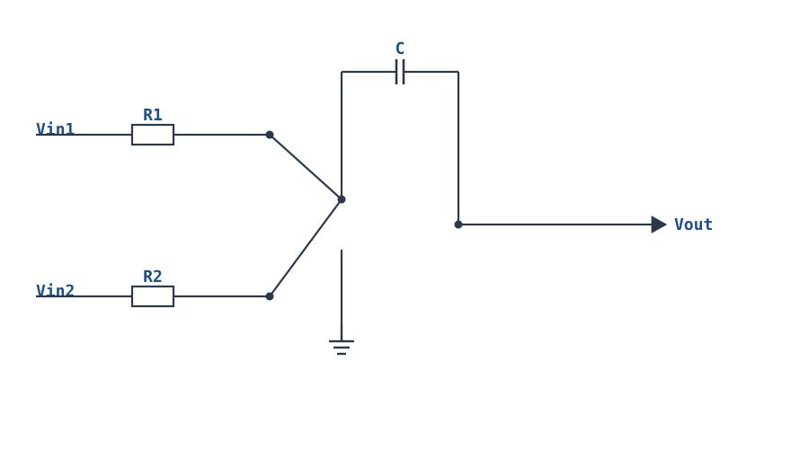
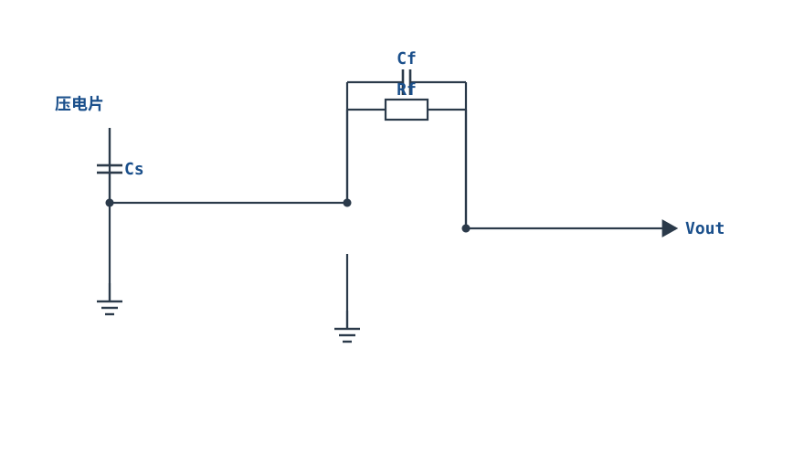

# 积分器与微分器 Integrator & Differentiator

## 1. 设计动机

::: motivation 为什么需要这两个电路
比例放大器把信号"按固定倍数放大"，但很多时候我们想要的是信号随时间的**累积**或**变化率**：
- 把加速度计信号积分一次得到速度、再积分得到位移；
- PID 控制器里需要"积分项"消除稳态误差、"微分项"预判趋势；
- 波形发生里，给积分器送方波就能得到三角波。

只用电阻反馈时增益是常数；把反馈臂或输入臂换成**电容**，电容的阻抗随频率变化，传递函数里就出现了 $1/s$（积分）或 $s$（微分）。这就是积分器与微分器。
:::

与 [反相比例放大器](inverting-amplifier.md) 相比，差别只在一处：把反馈电阻换成电容（积分器），或把输入电阻换成电容（微分器）。

## 2. 原理图

**实用积分器**（并联了直流反馈电阻 Rf，解决漂移问题）：


**微分器**（输入臂为电容 C，反馈臂为电阻 R）：


## 3. 静态分析（DC）

- **理想积分器**：电容在直流下开路，反馈臂没有直流通路。输入偏置电流 $I_B$ 无处可去，只能对电容充电，输出**缓慢但必然地**向某一电源轨漂移（ramp to rail）——这就是积分漂移（Integrator Drift）。
- **实用积分器**：并联大电阻 Rf 后，直流下反馈臂等效为 Rf，电路在 DC 退化成一个增益为 $-Rf/R$ 的反相放大器，输出被钳在有限范围。Rf 越大，直流增益越大、低频积分越"真"，但漂移抑制越弱。
- 同相端接地，虚短使反相端 N 点静态电位 $V_- \approx 0\text{V}$（虚地）。
- 微分器：电容隔直，直流下输入开路，输出由偏置电流决定，故微分器输入臂通常再串一个小电阻限幅（见第 6 节）。

## 4. 动态分析（AC / 瞬态）

**积分器传递函数**（由虚地与电容电流 $I=C\,dV_C/dt$ 推出）：

$$V_{out}(t)=-\frac{1}{RC}\int V_{in}(t)\,dt \qquad\Longrightarrow\qquad H(s)=\frac{V_{out}(s)}{V_{in}(s)}=-\frac{1}{sRC}$$

幅频上 $|H|=1/(2\pi fRC)$，频率每翻十倍增益降 20 dB（−20 dB/十倍频程），相位滞后 90°；特征频率 $f_0=\dfrac{1}{2\pi RC}$ 处 $|H|=1$。

**微分器传递函数**：

$$V_{out}(t)=-RC\,\frac{dV_{in}(t)}{dt}\qquad\Longrightarrow\qquad H(s)=-sRC$$

幅频上 $|H|=2\pi fRC$，频率每翻十倍增益升 20 dB（+20 dB/十倍频程），相位超前 90°。

下面是积分器把 ±1V 方波整形成三角波的瞬态波形：

```echarts
{
  "tooltip": {"trigger": "axis"},
  "legend": {"data": ["Vin 方波", "Vout 三角波"], "bottom": 0, "textStyle": {"fontSize": 13}},
  "grid": {"left": 56, "right": 24, "top": 26, "bottom": 58},
  "xAxis": {"type": "category", "name": "时间", "data": [0,1,2,3,4,5,6,7,8,9,10,11,12,13,14,15,16,17,18,19,20,21,22,23], "axisLabel": {"fontSize": 10}},
  "yAxis": {"type": "value", "name": "V", "min": -4, "max": 1.5, "axisLabel": {"fontSize": 11}},
  "series": [
    {"name": "Vin 方波", "type": "line", "step": "end", "showSymbol": false, "lineStyle": {"width": 2.4, "color": "#1a4f8b"},
     "data": [1,1,1,1,1,1,1,1,1,1,1,1,-1,-1,-1,-1,-1,-1,-1,-1,-1,-1,-1,-1]},
    {"name": "Vout 三角波", "type": "line", "smooth": false, "showSymbol": false, "lineStyle": {"width": 2.6, "color": "#b5642e"},
     "data": [0,-0.3,-0.6,-0.9,-1.2,-1.5,-1.8,-2.1,-2.4,-2.7,-3.0,-3.3,-3.0,-2.7,-2.4,-2.1,-1.8,-1.5,-1.2,-0.9,-0.6,-0.3,0,0.3]}
  ]
}
```

二者的幅频特性（归一化频率 $f/f_0$）：

```echarts
{
  "tooltip": {"trigger": "axis"},
  "legend": {"data": ["积分器 |H|", "微分器 |H|"], "bottom": 0, "textStyle": {"fontSize": 13}},
  "grid": {"left": 56, "right": 24, "top": 26, "bottom": 58},
  "xAxis": {"type": "category", "name": "f/f₀", "data": ["0.1","0.3","1","3","10"], "axisLabel": {"fontSize": 11}},
  "yAxis": {"type": "value", "name": "dB", "min": -25, "max": 25, "interval": 10, "axisLabel": {"fontSize": 11}},
  "series": [
    {"name": "积分器 |H|", "type": "line", "smooth": true, "showSymbol": true, "lineStyle": {"width": 2.6, "color": "#1a4f8b"},
     "data": [20, 10.4, 0, -9.5, -20]},
    {"name": "微分器 |H|", "type": "line", "smooth": true, "showSymbol": true, "lineStyle": {"width": 2.6, "color": "#b5642e"},
     "data": [-20, -10.4, 0, 9.5, 20]}
  ]
}
```

## 5. 环路分析

积分器/微分器都是**电压并联负反馈**结构，与反相比例器同源，区别仅在反馈/输入臂阻抗 $Z_f$、$Z_{in}$：闭环增益 $G=-Z_f/Z_{in}$。

- **积分器的稳定性**：反馈臂电容在环路里引入一个额外 90° 相位滞后，使运放本身的相位滞后再叠加 90°，环路极易在高频变成 180° 滞后而**自激振荡**。对策：在反馈电容 C 上并联小电阻 Rf（把低频积分、高频退化为比例），或在输入端串小电阻。
- **微分器更危险**：$Z_{in}=1/(sC)$ 随频率升高而减小，环路增益在高频越来越大，等于"高频越负反馈越强、相移越积越多"，天生不稳定且对高频噪声极度敏感。实用微分器必须在输入电容上**串联一个小电阻 R₁**，把高频增益压平。

::: advanced 进阶：为什么 Rf 能救积分器漂移
理想积分器 DC 增益无穷大（$s\to0$ 时 $1/s\to\infty$）。失调电压 $V_{OS}$ 与偏置电流 $I_B$ 被这个无穷大增益不断积分，输出单向爬坡直到撞轨。并联 Rf 后，DC 增益被限制为 $-Rf/R$，输出失调 $V_{out}\approx (1+Rf/R)V_{OS}+I_B Rf$，变成有限值。工程上取 $Rf \gg R$（如 100 倍），让 $f< f_p=1/(2\pi Rf C)$ 时电路仍是积分器，$f>f_p$ 退化为比例器——这个拐点就是积分"有效积分区间"的下限。
:::

## 6. 元件取值与工程权衡

- **时间常数 $\tau=RC$ 决定积分斜率**：要求 $1/\tau$ 与被积信号速度匹配，斜率太缓动态范围用不满，太陡一两个周期就撞轨。
- **电容选型关键是漏电**：积分电容漏电 $I_{leak}$ 与偏置电流一样会给电容"偷偷充电"，造成输出漂移。优先选 **C0G/NP0 陶瓷、聚丙烯薄膜电容**；**避开电解电容**（漏电大、有极性、容值随电压变化）。
- **Rf（直流反馈）取值**：取 $Rf=(10\text{~}100)\times R$，太大则漂移抑制差，太小则把有效积分带宽压窄。
- **微分器输入串联电阻 R₁**：取 $R_1\approx 1/(2\pi f_{max} C)$，在期望工作频率以上把 $Z_{in}$ 拉平，抑制高频增益与噪声。
- **阻抗甜点区**：R 取 1kΩ~1MΩ，C 取 nF~µF 级；高阻抗节点同样要注意拾取工频噪声。

## 7. 完整设计示例

::: example 用积分器把 1kHz 方波变成幅度 ±3V 的三角波
1. **需求**：输入为 ±1V、1kHz 方波，要求输出三角波峰峰值 6V（±3V）。
2. **算斜率**：方波半周期 $T/2=0.5\text{ms}$。积分器在半周期内输出摆幅 6V（从 −3V 到 +3V），斜率 $|dV_{out}/dt|=6\text{V}/0.5\text{ms}=12\text{V/ms}$。
3. **算 τ**：$V_{out}$ 斜率 $=V_{in}/\tau=1\text{V}/\tau=12\text{V/ms}$，得 $\tau=RC=1/12\text{ms}\approx 83.3\mu\text{s}$。
4. **选值**：取 $C=10\text{nF}$（C0G），则 $R=\tau/C=83.3\mu\text{s}/10\text{nF}\approx 8.3\text{k}\Omega$，取标准值 8.2kΩ。
5. **加直流反馈**：取 $Rf=1\text{M}\Omega$（≈120 倍 R），$f_p=1/(2\pi Rf C)\approx 16\text{Hz}$，远低于 1kHz，不影响积分。
6. **验算**：半周期内 $\Delta V_{out}=(V_{in}/RC)\cdot(T/2)=(1/83.3\mu\text{s})\times0.5\text{ms}=6\text{V}$，符合 ±3V 要求。
:::

## 8. 仿真与实验

在 LTspice 中用 `UniversalOpamp2`、双电源 ±15V 搭建实用积分器：
- 输入方波源（1kHz、±1V），瞬态仿真 2ms，观察输出应为线性三角波，频率与输入相同；
- 把 Rf 拆掉（开路），观察输出在几个周期内单边漂移直至被削波——直观看到积分漂移；
- 换用电解电容替代 C0G，观察零输入时输出漂移明显加快（漏电效应）；
- 微分器实验：输入窄脉冲，观察输出在脉冲上升沿/下降沿出现正负尖峰。

## 扩展与变种电路

### 扩展1：实用积分器（泄放电阻+复位开关）Practical Integrator

在反馈电容上并联大泄放电阻 $R_f$，并跨接一只手动复位开关，是积分器能真正在仪器里用的工程形态——既压住直流漂移，又能随时清零。


::: example 工作原理/静态分析
- 直流下 C 开路、$R_f$ 提供直流通路，电路退化为增益 $-R_f/R$ 的反相比例器，输出失调被限制为 $(1+R_f/R)V_{OS}+I_B R_f$。
- 有效积分下限 $f_p=\dfrac{1}{2\pi R_f C}$；只有 $f\gg f_p$ 时才是真积分。
- 按下复位开关 S，C 被短路、电荷瞬间泄放，输出回到 0，为下一次积分做准备。
:::

取值：$R_f$ 取 $(100\text{~}1000)\times R$；C 选 C0G/薄膜。与主电路相比，这里强调"复位开关"这一归零手段，常用于 PID 积分清零、三角波复位。

::: pitfall 复位不净
复位开关断开瞬间，杂散电容会保留少量电荷，复位后输出并非精确 0；应等待数个 $R_f C$ 时间常数再开始积分，或在复位后加一次短积分校准。
:::

### 扩展2：多输入求和积分器 Summing Integrator

多个输入各自经电阻汇入反相端，输出对各路误差按权重同时积分——这是 PID"积分项"和多路信号累积的基础。



::: example 工作原理/静态分析
由虚地与电容电流：

$$V_{out}(t)=-\frac{1}{C}\int\left(\frac{V_{in1}}{R_1}+\frac{V_{in2}}{R_2}\right)dt$$

各路权重由各自输入电阻决定，虚地使各路之间互不串扰。$R_1=R_2$ 时权重相等。
:::

取值：R1、R2 取 10k~100k；C 决定总时间常数。多路偏置会被同时积分，漂移更快，$R_f$ 泄放要留好。

::: pitfall 偏置叠加
某一路输入自带直流偏置时，会被持续积分并与其它路累积；路数越多，越要给反馈电容并联足够的 $R_f$，否则输出更快撞轨。
:::

### 扩展3：实用微分器（输入R+反馈C降噪）Practical Differentiator

在输入电容上串联小电阻 $R_1$、反馈臂并小电容，把高频增益压平——这是微分器从"理论可画、实际满是噪声"变成可用的关键。


::: example 工作原理/静态分析
- 低频段 $H(s)\approx -sRC$，是真微分；
- 当 $f>f_h=\dfrac{1}{2\pi R_1 C}$，输入臂阻抗被 $R_1$ 拉平，增益饱和为 $-R_f/R_1$，不再随频率升高，高频噪声被压制。
:::

取值：$R_1\approx 1/(2\pi f_{max}C)$，$f_{max}$ 是最高有用信号频率；$R_f$ 按所需高频限幅增益取。

::: pitfall R1 取值两难
$R_1$ 太大则微分带宽被压窄、相位滞后；太小则高频噪声尖峰依旧。必须按"最高有用频率"而非噪声频率设计 $R_1$。
:::

### 扩展4：压电传感器电荷放大器 Charge Amplifier

压电片是高输出阻抗的电荷源，直接接电压放大器会受电缆电容影响。电荷放大器把电荷转成电压，让电缆长度几乎不影响结果。



::: example 工作原理/静态分析
压电片产生电荷 $Q$，因反相端虚地，全部电荷灌入反馈电容 $C_f$：

$$V_{out}=-\frac{Q}{C_f}$$

压电片两端电压 $\approx 0$，电缆并联电容不进入传递函数，输出只与 $Q/C_f$ 有关。$R_f$ 给 $C_f$ 提供直流泄放。
:::

取值：$C_f$ 取 1nF~10nF（决定灵敏度，越大灵敏度越低但越稳定）；$R_f$ 取 $1\text{G}\Omega$ 级；必须选 FET 输入运放。

::: pitfall 漏电阻漂移
$R_f$、PCB 与插座的漏电阻会被 $C_f$ 积分成输出漂移。高阻抗节点必须高绝缘、屏蔽电缆，否则低频漂移远超信号。
:::


## 9. 常见坑与故障现象

::: pitfall 常见坑
- **积分器不并联 Rf，输出死撞一个电源轨**：现象是输出恒为 +13V 或 −13V 不动。原因是偏置/失调电流对电容无泄放通路，积分漂移把输出顶到轨。解决：反馈电容并联大电阻 Rf。
- **用了电解电容做积分电容**：温漂大、漏电大，零输入时输出缓慢爬行且随温度变化。解决：换 C0G 或薄膜电容。
- **微分器输出全是高频噪声尖峰**：现象是正常信号被一堆毛刺淹没。原因是微分器增益随频率升高，把空间拾取的高频噪声放大。解决：输入电容串联小电阻 R₁ 限带。
- **积分器输出波形非线性（弯曲）**：原因是运放压摆率（Slew Rate）不足，或输入信号里含直流分量被持续积分。解决：选 SR 足够的运放，输入端加隔直电容。
- **单电源下做积分/微分**：输出只能单向摆动，负半周被削。需加 Vcc/2 偏置（见[单电源电路与电平偏置搬移](single-supply-biasing.md)）。
:::

## 10. 自测题

<details><summary>积分器 $R=10\text{k}\Omega$、$C=0.1\mu\text{F}$，输入一直保持 +1V，输出以多快的速度变化？</summary>

时间常数 $\tau=RC=10\text{k}\times0.1\mu=1\text{ms}$。输出斜率 $|dV_{out}/dt|=V_{in}/\tau=1\text{V}/1\text{ms}=$ **1 V/ms**，方向为负（反相积分）。若电源 ±15V，约 15ms 后输出撞 −15V 轨。

</details>

<details><summary>为什么实用积分器要在反馈电容上并联一个大电阻 Rf，而不是干脆用很小的电容？</summary>

并联 Rf 是为了给直流（偏置电流、失调）提供泄放通路，把 DC 增益从无穷大限制为 $-Rf/R$，防止输出漂移撞轨；它只在很低的频率 $f_p=1/(2\pi Rf C)$ 以下破坏积分作用，而该频率通常远低于信号频率。换小电容只能改变积分斜率，无法解决直流漂移。

</details>

<details><summary>微分器对 1kHz 和 10kHz 的同样幅度方波，哪个输出尖峰更大？为什么？</summary>

**10kHz 更大**。微分器增益 $|H|=2\pi fRC$ 与频率成正比，高频增益高；同时频率越高方波边沿越陡，$dV/dt$ 越大，输出尖峰幅度 $|V_{out}|=RC\,dV/dt$ 也越大。这正是微分器对高频噪声敏感的原因。

</details>

## 11. 参考资料

- TI, *Op Amps for Everyone* (SLOD006B)，积分器/微分器与积分漂移章节
- Sergio Franco, *Design with Operational Amplifiers and Analog Integrated Circuits* (4th Ed.)，频率变换电路（1/s、s 网络）
- Analog Devices, MT-049 噪声与带宽积分小教程
