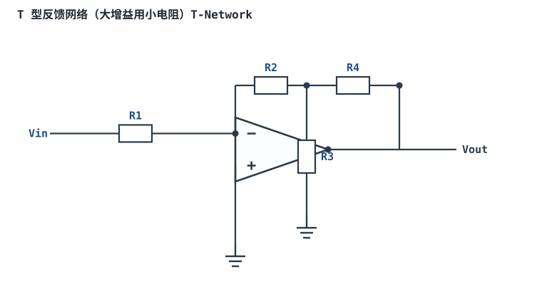
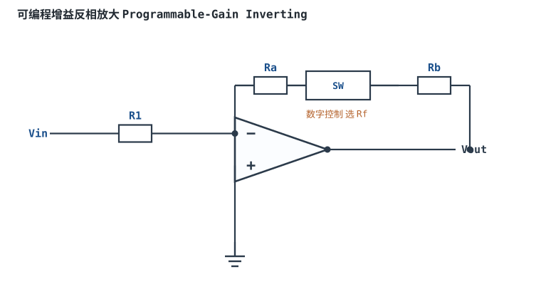
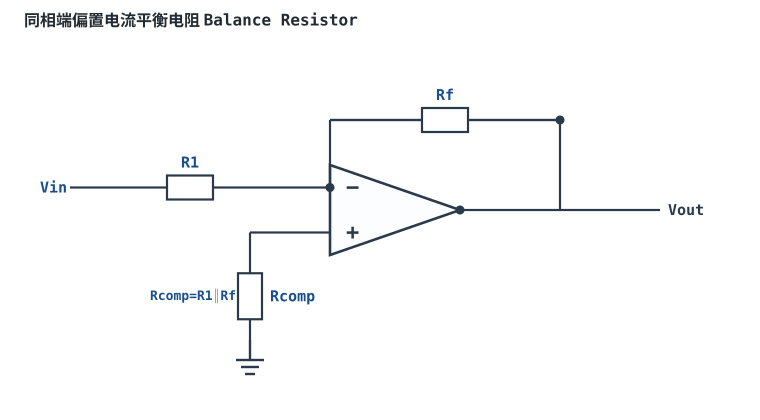
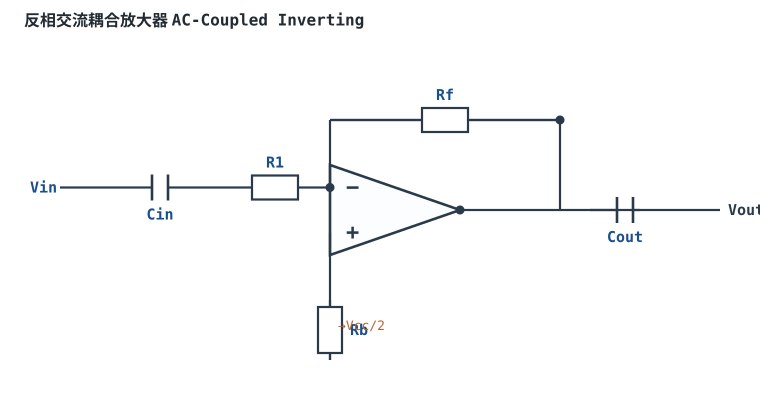
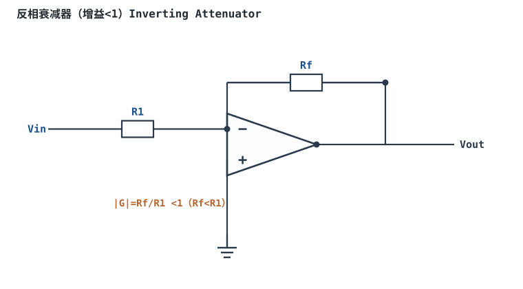

# 反相比例放大器 Inverting Amplifier

## 1. 设计动机

::: motivation 为什么需要这个电路
传感器送来的信号常常很微弱，比如只有 0.2V，而 ADC（模数转换器）希望读到 0~2.5V，这就需要把信号精确放大 10 倍。

如果把信号直接接在运放输入端、什么都不接，运放会以几十万倍的开环增益放大，输出瞬间被顶到电源轨——它变成了比较器，而不是放大器。**要让增益可控、可预测，就必须给运放接上负反馈。**反相比例放大器就是其中最基础、最常用的一种。
:::

反相比例放大器只需要两个电阻：输入电阻 **R₁** 和反馈电阻 **Rf**。信号从运放的**反相输入端（−）**进入，同相输入端（+）接地，输出与输入相位相反（相差 180°），所以叫"反相"。

## 2. 原理图


## 3. 静态分析（DC）

静态分析时把电容视为开路。本电路没有电容，直接看直流偏置：

- 同相端接地，$V_+ = 0\text{V}$；
- 由虚短（负反馈存在时），反相端电位被强制为 $V_- = V_+ = 0\text{V}$；
- 由虚断，两个输入端都没有直流电流流入芯片，因此电阻 R₁ 与 Rf 上的电流相等：
  $I = \dfrac{V_{in}}{R_1} = -\dfrac{V_{out}}{Rf}$；
- 当 $V_{in}=0$（输入接地）时，理想情况下 $V_{out}=0$，输出静态工作点位于 0V。

::: advanced 进阶：真实运放的静态偏差
真实运放存在输入失调电压 $V_{OS}$（毫伏甚至微伏级）和输入偏置电流 $I_B$。输入接地时输出并不严格为 0，而约为 $V_{out}\approx -\dfrac{Rf}{R_1}V_{OS}+I_B\cdot Rf$。精密应用需选低 $V_{OS}$ 型号或加调零电路，详见"失调与偏置"一章。
:::

## 4. 动态分析（AC / 瞬态）

对交流小信号，电路的传递函数（闭环增益）为：

$$V_{out}=-\frac{R_f}{R_1}\,V_{in}\qquad\Longrightarrow\qquad G(s)=\frac{V_{out}(s)}{V_{in}(s)}=-\frac{R_f}{R_1}$$

在运放带宽足够时，增益是一个与频率无关的常数，负号表示相位翻转 180°。下面是 $Rf/R_1=10$ 时输入与输出的瞬态波形：

```echarts
{
  "tooltip": {"trigger": "axis"},
  "legend": {"data": ["Vin（输入）", "Vout（输出）"], "bottom": 0, "textStyle": {"fontSize": 13}},
  "grid": {"left": 56, "right": 24, "top": 26, "bottom": 58},
  "xAxis": {"type": "category", "name": "角度", "data": [0,30,60,90,120,150,180,210,240,270,300,330,360], "axisLabel": {"fontSize": 11}},
  "yAxis": {"type": "value", "name": "电压 V", "min": -2.4, "max": 2.4, "interval": 0.8, "axisLabel": {"fontSize": 11}},
  "series": [
    {"name": "Vin（输入）", "type": "line", "smooth": true, "showSymbol": false, "lineStyle": {"width": 2.6, "color": "#1a4f8b"},
     "data": [0,0.1,0.173,0.2,0.173,0.1,0,-0.1,-0.173,-0.2,-0.173,-0.1,0]},
    {"name": "Vout（输出）", "type": "line", "smooth": true, "showSymbol": false, "lineStyle": {"width": 2.6, "color": "#b5642e"},
     "data": [0,-1,-1.73,-2,-1.73,-1,0,1,1.73,2,1.73,1,0]}
  ]
}
```

## 5. 环路分析

这是一个**电压并联负反馈**（Voltage Shunt Feedback）电路：反馈信号以电流形式在反相端与输入电流求和，取样对象是输出电压。

- 断开反馈环路、保留直流工作点，可求得环路增益 $T(s)$；深度负反馈下闭环增益几乎只由外部电阻决定：$G\approx -Rf/R_1$，与运放自身开环增益 $A_{OL}$ 基本无关。
- 稳定性判据：环路增益的幅频曲线穿越 0dB 时，若相位滞后不足 180°（即**相位裕度 Phase Margin > 0，工程上希望 ≥ 45°**），电路稳定不震荡。
- 纯电阻反馈本身相位裕度通常足够；但当 Rf 过大、布线寄生电容明显，或驱动容性负载时，可能出现额外相移导致自激（表现为输出叠加高频振荡）。

::: advanced 进阶：环路增益与相位裕度推导
运放开环增益为 $A(s)$，反相端为求和节点。由节点电流方程可推得闭环增益
$G(s)=-\dfrac{Rf/R_1}{1+\dfrac{1+Rf/R_1}{A(s)\beta}}$，其中反馈系数 $\beta=R_1/(R_1+Rf)$，环路增益 $T(s)=A(s)\beta$。
当 $|T|\gg 1$ 时 $G\to -Rf/R_1$。画出 $T(s)$ 的伯德图，在 $|T|=1$ 处读相位 $\phi$，相位裕度 $\text{PM}=180^{\circ}+\phi$。PM<0 时电路振荡，可通过在 Rf 上并联小电容或加补偿网络改善。
:::

## 6. 元件取值与工程权衡

- **R₁ 决定输入阻抗**：信号源看到的输入阻抗就是 R₁（反相端虚地）。高内阻传感器要求 R₁ 足够大，否则信号被衰减。
- **Rf = |G| × R₁**：先按增益需求确定比值，再选定阻值数量级。
- **阻值不宜过小**：如 R₁=100Ω，$V_{in}=0.2\text{V}$ 时信号源需提供 2mA 电流，弱信号源驱动不了，运放输出电流压力也大。
- **阻值不宜过大**：Rf 超过 1~10MΩ 时，输入偏置电流在 Rf 上产生明显失调，且高阻抗节点易拾取工频和空间噪声。
- **经验甜点区**：1kΩ~100kΩ，多数通用电路从 R₁=10kΩ 起步。

## 7. 完整设计示例

::: example 把 0.25V 放大到 2.5V
1. **需求**：电流传感器输出 0~0.25V，希望放大 10 倍后送给 ADC。
2. **算增益**：$G = 2.5 \div 0.25 = 10$，即 $Rf/R_1 = 10$。
3. **选 R₁**：通用场景取 R₁ = 10kΩ。
4. **算 Rf**：Rf = 10 × 10kΩ = 100kΩ。
5. **注意供电**：反相放大器输出会出现负电压，必须用双电源（如 ±5V）；单电源（5V/0V）下负半周被削平，需要加直流偏置或改用同相放大器（后续章节讲）。
6. **验算**：$V_{in}=0.25\text{V}\Rightarrow V_{out}=-(100\text{k}/10\text{k})\times0.25=-2.5\text{V}$，符合设计。
:::

## 8. 仿真与实验

在 LTspice 中用通用运放模型（如 `UniversalOpamp2`）搭建本电路，双电源 ±5V，输入端接信号发生器（正弦、频率 1kHz、幅度 0.2V），用示波器同时观察输入与输出：

- 输出幅度应为输入的 10 倍，相位相反；
- 逐步提高输入频率，观察当频率接近增益带宽积限制时，增益下降、相位进一步滞后；
- 把同相端的接地线断开（悬空），观察输出如何因拾取噪声而乱跳。

## 扩展与变种电路

### 扩展1：T 型反馈网络（大增益用小电阻）T-Network

需要大增益又不愿用 MΩ 级反馈电阻时，用 R2/R3/R4 组成 T 型网络，用中等阻值等效出很大的反馈电阻。



::: example 工作原理与静态分析
- 等效反馈电阻 $R_{eq}\approx R_2+R_4+R_2R_4/R_3$，选小 R3 即可在不大的阻值下获得大等效增益。
- 闭环增益 $G=-R_{eq}/R_1$。
- 代价：R3 把噪声增益抬高、且引入额外噪声，精度不如单一大 Rf。
- 例：R2=R4=100k、R3=10k，$R_{eq}\approx 310$k，等效增益大而阻值仍在百 k 级。
:::

取值数量级：R2/R4=100k、R3=几 k；与单 Rf=10M 对比：避免超大电阻的偏置与噪声问题。适用：高增益但输入阻抗受限、CMOS 高阻源；不适用：低噪声（T 网络自身噪声大）。

::: pitfall T 网络把噪声增益和噪声一起抬高
- **现象**：增益够了，但输出噪声/失调明显偏大。
- **原因**：R3 对地分流抬高噪声增益，且各电阻热噪声被放大。
- **解决**：低噪声设计优先选高输入阻抗的同相放大，或用真实大 Rf 配 CMOS 运放。
:::

### 扩展2：可编程增益反相放大 Programmable-Gain Inverting

用模拟开关在多档反馈电阻间切换，数字信号选择增益，实现可编程增益放大器（PGA）。



::: example 工作原理与静态分析
- 增益 $G=-R_{f,sel}/R_1$，开关选哪只 Rf 就用哪档增益。
- 开关导通电阻 $R_{on}$ 串入反馈，占比要远小于所选 Rf，否则增益误差变大。
- 关键：选 $R_{on}$ 小、电荷注入小的模拟开关；Rf 取百 k 级以压低 $R_{on}$ 占比。
:::

取值数量级：Rf=10k~100k，开关 $R_{on}<100\Omega$；与"手焊换电阻"对比：程控、可自动量程。适用：多量程仪表、自动测试；不适用：超高精度（$R_{on}$ 与电荷注入引入误差）。

::: pitfall 开关导通电阻吃掉增益精度
- **现象**：高档增益比理论值偏低、且随温度飘。
- **原因**：$R_{on}$ 串入反馈支路，等效 Rf 变大却未被计入。
- **解决**：选低 $R_{on}$ 开关，或把 Rf 取得远大于 $R_{on}$（1000 倍以上）。
:::

### 扩展3：同相端偏置电流平衡电阻 Balance Resistor

BJT 运放的偏置电流在反相端等效电阻上产生压降，同相端串一只相等电阻到地，抵消一阶偏置效应。



::: example 工作原理与静态分析
- 反相端等效电阻 $R_{eq}=R_1\parallel R_f$，$I_b$ 产生压降 $I_b R_{eq}$。
- 同相端串 $R_{comp}=R_1\parallel R_f$，两 $I_b$ 压降近似相消，残余为 $I_{os}\cdot R_{eq}$。
- CMOS 运放 $I_b$ 为 pA 级，通常不加。
:::

取值数量级：Rcomp=R1∥Rf；与"不加"对比：BJT 运放减小直流漂移。适用：BJT 高增益直流；不适用：CMOS 高阻、低噪声。

::: pitfall 给 CMOS 运放加平衡电阻反而增噪
- **现象**：加 Rcomp 后输出噪声变大。
- **原因**：pA 级 $I_b$ 压降可忽略，Rcomp 自身热噪声却被放大。
- **解决**：CMOS/JFET 输入级省略 Rcomp。
:::

### 扩展4：反相交流耦合放大器 AC-Coupled Inverting

输入/输出各串隔直电容，只放大交流分量；单电源工作时同相端偏置到 Vcc/2。



::: example 工作原理与静态分析
- 低频截止由 $R_1 C_{in}$ 与 $R_f C_{out}$ 决定：$f_L\approx 1/(2\pi R_1 C_{in})$。
- 静态时电容开路，输出直流偏在 Vcc/2，信号叠加其上摆动，Cout 隔直耦合到后级。
- 中带增益仍 $G=-R_f/R_1$。
:::

取值数量级：Cin=Cout=1µF 对应几十 Hz；与直流放大对比：隔断直流、单电源可用。适用：音频、交流信号链；不适用：需放大直流或极低频的场合。

::: pitfall 单电源下输出负半周被削平
- **现象**：交流输出下半周贴 0V。
- **原因**：同相端没偏置到 Vcc/2，或偏置电阻太大、静态点漂。
- **解决**：同相端设 Vcc/2 偏置，Cout 后再耦合，保证输出静态在中点。
:::

### 扩展5：反相衰减器（增益<1）Inverting Attenuator

让 Rf<R1，反相放大器增益绝对值小于 1，在反相结构里做衰减并保持阻抗明确。



::: example 工作原理与静态分析
- 增益 $G=-R_f/R_1$，Rf<R1 时 $|G|<1$。
- 噪声增益仍为 $1+R_f/R_1$（略大于 1），带宽按它算。
- 输入阻抗等于 R1，可用来衰减大信号到 ADC 量程内。
:::

取值数量级：R1=100k、Rf=10k 得 −0.1 倍；与电阻分压对比：低输出阻抗、有缓冲作用。适用：大信号衰减、电平压缩；不适用：高输入阻抗要求（输入阻抗=R1）。

::: pitfall 按信号增益估带宽导致高频失真
- **现象**：衰减器高频段增益掉得比预期快。
- **原因**：噪声增益 $1+R_f/R_1$ 虽接近 1，但带宽 $f_c=GBP/G_n$ 仍有限。
- **解决**：按噪声增益核算带宽，高频大信号还要同时核对压摆率。
:::

## 9. 常见坑与故障现象

::: pitfall 常见坑
- **同相端悬空不接地**：面包板上最常见。悬空引脚像天线一样拾取噪声，输出毫无规律地乱跳。同相端必须可靠接地。
- **单电源供电输入交流信号**：单电源（5V/0V）下输出无法为负，负半周被削波，输出卡在 0V。交流放大需双电源或加偏置。
- **反馈电阻取到 10MΩ 以上**：偏置电流流过巨大 Rf 产生毫伏级失调，表现为输入接地时输出不在 0V，温漂明显。
- **R₁ 取得太小**：信号源需提供较大电流，高内阻信号源驱动不了，增益失准。
- **Rf 接到同相端**：变成正反馈，输出锁死在电源轨，电路变成施密特触发器而非放大器。
:::

## 10. 自测题

<details><summary>R₁ = 1kΩ，Rf = 10kΩ，Vin = 0.3V，输出 Vout 等于多少？</summary>

$V_{out} = -(Rf/R_1)\times V_{in} = -10\times 0.3 =$ **−3V**。注意是负的，输出与输入反相。

</details>

<details><summary>用万用表测量反相端 N 点，会读到大约多少伏？为什么它叫"虚地"而不直接接地？</summary>

读到约 **0V**。因为负反馈配合虚短把 N 点电位拉到与接地的同相端相等。但 N 点不能真的接地——否则输入信号经 R₁ 直接对地短路，电路失效。

</details>

<details><summary>某传感器内阻高达 100kΩ，R₁ 取 1kΩ 会发生什么？应该怎么办？</summary>

传感器内阻（100k）与 R₁（1k）构成分压，真正送到电路的信号只剩约 1%，增益严重失准。应让 R₁ 远大于信号源内阻（受偏置电流限制不宜过大），或改用输入阻抗极高的同相放大器 / 仪表放大器。

</details>

<details><summary>输入接地后，示波器看到输出稳定在 +3.8V 不动，最可能是哪类问题？</summary>

反馈没有生效：可能是 Rf 虚焊/没接（运放开环工作，输出被顶到电源轨），或 Rf 接到了同相端形成正反馈。优先检查反馈回路接线。

</details>

## 11. 参考资料

- TI Precision Labs – Op Amps（负反馈与环路稳定性章节）
- Analog Devices 运放应用笔记（MT 系列）
