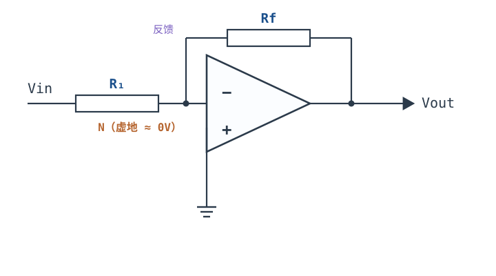
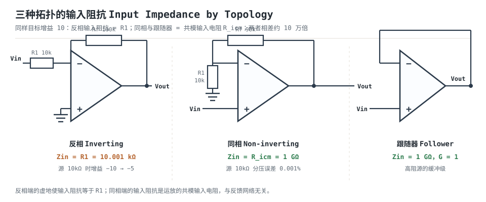

# 反相比例放大器 Inverting Amplifier

反相比例放大器（inverting amplifier）只需要两只电阻：输入电阻 $R_1$ 和反馈电阻 $R_f$。信号从反相端进，同相端接地，输出与输入反相，理想增益 $A_{CL}=-R_f/R_1$。它是最常见的运放电路之一，也是误解最多的一只：很多人记住"虚地"和"$-R_f/R_1$"，却不知道**反相端的输入阻抗就是 $R_1$**、**噪声增益是 $1+R_f/R_1$ 而不是 $R_f/R_1$**、**虚地只是近似**。这三条只要错一条，高阻源、带宽预算或直流误差就会在现场翻车。

本章按"为什么需要 → 虚地到底是什么意思 → 有限开环增益怎么修正 → 输入阻抗与噪声增益 → 完整设计算例"展开。符号沿用[运放概述：符号、封装与引脚](opamp-overview.md)：开环增益 $A_{OL}$、闭环增益 $A_{CL}$ 或 $G$、反馈系数 $\beta$（不是三极管的电流放大倍数）、环路增益 $T=A_{OL}\beta$、噪声增益 $1/\beta$、GBW、PM。**虚短、虚断只在负反馈成立、输出未饱和、$|T|\gg1$ 时成立**；本章每次使用前都会点明这个前提。三种基本组态的输入/输出阻抗对比见[理想模型五假设与虚短、虚断](ideal-opamp.md)，反馈拓扑的判别见[反馈四拓扑与环路增益](feedback-topologies.md)。

## 1. 设计动机

::: motivation 三个真实场景

**场景一：0.25 V 传感器放大到 2.5 V。** 电流传感器输出 0~0.25 V，ADC 满量程 2.5 V，需要 10 倍增益。用同相放大器当然可以，但同相放大的输入端必须承受信号本身的共模电压；如果信号是负的、或者需要多路相加，反相组态更方便：反相端是虚地，多路输入可以各经一只电阻汇到同一个节点，互不干扰。这是加法器、减法器和跨阻放大的共同基础。

**场景二：把 1 MΩ 高阻传感器接到反相放大。** 设计 $R_1=10\ \text{k}\Omega$、$R_f=100\ \text{k}\Omega$，目标增益 $-10$。实际信号源内阻 1 MΩ 与 $R_1$ 串联分压，送到虚地的电流只剩 $1/(1+100)=0.99\%$，等效增益

$$G=-\frac{R_f}{R_1+R_s}=-\frac{100\ \text{k}\Omega}{10\ \text{k}\Omega+1\ \text{M}\Omega}=-0.099$$

比设计值低 $20\lg(0.0099)=-40.1\ \text{dB}$。**反相放大的输入阻抗不是无穷大，而是 $R_1$**——这是本章最重要的一条纠正。

**场景三：单电源 5 V 下输出负半周被削平。** 输入 0.25 V、增益 $-10$，输出应该是 $-2.5\ \text{V}$；但 5 V 单电源的输出最低只能到 0 V 附近，负半周全部削掉，输出卡在 0 V。反相放大要输出负电压，要么用双电源，要么把同相端偏置到 $V_{ref}$、输入输出都交流耦合，让输出以 $V_{ref}$ 为中心摆动。

:::

| 你想确认 | 先算 | 判据（工程经验值） |
|---|---|---|
| 高阻源会不会被衰减 | $R_1$ 与源内阻 $R_s$ | $R_1\ge100R_s$（误差 ≤1%） |
| 增益准不准 | $T=A_{OL}\beta$ | $T\ge100$ → 误差 ≤1% |
| 带宽够不够 | $f_{cl}=GBW/(1/\beta)$ | $f_{cl}\ge10\times$ 最高信号频率 |
| 输出噪声多大 | $e_n(1/\beta)\sqrt{BW}$ | 小于 ADC 的 1 LSB |
| 直流误差多大 | $V_{OS}(1/\beta)+I_BR_{eq}(1/\beta)$ | 小于目标精度的 1/3 |
| 单电源能不能用 | 输出是否要为负 | 要负输出就加负电源或偏置 |

**不算会摔在哪**，四个带数字的代价：

1. **把输入阻抗当成无穷大。** 1 MΩ 源、$R_1=10\ \text{k}\Omega$，增益从 $-10$ 掉到 $-0.099$，低了 40.1 dB；信号还没进运放就没了。
2. **用信号增益算带宽。** 反相 $-10$ 的噪声增益是 11，闭环带宽 $10\ \text{MHz}/11=909\ \text{kHz}$，不是 $10\ \text{MHz}/10=1\ \text{MHz}$；按 1 MHz 设计，最后 100 kHz 处的增益误差会比预期大一截。
3. **忽略有限 $A_{OL}$。** 目标增益 1000 时 $T=100$，增益误差约 1%，比 1% 电阻的误差还大；换 0.1% 电阻没用，得降单级增益或换高 $A_{OL}$ 器件。
4. **单电源直接放大交流信号。** 负半周没有摆幅，输出削平；这不是"运放不好"，是供电与偏置没设计。

## 2. 定义与直观

### 2.1 一句话定义与两只电阻

**反相比例放大器**：输入电压经 $R_1$ 送到反相端，$R_f$ 从输出接回反相端，同相端接参考地（双电源时是 0 V，单电源时是 $V_{ref}$）。理想闭环增益

$$A_{CL}=-\frac{R_f}{R_1}$$

符号与单位：$A_{CL}$ 无量纲（V/V），负号表示输出与输入反相 $180^{\circ}$；$R_1$、$R_f$ 单位 $\Omega$。反馈系数

$$\beta=\frac{R_1}{R_1+R_f},\qquad \frac{1}{\beta}=1+\frac{R_f}{R_1}$$

注意 $\beta$ 是正数，负号来自输入网络（信号从 $R_1$ 进、从 $R_f$ 出），**不来自 $\beta$**。环路仍然是负反馈，稳定性判据用的是 $T=A_{OL}\beta$ 的相位，不是闭环增益的符号。



### 2.2 虚地：被反馈按住的 0 V

由 $V_{OUT}=A_{OL}(V_+-V_-)$，同相端接地 $V_+=0$，所以

$$V_-=-\frac{V_{OUT}}{A_{OL}}$$

量级是 $|V_{OUT}|/A_{OL}$。$V_{OUT}=-2.5\ \text{V}$、$A_{OL}=10^5$ 时，$V_-=+25\ \mu\text{V}$——反相端比地高 25 µV，几乎就是 0 V，但它不是真的接地。

这条 25 µV 的偏差决定了三件事：

1. **输入电流全部流过 $R_f$。** 因为 $V_-\approx0$，$R_1$ 上的电压就是 $V_{IN}$，电流 $I=V_{IN}/R_1$；虚断又保证这个电流不进入运放，只能全部流过 $R_f$，在 $R_f$ 上产生 $I R_f$ 的压降，输出因此是 $-I R_f$。
2. **输入阻抗等于 $R_1$。** 信号源看到的负载是 $R_1$ 一端接源、另一端接一个近似 0 V 的节点，所以 $Z_{in}\approx R_1$。
3. **虚地是近似，不是短路。** 如果把反相端直接接地"看看"，输入信号被 $R_1$ 短路到地，反馈也被破坏，电路不再放大。测试时只能用高阻探头轻触，不能短接。

::: analogy 虚地像一台不断纠偏的天平

把反相端想成天平的支点，$R_1$ 和 $R_f$ 是两侧的力臂。输入电流想把这端抬起来，运放立刻把输出往反方向压，用 $R_f$ 上的电流把它拉回 0 V。支点越"硬"（$A_{OL}\beta$ 越大），偏离 0 V 越小；支点一旦被输出饱和顶住，天平就失灵了。

类比的边界：天平是被动平衡，运放是主动伺服；天平的支点真的固定，虚地的支点只在 $|T|\gg1$ 的频率范围内有效。频率升高后 $A_{OL}$ 滚降，虚地会"软"下来，$V_-$ 从 25 µV 涨到 25 mV 甚至更大。

:::

### 2.3 反相是怎么来的

设输入电压升高 $\Delta V_{IN}$。反相端暂时升高，运放的同相端接地，误差 $V_+-V_-$ 变负，输出被往负方向推；输出下降又通过 $R_f$ 把反相端拉回 0 V。平衡后，$R_1$ 上的电流 $V_{IN}/R_1$ 全部流过 $R_f$，输出必须是 $-R_f/R_1$ 倍的输入，才能提供这个电流。**输出反向，是为了把输入电流"吸"过反馈电阻。**

如果把 $R_f$ 接到同相端，反馈变成正反馈，输出会锁在电源轨，电路变成施密特触发器而不是放大器。这是面包板上最常见的接错之一，见 §6。

## 3. 定量关系

### 3.1 理想增益推导

在负反馈成立、输出未饱和、$|T|\gg1$ 的前提下，用虚短 $V_-=V_+=0$，用虚断 $I_-=0$。对反相端列 KCL：

$$\frac{V_--V_{IN}}{R_1}+\frac{V_--V_{OUT}}{R_f}=0$$

代入 $V_-=0$：

$$-\frac{V_{IN}}{R_1}-\frac{V_{OUT}}{R_f}=0\ \Rightarrow\ V_{OUT}=-\frac{R_f}{R_1}V_{IN}$$

这就是反相比例放大的全部推导。它没有用到 $A_{OL}$，因为 $A_{OL}$ 被负反馈"消耗"掉了；只要 $|T|\gg1$，增益就只由电阻比决定。

### 3.2 有限开环增益的修正

保留 $A_{OL}$，同相端接地，$V_{OUT}=-A_{OL}V_-$。对反相端列 KCL：

$$\frac{V_--V_{IN}}{R_1}+\frac{V_--V_{OUT}}{R_f}=0,\qquad V_{OUT}=-A_{OL}V_-$$

把 $V_{OUT}$ 代入并整理：

$$V_-\left(\frac{1}{R_1}+\frac{1+A_{OL}}{R_f}\right)=\frac{V_{IN}}{R_1}$$

解出 $V_-$，再乘 $-A_{OL}$：

$$A_{CL}=-\frac{R_f}{R_1}\cdot\frac{A_{OL}}{A_{OL}+1+R_f/R_1}=-\frac{R_f}{R_1}\cdot\frac{T}{1+T}$$

其中

$$T=A_{OL}\beta,\qquad \beta=\frac{R_1}{R_1+R_f},\qquad \frac{1}{\beta}=1+\frac{R_f}{R_1}$$

这就是反相组态的精确式。**误差因子是 $T/(1+T)$，不是 $1/(1+T)$ 的倒数那么简单**：相对误差仍是 $-1/(1+T)$，但 $T$ 与 $\beta$ 的对应关系是"噪声增益" $1+R_f/R_1$，不是信号增益 $R_f/R_1$。负反馈"用多余增益换精度"的完整记账见[开环、闭环增益与负反馈本质](open-loop-feedback.md)。

以 $A_{OL0}=10^5$、$R_1=10\ \text{k}\Omega$、$R_f=100\ \text{k}\Omega$ 为例：

$$\beta=\frac{10}{10+100}=0.090909,\qquad \frac{1}{\beta}=11.0$$

$$T_0=10^5\times0.090909=9090.9,\qquad A_{CL0}=-10\times\frac{9090.9}{9091.9}=-9.99890$$

相对理想值 $-10$ 的误差是 $-0.0110\%$，正好是 $-1/(1+T_0)=-1/9091.9$。这个误差在低频很小，但频率升高、$T$ 下降后会变大：100 kHz 处 $|T|=9.09$，增益误差约 $-0.61\%$；到 $f_{cl}=909\ \text{kHz}$ 处 $|T|=1$，增益只剩 $-7.07$（$-29.3\%$）。

### 3.3 输入阻抗：等于 $R_1$，不是无穷大

在输入端加测试电压 $V_t$、量输入电流，保留 $A_{OL}$ 可推得

$$Z_{in,inv}=R_1+\frac{R_f}{1+A_{OL}}$$

取 $R_1=10\ \text{k}\Omega$、$R_f=100\ \text{k}\Omega$、$A_{OL}=10^5$：

$$Z_{in}=10^4+\frac{10^5}{1+10^5}=10^4+1.0\ \Omega=10.001\ \text{k}\Omega$$

第二项只有 1 Ω，**反相输入阻抗几乎就等于 $R_1$，与运放的开环增益几乎无关**。这跟同相组态形成鲜明对比：同相输入阻抗是 $R_{icm}$，典型 $10^9\sim10^{15}\ \Omega$；反相只有 $10\ \text{k}\Omega$，差五到十一个数量级。



| 项目 | 反相 $-10$ | 同相 $+10$ | 跟随器 $+1$ |
|---|---|---|---|
| 信号增益 | $-R_f/R_1=-10$ | $1+R_f/R_1=10$ | 1 |
| 输入阻抗（直流） | $\approx R_1=10\ \text{k}\Omega$ | $\approx R_{icm}=1\ \text{G}\Omega$ | $\approx1\ \text{G}\Omega$ |
| 输入端的共模电压 | $\approx0$（虚地） | 等于 $V_{IN}$ | 等于 $V_{IN}$ |
| 噪声增益 $1/\beta$ | $1+R_f/R_1=11$ | $1+R_f/R_1=10$ | 1 |
| 反馈网络是否加载信号源 | 是（$R_1$ 就是负载） | 否 | 否 |
| 单电源低端信号 | 容易处理（虚地接近 0 V） | 受 ICMR 限制 | 受 ICMR 限制 |

这张表的关键行是第二行：**"运放输入阻抗无穷大"只对同相端成立**。反相放大把输入信号经 $R_1$ 送到虚地，信号源看到的负载就是 $R_1$；如果源内阻与 $R_1$ 可比，增益会按 $R_f/(R_1+R_s)$ 掉下来。高阻源要么改用同相放大（见[同相比例放大器](non-inverting-amplifier.md)），要么在反相放大前加一级[电压跟随器](voltage-follower.md)。

### 3.4 虚地到底有多"虚"

虚地的偏差是 $|V_-|=|V_{OUT}|/A_{OL}$，它随频率升高而变大：

| 频率 | $\lvert A_{OL}\rvert$ | $\lvert V_-\rvert$（$V_{OUT}=-2.5\ \text{V}$） | 输入阻抗近似 |
|---|---|---|---|
| 直流 | $10^5$ | $25\ \mu\text{V}$ | $10.001\ \text{k}\Omega$ |
| 1 kHz | 9950 | $251\ \mu\text{V}$ | $10.01\ \text{k}\Omega$ |
| 100 kHz | 100.0 | $25.0\ \text{mV}$ | $10.99\ \text{k}\Omega$（近似） |
| 909 kHz | 11.0 | $227\ \text{mV}$ | — |

100 kHz 时虚地偏差 25 mV，已经不能忽略：它会让输入电流产生 25 mV 的误差，也会让"输入阻抗 = $R_1$"这个结论出现约 10% 的偏差（按 $R_1+R_f/(1+|A_{OL}|)$ 估算为 10.99 kΩ；严格复数计算因相位不同会略低，约 10.06 kΩ）。**虚地是低频近似，不是全频段定理**；高精度、高频率场合要把这个偏差计入预算。

### 3.5 噪声增益：不等于信号增益

反相组态有两个"增益"，必须分开记：

- **信号增益**：$|A_{CL}|=R_f/R_1=10$，决定输入到输出的比例；
- **噪声增益**：$1/\beta=1+R_f/R_1=11$，决定闭环带宽、输出噪声、失调与共模误差的放大倍数。

两者差 1，这个 1 来自输入网络：即使 $R_f=0$（信号增益为 0），反相端到输出仍有 $R_1$ 到地的通路，噪声增益是 1。三个后果：

1. **带宽**：$f_{cl}=GBW/(1/\beta)=GBW/11$。$R_1=10\ \text{k}\Omega$、$R_f=100\ \text{k}\Omega$、GBW=10 MHz 时 $f_{cl}=909\ \text{kHz}$，不是 $1\ \text{MHz}$；按信号增益算会高估 10%。
2. **噪声**：运放电压噪声被 $1/\beta=11$ 放大，不是 10。但闭环噪声带宽同时按 $1/11$ 缩小，所以总输出噪声只按 $\sqrt{11/10}=1.049$ 增加约 5%，不是 10%。**"噪声密度按噪声增益放大、总噪声还乘噪声带宽"这两步不能省。**
3. **稳定性**：噪声增益越高，$f_c=GBW/(1/\beta)$ 越低，离第二极点越远，PM 越大。所以同样目标增益 10，反相 $-10$（噪声增益 11）比同相 $+10$（噪声增益 10）略稳；真正吃掉 PM 的是反相端输入电容与大阻值反馈网络，不是噪声增益本身。反相端 $C_{in}$ 与 $R_1\parallel R_f$ 形成极点，$R_1\parallel R_f=9.09\ \text{k}\Omega$、$C_{in}=5\ \text{pF}$ 时极点在 $1/(2\pi\times9.09\ \text{k}\times5\ \text{p})=3.50\ \text{MHz}$，远高于 909 kHz，本例可以忽略；若把电阻放大到 $100\ \text{k}\Omega/1\ \text{M}\Omega$，同一 5 pF 会把极点压到 350 kHz，必须按[稳定性：伯德图、相位裕度与补偿](stability-bode.md)重算。

### 3.6 适用条件与失效边界

1. **负反馈必须回到反相端。** 接到同相端就是正反馈，输出锁死；这是上电前必须核对的一项。
2. **输出必须在线性区。** 反相输出要为负，双电源下没问题；单电源下输出撞到 0 V 就是饱和，虚地、增益公式全部失效。
3. **$|T|\gg1$。** 低频、低增益时 $T$ 很大；高增益或高频时 $T$ 下降，增益误差按 $1/(1+T)$ 增大。
4. **源内阻远小于 $R_1$。** 否则输入分压，增益按 $R_f/(R_1+R_s)$ 算，不是 $R_f/R_1$。
5. **反馈网络是实数。** 纯电阻在低频成立；加电容（低通、积分器）后 $\beta$ 带相移，稳定性要按 $\beta(s)$ 重算。
6. **输出负载与容性负载。** 反相输出的闭环输出阻抗也是 $R_{out,OL}/(1+T)$，带容性负载时同样可能振铃；驱动长线要串隔离电阻。

## 4. 典型计算

### 4.1 完整算例：$-10$、输入阻抗 $10\ \text{k}\Omega$、带宽不低于 100 kHz

**需求**：输入 0~0.25 V，输出 0~$-2.5\ \text{V}$，增益 $-10$，输入阻抗 $10\ \text{k}\Omega$，闭环 $-3\ \text{dB}$ 带宽不低于 100 kHz，双电源 $\pm5\ \text{V}$。运放示例参数：$A_{OL0}=10^5$、GBW=10 MHz、$f_p=100\ \text{Hz}$、$R_{out,OL}=50\ \Omega$、$V_{OS}=1\ \text{mV}$、$I_B=25\ \text{nA}$、$I_{OS}=2\ \text{nA}$、$C_{in}=5\ \text{pF}$、$e_n=10\ \text{nV}/\sqrt{\text{Hz}}$、CMRR=80 dB、PSRR=80 dB（典型量级，以数据手册为准）。

**第 1 步：取 E96 电阻。** 输入阻抗就是 $R_1$，所以 $R_1=10.0\ \text{k}\Omega$（E96 有 10.0）；增益 $-10$ 要求 $R_f=10\times10.0=100\ \text{k}\Omega$（E96 有 100）。两只都取 0.1% 薄膜电阻，理由见第 6 步的误差预算。

**第 2 步：噪声增益与带宽。** $\beta=10/(10+100)=0.090909$，$1/\beta=11.0$。

$$f_{cl}=\frac{GBW}{1/\beta}=\frac{10\ \text{MHz}}{11}=909.1\ \text{kHz}$$

$909.1\ \text{kHz}\ge100\ \text{kHz}$，带宽门槛满足，而且是 9.1 倍余量。如果只按"$-3\ \text{dB}\ge100\ \text{kHz}$"选器件，GBW 只要 $11\times100\ \text{kHz}=1.1\ \text{MHz}$；但 100 kHz 处的幅度误差会很大（见第 4 步），所以实际选了 10 MHz。

**第 3 步：有限 $A_{OL}$ 修正。**

$$T_0=A_{OL0}\beta=10^5\times0.090909=9090.9$$

$$A_{CL0}=-10\times\frac{9090.9}{1+9090.9}=-9.99890$$

误差 $-1/(1+T_0)=-1/9091.9=-0.0110\%$。低频增益几乎就是 $-10$。

**第 4 步：100 kHz 处的实际增益。** 100 kHz 处 $f/f_p=1000$：

$$|A_{OL}|=\frac{10^5}{\sqrt{1+1000^2}}=99.99995,\qquad \angle A_{OL}=-89.943^{\circ}$$

$$|T|=99.99995\times0.090909=9.0909,\qquad \angle T=-89.943^{\circ}$$

$$|A_{CL}|=10\times\frac{9.0909}{\sqrt{1+9.0909^2}}=10\times\frac{9.0909}{9.1457}=9.9390$$

幅度误差 $(9.9390-10)/10=-0.610\%$；相对理想反相的附加相移约 $-6.28^{\circ}$。**100 kHz 处掉了 0.61%，仍在 1% 预算内；如果只按 1.1 MHz 的 GBW 选，$f_{cl}=100\ \text{kHz}$，100 kHz 处正好 $-3\ \text{dB}$，误差 $-29.3\%$，完全不能用。**

**第 5 步：输入阻抗与虚地。** 直流

$$Z_{in}=10\ \text{k}\Omega+\frac{100\ \text{k}\Omega}{1+10^5}=10.001\ \text{k}\Omega$$

$V_{OUT}=-2.5\ \text{V}$ 时 $V_-=2.5/10^5=25\ \mu\text{V}$。100 kHz 时 $|A_{OL}|=100$，$V_-=2.5/100=25\ \text{mV}$；按 $R_1+R_f/(1+|A_{OL}|)$ 估算，输入阻抗升到约 10.99 kΩ。源内阻要远小于 10 kΩ：$R_s=100\ \Omega$ 时增益误差 $100/10100=0.99\%$，已经接近 1%；$R_s=10\ \Omega$ 时才降到 0.1%。

**第 6 步：直流误差预算。** 反相端对地等效电阻 $R_{eq}=R_1\parallel R_f=10\times100/110=9.091\ \text{k}\Omega$。

| 误差源 | 折合到输入 | 输出误差 | 说明 |
|---|---|---|---|
| $V_{OS}=1\ \text{mV}$ | $1\ \text{mV}$ | $11.0\ \text{mV}$ | 乘噪声增益 11，不是信号增益 10 |
| $I_B=25\ \text{nA}$ | $25\ \text{nA}\times9.091\ \text{k}\Omega=227\ \mu\text{V}$ | $2.50\ \text{mV}$ | $+$ 端接地时只由 $-$ 端贡献 |
| $I_{OS}=2\ \text{nA}$（加平衡电阻） | $2\ \text{nA}\times9.091\ \text{k}\Omega=18.2\ \mu\text{V}$ | $0.20\ \text{mV}$ | 平衡电阻只能消 $I_B$，消不掉 $I_{OS}$ |
| PSRR=80 dB、电源变化 50 mV | $50\ \text{mV}/10^4=5\ \mu\text{V}$ | $0.055\ \text{mV}$ | 正负电源各算一次，取最坏 |
| 电阻失配 0.1% | 增益误差 0.2% | $5.0\ \text{mV}$ | 两只 0.1% 最坏反向 |
| CMRR=80 dB、$V_{cm}\approx0$ | $\approx0$ | $\approx0$ | 反相组态的共模电压接近 0 |

最坏值相加（加平衡电阻）：$11.0+0.20+0.055+5.0=16.3\ \text{mV}$；不加平衡电阻：$11.0+2.50+0.055+5.0=18.6\ \text{mV}$。按 RSS 合成：加平衡电阻约 $12.1\ \text{mV}$，不加约 $12.3\ \text{mV}$。相对 2.5 V 输出，最坏 0.65%，RSS 0.48%。**主导项是 $V_{OS}$（11 mV）和电阻失配（5 mV），偏置电流只排第三**；如果换成 1% 电阻，失配项变成 50 mV，直接吃掉整个预算。

**第 7 步：噪声。** 闭环噪声带宽 $BW=(\pi/2)f_{cl}=1.428\ \text{MHz}$。运放电压噪声：

$$V_{n,op}=10\ \text{nV}/\sqrt{\text{Hz}}\times11\times\sqrt{1.428\times10^6}=131.4\ \mu\text{V}_{\text{RMS}}$$

反馈网络热噪声（$R_{eq}=9.091\ \text{k}\Omega$，噪声密度 $\sqrt{4kTR}=12.27\ \text{nV}/\sqrt{\text{Hz}}$）：

$$V_{n,R}=12.27\ \text{nV}/\sqrt{\text{Hz}}\times11\times\sqrt{1.428\times10^6}=161.3\ \mu\text{V}_{\text{RMS}}$$

总输出噪声 $\sqrt{131.4^2+161.3^2}=208.1\ \mu\text{V}_{\text{RMS}}$，约 0.17 个 12 位 5 V ADC 的 LSB（1.22 mV）。要再低，只能减小 $R_{eq}$（例如 $R_1=1\ \text{k}\Omega$、$R_f=10\ \text{k}\Omega$），代价是输入阻抗降到 1 kΩ、信号源要多供 10 倍电流。

**第 8 步：稳定性与输出摆幅。** 纯电阻反馈、$R_1\parallel R_f=9.09\ \text{k}\Omega$、$C_{in}=5\ \text{pF}$，反相端极点 3.50 MHz，远高于 $f_{cl}=909\ \text{kHz}$，PM 足够（量级上第二极点贡献不到 $15^{\circ}$）。输出 $-2.5\ \text{V}$ 在 $\pm5\ \text{V}$ 电源下离负轨还有 2.5 V，摆幅没问题。若改成 5 V 单电源，$-2.5\ \text{V}$ 不可能输出，必须按 §5.4 加偏置。

**第 9 步：汇总。**

| 项目 | 结果 | 公式 |
|---|---|---|
| 增益（直流） | $-9.99890$ | $-(R_f/R_1)T_0/(1+T_0)$ |
| 增益误差（直流） | $-0.0110\%$ | $-1/(1+T_0)$ |
| 增益（100 kHz） | $-9.9390$ | 复数 $T/(1+T)$ |
| 增益误差（100 kHz） | $-0.610\%$ | 同上 |
| $-3\ \text{dB}$ 带宽 | 909.1 kHz | $GBW/(1/\beta)$ |
| 输入阻抗（直流） | 10.001 kΩ | $R_1+R_f/(1+A_{OL})$ |
| 虚地偏差（100 kHz） | 25.0 mV | $\lvert V_{OUT}\rvert/\lvert A_{OL}\rvert$ |
| 输出噪声 | $208\ \mu\text{V}_{\text{RMS}}$ | $e_n(1/\beta)\sqrt{BW}$ 与电阻噪声 RSS |
| 直流误差（最坏） | 16.3 mV | 各项相加 |

```echarts
{
  "tooltip": {"trigger": "axis"},
  "legend": {"data": ["理想 −10（20 dB）", "实际闭环增益"], "bottom": 0, "textStyle": {"fontSize": 12.5}},
  "grid": {"left": 64, "right": 24, "top": 30, "bottom": 58},
  "xAxis": {"type": "category", "name": "频率 / Hz（对数刻度）", "data": ["10", "100", "1k", "10k", "100k", "909k", "1M"], "axisLabel": {"fontSize": 11}},
  "yAxis": {"type": "value", "name": "闭环增益 / dB", "min": 15, "max": 20.5, "interval": 1, "axisLabel": {"fontSize": 11}},
  "series": [
    {"name": "理想 −10（20 dB）", "type": "line", "showSymbol": false, "lineStyle": {"width": 2.0, "color": "#5c6772", "type": "dashed"},
     "data": [20.0, 20.0, 20.0, 20.0, 20.0, 20.0, 20.0]},
    {"name": "实际闭环增益", "type": "line", "showSymbol": true, "symbolSize": 6, "lineStyle": {"width": 2.6, "color": "#b5642e"}, "itemStyle": {"color": "#b5642e"},
     "data": [19.999, 19.999, 19.999, 19.999, 19.947, 16.989, 16.556]}
  ]
}
```

图里低频段两条线几乎重合（增益误差 0.011%，在 0.001 dB 量级），到 100 kHz 才开始可见地下弯（$-0.61\%$），909 kHz 处正好 $-3\ \text{dB}$。**"带宽 909 kHz"不是说到 909 kHz 才开始掉，而是从 100 kHz 起就已经掉了 0.61%**；要求 100 kHz 处误差小于 1%，$f_{cl}$ 至少要 1 MHz 量级。

### 4.2 算例二：高阻源为什么不能用反相放大

**已知**：$R_s=1\ \text{M}\Omega$、$R_1=10\ \text{k}\Omega$、$R_f=100\ \text{k}\Omega$，目标 $-10$。

**第 1 步：实际增益。**

$$G=-\frac{100\ \text{k}\Omega}{10\ \text{k}\Omega+1\ \text{M}\Omega}=-0.0990$$

相对 $-10$ 低 $20\lg(0.0099)=-40.1\ \text{dB}$。

**第 2 步：能不能靠加大 $R_1$ 解决？** 把 $R_1$ 加到 1 MΩ、$R_f$ 加到 10 MΩ，输入分压变成 $1/(1+1)=0.5$，增益 $-5$，仍然差一半；同时 $R_f=10\ \text{M}\Omega$ 带来三个新问题：① 偏置电流 $25\ \text{nA}\times R_{eq}\approx25\ \text{nA}\times0.909\ \text{M}\Omega=22.7\ \text{mV}$，乘噪声增益 11 后 250 mV；② 电阻热噪声 $\sqrt{4kT\times0.909\ \text{M}\Omega}=122\ \text{nV}/\sqrt{\text{Hz}}$，是 9 kΩ 时的 10 倍；③ 反相端极点降到 $1/(2\pi\times0.909\ \text{M}\times5\ \text{p})=35\ \text{kHz}$，可能吃掉 PM。

**第 3 步：正确做法。** 高阻源先用[电压跟随器](voltage-follower.md)缓冲，再进反相放大；或者直接用[同相比例放大器](non-inverting-amplifier.md)，输入阻抗是 $R_{icm}$，1 MΩ 源的分压误差只有 $10^6/(10^9+10^6)=0.1\%$。**拓扑选择错误，靠调电阻救不回来。**

### 4.3 算例三：反相衰减器（$|G|<1$）

**已知**：$R_1=100\ \text{k}\Omega$、$R_f=10\ \text{k}\Omega$，输入 2.5 V。

**第 1 步：增益与噪声增益。**

$$G=-\frac{10}{100}=-0.1,\qquad \frac{1}{\beta}=1+\frac{10}{100}=1.1$$

**第 2 步：带宽。** $f_{cl}=GBW/1.1$；以 10 MHz 为例 $f_{cl}=9.09\ \text{MHz}$。噪声增益只有 1.1，接近 1，所以反相衰减器反而是反相组态里**最容易振荡**的一种，和跟随器类似；驱动容性负载时要按 $N=1.1$ 的 $f_c$ 算 PM。

**第 3 步：输入阻抗。** $Z_{in}\approx R_1=100\ \text{k}\Omega$，比增益 $-10$ 的 10 kΩ 高 10 倍，这是衰减器的一个附带好处；代价是电阻热噪声更大（$R_1\parallel R_f=9.09\ \text{k}\Omega$，和 $-10$ 时一样）。

## 5. 工程含义

### 5.1 数量级表

| 量 | 典型范围 | 备注 |
|---|---|---|
| 信号增益 | $0.01\sim1000$ | 单级建议不超过 $A_{OL}/100$ |
| 噪声增益 $1/\beta$ | 信号增益 $+1$ | 增益 10 时差 10% |
| $R_1$ | $100\ \Omega\sim1\ \text{M}\Omega$ | 甜点区 $1\ \text{k}\Omega\sim100\ \text{k}\Omega$ |
| $R_f$ | $R_1\times\lvert G\rvert$ | 超过 1 MΩ 要查偏置与噪声 |
| $f_{cl}$ | $GBW/(1+R_f/R_1)$ | 不是 $GBW/\lvert G\rvert$ |
| 输入阻抗 | $\approx R_1$ | 高阻源要换拓扑 |
| 输出阻抗 | $R_{out,OL}/(1+T)$ | 与同相组态相同 |
| 直流误差 | $V_{OS}(1/\beta)+I_BR_{eq}(1/\beta)$ | $R_{eq}=R_1\parallel R_f$ |

### 5.2 电阻取值：为什么是 1 kΩ~100 kΩ

- **太小**：$R_1=100\ \Omega$、输入 0.25 V 时信号源要供 2.5 mA；高内阻源驱动不了，运放输出电流压力也大。
- **太大**：$R_f=10\ \text{M}\Omega$ 时，25 nA 偏置电流产生 250 mV 输出误差；电阻热噪声升到 $400\ \text{nV}/\sqrt{\text{Hz}}$ 量级；反相端极点降到几十 kHz，容易吃 PM；高阻节点还容易拾取工频与空间噪声。
- **甜点区**：$R_1$ 取 $1\ \text{k}\Omega\sim100\ \text{k}\Omega$，$R_f$ 按增益乘上去；超过 1 MΩ 时优先考虑 T 型网络或同相拓扑。
- **精度**：0.1% 薄膜电阻不贵，增益误差 0.2% 对应 2.5 V 输出 5 mV；1% 电阻对应 50 mV，12 位系统直接用不了。

### 5.3 布局：虚地节点是"最脏"的节点

- **反相端走线要短**：虚地节点阻抗低（直流约 1 Ω），但它是求和节点，$R_1$、$R_f$、运放输入电容、PCB 焊盘电容全部并在这一点上；走线越长，$C_{in}$ 越大，β 的极点越低。
- **反馈电阻紧靠反相端**：$R_f$ 的一端尽量短接到反相端，另一端靠近输出；不要从板子另一头绕回来。
- **地回流**：同相端的地要与输入信号地、负载地分开走，最后单点汇合；虚地节点对地弹很敏感。
- **保护环**：高阻源或高增益时，反相端周围可以加一圈驱动到同电位的 guard ring，降低漏电流；但 guard ring 会增加电容，要权衡。
- **电源退耦**：每个电源脚就近 100 nF，双电源正负各一只；退耦不良的典型现象是输出高频毛刺，看起来像"运放噪声大"。

### 5.4 单电源反相放大：把虚地抬到 $V_{ref}$

单电源 5 V 下要放大交流信号，输出必须以 $V_{ref}$（典型 2.5 V）为中心摆动。做法：

1. 同相端经 $R_b$ 接到 $V_{ref}$，并用 100 nF 旁路到地；
2. 输入经 $C_{in}$ 交流耦合，$R_1$ 的左端接 $C_{in}$，右端仍接反相端；
3. 输出经 $C_{out}$ 耦合到后级，或直接送 ADC（ADC 以 $V_{ref}$ 为参考）。

此时反相端的"虚地"不再是 0 V，而是 $V_{ref}$；直流工作点 $V_{OUT}=V_{ref}$，交流增益仍是 $-R_f/R_1$。输入信号幅度要满足

$$V_{ref}-\lvert V_{in,pk}\rvert\frac{R_f}{R_1}\ge V_{out,min},\qquad V_{ref}+\lvert V_{in,pk}\rvert\frac{R_f}{R_1}\le V_{out,max}$$

以 $V_{ref}=2.5\ \text{V}$、$R_f/R_1=10$、输出摆幅 0.2~4.8 V 为例，输入峰值最多 $\min(2.3,2.3)/10=0.23\ \text{V}$；超过就削顶。偏置电阻 $R_b$ 要按 $I_BR_b$ 核算：1 pA 时 1 MΩ 只有 1 µV，25 nA 时 1 MΩ 就是 25 mV。

### 5.5 模型什么时候不够用

- **源内阻与 $R_1$ 可比**：输入分压，增益按 $R_f/(R_1+R_s)$ 算。
- **高频接近 $f_{cl}$**：有限 $A_{OL}$、第二极点、输入电容都进来，单极点模型只能给量级。
- **大信号**：压摆率、输出电流限、饱和恢复都会让线性模型失效。
- **容性负载**：输出阻抗与 $C_L$ 形成第二极点，可能振铃。
- **精密直流**：$V_{OS}$、$I_B$、$I_{OS}$、1/f 噪声、热电偶效应都进入预算。反相组态的共模电压接近 0，CMRR 误差通常可以忽略；真正要算的是 $V_{OS}$、$I_B$、$I_{OS}$ 与电阻失配。

## 6. 常见坑

::: pitfall 常见坑

- **现象**：反相放大接 1 MΩ 高阻传感器，增益只有设计值的 1%，换低阻源立刻正常。**原因**：把反相输入阻抗当成无穷大；实际 $Z_{in}\approx R_1$，源内阻与 $R_1$ 串联分压。**解决**：按 $G=-R_f/(R_1+R_s)$ 重算；高阻源改用同相放大或先加跟随器；不要靠无限加大 $R_1$ 硬扛。

- **现象**：反相 $-10$ 实测闭环带宽只有 909 kHz，按 $GBW/10$ 算应该是 1 MHz。**原因**：反相的噪声增益是 $1+R_f/R_1=11$，不是信号增益 10。**解决**：带宽、噪声、稳定性一律按噪声增益 $1/\beta$ 算；信号增益与噪声增益差 1 只在同相组态才消失。

- **现象**：输入接地时输出不在 0 V，而是稳定在 +3.8 V 附近；输入加信号也不动。**原因**：反馈没有生效——$R_f$ 虚焊、$R_f$ 接到同相端形成正反馈、或运放电源没接。**解决**：先量电源脚，再用万用表量 $R_f$ 两端连通性；核对反馈是否回到反相端；必要时先接成跟随器验证器件。

- **现象**：单电源 5 V 反相放大交流信号，输出下半周贴 0 V。**原因**：输出要为负，但单电源没有负轨；同相端又接地，输出静态点就是 0 V。**解决**：同相端偏置到 $V_{ref}$（典型 $V_{CC}/2$），输入输出交流耦合；或改用双电源。

- **现象**：反相端用万用表量到约 0 V，于是直接把它接地"看看"，结果输出饱和。**原因**：把虚地当成真地；直接接地会短路输入信号、破坏反馈。**解决**：虚地只能高阻测量，不能短接；测试时用 10:1 高阻探头，或串 1 kΩ 再测。

- **现象**：$R_f$ 取到 10 MΩ 后，输入接地时输出有几百 mV 的固定偏移，且随温度漂。**原因**：输入偏置电流在 $R_f$ 上产生压降，被噪声增益放大；高阻反馈电阻的热噪声也变大。**解决**：把 $R_f$ 降到 1 MΩ 以下（同时降 $R_1$ 保持增益），或换低 $I_B$ 的 CMOS/JFET 运放；必要时加平衡电阻，但它只能消 $I_B$ 项。

- **现象**：输出端接 1 nF 滤波电容后出现几 MHz 振荡。**原因**：容性负载与开环输出电阻形成第二极点，反相组态的输出阻抗与同相组态一样随频率上升。**解决**：输出串 22~100 Ω 隔离电阻，反馈取在电阻内侧；或选容性负载稳定的器件；按[稳定性：伯德图、相位裕度与补偿](stability-bode.md)算 PM。

:::

## 7. 自测题

<details><summary>$R_1=10\ \text{k}\Omega$、$R_f=100\ \text{k}\Omega$、$V_{IN}=0.25\ \text{V}$，理想输出是多少？如果运放 $A_{OL}=10^5$，实际输出与误差是多少？</summary>

理想：

$$V_{OUT}=-\frac{R_f}{R_1}V_{IN}=-\frac{100}{10}\times0.25=-2.500\ \text{V}$$

有限 $A_{OL}$：$\beta=10/110=0.090909$，$T_0=10^5\times0.090909=9090.9$，

$$A_{CL0}=-10\times\frac{9090.9}{9091.9}=-9.99890$$

$$V_{OUT}=-9.99890\times0.25=-2.49973\ \text{V}$$

误差 $-0.0110\%$。误差来自 $1/(1+T_0)=1/9091.9$，不是电阻精度。

</details>

<details><summary>为什么反相放大的输入阻抗等于 $R_1$，而同相放大可以到 $R_{icm}$？如果源内阻也是 $10\ \text{k}\Omega$，反相增益会变成多少？</summary>

反相端是虚地，信号源经 $R_1$ 接到一个近似 0 V 的节点，所以源看到的负载就是 $R_1$。同相放大的信号接在同相端，反馈网络接在反相端，不加载信号源，所以输入阻抗由运放的共模输入电阻 $R_{icm}$ 决定。

源内阻 $R_s=10\ \text{k}\Omega$、$R_1=10\ \text{k}\Omega$、$R_f=100\ \text{k}\Omega$：

$$G=-\frac{R_f}{R_1+R_s}=-\frac{100}{20}=-5.00$$

比 $-10$ 低一半，即 $-6.02\ \text{dB}$。同相放大在同样源内阻下的分压误差只有 $10^4/(10^9+10^4)\approx0.001\%$。

</details>

<details><summary>反相 $-10$（$R_1=10\ \text{k}\Omega$、$R_f=100\ \text{k}\Omega$）的噪声增益是多少？闭环带宽用 $GBW/10$ 还是 $GBW/11$？为什么？</summary>

$$\beta=\frac{10}{110}=0.090909,\qquad \frac{1}{\beta}=1+\frac{R_f}{R_1}=11.0$$

闭环带宽

$$f_{cl}=\frac{GBW}{1/\beta}=\frac{GBW}{11}$$

不是 $GBW/10$。原因是反馈网络对误差/噪声的放大倍数是噪声增益 $1+R_f/R_1$，不是信号增益 $R_f/R_1$；反相组态的输入网络让噪声增益比信号增益大 1。以 GBW=10 MHz 为例，$f_{cl}=909\ \text{kHz}$，不是 1 MHz。

</details>

<details><summary>反相端虚地到底有多"虚"？$V_{OUT}=-2.5\ \text{V}$、$A_{OL}=10^5$ 时 $V_-$ 是多少？100 kHz 时又是多少？</summary>

由 $V_{OUT}=A_{OL}(V_+-V_-)$、$V_+=0$：

$$V_-=-\frac{V_{OUT}}{A_{OL}}$$

$V_{OUT}=-2.5\ \text{V}$、$A_{OL}=10^5$ 时 $V_-=+25\ \mu\text{V}$。100 kHz 时 $|A_{OL}|=100$，$V_-=2.5/100=25\ \text{mV}$。

25 mV 已经不能忽略：它会让输入电流产生 25 mV 的误差，也会让输入阻抗从 10.001 kΩ 升到约 10.99 kΩ。**虚地是低频近似，频率越高越"虚"。**

</details>

<details><summary>反相放大器的直流误差主要来自哪几项？$V_{OS}=1\ \text{mV}$、$I_B=25\ \text{nA}$、$R_1\parallel R_f=9.09\ \text{k}\Omega$、0.1% 电阻、目标输出 2.5 V，最坏总误差是多少？</summary>

各项：

- $V_{OS}$：$1\ \text{mV}\times11=11.0\ \text{mV}$；
- $I_B$：$25\ \text{nA}\times9.09\ \text{k}\Omega=227\ \mu\text{V}$，乘 11 得 $2.50\ \text{mV}$；
- 电阻失配 0.1%：增益误差 0.2%，输出 $2.5\times0.002=5.0\ \text{mV}$；
- PSRR 80 dB、电源变化 50 mV：$5\ \mu\text{V}\times11=0.055\ \text{mV}$；
- CMRR：反相组态 $V_{cm}\approx0$，可忽略。

最坏相加：$11.0+2.50+5.0+0.055=18.6\ \text{mV}$，相对 2.5 V 为 0.74%。加平衡电阻后 $I_B$ 项被抵消，只剩 $I_{OS}$ 项 $0.20\ \text{mV}$，总误差降到 $16.3\ \text{mV}$。**主导项是 $V_{OS}$ 和电阻失配，不是偏置电流。**

</details>

<details><summary>单电源 5 V 下要做反相 $-10$ 放大交流信号，应该怎么改电路？输出静态点和输入幅度上限怎么算？</summary>

把同相端偏置到 $V_{ref}=2.5\ \text{V}$，输入经 $C_{in}$ 交流耦合，输出以 $V_{ref}$ 为中心摆动；反相端的"虚地"变成 $V_{ref}$，交流增益仍是 $-R_f/R_1$。

输出静态点 $V_{OUT}=V_{ref}=2.5\ \text{V}$。输入峰值上限由输出摆幅决定：

$$\lvert V_{in,pk}\rvert\le\frac{\min(V_{out,max}-V_{ref},V_{ref}-V_{out,min})}{R_f/R_1}$$

取输出摆幅 0.2~4.8 V：

$$\lvert V_{in,pk}\rvert\le\frac{\min(2.3,2.3)}{10}=0.23\ \text{V}$$

超过 0.23 V 就削顶。同相端偏置电阻 $R_b$ 要按 $I_BR_b$ 核算：1 pA 时 1 MΩ 只有 1 µV，25 nA 时 1 MΩ 就是 25 mV。

</details>

<details><summary>把反相放大器的 $R_f$ 从输出改接到同相端，会发生什么？为什么？</summary>

反馈变成正反馈。设反馈系数 $\beta$，同相端电压 $V_+=V_{IN}+\beta V_{OUT}$，反相端接地，则

$$V_{OUT}=A_{OL}V_+=\frac{A_{OL}}{1-A_{OL}\beta}V_{IN}$$

分母是 $1-A_{OL}\beta$，不是 $1+A_{OL}\beta$。当 $A_{OL}\beta\to1$ 时增益发散，任何微小扰动都会被放大到电源轨并锁死；电路变成施密特触发器，不再是线性放大器。**上电前核对反馈是否回到反相端，是成本最低、后果最重的一项检查。**

</details>

## 8. 参考资料

- **TI, *Op Amps for Everyone*（SLOD006B）**：Chapter 3 *Development of the Ideal Op Amp Equations* 给反相组态的虚地、KCL 推导与理想增益；Chapter 6 *Development of the Non-Ideal Op Amp Equations* 给有限 $A_{OL}$ 的修正式。本章 §3.1、§3.2 的推导顺序与该书一致。
- **Analog Devices, MT-033 *Voltage Feedback Op Amp Gain and Bandwidth***：噪声增益、闭环带宽与增益带宽积；本章 §3.5、§4.1 的 $f_{cl}=GBW/11$ 按该文。<https://www.analog.com/media/en/training-seminars/tutorials/MT-033.pdf>
- **Analog Devices, MT-044 *Op Amp Open-Loop Gain and Open-Loop Gain Nonlinearity***：开环增益的测试条件、非线性与温度漂移；本章 §3.2、§4.1 的有限增益误差按该文。<https://www.analog.com/media/en/training-seminars/tutorials/MT-044.pdf>
- **Sergio Franco, *Design with Operational Amplifiers and Analog Integrated Systems*（4th ed.）**：Chapter 2 *Circuits with Resistive Feedback* 给反相组态的输入电阻、输出电阻与虚地推导；本章 §3.3 的 $Z_{in}=R_1+R_f/(1+A_{OL})$ 与该书一致。
- **Sedra & Smith, *Microelectronic Circuits*（8th ed.）**：Chapter 2 *Operational Amplifiers* 讲反相组态、虚地与输入电阻；本章 §2.2、§3.3 的术语与该章对齐。
- **TI, *Single-Supply Op-Amp Circuit Collection*（SLOA058）**：单电源反相放大、偏置与交流耦合的成套电路；本章 §5.4 的 $V_{ref}$ 偏置与输入幅度上限按该文口径。
