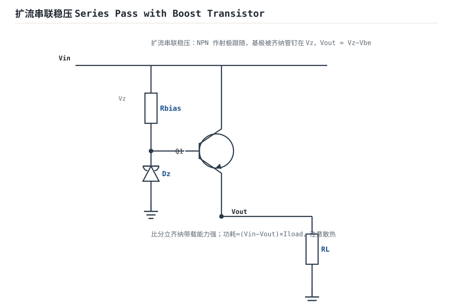
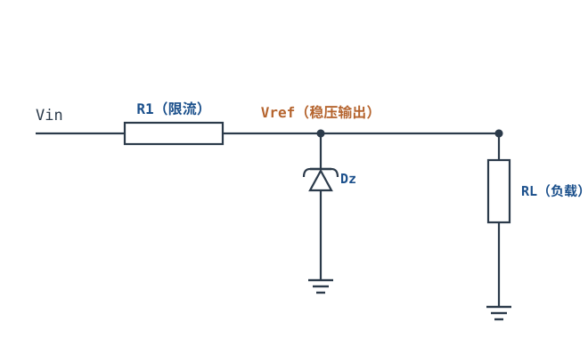
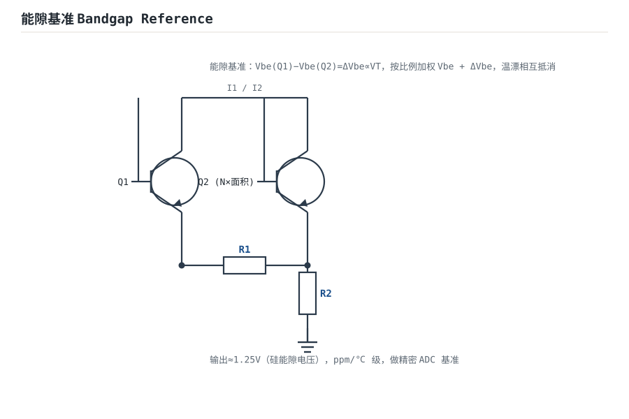

# 线性稳压与基准源 Linear Regulators & Voltage References

传感器和 ADC 需要一把"不动如山"的尺子——**电压基准（Voltage Reference）**；数字电路和模拟前级需要一堵"挡住输入波动"的墙——**线性稳压器（Linear Regulator）**。两者看起来是两类器件，本质却是同一个东西：**一个负反馈环路，把输出端的某个电压钉在基准上**。稳压器把基准放大到 3.3V/5V 并承担负载电流；基准源则把"钉住"这件事做到 ppm 级，但只肯出几 mA。

本章按"功率"和"精度"两条线展开。功率线讲三种调整管结构（NPN 串联、PNP LDO、PMOS/CMOS LDO）的**压差与稳定性**：为什么 78xx 能容忍几乎任何输出电容，而老式 PNP LDO 必须靠输出电容的 ESR 零点才能稳住；精度线讲齐纳、带隙、埋层齐纳三类基准的**初始精度、温漂、噪声**量级，以及 PSRR 随频率快速下降后，前级开关纹波还剩多少。最后用一个 5V→3.3V/300mA 的 LDO 完整算例，把功耗、温升、PSRR、ESR 窗口和基准分压误差一次算完。

线性电源的整流、滤波、变压器选型见[二极管电路：整流、滤波、限幅、钳位](diode-circuits.md)；LDO 的器件选型、封装与负载瞬态另见[LDO 原理、选型与功耗计算](../power/ldo.md)，本章不重复那部分，只把"运放环路"这一层讲透。

## 1. 设计动机

::: motivation 四个真实场景
**场景一：7805 用 9V 输入、0.3A 负载，没加散热片。** 功耗 $(10.4-5)\times0.3=1.6\text{W}$，TO-220 自然对流热阻约 65°C/W，环境 40°C 时结温 $40+1.6\times65=144^{\circ}\text{C}$，已经贴近 125°C 的降额线。**线性稳压的"简单"是用发热换来的；压差乘电流就是它逃不掉的税。**

**场景二：5V 转 3.3V/300mA 的 LDO 选了 SOT-23-5。** 功耗 $(5-3.3)\times0.3=0.51\text{W}$，SOT-23-5 的结到环境热阻约 250°C/W，温升 128°C；环境 50°C 时结温 178°C，远超 125°C。换成带裸露焊盘、铺铜的封装（约 60°C/W），结温降到 81°C。**同一颗芯片、同一个电路，封装和铜箔决定它能不能活。**

**场景三：12 位 3.3V ADC 用 50ppm/°C 的带隙基准。** 1 LSB 是 0.806mV。50ppm/°C 在 50°C 温升下是 2500ppm=0.25%，即 8.25mV，相当于 10 个 LSB；换成 5ppm/°C 的基准，只剩 1 个 LSB。**基准的温漂直接吃掉 ADC 的有效位数，且无法用软件平均消掉。**

**场景四：开关电源后级 LDO 只看 100Hz 的 PSRR。** 前级 Buck 在 100kHz 有 50mV 纹波，LDO 的 PSRR 在 100Hz 是 75dB、在 100kHz 只有 30dB；按 75dB 算以为输出只有 9µV，实际是 $50\text{mV}/31.6=1.58\text{mV}$，约 2 个 LSB。**PSRR 是频率的函数，必须按干扰所在的频率查。**
:::

| 你想确认 | 先算 | 判据（工程经验值） |
|---|---|---|
| 稳压器会不会过热 | $P=(V_{in}-V_{out})I$ 与 $R_{\theta ja}$ | $T_j\le125^{\circ}\text{C}$（降额后） |
| 压差够不够 | $V_{in,min}-V_{out}$ 与 $V_{DO}$ | 最坏工况留 0.3~0.5V |
| 环路稳不稳 | 输出极点 $f_{p,o}$ 与 ESR 零点 $f_z$ | $f_z\le f_c$，PM≥45° |
| 前级纹波剩多少 | $V_{ripple}/PSRR(f)$ | 折算到输出 < 1 LSB |
| 基准够不够准 | 初始 + 温漂 + 长期 + 噪声 | 总误差 < 1/2 LSB |
| 分压电阻选多少 | $V_{out}=V_{ref}(1+R_1/R_2)$ | 用 0.1% 或配对网络，1% 会吃掉 80 个 LSB |

**不算会摔在哪**，四个带数字的代价：

1. **只按"压差×电流"选封装。** 0.51W 在 SOT-23-5 上是 128°C 温升，不是"有点热"；裸焊盘/铺铜能把热阻从 250°C/W 降到 60°C/W，结温差 97°C。
2. **用老式 PNP LDO 配纯陶瓷电容。** 10µF 陶瓷的 ESR 只有几 mΩ，ESR 零点在 1.6MHz 以上，远高于 50kHz 的穿越频率，环路没有相位提升，输出可能出现几十~几百 kHz 的持续振荡。要按手册的 ESR 窗口选电容，或换"陶瓷稳定"的新一代 LDO。
3. **拿 100Hz 的 PSRR 当全频段指标。** 100kHz 处 PSRR 通常比 100Hz 低 40dB 以上，前级 50mV 纹波会变成 1.5mV 输出纹波，对 12 位 ADC 是 2 个 LSB。
4. **基准分压用 1% 电阻。** 分压比误差最坏约 2%，3.3V 输出偏 66mV，等于 82 个 LSB；LDO 环路再准也救不回来，因为误差在环路之外。

## 2. 定义与直观

### 2.1 稳压器与基准源的分工

| 项目 | 线性稳压器 | 电压基准 |
|---|---|---|
| 核心任务 | 输出固定电压、承担负载电流 | 提供一个"准"的电压，几乎不承担电流 |
| 输出电流 | mA~A 级 | µA~mA 级 |
| 精度口径 | 线/负载调整率、纹波抑制 | 初始精度、温漂、长期漂移、噪声 |
| 反馈 | 必须闭环，误差放大器驱动调整管 | 可以是开环（齐纳）、闭环（带隙/埋层）或并联稳压 |
| 典型器件 | 7805、LM317、TPS7A 系列 | TL431、REF30xx、ADR45xx、LTZ1000 |
| 关键指标 | 压差、PSRR、热阻 | ppm/°C、µVrms、ppm/1000h |

**稳压器是"功率版的基准"**：它把基准电压放大到目标值，再用一个功率调整管去"吃"掉输入与输出之间的压差。**基准是"精度版的稳压器"**：它也有一条反馈环，但负载电流很小，设计重点从散热转到了温漂和噪声。ADC 端的参考/信号链见[模拟信号与信号链概述](analog-signal-chain.md)；功放电源见[功率放大：甲类、乙类、甲乙类与推挽](power-amplifiers.md)。

### 2.2 三种调整管结构

**（a）NPN 串联稳压（78xx 类）。** 调整管接成射极跟随器：输入在集电极，输出在发射极，误差放大器驱动基极。输出电压 $V_{out}=V_{ref}(1+R_1/R_2)$，调整管只提供电流增益，电压增益接近 1。压差至少是

$$V_{DO}=V_{CE(sat)}+V_{BE}\approx0.3+0.7=1.0\text{V}$$

若用达林顿结构（78xx 内部常见），再叠一个 $V_{BE}$：

$$V_{DO}\approx V_{CE(sat)}+2V_{BE}\approx0.3+1.4=1.7\text{V}$$

实际 78xx 的 dropout 典型在 1.5~2.5V（以数据手册为准）。它的优点是输出阻抗低（射极跟随）、环路只有一只管子、对输出电容基本不挑；缺点是压差大、功耗高。



**（b）PNP LDO。** 调整管接成共射极：发射极接输入，集电极接输出，误差放大器从基极注入电流。压差降到

$$V_{DO}=V_{CE(sat)}\approx0.2\sim0.6\text{V}$$

代价是输出节点是高阻的集电极，调整管本身有电压增益和输出电容，环路里多了一个低频极点；必须靠输出电容的 ESR 零点把相位补回来。这是"老式 PNP LDO 要求 ESR 在某个窗口"的根源。

**（c）PMOS/CMOS LDO。** 调整管是 PMOS，源极接输入、漏极接输出，栅极由误差放大器驱动。压差是导通电阻上的压降：

$$V_{DO}=I_{out}R_{DS(on)}$$

例如 $R_{DS(on)}=0.6\Omega$、$I_{out}=300\text{mA}$，$V_{DO}=0.18\text{V}$。PMOS 的栅极是电容性负载，误差放大器要驱动它；现代 PMOS LDO 通常在片内做补偿（前馈电容/内部零点），因此可以配低 ESR 的陶瓷电容。**"CMOS LDO 必须用陶瓷电容"和"老 PNP LDO 必须用有 ESR 的电容"是两代不同的补偿策略，不能套用。**

| 结构 | 典型压差 | 输出阻抗 | 环路特点 | 输出电容 | 典型场景 |
|---|---|---|---|---|---|
| NPN 串联（78xx） | 1.5~2.5V | 低（射极跟随） | 单管、易稳定 | 不挑，陶瓷/电解均可 | 工频整流后级、便宜 |
| PNP LDO | 0.2~0.6V | 高（共射） | 两极点，需 ESR 零点 | 要求 ESR 窗口（钽/电解） | 5V→3.3V、老设计 |
| PMOS/CMOS LDO | 0.1~0.3V | 中（共源） | 片内补偿，可陶瓷稳定 | 低 ESR 陶瓷 | 便携、射频、ADC 供电 |

### 2.3 压差与稳定性为什么绑在一起

压差越低，调整管在相同电流下的导通电阻越小，器件面积越大。面积大带来两个后果：**栅极/基极电容大，内部极点频率低；跨导大，环路增益高**。这两点都让补偿更难。

- **NPN 射极跟随**：输出电压紧跟发射极，输出阻抗约 $1/g_m$（毫欧~欧级），输出极点在高频；主极点在误差放大器内部，环路像一个单极点系统，相位裕度天然接近 90°。所以 78xx 对输出电容不敏感。
- **PNP 共射/PMOS 共源**：输出节点是集电极/漏极，输出阻抗高（千欧级），输出极点 $f_{p,o}=1/(2\pi R_LC_o)$ 落到低频；环路至少有两个极点，在穿越频率处相位接近 -180°。必须在 $f_c$ 附近放一个零点，把相位抬回来——最便宜的做法就是利用输出电容的 ESR：

$$f_z=\frac{1}{2\pi\,ESR\cdot C_o}$$

ESR 太小（陶瓷），$f_z$ 太高，零点在穿越频率之外，等于没有；ESR 太大，$f_z$ 太低，零点把增益"抬平"，穿越频率被推向更高频，第二极点又开始吃相位裕度，同时 ESR 上的纹波压降和负载瞬态跌落也变大。**ESR 窗口是"相位"和"瞬态"两头夹出来的，不是随便写一个范围。** 环路增益、相位裕度与补偿的一般方法见[稳定性：伯德图、相位裕度与补偿](stability-bode.md)。

### 2.4 三类基准的物理机制





**齐纳基准（Zener）。** 二极管反向击穿，击穿电压 $V_Z$ 做基准。5.6V 附近齐纳击穿（负温漂）与雪崩击穿（正温漂）相互抵消，温度系数接近零；5.1V 及以下以齐纳击穿为主，温漂约 $-2\sim-3\text{mV}/^{\circ}\text{C}$；6V 以上以雪崩为主，温漂为正（典型 $+0.05\%\sim+0.1\%/^{\circ}\text{C}$）。齐纳的动态电阻 $r_z$ 几欧~几十欧，噪声较大，适合粗基准和钳位。详细机理见[稳压管、LED 与 TVS/ESD 保护管](../components/zener-led-tvs.md)。

**带隙基准（Bandgap）。** 利用两个不同电流密度的双极管：

$$\Delta V_{BE}=V_T\ln n,\qquad V_{BG}=V_{BE}+K\Delta V_{BE}$$

其中 $V_T=kT/q\approx25.85\text{mV}$（300K）；$n$ 是电流密度比；$K$ 是加权系数（无量纲）。$V_{BE}$ 约 $-2\text{mV}/^{\circ}\text{C}$，而 $K\Delta V_{BE}$ 是正温漂，选 $K$ 让两者抵消，得到约 1.25V 的零温漂基准。$n=8$ 时 $\Delta V_{BE}=25.85\ln8=53.75\text{mV}$；取 $K=11.2$，$K\Delta V_{BE}=0.602\text{V}$，加上 $V_{BE}\approx0.65\text{V}$，$V_{BG}\approx1.25\text{V}$。带隙基准的温漂典型 5~50ppm/°C（经修调可到 1~10ppm/°C），噪声 10~30µVrms，静态电流可以做到 µA 级。

**埋层齐纳（Buried Zener）。** 把齐纳结埋在硅表面之下，减少表面缺陷和噪声，再用片内加热/修调（trimming）把温漂修到 0.5~2ppm/°C。它的初始精度和长期稳定性最好，噪声也低（µVpp 级），代价是工作电流大（几 mA~十几 mA）、需要较高的输入电压、成本高。典型应用是精密仪器、计量和高端 ADC 的外部基准。

| 类型 | 典型电压 | 初始精度 | 温漂 | 噪声（0.1~10Hz） | 工作电流 | 定位 |
|---|---|---|---|---|---|---|
| 齐纳（5.6V 档） | 5.6V | ±1~5% | ±1mV/°C 量级 | 10~50µVpp | 5~20mA | 粗基准、钳位 |
| 带隙 | 1.2~5V | ±0.05~0.5% | 5~50ppm/°C | 10~30µVrms | 50µA~1mA | 一般精密 ADC |
| 埋层齐纳 | 6.2~7V | ±0.01~0.05% | 0.5~2ppm/°C | 1~3µVpp | 5~15mA | 计量、精密仪器 |

以上是典型量级，具体以数据手册为准；不同厂商、不同修调等级可以差一个数量级。

### 2.5 PSRR：电源纹波折算到输出

**电源抑制比（PSRR）**定义为输入电压变化与输出（或折算到输入）变化之比，是电压比，所以用 $20\lg$：

$$PSRR=\frac{\Delta V_{in}}{\Delta V_{out}},\qquad PSRR(\text{dB})=20\lg PSRR$$

纹波折算：

$$V_{out,ripple}=\frac{V_{in,ripple}}{PSRR(f)}$$

其中 $V_{in,ripple}$ 是输入纹波峰值（V）；$PSRR(f)$ 是工作频率处的抑制比（无量纲）；$V_{out,ripple}$ 是输出纹波峰值（V）。PSRR 与 CMRR 都是电压比、都用 $20\lg$，完整口径见[共模范围、CMRR 与 PSRR](cmrr-psrr.md)。

PSRR 的频率特性由环路增益决定：低频时 $PSRR\approx T$（环路增益），随频率以 $-20\text{dB/dec}$ 下降；到环路增益降到 1 附近，PSRR 靠输出电容的分压和片内前馈维持，下降变缓但仍继续掉。典型 LDO 的数量级：

| 频率 | 典型 PSRR | 说明 |
|---|---|---|
| 100Hz | 70~80dB | 工频纹波，环路增益高 |
| 1kHz | 60~70dB | 开始滚降 |
| 10kHz | 45~55dB | 环路增益下降 20dB/dec |
| 100kHz | 30~40dB | 开关电源主频段，最需要看 |
| 1MHz | 15~25dB | 输出电容/前馈主导 |

```echarts
{
  "animation": false,
  "tooltip": {"trigger": "axis"},
  "grid": {"left": 66, "right": 26, "top": 30, "bottom": 50},
  "xAxis": {"type": "log", "name": "频率 Hz", "nameLocation": "middle", "nameGap": 30, "min": 100, "max": 1000000, "axisLabel": {"fontSize": 11}},
  "yAxis": {"type": "value", "name": "PSRR dB", "nameLocation": "middle", "nameGap": 44, "min": 0, "max": 90, "interval": 15, "axisLabel": {"fontSize": 11}},
  "series": [
    {"name": "PSRR（示例）", "type": "line", "showSymbol": true, "symbolSize": 5, "lineStyle": {"width": 2.6, "color": "#1a4f8b"}, "itemStyle": {"color": "#1a4f8b"},
     "data": [[100,75],[1000,65],[10000,45],[100000,30],[1000000,20]]}
  ]
}
```

上图的示例值（100Hz 75dB、1kHz 65dB、10kHz 45dB、100kHz 30dB、1MHz 20dB）与 4.1 节算例一致；实际器件的曲线以数据手册为准，不同型号在 100kHz 处能差 20dB。

**"1kHz 后快速下降"不是器件偷懒，是环路增益在滚降。** 如果前级是 500kHz 的 Buck，必须查 500kHz 处的 PSRR，而不是首页的 100Hz 值。

### 2.6 类比：减压阀与标准尺

::: analogy 稳压器是减压阀，基准是标准尺
**稳压器**像楼道的减压阀：入口水压 5bar 波动，出口要稳定 3.3bar；多余的 1.7bar 全部变成阀门的发热。压差越小（LDO），阀门开得越大，发热越少；但阀门越大、惯性越大，越容易"晃"——这就是低压差 LDO 的稳定性问题。

**基准**像一把标准尺：它不负责出力（电流），只负责"多长算一米"。尺子本身会热胀冷缩（温漂），会磨损（长期漂移），刻度也有制造误差（初始精度）。**用一把会热胀冷缩的尺去量 12 位精度的东西，后面的电路再准也没用。**

类比的边界：减压阀不会因为出口电容的 ESR 而振荡，尺子也不会因为负载电流而"掉刻度"；稳压器和基准的环路、噪声、负载调整率是电路特有的。
:::

## 3. 定量关系

### 3.1 输出电压、调整率与效率

可调稳压器的输出由分压决定：

$$V_{out}=V_{ref}\left(1+\frac{R_1}{R_2}\right)$$

其中 $V_{ref}$ 是内部基准（V）；$R_1$ 是上分压电阻（$\Omega$）；$R_2$ 是下分压电阻（$\Omega$）。分压比误差直接变成输出误差：两只 1% 电阻的最坏分压比误差约 2%，3.3V 输出偏 66mV。

**线性调整率（Line Regulation）**：$\Delta V_{out}/\Delta V_{in}$，单位 mV/V 或 %/V。**负载调整率（Load Regulation）**：$\Delta V_{out}/\Delta I_{out}$，单位 mV/A 或 %/A。两者都由环路增益和输出阻抗决定，数据手册给的是特定条件下的最大值。

效率：

$$\eta=\frac{V_{out}I_{out}}{V_{in}(I_{out}+I_Q)}\approx\frac{V_{out}}{V_{in}}$$

其中 $I_Q$ 是静态电流（A）。5V→3.3V 的理想效率只有 66%，其余 34% 全在调整管上；这是线性稳压在压差大时不受欢迎的根本原因。

### 3.2 压差、功耗与工作窗口

功耗：

$$P_d=(V_{in}-V_{out})I_{out}+V_{in}I_Q$$

其中 $P_d$ 单位 W；$V_{in}$、$V_{out}$ 单位 V；$I_{out}$、$I_Q$ 单位 A。结温：

$$T_j=T_a+P_d(R_{\theta jc}+R_{\theta cs}+R_{\theta sa})$$

符号与单位：$T_j$、$T_a$ 单位 °C；$R_{\theta}$ 单位 °C/W。没有散热器时 $R_{\theta ja}$ 直接由封装和 PCB 铜箔决定。

由"压差必须大于 $V_{DO}$"和"功耗不能超过热限"两头夹，得到输入电压的工作窗口。忽略 $I_Q$ 时：

$$V_{out}+V_{DO}\le V_{in}\le V_{out}+\frac{P_{d,max}}{I_{out}}$$

以 5V→3.3V/300mA、允许 0.5W 为例，上限是 $3.3+0.5/0.3=4.97\text{V}$——**5V 输入已经略超这个上限（实际 0.515W > 0.5W）**。要留余量，要么降低功耗（更大封装/更好散热），要么降低输入电压，要么减小电流。计入 $I_Q$ 时精确式是 $V_{in}\le(P_{d,max}+V_{out}I_{out})/(I_{out}+I_Q)$，本例约 4.95V，差别不大。

### 3.3 环路极点、ESR 零点与相位裕度

对 PNP/PMOS LDO，输出极点：

$$f_{p,o}=\frac{1}{2\pi R_LC_o}$$

ESR 零点：

$$f_z=\frac{1}{2\pi\,ESR\cdot C_o}$$

其中 $R_L=V_{out}/I_{out}$ 是负载电阻（$\Omega$）；$C_o$ 是输出电容（F）；$ESR$ 是输出电容的等效串联电阻（$\Omega$）。

如果误差放大器的另一个极点远低于 $f_c$，则在穿越频率处的相位近似为 $-180^{\circ}+\arctan(f_c/f_z)$，相位裕度

$$PM\approx\arctan\frac{f_c}{f_z}$$

这个近似说明：**$f_z$ 必须落在 $f_c$ 附近或以下，PM 才够**。$f_z=f_c$ 时 PM=45°；$f_z=f_c/2$ 时 PM=63.4°；$f_z=2f_c$ 时 PM=26.6°。由此得到 ESR 的下限：

$$ESR\ge\frac{1}{2\pi f_cC_o}$$

上限则由瞬态跌落和纹波决定：

$$ESR\le\frac{\Delta V_{allowed}}{\Delta I_{out}}$$

其中 $\Delta V_{allowed}$ 是允许的负载阶跃跌落（V）；$\Delta I_{out}$ 是负载阶跃（A）。**下限保稳定，上限保瞬态**；两条线之间的区域就是"ESR 窗口"。本例的上限由瞬态给出；有些老器件在 ESR 过大时也会因为零点过低、穿越频率被推高而失稳，具体以手册的稳定区域图为准。

### 3.4 PSRR 与纹波的定量抑制

把 PSRR 换成倍数：

$$PSRR=10^{\,PSRR(\text{dB})/20}$$

例如 30dB=31.6 倍，40dB=100 倍，60dB=1000 倍。输入 50mV 纹波、PSRR=30dB，输出 $50/31.6=1.58\text{mV}$。

对 12 位、3.3V ADC：

$$1\text{LSB}=\frac{3.3}{2^{12}}=0.806\text{mV}$$

所以 1.58mV 约 1.96 个 LSB，1mV 约 1.24 个 LSB。**PSRR 的判据不是"多少 dB 好听"，而是"折算到输出还剩几个 LSB"。**

PSRR 还有两个容易忽略的路径：

- **基准/分压网络**：如果基准或分压电阻直接挂在脏电源上，纹波会绕过 LDO 环路，从 FB 脚进入，PSRR 指标保护不了这条路径。基准要单独滤波或由干净电源供电。
- **地回流**：输入电容、输出电容的地电流在公共地阻抗上产生压降，会把输入纹波"抬"到输出参考地上；布局上要单点接地、缩短功率回路。

### 3.5 基准的精度预算

基准的总误差由四项组成（RSS 或最坏相加，按应用选择）：

$$\varepsilon_{total}=\varepsilon_{initial}+\varepsilon_{TC}\Delta T+\varepsilon_{longterm}+\varepsilon_{noise}$$

其中 $\varepsilon_{initial}$ 是初始精度（% 或 ppm）；$\varepsilon_{TC}$ 是温漂（ppm/°C）；$\Delta T$ 是工作温升（°C）；$\varepsilon_{longterm}$ 是长期漂移（ppm/1000h）；$\varepsilon_{noise}$ 是噪声（µVrms 折合 ppm）。

把 ppm 换成 LSB：对 $V_{FS}=3.3\text{V}$、12 位 ADC，

$$1\text{LSB}=806\,\mu\text{V}=244\text{ppm}$$

所以 100ppm 的误差约 0.41 LSB，1000ppm 约 4.1 LSB。**基准的 ppm 数和 ADC 的 LSB 之间只差一个 244 的系数（3.3V 满量程时）。**

### 3.6 齐纳基准的定量设计

齐纳并联稳压的限流电阻：

$$R=\frac{V_{in}-V_Z}{I_Z+I_{load}}$$

其中 $V_{in}$ 是输入电压（V）；$V_Z$ 是齐纳电压（V）；$I_Z$ 是齐纳工作电流（A）；$I_{load}$ 是负载电流（A）。要同时满足两个最坏工况：

- 输入最低、负载最重：$I_Z\ge I_{Z,min}$；
- 输入最高、负载最轻：$I_Z\le I_{Z,max}$。

输出变化由动态电阻和温漂决定：

$$\Delta V_Z=r_z\Delta I_Z+\alpha_Z\Delta T$$

其中 $r_z$ 是齐纳动态电阻（$\Omega$）；$\alpha_Z$ 是温度系数（V/°C）。5.1V 齐纳的 $\alpha_Z\approx-1.5\text{mV}/^{\circ}\text{C}$，5.6V 档接近零，12V 档约 $+0.08\%/^{\circ}\text{C}$。

### 3.7 适用条件与失效边界

- **压差**：$V_{in}$ 必须始终高于 $V_{out}+V_{DO}$，包括纹波谷点、市电最低、负载最重。LDO 的 $V_{DO}$ 随电流和温度变，不能只用标称值。
- **稳定性**：老 PNP LDO 的 ESR 窗口必须满足；陶瓷电容不是"更高级就更好"，要看器件世代的补偿策略。
- **热**：$P_d$ 必须按最坏 $V_{in}$ 算，不是标称值；封装热阻按实际铜箔，不按数据手册的测试板。
- **基准负载**：基准的输出电流能力很小，分压电阻不能太小；负载电流变化会通过输出阻抗变成误差，必要时加缓冲。
- **PSRR 频率**：按干扰频率查，不按直流/100Hz 值。
- **长期漂移**：ppm/1000h 是老化指标，高温工作会加速；精密应用要留老化余量。

## 4. 典型计算

### 4.1 算例一：5V→3.3V/300mA LDO 完整设计

**需求与假设**：

| 项目 | 数值/假设 |
|---|---|
| 输入 | 5V ±5%（4.75~5.25V） |
| 输出 | 3.3V/300mA |
| 调整管 | PNP LDO，$V_{DO}=0.3\text{V}$@300mA（示例值，以数据手册为准） |
| 静态电流 | $I_Q=1\text{mA}$ |
| 环路 | 穿越频率 $f_c\approx50\text{kHz}$（示例值） |
| 输出电容 | $C_o=100\,\mu\text{F}$，ESR 可调 |
| 前级纹波 | 100kHz 处 50mVpp，1MHz 处 10mVpp |
| 环境 | 50°C，目标 $T_j\le125^{\circ}\text{C}$ |
| ADC | 12 位、3.3V，1 LSB=0.806mV |

**第 1 步：功耗。**

$$P_d=(5-3.3)\times0.3+5\times0.001=0.510+0.005=0.515\text{W}$$

最坏输入 5.25V 时：

$$P_d=(5.25-3.3)\times0.3+5.25\times0.001=0.585+0.005=0.590\text{W}$$

**第 2 步：温升与封装。** SOT-23-5 的 $R_{\theta ja}\approx250^{\circ}\text{C/W}$：

$$T_j=50+0.590\times250=197.5^{\circ}\text{C}>125^{\circ}\text{C}$$

不可用。允许的最大热阻：

$$R_{\theta ja}\le\frac{125-50}{0.590}=127^{\circ}\text{C/W}$$

带裸露焊盘、铺铜到 1 平方英寸的封装约 60°C/W：

$$T_j=50+0.590\times60=85.4^{\circ}\text{C}$$

可用。**同一颗芯片，封装从 SOT-23-5 换到带焊盘的 DFN，结温降 112°C。**

**第 3 步：压差工作窗口。** 输入最低 4.75V，输出 3.3V，压差 1.45V，远大于 $V_{DO}=0.3\text{V}$，不会进 dropout。按热限反推输入上限：

$$V_{in}\le3.3+\frac{P_{d,max}}{0.3}$$

若封装允许 0.8W，则 $V_{in}\le3.3+2.67=5.97\text{V}$，5.25V 在窗口内。

**第 4 步：PSRR 与输出纹波。** 查该 LDO 的 PSRR：100kHz 约 30dB，1MHz 约 20dB（示例值，以数据手册曲线为准）。

100kHz 分量：

$$V_{out,ripple}=\frac{50\text{mV}}{10^{30/20}}=\frac{50}{31.6}=1.58\text{mV}$$

1MHz 分量：

$$V_{out,ripple}=\frac{10\text{mV}}{10^{20/20}}=\frac{10}{10}=1.0\text{mV}$$

折合 LSB：

$$\frac{1.58\text{mV}}{0.806\text{mV}}=1.96\text{LSB},\qquad \frac{1.0\text{mV}}{0.806\text{mV}}=1.24\text{LSB}$$

两者 RSS 约 1.87mV，2.3 个 LSB。**如果 ADC 要求纹波 <1 LSB，100kHz 分量已经超标**；解决办法：换高 PSRR LDO（100kHz 处 >40dB），或在 LDO 前加 LC/磁珠滤波，或在基准/ADC 参考上单独滤波。

**第 5 步：输出电容的 ESR 窗口。** 负载电阻：

$$R_L=\frac{3.3}{0.3}=11\Omega$$

输出极点：

$$f_{p,o}=\frac{1}{2\pi\times11\times100\times10^{-6}}=144.7\text{Hz}$$

ESR 零点与相位裕度（用 $PM\approx\arctan(f_c/f_z)$）：

| ESR | $f_z$ | PM（估算） | 0.3A 阶跃跌落 |
|---|---|---|---|
| 0.01Ω | 159kHz | 17.4° | 3mV |
| 0.03Ω | 53.1kHz | 43.3° | 9mV |
| 0.05Ω | 31.8kHz | 57.5° | 15mV |
| 0.1Ω | 15.9kHz | 72.3° | 30mV |
| 0.2Ω | 7.96kHz | 81.0° | 60mV |
| 0.3Ω | 5.31kHz | 83.9° | 90mV |
| 1.0Ω | 1.59kHz | 88.2° | 300mV |

下限：PM≥45° 要求 $f_z\le f_c$，即

$$ESR\ge\frac{1}{2\pi\times50\times10^3\times100\times10^{-6}}=0.0318\Omega$$

上限：负载阶跃 0.3A 时允许 100mV 跌落，则

$$ESR\le\frac{0.1}{0.3}=0.333\Omega$$

所以 **ESR 窗口约 0.032~0.333Ω**；推荐 0.05~0.2Ω（PM 57~81°，跌落 15~60mV）。0.01Ω 的纯陶瓷电容在这个老式 PNP LDO 上 PM 只有 17°，会振荡；1Ω 的电解虽然稳定，但 300mV 的瞬态跌落不可接受。**若要用陶瓷电容，应选"陶瓷稳定"的新一代 PMOS LDO，而不是给老 LDO 硬配陶瓷。**

**第 6 步：基准与分压误差。** 设 LDO 内部 $V_{ref}=0.8\text{V}$，目标 3.3V：

$$\frac{R_1}{R_2}=\frac{3.3}{0.8}-1=3.125$$

取 $R_2=10\text{k}\Omega$，$R_1=31.25\text{k}\Omega$（E96 取 31.6kΩ，输出 3.328V，偏高 0.85%）。分压比误差：两只 1% 电阻最坏约 2%，即 66mV：

$$\frac{66\text{mV}}{0.806\text{mV}}=82\text{LSB}$$

不可接受。换 0.1% 电阻，最坏约 0.2%，6.6mV，约 8 个 LSB；再考虑基准初始精度 0.05%（1.65mV，2 个 LSB）和温漂 5ppm/°C×50°C=250ppm（0.825mV，1 个 LSB），最坏相加约 11 个 LSB。**要 12 位精度，LDO 的分压电阻和基准必须按 0.1% / 5ppm 级选，不能只用 1% 电阻。**

**第 7 步：结论。** 5V→3.3V/300mA 可用，但必须：带焊盘封装（$R_{\theta ja}\le127^{\circ}\text{C/W}$）；输出电容 100µF、ESR 0.05~0.2Ω（或换陶瓷稳定型 LDO）；100kHz PSRR 至少 40dB，否则加前级滤波；分压用 0.1% 电阻或改用固定输出版。最坏结温 85.4°C，留 40°C 余量。

### 4.2 算例二：5.1V 齐纳基准设计

**需求**：$V_{in}=12\text{V}\pm10\%$（10.8~13.2V），$V_Z=5.1\text{V}$，负载 0~1mA，齐纳最小工作电流 5mA、最大 20mA，$r_z=10\Omega$，$\alpha_Z=-1.5\text{mV}/^{\circ}\text{C}$。

**第 1 步：限流电阻范围。** 最低输入、最大负载：

$$R\le\frac{10.8-5.1}{5\text{mA}+1\text{mA}}=\frac{5.7}{0.006}=950\Omega$$

最高输入、空载：

$$R\ge\frac{13.2-5.1}{20\text{mA}}=\frac{8.1}{0.02}=405\Omega$$

取 470Ω。验算：最低输入满载 $I=(10.8-5.1)/470=12.13\text{mA}$，$I_Z=11.13\text{mA}$；最高输入空载 $I=(13.2-5.1)/470=17.23\text{mA}$，$I_Z=17.23\text{mA}$，都在 5~20mA 内。

**第 2 步：功耗。** 电阻最坏：

$$P_R=\frac{(13.2-5.1)^2}{470}=0.140\text{W}$$

选 0.25W。齐纳最坏：

$$P_Z=5.1\times17.23\text{mA}=87.9\text{mW}$$

选 0.5W。

**第 3 步：输出误差。** 齐纳电流从 11.13mA 变到 17.23mA，$\Delta I_Z=6.1\text{mA}$，其中线电压 ±10% 贡献 $5.1\text{mA}$、负载 0→1mA 贡献 $1\text{mA}$：

$$\Delta V_Z=r_z\Delta I_Z=10\times0.0061=61\text{mV}$$

温度 0~50°C：

$$\Delta V_T=-1.5\text{mV}/^{\circ}\text{C}\times50=-75\text{mV}$$

总误差约 61+75=136mV（最坏相加），对 3.3V/12 位 ADC 是 $136/0.806=169$ 个 LSB。**齐纳只能做粗基准；要 12 位精度，必须用带隙或埋层齐纳，或做温度/负载校准。**

### 4.3 算例三：带隙基准的温漂与噪声预算

**需求**：12 位、3.3V ADC，基准 2.5V，要求总误差 <1 LSB（0.806mV）。

**方案 A：普通带隙，初始 0.2%，温漂 50ppm/°C，噪声 20µVrms。**

初始误差：

$$2.5\times0.2\%=5.0\text{mV}=6.2\text{LSB}$$

温漂（50°C）：

$$2.5\times50\times10^{-6}\times50=6.25\text{mV}=7.8\text{LSB}$$

已经超过 1 LSB。**普通带隙不够。**

**方案 B：精密带隙，初始 0.05%，温漂 5ppm/°C，噪声 10µVrms。**

初始 $2.5\times0.0005=1.25\text{mV}=1.55\text{LSB}$；温漂 $2.5\times5\times10^{-6}\times50=0.625\text{mV}=0.78\text{LSB}$；噪声 $10\,\mu\text{V}=0.012\text{LSB}$。RSS 约 1.7 LSB，仍略超；要 <1 LSB，初始精度要 0.02% 级，或做产线校准。

**方案 C：埋层齐纳，初始 0.01%，温漂 1ppm/°C，噪声 2µVpp。**

初始 $2.5\times0.0001=0.25\text{mV}=0.31\text{LSB}$；温漂 $2.5\times1\times10^{-6}\times50=0.125\text{mV}=0.155\text{LSB}$；总 <0.5 LSB。代价是工作电流 10mA、需要 7V 以上输入、成本高。

**结论**：12 位 ADC 的基准不是"随便一颗 2.5V"；要么选精密带隙并校准，要么上埋层齐纳。**基准的 ppm 和 ADC 的 LSB 之间，差的是 244 这个系数（3.3V 满量程）。**

## 5. 工程含义

### 5.1 数量级表

| 指标 | 7805（NPN） | 老式 PNP LDO | 现代 PMOS LDO | 单位 |
|---|---|---|---|---|
| 压差 | 1.5~2.5 | 0.2~0.6 | 0.1~0.3 | V |
| 静态电流 | 3~8 | 0.5~5 | 0.01~1 | mA |
| 100Hz PSRR | 60~75 | 60~80 | 60~80 | dB |
| 100kHz PSRR | 20~30 | 25~40 | 30~45 | dB |
| 输出电容 | 不挑 | 需 ESR 窗口 | 陶瓷 1~10µF | — |
| 典型热阻（SOT-23-5） | — | 200~250 | 200~250 | °C/W |
| 典型热阻（DFN+焊盘） | — | 50~80 | 50~80 | °C/W |

### 5.2 选型顺序

1. **定压差**：$V_{in,min}-V_{out}\ge V_{DO}+0.3\text{V}$；否则进 dropout，PSRR 和调整率全部失效。
2. **算热**：按最坏 $V_{in}$、最大 $I_{out}$、最高环境温度算 $T_j$；封装热阻按实际铜箔。
3. **查稳定性**：老 PNP 看 ESR 窗口；陶瓷稳定型看最小/最大 $C_o$ 与 ESR 上限。
4. **查 PSRR**：按前级开关频率查曲线；不够就加 LC/磁珠或换器件。
5. **定基准**：按初始+温漂+长期+噪声的总预算选类型；分压电阻按 0.1% 或配对网络。
6. **布局**：输入/输出电容就近、FB 走线远离功率回路、裸露焊盘多打过孔、基准单独滤波。

### 5.3 布局与热设计

- **功率回路最小**：输入电容—调整管—输出电容—负载的环路面积越大，寄生电感越大，瞬态和 EMI 越差。
- **FB 走线**：从输出电容的正端开尔文接到 FB，不要从负载端随便引；FB 是高阻节点，远离 SW 节点和电感。
- **热焊盘**：DFN/QFN 的裸露焊盘必须焊到铺铜，过孔阵列到内层地；没有散热焊盘时，$R_{\theta ja}$ 可能比手册高 1.5~2 倍。
- **基准/参考**：基准输出加 RC 或 π 滤波，缓冲运放靠近 ADC；参考地单独回到 ADC 的 AGND。
- **输入保护**：热插拔/浪涌时，LDO 输入可能超过绝对最大值；加 TVS 或串联限流，见[二极管电路：整流、滤波、限幅、钳位](diode-circuits.md)。

### 5.4 模型什么时候不够用

- **负载瞬态**：大电流阶跃时，LDO 先靠输出电容供电，环路再慢慢恢复；本章的直流/小信号模型给不出坑深，要看负载瞬态曲线。
- **电容的 DC bias/温度特性**：10µF X5R 在 5V 偏置下可能只剩 5µF；ESR 也随频率/温度变，手册的 ESR 窗口通常是 100kHz 附近的值。
- **PSRR 的高频段**：片内前馈、封装寄生、PCB 耦合会让 PSRR 在 MHz 以上偏离曲线；射频/高速 ADC 要实测。
- **基准的长期漂移**：ppm/1000h 是统计值，高温加速；精密仪器要按老化预算留余量。
- **热耦合**：LDO 靠近功率电感/MOSFET 时，环境温度不是室温；热设计要按局部环境温度。

## 6. 常见坑

::: pitfall 常见坑
- **现象**：7805 输入 9V、输出 5V/0.5A，输出叠 100Hz 纹波，负载一重就掉压。**原因**：滤波电容太小或市电偏低，输入谷点低于 $V_{out}+V_{DO}$，稳压器在纹波谷点退出稳压。**解决**：按[二极管电路：整流、滤波、限幅、钳位](diode-circuits.md)的精确式算 $V_{min}$，加大电容或换更高副边；最坏工况留 0.5V 余量。
- **现象**：5V→3.3V LDO 用 10µF 陶瓷电容，输出出现 100~500kHz 振荡，负载一轻更明显。**原因**：老式 PNP LDO 靠 ESR 零点补偿，陶瓷 ESR 太低，零点在穿越频率之外，PM 不够。**解决**：按手册 ESR 窗口选钽/电解，或串 0.1~1Ω；要陶瓷电容就换"陶瓷稳定"的 PMOS LDO。
- **现象**：LDO 的 100Hz PSRR 有 75dB，但 ADC 读数仍随 Buck 负载跳。**原因**：Buck 的 100kHz 纹波处 PSRR 只有 30dB，50mV 变成 1.6mV（2 LSB）；或者纹波从基准/分压网络绕过了环路。**解决**：按开关频率查 PSRR；加 LC/磁珠；基准单独滤波，FB 走线远离功率节点。
- **现象**：3.3V 输出实测 3.36V，换 LDO 也一样。**原因**：分压电阻 1% 造成的分压比误差（最坏 2%，66mV）；或者 FB 脚漏电流在分压电阻上产生误差。**解决**：用 0.1% 电阻或配对网络；减小分压电阻（注意功耗）；固定输出版优先。
- **现象**：齐纳基准室温校准后，机器热起来读数整体偏移。**原因**：5.1V 齐纳的温漂约 $-1.5\text{mV}/^{\circ}\text{C}$，50°C 就是 75mV；12V 齐纳是正温漂，更大。**解决**：选 5.6V 零温漂档，或改用带隙/埋层齐纳；必须用齐纳时做温度补偿/校准。
- **现象**：LDO 结温远超估算，寿命短。**原因**：按标称 $V_{in}$ 算功耗、按数据手册的测试板热阻算温升，忽略了实际铜箔和局部环境温度。**解决**：按最坏 $V_{in}$、最高 $T_a$ 算；热阻按实际 PCB；裸露焊盘打过孔，必要时加散热片。
:::

## 7. 自测题

<details><summary>NPN 串联、PNP LDO、PMOS LDO 的压差分别由什么决定？为什么 PNP/PMOS 的稳定性更依赖输出电容？</summary>

NPN 射极跟随：

$$V_{DO}=V_{CE(sat)}+V_{BE}\approx1.0\text{V}$$

达林顿再加一个 $V_{BE}$，约 1.7V。PNP 共射：

$$V_{DO}=V_{CE(sat)}\approx0.2\sim0.6\text{V}$$

PMOS 共源：

$$V_{DO}=I_{out}R_{DS(on)}$$

例如 0.3A×0.6Ω=0.18V。

PNP/PMOS 的输出在集电极/漏极，输出阻抗高，输出极点 $f_{p,o}=1/(2\pi R_LC_o)$ 落到低频；环路至少有两个极点，需要 ESR 零点在 $f_c$ 附近提供相位提升。NPN 射极跟随输出阻抗低、输出极点高，主极点在内部，容易稳定，所以对电容不挑。

</details>

<details><summary>5V→3.3V/300mA，$I_Q=1\text{mA}$，SOT-23-5 的 $R_{\theta ja}=250$°C/W，环境 50°C。结温多少？要降到 125°C 以下，热阻上限多少？</summary>

$$P_d=(5-3.3)\times0.3+5\times0.001=0.515\text{W}$$

$$T_j=50+0.515\times250=178.8^{\circ}\text{C}$$

远超 125°C。热阻上限：

$$R_{\theta ja}\le\frac{125-50}{0.515}=145.6^{\circ}\text{C/W}$$

考虑到最坏输入 5.25V 时 $P_d=0.590\text{W}$，上限应取

$$R_{\theta ja}\le\frac{125-50}{0.590}=127.1^{\circ}\text{C/W}$$

带焊盘、铺铜的封装约 60°C/W，结温 $50+0.590\times60=85.4^{\circ}\text{C}$。

</details>

<details><summary>LDO 在 100kHz 的 PSRR=30dB，输入纹波 50mVpp；在 1MHz 的 PSRR=20dB，输入纹波 10mVpp。输出纹波各多少？对 12 位、3.3V ADC 是几个 LSB？</summary>

30dB=31.6 倍：

$$V_{out,100k}=\frac{50}{31.6}=1.58\text{mV}$$

20dB=10 倍：

$$V_{out,1M}=\frac{10}{10}=1.0\text{mV}$$

1 LSB=3.3/4096=0.806mV：

$$\frac{1.58}{0.806}=1.96\text{LSB},\qquad \frac{1.0}{0.806}=1.24\text{LSB}$$

RSS 约 1.87mV，2.3 个 LSB。要 <1 LSB，100kHz 处 PSRR 至少要 $20\lg(50/0.806)=35.8\text{dB}$，并留余量。

</details>

<details><summary>LDO 的 $C_o=100\mu F$、$f_c=50kHz$、$R_L=11\Omega$。ESR=0.05Ω 时零点、相位裕度、0.3A 阶跃跌落各多少？ESR 窗口怎么定？</summary>

$$f_{p,o}=\frac{1}{2\pi\times11\times100\times10^{-6}}=144.7\text{Hz}$$

$$f_z=\frac{1}{2\pi\times0.05\times100\times10^{-6}}=31.8\text{kHz}$$

$$PM\approx\arctan\frac{50}{31.8}=57.5^{\circ}$$

$$V_{d}=0.05\times0.3=15\text{mV}$$

下限由 PM≥45°（$f_z\le f_c$）：

$$ESR\ge\frac{1}{2\pi\times50\times10^3\times100\times10^{-6}}=0.0318\Omega$$

上限由允许跌落 100mV：

$$ESR\le\frac{0.1}{0.3}=0.333\Omega$$

窗口约 0.032~0.333Ω，推荐 0.05~0.2Ω。

</details>

<details><summary>12 位、3.3V ADC，基准 2.5V，要求总误差 <1 LSB。初始精度 0.05%、温漂 5ppm/°C、50°C 温升，够不够？</summary>

1 LSB 折合 2.5V 满量程的 ppm：

$$\frac{0.806}{2.5}=322\text{ppm}$$

初始 0.05%=500ppm=1.55 LSB；温漂 $5\times50=250\text{ppm}=0.78\text{LSB}$。RSS：

$$\sqrt{1.55^2+0.78^2}=1.74\text{LSB}$$

不够。要把初始精度降到 0.02%（200ppm，0.62 LSB）并校准温漂，或改用埋层齐纳（初始 0.01%、温漂 1ppm/°C，总 <0.5 LSB）。

</details>

<details><summary>5.1V 齐纳、$r_z=10\Omega$、$\alpha_Z=-1.5\text{mV}/^{\circ}\text{C}$，齐纳电流从 11mA 变到 17mA，温度升 50°C。输出变化多少？对 3.3V/12 位 ADC 是几个 LSB？</summary>

电流变化 6mA：

$$\Delta V_Z=10\times0.006=60\text{mV}$$

温度：

$$\Delta V_T=1.5\times50=75\text{mV}$$

合计约 136mV（线电压 61mV + 温漂 75mV）。折合 LSB：

$$\frac{136}{0.806}=169\text{LSB}$$

所以齐纳只能做粗基准；要 12 位精度，必须用带隙/埋层齐纳或做校准。

</details>

## 8. 参考资料

- **Analog Devices, *Low-Dropout Linear Regulator (LDO) Application Tutorial***：压差、调整管结构、环路补偿、PSRR 与热设计的工程讲法；本章 2.2、2.3、3.3 节的结构与 ESR 窗口按该文。<https://www.analog.com/en/resources/technical-articles/lowdropout-linear-regulator-ldo-application-tutorial.html>
- **Texas Instruments, LDO 产品与应用笔记索引**：线性稳压器拓扑、输出电容稳定性、热设计与 PSRR 资料的入口；本章 5.2 节的选型顺序参考该索引。<https://www.ti.com/product-category/power-management/linear-ldo-regulators/overview.html>
- **Horowitz & Hill, *The Art of Electronics*（3rd ed.）Chapter 9 *Voltage Regulation and Power Conversion***：线性稳压、基准源、开关电源与热设计的讲法；本章 2.1、2.4 节的分类与该书一致。
- **TI, *Op Amps for Everyone*（SLOD006B）Chapter 11 *Understanding Op Amp Parameters***：$V_{OS}$、$A_{OL}$、PSRR 的定义与测试条件；本章 3.1、3.4 节的误差预算按该章。<https://archive.org/details/TexasInstruments-TI-ApplicationsandSeminars-OpAmpsForEveryoneDesignReference2000OCR>
- **Analog Devices, MT-043 *Op Amp Power Supply Rejection Ratio (PSRR) and Supply Voltages***：PSRR 的定义、正负电源分别给值与频率特性；本章 2.5、3.4 节的 $20\lg$ 口径按该文。<https://www.analog.com/media/en/training-seminars/tutorials/MT-043.pdf>
- **TI, LM340/LM78xx 系列三端稳压器数据手册**：*Electrical Characteristics* 表给出 Dropout Voltage、Line/Load Regulation 与 Output Voltage；本章 2.2、4.1 节的 78xx 压差与功耗核算按该表（具体型号以数据手册为准）。
- **Analog Devices, MT-087 *Voltage References*（Mini Tutorial）**：齐纳、带隙、埋层齐纳的初始精度、温漂、噪声与长期稳定性对比；本章 2.4、3.5 节的量级按该文（具体数值以数据手册为准）。
