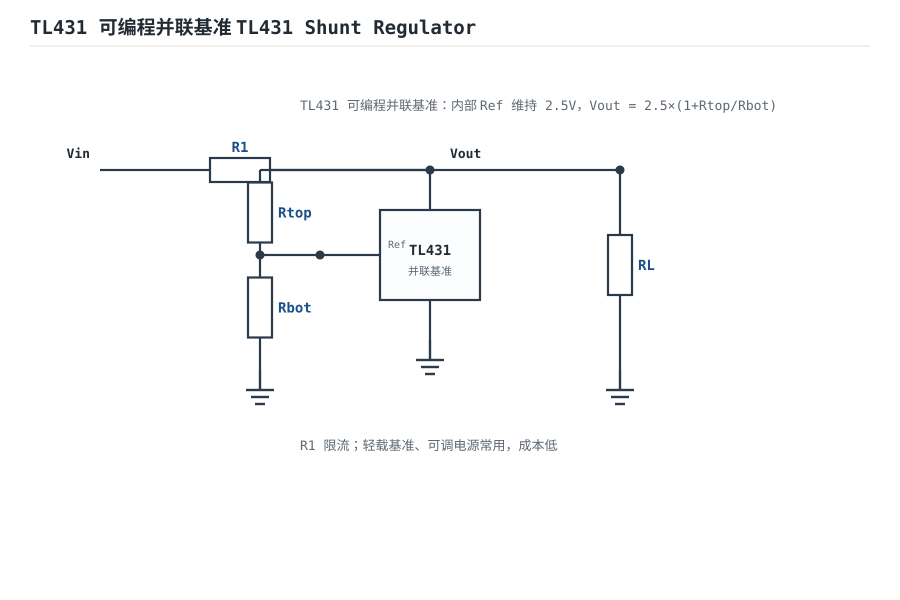
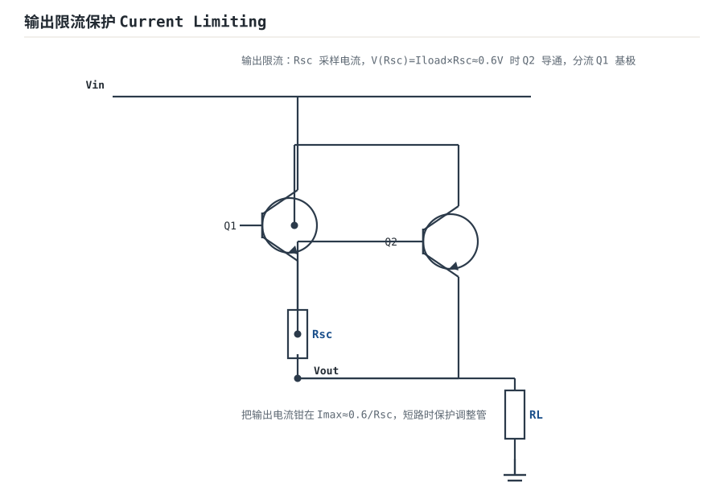
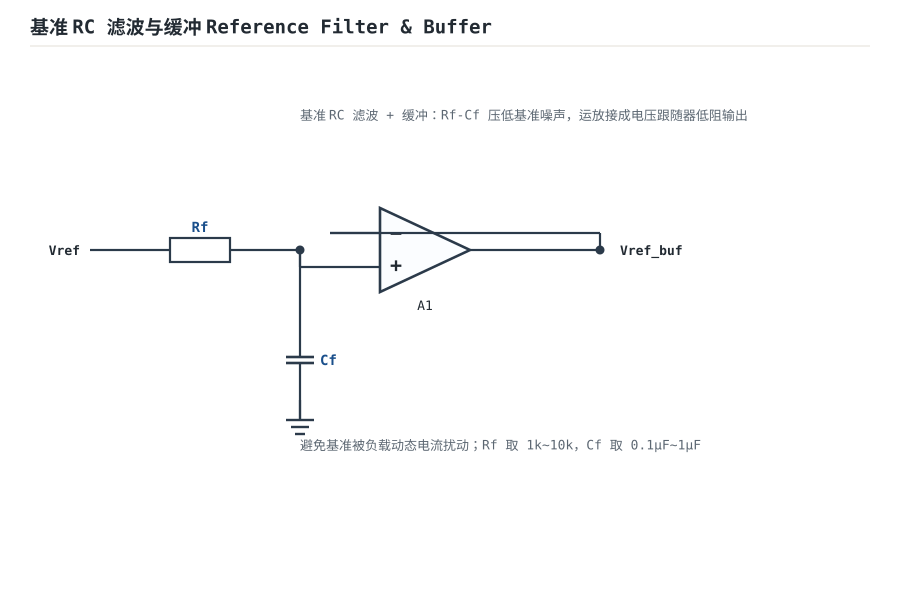

# 线性稳压与基准源 Linear Regulators & Voltage References

传感器和 ADC 需要一个"不动如山"的电压基准（Voltage Reference）；数字电路的电源则需要在输入波动、负载变化时维持稳定输出。**线性稳压（Linear Regulator）**就是用一个串联调整管"吃掉"多余电压，换来干净直流。

## 1. 设计动机

::: motivation 为什么需要稳压
整流滤波后的电压并不稳：市电波动 ±10%、负载轻重变化，输出能在 12~18V 之间漂移。直接给 ADC 供电，基准漂 10%，测量就错 10%。线性稳压的作用就是在输入与输出之间放一个"可调节的电阻"，自动把多余压差吃掉，让输出钉死在设定值。
:::

## 2. 原理图

最朴素的基准源是**齐纳二极管（Zener）并联稳压**：R1 限流，Dz 工作在反向击穿区，把节点电压钳在 Vz。


::: analogy 稳压像减压阀
城市供水水压会波动（类比 Vin 波动），家里减压阀把出口压力稳定在设定值（类比 Vref）。多余的压差全部变成减压阀的发热——这正是线性稳压"效率不高但纹波极小"的本质。
:::

## 3. 静态分析（DC）

- 齐纳管工作在反向击穿区时，两端电压为稳定值 $V_Z$。
- 限流电阻电流：$I_{R1}=(V_{in}-V_Z)/R_1$。
- 该电流在 Dz 与 RL 之间分配：$I_{R1}=I_Z+I_{load}$。
- 要正常稳压，必须保证 $I_Z$ 落在手册给定的工作电流区间（通常 5mA~50mA）：太小则未充分击穿，太大则过热。

## 4. 动态分析（AC / 瞬态）

稳压的两个核心指标：

- **线性调整率（Line Regulation）**：输入变化 $\Delta V_{in}$ 引起的输出变化，$= \Delta V_{out}/\Delta V_{in}$。
- **负载调整率（Load Regulation）**：负载电流变化 $\Delta I_{load}$ 引起的输出变化。

齐纳稳压的输出阻抗近似为 $r_z\parallel R_L$（$r_z$ 是齐纳动态电阻，几欧~几十欧）。下图示意输入从 12V 跌到 9V 时，输出仅轻微下降：

```echarts
{
  "tooltip": {"trigger": "axis"},
  "legend": {"data": ["Vin（输入）", "Vref（稳压输出）"], "bottom": 0, "textStyle": {"fontSize": 13}},
  "grid": {"left": 60, "right": 24, "top": 30, "bottom": 56},
  "xAxis": {"type": "category", "name": "时间 ms", "data": [0,2,4,6,8,10,12,14,16,18,20], "axisLabel": {"fontSize": 11}},
  "yAxis": {"type": "value", "name": "V", "min": 0, "max": 14, "axisLabel": {"fontSize": 11}},
  "series": [
    {"name": "Vin（输入）", "type": "line", "smooth": true, "showSymbol": false, "lineStyle": {"width": 2.4, "color": "#1a4f8b"},
     "data": [12,12,12,12,9,9,9,9,9,9.5,10]},
    {"name": "Vref（稳压输出）", "type": "line", "smooth": true, "showSymbol": false, "lineStyle": {"width": 2.6, "color": "#b5642e"},
     "data": [5.10,5.10,5.10,5.10,5.02,5.02,5.02,5.02,5.02,5.04,5.05]}
  ]
}
```

## 5. 环路分析

实用稳压电路（无论是分立齐纳还是集成 LDO）本质都是**负反馈**：取样输出电压 → 与内部基准比较 → 误差放大 → 驱动串联调整管。

- **结论**：环路增益越高，输出越"硬"，线性/负载调整率越好，输出阻抗越低。
- 但环路增益在高频滚降，引入附加相移后可能自激——所以 LDO 数据手册都规定**输出电容的 ESR 范围**，这就是频率补偿的一部分。

::: advanced 进阶：环路与稳定性
集成稳压器可建模为：误差放大器增益 $A$、反馈系数 $\beta=R_2/(R_1+R_2)$、串联调整管。环路增益 $T=A\beta$。闭环输出阻抗 $Z_{out}=Z_{open}/(1+T)$。输出电容及其 ESR 在环路中引入零点/极点，ESR 太大或太小都可能让相位裕度跌到 45° 以下，表现为输出纹波上叠数百 kHz 振荡。
:::

## 6. 元件取值与工程权衡

- **R1 取值**：要同时满足"输入最高、负载最轻时 $I_Z$ 不超限"和"输入最低、负载最重时 $I_Z$ 不低于最小击穿电流"。两头夹逼后往往只剩很窄的区间，这正是分立齐纳带载能力弱的原因。
- **齐纳电压选择**：$V_Z$ 越低动态电阻越大；5.1V 左右齐纳噪声与温漂折中较好。精密场合改用带隙基准（Bandgap Reference，如 REF30xx）。
- **功耗**：齐纳与 R1 上耗散 $P\approx(V_{in}-V_Z)I_{R1}$，压差大时必须算功耗选封装。

## 7. 完整设计示例

::: example 用齐纳做一个 5V/50mA 基准
1. **需求**：Vin=12V，输出 5V，负载电流 0~50mA，齐纳最小击穿电流 5mA、最大 50mA。
2. **取 R1**：最恶劣工况——Vin 最低 10.8V、负载满载 50mA 时，要保证 $I_Z\ge5mA$。$I_{R1}=(10.8-5)/R_1$，$I_Z=I_{R1}-50mA\ge5mA$，得 $R_1\le5.8/55m\approx105\Omega$。
3. **验上限**：Vin 最高 13.2V、空载时 $I_Z=(13.2-5)/100\Omega=82mA>50mA$，超了。
4. **修正**：取 $R_1=150\Omega$，满载时 $I_{R1}=5.8/150=38.7mA$，$I_Z=38.7-50<0$，带不动 50mA。
5. **结论**：分立齐纳带不动这么大负载，改用 7805/LDO 三端稳压器（带内部调整管），齐纳只做轻载基准。这正是工程上"算不通就换架构"的典型。
:::

## 8. 仿真与实验

LTspice 中：

- 搭齐纳电路，Vin 用 12V 直流，RL 从 1kΩ 扫到 100Ω，观察 Vref 下跌与 Iz 跌落。
- 把 Vin 做成 12V±2V 正弦调制，观察输出被"压平"的程度（线性调整率）。
- 对比 7805 模型：同样输入波动下，集成稳压器输出几乎纹丝不动——体会负反馈增益的威力。

## 扩展与变种电路

### 扩展1：TL431 可编程并联基准 TL431 Shunt Regulator

**定位**：用一颗三端器件替代"齐纳+取样"，输出电压由两颗电阻任意设定——与分立齐纳的差异是基准电压（2.5V）在片内、可调。



::: example 工作原理 / 静态分析
TL431 把 Ref 脚维持在内部 $V_{ref}=2.5\text{V}$。由分压

$$V_{out}=V_{ref}\left(1+\frac{R_{top}}{R_{bot}}\right)=2.5\left(1+\frac{R_{top}}{R_{bot}}\right)$$

$R_1$ 是限流电阻，保证 TL431 阴极电流落在 1~100mA。
:::

设计要点：要 5V 取 $R_{top}/R_{bot}=1$；动态电阻低、便宜，做可调电源、恒流源常用。

::: pitfall TL431 专属坑
- **阴极电流太小不击穿**：负载太轻或 $R_1$ 太大，阴极电流 $<1\text{mA}$，TL431 退出稳压、输出失控。算最轻载工况留余量。
:::

### 扩展2：扩流串联稳压 Series Pass with Boost Transistor

**定位**：给齐纳基准加一颗 NPN 做射极跟随扩流——与分立齐纳的差异是带载能力从几 mA 提到几百 mA。


::: example 工作原理 / 静态分析
基极被齐纳管钉在 $V_Z$，发射极输出

$$V_{out}=V_Z - V_{BE}\approx V_Z - 0.7\text{V}$$

NPN 提供负载电流，基极只取小电流，比分立齐纳带载强。功耗 $P_d\approx(V_{in}-V_{out})I_{load}$。
:::

设计要点：$R_{bias}$ 给齐纳供电；调整管要按压差×电流配散热。

::: pitfall 扩流管专属坑
- **调整管过热烧毁**：压差大、电流大时 $P_d=(V_{in}-V_{out})I$ 全部变成热量。必须算功耗选封装/散热片。
:::

### 扩展3：输出限流保护 Current Limiting

**定位**：输出短路时把电流钳在最大值，保护串联调整管——这是稳压电源从"能用"到"安全"的关键。



::: example 工作原理 / 静态分析
$R_{sc}$ 串在输出回路，$V_{Rsc}=I_{load}R_{sc}$。当 $V_{Rsc}\approx 0.6\text{V}$，保护管 Q2 导通，分流 Q1 基极电流：

$$I_{max}\approx \frac{0.6\text{V}}{R_{sc}}$$

输出电流被钳在 $I_{max}$，短路也不会过流。
:::

设计要点：$R_{sc}$ 取 $0.6/I_{max}$，几欧~几分之一欧；大功率用锰铜采样电阻。

::: pitfall 限流专属坑
- **采样电阻功率算漏**：$R_{sc}$ 上耗散 $I^2R$，连续短路时会烧。按最大电流的 1.5~2 倍选额定功率。
:::

### 扩展4：能隙基准 Bandgap Reference

**定位**：利用双极管 $V_{BE}$ 与 $\Delta V_{BE}$ 的相反温漂相互抵消，做 ppm/℃ 级低噪声基准——比齐纳稳得多。


::: example 工作原理 / 静态分析
$V_{BE}$ 约 $-2\text{mV}/^{\circ}\text{C}$，而两个不同电流密度管子的 $\Delta V_{BE}=V_T\ln n$ 为正温漂。按比例加权

$$V_{BG}=V_{BE}+K\Delta V_{BE}\approx 1.25\text{V}$$

（硅能隙电压），总温漂近似为零。
:::

设计要点：成品如 REF30xx、LT1029；精密 ADC/DAC 基准首选，不用齐纳。

::: pitfall 能隙基准专属坑
- **启动电阻不接**：某些带隙电路上电需启动通路，否则锁在零输出。按数据手册接启动电阻。
:::

### 扩展5：基准 RC 滤波与缓冲 Reference Filter & Buffer

**定位**：基准后加 RC 低通再用电压跟随器低阻输出——与直接接基准的差异是隔离开负载动态电流，基准不被扰动。



::: example 工作原理 / 静态分析
$R_f$-$C_f$ 压低基准噪声与开关毛刺，运放接成电压跟随器：

$$V_{ref(buf)}=V_{ref}\quad,\quad Z_{out}\approx 0$$

负载电流由运放提供，不取基准本身电流。
:::

设计要点：$R_f=1\text{k}\Omega\sim 10\text{k}\Omega$，$C_f=0.1\,\mu\text{F}\sim 1\,\mu\text{F}$；缓冲级选低漂移运放。

::: pitfall 基准缓冲专属坑
- **缓冲级自激**：容性负载 $C_f$ 直接挂在跟随器输出，运放容易振荡。反馈电阻串小电阻（几十 $\Omega$）隔离或选容性负载稳定型运放。
:::

## 9. 常见坑与故障现象

::: pitfall 常见坑
- **齐纳管接反**：当成普通二极管正向用，输出变成 0.7V。齐纳必须**反向**接（阴极接高电位）。
- **R1 取值太保守**：空载时齐纳电流超标发烫，甚至烧毁。永远两头夹着算一遍功耗。
- **LDO 输出电容 ESR 不对**：某些 LDO 要求 ESR 落在 1Ω 以下（或特定范围），用纯陶瓷电容可能引发振荡，表现为输出高频啸叫纹波。
- **压差不够（Dropout）**：Vin 只比 Vout 高 0.2V 时，普通线性稳压器（压差 1.5~2V）已经"掉压"输出失控，必须用 LDO。
:::

## 10. 自测题

<details><summary>齐纳稳压 Vz=5.1V，Vin=12V，R1=1kΩ，空载时齐纳耗散功率多大？</summary>

$I_Z=(12-5.1)/1k=6.9mA$，$P=5.1V\times6.9mA\approx 35mW$，在小信号齐纳安全范围。
</details>

<details><summary>为什么精密 ADC 基准不用齐纳，而用带隙基准？</summary>
齐纳噪声大、温漂明显（尤其低压齐纳）、动态电阻高。带隙基准利用 Vbe 与 ΔVbe 的温度系数抵消，做到 ppm/℃ 级温漂与低噪声，适合做 ADC 参考。
</details>

<details><summary>LDO 输入 3.3V、输出 3.0V，压差 0.3V，普通线性稳压器和 LDO 谁能正常工作？</summary>
普通稳压器压差通常 1.5~2V，0.3V 时已失去稳压能力。LDO 压差可低至几十~几百 mV，能正常稳压。
</details>

## 11. 参考资料

- Horowitz & Hill《The Art of Electronics》3e，Voltage References & Regulators 章
- Tim Williams《The Circuit Designer's Companion》3e，Power Supply 章
- Jim Williams《The Art and Science of Analog Circuit Design》——基准与稳压设计随笔
