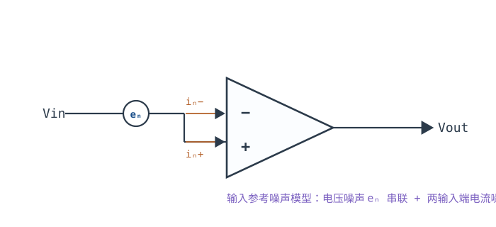
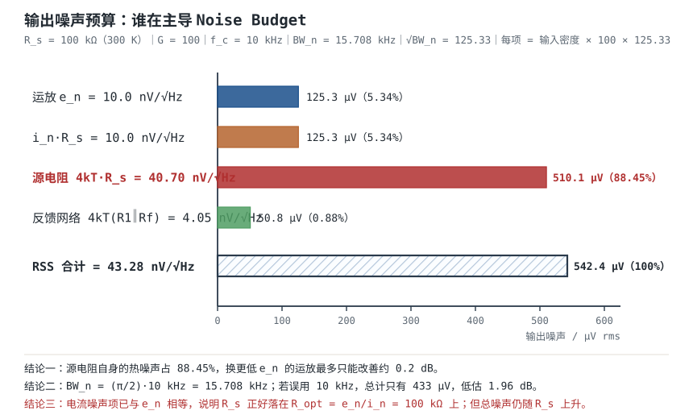

# 噪声：电压噪声、电流噪声与计算 Noise: Voltage & Current Noise

把运放的两个输入端短路，用高分辨率示波器看输出，会看到一条毛茸茸的线——这就是**噪声（Noise）**。它和失调、偏置电流不一样：失调是一个可以标定的常数，噪声是随机的、标不掉，只能压缩。常用的压缩办法有三条：换更安静的器件、把噪声源（尤其是电阻）改小、把带宽收窄。三条都要用数字算，算错方向就会像下面这样白花钱。

本章建立四件事：三类噪声（热噪声、散粒噪声、1/f 噪声）的来源与谱密度；数据手册里的 $e_n$、$i_n$ 曲线怎么读、哪些条件被隐藏在脚注里；**噪声带宽 $BW_n=(\pi/2)f_c$ 而不是 3dB 带宽**——这条每年都有人算错；以及多源噪声的 **RSS 合成**（电压相加要平方）。最后用一个 $R_s=100\ \text{k}\Omega$、$G=100$、$f_c=10\ \text{kHz}$ 的高阻传感器算例，把 $e_n$ 项、$i_nR_s$ 项、电阻热噪声项逐项算出来，看看到底是谁在主导。

**本章约定**：$e_n$ 是输入参考电压噪声密度（$\text{V}/\sqrt{\text{Hz}}$，常用 $\text{nV}/\sqrt{\text{Hz}}$）；$i_n$ 是输入参考电流噪声密度（$\text{A}/\sqrt{\text{Hz}}$，常用 $\text{pA}/\sqrt{\text{Hz}}$）；$e_{ni}$ 是折算到输入的总噪声密度；$BW_n$ 是等效噪声带宽（Hz）；$f_c$ 是闭环 $-3\ \text{dB}$ 带宽（Hz）；$1/\beta$ 是噪声增益，同相组态 $1/\beta=1+R_f/R_1$；$k=1.380649\times10^{-23}\ \text{J/K}$ 是玻尔兹曼常数；$q=1.602176634\times10^{-19}\ \text{C}$ 是电子电荷；$T$ 是绝对温度（K）。符号口径与[开环、闭环增益与负反馈本质](open-loop-feedback.md)、[失调电压、偏置电流与漂移](offset-bias.md)一致。下面的推导默认**负反馈闭合、输出在线性区、虚短与虚断成立**（前提见[理想模型五假设与虚短、虚断](ideal-opamp.md)）；比较器那种开环或正反馈的状态不适用。

## 1. 设计动机

::: motivation 三个真实场景
**场景一：100 kΩ 传感器，88% 的噪声来自传感器自己。** 高阻传感器 $R_s=100\ \text{k}\Omega$，接成 $G=100$、$f_c=10\ \text{kHz}$ 的同相放大；运放 $e_n=10\ \text{nV}/\sqrt{\text{Hz}}$、$i_n=0.1\ \text{pA}/\sqrt{\text{Hz}}$。很多人第一反应是"换一颗 $3\ \text{nV}$ 的超低噪声运放"。算完才知道：$100\ \text{k}\Omega$ 在 300 K 的热噪声密度是 $40.7\ \text{nV}/\sqrt{\text{Hz}}$，占了总噪声功率的 88%；把 $e_n$ 从 10 nV 降到 3 nV，总输出噪声只从 $542\ \mu\text{V rms}$ 降到 $529\ \mu\text{V rms}$，改善 0.22 dB。**真正的杠杆是把源阻抗或带宽降下来，不是换芯片。**

**场景二：1 kΩ 源，选错输入级差 10 dB。** 同一个信号源换成 $1\ \text{k}\Omega$。低噪声双极输入（$e_n=5\ \text{nV}/\sqrt{\text{Hz}}$、$i_n=0.5\ \text{pA}/\sqrt{\text{Hz}}$）总输入噪声密度 $6.5\ \text{nV}/\sqrt{\text{Hz}}$；通用 CMOS（$e_n=20\ \text{nV}/\sqrt{\text{Hz}}$、$i_n=0.01\ \text{pA}/\sqrt{\text{Hz}}$）是 $20.4\ \text{nV}/\sqrt{\text{Hz}}$，差 3.15 倍（约 10 dB）。而把源阻抗换回 $100\ \text{k}\Omega$，排名立刻反转：双极输入 $64.7\ \text{nV}/\sqrt{\text{Hz}}$，CMOS $45.4\ \text{nV}/\sqrt{\text{Hz}}$。**$e_n$ 和 $i_n$ 必须一起看，交叉点在 $R_s=e_n/i_n$。**

**场景三：0.1~10 Hz 的 1/f 噪声，白噪声公式完全失效。** 一个直流测量前端，信号带宽只有 10 Hz，按 1 kHz 的 $e_n=10\ \text{nV}/\sqrt{\text{Hz}}$ 估出噪声 $40\ \text{nV rms}$，实测却有 $218\ \text{nV rms}$。差别全部来自 1/f 段：$1/f$ 拐点 100 Hz 时，0.1~10 Hz 内的 $1/f$ 分量是 $214.6\ \text{nV rms}$，是白噪声分量的 5.4 倍。**低频测量不能只看 1 kHz 那一个点。**
:::

| 你想确认 | 先算 | 判据（工程经验值） |
|---|---|---|
| 源电阻本身有多吵 | $e_{R}=\sqrt{4kTR_s}$ | 与 $e_n$ 比，大 3 倍以上则器件不再是瓶颈 |
| 电流噪声会不会主导 | $i_nR_s$ | 与 $e_n$ 同量级时两者都要算 |
| 器件选得对不对 | $R_{s,opt}=e_n/i_n$ | 源阻抗在 $R_{s,opt}$ 附近时噪声系数最小 |
| 噪声带宽取多少 | $BW_n=(\pi/2)f_c$ | 不能直接用 $f_c$，会低估 1.96 dB |
| 总噪声多大 | 各源平方和再开方 | 一项主导时 RSS 接近最大值 |
| 低频能不能用 | $1/f$ 拐点与工作频段 | 工作频段跨过拐点就要单独积分 |
| 信噪比够不够 | $20\lg(V_{sig}/V_n)$ | 噪声 rms < 1 LSB（至少 < 1/2 LSB） |

**不算会摔在哪**，四个带数字的代价：

1. **把 $f_c$ 当噪声带宽。** $f_c=10\ \text{kHz}$ 时 $BW_n=15.708\ \text{kHz}$，噪声被低估 $\sqrt{\pi/2}=1.253$ 倍，即 1.96 dB：算出来 $433\ \mu\text{V}$，实际 $542\ \mu\text{V}$。方向是**乐观**的，这正是最危险的方向。
2. **把噪声电压直接相加。** $e_n=10\ \text{nV}$、$i_nR_s=10\ \text{nV}$、$4kTR_s=40.7\ \text{nV}$，直接相加得 $60.7\ \text{nV}$，RSS 只有 $43.3\ \text{nV}$，高估 2.94 dB。反过来，如果误以为"三项取最大"就只报 $40.7\ \text{nV}$，又低估 0.53 dB。
3. **高阻源用高 $i_n$ 器件。** $R_s=100\ \text{k}\Omega$ 配 $i_n=1\ \text{pA}/\sqrt{\text{Hz}}$ 的通用双极运放，$i_nR_s=100\ \text{nV}/\sqrt{\text{Hz}}$，总噪声 $108\ \text{nV}/\sqrt{\text{Hz}}$，是本章算例（$0.1\ \text{pA}$）的 2.5 倍。**同一个电路，换错输入级就多 8 dB 噪声。**
4. **反馈电阻取太大。** $1\ \text{M}\Omega$ 电阻的热噪声是 $128.7\ \text{nV}/\sqrt{\text{Hz}}$，比 $10\ \text{nV}$ 的运放本身大一个数量级；高增益、高阻反馈的设计里，反馈网络经常才是最大噪声源。

## 2. 定义与直观

### 2.1 三类噪声：来源不同，谱形不同，处理方式也不同

| 类型 | 物理来源 | 谱密度 | 谱形 | 与直流工作点的关系 |
|---|---|---|---|---|
| 热噪声（Thermal / Johnson） | 电阻中载流子的热运动，任何有电阻的导体都有 | $e_n=\sqrt{4kTR}$，$i_n=\sqrt{4kT/R}$ | 白噪声（平坦） | 与电流无关，只与 $T$、$R$ 有关 |
| 散粒噪声（Shot） | 载流子越过 PN 结势垒的离散性 | $i_n=\sqrt{2qI}$ | 白噪声 | 正比于 $\sqrt{I}$，没有直流电流就没有散粒噪声 |
| 1/f 噪声（Flicker） | 半导体表面缺陷、陷阱对载流子的随机俘获与释放 | $e_n^2=K/f$ | 每十倍频下降 10 dB | 与工艺、面积有关，与偏置有关 |
| 爆发噪声（Burst / Popcorn） | 缺陷处的随机跳变 | 非高斯，无法用谱密度完整描述 | 离散跳变 | 随机出现，只能靠筛选 |

前三种是设计要算的，第四种只能靠器件筛选和现场排查。三者的谱密度形状决定了算法：

- **白噪声**（热噪声、散粒噪声）的功率谱密度是常数，带宽内的 rms 直接是"密度乘 $\sqrt{BW_n}$"。
- **1/f 噪声**的功率谱密度随频率下降，必须对 $1/f$ 积分，不能用 1 kHz 的值乘带宽。
- 两类噪声叠加时，先把各自积分成 rms，再 RSS；不能把密度直接相加。

数量级先建立起来：300 K 下 $1\ \text{k}\Omega$ 电阻的热噪声是 $4.07\ \text{nV}/\sqrt{\text{Hz}}$，所以工程上常记"**每 kΩ 约 4 nV/√Hz**"；$100\ \text{k}\Omega$ 是 $40.7\ \text{nV}/\sqrt{\text{Hz}}$。散粒噪声：$1\ \mu\text{A}$ 直流电流对应 $0.566\ \text{pA}/\sqrt{\text{Hz}}$，$100\ \text{nA}$ 对应 $0.179\ \text{pA}/\sqrt{\text{Hz}}$——这就是双极输入运放 $i_n$ 的量级来源（基极电流的散粒噪声）。

### 2.2 噪声是随机量：只能用 rms、谱密度和统计分布描述

一个噪声波形不能预测下一时刻的值，但它的**功率谱密度**是确定的。工程上用三个量：

- **谱密度** $e_n$（$\text{V}/\sqrt{\text{Hz}}$）：每 $\sqrt{\text{Hz}}$ 带宽内的噪声电压。注意单位里带根号，是因为功率与带宽成正比、电压与 $\sqrt{\text{带宽}}$ 成正比。
- **rms 值**（$\text{V rms}$）：谱密度在带宽内积分后的有效值。白噪声时 $V_{n,\text{rms}}=e_n\sqrt{BW_n}$。
- **峰峰值**（$\text{V p-p}$）：示波器上看到的值。高斯噪声的峰峰值没有理论上限，工程上按 $6.6\times V_{n,\text{rms}}$ 估"99.9% 时间不超过"的峰峰值（对应 $\pm3.3\sigma$）。**这是一个统计口径，不是保证值**：测 10 次可能有 1 次超过。

**多源合成的规则只有一条：不相干的噪声按功率相加，也就是电压的平方相加。**

$$V_{n,\text{total}}=\sqrt{V_1^2+V_2^2+\cdots+V_N^2}$$

两个独立的 $10\ \text{nV}/\sqrt{\text{Hz}}$ 源，合成是 $\sqrt{10^2+10^2}=14.14\ \text{nV}/\sqrt{\text{Hz}}$（+3.01 dB），不是 $20\ \text{nV}$（+6.02 dB）。如果两个源完全相关（同一个源分两路），才按电压直接相加。**判断相关性的依据是物理来源**：不同电阻的热噪声、运放的 $e_n$ 与电阻的热噪声，都互不相干；同一个噪声源经过两条路径，可能相关。

::: analogy 噪声像雨点，不像水管
把噪声想成打在屋顶上的雨点：每一滴的方向、大小都随机，但单位面积、单位时间的**总水量**是稳定的。带宽就是屋顶的面积：面积翻倍，接到的水量翻倍；噪声的**功率**也随带宽线性增长，所以噪声**电压**只涨 $\sqrt{2}$ 倍——这就是为什么谱密度乘的是 $\sqrt{BW}$，不是 $BW$。

类比的边界：雨点是经典粒子，噪声是随机过程；雨量可以精确预测长期平均，噪声的瞬时峰峰值永远无法保证。所以噪声预算只能给 rms 和统计峰峰值，不能承诺"绝不超过某个电压"。
:::

### 2.3 从谱密度到 rms：为什么必须用噪声带宽

理想的白噪声通过一个理想的砖墙滤波器（通带到 $f_c$、带外为零），rms 就是 $e_n\sqrt{f_c}$。但运放的闭环响应不是砖墙，而是一条单极点曲线：

$$|H(f)|=\frac{1}{\sqrt{1+(f/f_c)^2}}$$

它的功率在 $f_c$ 以上还在缓慢下降，一直积分到无穷大，得到的等效带宽比 $f_c$ 大。这个积分就是本章最重要的一个数：

$$BW_n=\int_0^\infty|H(f)|^2\,df=\int_0^\infty\frac{df}{1+(f/f_c)^2}=\frac{\pi}{2}f_c\approx1.5708f_c$$

**$BW_n$ 比 $f_c$ 大 57.1%，$\sqrt{BW_n}$ 比 $\sqrt{f_c}$ 大 25.3%（1.96 dB）。** 也就是说，用 $f_c$ 直接乘会把噪声算小 20.2%。这个系数只对**单极点**闭环成立；二阶、三阶的系数小一些（§3.3 给表），有峰化时反而更大。数据手册里的"0.1~10 Hz 噪声"通常是按指定带通滤波后的积分结果，滤波器的噪声带宽与阶数有关，不要和本章的 $BW_n$ 直接互换。

### 2.4 数据手册里的 $e_n$、$i_n$ 怎么读

数据手册给噪声的方式有三种，读法不一样：

1. **单点值**：在 1 kHz（有时还有 10 Hz）给一个 $e_n$，单位 $\text{nV}/\sqrt{\text{Hz}}$。这个点通常是白噪声平台，但如果 1/f 拐点高于 1 kHz，它已经包含了 1/f 成分。
2. **频谱曲线**：横轴频率（对数）、纵轴 $\text{nV}/\sqrt{\text{Hz}}$（对数）。曲线上"平坦段"是白噪声，"每十倍频下降 10 dB"的斜段是 1/f；两段延长线的交点就是**1/f 拐点 $f_{ce}$**。
3. **积分噪声**：直接给"0.1~10 Hz"或"10 Hz~1 kHz"的 $\mu\text{V rms}$ 或 $\text{p-p}$，通常注明测试带宽与增益。这种值不能反推出谱密度曲线，只能用于同条件比较。

读曲线要核对四个条件：

- **测试增益与源阻抗**：$e_n$ 是输入折算量，但测试时源阻抗会叠加 $i_nR_s$ 与 $4kTR_s$；读曲线要看清测试条件，$i_n$ 的测量更依赖源阻抗。
- **典型值还是最大值**：曲线几乎都是 typical；预算要按 max 或加裕量。数据手册通常只给 $e_n$ 的典型曲线，$i_n$ 有时连曲线都没有。
- **$i_n$ 与 $I_B$ 不是一回事**：$I_B$ 是直流偏置电流（A），$i_n$ 是它的随机起伏（$\text{A}/\sqrt{\text{Hz}}$）。双极输入的 $i_n$ 大致是 $I_B$ 的散粒噪声 $\sqrt{2qI_B}$；CMOS 输入两者都极小，但不能假设为零。
- **$e_n$ 与 $i_n$ 的相关性**：数据手册不保证两者独立；预算按独立处理是常见做法，但要知道这是一个假设。

### 2.5 源阻抗面前的三项竞争

把信号源看成"一个理想电压源串一个 $R_s$"，运放输入端看到的噪声有三项：

| 项 | 密度 | 随 $R_s$ 的变化 | 谁主导 |
|---|---|---|---|
| 运放电压噪声 $e_n$ | 常数 | 不随 $R_s$ 变 | 低阻源 |
| 电流噪声在源阻抗上的压降 $i_nR_s$ | 正比 $R_s$ | 线性增长 | 高阻源 |
| 源电阻自身的热噪声 $\sqrt{4kTR_s}$ | 正比 $\sqrt{R_s}$ | 平方根增长 | 高阻源，且**无法被任何运放消除** |

三项画在同一张图上，前两项在 $R_s=e_n/i_n$ 处相等，这个点叫**噪声匹配点**。但注意：这个点让**噪声系数**（放大器相对源热噪声的恶化量）最小，不是让**总噪声**最小——在固定温度下，总噪声随 $R_s$ 单调上升，因为源电阻自己的热噪声也在涨。这个区别在 §3.5 展开，它是本章最容易讲错的一处。

## 3. 定量关系

### 3.1 电阻热噪声：$\sqrt{4kTR\Delta f}$

任何电阻，不论有没有电流流过，都有热噪声。电压形式：

$$e_{n,R}=\sqrt{4kTR}\quad\left[\text{V}/\sqrt{\text{Hz}}\right]$$

电流形式（把电阻看成诺顿源）：

$$i_{n,R}=\sqrt{\frac{4kT}{R}}\quad\left[\text{A}/\sqrt{\text{Hz}}\right]$$

符号与单位：$k=1.380649\times10^{-23}\ \text{J/K}$；$T$ 是绝对温度（K），300 K 对应约 $27^{\circ}\text{C}$；$R$ 是电阻（$\Omega$）；$e_{n,R}$ 的单位是 $\text{V}/\sqrt{\text{Hz}}$。在 300 K 下 $4kT=1.6568\times10^{-20}\ \text{J}$。

带宽 $\Delta f$ 内的 rms 噪声是 $e_{n,R}\sqrt{\Delta f}$。对白噪声，$\Delta f$ 要换成噪声带宽 $BW_n$，不是信号带宽。

| $R$ | $e_{n,R}$（300 K） | $i_{n,R}$（300 K） |
|---|---|---|
| $10\ \Omega$ | $0.407\ \text{nV}/\sqrt{\text{Hz}}$ | $4.07\ \text{pA}/\sqrt{\text{Hz}}$ |
| $100\ \Omega$ | $1.29\ \text{nV}/\sqrt{\text{Hz}}$ | $1.29\ \text{pA}/\sqrt{\text{Hz}}$ |
| $1\ \text{k}\Omega$ | $4.07\ \text{nV}/\sqrt{\text{Hz}}$ | $0.407\ \text{pA}/\sqrt{\text{Hz}}$ |
| $10\ \text{k}\Omega$ | $12.87\ \text{nV}/\sqrt{\text{Hz}}$ | $0.129\ \text{pA}/\sqrt{\text{Hz}}$ |
| $100\ \text{k}\Omega$ | $40.70\ \text{nV}/\sqrt{\text{Hz}}$ | $0.0407\ \text{pA}/\sqrt{\text{Hz}}$ |
| $1\ \text{M}\Omega$ | $128.7\ \text{nV}/\sqrt{\text{Hz}}$ | $0.00407\ \text{pA}/\sqrt{\text{Hz}}$ |

复算一行：$R=100\ \text{k}\Omega$，

$$e_{n,R}=\sqrt{4\times1.380649\times10^{-23}\times300\times10^5}=\sqrt{1.6568\times10^{-15}}=4.070\times10^{-8}\ \text{V}/\sqrt{\text{Hz}}=40.70\ \text{nV}/\sqrt{\text{Hz}}$$

**这张表要背下来的部分**：阻值每涨 100 倍，噪声涨 10 倍；$1\ \text{k}\Omega$ 对应 $4\ \text{nV}/\sqrt{\text{Hz}}$，$100\ \text{k}\Omega$ 对应 $40\ \text{nV}/\sqrt{\text{Hz}}$，$1\ \text{M}\Omega$ 对应 $129\ \text{nV}/\sqrt{\text{Hz}}$。低噪声设计里"把电阻压到 kΩ 量级"不是习惯，是这行数字逼出来的。

### 3.2 散粒噪声与 1/f 噪声

**散粒噪声**来自电荷的离散性：

$$i_{n,\text{shot}}=\sqrt{2qI}\quad\left[\text{A}/\sqrt{\text{Hz}}\right]$$

其中 $q=1.602176634\times10^{-19}\ \text{C}$，$I$ 是流过势垒的直流电流（A）。$I=1\ \mu\text{A}$ 时 $i_n=\sqrt{2\times1.602\times10^{-19}\times10^{-6}}=5.66\times10^{-13}\ \text{A}/\sqrt{\text{Hz}}=0.566\ \text{pA}/\sqrt{\text{Hz}}$。双极输入运放的基极电流 $I_B$ 就是这样一个直流电流，所以 $i_n\approx\sqrt{2qI_B}$：$I_B=100\ \text{nA}$ 对应 $0.179\ \text{pA}/\sqrt{\text{Hz}}$。

**1/f 噪声**（闪烁噪声）的功率谱密度与频率成反比：

$$e_n^2(f)=e_{nw}^2\left(1+\frac{f_{ce}}{f}\right)$$

其中 $e_{nw}$ 是白噪声平台密度（$\text{V}/\sqrt{\text{Hz}}$），$f_{ce}$ 是 1/f 拐点（Hz），$e_n(f)$ 是该频率处的总密度。在 $f=f_{ce}$ 处，1/f 分量与白噪声分量相等。拐点以下每降十倍频，电压密度涨 $\sqrt{10}=3.16$ 倍（+10 dB）。

在 $[f_1,f_2]$ 内积分 1/f 分量，得到 rms：

$$E_{1/f}=e_{nw}\sqrt{f_{ce}\ln\frac{f_2}{f_1}}$$

符号与单位：$E_{1/f}$ 单位 V rms；$f_1$、$f_2$ 是频带下限与上限（Hz）。这个式子假设 $f_1$ 远低于 $f_{ce}$、$f_2$ 远高于 $f_{ce}$，且把 1/f 段当砖墙积分；用于预算够用，精确值要按实际滤波器形状数值积分。

复算：$e_{nw}=10\ \text{nV}/\sqrt{\text{Hz}}$、$f_{ce}=100\ \text{Hz}$、$f_1=0.1\ \text{Hz}$、$f_2=10\ \text{Hz}$：

$$E_{1/f}=10\times10^{-9}\times\sqrt{100\times\ln\frac{10}{0.1}}=10^{-8}\times\sqrt{100\times4.605}=10^{-8}\times21.46=214.6\ \text{nV rms}$$

同一频带的白噪声分量是 $10\ \text{nV}\times\sqrt{(\pi/2)\times10}=39.6\ \text{nV rms}$，1/f 是它的 5.4 倍。**0.1~10 Hz 测量里，1 kHz 的 $e_n$ 几乎没有参考价值。**

### 3.3 噪声带宽：$(\pi/2)f_c$，不是 $f_c$

单极点闭环的噪声带宽已经在 §2.3 推出：

$$BW_n=\frac{\pi}{2}f_c\approx1.5708f_c$$

三个直接可算的差：

| 你用的带宽 | 数值（$f_c=10\ \text{kHz}$） | 噪声电压（$e_{ni}=43.28\ \text{nV}/\sqrt{\text{Hz}}$、$G=100$） | 相对正确值 |
|---|---|---|---|
| $f_c$（错） | 10 kHz | $433\ \mu\text{V rms}$ | −20.2%（−1.96 dB） |
| $2f_c$（错） | 20 kHz | $612\ \mu\text{V rms}$ | +12.8%（+1.05 dB） |
| $(\pi/2)f_c$（对） | 15.708 kHz | $542\ \mu\text{V rms}$ | 0 |

**注意 $2f_c$ 也不对**：它比正确值大 12.8%，方向和 $f_c$ 相反。这两个错误都很常见，一个是"忘了滚降的尾巴"，一个是"把单极点当成了双边带"。

不同阶数的低通，系数不一样。对最大平坦（巴特沃斯）响应 $|H(f)|^2=1/[1+(f/f_c)^{2n}]$：

$$BW_n=f_c\cdot\frac{\pi/(2n)}{\sin\left(\pi/(2n)\right)}$$

| 阶数 $n$ | $BW_n/f_c$ | 说明 |
|---|---|---|
| 1 | 1.5708 | 单极点，运放闭环最常见 |
| 2 | 1.1107 | 二阶低通、Sallen-Key |
| 3 | 1.0472 | 三阶 |
| 4 | 1.0262 | 四阶，已接近砖墙 |

**这张表的用法**：如果运放后面还有一级二阶抗混叠滤波，系统的总噪声带宽不是 $1.5708f_c$，而是由每一级的噪声带宽与增益共同决定；不能拿一个系数套整条链路。级联两个相同的一阶节时，噪声带宽是 $0.7854f_0$，而总 $-3\ \text{dB}$ 带宽是 $0.6436f_0$，比值 1.22——**系数随拓扑变，报告里必须写清用的是哪一个**。

### 3.4 噪声增益与分项合成公式

噪声增益 $1/\beta$ 是运放电压噪声、电流噪声、电阻热噪声被放大的统一倍数：

$$\frac{1}{\beta}=1+\frac{R_f}{R_1}\quad\text{（同相组态）}$$

反相组态的信号增益是 $-R_f/R_1$，但噪声增益仍是 $1+R_f/R_1$，两者差 1。**噪声预算一律用噪声增益，不用信号增益**（见[开环、闭环增益与负反馈本质](open-loop-feedback.md)）。

同相组态、源阻抗为纯电阻 $R_s$ 时，输入参考总噪声密度是五项平方和：

$$e_{ni}=\sqrt{e_n^2+\left(i_nR_s\right)^2+4kTR_s+\left[i_n\left(R_1\parallel R_f\right)\right]^2+4kT\left(R_1\parallel R_f\right)}$$

符号与单位：$e_{ni}$ 单位 $\text{V}/\sqrt{\text{Hz}}$；$R_s$ 是源阻抗（$\Omega$）；$R_1\parallel R_f$ 是反相端对地的直流等效电阻（$\Omega$）。五项依次是：运放电压噪声、电流噪声在源阻抗上的压降、源电阻热噪声、电流噪声在反馈网络上的压降、反馈网络热噪声。

反馈网络那一项值得单独验算：$R_1$ 的热噪声经 $R_f/R_1$ 放大到输出，功率是 $4kTR_f^2/R_1$；$R_f$ 的热噪声直接出现在输出，功率是 $4kTR_f$。两项相加再除以噪声增益的平方 $(1+R_f/R_1)^2$，折算到输入正好是

$$4kT\left(\frac{R_f^2}{R_1}+R_f\right)\cdot\frac{1}{\left(1+\frac{R_f}{R_1}\right)^2}=4kT\frac{R_1R_f}{R_1+R_f}=4kT\left(R_1\parallel R_f\right)$$

这就是式子里出现 $R_1\parallel R_f$ 而不是 $R_f$ 的原因。

输出噪声：

$$V_{out,n}=e_{ni}\cdot\frac{1}{\beta}\cdot\sqrt{BW_n}$$

符号与单位：$V_{out,n}$ 单位 V rms；$1/\beta$ 无量纲；$BW_n$ 单位 Hz。

三条使用条件必须同时满足：① 闭环是单极点（否则 $BW_n$ 换系数）；② 信号源是纯电阻、输入电容的极点高于工作频段（否则 $R_sC_{in}$ 会改变噪声增益的频响）；③ 各项互不相干（否则按相关性合成）。反相组态的公式不同：$R_s$ 与 $R_1$ 串联，信号被分压，噪声项要按 $R_s+R_1$ 重算——本章算例用同相组态，因为高阻传感器通常接同相/仪表拓扑。

### 3.5 噪声匹配点：$R_{s,opt}=e_n/i_n$ 到底优化了什么

把"放大器引入的噪声"与"源电阻自身的热噪声"相比，定义噪声系数：

$$NF=1+\frac{e_n^2+\left(i_nR_s\right)^2}{4kTR_s},\qquad NF(\text{dB})=10\lg NF$$

注意这里用 $10\lg$，因为 $NF$ 是**功率比**；而噪声电压比用 $20\lg$。两者数值相同（因为电压比平方就是功率比），但写规格时要注明是哪一个。

对 $R_s$ 求导并令其为零，得到

$$R_{s,opt}=\frac{e_n}{i_n},\qquad NF_{min}=1+\frac{e_ni_n}{2kT}$$

复算：$e_n=10\ \text{nV}/\sqrt{\text{Hz}}$、$i_n=0.1\ \text{pA}/\sqrt{\text{Hz}}$：

$$R_{s,opt}=\frac{10\times10^{-9}}{0.1\times10^{-12}}=1.0\times10^5\ \Omega=100\ \text{k}\Omega$$

$$NF_{min}=1+\frac{10^{-8}\times10^{-13}}{2\times1.380649\times10^{-23}\times300}=1+\frac{10^{-21}}{8.284\times10^{-21}}=1.1207$$

$$NF_{min}(\text{dB})=10\lg1.1207=0.495\ \text{dB}$$

**这里必须纠正一个流行说法**："$R_s=e_n/i_n$ 时总噪声最小。" 不对。$R_{s,opt}$ 让**噪声系数**最小，也就是让放大器相对源热噪声的恶化最小；**总输入噪声 $e_{ni}$ 在固定温度下随 $R_s$ 单调上升**，因为 $4kTR_s$ 这一项一直在涨。在 $R_{s,opt}$ 处，$e_n$ 项与 $i_nR_s$ 项相等（都是 10 nV），但源热噪声是 40.7 nV，总噪声 43.3 nV——比源热噪声只高 6.3%。$NF_{min}=0.495\ \text{dB}$ 只算了 $e_n$ 与 $i_nR_s$；把反馈网络也算进去是 0.53 dB（§4.1 的 $542.4/510.1$）。**选型时用 $R_{s,opt}$ 判断"该用低 $e_n$ 还是低 $i_n$ 器件"是对的；用它判断"总噪声最小"是错的。** 真要降总噪声，只能降 $R_s$、降带宽、或降温度。

### 3.6 适用条件与失效边界

1. **单极点假设**：$BW_n=(\pi/2)f_c$ 只对单极点闭环成立；有第二极点、峰化、或后级滤波时，要按实际 $|H(f)|^2$ 积分。
2. **白噪声假设**：$e_n\sqrt{BW_n}$ 只对平坦段成立；跨过 1/f 拐点必须分段积分。
3. **独立性假设**：不同电阻、运放 $e_n$ 与电阻热噪声可视为独立；同一噪声源经两条路径、或 $e_n$ 与 $i_n$ 通过同一器件参数相关时，不能平方和。
4. **高斯假设**：$6.6\times$ rms 的峰峰值是统计口径（约 99.9%），不是保证值；低概率的大幅值（burst noise）会超出这个估计。
5. **电阻模型**：$4kTR$ 只描述热噪声；碳膜/厚膜电阻在直流电流下还有过剩噪声（1/f 型），低噪声设计要用金属膜/薄膜电阻。
6. **温度**：$4kT$ 中的 $T$ 是绝对温度；从 300 K 到 400 K，热噪声涨 $\sqrt{400/300}=1.155$ 倍（+1.25 dB），高温场合要重算。
7. **输入电容与源阻抗**：$R_sC_{in}$ 在高频形成极点，可能让噪声增益出现峰化，实际噪声比本公式大；高阻源必须核对。
8. **测量口径**：数据手册的积分噪声有指定带宽与增益，不能直接和本章的 $BW_n$ 数值互换。

## 4. 典型计算

### 4.1 完整算例：$R_s=100\ \text{k}\Omega$、$G=100$、$f_c=10\ \text{kHz}$

**需求**：高阻传感器 $R_s=100\ \text{k}\Omega$（300 K），接成同相 $G=100$（$R_1=1\ \text{k}\Omega$、$R_f=99\ \text{k}\Omega$）。运放 $e_n=10\ \text{nV}/\sqrt{\text{Hz}}$、$i_n=0.1\ \text{pA}/\sqrt{\text{Hz}}$（按白噪声处理，1/f 在 §4.3 单独算）。闭环 $-3\ \text{dB}$ 带宽 $f_c=10\ \text{kHz}$（对应 GBW=1 MHz、噪声增益 100）。求输出总噪声、等效输入噪声、信噪比，并指出主导项。

**第 1 步：噪声增益与噪声带宽。**

$$\frac{1}{\beta}=1+\frac{R_f}{R_1}=1+\frac{99}{1}=100$$

$$BW_n=\frac{\pi}{2}f_c=\frac{\pi}{2}\times10^4=1.5708\times10^4\ \text{Hz}=15.708\ \text{kHz}$$

$$\sqrt{BW_n}=\sqrt{1.5708\times10^4}=125.33\ \sqrt{\text{Hz}}$$

**第 2 步：源电阻热噪声。**

$$e_{R_s}=\sqrt{4kTR_s}=\sqrt{4\times1.380649\times10^{-23}\times300\times10^5}=40.70\ \text{nV}/\sqrt{\text{Hz}}$$

**第 3 步：电流噪声在源阻抗上的压降。**

$$i_nR_s=0.1\times10^{-12}\times10^5=1.0\times10^{-8}\ \text{V}/\sqrt{\text{Hz}}=10.0\ \text{nV}/\sqrt{\text{Hz}}$$

它恰好等于 $e_n$，因为 $R_s=100\ \text{k}\Omega$ 正好是 $e_n/i_n$ 的匹配点。**这是设计者选的值，不是巧合**：高阻源选 $i_n$ 低的器件，就是为了让这一项不压倒 $e_n$。

**第 4 步：反馈网络的两项。**

$$R_1\parallel R_f=\frac{1\times99}{1+99}=0.990\ \text{k}\Omega=990\ \Omega$$

$$4kT\left(R_1\parallel R_f\right)=\sqrt{1.6568\times10^{-20}\times990}=4.05\ \text{nV}/\sqrt{\text{Hz}}$$

$$i_n\left(R_1\parallel R_f\right)=0.1\times10^{-12}\times990=9.9\times10^{-11}\ \text{V}/\sqrt{\text{Hz}}=0.099\ \text{nV}/\sqrt{\text{Hz}}$$

**第 5 步：RSS 合成输入参考密度。**

$$e_{ni}=\sqrt{10.0^2+10.0^2+40.70^2+4.05^2+0.099^2}\ \text{nV}/\sqrt{\text{Hz}}$$

$$e_{ni}=\sqrt{100+100+1656.5+16.4+0.01}=\sqrt{1872.9}=43.28\ \text{nV}/\sqrt{\text{Hz}}$$

**第 6 步：输出噪声与输入等效噪声。**

$$V_{out,n}=43.28\times10^{-9}\times100\times125.33=5.424\times10^{-4}\ \text{V rms}=542.4\ \mu\text{V rms}$$

$$V_{in,n}=\frac{V_{out,n}}{100}=5.424\ \mu\text{V rms}$$

按 $6.6\times$ 估峰峰值：

$$V_{p-p}\approx6.6\times542.4\ \mu\text{V}=3.58\ \text{mV p-p}$$

**第 7 步：分项占比。**

| 噪声源 | 输入密度（$\text{nV}/\sqrt{\text{Hz}}$） | 输出贡献（$\mu\text{V rms}$） | 功率占比 |
|---|---|---|---|
| 运放 $e_n$ | 10.0 | 125.3 | 5.34% |
| $i_nR_s$ | 10.0 | 125.3 | 5.34% |
| 源电阻 $4kTR_s$ | 40.70 | 510.1 | 88.45% |
| 反馈网络 $4kT(R_1\parallel R_f)$ | 4.05 | 50.8 | 0.88% |
| $i_n(R_1\parallel R_f)$ | 0.099 | 1.24 | 0.0005% |
| **RSS 合计** | **43.28** | **542.4** | **100%** |

复算一行：源电阻项 $40.70\times10^{-9}\times100\times125.33=5.101\times10^{-4}\ \text{V}=510.1\ \mu\text{V}$；它对总功率的贡献是 $(510.1/542.4)^2=88.45\%$。

**第 8 步：信噪比与 ADC 分辨率。**

设传感器满量程输出 $10\ \text{mV rms}$，放大器输出 $10\ \text{mV}\times100=1.0\ \text{V rms}$：

$$SNR=20\lg\frac{1.0\ \text{V}}{542.4\ \mu\text{V}}=20\lg1844=65.3\ \text{dB}$$

对 3.3 V、12 位 ADC（1 LSB $=3.3/4096=805.7\ \mu\text{V}$）：

$$\frac{542.4\ \mu\text{V}}{805.7\ \mu\text{V}}=0.673\ \text{LSB}$$

也就是噪声约 0.67 个码，折合有效位数约 $65.3/6.02\approx10.8$ 位（含 1.76 dB 修正后约 10.6 位）——**12 位 ADC 只能拿到约 10.6 位有效分辨率**，这就是模拟前级的噪声代价。若信号只有 $1\ \text{mV rms}$，SNR 降到 $45.3\ \text{dB}$，$542\ \mu\text{V}$ 的噪声已经是信号的 54%，必须降带宽或降源阻抗。

**第 9 步：口径检查——如果 10 kHz 指的是噪声带宽。** 若规格写的是"噪声带宽 10 kHz"，则 $BW_n=10\ \text{kHz}$，对应 $f_c=(2/\pi)\times10\ \text{kHz}=6.366\ \text{kHz}$，输出噪声是

$$43.28\times10^{-9}\times100\times\sqrt{10^4}=432.8\ \mu\text{V rms}$$

比本章的 542.4 µV 低 1.96 dB。**同一句"带宽 10 kHz"，两种口径差一倍多（542/433=1.253），所以规格书必须写清是 $f_c$ 还是 $BW_n$。**

**第 10 步：换器件能改善多少？** 把 $e_n$ 从 10 nV 换成 3 nV（$i_n$ 不变）：

$$e_{ni}=\sqrt{3^2+10^2+40.70^2+4.05^2}=42.22\ \text{nV}/\sqrt{\text{Hz}}$$

$$V_{out,n}=42.22\times10^{-9}\times100\times125.33=529.1\ \mu\text{V rms}$$

只降 2.5%（−0.22 dB）。若同时把源阻抗从 100 kΩ 降到 10 kΩ，源热噪声变成 12.87 nV，总密度降到 16.83 nV，输出 $210.9\ \mu\text{V rms}$——**降 2.6 倍，这才是数量级的改善**。结论：主导项是源电阻，优化顺序应该是"降源阻抗 → 降带宽 → 换器件"。

### 4.2 算例二：1 kΩ 源，双极还是 CMOS

**已知**：源阻抗 $R_s=1\ \text{k}\Omega$（300 K），两种候选器件：A 为低噪声双极（$e_n=5\ \text{nV}/\sqrt{\text{Hz}}$、$i_n=0.5\ \text{pA}/\sqrt{\text{Hz}}$）；B 为通用 CMOS（$e_n=20\ \text{nV}/\sqrt{\text{Hz}}$、$i_n=0.01\ \text{pA}/\sqrt{\text{Hz}}$）。忽略反馈网络，比较输入参考总密度。

**第 1 步：源热噪声。**

$$e_{R_s}=\sqrt{1.6568\times10^{-20}\times10^3}=4.07\ \text{nV}/\sqrt{\text{Hz}}$$

**第 2 步：器件 A。**

$$e_{ni,A}=\sqrt{5^2+\left(0.5\times10^{-12}\times10^3\times10^9\right)^2+4.07^2}=\sqrt{25+0.25+16.6}=6.47\ \text{nV}/\sqrt{\text{Hz}}$$

（$i_nR_s=0.5\ \text{pA}\times1\ \text{k}\Omega=0.5\ \text{nV}$。）

**第 3 步：器件 B。**

$$e_{ni,B}=\sqrt{20^2+\left(0.01\times10^{-12}\times10^3\times10^9\right)^2+4.07^2}=\sqrt{400+0.0001+16.6}=20.41\ \text{nV}/\sqrt{\text{Hz}}$$

**第 4 步：换成 100 kΩ 再看。**

$$e_{ni,A}=\sqrt{25+\left(0.5\times10^{-12}\times10^5\times10^9\right)^2+40.70^2}=\sqrt{25+2500+1656.8}=64.67\ \text{nV}/\sqrt{\text{Hz}}$$

$$e_{ni,B}=\sqrt{400+\left(0.01\times10^{-12}\times10^5\times10^9\right)^2+40.70^2}=\sqrt{400+1+1656.8}=45.36\ \text{nV}/\sqrt{\text{Hz}}$$

**第 5 步：交叉点。** 忽略 $\sqrt{4kTR_s}$（两面相同，抵消），令 $e_n^2+(i_nR_s)^2$ 相等：

$$5^2+\left(0.5R_s\right)^2=20^2+\left(0.01R_s\right)^2\quad(R_s\ \text{以 k}\Omega\ \text{计，}e_n\ \text{以 nV 计})$$

$$0.25R_s^2-0.0001R_s^2=375\quad\Rightarrow\quad R_s^2=\frac{375}{0.2499}=1500.6\quad\Rightarrow\quad R_s=38.7\ \text{k}\Omega$$

**结论**：源阻抗低于 38.7 kΩ 用双极低噪声器件；高于 38.7 kΩ 用 CMOS/JFET。**这个交叉点由两款器件的 $e_n$、$i_n$ 共同决定，不是把两个 $R_{s,opt}$ 取平均：A 的 $R_{s,opt}=10\ \text{k}\Omega$、B 的 $R_{s,opt}=2\ \text{M}\Omega$，交叉点 38.7 kΩ 更靠近 A 一侧。** 本章算例的 100 kΩ 已经越过交叉点，所以选 $i_n=0.1\ \text{pA}$ 的器件是对的；如果贪便宜用 1 pA 的通用双极件，$i_nR_s=100\ \text{nV}$，比源热噪声还大 2.5 倍。

### 4.3 算例三：1/f 在 0.1~10 Hz 与 10 Hz~10 kHz 的贡献

**已知**：$e_{nw}=10\ \text{nV}/\sqrt{\text{Hz}}$、$f_{ce}=100\ \text{Hz}$。分别求 0.1~10 Hz 与 10 Hz~10 kHz 两个频段的 $e_n$ 分量。

**第 1 步：0.1~10 Hz 的 1/f 分量。**

$$E_{1/f}=10\times10^{-9}\times\sqrt{100\times\ln\frac{10}{0.1}}=10^{-8}\times\sqrt{460.5}=214.6\ \text{nV rms}$$

**第 2 步：同频带的白噪声分量。** 单极点 10 Hz 低通的 $BW_n=(\pi/2)\times10=15.708\ \text{Hz}$：

$$E_{w}=10\times10^{-9}\times\sqrt{15.708}=39.63\ \text{nV rms}$$

**第 3 步：合成。**

$$E_{total}=\sqrt{214.6^2+39.63^2}=\sqrt{46053+1571}=218.2\ \text{nV rms}$$

1/f 占总功率的 $46053/47624=96.7\%$——**这个频段里 1/f 完全主导，白噪声平台值没有参考意义。**

**第 4 步：10 Hz~10 kHz 频段。**

$$E_{1/f}=10^{-8}\times\sqrt{100\times\ln1000}=10^{-8}\times26.28=262.8\ \text{nV rms}$$

$$E_w=10^{-8}\times\sqrt{1.5708\times10^4}=1.253\ \mu\text{V rms}$$

$$E_{total}=\sqrt{1253^2+262.8^2}=1.281\ \mu\text{V rms}$$

1/f 只占 4.4% 的功率——**同样是 1/f 噪声，频段不同，重要性差 22 倍（96.7% 对 4.4%）**。这解释了为什么"音频/直流精密测量"和"宽带放大器"要用两套完全不同的选型逻辑。

**代回 §4.1 的总额**：$e_n$ 的积分从 $1.253\ \mu\text{V rms}$ 变成 $\sqrt{1253^2+262.8^2}=1.281\ \mu\text{V rms}$，输出贡献从 $125.3\ \mu\text{V}$ 变成 $128.1\ \mu\text{V}$；在 $542.4\ \mu\text{V}$ 的总噪声里只增加约 0.01 dB，所以主算例按白噪声处理是合理的。但如果源阻抗降到 $1\ \text{k}\Omega$，$e_n$ 项在总噪声里的占比上升，1/f 就必须计入——**同一个 1/f 拐点，在不同的源阻抗下重要性完全不同。**

## 5. 工程含义

### 5.1 数量级表：先知道该看哪个数

| 输入级类型 | $e_n$（1 kHz） | $i_n$（1 kHz） | $R_{s,opt}=e_n/i_n$ | 1/f 拐点 | 典型适用 |
|---|---|---|---|---|---|
| 低噪声双极 | 1~5 $\text{nV}/\sqrt{\text{Hz}}$ | 0.5~3 $\text{pA}/\sqrt{\text{Hz}}$ | 0.3~10 $\text{k}\Omega$ | 2~50 Hz | 低阻源、音频、传感器前置 |
| 精密双极 | 5~15 $\text{nV}/\sqrt{\text{Hz}}$ | 0.2~1 $\text{pA}/\sqrt{\text{Hz}}$ | 5~75 $\text{k}\Omega$ | 10~100 Hz | 精密直流、仪表 |
| JFET 输入 | 5~20 $\text{nV}/\sqrt{\text{Hz}}$ | 0.001~0.05 $\text{pA}/\sqrt{\text{Hz}}$ | 0.1~20 $\text{M}\Omega$ | 10~200 Hz | 高阻传感器、pH、光电 |
| CMOS 输入 | 10~50 $\text{nV}/\sqrt{\text{Hz}}$ | 0.001~0.01 $\text{pA}/\sqrt{\text{Hz}}$ | 1~50 $\text{M}\Omega$ | 1~10 kHz | 高阻、低功耗 |
| 斩波/零漂移 | 10~30 $\text{nV}/\sqrt{\text{Hz}}$ | 0.01~0.1 $\text{pA}/\sqrt{\text{Hz}}$ | 0.1~3 $\text{M}\Omega$ | 被斩波搬移 | 精密直流、低频 |

这些是**典型量级**，具体型号以数据手册为准。表的用法：先算源阻抗，再对照 $R_{s,opt}$ 选输入级；不要拿"最低 $e_n$"的器件去接 1 MΩ 源，也不要拿 CMOS 去接 50 Ω 源。

### 5.2 选型顺序：先算源，再算器件，最后算带宽

1. **算源热噪声**：$e_{R_s}=\sqrt{4kTR_s}$。这是噪声的物理下限，任何器件都不可能低于它。
2. **算 $i_nR_s$**：与 $e_n$ 比较。$i_nR_s$ 比 $e_n$ 大 3 倍以上时，优先降 $i_n$（换 CMOS/JFET）；反之优先降 $e_n$。
3. **算 $R_{s,opt}$**：确认所选器件的 $e_n/i_n$ 在源阻抗附近；偏离一个数量级以上，说明选型方向错了。
4. **算带宽**：$BW_n=(\pi/2)f_c$（或按实际滤波器阶数取系数），再乘 $\sqrt{BW_n}$。
5. **算 1/f**：工作频段跨过拐点时单独积分；0.1~10 Hz 测量必须看拐点。
6. **算反馈网络**：$R_1\parallel R_f$ 的热噪声与 $i_n$ 项；高增益、高阻反馈时这一项经常进前二。
7. **最后看价格、封装、功耗**。

### 5.3 布局与外部噪声：算不到的比算得到的更大

- **高阻节点保护**：$R_s$ 在 100 kΩ 以上时，PCB 漏电、湿度、助焊剂残留、输入电容耦合都会引入噪声；加保护环（guard ring）、清洗、三防漆（见[失调电压、偏置电流与漂移](offset-bias.md)）。
- **反馈电阻靠近反相端**：缩短高阻节点走线，减少拾取面积；反馈电阻上方不要走数字线。
- **屏蔽与双绞**：传感器引线双绞、屏蔽层单端接地；屏蔽层两端接地会形成地环路，把地电流变成共模噪声。
- **电源去耦**：每个电源脚就近 100 nF，模拟电源与数字电源分开；开关电源的纹波会通过 PSRR 进入输出（见[共模范围、CMRR 与 PSRR](cmrr-psrr.md)）。
- **地平面**：完整地平面、单点汇合；地弹会把数字电流变成输入端的共模噪声。
- **电阻类型**：金属膜/薄膜电阻的热噪声就是 $4kTR$，但碳膜/厚膜在直流电流下还有过剩 1/f 噪声；低噪声设计不要用碳膜。
- **温度与热电偶**：不同金属结点产生 $\mu\text{V}/^{\circ}\text{C}$ 级热电势，属于直流误差，不是噪声，但会被误判成"低频噪声"；两个输入端等温布局。

### 5.4 测量：怎么证明噪声预算是对的

- **测 $e_n$**：把运放接成高增益（如 1000 倍）同相放大，输入端用低阻（如 50 Ω）端接，用频谱分析仪测输出噪声密度，再除以增益、扣除源电阻与反馈网络的热噪声。测量系统的本底噪声要至少低 10 dB，否则测到的是仪器。
- **测 $i_n$**：输入端接一个大电阻（如 10 MΩ）或电容，测输出噪声，扣除 $4kTR$ 与 $e_n$ 项后反推 $i_n$。大电阻本身的热噪声很大，要用已知值精确扣除。
- **测总噪声**：用真有效值表或示波器带宽限制到 $BW_n$，读 rms；注意表的热噪声本底与带宽。
- **环境**：电池供电、屏蔽箱、远离开关电源与无线设备；50 Hz 工频与地环路是最常见的"假噪声"。
- **验收判据**：实测与预算差 3 dB 以内算正常；差 10 dB 以上先查测量方法，再查器件与布局。

### 5.5 噪声与其他误差的关系

噪声是**随机误差**，失调/偏置/CMRR/PSRR 是**系统误差**。系统误差可以标定（至少在一次校准后），噪声不能。预算时两者分开：系统误差按最坏和或 RSS 合成（见[失调电压、偏置电流与漂移](offset-bias.md)），噪声按 rms 单独给；最后用"噪声 + 失调 + 非线性"一起判断 ADC 的有效位数。**不要把噪声 rms 和失调 mV 直接相加**——一个是统计量，一个是直流量，量纲相同但意义不同。

## 6. 常见坑

::: pitfall 常见坑
- **现象**：按 $f_c$ 算出的噪声比实测小 2 dB 左右，设计"刚好达标"却在量产中掉指标。**原因**：把闭环 $-3\ \text{dB}$ 带宽当噪声带宽；单极点系统的等效噪声带宽是 $(\pi/2)f_c=1.571f_c$，噪声被低估 $\sqrt{\pi/2}=1.253$ 倍（1.96 dB）。**解决**：白噪声一律乘 $\sqrt{\pi/2}$；多阶滤波器按 $(\pi/2n)/\sin(\pi/2n)$ 取系数；报告里写清用的是 $f_c$ 还是 $BW_n$。
- **现象**：手算总噪声 60 nV，实测只有 43 nV，或者反过来算小了。**原因**：把噪声电压直接相加，或把 RSS 用在了相关源上。**解决**：不相干源按平方和开方；两个 10 nV 源合成 14.14 nV（+3 dB），不是 20 nV（+6 dB）；同一源分两路才按电压相加。
- **现象**：100 kΩ 传感器接上后噪声比预期大 8 dB，换低 $e_n$ 运放没用。**原因**：$i_nR_s$ 项主导；通用双极运放 $i_n=1\ \text{pA}/\sqrt{\text{Hz}}$ 在 100 kΩ 上产生 100 nV/√Hz，而 $e_n$ 只有 5~10 nV。**解决**：先算 $i_nR_s$ 与 $e_n$ 的比；高阻源换 JFET/CMOS 低 $i_n$ 器件，或降低源阻抗。
- **现象**：高增益前置的噪声比运放手册的 $e_n$ 算出来大一个数量级。**原因**：反馈电阻太大，$4kT(R_1\parallel R_f)$ 成为主导；1 MΩ 反馈电阻的热噪声是 128.7 nV/√Hz。**解决**：在增益允许的前提下压低反馈电阻（kΩ~数十 kΩ）；必要时用 T 型网络或变压器，但要重新算噪声。
- **现象**：0.1~10 Hz 噪声实测 200 nV rms，按 1 kHz 的 $e_n$ 算只有 40 nV。**原因**：1/f 噪声在低频主导，1 kHz 的单点值不能代表低频。**解决**：查 1/f 拐点，按 $E_{1/f}=e_{nw}\sqrt{f_{ce}\ln(f_2/f_1)}$ 单独积分；低频测量优先选低 1/f 器件或斩波稳零器件。
- **现象**：以为源阻抗等于 $e_n/i_n$ 时"总噪声最小"，于是把源阻抗往上加。**原因**：$R_{s,opt}$ 优化的是噪声系数（放大器相对源热噪声的恶化），不是总噪声；在固定温度下总噪声随 $R_s$ 单调上升。**解决**：用 $R_{s,opt}$ 判断选型方向；降总噪声只能降 $R_s$、降带宽、降温度。
- **现象**：换了一批电阻，噪声变大且随直流电流变化。**原因**：碳膜/厚膜电阻的过剩噪声（1/f 型），与电流有关，不在 $4kTR$ 模型里。**解决**：低噪声场合用金属膜/薄膜电阻；大阻值处避免直流电流。
:::

## 7. 自测题

$R_s=100\ \text{k}\Omega$、300 K、$f_c=10\ \text{kHz}$ 单极点。源电阻自身的 rms 噪声是多少？如果误用 $f_c$ 当噪声带宽，会差多少 dB？

源电阻密度：

$$e_{R_s}=\sqrt{4\times1.380649\times10^{-23}\times300\times10^5}=40.70\ \text{nV}/\sqrt{\text{Hz}}$$

噪声带宽：

$$BW_n=\frac{\pi}{2}\times10^4=15.708\ \text{kHz},\qquad \sqrt{BW_n}=125.33$$

$$V_{n,\text{rms}}=40.70\times10^{-9}\times125.33=5.101\times10^{-6}\ \text{V}=5.10\ \mu\text{V rms}$$

误用 $f_c$：$40.70\times10^{-9}\times100=4.07\ \mu\text{V rms}$，低估 $5.10/4.07=1.253$ 倍，即 $20\lg1.253=1.96\ \text{dB}$。

两个独立的 $10\ \text{nV}/\sqrt{\text{Hz}}$ 噪声源和一个 $40.7\ \text{nV}/\sqrt{\text{Hz}}$ 源，总密度是多少？如果直接相加会高估多少 dB？

RSS：

$$e_{total}=\sqrt{10^2+10^2+40.7^2}=\sqrt{100+100+1656.5}=43.09\ \text{nV}/\sqrt{\text{Hz}}$$

直接相加：$10+10+40.7=60.7\ \text{nV}/\sqrt{\text{Hz}}$。

$$20\lg\frac{60.7}{43.09}=20\lg1.409=2.98\ \text{dB}$$

**直接相加高估约 3 dB。** 注意：RSS 的结果 43.09 nV 与 40.7 nV 只差 0.5 dB，因为 40.7 nV 一项已经主导——这正是"一项主导时 RSS 接近最大值"的例子。

$e_n=10\ \text{nV}/\sqrt{\text{Hz}}$、$i_n=0.1\ \text{pA}/\sqrt{\text{Hz}}$、$R_s=100\ \text{k}\Omega$。$e_n$ 项与 $i_nR_s$ 项各是多少？$R_{s,opt}$ 是多少？为什么此时总噪声不是最小？

$$i_nR_s=0.1\times10^{-12}\times10^5=10\ \text{nV}/\sqrt{\text{Hz}}$$

与 $e_n$ 相等，所以 $R_s$ 正好是 $R_{s,opt}=e_n/i_n=100\ \text{k}\Omega$。

但总输入噪声密度是：

$$e_{ni}=\sqrt{10^2+10^2+40.7^2}=43.1\ \text{nV}/\sqrt{\text{Hz}}$$

其中 $40.7\ \text{nV}$ 来自源电阻自身的热噪声。**$R_{s,opt}$ 只让"放大器引入的噪声"相对源热噪声的恶化最小（$NF_{min}=0.495\ \text{dB}$），在固定温度下总噪声仍随 $R_s$ 上升。** 要降总噪声，只能降 $R_s$、降带宽、降温度。

$e_{nw}=10\ \text{nV}/\sqrt{\text{Hz}}$、$f_{ce}=100\ \text{Hz}$。0.1~10 Hz 的 1/f 分量与白噪声分量各是多少？哪个主导？

1/f 分量：

$$E_{1/f}=10\times10^{-9}\times\sqrt{100\times\ln\frac{10}{0.1}}=10^{-8}\times\sqrt{460.5}=214.6\ \text{nV rms}$$

白噪声分量（$BW_n=(\pi/2)\times10=15.708\ \text{Hz}$）：

$$E_w=10\times10^{-9}\times\sqrt{15.708}=39.63\ \text{nV rms}$$

合成：

$$E_{total}=\sqrt{214.6^2+39.63^2}=218.2\ \text{nV rms}$$

1/f 占总功率 $214.6^2/218.2^2=96.7\%$。**低频测量必须看 1/f 拐点，不能只用 1 kHz 的 $e_n$。**

一个 $G=100$ 的同相放大，输入参考总噪声 $5.42\ \mu\text{V rms}$，信号满量程 $10\ \text{mV rms}$。信噪比是多少 dB？对 3.3 V、12 位 ADC 是多少个 LSB？

输出信号 $10\ \text{mV}\times100=1.0\ \text{V rms}$，输出噪声 $5.42\ \mu\text{V}\times100=542\ \mu\text{V rms}$：

$$SNR=20\lg\frac{1.0}{542\times10^{-6}}=20\lg1845=65.3\ \text{dB}$$

12 位、3.3 V 的 1 LSB $=3.3/4096=805.7\ \mu\text{V}$：

$$\frac{542\ \mu\text{V}}{805.7\ \mu\text{V}}=0.673\ \text{LSB}$$

有效位数约 $65.3/6.02\approx10.8$ 位（含 1.76 dB 修正后约 10.6 位）。**12 位 ADC 只发挥出约 10.6 位，剩下的 1.4 位被模拟噪声吃掉了。**

为什么反馈电阻取大了会变成主要噪声源？1 MΩ 反馈电阻在 300 K 的噪声密度是多少？

$$e_{n,R}=\sqrt{4kTR}=\sqrt{1.6568\times10^{-20}\times10^6}=128.7\ \text{nV}/\sqrt{\text{Hz}}$$

它比 $10\ \text{nV}/\sqrt{\text{Hz}}$ 的运放本身大 12.9 倍；即使按噪声增益折算，$4kT(R_1\parallel R_f)$ 也可能与 $e_n$ 同量级或更大。**低噪声设计中，反馈电阻的阻值不是"越大越省电"，而是"越大越吵"**；在增益允许的前提下压到 kΩ~数十 kΩ，并核算 $i_n(R_1\parallel R_f)$ 与 $4kT(R_1\parallel R_f)$ 两项。

数据手册给 $e_n=10\ \text{nV}/\sqrt{\text{Hz}}$（1 kHz），但你的电路工作在 1 Hz~100 Hz。能直接用这个值乘 $\sqrt{BW_n}$ 吗？

不能直接乘，要先看 1/f 拐点。若拐点是 100 Hz，1 Hz 处的密度是 $10\times\sqrt{1+100}=100.5\ \text{nV}/\sqrt{\text{Hz}}$，是 1 kHz 值的 10 倍；在 1~100 Hz 内积分，1/f 分量为

$$E_{1/f}=10\times10^{-9}\times\sqrt{100\times\ln100}=10^{-8}\times21.46=214.6\ \text{nV rms}$$

而白噪声分量只有 $10\times10^{-9}\times\sqrt{(\pi/2)\times100}=125.3\ \text{nV rms}$。**工作频段跨过拐点时，必须分段积分；只看 1 kHz 单点会低估低频噪声。**

## 8. 参考资料

- **Analog Devices, MT-047 *Op Amp Noise***：噪声的物理来源、输入参考噪声模型、$e_n$/$i_n$ 谱密度曲线的读法。本章 §2.1、§2.4 的分类与读图口径按该文。<https://www.analog.com/media/en/training-seminars/tutorials/MT-047.pdf>
- **Analog Devices, MT-048 *Op Amp Noise Relationships（1/f Noise, RMS Noise, and Equivalent Noise Bandwidth）***：1/f 噪声的积分、RMS 换算与单极点噪声带宽 $\pi/2$ 因子。本章 §3.2、§3.3 的公式与 §4.3 的算例按该文口径。<https://www.analog.com/media/en/training-seminars/tutorials/MT-048.pdf>
- **Analog Devices, MT-049 *Op Amp Total Output Noise Calculations for Single-Pole System***：把 $e_n$、$i_n$、源阻抗、反馈网络逐项折算到输出再 RSS 的标准算法。本章 §3.4、§4.1 的分项表与该方法一致。<https://www.analog.com/media/en/training-seminars/tutorials/MT-049.pdf>
- **TI, *Op Amps for Everyone*（SLOD006B）**：Chapter 10 *Op Amp Noise Theory and Applications* 给噪声模型、噪声增益、带宽与信噪比的工程口径；本章 §2.5、§3.5 的"源阻抗三项竞争"参考该章。<https://www.ti.com/lit/an/slod006b/slod006b.pdf>
- **TI, *Noise Analysis in Operational Amplifier Circuits*（SLVA043B）**：分项噪声预算、源阻抗匹配、噪声系数与 $R_{s,opt}$ 的推导；本章 §3.5 的 $NF$ 与 $R_{s,opt}$ 公式按该文，并纠正了"$R_{s,opt}$ 使总噪声最小"的常见误读。<https://www.ti.com/lit/an/slva043b/slva043b.pdf>
- **Sergio Franco, *Design with Operational Amplifiers and Analog Integrated Systems*（4th ed.）**：*Noise* 一章给噪声谱密度、等效噪声带宽与多源合成的严格推导；本章 §3.1~§3.3 的符号与量纲与该书一致。
