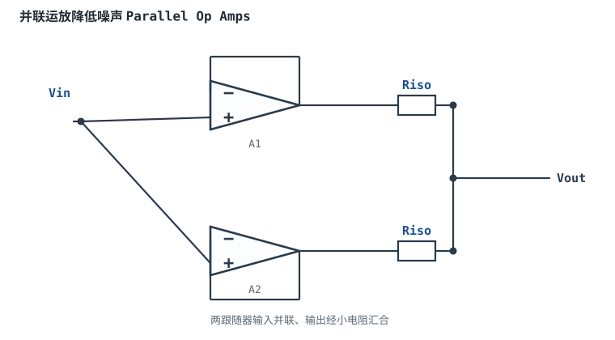

---

id: noise
title: "噪声：电压噪声、电流噪声与计算 Noise: Voltage & Current Noise"
part: 3
chapter: 运放基础
order: 80
tags: [运放, 噪声, 电压噪声密度, 电流噪声, 信噪比, 热噪声]
difficulty: 3
status: published
sources:
  - MT-049 Op Amp Total Output Noise Calculations for Single-Pole System (ADI)
  - https://www.analog.com/en/technical-articles.html
  - The Art of Electronics (Horowitz & Hill, 3rd ed.)
---

# 噪声：电压噪声、电流噪声与计算

## 1. 定义与物理来源

运放输出即使输入端短路，也不是一条平直的直线，而是叠加了密密麻麻的微小起伏——这就是**噪声（Noise）**。它是随机信号，只能用统计量描述。

- **电压噪声密度 $e_n$**：输入端等效串联电压噪声，单位 $nV/\sqrt{Hz}$。低频段（<100Hz）按 $1/f$ 上升（闪烁噪声），高频段平坦（白噪声）。
- **电流噪声密度 $i_n$**：两个输入端的电流噪声，单位 $pA/\sqrt{Hz}$，同样有 $1/f$ 拐点。
- **电阻热噪声**：任何电阻都有约翰逊热噪声，$e_R=\sqrt{4kTRB}$，与阻值平方根成正比。

物理来源：电阻中电子的热运动（白噪声）、晶体管基极电流的离散性（散粒噪声）、以及半导体表面缺陷导致的 $1/f$ 闪烁噪声。


## 2. 典型数量级

| 运放类型 | $e_n$（1kHz） | $1/f$ 拐点 | $i_n$（1kHz） |
|---|---|---|---|
| 低噪声 BJT（如 NE5534） | 3~5 nV/√Hz | 100~200 Hz | 0.5 pA/√Hz |
| 通用 CMOS | 20~80 nV/√Hz | 1~10 kHz | 0.01 pA/√Hz |
| 超低噪声（如 ADA4898） | 0.9 nV/√Hz | 数十 Hz | 2 pA/√Hz |

直觉：**BJT 运放电压噪声低但电流噪声大；CMOS 运放电流噪声极低但电压噪声高**。信号源内阻大时选 CMOS（电流噪声流过电阻产生的噪声更重要），信号源内阻小时选低电压噪声 BJT。

```echarts
{
  "tooltip": {"trigger": "axis"},
  "legend": {"data": ["电压噪声密度 eₙ"], "bottom": 0, "textStyle": {"fontSize": 12}},
  "grid": {"left": 60, "right": 24, "top": 26, "bottom": 58},
  "xAxis": {"type": "category", "name": "频率 Hz（对数示意）", "data": ["1","10","100","1k","10k","100k"], "axisLabel": {"fontSize": 11}},
  "yAxis": {"type": "value", "name": "nV/√Hz", "min": 0, "axisLabel": {"fontSize": 11}},
  "series": [
    {"name": "电压噪声密度 eₙ", "type": "line", "smooth": true, "showSymbol": false, "lineStyle": {"width": 2.4, "color": "#1a4f8b"},
     "data": [80,25,10,7,6.5,6.5]}
  ]
}
```

低频 $1/f$ 段随频率升高下降，到 1kHz 后进入平坦的白噪声区——这正是低噪声设计要关注的形状。

## 3. 如何计算总输出噪声

噪声是功率相加（不相干源），要把各噪声源在**噪声增益**和**噪声带宽**下平方积分：

1. 算出输入参考总噪声密度 $e_{ni}$，它包括：运放 $e_n$、电流噪声在等效电阻上的压降 $i_n\cdot R_s$、电阻热噪声 $\sqrt{4kTR}$。
2. 噪声带宽 $B_n$：单极点系统中 $B_n = 1.57\cdot f_c$（$f_c$ 为闭环 −3dB 带宽），1.57 是积分系数。
3. 总输入噪声有效值 $V_{n,rms}=e_{ni}\cdot\sqrt{B_n}$。
4. 折算到输出 $V_{out,n}=V_{n,rms}\cdot G_n$。

::: example 一个反相放大器的总输出噪声
1. **电路**：$G_n=10$，闭环带宽 $f_c=100\text{kHz}$，噪声带宽 $B_n=1.57\times100\text{k}\approx157\text{kHz}$。
2. **运放 $e_n=10\text{nV}/\sqrt{Hz}$**（忽略 $1/f$），电流噪声经等效电阻产生的噪声与电阻热噪声合计约 $8\text{nV}/\sqrt{Hz}$。
3. **输入参考噪声**：$e_{ni}=\sqrt{10^2+8^2}\approx12.8\text{nV}/\sqrt{Hz}$。
4. **总输入噪声**：$12.8\text{nV}/\sqrt{Hz}\times\sqrt{157\text{kHz}}\approx12.8\times396\approx5.1\,\mu\text{V rms}$。
5. **输出噪声**：$5.1\,\mu\text{V}\times10=51\,\mu\text{V rms}$。换算峰峰值约 $6.6\times51\approx340\,\mu\text{V p-p}$（峰峰值通常按 6.6 倍 rms 估，对应 99.9% 时间）。
:::

::: advanced 进阶：为什么用噪声带宽而不是信号带宽
白噪声均匀分布在所有频率，但运放闭环传递函数不是硬截断——它在截止频率附近平缓滚降，积分出来的"有效噪声带宽"比 −3dB 频率大一个系数（单极点为 π/2≈1.57）。多个噪声源不相干，按平方和相加，不能直接电压相加。这是 ADI MT-049 的标准算法。
:::

## 扩展与变种电路

### 扩展1：并联运放降低噪声 Parallel Op Amps

N 个相同运放输入端并联、输出经小电阻汇合，电压噪声按功率平均下降 $\sqrt{N}$，而输出电流能力成倍增加。



::: example 工作原理与静态分析
- 各运放电压噪声 $e_n$ 互不相干，汇合后总输入噪声 $e_{n,total}=e_n/\sqrt{N}$。
- 输出阻抗并联后下降，电流驱动能力约 $N$ 倍；每路串 Riso（几十 Ω）防止输出间相互打架。
- 代价：电流噪声、功耗、输入电容按 N 增加；偏置电流也相加。
- 例：两个 $e_n=10\text{nV}/\sqrt{\text{Hz}}$ 运放并联后约 $7\text{nV}/\sqrt{\text{Hz}}$。
:::

取值数量级：Riso=10~100Ω；与"换更低 e_n 单芯片"对比：并联不需更贵芯片，但增加功耗与面积。适用：极低噪声前置、大电流缓冲；不适用：高内阻源（电流噪声相加反而变差）。

::: pitfall 并联后高阻源下噪声反而变大
- **现象**：低阻源测噪声下降，高阻源下却变差。
- **原因**：电流噪声 $i_n$ 按 N 相加，$i_n\cdot R_s$ 项随 N 线性增大，盖过了 $e_n/\sqrt{N}$ 的收益。
- **解决**：信号源内阻小时才用并联；高阻源优先选低 $i_n$ 的 CMOS 单芯片。
:::

## 4. 常见坑

::: pitfall 常见坑
- **只看 1kHz 的 e_n 不看 1/f**：音频/直流测量（20Hz~20kHz）里 $1/f$ 段贡献很大，低频 e_n 可能是高频的 5~10 倍。要看完整噪声谱曲线，按实际频段积分。
- **信号源内阻大却用低 e_n 高 i_n 的 BJT 运放**：i_n 流过 100kΩ 内阻产生的噪声 $i_n\cdot R$ 可能远超 e_n。高内阻传感器（压电、光电）要选 CMOS 低 i_n 运放。
- **反馈电阻取过大**：1MΩ 电阻热噪声约 $128\text{nV}/\sqrt{Hz}$，本身就成了最大噪声源。低噪声设计把外部电阻压在 kΩ~数十 kΩ。
:::

## 5. 自测题

<details><summary>为什么低噪声设计常把反馈电阻取得较小，而不是为了输入阻抗取得很大？</summary>

电阻热噪声随 $\sqrt{R}$ 增大。大反馈电阻（MΩ 级）自身热噪声可能远超运放 e_n，成为主导噪声源。低噪声设计在输入阻抗允许的前提下，尽量用 kΩ~数十 kΩ。

</details>

<details><summary>CMOS 运放 e_n=50nV/√Hz、i_n=0.01pA/√Hz，接在内阻 1MΩ 的传感器后，电流噪声在传感器内阻上产生多大电压噪声密度？该选它还是低 e_n BJT 运放？</summary>

电流噪声压降 $=i_n\cdot R_s = 0.01\text{pA}/\sqrt{Hz}\times1\text{M}\Omega = 10\text{nV}/\sqrt{Hz}$，比 e_n=50 还小，CMOS 合适。若改用低 e_n BJT（e_n=5nV 但 i_n=1pA），$i_n\cdot R_s=1\mu\text{V}/\sqrt{Hz}$，反而更差。高内阻场景选低 i_n 的 CMOS。

</details>

## 6. 参考资料

- MT-049 Op Amp Total Output Noise Calculations for Single-Pole System（ADI）
- The Art of Electronics（Horowitz & Hill, 3rd ed.），噪声章节
