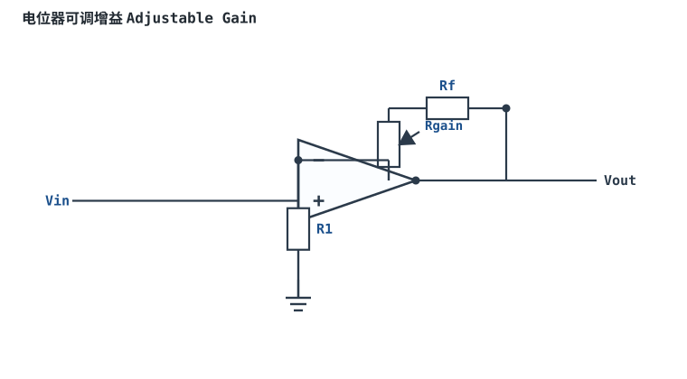
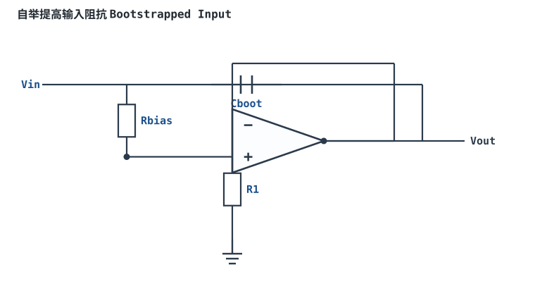
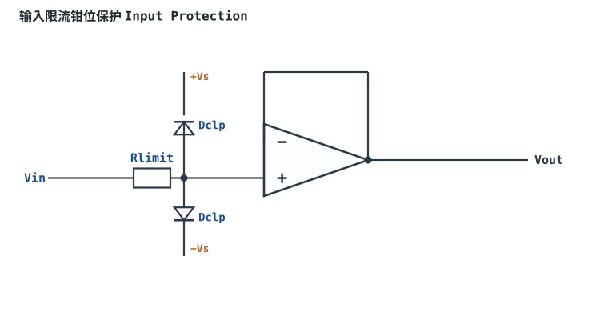
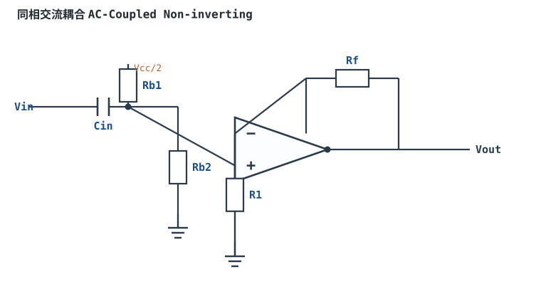

# 同相比例放大器 Non-Inverting Amplifier

## 1. 设计动机

::: motivation 为什么需要这个电路
[反相比例放大器](inverting-amplifier.md) 输入阻抗只有 R₁，高内阻传感器接上去信号就被分压衰减。很多时候我们既要**精确放大**，又要**极高输入阻抗**不拖累信号源——同相比例放大器就是为此而生。

信号从同相端进入，反馈网络 Rf/R₁ 决定增益，输出与输入同相，输入阻抗高达 MΩ~TΩ。
:::

## 2. 原理图


## 3. 静态分析（DC）

- 同相端 $V_+=V_{in}$；由虚短，反相端 $V_-=V_+=V_{in}$。
- 反相端节点由 R₁ 下地、Rf 接输出，是一个分压：$V_- = V_{out}\cdot R_1/(R_1+R_f)$。
- 联立得 $V_{in}=V_{out}\cdot R_1/(R_1+R_f)$，即 $V_{out}=V_{in}(1+R_f/R_1)$。

## 4. 动态分析（AC / 瞬态）

传递函数：

$$G(s)=\frac{V_{out}}{V_{in}}=1+\frac{R_f}{R_1}$$

增益恒大于等于 1，输出与输入同相。下面是 $R_f/R_1=9$（即 G=10）时的波形：

```echarts
{
  "tooltip": {"trigger": "axis"},
  "legend": {"data": ["Vin", "Vout"], "bottom": 0, "textStyle": {"fontSize": 13}},
  "grid": {"left": 56, "right": 24, "top": 26, "bottom": 58},
  "xAxis": {"type": "category", "name": "角度", "data": [0,30,60,90,120,150,180,210,240,270,300,330,360], "axisLabel": {"fontSize": 11}},
  "yAxis": {"type": "value", "name": "电压 V", "min": -2.4, "max": 2.4, "interval": 0.8, "axisLabel": {"fontSize": 11}},
  "series": [
    {"name": "Vin", "type": "line", "smooth": true, "showSymbol": false, "lineStyle": {"width": 2.6, "color": "#1a4f8b"},
     "data": [0,0.1,0.173,0.2,0.173,0.1,0,-0.1,-0.173,-0.2,-0.173,-0.1,0]},
    {"name": "Vout", "type": "line", "smooth": true, "showSymbol": false, "lineStyle": {"width": 2.6, "color": "#b5642e"},
     "data": [0,1,1.73,2,1.73,1,0,-1,-1.73,-2,-1.73,-1,0]}
  ]
}
```

## 5. 环路分析

这是**电压串联负反馈**：反馈系数 $\beta=R_1/(R_1+R_f)$，噪声增益 $G_n=1/\beta=1+R_f/R_1$（正好等于信号增益）。

- 深度负反馈下 $G=1+R_f/R_1$，与运放开环增益基本无关。
- 纯电阻反馈相位裕度通常足够；增益越低（接近 1）越接近单位增益稳定边界。

::: advanced 进阶：噪声增益与信号增益
同相放大器的一个重要特点：**信号增益 = 噪声增益**。反相放大器信号增益是 $R_f/R_1$，但噪声增益仍是 $1+R_f/R_1$——失调、噪声、带宽都按噪声增益算，不按信号增益算。闭环带宽 $f_c=GBP/G_n$。
:::

## 6. 元件取值与工程权衡

- **R₁、Rf 决定增益**：$G=1+R_f/R_1$。先按增益定比值，再选阻值数量级。
- **输入阻抗**：由运放同相端决定，与 R₁、Rf 无关（这是它相对反相电路的最大优势）。
- **阻值甜点区**：1kΩ~100kΩ。过小增加功耗，过大引入偏置电流失调与噪声。
- **平衡电阻**：同相端可串一个 $R_{comp}=R_1\parallel R_f$，抵消偏置电流一阶效应（详见 [失调与偏置](offset-bias.md)）。

## 7. 完整设计示例

::: example 把 0~0.5V 放大到 0~5V
1. **需求**：传感器输出 0~0.5V，ADC 满量程 5V。
2. **算增益**：$G=5/0.5=10$，即 $1+R_f/R_1=10$，$R_f/R_1=9$。
3. **选 R₁**：取 R₁=10kΩ。
4. **算 Rf**：Rf=9×10kΩ=90kΩ（取标准值 90.9kΩ E96）。
5. **注意**：输入共模电压等于 Vin（最高 0.5V），在普通运放共模范围内即可；单电源时输出需从 0V 起，选 RRO。
6. **验算**：$V_{in}=0.5\text{V}\Rightarrow V_{out}=10\times0.5=5\text{V}$。
:::

## 8. 仿真与实验

LTspice 双电源 ±5V，输入正弦 0.2V/1kHz，观察输出幅度 2V、同相；逐步提高频率，接近 GBP/Gn 时增益下降、相位滞后。

## 扩展与变种电路

### 扩展1：电位器可调增益 Adjustable Gain

把反馈支路做成电位器，转动滑臂即可连续改变 $R_f$，增益在范围内可调。



::: example 工作原理与静态分析
- 增益 $G=1+R_f/R_1$，电位器滑臂改变有效 $R_f$，$G$ 在最小~最大间连续变化。
- 关键：电位器用线性型；为保证不出现增益过小/0，串固定电阻限位。
- 带宽按噪声增益（=信号增益）随设置变化，增益越高带宽越窄。
:::

取值数量级：R1=10k、电位器 100k；与固定增益对比：现场可校准。适用：可调放大、校准前级；不适用：增益要求长期稳定的量产（电位器会漂）。

::: pitfall 电位器调到一端增益骤降甚至自激
- **现象**：调小到某点后输出振荡。
- **原因**：增益调到接近 1，非单位增益稳定运放相位裕度不足。
- **解决**：串固定电阻限制最小增益，或选 Unity-Gain Stable 运放。
:::

### 扩展2：自举提高输入阻抗 Bootstrapped Input

用输出经电容把偏置电阻的"下端"也驱动到信号电位，让偏置电阻上几乎无交流电流，等效输入阻抗大幅提高。



::: example 工作原理与静态分析
- 普通偏置电阻 Rbias 到地会并联在输入端，降低输入阻抗。
- 自举：输出 $V_{out}\approx V_{in}$ 经 Cboot 接到 Rbias 信号侧，使 Rbias 两端交流电位近似相等，流过的电流趋近于 0，等效阻抗 $R_{in}\gg R_{bias}$。
- 只对交流有效（Cboot 隔直）；直流偏置仍由电阻设定。
:::

取值数量级：Rbias=1M、Cboot 按最低频率选；与高输入阻抗运放对比：再提升一两个数量级。适用：压电、高阻传感器、交流测量；不适用：直流/超低频（Cboot 失效）。

::: pitfall 自举过头反而自激
- **现象**：接 Cboot 后输出出现高频振荡。
- **原因**：自举环路引入额外相移，接近正反馈。
- **解决**：Cboot 串小电阻、限制带宽，或在 Rbias 上并小电容相位补偿。
:::

### 扩展3：输入限流钳位保护 Input Protection

同相输入端串限流电阻、并两只钳位二极管到正负电源，把输入过压钳在轨附近，保护高阻输入级。



::: example 工作原理与静态分析
- Rlimit 限制故障电流（通常 1~10k），Dclp 把节点电压钳在 $V_s+0.7$ 与 $-V_s-0.7$。
- 正常信号在范围内时二极管不导通，不影响跟随；过压时电流经 Rlimit 限流、二极管泄放。
- 关键：Rlimit 不宜过大以免与输入电容形成额外极点。
:::

取值数量级：Rlimit=10k、小信号开关二极管；与"直接接"对比：防过压/ESD。适用：工业现场、易接触人体的输入；不适用：极低噪声（Rlimit 热噪声）。

::: pitfall 钳位漏电流随温度飙升
- **现象**：高温下输入偏置误差变大。
- **原因**：钳位二极管反向漏电流随温度指数增大，流过 Rlimit 产生误差。
- **解决**：选低漏电流 PIN/专用保护管，或减小 Rlimit 并核算漏流压降。
:::

### 扩展4：同相交流耦合 AC-Coupled Non-inverting

输入串隔直电容，同相端用电阻偏置到 Vcc/2，单电源下放大交流信号。



::: example 工作原理与静态分析
- 同相端直流由 Rb1/Rb2 分压到 Vcc/2，交流信号经 Cin 叠加其上。
- 低频截止 $f_L\approx 1/(2\pi R_b C_{in})$，$R_b=R_{b1}\parallel R_{b2}$。
- 中带增益 $G=1+R_f/R_1$，输出静态在 Vcc/2。
:::

取值数量级：Cin=1µF、Rb=100k；与直流耦合对比：单电源、隔直。适用：音频、交流采集；不适用：直流/超低频测量。

::: pitfall 偏置电阻太大导致输入阻抗与漂移矛盾
- **现象**：输入阻抗高了，但输出漂移或低频跌落明显。
- **原因**：Rb 太大与运放输入电容/偏置电流配合产生极点或压降。
- **解决**：Rb 取几十~几百 k，兼顾阻抗与偏置电流压降。
:::

## 9. 常见坑

::: pitfall 常见坑
- **以为高输入阻抗就万事大吉**：输入阻抗高但输入共模电压必须落在运放共模范围内。输入信号摆到负轨附近时，普通运放失真，需 RRI 输入运放。
- **增益取 1 却用了未补偿运放**：增益 1~2 接近单位增益边界，非单位增益稳定运放会振荡。
:::

## 10. 自测题

<details><summary>R₁=10kΩ、Rf=90kΩ，同相放大器增益是多少？</summary>

$G=1+R_f/R_1=1+90/10=$ **10**。注意别写成 $R_f/R_1=9$，同相增益要加 1。

</details>

<details><summary>同相放大器和反相放大器，哪个输入阻抗更高？为什么？</summary>

同相放大器输入接运放同相端，输入阻抗由运放决定（极高）；反相放大器输入阻抗等于 R₁。要接高内阻信号源选同相。

</details>

## 11. 参考资料

- Op Amps for Everyone（TI, SLOD006B），同相放大器章节
- Design with Operational Amplifiers（Sergio Franco）
