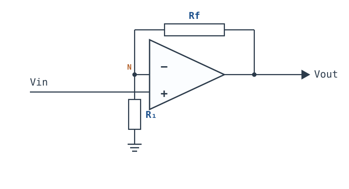
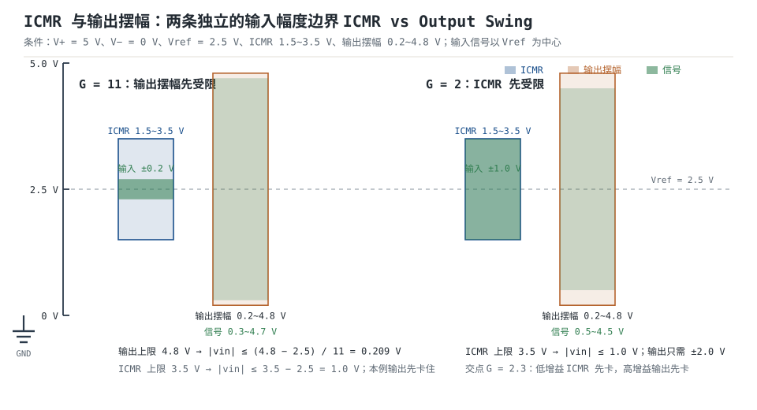

# 同相比例放大器 Non-Inverting Amplifier

同相比例放大器（non-inverting amplifier）把信号送进同相端，用 $R_1$、$R_f$ 组成的分压网络把输出电压的一部分送回反相端，理想增益 $A_{CL}=1+R_f/R_1$，输出与输入同相。它相对[反相比例放大器](inverting-amplifier.md)最大的优势是**输入阻抗极高**：信号直接接运放的同相端，源看到的是共模输入电阻 $R_{icm}$，典型 $10^9\sim10^{15}\ \Omega$，而不是 $R_1$。高阻传感器、pH 电极、压电片、桥式传感器都更愿意接它。

但"输入阻抗高"不是免费的。同相端的共模电压等于输入电压，受输入共模范围（ICMR）限制；单电源下信号还必须抬到某个参考电平，而**不能简单地把同相端偏置到 $V_{CC}/2$**——同相放大的直流增益也是 $1+R_f/R_1$，偏置 2.5 V、增益 11 会把输出顶到 27.5 V。正确的做法是把反馈分压的参考端（$R_1$ 的下端）接到 $V_{ref}$，让直流输出等于 $V_{ref}$，交流增益仍是 $1+R_f/R_1$。这一章会把这条容易踩的坑、ICMR 的定量边界和完整设计算例一次讲清。

符号沿用[运放概述：符号、封装与引脚](opamp-overview.md)：开环增益 $A_{OL}$、闭环增益 $A_{CL}$ 或 $G$、反馈系数 $\beta$（不是三极管的电流放大倍数）、环路增益 $T=A_{OL}\beta$、噪声增益 $1/\beta$、GBW、PM。**虚短、虚断只在负反馈成立、输出未饱和、$|T|\gg1$ 时成立**；本章在偏置与 ICMR 两节会反复用到这个前提。

## 1. 设计动机

::: motivation 三个真实场景

**场景一：1 MΩ 传感器接反相放大，信号被衰减 100 倍。** 传感器内阻 1 MΩ，输出 ±0.2 V；如果用反相放大、$R_1=10\ \text{k}\Omega$，输入阻抗就是 10 kΩ，源内阻与 $R_1$ 分压，真正送到虚地的信号只有 $10/(1000+10)=0.99\%$，增益从 $-10$ 掉到 $-0.099$。改用同相放大，输入阻抗由 $R_{icm}=1\ \text{G}\Omega$ 决定，1 MΩ 源的分压误差只有 $10^6/(10^9+10^6)=0.1\%$；这就是同相拓扑存在的第一理由。

**场景二：5 V 单电源、±0.2 V 交流信号、增益 +11。** 直接把信号接同相端，负半周会低于 0 V：运放的输入共模范围可能不允许，输出也没有负摆幅。把同相端偏置到 2.5 V 行不行？不行——同相放大的直流增益也是 11，输出直流会变成 $11\times2.5=27.5\ \text{V}$，直接撞轨。正确做法是把 $R_1$ 的下端接到 2.5 V 参考，同相端也偏置到 2.5 V；这样直流输出等于 2.5 V，交流增益仍是 11。

**场景三：非轨到轨输入运放、5 V 单电源、信号共模 4 V。** 运放的 ICMR 只有 1.5~3.5 V，4 V 已经超出上限，输入级截止，输出可能突然反相或锁死。把信号交流耦合、重新偏置到 2.5 V 才能工作。**同相放大的输入共模电压等于输入电压本身**，这是它相对反相放大的第二个代价。

:::

| 你想确认 | 先算 | 判据（工程经验值） |
|---|---|---|
| 高阻源会不会被分压 | $R_{icm}$ 与 $R_s$ | $R_{icm}\ge100R_s$（误差 ≤1%） |
| 输入共模会不会越界 | $V_{cm}=V_{IN}$ 与 ICMR | 全信号范围落在 ICMR 内 |
| 输出会不会削顶 | $V_{OUT}=V_{ref}+G(V_{IN}-V_{ref})$ | 峰值离轨 ≥0.2 V（RRO） |
| 增益准不准 | $T=A_{OL}\beta$ | $T\ge100$ → 误差 ≤1% |
| 带宽够不够 | $f_{cl}=GBW/G$ | $f_{cl}\ge10\times$ 最高信号频率 |
| 单电源偏置对不对 | 直流输出是否等于 $V_{ref}$ | 不是 $G\times V_{ref}$ |

**不算会摔在哪**，四个带数字的代价：

1. **把同相端直接偏置到 $V_{CC}/2$。** $V_{ref}=2.5\ \text{V}$、$G=11$，输出直流 $27.5\ \text{V}$，5 V 电源下直接饱和，交流信号完全看不到。
2. **忽略 ICMR。** 5 V 单电源、ICMR 1.5~3.5 V、信号共模 4 V，输入级截止，输出可能反相；这不是"失真"，是工作点没了。
3. **输入电容把高阻优势吃掉。** $R_{icm}=1\ \text{G}\Omega$、$C_{in}=5\ \text{pF}$，100 kHz 时输入阻抗只剩 318 kΩ；如果信号是 100 kHz、源是 1 MΩ，分压误差约 24%。
4. **用 1% 电阻做 +11。** 两只 1% 最坏反向，比值误差 2%，折算到 $G=11$ 是 1.82%，2.5 V 输出就是 45.5 mV；12 位 5 V ADC 的 1 LSB 才 1.22 mV，直接吃掉 37 个 LSB。

## 2. 定义与直观

### 2.1 一句话定义与两只电阻的位置

**同相比例放大器**：输入接同相端，$R_1$ 从反相端接参考端（双电源时是地，单电源时是 $V_{ref}$），$R_f$ 从输出接回反相端。理想闭环增益

$$A_{CL}=1+\frac{R_f}{R_1}$$

符号与单位：$A_{CL}$ 无量纲（V/V），正号表示输出与输入同相；$R_1$、$R_f$ 单位 $\Omega$。反馈系数

$$\beta=\frac{R_1}{R_1+R_f},\qquad \frac{1}{\beta}=1+\frac{R_f}{R_1}=A_{CL}$$

注意：**同相组态的噪声增益恰好等于信号增益**。这一点和反相组态不同——反相的噪声增益是 $1+R_f/R_1$，比信号增益 $R_f/R_1$ 大 1。



### 2.2 虚短的直观：分压器被"反着用"

同相端的电压是 $V_{IN}$；负反馈把反相端拉到同样的电位，$V_-=V_{IN}$。反相端接在 $R_1$、$R_f$ 的分压点上：

$$V_-=V_{OUT}\frac{R_1}{R_1+R_f}$$

既然 $V_-=V_{IN}$，就有

$$V_{OUT}=V_{IN}\frac{R_1+R_f}{R_1}=V_{IN}\left(1+\frac{R_f}{R_1}\right)$$

直观上，$R_1$、$R_f$ 是一个"反着用"的分压器：通常分压器把输出变小，这里运放强制分压点的电压等于输入，于是输出必须是输入的 $(R_1+R_f)/R_1$ 倍。**增益来自"分压比被倒过来用"，不是来自运放本身。**

::: analogy 同相放大像带反馈的恒温槽

把 $V_{IN}$ 想成设定温度，$R_1$、$R_f$ 分压比想成温度传感器的衰减系数，运放是加热器。设定温度升高，传感器读数暂时偏低，加热器加大功率，直到传感器读数重新等于设定值；此时槽内实际温度就是设定值除以衰减系数，也就是被放大了 $1+R_f/R_1$ 倍。

类比的边界：恒温槽的"设定值"可以是任意绝对温度，而同相放大的输入共模电压必须落在运放允许的 ICMR 内；槽可以加热也可以制冷，单电源同相放大却不能输出负电压。**增益公式不负责工作点，工作点要另外设计。**

:::

### 2.3 输入侧与反馈侧是分开的

同相放大最关键的结构事实：**信号只进同相端，反馈网络接在反相端和输出之间，不加载信号源**。所以

- 输入阻抗由同相端决定：$R_{icm}$、输入电容 $C_{in}$、外部偏置电阻 $R_b$ 的并联；
- 反馈网络只加载输出，不加载输入；$R_1$、$R_f$ 取多大，都不会直接降低输入阻抗（但会影响噪声、带宽和稳定性）。

这跟反相放大正好相反：反相的输入网络 $R_1$ 就是信号源的负载，$R_1$ 取小了输入阻抗就低。**需要高输入阻抗时，拓扑选择比电阻取值更重要。**

## 3. 定量关系

### 3.1 理想增益推导

在负反馈成立、输出未饱和、$|T|\gg1$ 的前提下，用虚短 $V_-=V_+=V_{IN}$，用虚断 $I_-=0$。$R_1$ 与 $R_f$ 流过同一电流，构成分压：

$$V_-=V_{OUT}\frac{R_1}{R_1+R_f}=V_{IN}$$

整理得

$$A_{CL}=\frac{V_{OUT}}{V_{IN}}=1+\frac{R_f}{R_1}$$

反馈系数 $\beta=R_1/(R_1+R_f)$，所以 $1/\beta=1+R_f/R_1$，理想闭环增益就是噪声增益。虚短、虚断的三条前提（负反馈闭合、输出未饱和、$|T|\gg1$）见[理想模型五假设与虚短、虚断](ideal-opamp.md)。

### 3.2 有限开环增益的修正

同相组态的闭环增益是标准反馈式

$$A_{CL}=\frac{A_{OL}}{1+A_{OL}\beta}=\frac{1}{\beta}\cdot\frac{T}{1+T}=\frac{1+R_f/R_1}{1+\dfrac{1+R_f/R_1}{A_{OL}}}$$

其中 $T=A_{OL}\beta$。相对理想值 $1/\beta$ 的误差是 $-1/(1+T)$。负反馈如何用多余的 $A_{OL}$ 换精度、带宽和低输出阻抗，见[开环、闭环增益与负反馈本质](open-loop-feedback.md)。以 $A_{OL0}=10^5$、$R_1=10\ \text{k}\Omega$、$R_f=100\ \text{k}\Omega$ 为例：

$$\beta=\frac{10}{110}=0.090909,\qquad \frac{1}{\beta}=11.0,\qquad T_0=10^5\times0.090909=9090.9$$

$$A_{CL0}=11\times\frac{9090.9}{9091.9}=10.99879$$

误差 $-0.0110\%$。100 kHz 处 $|T|=9.09$，实际增益

$$|A_{CL}(100\ \text{kHz})|=11\times\frac{9.0909}{\sqrt{1+9.0909^2}}=11\times\frac{9.0909}{9.1457}=10.9329$$

误差 $-0.610\%$。这个相对误差和反相 $-10$ 在 100 kHz 处完全一样（$-0.610\%$），因为两者的 $\beta$、$T$ 相同，只是理想增益一个是 11、一个是 10。**误差因子只看 $T$，不看信号增益的绝对值。**

### 3.3 输入阻抗：真正的优势，也是频率的函数

同相输入阻抗由三部分并联：

$$Z_{in}=R_{icm}\parallel R_b\parallel\frac{1}{j\omega C_{in}}$$

其中 $R_b$ 是外部偏置电阻（交流耦合时用来给同相端提供直流路径），$C_{in}$ 是运放输入电容与 PCB 寄生电容之和。以 $R_{icm}=1\ \text{G}\Omega$、$R_b=10\ \text{M}\Omega$、$C_{in}=5\ \text{pF}$ 为例：

| 频率 | $R_{icm}\parallel R_b$ | $\lvert Z_{C_{in}}\rvert$ | $Z_{in}$ |
|---|---|---|---|
| 直流 | 9.90 MΩ | $\infty$ | 9.90 MΩ |
| 1 kHz | 9.90 MΩ | 31.8 MΩ | 7.55 MΩ |
| 10 kHz | 9.90 MΩ | 3.18 MΩ | 2.41 MΩ |
| 28.6 kHz | 9.90 MΩ | 1.11 MΩ | 1.00 MΩ |
| 100 kHz | 9.90 MΩ | 318 kΩ | 308 kΩ |
| 1 MHz | 9.90 MΩ | 31.8 kΩ | 31.7 kΩ |

**"输入阻抗大于 1 MΩ"只在 28.6 kHz 以下成立**；100 kHz 时只剩 308 kΩ。这不是运放不好，是输入电容的物理限制：$1/(2\pi fC_{in})$ 随频率反比下降，任何高阻输入都逃不掉。要高阻到更高频率，只能选 $C_{in}$ 更小的运放（例如 1~2 pF），或者在源端加自举/屏蔽。

输入偏置电流在 $R_b$ 上的压降是另一个直流项：

$$V_{err,I_B}=I_BR_b$$

$R_b=10\ \text{M}\Omega$ 时，$I_B=1\ \text{pA}$ 对应 10 µV，$I_B=25\ \text{nA}$ 对应 250 mV。**同相放大的高输入阻抗必须配低 $I_B$ 的运放**；双极输入运放接 10 MΩ 偏置电阻，输出会偏到不能用。偏置电流的完整预算见[失调电压、偏置电流与漂移](offset-bias.md)。

### 3.4 噪声增益 = 信号增益：与反相放大的关键差异

同相组态的 $\beta=R_1/(R_1+R_f)$，所以 $1/\beta=1+R_f/R_1=A_{CL}$。三个后果：

1. **带宽**：$f_{cl}=GBW/(1/\beta)=GBW/G$。目标 +10 时 $f_{cl}=GBW/10$；目标 +11 时 $f_{cl}=GBW/11$。想要 +10 又想要更宽带宽，取 $R_f/R_1=9$（$R_1=10\ \text{k}\Omega$、$R_f=90.9\ \text{k}\Omega$ E96，$G=10.09$），$f_{cl}=991\ \text{kHz}$（GBW=10 MHz）；若用理想比值 9.00（$R_f=90.0\ \text{k}\Omega$），$f_{cl}=1.000\ \text{MHz}$，差 0.9%。
2. **噪声**：运放电压噪声被 $G$ 放大，不是被 $G+1$ 放大；同相 +10 的输出噪声密度是 $10e_n$，反相 $-10$ 是 $11e_n$，高 10%。但闭环噪声带宽也按 $1/G$ 缩小，总输出噪声只按 $\sqrt{G}$ 增加。
3. **稳定性**：$G$ 越小，$f_{c}$ 越高，离第二极点越近，PM 越小。同相 +1 就是跟随器，PM 最低；+11 的 $f_c=909\ \text{kHz}$，比跟随器低 11 倍，稳定性好得多。这也是为什么去补偿运放要求"最小增益 ≥5"——它要保证 $f_c$ 足够低。

| 指标 | 同相 +10（$R_f=90.9\ \text{k}\Omega$） | 同相 +11（$R_f/R_1=10$） | 反相 $-10$（$R_f/R_1=10$） |
|---|---|---|---|
| 信号增益 | 10.09 | 11.0 | $-10.0$ |
| 噪声增益 $1/\beta$ | 10.09 | 11.0 | 11.0 |
| $f_{cl}$（GBW=10 MHz） | 991 kHz | 909 kHz | 909 kHz |
| 输出噪声密度 | $10.09e_n$ | $11e_n$ | $11e_n$ |
| 输入阻抗 | $R_{icm}$ | $R_{icm}$ | $R_1$ |
| 输入共模电压 | $V_{IN}$ | $V_{IN}$ | $\approx0$ |

**同相 +10 和反相 $-10$ 的"信号增益绝对值"一样，但噪声增益、带宽、输入阻抗、共模电压全不一样。** 这正是拓扑选择要算清楚的原因；同相组态属于电压串联负反馈，四种拓扑的判别见[反馈四拓扑与环路增益](feedback-topologies.md)。

### 3.5 单电源偏置：为什么不能只把同相端抬到 $V_{CC}/2$

单电源 5 V、目标 +11、输入是 ±0.2 V 的交流信号。最直觉的做法是：同相端用两只 100 kΩ 电阻分压到 2.5 V，$R_1$ 下端接地。算一下直流工作点：

$$V_{OUT,DC}=G\times V_{+,DC}=11\times2.5=27.5\ \text{V}$$

5 V 电源下根本不可能，运放直接饱和到正轨。**同相放大的直流增益和交流增益是同一个 $G$，偏置电压也会被放大 $G$ 倍。**

正确做法是把 $R_1$ 的下端也接到 $V_{ref}$，而不是地：

- 同相端经 $R_b$ 接 $V_{ref}$；
- $R_1$ 从反相端接 $V_{ref}$；
- 输入经 $C_{in}$ 交流耦合到同相端。

直流时 $V_+=V_{ref}$，虚短使 $V_-=V_{ref}$；$R_1$ 两端都是 $V_{ref}$，没有电流，$R_f$ 也没有电流，所以 $V_{OUT}=V_{ref}$。交流时 $V_{ref}$ 是交流地，$R_1$ 下端交流接地，增益仍是 $1+R_f/R_1$。**直流输出等于 $V_{ref}$，不是 $G\times V_{ref}$。**

这个 $V_{ref}$ 就是单电源电路的"虚地"：它不是 0 V，而是 2.5 V；所有交流信号都以它为参考。它必须**低阻抗**，因为 $R_1$ 上的交流电流要流进它。以 $R_1=10\ \text{k}\Omega$、输入 ±0.2 V 为例，$R_1$ 上的交流电流峰值 $0.2/10\ \text{k}=20\ \mu\text{A}$。如果 $V_{ref}$ 直接由两只 100 kΩ 电阻分压（戴维南内阻 50 kΩ），这 20 µA 会产生

$$V_{ref,err}=20\ \mu\text{A}\times50\ \text{k}\Omega=1.0\ \text{V}$$

的交流误差——增益和失真都会彻底崩掉。用一只[电压跟随器](voltage-follower.md)把 2.5 V 分压缓冲一下，输出阻抗降到毫欧级，同样的 20 µA 只产生 $20\ \mu\text{A}\times0.5\ \text{m}\Omega=10\ \text{nV}$。**单电源同相放大的"虚地"必须是一只缓冲器，不能是裸分压器。**

### 3.6 ICMR 与输出摆幅：两条独立的边界

同相端的共模电压就是输入电压：$V_{cm}=V_{IN}=V_{ref}+v_{ac}$。它必须落在运放的输入共模范围 $[V_{ICMR-},V_{ICMR+}]$ 内：

$$V_{ICMR-}\le V_{ref}+v_{ac}\le V_{ICMR+}$$

输出电压还必须落在输出摆幅内：

$$V_{OUT,min}\le V_{ref}+G\,v_{ac}\le V_{OUT,max}$$

两个不等式给出两个最大输入幅度：

$$|v_{ac}|_{ICMR}=\min(V_{ICMR+}-V_{ref},\ V_{ref}-V_{ICMR-})$$

$$|v_{ac}|_{OUT}=\frac{\min(V_{OUT,max}-V_{ref},\ V_{ref}-V_{OUT,min})}{G}$$

实际可用幅度取两者较小值。以 $V_{ref}=2.5\ \text{V}$、ICMR 1.5~3.5 V、输出摆幅 0.2~4.8 V 为例：

$$|v_{ac}|_{ICMR}=\min(1.0,1.0)=1.0\ \text{V},\qquad |v_{ac}|_{OUT}=\frac{\min(2.3,2.3)}{G}=\frac{2.3}{G}$$

- $G=11$：$|v_{ac}|_{OUT}=2.3/11=0.209\ \text{V}$，输出摆幅先受限；
- $G=2$：$|v_{ac}|_{OUT}=2.3/2=1.15\ \text{V}$，ICMR 的 1.0 V 先受限；
- 交点：$2.3/G=1.0\Rightarrow G=2.3$。

**ICMR 和输出摆幅谁先卡住，取决于增益和偏置点，不是固定答案。** 把偏置点从 2.5 V 挪到 4.0 V，ICMR 上限只剩 3.5−4.0=−0.5 V，直接不可用；挪到 1.0 V，下限 1.5 V 又越界。所以单电源偏置点不是随便取 $V_{CC}/2$，要同时满足 ICMR 和输出摆幅。



```echarts
{
  "tooltip": {"trigger": "axis"},
  "legend": {"data": ["输出摆幅限制", "ICMR 限制"], "bottom": 0, "textStyle": {"fontSize": 12.5}},
  "grid": {"left": 64, "right": 24, "top": 30, "bottom": 58},
  "xAxis": {"type": "category", "name": "闭环增益 G", "data": ["1", "2", "3", "5", "8", "11", "15", "20"], "axisLabel": {"fontSize": 11}},
  "yAxis": {"type": "value", "name": "最大输入峰值 / V", "min": 0, "max": 2.5, "interval": 0.5, "axisLabel": {"fontSize": 11}},
  "series": [
    {"name": "输出摆幅限制", "type": "line", "showSymbol": true, "symbolSize": 6, "lineStyle": {"width": 2.6, "color": "#b5642e"}, "itemStyle": {"color": "#b5642e"},
     "data": [2.30, 1.15, 0.767, 0.460, 0.288, 0.209, 0.153, 0.115]},
    {"name": "ICMR 限制", "type": "line", "showSymbol": true, "symbolSize": 6, "lineStyle": {"width": 2.6, "color": "#1a4f8b", "type": "dashed"}, "itemStyle": {"color": "#1a4f8b"},
     "data": [1.00, 1.00, 1.00, 1.00, 1.00, 1.00, 1.00, 1.00]}
  ]
}
```

图里两条线在 $G=2.3$ 附近交叉：低增益时 ICMR 是瓶颈，高增益时输出摆幅是瓶颈。**设计时先算这两条线，再选增益和偏置点**；只算其中一条，另一边会在样机上给你惊喜。

### 3.7 适用条件与失效边界

1. **负反馈回到反相端。** 接错到同相端就是正反馈，输出锁死。
2. **输入共模在 ICMR 内。** 同相端的 $V_{cm}=V_{IN}$，单电源下尤其要查下限和上限；非轨到轨输入级的 ICMR 可能只有 1.5~3.5 V。
3. **输出在线性区。** 单电源下输出不能为负；偏置点与增益要一起算，别让直流工作点先饱和。
4. **$|T|\gg1$。** 高增益、高频时 $T$ 下降，增益误差按 $1/(1+T)$ 增大。
5. **源内阻与 $R_{icm}$ 可比。** 高阻源还要看 $C_{in}$ 的极点，不能只看直流 $R_{icm}$。
6. **反馈网络是实数。** 纯电阻低频成立；加电容后 $\beta(s)$ 带相移，稳定性要重算。

## 4. 典型计算

### 4.1 完整算例：+11、$R_{in}>1\ \text{M}\Omega$、5 V 单电源

**需求**：传感器输出 ±0.2 V（以 0 V 为参考），源内阻 10 kΩ；放大 +11 后送 5 V 单电源 ADC；要求输入阻抗大于 1 MΩ，信号带宽 20 kHz。运放示例参数：$A_{OL0}=10^5$、GBW=10 MHz、$f_p=100\ \text{Hz}$、$R_{icm}=1\ \text{G}\Omega$、$C_{in}=5\ \text{pF}$、$I_B=1\ \text{pA}$、$V_{OS}=1\ \text{mV}$、CMRR=80 dB、PSRR=80 dB、$e_n=10\ \text{nV}/\sqrt{\text{Hz}}$、RRO 输出（5 mA 时离轨 0.2 V）、ICMR 1.5~3.5 V（典型量级，以数据手册为准）。

**第 1 步：取 E96 电阻。** $G=11$ 要求 $R_f/R_1=10$。取 $R_1=10.0\ \text{k}\Omega$、$R_f=100\ \text{k}\Omega$（都是 E96），0.1% 薄膜电阻。$\beta=10/110=0.090909$，$1/\beta=11.0$。

**第 2 步：单电源偏置。** 取 $V_{ref}=2.5\ \text{V}$。同相端经 $R_b=10\ \text{M}\Omega$ 接 $V_{ref}$，输入经 $C_{in}=1\ \mu\text{F}$ 交流耦合；$R_1$ 下端接 $V_{ref}$，不是地。$V_{ref}$ 由两只 100 kΩ 电阻分压、再用一只跟随器缓冲（或直接用 2.5 V 基准源），输出阻抗毫欧级；分压点并 100 nF 旁路。

直流：$V_+=V_-=V_{ref}$，$R_1$ 两端等电位，$V_{OUT}=V_{ref}=2.5\ \text{V}$。交流：$V_{ref}$ 是交流地，$A_{CL}=1+R_f/R_1=11$。输出以 2.5 V 为中心，±0.2 V 输入对应 ±2.2 V 输出，即 0.3~4.7 V，RRO 的 0.2 V 余量够用。

**第 3 步：输入阻抗。** 直流

$$Z_{in}=R_{icm}\parallel R_b=1\ \text{G}\Omega\parallel10\ \text{M}\Omega=9.90\ \text{M}\Omega>1\ \text{M}\Omega$$

1 kHz 时 $C_{in}=5\ \text{pF}$ 的阻抗 $1/(2\pi\times10^3\times5\times10^{-12})=31.8\ \text{M}\Omega$，并联后 $9.90\parallel31.8=7.55\ \text{M}\Omega$；20 kHz 时 $1.59\ \text{M}\Omega$，并联后 $1.37\ \text{M}\Omega$——在 20 kHz 信号带宽边缘仍大于 1 MΩ。100 kHz 时降到 308 kΩ，超出本题带宽，不影响。

**第 4 步：带宽与 20 kHz 处的误差。** 噪声增益 11，

$$f_{cl}=\frac{10\ \text{MHz}}{11}=909.1\ \text{kHz}$$

20 kHz 处 $f/f_{cl}=0.022$：

$$\frac{|A_{CL}(20\ \text{kHz})|}{11}=\frac{1}{\sqrt{1+0.022^2}}=0.999758$$

误差 $-0.0242\%$，可以忽略。100 kHz 处误差 $-0.610\%$，仍在 1% 以内；如果信号带宽要到 100 kHz，$f_{cl}$ 至少 1 MHz（GBW≥11 MHz），10 MHz 只是刚好够。

**第 5 步：输出摆幅与 ICMR。** 输出 0.3~4.7 V，RRO 在 5 mA 下 0.2~4.8 V，低端余量 0.1 V、高端余量 0.1 V，偏紧但可用；如果把增益提到 12，输出 0.1~4.9 V，低端就越界了。ICMR：$V_{cm}=2.5\pm0.2=2.3\sim2.7\ \text{V}$，在 1.5~3.5 V 内，余量 0.8 V。

按 §3.6 算两条边界：

$$|v_{ac}|_{ICMR}=1.0\ \text{V},\qquad |v_{ac}|_{OUT}=\frac{2.3}{11}=0.209\ \text{V}$$

实际 0.2 V 小于 0.209 V，**输出摆幅是瓶颈，ICMR 还有 5 倍余量**。如果把增益降到 2，输出允许 1.15 V，ICMR 的 1.0 V 反而先卡住；这说明"ICMR 够不够"不能脱离增益和偏置点单独回答。

**第 6 步：直流误差预算。**

| 误差源 | 折合到输入 | 输出误差 | 说明 |
|---|---|---|---|
| $V_{OS}=1\ \text{mV}$ | $1\ \text{mV}$ | $11.0\ \text{mV}$ | 乘噪声增益 11 |
| $I_B=1\ \text{pA}$ | $1\ \text{pA}\times10\ \text{M}\Omega=10\ \mu\text{V}$ | $0.11\ \text{mV}$ | $R_b=10\ \text{M}\Omega$ |
| CMRR=80 dB、$V_{cm}=2.5\ \text{V}$ | $2.5\ \text{V}/10^4=250\ \mu\text{V}$ | $2.75\ \text{mV}$ | 共模误差乘 11 |
| PSRR=80 dB、电源变化 50 mV | $50\ \text{mV}/10^4=5\ \mu\text{V}$ | $0.055\ \text{mV}$ | 正负电源各算一次 |
| 电阻失配 0.1% | 增益误差 0.1818% | $4.0\ \text{mV}$ | $(R_f/R_1)/(1+R_f/R_1)\times0.2\%$，作用在 2.2 V 信号上 |
| $V_{ref}$ 初始误差 5 mV（0.1% 分压） | 5 mV | $5.0\ \text{mV}$ | $V_{ref}$ 到输出增益为 1 |
| 参考缓冲器 $V_{OS}$ 1 mV | 1 mV | $1.0\ \text{mV}$ | 同上，增益 1 |

最坏相加：$11.0+0.11+2.75+0.055+4.0+5.0+1.0=23.9\ \text{mV}$；RSS：$\sqrt{11^2+0.11^2+2.75^2+0.055^2+4.0^2+5^2+1^2}=13.1\ \text{mV}$。相对 2.2 V 输出摆幅，最坏 1.09%，RSS 0.59%。**主导项是 $V_{OS}$、$V_{ref}$ 初始误差和电阻失配，共模误差排第四**；要再准，先换低 $V_{OS}$ 器件、用 0.1% 基准，再考虑 CMRR。

**第 7 步：噪声。** 闭环噪声带宽 $BW=(\pi/2)\times909.1\ \text{kHz}=1.428\ \text{MHz}$。运放噪声：

$$V_{n,op}=10\ \text{nV}/\sqrt{\text{Hz}}\times11\times\sqrt{1.428\times10^6}=131.4\ \mu\text{V}_{\text{RMS}}$$

反馈网络热噪声（$R_1\parallel R_f=9.091\ \text{k}\Omega$，$12.27\ \text{nV}/\sqrt{\text{Hz}}$）：

$$V_{n,R}=12.27\ \text{nV}/\sqrt{\text{Hz}}\times11\times\sqrt{1.428\times10^6}=161.3\ \mu\text{V}_{\text{RMS}}$$

总输出噪声 $\sqrt{131.4^2+161.3^2}=208.1\ \mu\text{V}_{\text{RMS}}$，约 0.17 个 12 位 5 V ADC 的 LSB。偏置电阻 $R_b=10\ \text{M}\Omega$ 的热噪声密度是 $407\ \text{nV}/\sqrt{\text{Hz}}$，但同相端的 100 nF 旁路把它滤到 0.16 Hz 以下，高频噪声被旁路，不进入输出；如果没有这只电容，$R_b$ 的噪声会成为主导项。

**第 8 步：稳定性。** 纯电阻反馈、$G=11$、$f_{cl}=909\ \text{kHz}$；$R_1\parallel R_f=9.09\ \text{k}\Omega$、$C_{in}=5\ \text{pF}$ 的反相端极点 3.50 MHz，远高于 $f_{cl}$，PM 足够。驱动 1 nF 容性负载时，$f_{p2}=1/(2\pi\times50\times10^{-9})=3.18\ \text{MHz}$，$f_{c0}/f_{p2}=0.286$，$u=0.275$，PM $=90^{\circ}-\arctan0.275=74.6^{\circ}$；10 nF 时 $f_{p2}=318\ \text{kHz}$，$u=1.549$，PM 掉到 $32.8^{\circ}$，需要隔离电阻。**同相 +11 比跟随器稳得多，但大电容仍然能把它放倒。**

**第 9 步：汇总。**

| 项目 | 结果 | 公式 |
|---|---|---|
| 增益（直流） | 10.99879 | $(1+R_f/R_1)T_0/(1+T_0)$ |
| 增益误差（直流） | $-0.0110\%$ | $-1/(1+T_0)$ |
| 增益（100 kHz） | 10.9329 | 复数 $T/(1+T)$ |
| 增益误差（100 kHz） | $-0.610\%$ | 同上 |
| $-3\ \text{dB}$ 带宽 | 909.1 kHz | $GBW/G$ |
| 输入阻抗（直流） | 9.90 MΩ | $R_{icm}\parallel R_b$ |
| 输入阻抗（20 kHz） | 1.37 MΩ | 加 $C_{in}$ 并联 |
| 最大输入（输出限制） | 0.209 V | $2.3/G$ |
| 最大输入（ICMR 限制） | 1.0 V | $3.5-2.5$ |
| 直流误差（最坏） | 23.9 mV | 各项相加 |
| 输出噪声 | $208\ \mu\text{V}_{\text{RMS}}$ | $e_nG\sqrt{BW}$ 与电阻噪声 RSS |

### 4.2 算例二：同相 +10 与反相 −10 的账本对比

**已知**：同一只运放 $A_{OL0}=10^5$、GBW=10 MHz、$e_n=10\ \text{nV}/\sqrt{\text{Hz}}$；同相 +10 取 $R_1=10\ \text{k}\Omega$、$R_f=90.9\ \text{k}\Omega$；反相 $-10$ 取 $R_1=10\ \text{k}\Omega$、$R_f=100\ \text{k}\Omega$。

**第 1 步：噪声增益与带宽。**

- 同相 +10：$\beta=10/100.9=0.09911$，$1/\beta=10.09$，$f_{cl}=991\ \text{kHz}$；
- 反相 $-10$：$\beta=10/110=0.090909$，$1/\beta=11.0$，$f_{cl}=909\ \text{kHz}$。

反相带宽低 8.3%，不是 10%，因为同相 +10 的 $\beta$ 也不是正好 0.1（$R_f=90.9\ \text{k}$ 是 E96 近似 9 倍）。

**第 2 步：输出噪声。** 同相：$10\ \text{nV}\times10.09\times\sqrt{(\pi/2)\times991\ \text{k}}=126\ \mu\text{V}_{\text{RMS}}$；反相：$10\ \text{nV}\times11\times\sqrt{(\pi/2)\times909\ \text{k}}=131\ \mu\text{V}_{\text{RMS}}$。反相高约 4%，不是 10%——同样因为噪声带宽随 $1/\beta$ 缩小。

**第 3 步：输入阻抗与共模。** 同相输入阻抗 $R_{icm}$（1 GΩ 量级），共模电压等于 $V_{IN}$；反相输入阻抗 $R_1=10\ \text{k}\Omega$，共模电压约 0。1 MΩ 源时，同相分压误差 0.1%，反相增益掉到 $-0.099$。**同样的增益数字，拓扑选错就完全不能用。**

### 4.3 算例三：参考缓冲器为什么必须低阻抗

**已知**：$V_{ref}$ 由两只 100 kΩ 电阻从 5 V 分压，戴维南内阻 $R_{th}=50\ \text{k}\Omega$；$R_1=10\ \text{k}\Omega$，输入 ±0.2 V。

**第 1 步：$R_1$ 上的交流电流峰值。**

$$i_{R1,pk}=\frac{0.2\ \text{V}}{10\ \text{k}\Omega}=20\ \mu\text{A}$$

**第 2 步：裸分压器的交流误差。**

$$v_{ref,err}=20\ \mu\text{A}\times50\ \text{k}\Omega=1.0\ \text{V}$$

这个误差和信号本身一样大，增益、线性度全毁。**裸分压器只能做直流参考，不能做交流虚地。**

**第 3 步：加跟随器缓冲。** 跟随器输出阻抗 $R_{out,OL}/(1+T)=50/10^5=0.5\ \text{m}\Omega$：

$$v_{ref,err}=20\ \mu\text{A}\times0.5\ \text{m}\Omega=10\ \text{nV}$$

可以忽略。缓冲器的 $V_{OS}$ 会给 $V_{ref}$ 带来 1 mV 的直流偏移，通过 $R_1$ 的反馈，这个偏移到输出是 1 mV（不是 11 mV），因为 $V_{ref}$ 同时驱动同相端和 $R_1$ 下端，属于共模参考。**这是"把 $R_1$ 下端接到 $V_{ref}$"的另一个好处：参考噪声和漂移不被信号增益放大。**

### 4.4 算例四：ICMR 与输出摆幅谁先受限

**已知**：$V_{ref}=2.5\ \text{V}$、ICMR 1.5~3.5 V、输出摆幅 0.2~4.8 V；求 $G=1,2,3,5,11$ 时的最大输入峰值。

**第 1 步：ICMR 限制。** $|v_{ac}|_{ICMR}=\min(3.5-2.5,2.5-1.5)=1.0\ \text{V}$，与增益无关。

**第 2 步：输出限制。** $|v_{ac}|_{OUT}=2.3/G$。

| $G$ | 输出限制 | ICMR 限制 | 实际可用 | 谁先受限 |
|---|---|---|---|---|
| 1 | 2.30 V | 1.00 V | 1.00 V | ICMR |
| 2 | 1.15 V | 1.00 V | 1.00 V | ICMR |
| 3 | 0.767 V | 1.00 V | 0.767 V | 输出 |
| 5 | 0.460 V | 1.00 V | 0.460 V | 输出 |
| 11 | 0.209 V | 1.00 V | 0.209 V | 输出 |

**第 3 步：结论。** 低增益时 ICMR 先卡住，高增益时输出摆幅先卡住，交点 $G=2.3$。要把可用输入做大，低增益时抬偏置点或换轨到轨输入，高增益时降增益或换 RRO 输出。**"我的运放 ICMR 够宽"这句话只有在给定增益和偏置点后才有意义。**

## 5. 工程含义

### 5.1 数量级表

| 量 | 典型范围 | 备注 |
|---|---|---|
| 信号增益 | $1\sim1000$ | 单级建议不超过 $A_{OL}/100$ |
| 噪声增益 | 等于信号增益 | 这是与反相组态的关键差异 |
| $R_{icm}$ | 双极 $10^6\sim10^8\ \Omega$；CMOS $10^{12}\sim10^{15}\ \Omega$ | 高阻源优先 CMOS/JFET |
| $I_B$ | 双极 10 nA~1 µA；CMOS 1 pA~1 nA | 与 $R_b$ 一起算 $I_BR_b$ |
| $C_{in}$ | 1~10 pF | 与源内阻形成输入极点 |
| ICMR | 非 RRI 可能只有 1.5~3.5 V（5 V 供电） | 查数据手册曲线，不只看标题 |
| 输出摆幅 | RRO 轻载 0.05~4.95 V；重载 0.3~4.7 V | 按负载电流查曲线 |
| $f_{cl}$ | $GBW/G$ | 目标 10 时约 $GBW/10$ |

### 5.2 偏置点怎么选

1. **先定输出静态点。** ADC 输入范围的中点、后级电路的偏置点，通常就是 $V_{ref}$。
2. **算 ICMR 上下余量。** $V_{ref}$ 到 ICMR 上下限的距离要大于信号峰值；不够就换 RRI 器件或挪偏置点。
3. **算输出上下余量。** $V_{ref}\pm G\,v_{ac}$ 要在输出摆幅内；重载时按实际负载电流查曲线。
4. **让 $V_{ref}$ 低阻抗。** 用跟随器或基准源，不要用裸分压器；$R_1$ 下端与同相端接同一个 $V_{ref}$，参考噪声才不被 $G$ 放大。
5. **交流耦合电容。** $C_{in}$ 与 $R_b$ 形成高通，$f_L=1/(2\pi R_bC_{in})$；$R_b=10\ \text{M}\Omega$、$C_{in}=1\ \mu\text{F}$ 时 $f_L=0.016\ \text{Hz}$，远低于信号带宽。

### 5.3 布局与保护

- **同相端走线要短**：高阻节点，$C_{in}$ 每增加 1 pF，输入极点就往下掉；焊盘尽量小，必要时加 guard ring。
- **$R_1$ 下端接 $V_{ref}$ 的走线要粗**：它要承载 $R_1$ 的交流电流，走线电阻会变成增益误差；$V_{ref}$ 的旁路电容就近放。
- **输入保护**：高阻输入容易被 ESD、探头、长线过压；串 1~10 kΩ 限流电阻并加钳位二极管，但要核算漏电流与输入电容。
- **反馈电阻紧靠反相端**：$R_f$ 从输出到反相端的走线越短越好；$R_1$ 与 $R_f$ 的结点尽量小。
- **电源退耦**：每个电源脚 100 nF，单电源时再加 1~10 µF；退耦不良会把电源纹波通过 PSRR 带到输出。

### 5.4 模型什么时候不够用

- **输入共模接近 ICMR 边界**：输入级跨导下降、失真增大，甚至相位反转；小信号模型完全失效。
- **输出接近轨**：输出级进入非线性，增益下降、恢复变慢；RRO 的"离轨 50 mV"只在轻载成立。
- **高频接近 $f_{cl}$**：第二极点、输入电容、PCB 寄生都进来。
- **大信号**：压摆率、输出电流限、饱和恢复都会限制。
- **高阻源**：$I_B$、$C_{in}$、PCB 漏电、guard ring 完整性都会改变输入阻抗。
- **精密直流**：$V_{OS}$、$V_{ref}$ 初始误差、电阻失配、1/f 噪声都进入预算。

## 6. 常见坑

::: pitfall 常见坑

- **现象**：5 V 单电源、+11 同相放大，同相端偏置到 2.5 V、$R_1$ 下端接地，上电输出直接贴 5 V。**原因**：同相放大的直流增益也是 11，$11\times2.5=27.5\ \text{V}$，输出饱和。**解决**：把 $R_1$ 下端接到 $V_{ref}$，同相端也偏置到 $V_{ref}$；直流输出等于 $V_{ref}$，交流增益仍是 11。用跟随器缓冲 $V_{ref}$，不要用裸分压器。

- **现象**：信号共模 4 V，运放 ICMR 只有 1.5~3.5 V，输出突然反相或锁死。**原因**：同相端共模电压超出 ICMR 上限，输入级截止。**解决**：交流耦合、重新偏置到 2.5 V；或换轨到轨输入运放；或改用反相拓扑（共模电压接近 0）。

- **现象**：1 MΩ 源接同相放大，直流正常，100 kHz 时增益掉了 20% 以上。**原因**：输入电容 $C_{in}=5\ \text{pF}$ 与源内阻形成 31.8 kHz 极点，100 kHz 时输入阻抗只剩 308 kΩ，源被加载。**解决**：选 $C_{in}<1\ \text{pF}$ 的运放、降低源内阻、加自举/屏蔽，或把信号带宽降到极点以下。

- **现象**：同相端用 10 MΩ 偏置电阻，输出有 250 mV 的固定偏移，随温度漂。**原因**：双极输入运放 $I_B=25\ \text{nA}$，$25\ \text{nA}\times10\ \text{M}\Omega=250\ \text{mV}$。**解决**：换 CMOS/JFET 输入运放（$I_B$ 降到 pA 级）；或降低 $R_b$（但会降低输入阻抗、提高高通截止频率）。

- **现象**：$V_{ref}$ 用两只 100 kΩ 电阻分压，输入加信号后输出波形失真、增益偏低。**原因**：$R_1$ 上的交流电流（20 µA）流过 50 kΩ 戴维南内阻，产生 1 V 的交流误差。**解决**：用跟随器或基准源缓冲 $V_{ref}$，输出阻抗降到毫欧级；旁路电容就近放。

- **现象**：+11 用 1% 电阻，实测增益偏差 1.82%，2.5 V 输出差 45.5 mV。**原因**：$G=1+R_f/R_1$ 对 $R_f/R_1$ 的失配敏感，两只 1% 最坏反向，比值误差 2%，折算到 $G=11$ 是 $10/11\times2\%=1.82\%$。**解决**：用 0.1% 电阻（最坏 0.18%），或做增益校准；高精度场合把 $R_1$、$R_f$ 选同一批次、同一封装。

- **现象**：同相 +11 驱动 10 nF 负载，输出在几百 kHz 上振荡。**原因**：容性负载与 $R_{out,OL}$ 造出第二极点，$f_{p2}=318\ \text{kHz}$，$f_{c0}=909\ \text{kHz}$，PM 只剩 32.8°。**解决**：输出串 22~100 Ω 隔离电阻，反馈取在电阻内侧；或选容性负载稳定器件；按[稳定性：伯德图、相位裕度与补偿](stability-bode.md)算 PM。

:::

## 7. 自测题

<details><summary>$R_1=10\ \text{k}\Omega$、$R_f=100\ \text{k}\Omega$，同相增益是多少？如果输入 0.2 V，输出多少？噪声增益是多少？</summary>

$$A_{CL}=1+\frac{R_f}{R_1}=1+\frac{100}{10}=11.0$$

输入 0.2 V，输出 $11\times0.2=2.2\ \text{V}$，与输入同相。

噪声增益 $1/\beta=1+R_f/R_1=11.0$，**等于信号增益**。这是同相组态和反相组态的关键差异：反相 $-10$ 的信号增益是 10，噪声增益是 11。

</details>

<details><summary>为什么不能把同相端直接偏置到 $V_{CC}/2$、$R_1$ 下端接地？正确的单电源偏置怎么接？</summary>

同相放大的直流增益也是 $1+R_f/R_1$。$V_{CC}=5\ \text{V}$、$V_{ref}=2.5\ \text{V}$、$G=11$ 时，输出直流

$$V_{OUT,DC}=11\times2.5=27.5\ \text{V}$$

远超 5 V 电源，运放直接饱和。正确做法：把 $R_1$ 的下端接到 $V_{ref}$，同相端也经 $R_b$ 接 $V_{ref}$，输入交流耦合。直流时 $V_+=V_-=V_{ref}$，$R_1$ 两端等电位，$V_{OUT}=V_{ref}$；交流时 $V_{ref}$ 是交流地，增益仍是 $1+R_f/R_1$。

$V_{ref}$ 必须低阻抗：$R_1=10\ \text{k}\Omega$、输入 ±0.2 V 时，$R_1$ 上的交流电流峰值 20 µA；50 kΩ 戴维南内阻会产生 1 V 误差，必须用跟随器或基准源缓冲。

</details>

<details><summary>同相 +11、$V_{ref}=2.5\ \text{V}$、ICMR 1.5~3.5 V、输出摆幅 0.2~4.8 V。最大输入峰值是多少？谁先受限？如果增益改成 2 呢？</summary>

ICMR 限制：

$$|v_{ac}|_{ICMR}=\min(3.5-2.5,2.5-1.5)=1.0\ \text{V}$$

输出限制：

$$|v_{ac}|_{OUT}=\frac{\min(4.8-2.5,2.5-0.2)}{11}=\frac{2.3}{11}=0.209\ \text{V}$$

实际取 0.209 V，**输出摆幅先受限**。

$G=2$ 时输出限制 $2.3/2=1.15\ \text{V}$，ICMR 仍是 1.0 V，**ICMR 先受限**。交点 $G=2.3$。所以"ICMR 够不够"必须结合增益和偏置点回答。

</details>

<details><summary>同相放大 $R_1=10\ \text{k}\Omega$、$R_f=100\ \text{k}\Omega$，$R_{icm}=1\ \text{G}\Omega$、$R_b=10\ \text{M}\Omega$、$C_{in}=5\ \text{pF}$。直流、1 kHz、100 kHz 的输入阻抗各是多少？</summary>

直流：

$$Z_{in}=1\ \text{G}\Omega\parallel10\ \text{M}\Omega=9.90\ \text{M}\Omega$$

1 kHz：$C_{in}$ 阻抗 $1/(2\pi\times10^3\times5\times10^{-12})=31.8\ \text{M}\Omega$，

$$Z_{in}=9.90\ \text{M}\Omega\parallel31.8\ \text{M}\Omega=7.55\ \text{M}\Omega$$

100 kHz：$C_{in}$ 阻抗 318 kΩ，

$$Z_{in}=9.90\ \text{M}\Omega\parallel318\ \text{k}\Omega=308\ \text{k}\Omega$$

**"输入阻抗大于 1 MΩ"只在 28.6 kHz 以下成立**；100 kHz 时只剩 308 kΩ。高阻输入是频率的函数，不是常数。

</details>

<details><summary>同相 +11 的直流误差主要来自哪几项？$V_{OS}=1\ \text{mV}$、$I_B=1\ \text{pA}$、$R_b=10\ \text{M}\Omega$、CMRR=80 dB、$V_{cm}=2.5\ \text{V}$、0.1% 电阻、$V_{ref}$ 初始误差 5 mV、参考缓冲器 $V_{OS}=1\ \text{mV}$，最坏总误差多少？</summary>

各项：

- $V_{OS}$：$1\ \text{mV}\times11=11.0\ \text{mV}$；
- $I_B$：$1\ \text{pA}\times10\ \text{M}\Omega=10\ \mu\text{V}$，乘 11 得 $0.11\ \text{mV}$；
- CMRR：$2.5\ \text{V}/10^4=250\ \mu\text{V}$，乘 11 得 $2.75\ \text{mV}$；
- PSRR：$50\ \text{mV}/10^4=5\ \mu\text{V}$，乘 11 得 $0.055\ \text{mV}$；
- 电阻失配 0.1%：$0.1818\%\times2.2\ \text{V}=4.0\ \text{mV}$（按 2.2 V 输出摆幅算）；
- $V_{ref}$ 初始误差 5 mV：到输出增益 1，$5.0\ \text{mV}$；
- 参考缓冲器 $V_{OS}$ 1 mV：$1.0\ \text{mV}$。

最坏相加约 $11.0+0.11+2.75+0.055+4.0+5.0+1.0=23.9\ \text{mV}$；RSS 约 $\sqrt{11^2+0.11^2+2.75^2+0.055^2+4.0^2+5^2+1^2}=13.1\ \text{mV}$。主导项是 $V_{OS}$、$V_{ref}$ 初始误差和电阻失配。**注意 $V_{ref}$ 的误差到输出是 1 倍，不是 11 倍**，因为 $R_1$ 下端也接 $V_{ref}$，参考是共模的。

</details>

<details><summary>为什么同相 +10 和反相 −10 的"增益绝对值"一样，带宽和噪声却不同？</summary>

同相 +10：$\beta=R_1/(R_1+R_f)=10/(10+90)=0.1$，噪声增益 $1/\beta=10$，$f_{cl}=GBW/10$。

反相 −10：$R_1=10\ \text{k}\Omega$、$R_f=100\ \text{k}\Omega$，$\beta=10/110=0.090909$，噪声增益 $1/\beta=11$，$f_{cl}=GBW/11$。

反相的噪声增益比同相大 1，所以带宽低约 9%，输出噪声密度高 10%（总噪声约高 5%，因为噪声带宽也缩小）。**带宽、噪声、失调、共模误差都按噪声增益 $1/\beta$ 算，不按信号增益算。** 同样标称"10 倍"，反相电路比同相电路少约 9% 的带宽。

</details>

<details><summary>同相 +11 驱动 1 nF 和 10 nF 容性负载，PM 各是多少？为什么同相 +11 比跟随器稳？</summary>

$f_{c0}=GBW/G=10\ \text{MHz}/11=909\ \text{kHz}$，$R_{out,OL}=50\ \Omega$。

1 nF：$f_{p2}=1/(2\pi\times50\times10^{-9})=3.18\ \text{MHz}$，比值 $909\ \text{k}/3.18\ \text{M}=0.286$，解 $u^2(1+u^2)=0.286^2$ 得 $u=0.275$，

$$PM=90^{\circ}-\arctan0.275=74.6^{\circ}$$

10 nF：$f_{p2}=318\ \text{kHz}$，比值 $2.86$，$u=1.549$，

$$PM=90^{\circ}-\arctan1.549=32.8^{\circ}$$

同相 +11 的 $f_{c0}$ 只有 909 kHz，比跟随器的 10 MHz 低 11 倍，第二极点相对更远，所以 PM 高得多。**跟随器最容易振荡，不是因为它"增益为 1"，而是因为它的穿越频率最高。**

</details>

## 8. 参考资料

- **TI, *Op Amps for Everyone*（SLOD006B）**：Chapter 3 *Development of the Ideal Op Amp Equations* 给同相组态的虚短、分压推导与理想增益；Chapter 6 *Development of the Non-Ideal Op Amp Equations* 给有限 $A_{OL}$ 的修正式。本章 §3.1、§3.2 的推导顺序与该书一致。<https://archive.org/details/TexasInstruments-TI-ApplicationsandSeminars-OpAmpsForEveryoneDesignReference2000OCR>
- **TI, *Single-Supply Op-Amp Circuit Collection*（SLOA058）**：单电源同相放大、偏置与交流耦合的成套电路；本章 §3.5、§5.2 的 $V_{ref}$ 偏置与参考缓冲按该文口径。
- **Analog Devices, MT-035 *Op Amp Inputs, Outputs, Single-Supply & Rail-to-Rail Issues***：输入共模范围、输出摆幅与轨到轨的真实边界；本章 §3.6、§4.4 的 ICMR 与摆幅预算参考该文。<https://www.analog.com/media/en/training-seminars/tutorials/MT-035.pdf>
- **Analog Devices, MT-033 *Voltage Feedback Op Amp Gain and Bandwidth***：噪声增益、闭环带宽与增益带宽积；本章 §3.4、§4.2 的 $f_{cl}=GBW/G$ 按该文。<https://www.analog.com/media/en/training-seminars/tutorials/MT-033.pdf>
- **TI, LM358 数据手册**：*Input Common-Mode Voltage Range* 给 5 V 单电源下 0~$V_{CC}-1.5\ \text{V}$ 的典型边界，*Output Voltage Swing* 与 *Input Bias Current* 表给出摆幅、偏置电流的测试条件；本章 §3.6 的 ICMR 示例按该手册的量级整理。<https://www.ti.com/lit/ds/symlink/lm358.pdf>
- **Sergio Franco, *Design with Operational Amplifiers and Analog Integrated Systems*（4th ed.）**：Chapter 2 *Circuits with Resistive Feedback* 给同相组态的输入电阻、输出电阻与有限增益修正；本章 §3.3 的 $Z_{in}$ 与该书一致。
