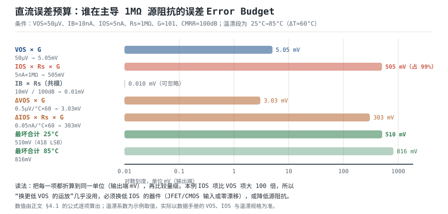

# 失调电压、偏置电流与漂移 Offset Voltage, Bias Current & Drift

把运放的两个输入端短接接地，理想输出是 0V。真实器件的输出会停在某个非零电压上：等效于在输入端串了一个小电压源 $V_{OS}$，同时两个输入端各有一点电流 $I_B$ 进出。这两个"小量"看起来都是 µV/mV、nA/pA 量级，但它们会被**噪声增益 $1/\beta$ 放大**，而且在高阻源上，$I_B$ 项的破坏力可以比 $V_{OS}$ 大两个数量级。

本章要建立的是**误差预算的能力**：给定器件的 $V_{OS}$、$I_B$、$I_{OS}$ 与温漂，算出输出端的直流误差；判断哪个误差源在主导；知道"平衡电阻"能消掉什么、消不掉什么；知道斩波/自稳零方案换来了什么、付出了什么。

**本章约定**：$V_{OS}$ 是输入失调电压（V），$\mathrm{d}V_{OS}/\mathrm{d}T$ 是它的温度系数；$I_B$ 是输入偏置电流（A），$I_{OS}$ 是输入失调电流（A）；$1/\beta$ 是噪声增益，$G$ 是闭环增益，$A_{CL}$ 同义；$\beta$ 是反馈系数（**不是**三极管的电流放大倍数），$T=A_{OL}\beta$ 是环路增益。符号口径与[运放概述：符号、封装与引脚](opamp-overview.md)、[理想模型五假设与虚短、虚断](ideal-opamp.md)一致。

## 1. 设计动机

::: motivation 三个真实场景
**场景一：1MΩ 传感器，误差 510mV，而"换低失调运放"只解决 1%。** 一个 $G=101$ 的仪表放大接 1MΩ 源阻抗的传感器。器件 $V_{OS}=50\ \mu$V、$I_B=10$ nA、$I_{OS}=5$ nA。算下来：$V_{OS}$ 项在输出端是 $50\ \mu\text{V}\times101=5.05$ mV；$I_{OS}$ 在 1MΩ 上的压降是 $5\ \text{nA}\times1\ \text{M}\Omega=5$ mV，被放大 101 倍是 **505mV**。对 12 位、5V ADC（1 LSB=1.22mV），这相当于 418 个码。**此时再换一颗 $V_{OS}$ 只有 10µV 的运放，输出误差只从 510mV 降到 506mV——优化的方向完全错了。**

**场景二：加了平衡电阻，还剩 2mV 残余；换个接法，平衡电阻根本配不平。** 单运放反相加法 100 倍，$R_1=1$ kΩ、$R_f=100$ kΩ，反相端看到的直流电阻是 $R_1\parallel R_f=990\ \Omega$；在同相端串一只 990Ω 的"平衡电阻"，$I_B$ 的一阶项被抵消，残余是 $I_{OS}\times990\ \Omega=19.8\ \mu$V（输出 2.0mV）。但如果把电路换成同相放大、信号源内阻 1MΩ，平衡电阻就**帮不上忙**：$R_+$ 里已经含了 1MΩ 源阻抗，你只能往上加电阻、不能往下减，配不平。

**场景三：斩波运放把失调压到 5µV，但带宽只剩 3.5kHz。** 换成零漂移器件后 $V_{OS}$ 与温漂几乎消失，$I_B$ 也降到几十 pA——但 GBW 只有几百 kHz，$G=101$ 时闭环带宽 $f_{cl}=GBW/G$ 只有 3.5kHz 量级。信号带宽一超，失调的收益就被带宽的损失抵掉了。
:::

| 你想确认 | 先算 | 判据（工程经验值） |
|---|---|---|
| 输出直流偏多少 | $V_{OS}\cdot(1/\beta)$ | 偏置 < 满量程的 1/10 |
| 高阻源能不能接 | $I_B R_s$ 与 $V_{OS}$ 比 | $I_BR_s < V_{OS}$ 才能忽略 $I_B$ |
| 两个输入端配不配平 | $R_+$ 与 $R_-$ | 配平后残余 $I_{OS}R$ |
| 宽温能不能用 | $\mathrm{d}V_{OS}/\mathrm{d}T\cdot\Delta T$ | 全温区漂移 < 目标精度的 1/3 |
| 预算怎么合成 | 最坏和 / RSS | 保证书用最坏；良率估算用 RSS |
| 要不要斩波 | 带宽、噪声、$I_B$ 尖峰 | 带宽够、源阻抗不太高才用 |

**不算会摔在哪**，四个带数字的代价：

1. **失调被增益放大。** $V_{OS}=1$ mV、$G=1000$，输出偏移 1V。对 12 位、5V ADC，1V 是 819 个码，后级根本没法用。
2. **偏置电流在高阻上变成电压。** $I_B=100$ nA 流过 1MΩ，压降 $100\ \text{nA}\times1\ \text{M}\Omega=0.1$ V。若被测信号只有 10mV，这个误差是信号的 10 倍。
3. **温漂把校准作废。** 室温调零到 0V，$V_{OS}$ 温漂 10 µV/°C，从 25°C 用到 85°C（$\Delta T=60$°C）漂移 $10\times60=600\ \mu$V；放大 100 倍就是 60mV。
4. **平衡电阻给了虚假的安全感。** 加了平衡电阻就以为"偏置电流问题解决了"，实际残余 $I_{OS}R$ 仍在；而高阻源场合它连一阶项都配不平。

## 2. 定义与直观

### 2.1 输入失调电压 $V_{OS}$：输入端串了一个电池

**定义**：使输出电压回到 0 所需在输入端外加的补偿电压。等效模型是把 $V_{OS}$ 当成一个与输入串联的电压源（极性随机，可正可负）。

几个必须分清的量：

- **$V_{OS}$ 本身**：室温、标称电源下的值。数据手册给 Typical 与 Max 两列，**设计按 Max**。
- **温漂 $\mathrm{d}V_{OS}/\mathrm{d}T$**：单位 µV/°C。常见规格是"全温区最大值"，也有只给 typical 的，要看清。
- **长期漂移（老化）**：几百到几千小时后的漂移，精密仪表会单独给（典型量级，以数据手册为准）。
- **$V_{OS}$ 随共模与电源的变化**：由 CMRR 与 PSRR 决定，即 $\Delta V_{OS}=\Delta V_{cm}/CMRR+\Delta V_s/PSRR$，见[共模范围、CMRR 与 PSRR](cmrr-psrr.md)。**所以"$V_{OS}$ 是一个常数"只在共模、电源、温度都不变时成立。**

量级（典型值，以数据手册为准）：通用双极输入 0.5~5mV；精密双极 10~100µV；CMOS 精密 10~500µV；斩波/零漂移 1~10µV。温漂相应从 5~20µV/°C 一路降到 0.01~0.05µV/°C。

### 2.2 输入偏置电流 $I_B$ 与失调电流 $I_{OS}$：两个输入端要"喝"一点电流

**定义**：

$$I_B=\frac{I_{B+}+I_{B-}}{2},\qquad I_{OS}=\left|I_{B+}-I_{B-}\right|$$

符号与单位：$I_{B+}$、$I_{B-}$ 分别是同相端、反相端流出的偏置电流（A，正负号表示方向）；$I_B$ 是两者的平均（A）；$I_{OS}$ 是两者之差（A）。

**$I_B$ 与 $I_{OS}$ 的区别是本章最容易搞混的地方**：

- $I_B$ 是**共模性质**的：两个输入端都流同样的电流时，它在两个输入端产生**同样的**压降，属于共模误差，会被 CMRR 抑制一部分；
- $I_{OS}$ 是**差模性质**的：两个电流不相等时，压降之差直接变成差模误差，**不被 CMRR 抑制**，全量进入误差预算。

方向与温度：

- **双极输入**：$I_B$ 由基极电流决定，nA~µA 级；方向取决于输入级极性（NPN 输入多为流出，PNP 多为流入）；温度升高时 $\beta$ 上升，$I_B$ 通常下降（以数据手册曲线为准）。
- **JFET/CMOS 输入**：$I_B$ 是栅极漏电流与保护二极管漏电流，pA~nA 级；**温度每升 10°C 大约翻一倍**，所以室温 1pA 的器件在 85°C 可能到几十 pA。这一点在宽温设计里必须按高温端算。
- **斩波/自稳零**：直流 $I_B$ 很小（pA 级），但存在**开关瞬间的输入电流尖峰**（电荷注入），见 §2.5。

### 2.3 误差模型：一个式子管三种接法

把两个输入端的偏置电流与失调电压都折算到输入端，得到**输入等效误差**：

$$V_{err}=V_{OS}+I_{B+}R_+ - I_{B-}R_-$$

其中 $R_+$、$R_-$ 分别是同相端、反相端**对地的直流等效电阻**（$\Omega$）。代入 $I_{B\pm}=I_B\pm I_{OS}/2$：

$$V_{err}=V_{OS}+I_B\left(R_+-R_-\right)+\frac{I_{OS}}{2}\left(R_++R_-\right)$$

这个式子把误差拆成三块，含义非常清楚：

1. **$V_{OS}$**：与外部电阻无关，永远存在；
2. **$I_B(R_+-R_-)$**：只有两个输入端电阻**不相等**时才出现，这就是"平衡电阻"要消的项；
3. **$\frac{I_{OS}}{2}(R_++R_-)$**：只要两个输入端有电阻就存在，**配平也消不掉**。

三种常见接法的 $R_+$、$R_-$：

| 接法 | $R_+$ | $R_-$ | $I_B$ 项能不能消 |
|---|---|---|---|
| 反相放大（源阻抗可忽略） | 0（或后加的 $R_c$） | $R_1\parallel R_f$ | 能，取 $R_c=R_1\parallel R_f$ |
| 同相放大（源阻抗 $R_s$） | $R_s$（+ 可选 $R_c$） | $R_1\parallel R_f$ | 只在 $R_s\le R_1\parallel R_f$ 时能 |
| 仪表放大（三运放） | 源阻抗 $R_{s+}$ | 源阻抗 $R_{s-}$ | 只能靠 $R_{s+}=R_{s-}$ 配平 |

**配平后**（$R_+=R_-=R$）：

$$V_{err}=V_{OS}+I_{OS}R$$

注意残余是 $I_{OS}R$，不是零，也不是 $I_{OS}R/2$。这就是"平衡电阻只能消一部分"的定量来源。

### 2.4 噪声增益：所有输入误差的统一放大器

输入端的任何误差（$V_{OS}$、$I_BR$、共模、纹波）都被**噪声增益**放大到输出：

$$V_{OUT,err}=V_{err}\cdot\frac{1}{\beta}$$

符号与单位：$V_{OUT,err}$ 是输出误差（V），$V_{err}$ 是输入等效误差（V），$1/\beta$ 是噪声增益（无量纲）。

同相组态 $1/\beta=1+R_f/R_1=G$；反相组态 $1/\beta=1+R_f/R_1$，比信号增益 $R_f/R_1$ 大 1。**统一用噪声增益，就不会在反相电路上算错**——这一条在[开环、闭环增益与负反馈本质](open-loop-feedback.md)的误差预算表里已经列过。

仪表放大（三运放）的增益由内部/外部电阻决定，常见形式是

$$G=1+\frac{50\ \text{k}\Omega}{R_G}$$

以 INA128 为例（数据手册给的正是这个形式）。$G=101$ 时：

$$R_G=\frac{50\ \text{k}\Omega}{101-1}=500\ \Omega$$

**这个式子的意义**：仪表放大的增益设置电阻只有 500Ω，任何引线电阻、接插件接触电阻都会直接改变增益；同时输入失调与偏置电流误差都按 101 倍放大。

### 2.5 斩波与自稳零：用调制换失调

**原理**：把输入信号调制到高频（斩波），经交流放大后再解调回基带。放大器的失调与 1/f 噪声在调制前加入、在解调时被搬到高频，于是基带里的失调与低频噪声都变得极小。

**取舍**（这四条都要算，不能只看 $V_{OS}$）：

| 维度 | 收益 | 代价 |
|---|---|---|
| 失调与温漂 | $V_{OS}$ 降到 µV 级、温漂 0.01~0.05µV/°C | 成本、功耗更高 |
| 低频噪声 | 1/f 噪声被"斩"掉，0.1~10Hz 噪声极低 | 斩波频率处出现新的噪声分量与纹波 |
| 带宽 | — | GBW 常只有几百 kHz，高增益时 $f_{cl}$ 很窄 |
| 输入电流 | 直流 $I_B$ 可到 pA 级 | 开关瞬间的**电荷注入**产生电流尖峰，在高阻源上变成电压 |

**电荷注入的定量看法要分两层**：

1. **平均分量**：每次切换注入电荷 $Q_{inj}$，等效平均电流 $I_{inj}=Q_{inj}f_{chop}$。**数据手册给出的 $I_B$ 通常已经包含了这个平均分量的贡献**（这正是零漂移器件的 $I_B$ 比纯 CMOS 栅极漏电流大的原因），所以不要把它和 $I_B$ 重复相加。
2. **尖峰分量**：切换瞬间的峰值电流 $I_{pk}$ 在源阻抗上产生 $I_{pk}R_s$ 的瞬态电压。源端没有对地电容时，这个尖峰只能靠 $R_sC_{in}$ 的时间常数衰减慢下来，可能被后级当成信号。

工程做法是在源端并一只小电容，让尖峰电流有低阻回路旁路，转折频率

$$f_p=\frac{1}{2\pi R_sC}$$

符号与单位：$R_s$ 是源阻抗（$\Omega$），$C$ 是源端对地电容（F），$f_p$ 是低通转折频率（Hz）。**这个电容同时限制了信号带宽**，取值要在"旁路尖峰"与"保住信号带宽"之间折中。具体数值必须查数据手册的输入电流/电荷注入指标，不能假设为零。

## 3. 定量关系

### 3.1 误差预算的三条公式

**单点（室温）**：

$$V_{OUT,err}=V_{err}\cdot\frac{1}{\beta}=\left[V_{OS}+I_B(R_+-R_-)+\frac{I_{OS}}{2}(R_++R_-)\right]\frac{1}{\beta}$$

**全温区**：

$$V_{OUT,err}(T)=V_{OUT,err}(25^{\circ}\text{C})+\left(\frac{\mathrm{d}V_{OS}}{\mathrm{d}T}\Delta T\right)\frac{1}{\beta}+\left(\frac{\mathrm{d}I_{OS}}{\mathrm{d}T}R_s\Delta T\right)\frac{1}{\beta}$$

其中 $\Delta T=T_{max}-25^{\circ}\text{C}$（°C）；$\mathrm{d}I_{OS}/\mathrm{d}T$ 是失调电流的温度系数（A/°C）；$R_s$ 是源阻抗（$\Omega$，配平场合取两端中较大的那个）。

**预算合成**：

$$V_{worst}=\sum_i\left|V_i\right|,\qquad V_{RSS}=\sqrt{\sum_i V_i^2}$$

$V_{worst}$ 是各项同号、同时取极值的最坏情况，用于保证书与极限测试；$V_{RSS}$ 假设各项独立、随机、近似正态，用于良率估计（约对应 ±3σ）。**两项误差量级相差 10 倍以上时，RSS 与最坏几乎相同；只有同量级时 RSS 才明显小。**

### 3.2 折算到输入还是输出：统一口径

误差可以在输入端比较，也可以在输出端比较，但**同一张预算表里只能用一种口径**。本章统一用**输出端 mV**，因为最终要跟 ADC 的 LSB 比。换算关系只有一条：

$$V_{OUT,err}=V_{err}\cdot\frac{1}{\beta}$$

举例：输入端的 5mV 误差，在 $G=101$ 下是 505mV；在 $G=1$ 下就是 5mV。**同一个器件、同一个源阻抗，增益不同，结论完全不同。**

### 3.3 温漂：全温区算，不要只算室温

$$V_{OS}(T)=V_{OS}(25^{\circ}\text{C})+\frac{\mathrm{d}V_{OS}}{\mathrm{d}T}(T-25^{\circ}\text{C})$$

线性模型够用于一阶预算，但要注意三点：

1. **数据手册的温漂可能是 typical**：按 max 算，或查 $V_{OS}$ vs Temperature 曲线的包络。
2. **温漂有二次项**：宽温区（−40~125°C）用线性外推会低估，尤其是双极输入器件。
3. **$I_{OS}$ 的温漂往往比 $V_{OS}$ 更糟**：JFET/CMOS 的漏电流每 10°C 翻倍，85°C 时可能是室温的 $2^{6}=64$ 倍（从 25°C 到 85°C 是 6 个 10°C）。**高阻源 + 宽温，这一项经常主导。**

### 3.4 平衡电阻：能消什么、不能消什么

把 $R_c$ 串在同相端，使 $R_+=R_-=R$，则

$$V_{err}=V_{OS}+I_{OS}R$$

**改善倍数**（相对"完全不平衡、$R_+=0$、$R_-=R$"，此时 $V_{err,unbal}=I_{B-}R$）：

$$\frac{V_{err,unbal}}{V_{err,bal}}=\frac{I_{B-}R}{I_{OS}R}=\frac{I_B-I_{OS}/2}{I_{OS}}$$

符号随不平衡方向变：若反过来是 $R_+=R$、$R_-=0$，分子换成 $I_{B+}$，比值变成 $(I_B+I_{OS}/2)/I_{OS}$。以 $I_B=100$ nA、$I_{OS}=20$ nA 为例，两个方向分别是 $90/20=4.5$ 与 $110/20=5.5$。**所以平衡电阻的收益在 $I_B/I_{OS}$ 倍这个量级，典型 2~10 倍，不是"消掉"。**

三条边界：

1. **配平要求 $R_+\ge R_-$ 可实现**。源阻抗 $R_s$ 本身就在 $R_+$ 里，若 $R_s>R_-$，你只能加不能减，**配不平**。
2. **配平后残余 $I_{OS}R$ 仍在**，且 $R$ 越大残余越大——高阻电路里这一项可能比 $V_{OS}$ 大。
3. **$R_c$ 自身引入热噪声** $e_n=\sqrt{4kTR_c}$，在低噪声设计里可能得不偿失（见[噪声：来源、谱密度与预算](noise.md)）。

### 3.5 适用条件与失效边界

1. **模型是线性叠加**：$V_{OS}$、$I_B$、$I_{OS}$ 的符号未知，最坏情况要按"同号相加"取；RSS 只在统计意义上成立。
2. **温度必须覆盖全工作范围**：−40~85°C 与 0~50°C 的结论可能差 3 倍。
3. **共模与电源变化会改变 $V_{OS}$**：CMRR/PSRR 有限时，$\Delta V_{OS}=\Delta V_{cm}/CMRR+\Delta V_s/PSRR$，这部分也要进预算。
4. **高阻节点还有别的误差源**：PCB 漏电、湿度、助焊剂残留、保护环缺失，都可能比 $I_B$ 大。见 §5.3。
5. **斩波器件的 $I_B$ 规格包含平均分量，但不描述尖峰**：平均分量已经计入 $I_B$，不要重复相加；尖峰的峰值与恢复时间要单独看手册、单独算（§2.5）。

## 4. 典型计算

### 4.1 完整算例：1MΩ 源阻抗、G=101 的仪表放大

**需求**：高阻传感器（源阻抗 1MΩ，两端对称）接成 $G=101$ 的仪表放大。器件规格（示例取值，典型量级，以数据手册为准）：$V_{OS}=50\ \mu$V、$\mathrm{d}V_{OS}/\mathrm{d}T=0.5\ \mu$V/°C、$I_B=10$ nA、$I_{OS}=5$ nA、$\mathrm{d}I_{OS}/\mathrm{d}T=0.05$ nA/°C、CMRR=100dB。工作温度 25~85°C。求输出端的直流误差与温漂。

**第 1 步：增益设置电阻。**

$$R_G=\frac{50\ \text{k}\Omega}{G-1}=\frac{50\ \text{k}\Omega}{100}=500\ \Omega$$

**第 2 步：$V_{OS}$ 项。** $V_{OS}$ 与外部电阻无关，直接乘增益：

$$V_{OUT,VOS}=50\ \mu\text{V}\times101=5.05\ \text{mV}$$

**第 3 步：$I_{OS}$ 项。** 两端源阻抗对称（$R_+=R_-=1\ \text{M}\Omega$），$I_B$ 项被抵消，只剩 $I_{OS}$：

$$V_{err,IOS}=I_{OS}R_s=5\ \text{nA}\times1\ \text{M}\Omega=5\ \text{mV}$$

$$V_{OUT,IOS}=5\ \text{mV}\times101=505\ \text{mV}$$

**第 4 步：$I_B$ 项（共模）。** 两个输入端同时被 $I_B$ 抬高：

$$V_{err,IB}=I_BR_s=10\ \text{nA}\times1\ \text{M}\Omega=10\ \text{mV}$$

这是共模误差，被 CMRR=100dB（$10^{5}$）抑制后：

$$V_{err,IB,dm}=\frac{10\ \text{mV}}{10^{5}}=0.1\ \mu\text{V},\qquad V_{OUT,IB}=0.1\ \mu\text{V}\times101=0.0101\ \text{mV}$$

**第 5 步：25°C 合计。** 最坏情况按同号相加：

$$V_{OUT}(25^{\circ}\text{C})=5.05+505+0.0101=510.06\ \text{mV}\approx510\ \text{mV}$$

对 12 位、5V ADC（1 LSB $=5/4096=1.2207$ mV）：

$$N_{LSB}=\frac{510}{1.2207}=417.8\approx418\ \text{个码}$$

**第 6 步：温漂（$\Delta T=60$°C）。**

$V_{OS}$ 项：

$$\Delta V_{OS}=0.5\ \mu\text{V}/^{\circ}\text{C}\times60^{\circ}\text{C}=30\ \mu\text{V},\qquad \Delta V_{OUT}=30\ \mu\text{V}\times101=3.03\ \text{mV}$$

$I_{OS}$ 项：

$$\Delta I_{OS}=0.05\ \text{nA}/^{\circ}\text{C}\times60^{\circ}\text{C}=3\ \text{nA}$$

$$\Delta V_{err}=3\ \text{nA}\times1\ \text{M}\Omega=3\ \text{mV},\qquad \Delta V_{OUT}=3\ \text{mV}\times101=303\ \text{mV}$$

$I_B$ 项（共模，仍被 CMRR 压）：

$$\Delta I_B=0.5\ \text{nA}/^{\circ}\text{C}\times60^{\circ}\text{C}=30\ \text{nA}\ \Rightarrow\ 30\ \text{nA}\times1\ \text{M}\Omega=30\ \text{mV}$$

$$\Delta V_{err,IB,dm}=\frac{30\ \text{mV}}{10^{5}}=0.3\ \mu\text{V},\qquad \Delta V_{OUT}=0.3\ \mu\text{V}\times101=0.0303\ \text{mV}$$

**第 7 步：85°C 最坏合计。**

$$V_{OUT}(85^{\circ}\text{C})=510+3.03+303+0.03=816.1\ \text{mV}$$

**结论**：这个电路在 25°C 就有 510mV 的直流误差，85°C 到 816mV，**已经完全淹没有用信号**（若满量程 2V，误差占 41%）。而且主导项是 $I_{OS}$（505mV/510mV = 99%），**换低 $V_{OS}$ 的器件没有意义**；必须换低 $I_{OS}$ 的器件（JFET/CMOS 输入、零漂移）或降低源阻抗。

### 4.2 算例二：RSS 与最坏差多少

**已知**：同 §4.1 的四项。分别算 25°C 与 85°C 的 RSS，并与最坏对比。

**第 1 步：25°C RSS。** 只有两项可比：

$$V_{RSS}=\sqrt{5.05^2+505^2}=\sqrt{25.5+255025}=505.03\ \text{mV}$$

与最坏 510.06mV 相差 1.0%。**原因很直接：505mV 一项比 5.05mV 大 100 倍，平方后完全主导。**

**第 2 步：85°C RSS。** 四项：

$$V_{RSS}=\sqrt{5.05^2+505^2+3.03^2+303^2}=\sqrt{25.5+255025+9.2+91809}=588.9\ \text{mV}$$

**第 3 步：对比。**

$$\frac{V_{worst}}{V_{RSS}}=\frac{816.1}{588.9}=1.39$$

**第 4 步：结论。** RSS 只在各项**同量级**时才明显小于最坏和。本例 85°C 时最坏比 RSS 大 39%，说明四项里已经有两项可比（505mV 与 303mV）；25°C 时差 1%，说明只有一项主导。**做预算时先用最坏和定位主导项，再用 RSS 估实际分布；两个都算，不要只算一个。**

### 4.3 算例三：平衡电阻到底能救多少

**已知**：单运放反相放大，$R_1=1$ kΩ、$R_f=100$ kΩ（$G=-100$、噪声增益 $1/\beta=101$），源阻抗可忽略；器件 $I_B=100$ nA、$I_{OS}=20$ nA、$V_{OS}=0.5$ mV。求不加与加平衡电阻时的输出误差。

**第 1 步：反相端等效电阻。**

$$R_1\parallel R_f=\frac{1\times100}{1+100}=0.990\ \text{k}\Omega=990\ \Omega$$

**第 2 步：不加平衡电阻（$R_+=0$、$R_-=990\ \Omega$）。**

$$I_{B-}=I_B-\frac{I_{OS}}{2}=100-10=90\ \text{nA}$$

$$V_{err,I}=-I_{B-}\times990\ \Omega=-90\ \text{nA}\times990\ \Omega=-89.1\ \mu\text{V}$$

取模 $89.1\ \mu$V，输出 $|V_{OUT,I}|=89.1\ \mu\text{V}\times101=9.00\ \text{mV}$。负号只表示方向：偏置电流把输出往反方向拉。

**第 3 步：加 $R_c=990\ \Omega$（$R_+=R_-=990\ \Omega$）。**

$$V_{err,I}=I_{OS}\times990\ \Omega=20\ \text{nA}\times990\ \Omega=19.8\ \mu\text{V},\qquad V_{OUT,I}=19.8\ \mu\text{V}\times101=2.00\ \text{mV}$$

**第 4 步：改善与残余。**

$$\frac{9.00}{2.00}=4.5\ \text{倍},\qquad \text{残余}=\frac{19.8}{89.1}=22.2\%$$

改善倍数正好是 $I_{B-}/I_{OS}=90/20=4.5$（与 §3.4 的公式一致）。

**第 5 步：加上 $V_{OS}$ 项。** $V_{OS}=0.5$ mV → $0.5\ \text{mV}\times101=50.5$ mV。**此时 $V_{OS}$ 项（50.5mV）远大于偏置项（2.0mV）**，平衡电阻的 4.5 倍改善在总量上只体现为 $59.5\to52.5$ mV（12%）。**这又是一个"优化错方向"的例子：低阻电路里，$V_{OS}$ 才是主角，平衡电阻只是配角。**

### 4.4 算例四：换零漂移器件，收益与代价

**已知**：同 §4.1 的 1MΩ 传感器，改用零漂移仪表放大（示例取值，典型量级，以数据手册为准）：$V_{OS}=10\ \mu$V、$\mathrm{d}V_{OS}/\mathrm{d}T=0.05\ \mu$V/°C、$I_B=50$ pA、$I_{OS}=25$ pA、$\mathrm{d}I_{OS}/\mathrm{d}T=0.25$ pA/°C、CMRR=100dB、GBW=350 kHz。

**第 1 步：25°C 各误差项。**

$$V_{OUT,VOS}=10\ \mu\text{V}\times101=1.01\ \text{mV}$$

$$V_{OUT,IOS}=25\ \text{pA}\times1\ \text{M}\Omega\times101=25\ \mu\text{V}\times101=2.525\ \text{mV}$$

$$V_{OUT}(25^{\circ}\text{C})=1.01+2.525=3.535\ \text{mV}$$

与 §4.1 的 510mV 相比：

$$\frac{510}{3.535}=144\ \text{倍}$$

**第 2 步：温漂。**

$$\Delta V_{OS}=0.05\ \mu\text{V}/^{\circ}\text{C}\times60^{\circ}\text{C}=3\ \mu\text{V}\ \Rightarrow\ 3\ \mu\text{V}\times101=0.303\ \text{mV}$$

$$\Delta I_{OS}=0.25\ \text{pA}/^{\circ}\text{C}\times60^{\circ}\text{C}=15\ \text{pA}\ \Rightarrow\ 15\ \text{pA}\times1\ \text{M}\Omega\times101=1.515\ \text{mV}$$

$$V_{OUT}(85^{\circ}\text{C})=3.535+0.303+1.515=5.35\ \text{mV}$$

**第 3 步：带宽代价。** 零漂移器件 GBW 通常只有几百 kHz。取 350kHz：

$$f_{cl}=\frac{GBW}{G}=\frac{350\ \text{kHz}}{101}=3.465\ \text{kHz}$$

如果信号带宽需要 10kHz，这个方案直接出局——**必须在选型时先看带宽，再看失调**。

**第 4 步：斩波纹波的落点。** 斩波频率典型在几百 kHz（取 200kHz），相对 $f_{cl}$：

$$\frac{200\ \text{kHz}}{3.465\ \text{kHz}}=57.7\ \text{倍}\ \Rightarrow\ 20\lg\frac{1}{57.7}=-35.2\ \text{dB}$$

**斩波纹波被闭环滚降压低 35dB**，这是好消息；但要确认纹波在 200kHz 的绝对幅度，以及它会不会被后级 ADC 采样混叠。

**第 5 步：输入电流尖峰的旁路设计。** 零漂移器件的直流 $I_B$ 只有几十 pA，但切换瞬间的电荷注入会产生尖峰电流，尖峰在 1MΩ 上变成瞬态电压。按 §2.5，源端并电容形成低通，取 $C=10$ pF：

$$f_p=\frac{1}{2\pi R_sC}=\frac{1}{2\pi\times1\ \text{M}\Omega\times10\ \text{pF}}=\frac{1}{2\pi\times10^{-5}}=15.9\ \text{kHz}$$

**这个极点高于闭环带宽 3.465kHz**（$15.9/3.465=4.6$ 倍），所以不额外吃信号带宽，同时又给了尖峰电流一条低阻回路。如果源阻抗升到 10MΩ，同一个 10pF 会把极点压到 1.59kHz，**低于闭环带宽，这时就要减小电容或降低源阻抗**。

### 4.5 算例五：平衡电阻在高阻源上彻底失效

**已知**：同相放大 $G=101$（$R_1=1$ kΩ、$R_f=100$ kΩ），信号源内阻 $R_s=1$ MΩ，器件 $I_B=100$ nA、$I_{OS}=20$ nA、$V_{OS}=0.5$ mV、5V 单电源。

**第 1 步：两个输入端的等效电阻。**

$$R_+=R_s=1\ \text{M}\Omega,\qquad R_-=R_1\parallel R_f=990\ \Omega$$

**第 2 步：输入等效误差。**

$$I_{B+}=110\ \text{nA},\qquad I_{B-}=90\ \text{nA}$$

$$V_{err}=110\ \text{nA}\times1\ \text{M}\Omega-90\ \text{nA}\times990\ \Omega=110\ \text{mV}-0.089\ \text{mV}=109.91\ \text{mV}$$

**第 3 步：输出。**

$$V_{OUT}=109.91\ \text{mV}\times101=11.1\ \text{V}$$

**11.1V 远超 5V 单电源的摆幅**——输出直接饱和。**这不是"误差大"，是电路根本不能用。**

**第 4 步：能不能靠加平衡电阻救？** 不能。$R_+$ 已经 ≥1MΩ，而 $R_-=990\ \Omega$；串电阻只能让 $R_+$ 更大，配不平。

**第 5 步：把 $R_1$、$R_f$ 放大 100 倍（100kΩ、10MΩ，增益不变）。**

$$R_-=100\ \text{k}\Omega\parallel10\ \text{M}\Omega=99.01\ \text{k}\Omega$$

$$V_{err}=110\ \text{mV}-90\ \text{nA}\times99.01\ \text{k}\Omega=110-8.91=101.09\ \text{mV}$$

只从 109.91mV 降到 101.09mV，**改善 8.0%**，输出仍然饱和。**结论：高阻源场合，降低 $I_B$ 或降低源阻抗才是正解，平衡电阻不是。**

## 5. 工程含义

### 5.1 数量级表：先建立直觉

| 参数 | 通用双极 | 精密双极 | JFET 输入 | CMOS 输入 | 斩波/零漂移 |
|---|---|---|---|---|---|
| $V_{OS}$ | 0.5~5mV | 10~100µV | 0.5~5mV | 50~500µV | 1~10µV |
| $\mathrm{d}V_{OS}/\mathrm{d}T$ | 5~20µV/°C | 0.1~1µV/°C | 5~20µV/°C | 0.5~5µV/°C | 0.01~0.05µV/°C |
| $I_B$（25°C） | 10nA~1µA | 1~50nA | 1~50pA | 1pA~1nA | 10~100pA |
| $I_{OS}$ | 1~100nA | 0.1~10nA | 0.5~10pA | 0.5~100pA | 10~50pA |
| $I_B$ 温升趋势 | 温度升高时略降（$\beta$ 增大） | 同左 | 每 10°C 翻倍 | 每 10°C 翻倍 | 尖峰电流需单独查 |

这些是**典型量级**，具体型号以数据手册为准。表的作用是让你在选型前就知道"该看哪个数量级"。

### 5.2 选型顺序：先算 $I_BR_s$，再看别的

1. **算 $I_BR_s$**：源阻抗 × 偏置电流，与信号幅度比。$I_BR_s$ 与 $V_{OS}$ 同量级或更大时，优先选低 $I_B$ 器件。
2. **算 $V_{OS}\times(1/\beta)$**：与满量程比。这就是"精度够不够"。
3. **算全温区漂移**：$\mathrm{d}V_{OS}/\mathrm{d}T$ 与 $\mathrm{d}I_{OS}/\mathrm{d}T$ 都要算，后者在宽温高阻场合常常更大。
4. **算带宽**：$f_{cl}=GBW/(1/\beta)$，确保信号带宽够。**零漂移器件在这一步经常被淘汰。**
5. **算噪声**：见[噪声：来源、谱密度与预算](noise.md)。
6. **最后看价格、封装、供货**。

### 5.3 PCB 上的直流误差：比 $V_{OS}$ 更大的东西

- **保护环（guard ring）**：高阻输入节点周围用一圈低阻环包围，环接到与输入等电位的低阻点（缓冲输出或地），把表面漏电流"截走"。1MΩ 以上的节点**必须**有，否则 PCB 表面电阻（受湿度、助焊剂残留影响）可能只有 $10^{9}\sim10^{10}\ \Omega$ 量级。
- **清洁与三防漆**：助焊剂残留是离子性的，吸湿后表面电阻大幅下降。精密高阻电路装配后必须清洗，必要时涂三防漆。
- **热电偶效应**：不同金属的结点会产生几 µV/°C 到几十 µV/°C 的热电势（典型量级）。两个输入端的焊点、走线、器件引脚材质要对称，布局上让两个输入端等温（同一方向、相邻位置），避免在输入端附近放发热器件。
- **对称布局**：两个输入端的走线长度、过孔数量、周围铜箔要尽量一致，减少寄生与热不对称。
- **屏蔽与接地**：高阻节点远离数字走线与开关电源，必要时用地平面包围。

### 5.4 校准：能消什么、不能消什么

| 手段 | 消掉 | 消不掉 | 适用 |
|---|---|---|---|
| 外部调零（电位器/trim 脚） | 初始 $V_{OS}$ | 温漂、长期漂移、$I_B$ 项 | 实验室仪器、单件校准 |
| 系统级校准（软件零点） | 整条链路的初始失调 | 温漂、非线性、噪声 | 量产设备（配合温度补偿） |
| 斩波/零漂移器件 | $V_{OS}$ 与温漂 | 电流尖峰、带宽受限 | 精密直流、低带宽 |
| 降低源阻抗/加缓冲 | $I_BR_s$ | $V_{OS}$、$I_{OS}$ | 高阻传感器前端 |

**关键判断**：校准只能消"常数项"，消不掉"随温度/时间变的项"。宽温、长寿命的产品，要么用零漂移器件，要么做温度补偿。

### 5.5 测量：$V_{OS}$ 与 $I_B$ 怎么测

- **测 $V_{OS}$**：接成单位增益跟随器，输入端接地，测输出直流电压；等芯片热稳定（开机后几分钟）再读。$V_{OS}=V_{OUT}$。若用高增益接法，$V_{OS}=V_{OUT}/(1/\beta)$，但要注意输出是否饱和。
- **测 $I_B$**：两种常用方法。① 电阻法：在同相端串一个大电阻 $R$（如 10MΩ），测输出变化 $\Delta V_{OUT}$，则 $I_B=\Delta V_{OUT}/(R\cdot(1/\beta))$；② 电容积分法：输入端接电容，测电压上升斜率 $\mathrm{d}V/\mathrm{d}t$，则 $I_B=C\,\mathrm{d}V/\mathrm{d}t$。后者能测到 pA 级。
- **测温漂**：把器件放进温箱，在几个温度点测 $V_{OS}$，做线性拟合；注意每个温度点都要等热平衡。

### 5.6 失效边界

- **超出线性区**：输出饱和时 $V_{OS}$ 的测量与预算都不成立。
- **共模/电源变化**：CMRR/PSRR 有限，$V_{OS}$ 会跟着变，静态预算不够。
- **湿度与污染**：PCB 漏电可能比 $I_B$ 大几个数量级。
- **长期漂移**：几百小时后的漂移可能超过初始 $V_{OS}$，精密仪表要按老化指标设计。
- **斩波器件的尖峰电流**：$I_B$ 规格只描述平均分量，开关尖峰要单独核算，高阻源尤其要查。

## 6. 常见坑

::: pitfall 常见坑
- **现象**：高阻传感器接上后输出偏几百 mV，换低 $V_{OS}$ 运放毫无改善。**原因**：主导项是 $I_{OS}R_s$，不是 $V_{OS}$；$I_{OS}$ 是差模误差，不被 CMRR 抑制，全量放大。**解决**：先算 $I_{OS}R_s$ 与 $V_{OS}$ 的比值，再选器件；高阻源优先 JFET/CMOS 输入或零漂移。
- **现象**：加了平衡电阻，输出仍有几 mV 偏移。**原因**：平衡电阻只消 $I_B(R_+-R_-)$ 的一阶项，残余 $I_{OS}R$ 消不掉；而且 $R$ 越大残余越大。**解决**：把 $I_{OS}R$ 写进预算；要更小只能换低 $I_{OS}$ 器件或降低 $R$。
- **现象**：同相放大接 1MΩ 源，加平衡电阻后输出仍然饱和。**原因**：$R_+$ 已经含 1MΩ 源阻抗，$R_-$ 只有 990Ω，配不平；串电阻只能让 $R_+$ 更大。**解决**：降低源阻抗（加缓冲/跟随器）、换低 $I_B$ 器件，或改反相组态（虚地让源阻抗不进入 $R_+$，但输入阻抗变成 $R_1$）。
- **现象**：室温调零后，设备在高温端偏移几十 mV。**原因**：调零只消初始 $V_{OS}$；温漂 $\mathrm{d}V_{OS}/\mathrm{d}T$ 与 $\mathrm{d}I_{OS}/\mathrm{d}T$ 仍在，且被噪声增益放大。**解决**：按全温区做预算，宽温产品用零漂移器件或温度补偿。
- **现象**：换零漂移运放后失调好了，但信号一快就衰减。**原因**：零漂移器件 GBW 常只有几百 kHz，$G=101$ 时 $f_{cl}$ 只有 3.5kHz 量级。**解决**：先按带宽选型（$f_{cl}\ge10\times$ 最高信号频率），再在满足带宽的器件里挑失调。
- **现象**：精密电路在潮湿环境漂移，清洗后恢复。**原因**：PCB 表面漏电（助焊剂残留 + 吸湿），在高阻节点形成随湿度变化的漏电流。**解决**：清洗、三防漆、加保护环，高阻节点远离电源与数字走线。
:::

## 7. 自测题

某运放 $V_{OS}=5$mV，接成噪声增益 100 的同相放大，输出静态失调多少？如果是反相增益 −100 呢？

同相：噪声增益 $1/\beta=1+R_f/R_1=100$。

$$V_{OUT,OS}=5\ \text{mV}\times100=500\ \text{mV}$$

反相增益 −100（$R_1=10$kΩ、$R_f=1$MΩ）：信号增益 100，但噪声增益 $1+R_f/R_1=101$。

$$V_{OUT,OS}=5\ \text{mV}\times101=505\ \text{mV}$$

**差别只有 1%，但方向一致：失调永远按噪声增益放大，不按信号增益。**

$I_B=10$nA、$I_{OS}=5$nA、源阻抗 1MΩ 且两端对称。偏置电流造成的差模输入误差是多少？如果两端不对称（一端 1MΩ、一端 1kΩ）呢？

对称（$R_+=R_-=1$MΩ）：$I_B$ 项抵消，只剩 $I_{OS}$：

$$V_{err}=I_{OS}R_s=5\ \text{nA}\times1\ \text{M}\Omega=5\ \text{mV}$$

不对称（$R_+=1$MΩ、$R_-=1$kΩ）：

$$I_{B+}=10+\frac{5}{2}=12.5\ \text{nA},\qquad I_{B-}=10-\frac{5}{2}=7.5\ \text{nA}$$

$$V_{err}=12.5\ \text{nA}\times1\ \text{M}\Omega-7.5\ \text{nA}\times1\ \text{k}\Omega=12.5\ \text{mV}-7.5\ \mu\text{V}\approx12.5\ \text{mV}$$

**差 2.5 倍。仪表放大要求两端源阻抗对称，这不是"讲究"，是 2.5 倍的误差。**

$V_{OS}=50$µV、$G=101$、$I_{OS}=5$nA、$R_s=1$MΩ。输出误差多少？哪一项主导？

$$V_{OUT,VOS}=50\ \mu\text{V}\times101=5.05\ \text{mV}$$

$$V_{OUT,IOS}=5\ \text{nA}\times1\ \text{M}\Omega\times101=5\ \text{mV}\times101=505\ \text{mV}$$

合计约 510mV。**$I_{OS}$ 项占 $505/510=99\%$**，主导项是失调电流，不是失调电压。对 12 位、5V ADC，510mV 是 418 个码。

**因此优化的正确方向是降低 $I_{OS}$ 或源阻抗，而不是换低 $V_{OS}$ 的器件。**

平衡电阻让两个输入端都是 990Ω，$I_B=100$nA、$I_{OS}=20$nA。配平后的残余误差是多少？改善几倍？

残余：

$$V_{err}=I_{OS}R=20\ \text{nA}\times990\ \Omega=19.8\ \mu\text{V}$$

配平前（$R_+=0$、$R_-=990\ \Omega$）：

$$V_{err}=I_{B-}R=90\ \text{nA}\times990\ \Omega=89.1\ \mu\text{V}$$

改善：

$$\frac{89.1}{19.8}=4.5\ \text{倍},\qquad \text{残余}=22.2\%$$

改善倍数等于 $I_{B-}/I_{OS}=90/20$，与 §3.4 的公式一致。**平衡电阻把误差压到 22%，不是压到 0。**

为什么"最坏和"与"RSS"有时几乎一样，有时差 40%？

因为 RSS 是平方和开方：当某一项明显大于其他项时，平方后它完全主导，RSS 趋近于最大值本身。

例：5.05mV 与 505mV 两项，$\sqrt{5.05^2+505^2}=505.03$ mV，与最大值 505mV 只差 0.03mV（0.005%），与最坏和 510.06mV 差 1.0%。

若四项是 5.05、505、3.03、303 mV，$\sqrt{5.05^2+505^2+3.03^2+303^2}=588.9$ mV，最坏和是 816.1mV，**差 39%**——因为出现了两个同量级的项。

**结论：一项主导时 RSS 与最坏接近；多项同量级时 RSS 明显更小。两种都算，用最坏定位主导项，用 RSS 估分布。**

零漂移运放把 $V_{OS}$ 从 50µV 降到 10µV，为什么不能只看这个数字就换？

换器件要看四条：

1. **带宽**：零漂移器件 GBW 常只有几百 kHz，$G=101$ 时 $f_{cl}=GBW/G$ 只有 3.5kHz 量级；信号带宽一超就直接出局。
2. **$I_{OS}$ 与源阻抗**：真正的误差主导项可能是 $I_{OS}R_s$，而零漂移器件的 $I_{OS}$ 虽小，仍要按 1MΩ 重算（§4.4 里是 2.525mV）。
3. **输入电流尖峰**：$I_B$ 只给平均值，开关瞬间的峰值电流在 1MΩ 上产生瞬态电压，要用源端电容旁路（§2.5），并按尖峰指标核算。
4. **斩波纹波**：落在 $f_{chop}$ 的纹波要靠闭环滚降压掉，要确认它不会被后级采样混叠。

**$V_{OS}$ 只是四个数字里的一个；高阻、宽带两个条件都不满足时，换零漂移反而更差。**

## 8. 参考资料

- **Analog Devices, MT-037 *Op Amp Input Offset Voltage***：$V_{OS}$ 的定义、温漂、分布与误差预算；本章 §2.1、§3.3 的口径按该文。<https://www.analog.com/media/en/training-seminars/tutorials/MT-037.pdf>
- **Analog Devices, MT-038 *Op Amp Input Bias Current***：$I_B$、$I_{OS}$ 的定义、方向、温度行为与高源阻抗误差；本章 §2.2、§2.3 的误差模型与该文一致。<https://www.analog.com/media/en/training-seminars/tutorials/MT-038.pdf>
- **Analog Devices, MT-055 *Chopper Stabilized (Auto-Zero) Precision Op Amps***：斩波/自稳零的原理、噪声与带宽取舍、电荷注入；本章 §2.5、§4.4 的讨论参考该文。<https://www.analog.com/media/en/training-seminars/tutorials/MT-055.pdf>
- **TI, *Op Amps for Everyone*（SLOD006B）**：Chapter 11 *Understanding Op Amp Parameters* 给 $V_{OS}$、$I_B$、$I_{OS}$ 的定义与测试条件；本章 §3.1、§5.5 的测试方法来自该章。<https://archive.org/details/TexasInstruments-TI-ApplicationsandSeminars-OpAmpsForEveryoneDesignReference2000OCR>
- **TI, INA128 数据手册**：增益公式 $G=1+50\ \text{k}\Omega/R_G$、输入偏置电流与失调规格、CMRR vs Gain 表；本章 §2.4、§4.1 的仪表放大参数按该手册。<https://www.ti.com/lit/ds/symlink/ina128.pdf>
- **TI, OPA333 数据手册**：零漂移运放的 $V_{OS}$、温漂与静态电流规格，是 §4.4 的对照器件（具体数值以手册为准）。<https://www.ti.com/lit/ds/symlink/opa333.pdf>
