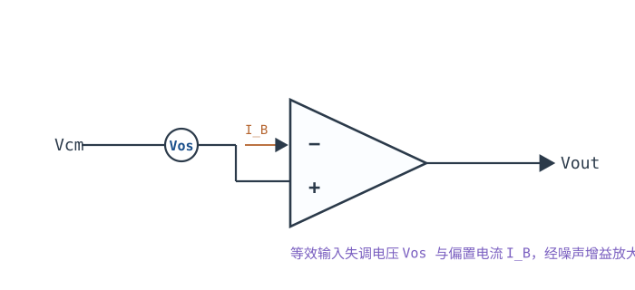
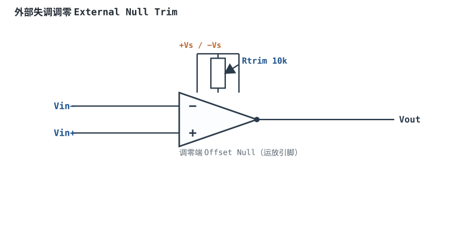
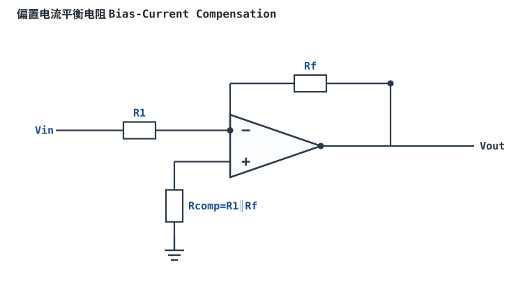

# 失调电压、偏置电流与漂移

## 1. 定义与物理来源

把运放两个输入端短接接地，理想情况下输出应为 0V。但真实运放输出会停在某个非零值——等效于在输入端串联了一个小电压源。

- **输入失调电压（Vos, Input Offset Voltage）**：为使输出回到 0，需在输入端外加的补偿电压。BJT 输入级 mV 级，CMOS 精密运放 µV 级。
- **输入偏置电流（Ib, Input Bias Current）**：两个输入端为维持输入级晶体管工作而**流入（或流出）**的平均电流。BJT 输入级 nA~µA 级，CMOS 输入级 pA~fA 级。
- **输入失调电流（Ios, Input Offset Current）**：两个输入端偏置电流之差。
- **漂移（Drift）**：Vos 随温度（µV/°C）、随时间、随电源电压的变化。

物理来源：输入差分对两个管子的 Vbe/Vth、面积、负载电阻不可能完全对称，导致输入为零时输出不为零；BJT 基极需要电流，CMOS 栅极几乎不取电流。



## 2. 典型数量级

| 参数 | BJT 通用运放 | CMOS 精密运放 | 单位 |
|---|---|---|---|
| Vos（室温） | 1~6 mV | 10~500 µV | mV / µV |
| Vos 温漂 | 5~20 µV/°C | 0.05~2 µV/°C | µV/°C |
| Ib | 10 nA~1 µA | 0.1~100 pA | nA / pA |
| Ios | 1~100 nA | 1~100 pA | nA / pA |

## 3. 在电路中的后果与测量

失调和偏置电流本身是直流小量，但它们会被**噪声增益（Noise Gain）**放大到输出：

- 失调电压 $V_{os}$ 按噪声增益 $G_n = 1+R_f/R_1$ 放大：$V_{out,os} = V_{os}\cdot G_n$。
- 偏置电流 $I_b$ 流过外部等效电阻 $R_{eq}=R_1\parallel R_f$，产生电压 $I_b\cdot R_{eq}$，同样被放大。

```echarts
{
  "tooltip": {"trigger": "axis"},
  "legend": {"data": ["失调电压引起的输出漂移", "偏置电流引起的输出漂移"], "bottom": 0, "textStyle": {"fontSize": 12}},
  "grid": {"left": 60, "right": 24, "top": 26, "bottom": 58},
  "xAxis": {"type": "category", "name": "闭环增益", "data": ["1","10","100","1000"], "axisLabel": {"fontSize": 11}},
  "yAxis": {"type": "value", "name": "输出失调 mV", "min": 0, "axisLabel": {"fontSize": 11}},
  "series": [
    {"name": "失调电压引起的输出漂移", "type": "bar", "lineStyle": {"width": 2.4, "color": "#1a4f8b"}, "itemStyle": {"color": "#1a4f8b"},
     "data": [1,10,100,1000]},
    {"name": "偏置电流引起的输出漂移", "type": "bar", "itemStyle": {"color": "#b5642e"},
     "data": [0.5,5,50,500]}
  ]
}
```

测量：输入端接地，用万用表测输出直流电压，再除以噪声增益，反推输入端等效 $V_{os}$。精密测量需等芯片热稳定（开机漂移几分钟）。

## 4. 计算示例

::: example 偏置电流在大反馈电阻上产生多大误差
1. **电路**：反相放大器 $R_1=10\text{k}\Omega$，$R_f=100\text{k}\Omega$，噪声增益 $G_n=11$。
2. **失调贡献**：$V_{os}=2\text{mV}$，则输出失调 $=2\text{mV}\times11=22\text{mV}$。
3. **偏置电流贡献**：BJT 运放 $I_b=100\text{nA}$，等效电阻 $R_{eq}=R_1\parallel R_f=9.1\text{k}\Omega$，压降 $=100\text{nA}\times9.1\text{k}\Omega=0.91\text{mV}$，放大到输出约 $10\text{mV}$。
4. **结论**：高增益 + 大电阻时，直流失调可达几十 mV，小信号（如 mV 级传感器）被淹没。解决办法：选低 Vos/Chopper 零漂移运放，或在同相端加**平衡电阻** $R_{comp}=R_1\parallel R_f$ 抵消偏置电流一阶效应。
:::

::: advanced 进阶：平衡电阻与零漂移
加 $R_{comp}=R_1\parallel R_f$ 后，两输入端看到的直流电阻相等，$I_b$ 在两输入端产生的压降近似抵消，剩下的只是 $I_{os}\cdot R_{eq}$（失调电流，通常远小于 $I_b$）。CMOS 运放 $I_b$ 小到 pA 级时，一般不必加平衡电阻，加了反而引入噪声。斩波稳零（Chopper）运放用调制把 Vos 压到 µV 以下、温漂 <0.1µV/°C，是直流精密测量的首选。
:::

## 扩展与变种电路

### 扩展1：外部失调调零 External Null Trim

老一代 BJT 运放（如 µA741）留有两个失调调零脚，跨接电位器并把滑臂接负电源，手动把输入短路时的输出调到 0。



::: example 工作原理与静态分析
- 输入短路时输出本应 0，实际停在 $V_{out,os}=V_{os}\cdot G_n$；调零即在输入级人为注入一个反向补偿电压，抵消 $V_{os}$。
- 关系近似 $\Delta V_{in,trim}\propto R_{trim}$（滑臂位置连续可调），调到 $V_{out}=0$ 即补偿完成。
- 关键元件：10k 多圈电位器，仅带调零脚的器件可用。
- 注意：调零只消掉初始失调，不消温漂；温漂仍随温度变化。
:::

取值数量级：Rtrim=10k 多圈电位器；与零漂移运放对比：便宜、不需换料，但需要人工调校、不能随温度自动补偿。适用：实验室仪器、校准设备；不适用：宽温批量产品（应选 Chopper 零漂移运放）。

::: pitfall 调零后温漂又把输出带偏
- **现象**：室温调好输出 0V，升温后又偏移几十 mV。
- **原因**：调零只补偿初始 $V_{os}$，温漂 $\Delta V_{os}/\Delta T$ 仍在。
- **解决**：宽温场合改用零漂移运放，或把调零范围留给老化、并在恒温下校准。
:::

### 扩展2：偏置电流平衡电阻 Bias-Current Compensation

BJT 运放两个输入端要流偏置电流 $I_b$，在外部等效电阻上产生压降；在同相端串一个等于反相端等效电阻的平衡电阻，让两个压降近似抵消。



::: example 工作原理与静态分析
- 反相端向外看到的等效电阻 $R_{eq}=R_1\parallel R_f$，偏置电流在其上产生 $V=I_b\cdot R_{eq}$。
- 同相端串 $R_{comp}=R_1\parallel R_f$ 到地后，两输入端电阻相等，两个 $I_b$ 压降相消，剩下的是失调电流 $I_{os}=|I_{b+}-I_{b-}|$ 的贡献。
- 残余输出失调近似 $V_{out,os}\approx I_{os}\cdot R_{eq}\cdot G_n$。
- CMOS 运放 $I_b$ 在 pA 级时，一般不必加，加了反而增加噪声。
:::

取值数量级：Rcomp=R1∥Rf，取 kΩ 级；与"不加平衡电阻"对比：BJT 运放显著减小直流输出漂移，CMOS 运放收益甚微。适用：BJT 高增益直流放大；不适用：CMOS 高阻、低噪声设计。

::: pitfall 给 CMOS 运放加平衡电阻反而更差
- **现象**：CMOS 运放加了 Rcomp 后输出噪声变大。
- **原因**：Rcomp 自身热噪声 $e_n=\sqrt{4kTR}$ 被放大，而 pA 级 $I_b$ 在其上压降到可忽略。
- **解决**：CMOS/JFET 高阻输入级省略平衡电阻；BJT 输入级才加。
:::

## 5. 常见坑

::: pitfall 常见坑
- **高增益放大直流小信号却用通用运放**：mV 级传感器经 100 倍放大后，运放自身 2mV 失调变成 200mV 输出漂移，信号被淹没。精密直流应用必须选低 Vos 零漂移运放。
- **反馈电阻取到 10MΩ 以上**：BJT 运放 nA 级 $I_b$ 流过 10MΩ 产生几十 mV 压降，且随温度飘移。要么用 CMOS 高输入阻抗运放，要么把阻值降到 kΩ 级。
- **忽略温漂**：室温校准 0V，设备从 0°C 用到 50°C，温漂 10µV/°C × 50°C = 0.5mV 输入漂移，放大后可观。宽温应用要查温漂指标。
:::

## 6. 自测题

<details><summary>某运放 Vos=5mV，接成噪声增益为 100 的同相放大器，输出端静态失调约多少？</summary>

$V_{out,os}=V_{os}\times G_n = 5\text{mV}\times100 =$ **500mV**。失调被噪声增益放大，与信号增益同倍数。

</details>

<details><summary>为什么 CMOS 运放几乎不用加平衡电阻，而 BJT 运放常常要加？</summary>

CMOS 输入级 $I_b$ 在 pA 级，流过等效电阻产生的压降低到可忽略；BJT 输入级 $I_b$ 在 nA~µA 级，在 kΩ 电阻上产生明显压降。加 $R_{comp}=R_1\parallel R_f$ 让两输入端电阻对称，抵消 $I_b$ 的一阶影响。

</details>

## 7. 参考资料

- Op Amps for Everyone（TI, SLOD006B），失调与偏置电流章节
- MT-035（ADI），输入级与偏置电流
