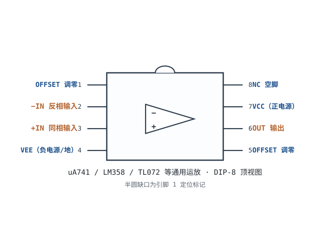
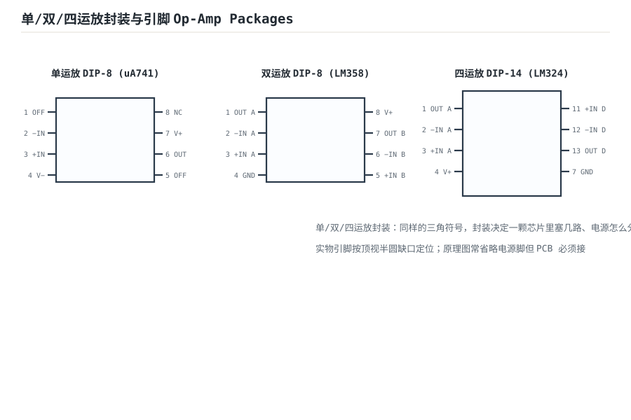

# 运放概述：符号、封装与引脚 Op-Amp Overview

运算放大器（Operational Amplifier，Op-Amp）是一颗**高增益、直接耦合、差分输入**的放大芯片。把它配上几颗电阻，就能实现比例、加减、积分、滤波——它是模拟电路的"万能积木"。本章先认识它的符号、封装与引脚。

## 1. 设计动机

::: motivation 为什么需要运放
分立晶体管放大电路要算 Q 点、配偏置、调工作点，一颗管子一个样。运放把几十只晶体管集成在一颗芯片里，对外只暴露"两个输入、一个输出、两个电源"。你不需要管内部怎么偏置，只要接好外部反馈网络，增益就由两颗电阻决定。这就是它取代分立设计的原因。
:::

## 2. 原理图：符号与封装

标准符号是一个三角形：**上端是反相输入端（−），下端是同相输入端（+），右端是输出**。内部还有两个不显眼的电源脚（正电源 V+、负电源 V−），原理图上常省略但实物必须接。

::: analogy 运放像"超级灵敏的天平"
两个输入端像天平的两个托盘：哪边电压高，输出就往哪边猛摆。开环时增益几十万倍，一点点差值就把输出顶到电源轨——所以运放不能开环用，必须接负反馈让它"收敛"。
:::

## 3. 引脚与供电要点

- **同相输入（+）**：输出与它同相。
- **反相输入（−）**：输出与它反相。
- **输出（OUT）**：推挽结构，能灌/抽几 mA~几十 mA。
- **电源**：双电源（如 ±15V）或单电源（如 0~5V）。输出摆幅受电源轨限制。

## 4. 常见型号与封装

| 型号 | 特点 | 典型用途 |
|---|---|---|
| uA741 | 老牌通用、便宜、慢 | 教学、低频 |
| LM358 | 单电源、双运放 | 电池、低成本 |
| TL072 | JFET 输入、低噪声 | 音频、传感器 |
| OP07 | 低失调、精密 | 仪器、测量 |

封装有 DIP-8（直插好焊）、SOIC-8（贴片量产）、SOT-23-5（超小）等。

## 扩展与变种电路

### 扩展1：单/双/四运放封装与引脚 Op-Amp Packages

**定位**：同一颗三角符号，封装决定一颗芯片塞几路运放、电源脚怎么分——画原理图时知道选哪种封装才不接错脚。

::: example 工作原理 / 静态分析
- 单运放 DIP-8（uA741）：1/5 失调调零，2 反相、3 同相、6 输出，4 负电源、7 正电源。
- 双运放 DIP-8（LM358）：1OUT/2IN−/3IN+ 在一侧，GND 与 V+ 在两侧。
- 四运放 DIP-14（LM324）：四路各两个输入+一个输出，电源共用。

原理图常省略电源脚，但 PCB 必须接，且退耦电容就近放。
:::

设计要点：直插调试用 DIP-8，量产出 SOIC-8；空间极小用 SOT-23-5。

::: pitfall 封装专属坑
- **电源脚忘了接**：面包板只接信号和反馈，输出不动——运放首先要供电，且正负电源脚都要接。
:::

## 5. 常见坑

::: pitfall 常见坑
- **电源脚忘了接**：面包板上只接了信号和反馈，输出不动——运放首先要供电。
- **输出对电源轨的摆幅误解**：不是轨到轨（Rail-to-Rail）的运放，输出离电源轨还有 1~2V，5V 供电下输出最多到 3.5V 左右。
- **输入共模范围超了**：输入电压不在允许范围内，输出会乱跳甚至锁死。
:::

## 6. 自测题

运放的同相输入端和反相输入端，输出相位分别是什么关系？

同相端（+）→ 输出同相；反相端（−）→ 输出反相（差 180°）。

DIP-8 封装的 uA741，引脚 2、3、6、7 分别是什么？

2=反相输入（−），3=同相输入（+），6=输出，7=正电源 VCC。引脚 4 是负电源。

## 7. 参考资料

- TI SLOD006B《Op Amps for Everyone》——运放基础章节
- Mancini《Op Amps for Everyone》Newnes 2e
- [Kitspace awesome-electronics](https://github.com/kitspace/awesome-electronics)
