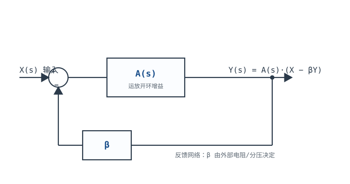
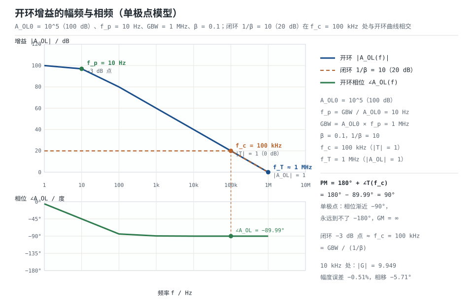
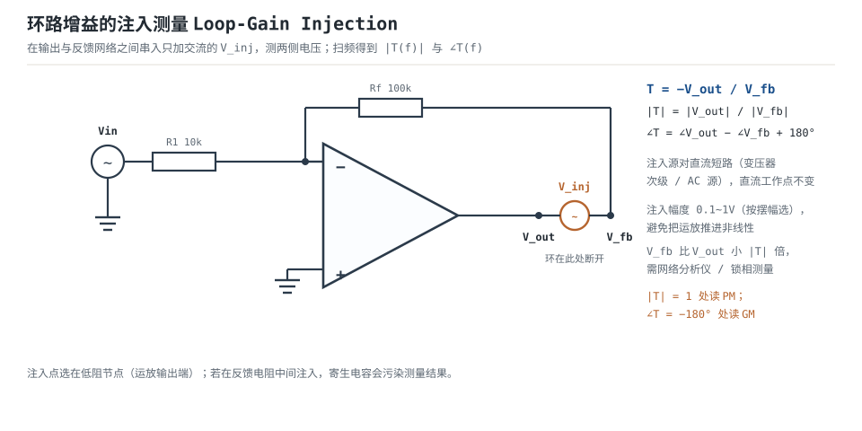

# 开环、闭环增益与负反馈本质 Open-Loop & Closed-Loop Gain

运放的开环增益高达 $10^5\sim10^7$ 倍，但这个数字**不是用来直接放大的**——输入差 0.1mV 乘 $10^5$ 就是 10V，输出早就撞到电源轨。高开环增益的真正用途，是**被负反馈"消耗"掉**：用多余的增益换精度、换带宽、换低失真、换低输出阻抗。这笔交易的记账单位只有一个——**环路增益 $T=A_{OL}\beta$**。

本章把负反馈从"感觉上更稳"变成可以计算的账本：闭环增益误差约等于 $1/T$、带宽扩展 $1+T$ 倍、输出阻抗降低 $1+T$ 倍、失真压低 $1+T$ 倍。然后再往前走一步：$T$ 的相位一旦转到 −180°、而幅值还大于 1，负反馈就变成正反馈，电路从"更稳"变成"自激"。最后用一个 $A_{OL}=10^5$、主极点 10Hz 的完整算例，把闭环带宽、增益误差、阶跃建立时间一次算清。

## 1. 设计动机

::: motivation 三个真实场景
**场景一：开环增益的分散性让它无法直接用于测量。** 同一型号的运放，$A_{OL}$ 的批次分散可以达到 ±30%，还随温度漂移。如果用开环增益做 100 倍放大，输出会随器件、温度、电源电压一起漂，根本无法校准。接成闭环、$\beta=0.01$ 后，$T=10^5\times0.01=1000$，$A_{OL}$ 变化 30% 只让闭环增益变化 $30\%/1001\approx0.03\%$——这才有可重复性。

**场景二：1000 倍前置放大，单级做不了。** GBW=1MHz 的运放，单级增益 1000 → 闭环带宽 $1\text{MHz}/1000=1\text{kHz}$，环路增益只有 $T=100$，增益误差约 1%。改成两级各 31.6 倍：每级 $T=3165$、误差约 0.032%，单级带宽 31.6kHz，两级级联后约 20.3kHz。**同样的器件，增益分配不同，精度和带宽都差一个数量级。**

**场景三：跟随器带容性负载自激。** 电压跟随器（噪声增益 1）驱动 100pF 电缆，输出端多了一个极点，相位裕度从 90° 掉到 20° 以下，输出出现几 MHz 的持续振荡。示波器上看是"运放坏了"，实际是**环路相位**出了问题。
:::

| 你想确认 | 先算 | 判据（工程经验值） |
|---|---|---|
| 闭环增益准不准 | $T=A_{OL}\beta$ | $T\ge100$ → 误差 ≤1% |
| 增益随温度漂多少 | $\Delta G/G\approx(\Delta A_{OL}/A_{OL})/(1+T)$ | 漂移 < 目标精度的 1/3 |
| 闭环带宽够不够 | $f_{cl}\approx GBW\cdot\beta$ | $f_{cl}\ge10\times$ 最高信号频率 |
| 阶跃建立快不快 | $\tau=1/(2\pi f_{cl})$、$SR$ | 建立时间在预算内，且不压摆受限 |
| 会不会自激 | $PM=180^{\circ}+\angle T(f_c)$ | $PM\ge45^{\circ}$（推荐 60°），$GM\ge10\text{dB}$ |
| 环路增益怎么测 | 注入法或闭环偏差法 | 测量不破坏直流工作点 |

**不算会摔在哪**，四个带数字的代价：

1. **增益误差被当成"电阻精度"**。$A_{OL}=10^5$、目标增益 1000，$T=100$，闭环增益误差约 $1\%$——比 1% 电阻的误差还大。换 0.1% 电阻没用，得换更高 $A_{OL}$ 的器件或降低单级增益。
2. **带宽算错**。以为"GBW=1MHz 就能放大 1MHz 的信号"，实际增益 10 时闭环带宽只有 100kHz；到 1MHz 时增益只剩约 1，信号被衰减 20dB。
3. **把 $1/T$ 套到高频**。1kHz 处 $T$ 的相位已接近 −90°，幅度误差远小于 $1/|T|$，但相移有 0.58°；用 $1/T$ 估幅度会高估 66 倍，用"没误差"估相位又会漏掉相位。
4. **忽略相位裕度**。$|T|$ 在穿越频率处刚好等于 1，若此时相移 −170°，PM=10°，阶跃响应会严重振铃，温度或负载一变就自激。

## 2. 定义与直观

### 2.1 四个量：开环增益、反馈系数、环路增益、闭环增益

先约定符号（与整篇运放章节一致）：

- **开环增益 $A_{OL}$**：运放本身的增益，无量纲（V/V），分贝表示 $20\lg A_{OL}$；随频率、温度、批次变化。
- **反馈系数 $\beta$**：输出被送回输入端的比例，无量纲，$0<\beta\le1$。**注意不是三极管的电流放大倍数**，两者只是字母相同。
- **环路增益 $T=A_{OL}\beta$**：信号绕环路走一圈的总增益，无量纲，也常用 dB 表示（$20\lg|T|$）。它是负反馈一切好处的"汇率"。
- **闭环增益 $A_{CL}$**（下文也写作 $G$）：接反馈后的实际增益，无量纲。
- **噪声增益 $1/\beta$**：闭环增益的理想值（同相组态），也是运放电压噪声、失调、共模误差被放大的倍数。

由框图直接列方程：输出 $Y=A_{OL}(X-\beta Y)$，整理得

$$G=\frac{Y}{X}=\frac{A_{OL}}{1+A_{OL}\beta}=\frac{A_{OL}}{1+T}=\frac{1}{\beta}\cdot\frac{T}{1+T}$$

符号与单位：$G$ 无量纲；$A_{OL}$ 无量纲；$\beta$ 无量纲；$T$ 无量纲。**这个式子是本章所有结论的源头**，后面每一个"误差"、"带宽"、"阻抗"都可以从这里推出来。

当 $T\gg1$ 时，$G\to1/\beta$：**闭环增益只由反馈网络决定，与运放自身的 $A_{OL}$ 无关**。这就是负反馈最核心的价值。代价是增益从 $A_{OL}$ 降到 $1/\beta$，被"牺牲"掉的倍数是 $A_{OL}/(1/\beta)=T$——所以 $T$ 越大，牺牲越多，换来的精度也越高。三种基本组态的完整增益、输入阻抗与输出阻抗推导，见[理想模型五假设与虚短、虚断](ideal-opamp.md)。

**反相组态要注意符号**。反相放大器的输入网络把信号送到反相端，闭环增益是

$$G_{inv}=-\frac{R_f}{R_1}\cdot\frac{T}{1+T},\qquad \beta=\frac{R_1}{R_1+R_f}$$

负号来自输入网络（信号从 $R_1$ 进、从 $R_f$ 出），**不来自 $\beta$**。$\beta$ 仍然是正数，环路仍然是负反馈。这一点在稳定性分析里很关键：判据用的是 $T=A_{OL}\beta$ 的相位，不是闭环增益的符号。

### 2.2 负反馈的本质：用多余的增益买四样东西

把 $G=(1/\beta)\cdot T/(1+T)$ 改写成"理想值 × 修正因子"：

$$G=\frac{1}{\beta}\left(1-\frac{1}{1+T}\right)$$

括号里的 $1/(1+T)$ 就是**相对误差**。$T=1000$ 时误差 0.0999%，$T=10^4$ 时误差 0.009999%。同理可以推出另外三样好处：

| 好处 | 定量关系 | $T=10^4$ 时的效果 |
|---|---|---|
| 增益精度 | 相对误差 $\approx1/(1+T)$ | 0.01% |
| 增益稳定性 | $\dfrac{\Delta G/G}{\Delta A_{OL}/A_{OL}}=\dfrac{1}{1+T}$ | $A_{OL}$ 漂 30% → $G$ 漂 0.003% |
| 带宽 | $f_{cl}=f_p(1+T_0)\approx GBW\cdot\beta$ | 主极点 10Hz → 100kHz（增益 10） |
| 输出阻抗 | $R_{out,CL}=R_{out,OL}/(1+T)$ | 100Ω → 0.01Ω |
| 失真/噪声（输出级） | 折合到输入除以 $1+T$ | 1% 失真 → 0.0001% |

代价也写在同一张表里：**增益降了 $T$ 倍**，而且高频时 $T$ 会下降，所有好处都随频率缩水。**负反馈不是"免费的稳定"，它是用增益换来的稳定。**

::: analogy 负反馈像恒温器
你设定 25℃（目标），温度计测到实际温度（反馈），控制器比较两者、决定加热功率（增益）。炉子的最大功率（$A_{OL}$）再大，室温也稳定在 25℃ 附近；炉子功率波动 30%，室温只变一点点——因为反馈一直在纠错。

类比的边界：恒温器有"滞后"（温度到 26℃ 才关），运放有"相位滞后"；如果滞后太大（相位到 −180°），控制器就会在"该关的时候开、该开的时候关"，系统开始振荡。**负反馈的稳定性取决于滞后，而不取决于增益大小。**
:::

### 2.3 从"负"到"正"：相位决定一切

在直流和低频，$A_{OL}$ 是正实数、$\beta$ 是正实数，$T$ 是正实数，分母 $1+T$ 让增益变小——这是**负反馈**。

但 $A_{OL}$ 是频率的函数。每个极点在高频贡献最多 $-90^{\circ}$ 相移：

- 一个极点：$\angle A_{OL}\to-90^{\circ}$；
- 两个极点：$\angle A_{OL}\to-180^{\circ}$；
- 三个极点：$\angle A_{OL}\to-270^{\circ}$。

当 $\angle T=-180^{\circ}$ 时，反馈信号与输入信号变成**同相相加**，分母从 $1+T$ 变成 $1-T$：只要 $|T|>1$，闭环增益就发散，电路自激。这就是**巴克豪森判据**（Barkhausen criterion）的线性版本：

$$|T(j\omega)|=1,\qquad \angle T(j\omega)=-180^{\circ}$$

注意这两个条件必须**同时**满足。只满足相位、幅值小于 1，电路只是"相位不对"，不会起振；只满足幅值、相位没到 −180°，仍然是负反馈。工程上用**相位裕度**和**增益裕度**衡量"离这两个条件还有多远"，下一节给定义。

## 3. 定量关系

### 3.1 闭环增益误差与灵敏度

由 $G=A_{OL}/(1+T)$ 对 $A_{OL}$ 求导，可以严格得到灵敏度：

$$\frac{dG}{G}=\frac{1}{1+T}\cdot\frac{dA_{OL}}{A_{OL}}$$

也就是说，**开环增益的相对变化被缩小 $1+T$ 倍传到闭环**。取 $T=1000$、$A_{OL}$ 变化 30%：

$$\frac{\Delta G}{G}=\frac{0.30}{1001}=0.030\%$$

增益误差本身（相对理想值 $1/\beta$）：

$$\frac{G-1/\beta}{1/\beta}=-\frac{1}{1+T}$$

| $T$ | $1/(1+T)$ | 增益误差 | 典型场景 |
|---|---|---|---|
| 10 | 0.0909 | 9.09% | 增益接近 $A_{OL}$，或高频 |
| 100 | 0.00990 | 0.99% | 高增益单级、音频中频 |
| 1000 | 0.000999 | 0.0999% | 一般精密放大 |
| $10^4$ | $9.999\times10^{-5}$ | 0.009999% | 仪表、ADC 驱动 |
| $10^5$ | $9.9999\times10^{-6}$ | 0.00099999% | 高精度直流 |

**这张表要背下来**：$T=100$ 对应 1%，$T=1000$ 对应 0.1%，$T=10^4$ 对应 0.01%。每增加 10 倍 $T$，误差降一个数量级。

**高频时 $1/T$ 不再是幅度误差。** 当 $T$ 的相位接近 $-90^{\circ}$ 时，$|1+T|\approx|T|$，$|G|\approx|A_{OL}|/|T|=1/\beta$，幅度误差变成二阶小量，误差主要体现为相移。精确式是

$$\frac{|G|}{1/\beta}=\frac{|T|}{|1+T|}=\frac{1}{\sqrt{1+\frac{1}{|T|^2}+\frac{2\cos\theta_T}{|T|}}}$$

其中 $\theta_T=\angle T$。$\theta_T=0$ 时退化为 $1/(1+1/|T|)$（最坏情况）；$\theta_T=-90^{\circ}$ 时误差约 $1/(2|T|^2)$。这个式子在[运放概述：符号、封装与引脚](opamp-overview.md)的算例里已经用过一次，这里给出一般形式。

### 3.2 开环增益的幅频与相频

通用运放的开环响应可以用单极点近似（真实器件还有第二、第三极点）：

$$A_{OL}(f)=\frac{A_{OL0}}{1+jf/f_p}$$

$$|A_{OL}(f)|=\frac{A_{OL0}}{\sqrt{1+(f/f_p)^2}},\qquad \angle A_{OL}(f)=-\arctan\frac{f}{f_p}$$

$$GBW=A_{OL0}f_p\approx f_T$$

符号与单位：$A_{OL0}$ 是直流开环增益（无量纲）；$f_p$ 是主极点（Hz）；$GBW$ 是增益带宽积（Hz）；$f_T$ 是单位增益频率（$|A_{OL}|=1$ 的频率，Hz）。

在双对数坐标上，幅频曲线在 $f_p$ 之前是水平线（$20\lg A_{OL0}$ dB），之后是斜率 $-20\text{dB/}$ 十倍频的直线；相频曲线在 $f_p$ 处是 $-45^{\circ}$，前后各一个十倍频内完成 $-90^{\circ}$ 的过渡。**单极点系统的相位永远到不了 $-180^{\circ}$**，所以单极点运放接成任何闭环增益都稳定（PM=90°）。真实运放有第二极点，相位才会继续往下走。

### 3.3 闭环带宽

把 $A_{OL}(f)$ 代入 $G=A_{OL}/(1+A_{OL}\beta)$，闭环增益也是单极点形式，极点从 $f_p$ 移到

$$f_{cl}=f_p(1+T_0)=f_p(1+A_{OL0}\beta)\approx A_{OL0}f_p\beta=GBW\cdot\beta=\frac{GBW}{1/\beta}$$

其中 $T_0=A_{OL0}\beta$ 是直流环路增益。**增益与带宽的乘积恒为 GBW**：增益 10 用掉 1/10，增益 100 用掉 1/100。

反相组态用同一个公式，但 $\beta=R_1/(R_1+R_f)$ 对应的是噪声增益 $1+R_f/R_1$，不是信号增益 $R_f/R_1$。所以反相增益 −10（$R_1=10\text{k}\Omega$、$R_f=100\text{k}\Omega$）的闭环带宽是 $1\text{MHz}/11=90.9\text{kHz}$，不是 100kHz。

### 3.4 环路增益 $T$ 的测量思路

$T$ 是负反馈的核心参数，但它不是数据手册直接给的（手册给 $A_{OL}$，$\beta$ 由外部电阻决定）。工程上有三种测法：

**方法一：注入法（仿真与实测都适用）。** 在反馈环路上选一个低阻节点（通常是运放输出端），把环路在此处断开，串入一个只加交流的测试源 $V_{inj}$；测注入源两侧的电压——放大器侧 $V_{out}$、反馈网络侧 $V_{fb}$，则

$$T=-\frac{V_{out}}{V_{fb}}$$

因为环路已在此处断开，反馈网络只受 $V_{fb}$ 驱动，运放输出就是"绕环路一圈后回来的信号"：$V_{out}=-T V_{fb}$，所以这个比值就是环路增益。负号来自负反馈。注入源对直流近似短路（变压器次级、AC 源的直流路径），所以直流工作点不变；对测试频率呈现源阻抗，环路在该频率上被"断开"。扫频得到 $|T(f)|$ 与 $\angle T(f)$，就能读出 $f_c$、PM、GM。

**两个电压差多少？** 由 $V_{fb}=V_{out}+V_{inj}$ 可得

$$|V_{fb}|=\frac{|V_{inj}|}{|1+T|}$$

$|T|=100$ 时 $V_{fb}$ 只有注入源电压的 1/100 左右。所以注入幅度按"让 $V_{out}$ 落在运放线性区"来选，典型 0.1~1V；$V_{fb}$ 很小时要用网络分析仪或锁相测量，示波器只适合 $|T|<20$ 的粗测。

**方法二：闭环增益偏差法（低频、低成本）。** 在 $T$ 近似实数的低频，测出实际闭环增益 $G$ 与理想值 $1/\beta$，则

$$\frac{1}{T}\approx\frac{1/\beta-G}{G}$$

例如 $1/\beta=10$、实测 $G=9.9990$，则 $1/T=(10-9.9990)/9.9990=1.0\times10^{-4}$，$T\approx10^4$。这个方法只需要精密电阻和一块 6 位半万用表，但只能测低频，且对电阻精度要求高。

**方法三：仿真环路分析。** SPICE 里用 AC 分析 + 注入源，或直接用厂商提供的环路增益（loop gain）仿真模板；结果与方法一一致，适合在设计阶段扫参数。

实测时要注意三点：① 注入幅度按输出摆幅选（0.1~1V），保证运放不进入非线性；② 注入点选低阻节点，避免寄生电容影响；③ 相位测量要用双通道或网络分析仪，单通道示波器只能看幅值。

### 3.5 稳定性判据：相位裕度与增益裕度

**穿越频率 $f_c$**：$|T(f_c)|=1$（0dB）的频率。

**相位裕度 PM**：

$$PM=180^{\circ}+\angle T(f_c)$$

它表示"在幅值降到 1 的频率上，相位离 $-180^{\circ}$ 还有多远"。PM=90° 表示还差 90° 才到正反馈；PM=0° 表示正好在自激边缘。

**增益裕度 GM**：在相位等于 $-180^{\circ}$ 的频率 $f_{180}$ 上，幅值还比 1 大多少：

$$GM=-20\lg|T(f_{180})|$$

GM=10dB 表示幅值还可以再涨 10dB 才会自激。

工程经验值（不是绝对标准，按应用调整）：**PM 45°~60° 是常见目标，GM 10~20dB**。PM 与二阶阶跃响应的过冲有近似关系（$\zeta\approx PM/100$，PM 用度）：

$$M_p\approx\exp\left(\frac{-\pi\zeta}{\sqrt{1-\zeta^2}}\right)$$

| PM | $\zeta\approx PM/100$ | 过冲 $M_p$ | 现象 |
|---|---|---|---|
| 90° | 0.9 | 0.15% | 几乎无过冲 |
| 75° | 0.75 | 2.8% | 轻微 |
| 60° | 0.60 | 9.5% | 可接受 |
| 45° | 0.45 | 20.5% | 明显振铃 |
| 30° | 0.30 | 37.2% | 严重振铃 |
| 0° | 0 | 100% | 自激 |

**PM 与噪声增益的关系**：同样的运放，噪声增益越低，$f_c$ 越高，第二极点造成的相位滞后越大，PM 越小。所以**跟随器（噪声增益 1）是最容易振荡的接法**，高增益反而更稳。这个结论和直觉相反，但可以用数字验证（见 §4.3）。

### 3.6 建立时间与压摆率

闭环后若只有一个主极点，阶跃响应是一阶指数：

$$V_{OUT}(t)=V_{final}\left(1-e^{-t/\tau}\right),\qquad \tau=\frac{1}{2\pi f_{cl}}$$

建立到相对误差 $\varepsilon$ 所需时间：

$$t_s=\tau\ln\frac{1}{\varepsilon}$$

$\varepsilon=1\%$ → $4.61\tau$；$\varepsilon=0.1\%$ → $6.91\tau$；$\varepsilon=0.01\%$ → $9.21\tau$。10%~90% 上升时间 $t_r=2.20\tau$。

但这是**小信号**结论。大信号时压摆率 SR 限制：

$$t_{slew}=\frac{\Delta V}{SR},\qquad SR\ge2\pi fV_{pk}\ \text{（正弦不畸变条件）}$$

实际建立时间近似为"压摆段 + 线性段"：

$$t_{s,total}\approx t_{slew}+t_s$$

哪一段主导，取决于 $\Delta V/SR$ 与 $\tau\ln(1/\varepsilon)$ 谁大。**小信号看 GBW，大信号看 SR**，两个都要算。

### 3.7 适用条件与失效边界

1. **单极点近似**：只在一个主极点主导的频率范围内成立；接近第二极点后，相位、幅值都要按实际曲线算。
2. **线性区**：输出饱和后 $T$ 的定义失效（环路被"顶住"），建立时间、稳定性分析都不适用。
3. **小信号**：$T$、PM、GM 都是小信号参数；大信号还要叠加 SR 限制。
4. **电阻网络是实数**：$\beta$ 在低频是实数；如果反馈网络里有电容（积分器、滤波器），$\beta$ 本身带相移，稳定性要按 $\beta(s)$ 重新算。
5. **负载与布局**：容性负载、PCB 寄生电容会引入额外极点，数据手册的 PM 是在特定负载下测的。

## 4. 典型计算

### 4.1 算例一：$A_{OL}=10^5$、主极点 10Hz、增益 10 的闭环带宽、误差与建立时间

**已知**：$A_{OL0}=10^5$、$f_p=10\text{Hz}$（所以 GBW=$10^5\times10=1\text{MHz}$）；接成同相增益 10，$R_1=10\text{k}\Omega$、$R_f=90\text{k}\Omega$，$\beta=0.1$、$1/\beta=10$。求闭环带宽、直流与 1kHz 的增益误差、1V 阶跃的建立时间量级。

**第 1 步：直流环路增益与闭环增益。**

$$T_0=A_{OL0}\beta=10^5\times0.1=10^4$$

$$G_0=\frac{A_{OL0}}{1+T_0}=\frac{10^5}{1+10^4}=9.9990$$

增益误差 $(9.9990-10)/10=-0.010\%=-1/(1+T_0)$。✓

**第 2 步：闭环带宽。**

$$f_{cl}=f_p(1+T_0)=10\times(1+10^4)=100.01\ \text{kHz}$$

用 GBW 验证：$GBW/(1/\beta)=10^6/10=100\text{kHz}$，两者相差 0.01%，来自 $f_p(1+T_0)$ 与 $GBW\beta$ 的近似差别（精确值 100.01kHz，近似值 100kHz）。

**第 3 步：1kHz 处的增益误差（复数）。** 1kHz 处 $f/f_p=100$：

$$|A_{OL}|=\frac{10^5}{\sqrt{1+100^2}}=999.95,\qquad \angle A_{OL}=-89.43^{\circ}$$

$$|T|=99.995,\qquad G(1\text{k})=\frac{999.95\angle-89.43^{\circ}}{100.01\angle-88.85^{\circ}}=9.9985\angle-0.58^{\circ}$$

幅度误差 $-0.015\%$，相移 $-0.58^{\circ}$。**注意：1kHz 的幅度误差与直流（$-0.010\%$）是同一量级，并没有按 $1/T=1\%$ 恶化——因为 $T$ 的相位把 $1/T$ 的缺口转成了相移。** 真正随频率恶化的是相移和带宽，不是幅度。

**第 4 步：频响表。**

| 频率 | $\lvert A_{OL}\rvert$ | $\lvert T\rvert$ | $\lvert G\rvert$ | 相对 10 的误差 | 相移 |
|---|---|---|---|---|---|
| 直流 | $10^5$ | $10^4$ | 9.9990 | −0.010% | $0^{\circ}$ |
| 1kHz | 999.95 | 99.995 | 9.9985 | −0.015% | −0.58° |
| 10kHz | 99.995 | 9.9995 | 9.9494 | −0.51% | −5.71° |
| 100kHz | 10.000 | 1.000 | 7.071 | −29.3% | −45.0° |
| 1MHz | 1.000 | 0.100 | 0.995 | −90.1% | −84.3° |

1MHz 这一行值得注意：$|G|=0.995$，不是 $1/\beta=10$，也不是 $|A_{OL}|=1$。因为超过 $f_{cl}$ 后，闭环增益**跟着开环增益滚降**，$|G|\approx|A_{OL}|=1$。**"闭环增益等于 $1/\beta$"只在 $|T|\gg1$ 的频率范围内成立。**

**第 5 步：1V 阶跃的建立时间。** 时间常数：

$$\tau=\frac{1}{2\pi f_{cl}}=\frac{1}{2\pi\times1.0001\times10^5}=1.591\ \mu\text{s}$$

建立到 0.1%：

$$t_s=6.908\tau=6.908\times1.591=10.99\ \mu\text{s}$$

建立到 0.01%：$9.210\tau=14.66\ \mu\text{s}$。

**第 6 步：压摆率检查。** 若 SR=1V/µs，1V 阶跃的压摆段：

$$t_{slew}=\frac{1\text{V}}{1\text{V/}\mu\text{s}}=1.0\ \mu\text{s}$$

与 $\tau=1.591\mu\text{s}$ 同量级，总建立时间约 $1.0+11.0=12.0\mu\text{s}$（压摆段结束后还有线性段）。若 SR 只有 0.5V/µs，压摆段 2µs，总时间约 13µs；若阶跃是 5V，压摆段 5µs，总时间约 16µs。**大阶跃时 SR 会主导建立时间，光看 GBW 会低估。**

**第 7 步：稳定性。** 单极点系统的相位最多到 $-90^{\circ}$，$f_c=100\text{kHz}$ 处 $\angle T=-89.99^{\circ}$：

$$PM=180^{\circ}-89.99^{\circ}=90.01^{\circ}$$

GM 无穷大（相位永远到不了 $-180^{\circ}$）。所以这个电路**在单极点模型下一阶无过冲、不会自激**——但真实运放有第二极点，见 §4.3。

### 4.2 算例二：1000 倍放大，单级还是两级

**需求**：用 GBW=1MHz、$A_{OL0}=10^5$ 的运放做 1000 倍放大，信号最高 5kHz。比较单级与两级方案。

**方案 A：单级 1000 倍。**

$$\beta=\frac{1}{1000}=0.001,\qquad T_0=10^5\times0.001=100$$

增益误差 $1/(1+100)=0.99\%$；闭环带宽 $f_{cl}=10^6\times0.001=1\text{kHz}$。5kHz 信号已经被衰减：$|G(5\text{k})|=1000/\sqrt{1+(5/1)^2}=1000/5.10=196$，只剩 19.6%。

**方案 B：两级各 31.6 倍。**

每级 $\beta=1/31.6=0.0316$，$T_0=10^5\times0.0316=3162$，误差 $1/3163=0.032\%$；单级带宽 $f_{cl}=10^6\times0.0316=31.6\text{kHz}$。

两级级联的 −3dB 带宽（两个相同一阶节）：

$$f_{cl,2}=f_{cl}\sqrt{\sqrt{2}-1}=31.6\text{kHz}\times0.6436=20.3\ \text{kHz}$$

总增益误差约 $2\times0.032\%=0.064\%$（一阶近似，忽略级间交互）。

**方案对比：**

| 指标 | 单级 1000× | 两级 31.6×31.6 |
|---|---|---|
| 直流增益误差 | 0.99% | 约 0.064% |
| 闭环带宽 | 1kHz | 20.3kHz |
| 5kHz 处增益 | 196（−14.2dB） | 约 971（−0.26dB） |
| 元件数量 | 2 个电阻 | 4 个电阻 |
| 噪声 | 一级噪声增益 1000 | 两级，第一级噪声增益 31.6 主导 |

**结论**：同样器件，两级方案把精度提高 15 倍、带宽提高 20 倍，代价是多了两个电阻和一点噪声/失调。**高增益不要用单级硬扛**——这是运放设计里最常见的一条经验。

### 4.3 算例三：第二极点、相位裕度与"为什么跟随器最容易振荡"

**已知**：在 §4.1 的单极点模型上再加一个极点 $f_{p2}=1\text{MHz}$（典型通用运放的第二极点量级），其余不变：$A_{OL0}=10^5$、$f_{p1}=10\text{Hz}$。求不同噪声增益下的 $f_c$ 与 PM。

**第 1 步：噪声增益 1（跟随器）。** $|T|=|A_{OL}|$，穿越条件 $|A_{OL}(f_c)|=1$：

$$\frac{10^5}{\sqrt{1+(f_c/10)^2}\sqrt{1+(f_c/10^6)^2}}=1$$

在 $f_c\gg10\text{Hz}$ 时近似为 $\dfrac{10^6}{f_c\sqrt{1+(f_c/10^6)^2}}=1$。令 $u=f_c/10^6$：

$$u^2(1+u^2)=1\ \Rightarrow\ u^2=\frac{\sqrt{5}-1}{2}=0.6180\ \Rightarrow\ u=0.7862$$

$$f_c=786.2\ \text{kHz}$$

相移：

$$\angle T=-\arctan\frac{786.2\times10^3}{10}-\arctan0.7862=-90^{\circ}-38.17^{\circ}=-128.17^{\circ}$$

$$PM=180^{\circ}-128.17^{\circ}=51.8^{\circ}$$

**第 2 步：噪声增益 10（同相增益 10）。** $|T|=|A_{OL}|/10$，穿越条件 $|A_{OL}|=10$：

$$\frac{10^6}{f_c\sqrt{1+(f_c/10^6)^2}}=10\ \Rightarrow\ u^2(1+u^2)=0.01$$

$$u^2=\frac{\sqrt{1.04}-1}{2}=0.009902\ \Rightarrow\ u=0.09951,\qquad f_c=99.51\ \text{kHz}$$

$$\angle T=-90^{\circ}-\arctan0.09951=-90^{\circ}-5.68^{\circ}=-95.68^{\circ}$$

$$PM=84.3^{\circ}$$

**第 3 步：噪声增益 100。** 同理 $u^2(1+u^2)=10^{-4}$，$u^2\approx10^{-4}$，$u=0.0099995$，$f_c=10.0\text{kHz}$，$\angle T=-90^{\circ}-0.52^{\circ}=-90.52^{\circ}$，$PM=89.5^{\circ}$。

**第 4 步：对比。**

| 噪声增益 $1/\beta$ | $f_c$ | $\angle T(f_c)$ | PM | 过冲（式 $M_p$） |
|---|---|---|---|---|
| 1（跟随器） | 786kHz | −128.2° | 51.8° | 约 15% |
| 10 | 99.5kHz | −95.7° | 84.3° | 约 0.7% |
| 100 | 10.0kHz | −90.5° | 89.5° | 约 0.2% |

**结论**：**噪声增益越低，穿越频率越高，第二极点的相位滞后越大，PM 越小。** 跟随器带容性负载最容易振荡，不是因为它"增益为 1 所以不稳定"，而是因为它的 $f_c$ 最高、离第二极点最近。反过来说，如果电路在跟随器模式下振荡，可以给它加一点噪声增益（在反馈网络里串一个小电阻），把 $f_c$ 压下来——这是工程上常用的"用增益换稳定"手段。

## 5. 工程含义

### 5.1 精度预算：所有好处都记在 $T$ 上

| 误差源 | 折合到输入的表达式 | 被什么放大 | 怎么压 |
|---|---|---|---|
| 有限 $A_{OL}$ | $V_{OUT}/(A_{OL}\beta)$ | $1/(1+T)$ | 提高 $T$、降低增益 |
| 失调 $V_{OS}$ | $V_{OS}$ | $1/\beta$（同相） | 调零、斩波、低 $V_{OS}$ 器件 |
| 偏置电流 $I_B$ | $I_BR_s$ | $1/\beta$ | 平衡电阻、低 $I_B$ 器件 |
| 共模 $V_{cm}$ | $V_{cm}/CMRR$ | $1/\beta$ | 高 CMRR、降低共模 |
| 电源纹波 | $V_{ripple}/PSRR$ | $1/\beta$ | 退耦、高 PSRR |
| 噪声 | $e_n\sqrt{BW}$ | $1/\beta$ | 低噪声器件、限带宽 |

**所有误差都乘噪声增益 $1/\beta$，只有有限增益误差乘 $1/(1+T)$**——这是预算表里最容易搞混的一行。反相放大时 $1/\beta=1+R_f/R_1$，比信号增益大 1；同相时 $1/\beta$ 就等于信号增益。

### 5.2 增益分配：为什么高增益要分两级

级联 $n$ 级、每级增益 $G_i$、带宽 $f_i$ 的放大器：

$$G_{total}=\prod G_i,\qquad \frac{1}{f_{total}}\approx\sum\frac{1}{f_i}\quad(\text{一阶近似})$$

每级的误差 $1/(1+T_i)=1/(1+A_{OL}\beta_i)$ 随该级增益增大而增大。把总增益平均分配到两级，每级只需要 $\sqrt{G_{total}}$ 的增益，$T$ 提高 $\sqrt{G_{total}}$ 倍，误差同比下降；代价是级联带宽按上式收缩（两个相同一阶节收缩到 0.6436 倍）。

**经验法则**：单级增益不超过 $A_{OL}/100$（即 $T\ge100$，误差 ≤1%）；要更高精度就分级。1000 倍用两级、10000 倍用三级，是常见的分法。

### 5.3 稳定性设计：几条可操作的规则

1. **先定噪声增益**：$1/\beta$ 决定 $f_c$，也就决定 PM。跟随器/低增益最容易振荡，必要时在反馈网络里加一个小电阻抬高噪声增益。
2. **看数据手册的 PM 测试条件**：PM 通常是在指定负载、指定增益下测的；容性负载会让 PM 变差。
3. **容性负载串隔离电阻**：在输出与负载之间串 $R_{iso}$（典型 10~100Ω），把负载电容与输出电阻"隔开"，形成一个零点，改善 PM；代价是带载能力下降、直流误差增加（负载电流在 $R_{iso}$ 上的压降不在反馈环内）。
4. **反馈电容/前馈电容**：在 $R_f$ 上并一只小电容，可以补偿输入电容造成的相位滞后；取值必须按实际开环曲线仿真，不能拍脑袋。
5. **实测 PM**：注入法扫频，读 $f_c$ 处的相移；PM<45° 就要改补偿或降增益。
6. **别忽略布局**：反馈走线过长、接地不良会引入寄生电容/电感，实测 PM 可能比仿真低 20° 以上。

### 5.4 什么情况下负反馈会变成正反馈

按发生概率排序：

1. **接错端**：反馈回到同相端。分母变成 $1-T$，$T\to1$ 时增益发散，输出锁在电源轨。**这是上电前必须核对的一项，代价最低、后果最重。**
2. **高频相移**：$|T|>1$ 且 $\angle T=-180^{\circ}$。多极点运放、容性负载、长走线都可能把相位推到 −180°。
3. **反馈网络本身带相移**：积分器（反馈电容）在低频就有 $-90^{\circ}$，叠加运放主极点的 $-90^{\circ}$，很容易到 $-180^{\circ}$；所以积分器必须并联一个电阻提供直流反馈，把低频极点拉开。
4. **多级放大**：每级贡献极点，三级以上很容易在 $|T|>1$ 时堆到 $-180^{\circ}$。
5. **输出饱和后的"假稳定"**：输出撞轨时环路被顶住，看起来不振，但一旦退出饱和就可能起振；这种"间歇振荡"最难查。

判断口诀：**先看极性（接错端没有），再看穿越频率处的相位（PM 够不够），最后看大信号（饱和/压摆）。**

### 5.5 数量级表

| 量 | 典型范围 | 备注 |
|---|---|---|
| $A_{OL0}$ | $10^5\sim10^7$（100~140dB） | 精密型可到 $10^7$ |
| $f_p$ | 1Hz~1kHz | 与 GBW、$A_{OL0}$ 互相牵制 |
| GBW | 1~100MHz | 通用型 1~10MHz |
| $T_0$（增益 10） | $10^3\sim10^6$ | $T_0=A_{OL0}\beta$ |
| $f_{cl}$（增益 10） | 0.1~10MHz | $GBW/10$ |
| PM（数据手册） | 45°~70° | 越高越稳，带宽越窄 |
| GM | 10~20dB | 与 PM 一起看 |

## 6. 常见坑

::: pitfall 常见坑
- **现象**：上电输出就锁在电源轨，输入怎么调都不动。**原因**：反馈接错到同相端，正反馈把输出锁死；或反馈网络虚焊，环路实际开环。**解决**：核对反馈是否回到反相端；用万用表量反馈电阻两端是否连通；必要时先接成跟随器（输出直接接反相端）验证器件和电源。
- **现象**：低频正常，高频自激，输出叠加几 MHz 的正弦。**原因**：$|T|$ 在穿越频率处相位已接近 $-180^{\circ}$，PM 不足；常见于容性负载、长反馈走线、多级放大。**解决**：注入法测 PM，加隔离电阻/反馈电容补偿，降低噪声增益或换更稳的器件；布局上缩短反馈路径。
- **现象**：按 $1/T$ 算出 1% 增益误差，实测只有 0.02%，但相位偏了 0.6°。**原因**：把低频的 $1/T$ 公式套到了 $T$ 相位接近 −90° 的频率上。**解决**：低频看 $1/(1+T)$，高频用复数式 $|G|/(1/\beta)=|T|/|1+T|$，同时把相位误差纳入预算。
- **现象**：反相放大 −10 倍，实测闭环带宽只有 91kHz，按 GBW/10 算应该是 100kHz。**原因**：反相的噪声增益是 $1+R_f/R_1=11$，不是 10。**解决**：带宽、噪声、稳定性一律按噪声增益 $1/\beta$ 算，不按信号增益算。
- **现象**：环路增益测出来和仿真对不上，或者一注入就饱和。**原因**：注入点选错（选在高阻节点）、注入幅度太大（激励非线性）、注入源破坏了直流工作点。**解决**：在低阻节点（输出端）注入，幅度 10mV 量级，用对直流短路的注入源；先测直流工作点，再扫频。
- **现象**：跟随器带 100pF 电缆就振铃，换同型号另一批又不振。**原因**：PM 在临界附近（40°~50°），批次/温度/负载的微小差异就能让它越过临界。**解决**：不要卡着 PM 下限设计，留 20°~30° 余量；串隔离电阻、加反馈电容，或选容性负载能力更强的器件。
:::

## 7. 自测题

$A_{OL}=10^5$、$\beta=0.01$。求 $T$、闭环增益、增益误差。若 $A_{OL}$ 下降 20%，闭环增益变化多少？

$$T=A_{OL}\beta=10^5\times0.01=1000$$

$$G=\frac{A_{OL}}{1+T}=\frac{10^5}{1001}=99.90$$

理想值 $1/\beta=100$，误差 $(99.90-100)/100=-0.0999\%$，即 $1/(1+T)=1/1001$。

$A_{OL}$ 下降 20%（到 $8\times10^4$）时：

$$T'=800,\qquad G'=\frac{8\times10^4}{801}=99.875$$

变化 $(99.875-99.90)/99.90=-0.025\%$，正好是 $20\%/801$。**开环 20% 的波动被压缩成 0.025%**，这就是负反馈的"稳定增益"作用。

一只运放 $A_{OL0}=10^5$、$f_p=10\text{Hz}$，接成同相增益 10。求 $f_c$、$PM$（单极点模型）、0.1% 建立时间。

$GBW=A_{OL0}f_p=10^5\times10=1\text{MHz}$；$\beta=0.1$，$T_0=10^4$。

$$f_{cl}=f_p(1+T_0)=10\times10001=100.01\text{kHz}\approx100\text{kHz}$$

单极点模型下 $f_c=f_{cl}$，相移 $-\arctan(f_c/f_p)=-\arctan(10^4)\approx-89.99^{\circ}$：

$$PM=180^{\circ}-89.99^{\circ}=90.01^{\circ}$$

$$\tau=\frac{1}{2\pi f_{cl}}=\frac{1}{2\pi\times1.0001\times10^5}=1.591\ \mu\text{s}$$

$$t_s(0.1\%)=6.908\tau=10.99\ \mu\text{s}$$

这是小信号结果；若阶跃幅度大、SR 不够，还要加压摆段时间。

为什么跟随器比增益 10 的电路更容易振荡？用第二极点 $f_{p2}=1\text{MHz}$ 的数字说明。

因为噪声增益越低，$|T|$ 的穿越频率 $f_c$ 越高，第二极点贡献的相位滞后越大。

跟随器（噪声增益 1）：$f_c=786\text{kHz}$，$\angle T=-90^{\circ}-\arctan(0.786)=-128.2^{\circ}$，$PM=51.8^{\circ}$。

增益 10（噪声增益 10）：$f_c=99.5\text{kHz}$，$\angle T=-90^{\circ}-5.68^{\circ}=-95.7^{\circ}$，$PM=84.3^{\circ}$。

跟随器的 $f_c$ 高了近 8 倍，第二极点的相移从 5.7° 增加到 38.2°，PM 从 84.3° 掉到 51.8°。**所以"增益为 1"不是不稳定的原因，"穿越频率高、离第二极点近"才是。** 给跟随器加一点噪声增益（反馈网络串小电阻）可以把 $f_c$ 压下来、提高 PM。

相位裕度 45° 时，二阶阶跃响应的过冲大约多少？如果 PM=60° 呢？

用近似 $\zeta\approx PM/100$：

PM=45° → $\zeta=0.45$：

$$M_p=\exp\left(\frac{-\pi\times0.45}{\sqrt{1-0.45^2}}\right)=\exp\left(\frac{-1.4137}{0.8930}\right)=\exp(-1.583)=20.5\%$$

PM=60° → $\zeta=0.6$：

$$M_p=\exp\left(\frac{-\pi\times0.6}{\sqrt{1-0.36}}\right)=\exp\left(\frac{-1.885}{0.8}\right)=\exp(-2.356)=9.5\%$$

这是二阶近似，实际运放还有高阶极点，过冲可能更大。工程上常把 45° 当"能用"的下限、60° 当"舒服"的目标。

用闭环增益偏差法测 $T$：$1/\beta=10$，实测直流闭环增益 9.9990。$T$ 是多少？这个方法的误差来源是什么？

$$\frac{1}{T}\approx\frac{1/\beta-G}{G}=\frac{10-9.9990}{9.9990}=1.0\times10^{-4}$$

$$T\approx10^4$$

误差来源：① 电阻精度直接进入 $1/\beta$，0.01% 的电阻误差就对应 0.01% 的增益误差，与 $1/T=0.01%$ 同量级；② 万用表的直流精度和温漂；③ 只适用于 $T$ 近似实数（低频）的场合，高频相位一偏，公式就失效；④ 失调电压会叠加到输出，需要先调零或扣除。

反相放大 −10（$R_1=10\text{k}\Omega$、$R_f=100\text{k}\Omega$）的闭环带宽是多少？为什么不是 $GBW/10$？

反相的反馈系数是 $R_1/(R_1+R_f)=10/110=0.0909$，噪声增益 $1/\beta=11$：

$$f_{cl}=GBW\cdot\beta=\frac{1\text{MHz}}{11}=90.9\ \text{kHz}$$

不是 100kHz。原因：闭环带宽由**噪声增益**决定，不是信号增益。反相组态的信号增益是 $R_f/R_1=10$，但反馈网络对误差/噪声的增益是 $1+R_f/R_1=11$，两者差 1。同相增益 10 时 $\beta=0.1$，带宽才是 100kHz。

## 8. 参考资料

- **TI, *Op Amps for Everyone*（SLOD006B）**：Chapter 5 *Feedback and Stability Theory* 给环路增益、闭环增益、稳定性与伯德判据；Chapter 6 *Development of the Non-Ideal Op Amp Equations* 给有限增益、有限带宽的修正。本章 §3.1~§3.5 的公式与该书一致。<https://www.ti.com/lit/an/slod006b/slod006b.pdf>
- **Analog Devices, MT-033 *Voltage Feedback Op Amp Gain and Bandwidth***：开环增益、闭环带宽、增益带宽积与噪声增益的关系；本章 §3.3、§4.1 的带宽口径按该文。<https://www.analog.com/media/en/training-seminars/tutorials/MT-033.pdf>
- **Analog Devices, MT-044 *Op Amp Open-Loop Gain and Open-Loop Gain Nonlinearity***：开环增益的测试条件、非线性与温度漂移；本章 §3.1、§5.1 的误差预算参考该文。<https://www.analog.com/media/en/training-seminars/tutorials/MT-044.pdf>
- **Sergio Franco, *Design with Operational Amplifiers and Analog Integrated Systems*（4th ed.）**：Chapter 1 *Operational Amplifier Fundamentals* 与 Chapter 8 *Stability* 给环路增益、相位裕度、增益裕度与补偿的完整推导；本章 §3.5、§4.3 的 PM/GM 口径与该书一致。
- **Sedra & Smith, *Microelectronic Circuits*（8th ed.）**：*Feedback* 一章讲负反馈的增益去敏感化、环路增益与稳定性判据；本章 §2.2、§3.1 的灵敏度公式与该章一致。
- **童诗白、华成英《模拟电子技术基础》**：「放大电路中的反馈」一章讲四种反馈组态、深度负反馈与自激振荡条件；本章 §2.3、§5.4 的"负反馈变正反馈"判据与该章一致。
