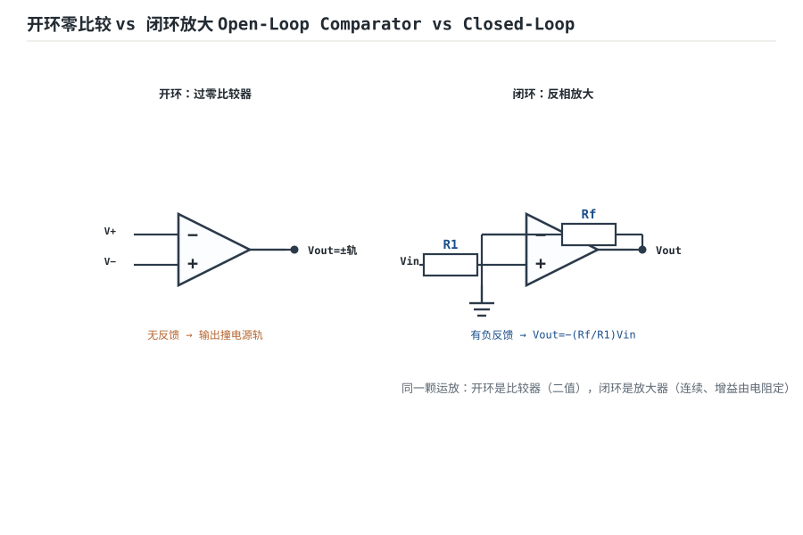

# 开环、闭环增益与负反馈本质 Open-Loop & Closed-Loop Gain

运放开环增益高达 10 万~100 万倍，但你永远不想直接用它——输出会被顶到电源轨。**负反馈**把一部分输出"送回"输入端相减，用牺牲增益换来稳定、可预测、低失真的闭环电路。本章讲清这个代价交换。

## 1. 设计动机

::: motivation 为什么要负反馈
开环增益高得失控：输入差 0.1mV，开环放大 10 万倍就是 100V，现实里输出直接撞电源轨，变成比较器。负反馈像"刹车"——把输出拽回来和输入比较，让增益稳稳压在你设定的电阻比值上，代价只是放弃一点增益。
:::

## 2. 原理图


## 3. 开环与闭环增益

- **开环增益 $A$**：运放本身的增益（$10^5$ 量级），随频率、温度、批次漂移。
- **闭环增益 $G$**：接了反馈后的实际增益。

由框图推导：$Y=A(X-\beta Y)$，整理得

$$G=\frac{Y}{X}=\frac{A}{1+A\beta}=\frac{1}{\beta}\cdot\frac{T}{1+T}\quad,\quad T=A\beta\text{（环路增益）}$$

当 $T=A\beta\gg1$ 时，$G\approx 1/\beta$——**闭环增益几乎只由反馈网络 β 决定，与运放自身的 A 无关**。这就是负反馈最核心的价值。

::: analogy 负反馈像自动控温
你设 25℃（目标 X），温度计测到实际室温（βY）送回比较，炉子根据温差自动加减火力。不管炉子本身火力多猛（A 多大），室温都稳在 25℃——因为反馈一直在"纠错"。$A\beta$ 越大，纠偏越狠，温度越稳。
:::

## 4. 灵敏度：为什么闭环更稳

开环增益 $A$ 变化 10%，闭环增益 $G$ 只变化约 $1/(1+T)$。下表是 $T=1000$ 时的对比：

```echarts
{
  "tooltip": {"trigger": "axis"},
  "legend": {"data": ["开环增益 A", "闭环增益 G"], "bottom": 0, "textStyle": {"fontSize": 13}},
  "grid": {"left": 56, "right": 24, "top": 26, "bottom": 56},
  "xAxis": {"type": "category", "name": "批次/温度变化", "data": ["基准", "+10%", "+20%", "-10%"], "axisLabel": {"fontSize": 11}},
  "yAxis": {"type": "value", "name": "增益倍数", "min": 0, "max": 120000, "axisLabel": {"fontSize": 11}},
  "series": [
    {"name": "开环增益 A", "type": "line", "smooth": true, "showSymbol": false, "lineStyle": {"width": 2.6, "color": "#1a4f8b"},
     "data": [100000,110000,120000,90000]},
    {"name": "闭环增益 G", "type": "line", "smooth": true, "showSymbol": false, "lineStyle": {"width": 2.6, "color": "#b5642e"},
     "data": [100.1,100.1,100.1,100.1]}
  ]
}
```

## 5. 负反馈带来的四大好处

- **增益稳定**：由精密电阻决定，不随运放参数漂。
- **扩展带宽**：闭环后增益滚降频率被抬高 $1+T$ 倍。
- **改变输入/输出阻抗**：串联反馈提高输入阻抗，电压反馈降低输出阻抗。
- **压低失真与噪声**：非线性被环路"平均"掉。

代价：**增益降了**（从 A 降到 1/β），且高频要防自激。

## 扩展与变种电路

### 扩展1：开环零比较 vs 闭环放大 Open-Loop Comparator vs Closed-Loop

**定位**：同一颗运放，开环时是二值比较器（输出撞轨），闭环时是连续放大器（增益由电阻定）——理解"反馈存在与否"是分水岭。



::: example 工作原理 / 静态分析
- 开环：无反馈，$A\approx 10^5$，$V_+$ 略高于 $V_-$ 就输出正满轨，反之负满轨——比较器。
- 闭环：负反馈使 $G=A/(1+A\beta)\approx 1/\beta$，输出连续、由电阻比定。

$$G_{open}\to\text{饱和二值}\quad,\quad G_{closed}\approx \frac{1}{\beta}$$
:::

设计要点：要"二值判断"（过零检测）用开环；要"线性放大"必须闭环。

::: pitfall 开闭环专属坑
- **把开环当线性放大用**：输入 1mV 就输出撞轨，误以为运放坏。线性用途一定要接负反馈。
:::

## 6. 常见坑

::: pitfall 常见坑
- **反馈接成正反馈**：输出越偏越远，锁死在电源轨，变成振荡器/比较器。接完一定核对：反馈回反相端（−）才是负反馈。
- **环路增益不够**：$A\beta$ 在高频滚到 1 以下，闭环增益不再等于 $1/\beta$，频响抬头。
- **以为闭环增益永远等于 1/β**：只在低频、深度负反馈下成立；高频/大信号要按 $G=A/(1+A\beta)$ 算。
:::

## 7. 自测题

<details><summary>A=100000，β=0.01（闭环目标 100），实际闭环增益多少？</summary>

$G=A/(1+A\beta)=100000/(1+1000)=99.9\approx100$。环路增益 $T=1000$，足够深，闭环增益几乎就是 $1/\beta=100$。
</details>

<details><summary>A 从 100000 变到 90000（−10%），闭环增益变了多少？</summary>
$T$ 从 1000 变到 900，$G$ 从 99.9 变到 99.89，相对变化约 0.01%——比开环的 10% 小了三个数量级。这就是负反馈"稳定增益"的威力。
</details>

## 8. 参考资料

- TI SLOD006B《Op Amps for Everyone》，Feedback 章
- [MIT Roberge, Operational Amplifiers](https://web.mit.edu/klund/www/books/op2e.html)
- Sergio Franco《Design with Operational Amplifiers》4e
