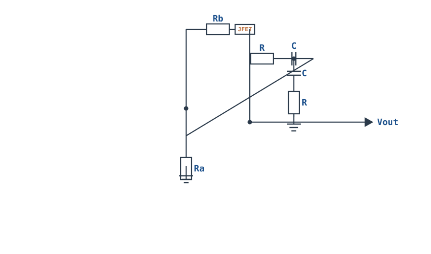
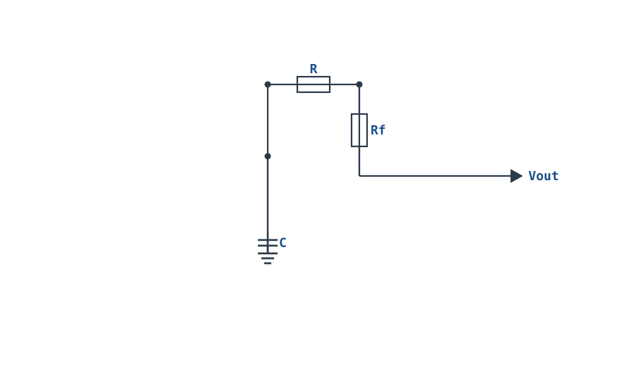

---

id: oscillators
title: "振荡器：文氏桥与晶体振荡 Oscillators: Wien Bridge & Crystal"
part: 3
chapter: 应用与信号处理
order: 140
tags: [运放电路, 振荡器, 文氏桥, 晶体振荡, Barkhausen]
difficulty: 2
status: published
sources:
  - TI Op Amps for Everyone (SLOD006B)
  - The Art of Electronics (Horowitz & Hill)
  - NEETS (Navy Training Series)
---

# 振荡器：文氏桥与晶体振荡 Oscillators: Wien Bridge & Crystal

## 1. 设计动机

::: motivation 为什么需要振荡器
电路里到处都需要"自己产生的时钟信号"：MCU 的时钟、函数发生器的正弦波、仪表的激励信号、载波。振荡器（Oscillator）不需要输入信号，就能自己输出周期波形。

它的本质是**正反馈**：把输出的一小部分相移后送回输入，信号被"自己放大自己"地维持下去。两个硬条件由**巴克豪森判据（Barkhausen Criteria）**给出：环路增益 $|A\beta|=1$，且绕环路一圈的相位偏移为 $0^{\circ}$ 或 $360^{\circ}$。
:::

## 2. 原理图

**文氏桥正弦振荡器（Wien Bridge）**：同相放大器 + RC 串并联选频网络（正反馈），负反馈臂带稳幅元件。


**皮尔斯晶体振荡器（Pierce）**：反相放大器 + 两个负载电容，晶体（Crystal）接在输出与输入之间作反馈。

## 3. 静态分析（DC）

- 文氏桥：RC 选频网络直流下，串联 R 直通、并联 C 开路；同相端直流电位等于输出直流。运放接成同相放大器，静态工作点由负反馈臂 Rb/Ra 决定。
- 起振初期输出为噪声/上电扰动，只要满足条件信号就指数增长；稳态由稳幅元件把增益压回 3。
- 皮尔斯晶体振荡器：反相放大器静态偏置在中间点，晶体在直流下等效为高阻（不影响 DC）。

## 4. 动态分析（AC / 瞬态）

**文氏桥选频网络**：在频率

$$f_0=\frac{1}{2\pi RC}$$

处，串并联 RC 网络的相移恰好为 $0^{\circ}$，且衰减系数 $\beta=1/3$。由巴克豪森判据 $|A\beta|=1$，要求放大器增益：

$$A=1+\frac{R_b}{R_a}=3\qquad(\Rightarrow R_b=2R_a)$$

- 起振时增益需**略大于 3**（信号才能从噪声中长大）；
- 幅值稳定后稳幅元件（灯泡/热敏电阻/并联二极管+AGC）把增益压回**正好 3**，否则波形削顶或停振。

输出是低失真正弦波（文氏桥是少有的正弦振荡器）：

```echarts
{
  "tooltip": {"trigger": "axis"},
  "legend": {"data": ["Vout 正弦波"], "bottom": 0, "textStyle": {"fontSize": 13}},
  "grid": {"left": 56, "right": 24, "top": 26, "bottom": 50},
  "xAxis": {"type": "category", "name": "角度°", "data": [0,30,60,90,120,150,180,210,240,270,300,330,360], "axisLabel": {"fontSize": 11}},
  "yAxis": {"type": "value", "name": "V", "min": -3, "max": 3, "interval": 1.5, "axisLabel": {"fontSize": 11}},
  "series": [
    {"name": "Vout 正弦波", "type": "line", "smooth": true, "showSymbol": false, "lineStyle": {"width": 2.6, "color": "#1a4f8b"},
     "data": [0,1.5,2.6,3,2.6,1.5,0,-1.5,-2.6,-3,-2.6,-1.5,0]}
  ]
}
```

**晶体振荡**：晶体在其串联谐振频率 $f_s$ 附近等效为极高 Q（$Q$ 可达 10⁴~10⁶）的选频元件，振荡频率几乎只由晶体本身决定，温漂可低至 ppm 级——这是它比 RC 振荡器稳定得多的原因。

## 5. 环路分析

- **环路增益 $A\beta$**：文氏桥里 $\beta=1/3$ 仅在 $f_0$ 成立，其他频率相移不为 0 或衰减更大，所以只有 $f_0$ 满足巴克豪森条件——这就是选频。
- **起振与稳幅**：$A>3$ 时 $|A\beta|>1$，信号指数增长；增益过大输出削波失真，增益过小停振。稳幅环把工作点精确锁在 $A=3$。
- **皮尔斯振荡**：反相放大器本身提供 180° 相移，晶体在谐振时再提供 180°，合计 360°，满足相位条件。
- 稳定性：RC 文氏桥频率精度由 R、C 决定（±1%~5%）；晶体振荡器由晶体决定（±几十 ppm）。

::: advanced 进阶：为什么要稳幅
若 $A$ 一直略大于 3，输出会一直长大直到撞电源轨，波形变成方波/削顶。稳幅元件（如钨丝灯泡，电阻随发热增大）自动把大信号时的增益压到 3、小信号时保持 >3，于是振幅稳定、波形干净。没有稳幅的文氏桥要么停振要么削波。
:::

## 6. 元件取值与工程权衡

- **f0 定 R、C**：kHz 级取 C=1nF~100nF，反算 R。串臂与并臂的 R、C 要严格相等（都用同值）。
- **电阻比 Rb/Ra=2**：用 1% 电阻，Rb 上并联二极管/接灯泡实现稳幅。
- **电容材质**：选 C0G/NP0，温漂小、频率稳定。
- **晶体选择**：按所需频率选标称晶振（如 16MHz、32.768kHz），配规定的负载电容（CL，见晶振 datasheet）。
- **运放 GBP**：选 GBP 远大于 $f_0$，否则额外相移破坏起振条件。

## 7. 完整设计示例

::: example 设计 f0=1kHz 的文氏桥正弦振荡器
1. **需求**：输出 1kHz、幅度约 2V 的正弦波，双电源 ±15V。
2. **选 C**：取 C=10nF（C0G）。
3. **算 R**：$R=1/(2\pi f_0 C)=1/(2\pi\times1\text{k}\times10\text{n})\approx15.9\text{k}\Omega$，取 15.8kΩ（1%），串臂并臂用同值。
4. **定增益**：$A=3$，即 $R_b/R_a=2$。取 $R_a=10\text{k}\Omega$，$R_b=20\text{k}\Omega$（实际用 18kΩ 串电位器微调，或并联两个硅二极管在 Rb 上自动稳幅）。
5. **验算**：$f_0=1/(2\pi\times15.8\text{k}\times10\text{n})\approx1.005\text{kHz}$；$A=1+20/10=3$，满足 $|A\beta|=1$。
6. **起振检查**：上电后输出应从噪声中长出稳定正弦波，示波器观察无削顶。
:::

## 8. 仿真与实验

LTspice 搭建文氏桥：
- 瞬态仿真 5ms，观察输出从 0 开始指数增长、最后稳定为正弦波；
- 把 Rb 换成固定 3 倍 Ra，观察要么不起来、要么削顶；再换上并联二极管稳幅，观察波形变干净；
- 用频率计/FFT 测输出频率，核对 $f_0$；
- 皮尔斯电路：用反相门 + 晶振模型，观察起振到稳定振荡。

## 扩展与变种电路

### 扩展1：RC 三级移相振荡器 Phase-Shift Oscillator

反相放大器本身提供 180° 相移，三级 RC 网络再额外移相 180°，合计 360° 满足振荡——结构简单，适合产生固定低频正弦方波。


::: example 工作原理/静态分析
三级相同 RC 在某一频率恰好移相 180°，且衰减到 $1/29$；故要求放大器增益 $|A|=29$（$R_f=29R$）：

$$f_0=\frac{1}{2\pi RC\sqrt{6}}$$
:::

取值：$R_f=29R$；输出失真较大，适合方波/低频场合，不做高质量正弦。

::: pitfall 增益不足不起振
$R_f<29R$ 时环路增益 $<1$，输出停振。$R_f$ 略大于 $29R$ 才能从噪声起振，但过大则削波。
:::

### 扩展2：文氏桥 AGC（JFET）稳幅 Wien AGC

在文氏桥负反馈臂里接入结型场效应管（JFET）作压控电阻，自动把大信号增益压回 3——比灯泡稳幅更可控、更快速。



::: example 工作原理/静态分析
$V_{out}$ 经整流得到直流，控制 JFET 的 $V_{GS}$：信号大时 JFET 电阻增大、负反馈加深、增益降到 3；信号小时反之。环路自动锁定 $A=3$，波形低失真。
:::

取值：$f_0=1/(2\pi RC)$；JFET 选低噪声型号，整流时间常数按数倍振荡周期取。

::: pitfall AGC 时间常数不当
整流滤波太慢会导致幅度蠕变；太快则把调制纹波馈进信号。时间常数需取振荡周期的数倍。
:::

### 扩展3：考毕兹 LC 振荡器 Colpitts LC

用一个电感加两个串联电容构成分压反馈网络，配合反相放大器产生高频正弦——适合几 MHz 到 VHF 频段。


::: example 工作原理/静态分析
$$f_0=\frac{1}{2\pi\sqrt{L\,(C_1\parallel C_2)}}$$

$C_1,C_2$ 的分压比决定反馈系数，选 $C_1\gg C_2$ 获得合适反馈。
:::

取值：$L$ 取 µH 级；高频应用，运放 GBP 要远大于 $f_0$，否则改用晶体管。

::: pitfall 高频运放跟不上
$f_0$ 接近运放 GBP 时附加相移破坏起振条件。高频段应改用 BJT/FET 考毕兹，而非运放。
:::

### 扩展4：弛张振荡器 Relaxation Oscillator

电容在两个阈值间反复充放电，比较器在阈值处翻转——这是最通用的方波/锯齿波产生结构，555 内部就是它。



::: example 工作原理/静态分析
$$T=2RC\ln\frac{1+\beta}{1-\beta},\quad \beta=\frac{R_1}{R_1+R_f}$$

电容电压指数逼近输出电平，碰到阈值即翻转，形成连续振荡。
:::

取值：$R,C$ 决定频率；波形是方波（输出）加指数充放电（电容）。

::: pitfall 频率温漂
定时电容温漂直接变成频率温漂。要稳定频率选 C0G/薄膜电容，避免电解。
:::


## 9. 常见坑与故障现象

::: pitfall 常见坑
- **不起振（输出恒为 0 或直流）**：原因是增益不足（$A<3$）、选频网络断线、或运放 GBP 不够。解决：略增大 Rb、检查接线、换高 GBP 运放。
- **输出削波成方波**：原因是没有稳幅，$A$ 远大于 3。解决：加灯泡/二极管稳幅网络。
- **频率不准**：R、C 不等值或用了温漂大的电容。解决：串并臂用同值 1% 电阻、C0G 电容。
- **晶体电路不起振/停振**：负载电容 CL 不匹配、布线寄生大、反相放大器增益不足。解决：按晶振 datasheet 配 CL，缩短走线。
- **输出有高频寄生振荡**：运放补偿不当或探针/负载过重。解决：按 GBP 要求选运放，输出加缓冲。
:::

## 10. 自测题

<details><summary>文氏桥选频网络在 f0 处衰减 1/3，放大器增益应取多少？为什么？</summary>

增益应取 **3**。因为巴克豪森判据要求环路增益 $|A\beta|=1$，$\beta=1/3$，所以 $A=1/\beta=3$。起振时需略大于 3，稳幅后回到 3。

</details>

<details><summary>巴克豪森两个条件是什么？</summary>

① 环路增益 $|A\beta|=1$（幅值条件）；② 绕环路一圈的总相移为 $0^{\circ}$ 或 $360^{\circ}$（相位条件）。二者同时满足才能维持等幅振荡。

</details>

<details><summary>RC 文氏桥和皮尔斯晶体振荡器，哪个频率更稳定？为什么？</summary>

**皮尔斯晶体振荡器**。它靠晶体极高的 Q（10⁴~10⁶）选频，频率由晶体物理特性决定，温漂 ppm 级；文氏桥频率由 R、C 决定，精度和稳定性都差几个数量级。

</details>

## 11. 参考资料

- TI, *Op Amps for Everyone* (SLOD006B)，正弦振荡器
- Horowitz & Hill, *The Art of Electronics* (3rd Ed.)，Wien bridge 与晶体振荡
- NEETS, *Navy Electricity and Electronics Training Series*，振荡器原理
