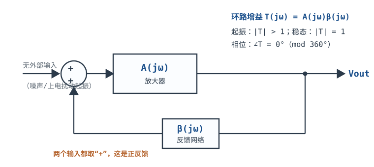
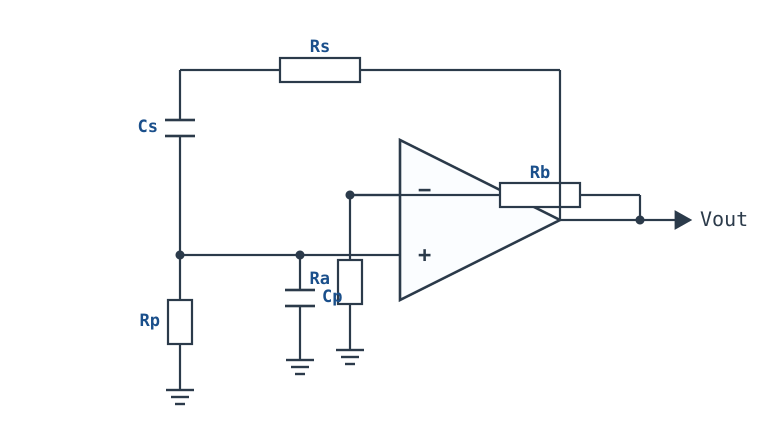
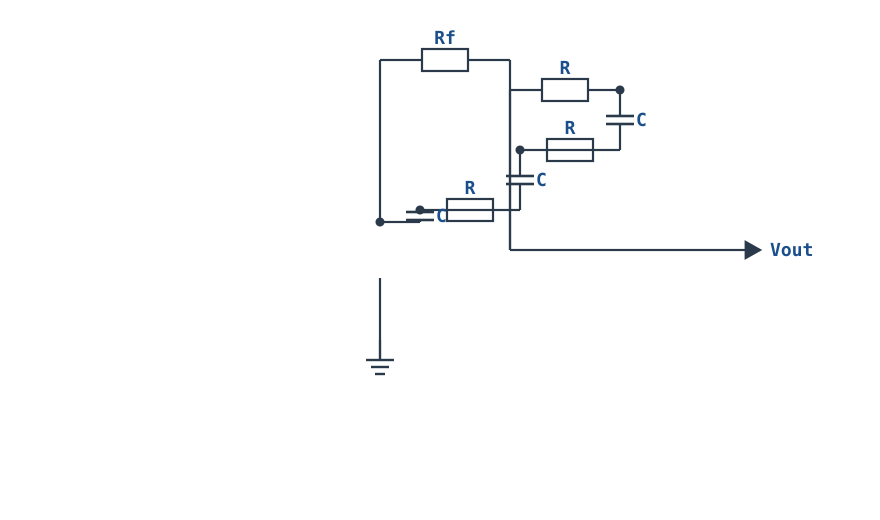
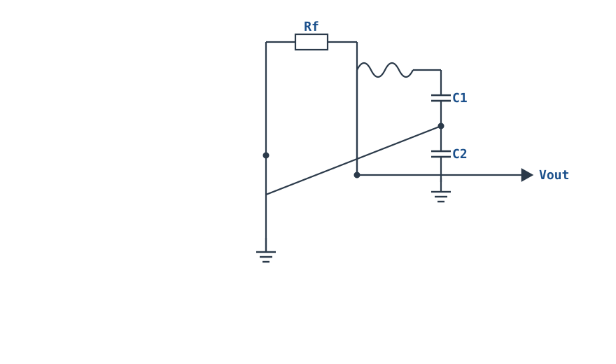

---

id: oscillators
title: "振荡器：文氏桥与晶体振荡 Oscillators: Wien Bridge & Crystal"
part: 3
chapter: 应用与信号处理
order: 140
tags: [运放电路, 振荡器, 文氏桥, 晶体振荡, Barkhausen]
difficulty: 2
status: published
sources:
  - TI, Op Amps for Everyone (SLOD006B), Chapter 15 Sine Wave Oscillators — 文氏桥的 beta=1/3、起振增益 3、灯泡与二极管稳幅 https://archive.org/details/TexasInstruments-TI-ApplicationsandSeminars-OpAmpsForEveryoneDesignReference2000OCR
  - TI, SLOA060 Sine Wave Oscillators (Jim Karki) — 文氏桥、移相与正交振荡器的推导，幅度稳定方法 https://www.ti.com/lit/an/sloa060/sloa060.pdf
  - Horowitz & Hill, The Art of Electronics (3rd ed.), Chapter 7 Oscillators and Timers — 文氏桥起振、灯泡/热敏电阻稳幅、晶体振荡与 ppm 量级
  - Epson, Crystal Device Technical Handbook — 石英晶体的 Q 值、AT 切温度特性、频率容差与老化
  - Sedra & Smith, Microelectronic Circuits (8th ed.), Signal Generators and Waveform-Shaping Circuits — 巴克豪森判据、RC 相移振荡器与三点式
  - IEC 60122-1, Quartz crystal units — 标称频率、负载电容与频率容差等级
---

# 振荡器：文氏桥与晶体振荡 Oscillators: Wien Bridge & Crystal

振荡器（Oscillator）是一台**没有外部输入、却能自己输出周期波形**的电路。它把输出的一部分送回输入，让信号"自己放大自己"地维持下去；一旦这个环路在某个频率上既满足相位、又满足幅度，噪声就会从微伏级长成稳定的正弦波或方波。

这件事听起来像永动机，其实不是：环路每绕一圈都要从电源取能量，补上电阻、电容和负载消耗掉的那一部分。**振荡器是"正反馈 + 非线性限幅"的组合**：正反馈决定它能不能起振、在哪个频率振；非线性限幅决定它最后停在多大振幅。缺了后者，输出不是停在噪声上，就是一路撞到电源轨。

本章围绕三个问题展开：**为什么环路增益必须略大于 1 才能起振、文氏桥的频率和起振增益 3 是怎么来的、不同振荡器的频率稳定度差多少个 ppm**。算完这一章，你应该能独立设计一个 1 kHz、失真可控的文氏桥，并能说清 RC、陶瓷、晶体三类振荡器分别适合什么场合。负反馈的稳定性判据见[稳定性：伯德图、相位裕度与补偿](stability-bode.md)；环路增益的定义见[开环、闭环增益与负反馈本质](open-loop-feedback.md)；LC 回路的 Q 与谐振见[RLC 电路与谐振](../basics/rlc-resonance.md)；晶体的负载电容与 ppm 计算见[晶振与谐振器](../components/crystal-oscillator.md)。

## 1. 设计动机

::: motivation 三个真实场景
**场景一：函数发生器要一个 1 kHz、失真 0.1% 的正弦。** 用 MCU 的 PWM 加滤波，1 kHz 处要获得 0.1% 的失真，滤波器的阶数和成本都不低；用文氏桥加灯泡稳幅，两三只运放、一只灯泡就能做到 0.1% 量级。但如果把负反馈电阻取成"正好 2 倍下臂"，环路增益刚好等于 1，电路只会把上电噪声原样保持——输出停在几毫伏，长不到 1 V。**"增益等于 1"是维持条件，不是起振条件。**

**场景二：给 16 位 ADC 做采样时钟。** RC 振荡器的频率误差是百分之一到百分之几（$10^4$ ppm 量级），晶振是几十 ppm 量级。同样标称 1 MHz，RC 振荡器的实际频率可能偏 20 kHz，而晶振只偏 20 Hz——前者会让需要精确采样率的系统直接失效。**振荡器的选型，第一步是问"频率允许偏多少 ppm"，而不是问"能不能振"。**

**场景三：555 或比较器做的弛张振荡器，频率随电源和温度跑。** 这类振荡器的频率由 RC 和阈值共同决定，阈值又跟着电源走；要一个"只由无源元件决定"的频率，就得用线性振荡器（文氏桥、LC、晶体）。**方波容易，稳定的正弦难；稳定的频率最难。**
:::

把这三个场景压成一张表，遇到"要产生一个信号"时先问自己：

| 你想确认 | 先算 | 判据（工程经验值） |
|---|---|---|
| 能不能起振 | 环路增益 $T=A\beta$ 在目标频率的模 | 起振 $|T|>1$，留 1%~5% 余量 |
| 振在哪个频率 | 环路相位为 $0^{\circ}$ 的频率 | 与目标频率偏差在预算内 |
| 振幅多大 | 限幅元件的拐点与过增益 | 输出不撞电源轨，失真可接受 |
| 频率稳不稳 | R、C、Q、温度系数与 ppm 预算 | 总偏差小于系统容限的 1/3 |
| 运放够不够快 | $GBW$ 与 $f_0$ 的比值 | 至少 $1000f_0$（0.5%），高精度取 $4500f_0$（0.1%） |
| 输出干不干净 | 限幅方式与环路时间常数 | 失真、幅度漂移、起振时间都在预算内 |

**不懂会在哪摔跤**，四个带数字的代价：

1. **把"环路增益 = 1"当成起振条件。** 文氏桥的放大器增益取 $A=3.00$，理论上处于临界；实际电阻公差让 $A$ 落在 $2.97\sim3.03$，一半的板子不起振，另一半勉强起振但幅度随温度漂。必须让 $A$ 在起振时略大于 3，再用非线性把稳态压回 3。
2. **没有限幅，增益取到 3.5。** 输出会一路长到撞电源轨，正弦变成方波，失真从 0.1% 恶化到 40% 以上；同时运放长期饱和，恢复时间变长，频率也会被拖偏。
3. **用 X7R 电容做选频。** X7R 的容量随温度和直流偏压可以变化 ±15% 以上，$f_0$ 跟着变 $10^4$ ppm 量级；同样条件下 C0G 的温漂约 $30$ ppm/$^{\circ}\text{C}$，差两个数量级。
4. **忽略运放相位滞后。** GBW=1 MHz 的运放做 1 kHz 文氏桥，闭环极点落在 323 kHz，1 kHz 处额外相移约 $0.18^{\circ}$，把频率拉低约 0.47%（4.7 Hz）——这已经比 1% 电阻的公差小不了多少。

## 2. 定义与直观

### 2.1 一句话定义：把输出送回输入，并且送对了相位

**振荡器**是一个正反馈环路：放大器 $A(j\omega)$ 把误差放大，反馈网络 $\beta(j\omega)$ 把输出的一部分送回输入端，两个输入在求和点**同相相加**。没有外部输入时，环路里只剩噪声和上电扰动；只要环路在某个频率上满足条件，这个频率的分量就会每绕一圈长大一点，最终被非线性限制在稳定振幅。



环路增益（Loop Gain）定义为

$$T(j\omega)=A(j\omega)\,\beta(j\omega)$$

其中 $T$ 无量纲；$A$ 是放大器的开环增益（无量纲，V/V）；$\beta$ 是反馈系数（无量纲，$0<\beta\leq1$）。**注意 $\beta$ 不是三极管的电流放大倍数**，两者只是字母相同。这个符号体系与[稳定性：伯德图、相位裕度与补偿](stability-bode.md)一致：那里讨论负反馈，环路增益同样写成 $T=A_{OL}\beta$，只是相位条件写成 $-180^{\circ}$。

### 2.2 两个条件：幅度与相位

振荡必须同时满足两个条件，缺一不可：

| 条件 | 起振时 | 稳态时 | 物理含义 |
|---|---|---|---|
| 幅度条件 | $\lvert T(j\omega_0)\rvert>1$ | $\lvert T(j\omega_0)\rvert=1$ | 每绕一圈，回来的信号至少和出发时一样大 |
| 相位条件 | $\angle T(j\omega_0)=0^{\circ}\ (\mathrm{mod}\ 360^{\circ})$ | 同左 | 回来的信号与输入同相，才是"助推"而不是"纠错" |

这就是**巴克豪森判据（Barkhausen Criterion）**。两个条件的分工很清楚：**相位条件选频率**——只有那些绕一圈相位为 $0^{\circ}$ 的频率才可能振；**幅度条件决定能不能起来、最后停在哪**——起振时要大于 1，稳态时被非线性压回 1。

这里要澄清一个常见混淆：负反馈的稳定性判据写成 $\angle T=-180^{\circ}$ 时自激，正反馈的振荡条件写成 $\angle T=0^{\circ}\ (\mathrm{mod}\ 360^{\circ})$，两者是**同一件事的两种记账方式**。负反馈环路在 $-180^{\circ}$ 处变成正反馈；如果把反馈网络本身的"反相"算进 $\beta$，那么正反馈环路的相位条件就是 $0^{\circ}$。本书运放篇统一用后一种写法：**振荡器分析看正反馈环，相位目标 $0^{\circ}$（等价于 $360^{\circ}$）**。

### 2.3 为什么"环路增益刚好等于 1"无法起振

这是本章最容易被跳过、却最影响设计成败的一点。

把环路在 $f_0$ 附近近似成一阶谐振环节。设无反馈时谐振器的品质因数为 $Q$，环路增益在 $f_0$ 处为 $T_0$。闭环特征方程是 $1-T(j\omega)=0$；在 $f_0$ 附近展开，可以得到闭环极点

$$s=\sigma+j\omega_0,\qquad \sigma=\frac{\omega_0\,(T_0-1)}{2Q}$$

其中 $\sigma$ 是包络的增长率（单位 $\text{s}^{-1}$），$\omega_0=2\pi f_0$ 是角频率（rad/s），$Q$ 无量纲。三种情况：

- $T_0<1$：$\sigma<0$，包络按 $e^{\sigma t}$ 衰减，噪声很快消失，**不起振**；
- $T_0=1$：$\sigma=0$，极点正好落在虚轴上，包络既不长大也不衰减，输出停在初始扰动的大小（通常几十微伏到几毫伏），**看起来"振了"，其实没有可用幅度**；
- $T_0>1$：$\sigma>0$，包络指数增长，直到非线性把有效增益压回 1，**这才是可用的振荡器**。

增长的时间常数是 $\tau=1/\sigma=2Q/[\omega_0(T_0-1)]$。从初始幅度 $V_0$ 长到目标幅度 $V_1$ 需要

$$t_{start}=\tau\ln\frac{V_1}{V_0}=\frac{2Q}{\omega_0(T_0-1)}\ln\frac{V_1}{V_0}$$

以文氏桥为例，选频网络的 $Q=1/3$（下一节证明），所以

$$\tau=\frac{2\times(1/3)}{2\pi f_0(T_0-1)}=\frac{1}{3\pi f_0(T_0-1)}$$

取 $f_0=1007.3\ \text{Hz}$、$V_0=100\ \mu\text{V}$、$V_1=1.38\ \text{V}$（本章设计示例的振幅），不同过增益下的起振时间如下：

| $T_0-1$ | $\tau$ | $t_{start}$（$100\ \mu\text{V}\to1.38\ \text{V}$） | 现象 |
|---|---|---|---|
| $0.1\%$ | $105\ \text{ms}$ | $1.00\ \text{s}$ | 上电后要等约 1 秒才看到波形，温度一变就可能停振 |
| $1\%$ | $10.5\ \text{ms}$ | $100\ \text{ms}$ | 可用，但批次差异明显 |
| $3.33\%$ | $3.16\ \text{ms}$ | $30.1\ \text{ms}$ | 本章设计示例的选择，起振快、限幅压力小 |
| $10\%$ | $1.05\ \text{ms}$ | $10.0\ \text{ms}$ | 起振很快，但限幅元件要吸收更多过增益，失真变大 |

**结论**：$T_0=1$ 时 $\tau\to\infty$，起振时间无穷大；实际电路里总有损耗和公差，所以"刚好 1"的电路不是"临界稳定"，而是"大概率不起振"。工程上让 $T_0$ 比 1 大 1%~5%，再用一个随幅度增加而减小增益的元件把稳态锁回 $T=1$。

::: analogy 推秋千
秋千是一个摆在重力场里的谐振系统，频率由绳长决定，跟你怎么推关系不大。想让秋千越荡越高，你必须在它**每次到达最高点时顺着速度方向推**——这就是相位条件；推的力度要略大于空气阻力和摩擦消耗的能量——这就是幅度条件里"略大于 1"的部分。推得太轻，秋千慢慢停；推得太重，秋千会撞到架子（限幅），而且你的推力节奏会被秋千的反作用打乱（非线性）。

类比的边界：秋千的"限幅"是撞架子，硬限幅会产生大量高次谐波；文氏桥的限幅元件（灯泡、二极管、AGC）是**软限幅**，它只在大幅度时轻微压缩增益，所以输出仍然是低失真正弦。另一个边界：秋千的频率几乎不受推力影响，而电子振荡器的频率会受放大器相移、寄生电容和负载影响——这正是后面要用 $Q$ 比较频率稳定度的原因。
:::

### 2.4 三类常见拓扑：RC、LC、晶体

按选频元件的 $Q$ 从低到高，常见的正弦振荡器可以排成一条线：

1. **RC 振荡器**：文氏桥（Wien Bridge）、三级移相（Phase Shift）、双 T（Twin-T）。$Q$ 在 $1/3\sim1$ 量级，频率由 $RC$ 决定，适合 1 Hz~100 kHz 的低频正弦，失真可以做到 0.1% 以下，频率稳定度 $10^{-4}\sim10^{-2}$。
2. **LC 振荡器**：考毕兹（Colpitts）、哈特莱（Hartley）、克拉普（Clapp）。$Q$ 在 $50\sim200$ 量级，频率由 $LC$ 决定，适合 100 kHz~几百 MHz 的射频，频率稳定度 $10^{-5}\sim10^{-4}$。
3. **晶体振荡器**：皮尔斯（Pierce）、米勒（Miller）。$Q$ 在 $10^4\sim10^6$ 量级，频率由石英片的机械谐振决定，适合对频率精度要求高的时钟与载波，稳定度 $10^{-5}\sim10^{-4}$（10~100 ppm 级）。

**文氏桥（Wien Bridge）**是最经典的低频正弦振荡器：同相放大器 + RC 串并联选频网络（正反馈）+ 负反馈臂（决定增益与稳幅）。



**皮尔斯晶体振荡器（Pierce）**把晶体接在反相放大器的输出与输入之间，两端各接一只负载电容到地。晶体在串联谐振与并联谐振之间呈感性，和两只负载电容构成一个 π 网络，在谐振频率上提供 $180^{\circ}$ 相移；反相放大器再提供 $180^{\circ}$，合计 $360^{\circ}$。晶体的等效模型、负载电容与 ppm 计算见[晶振与谐振器](../components/crystal-oscillator.md)。

## 3. 定量关系

### 3.1 文氏桥的选频网络：为什么是 $1/3$

把文氏桥的选频网络单独拿出来：串联臂 $Z_s=R_s+1/(sC_s)$，并联臂 $Z_p=R_p\parallel 1/(sC_p)=R_p/(1+sR_pC_p)$。反馈系数是并联臂上的分压：

$$\beta(s)=\frac{Z_p}{Z_s+Z_p}$$

取 $R_s=R_p=R$、$C_s=C_p=C$，代入并通分：

$$\beta(s)=\frac{sRC}{s^2R^2C^2+3sRC+1}$$

令 $s=j\omega$、$u=\omega RC$，分子分母同乘 $(1-u^2-3ju)$：

$$\beta(j\omega)=\frac{ju}{1-u^2+3ju}=\frac{1}{3+j\left(u-\dfrac{1}{u}\right)}$$

这一步是本章大部分结论的起点。由此直接读出两件事：

- **幅频**：$|\beta|=\dfrac{1}{\sqrt{9+\left(u-1/u\right)^2}}$，在 $u=1$ 处取最大值 $1/3$；
- **相频**：$\angle\beta=-\arctan\dfrac{u-1/u}{3}$，在 $u=1$ 处正好为 $0^{\circ}$。

所以选频网络的谐振频率是

$$u=1\ \Longrightarrow\ \omega_0RC=1\ \Longrightarrow\ f_0=\frac{1}{2\pi RC}$$

在 $f_0$ 处，$\beta=1/3$、相移 $0^{\circ}$。**$1/3$ 不是随便取的，它是 $R_s=R_p$、$C_s=C_p$ 时并联臂分压的必然结果**；只要串臂和并臂的 $R$、$C$ 不相等，$f_0$ 处的 $\beta$ 和相位都会变，增益 3 的结论也跟着失效。

把上面两个式子画成图：幅频在 $f_0$ 处有最大值 $-9.54\ \text{dB}$，两侧按 $\pm20\ \text{dB/十倍频}$ 下降；相频在 $f_0$ 处过零，低频侧超前、高频侧滞后，$0.1f_0$ 与 $10f_0$ 处约为 $\pm73^{\circ}$。**相频在 $f_0$ 附近的斜率决定了频率稳定度**：同样的相位误差，斜率越陡，频率偏得越少。

```echarts
{
  "tooltip": {"trigger": "axis"},
  "legend": {"data": ["|β| / dB", "∠β / deg"], "bottom": 0, "textStyle": {"fontSize": 12}},
  "grid": {"left": 64, "right": 64, "top": 30, "bottom": 58},
  "xAxis": {"type": "category", "name": "f / f0", "data": ["0.1","0.15","0.2","0.3","0.5","0.7","1","1.4","2","3","5","7","10"], "axisLabel": {"fontSize": 11}},
  "yAxis": [
    {"type": "value", "name": "|β| / dB", "min": -24, "max": 0, "axisLabel": {"fontSize": 11}},
    {"type": "value", "name": "∠β / deg", "min": -90, "max": 90, "axisLabel": {"fontSize": 11}}
  ],
  "series": [
    {"name": "|β| / dB", "type": "line", "smooth": true, "showSymbol": false, "lineStyle": {"width": 2.6, "color": "#1a4f8b"},
     "data": [-20.29,-17.12,-15.06,-12.60,-10.51,-9.79,-9.54,-9.76,-10.51,-12.07,-15.06,-17.48,-20.29]},
    {"name": "∠β / deg", "type": "line", "smooth": true, "showSymbol": false, "yAxisIndex": 1, "lineStyle": {"width": 2.6, "color": "#b5642e"},
     "data": [73.14,65.28,57.99,45.32,26.57,13.65,0,-12.88,-26.57,-41.63,-57.99,-66.37,-73.14]}
  ]
}
```

### 3.2 起振增益 3 的来历与稳幅

放大器接成同相放大，增益是

$$A=1+\frac{R_b}{R_a}$$

其中 $R_a$ 是反相端到地的下臂电阻（$\Omega$），$R_b$ 是输出到反相端的上臂电阻（$\Omega$）。巴克豪森幅度条件在 $f_0$ 处要求

$$|T|=A\cdot\beta=A\cdot\frac{1}{3}=1\ \Longrightarrow\ A=3\ \Longrightarrow\ R_b=2R_a$$

这就是"起振增益 3"的全部来历：**选频网络在 $f_0$ 处衰减到 $1/3$，放大器必须补回 3 倍**。注意 $A=3$ 是稳态条件；起振时 $A$ 要略大于 3，通常取 $A=3.02\sim3.10$，对应 $R_b=(2.02\sim2.10)R_a$。

为什么不能取更大的过增益？因为限幅元件要吸收全部多余的环路增益。过增益 10% 意味着限幅元件在峰值附近要把有效增益压低 10%，非线性工作区间更宽，失真更大；过增益 1% 又会被电阻公差和温度漂移吃掉。**1%~5% 是失真与可靠起振的折中**。

稳幅元件必须满足一个符号条件：**幅度增大时，环路增益要减小**。四种常见做法：

| 方法 | 接在哪里 | 为什么能稳幅 | 失真量级 | 速度 | 代价 |
|---|---|---|---|---|---|
| 钨丝灯泡（PTC） | 下臂 $R_a$ | 幅度↑ → 灯丝电流↑ → 温度↑ → $R_a$↑ → $A=1+R_b/R_a$↓ | 0.1% 量级 | 几十 ms | 需要灯丝功率与输出幅度匹配；低温启动慢 |
| NTC 热敏电阻 | 上臂 $R_b$ | 幅度↑ → 自热↑ → $R_b$↓ → $A$↓ | 0.1%~1% | 秒级 | 热时间常数大，可能低频"呼吸" |
| 二极管对 | 跨接在 $R_b$ 两端 | 大信号时二极管导通，旁路一部分 $R_b$，等效增益下降 | 1% 量级 | 即时 | 幅度低（约 1 V 峰）、随温度漂移 |
| JFET/光敏电阻 AGC | 串在 $R_b$ 或 $R_a$ 中 | 整流后的直流控制栅压/光照，改变等效电阻 | 0.01%~0.1% | ms~s | 需要整流、滤波与控制环路 |

**灯泡必须放在下臂 $R_a$，不能放在上臂 $R_b$。** 这是本章最容易接反的一处：PTC 灯泡的电阻随温度升高而增大；放在上臂时，幅度增大 → $R_b$ 增大 → 增益更大 → 幅度继续增大，符号反了，电路会一路削顶。放在下臂，$R_a$ 增大才会让 $1+R_b/R_a$ 减小。NTC 热敏电阻的方向相反，所以它放在上臂。**先确认元件的温度系数，再决定放上臂还是下臂。**

二极管稳幅的定量估算放在 §4.1 的设计示例里：三只 1N4148 串联、两只方向反并联跨接在 $R_b$ 上，输出幅度约 1.38 V 峰，峰值处二极管只分流 4.8%，按硬限幅模型估算 THD 约 1.7%。它的优点是快、便宜；缺点是幅度低、温度漂移大（硅二极管约 $-2\ \text{mV}/^{\circ}\text{C}$，三只串联让幅度温度系数约 $-0.65\%/^{\circ}\text{C}$）。

::: advanced 进阶：起振时间常数的推导
把选频网络在 $f_0$ 附近展开。由 $\beta(j\omega)=1/[3+j(u-1/u)]$，令 $u=1+\delta$（$\delta\ll1$），则 $u-1/u\approx2\delta$，于是

$$\beta\approx\frac{1}{3}\cdot\frac{1}{1+j(2\delta/3)}=\frac{1}{3}\cdot\frac{1}{1+j2Q\delta},\qquad Q=\frac{1}{3}$$

环路增益 $T=T_0/(1+j2Q\delta)$，闭环特征方程 $1-T=0$ 给出 $j2Q\delta=T_0-1$，即 $\delta=-j(T_0-1)/(2Q)$。代回 $s=j\omega_0(1+\delta)$：

$$s=j\omega_0+\frac{\omega_0(T_0-1)}{2Q}$$

所以增长率 $\sigma=\omega_0(T_0-1)/(2Q)$，时间常数 $\tau=2Q/[\omega_0(T_0-1)]$。$Q=1/3$ 时 $\tau=1/[3\pi f_0(T_0-1)]$，与 §2.3 的式子一致。

这个推导假设 $T_0$ 与频率无关、限幅还没起作用；它只描述**起振初期**。到了大信号，限幅元件把有效 $T_0$ 压回 1，指数增长停止，进入等幅振荡。起振时间与限幅建立时间之和，才是示波器上看到的"上电到稳定"的时间。
:::

### 3.3 频率稳定度：$Q$ 决定"同样的相位误差偏多少"

振荡频率由相位条件决定：环路总相位为 $0^{\circ}$ 的频率就是 $f_0$。如果放大器、寄生电容或负载额外引入了一个相位误差 $\Delta\varphi$，选频网络必须用一个相反的相位来补偿，频率就会偏移。偏移量由相频斜率决定：

$$\frac{\Delta f}{f_0}=\frac{\Delta\varphi}{2Q}$$

其中 $\Delta\varphi$ 用弧度（rad），$Q$ 无量纲。这个式子是本章比较不同振荡器的核心工具：**同样的相位误差，$Q$ 越高，频率偏得越少**。

取一个具体的相位误差 $\Delta\varphi=0.1^{\circ}=1.745\times10^{-3}\ \text{rad}$：

| 振荡器 | $Q$ | $\Delta f/f_0$ | 以 ppm 计 | 1 MHz 时偏多少 |
|---|---|---|---|---|
| 文氏桥 RC | $1/3$ | $2.62\times10^{-3}$ | $2620\ \text{ppm}$ | $2.62\ \text{kHz}$ |
| LC 考毕兹 | $100$ | $8.7\times10^{-6}$ | $8.7\ \text{ppm}$ | $8.7\ \text{Hz}$ |
| 石英晶体 | $10^5$ | $8.7\times10^{-9}$ | $0.0087\ \text{ppm}$ | $0.0087\ \text{Hz}$ |

**三个数量级的差距，全部来自 $Q$。** 这也解释了为什么晶振对电路寄生、运放相移、负载变化都不敏感：它的相频斜率太陡，同样的扰动只能让它偏零点几个 ppm。

再看绝对精度。绝对精度由元件容差、温度系数、老化共同决定，不只是 $Q$：

| 类型 | 初始容差 | 温度 | 老化 | 合计（典型量级） |
|---|---|---|---|---|
| RC 文氏桥（1% 电阻 + 1% C0G） | $\pm2\%$（$2\times10^4\ \text{ppm}$） | 约 $55\ \text{ppm}/^{\circ}\text{C}$，$45^{\circ}\text{C}$ 内约 $2500\ \text{ppm}$ | 可忽略 | $2\times10^4\sim3\times10^4\ \text{ppm}$ |
| 陶瓷谐振器 | $\pm0.5\%$（$5000\ \text{ppm}$） | $\pm0.3\%$（$3000\ \text{ppm}$） | $\pm0.1\%$（$1000\ \text{ppm}$） | 约 $9000\ \text{ppm}$ |
| 石英晶体（含负载电容误差） | $\pm20\ \text{ppm}$ | $\pm20\ \text{ppm}$ | $\pm5\ \text{ppm/年}$ | 约 $80\ \text{ppm}$ |

读表要注意三件事：

1. **RC 的绝对误差主要不是 $Q$ 造成的**，而是电阻、电容本身的容差；$Q$ 决定的是"外部相位扰动"折算成频率的比例。两者要分开算。
2. **陶瓷谐振器比 RC 好，但远不如晶体**：它的初始容差和温漂都在 $10^3\ \text{ppm}$ 量级，适合对成本敏感、容差要求 ±1% 的场合（如某些 MCU 的时钟）。
3. **晶体的 $80\ \text{ppm}$ 里，负载电容误差占了大头**：按[晶振与谐振器](../components/crystal-oscillator.md)的 $19\ \text{ppm/pF}$，两只负载电容配错 2 pF 就是 38 ppm。晶体本身很好，外围配错照样超差。

### 3.4 运放相移对频率的影响：GBW 要多大

文氏桥里的运放不是理想器件。它的闭环极点落在 $GBW/A$ 处，在 $f_0$ 处产生相位滞后

$$\Delta\varphi_{op}=\arctan\frac{A f_0}{GBW}$$

其中 $GBW$ 是运放的增益带宽积（Hz），$A$ 是闭环增益（本章 $A=3.1$）。这个滞后要由选频网络的相位超前补偿，频率因此偏低：

$$\frac{\Delta f}{f_0}\approx\frac{\Delta\varphi_{op}}{2Q}=1.5\arctan\frac{A f_0}{GBW}$$

取 $GBW=1\ \text{MHz}$、$f_0=1007.3\ \text{Hz}$、$A=3.1$：

$$\Delta\varphi_{op}=\arctan\frac{3.1\times1007.3}{10^6}=\arctan(0.00312)=0.179^{\circ}=3.12\times10^{-3}\ \text{rad}$$

$$\frac{\Delta f}{f_0}=1.5\times3.12\times10^{-3}=4.68\times10^{-3}=0.47\%\ \Longrightarrow\ \Delta f=-4.7\ \text{Hz}$$

要控制在 0.5% 以内，需要 $GBW\geq0.94\ \text{MHz}$；要控制在 0.1% 以内，需要 $GBW\geq4.7\ \text{MHz}$。**所以"GBW 至少 100 倍 $f_0$"只够 5% 量级的频率误差；要 0.5% 得 1000 倍，要 0.1% 得 4500 倍。** 这句话和"选 GBP 远大于 $f_0$"的模糊说法相比，才是能直接写进设计规格的判据。

### 3.5 移相、三点式与晶体：另外三种选频方式

**三级移相振荡器（Phase-Shift Oscillator）**用三级 RC 加一个反相放大器。三级 RC 梯在 $f_0$ 处合计提供 $180^{\circ}$ 相移（后级会加载前级，各级并不各占 $60^{\circ}$），反相放大器再给 $180^{\circ}$，合计 $360^{\circ}$。图里画的是 **R 串联、C 并联的三级低通梯**：



三级不完全隔离，准确传递函数是 $H(x)=1/(x^3+5x^2+6x+1)$（$x=sRC$）。令分母虚部为零得 $x=j\sqrt6$，此时 $H=-1/29$，所以

$$f_0=\frac{\sqrt6}{2\pi RC},\qquad |A|=29$$

**注意公式与拓扑的配对**：如果画的是 C 串联、R 并联的三级高通梯，公式变成 $f_0=1/(2\pi RC\sqrt6)$，增益仍是 29。两个版本只差一个 $\sqrt6$ 因子，但频率差 6 倍；把高通版的公式套到低通图上，是这类电路最常见的错误之一。

**三点式 LC 振荡器（Colpitts / Hartley）**用 LC 回路选频，用电容或电感分压产生反馈。考毕兹（Colpitts）的谐振频率与反馈系数是

$$f_0=\frac{1}{2\pi\sqrt{L\,C_T}},\qquad C_T=\frac{C_1C_2}{C_1+C_2},\qquad \beta=\frac{C_1}{C_1+C_2}$$

其中 $C_1$ 是输出端到抽头的电容（F），$C_2$ 是抽头到地的电容（F），$L$ 是回路电感（H）。反相放大器给 $180^{\circ}$，LC 回路在谐振点附近再提供 $180^{\circ}$，合计 $360^{\circ}$；幅度条件要求 $|A|\geq1/\beta$。



**晶体振荡器（Pierce）**把晶体当作一个 $Q$ 极高的电感使用。晶体的串联谐振 $f_s$ 与并联谐振 $f_p$ 之间只有几百到几千 ppm 的宽度，工作点由负载电容 $C_L$ 决定；在这个窄窗口里，晶体的相频斜率极陡，所以频率几乎只由晶体本身决定。$Q$ 与 ppm 的定量关系、$C_L$ 与频率的拉动公式见[晶振与谐振器](../components/crystal-oscillator.md)。

## 4. 典型计算

### 4.1 算例一：设计一个 1 kHz 文氏桥正弦振荡器

**需求**：$f_0=1\ \text{kHz}$，输出约 $1\ \text{V}$ 有效值（峰值约 $1.4\ \text{V}$），失真 $\leq2\%$，双电源 $\pm15\ \text{V}$。要求给出 E96 电阻、实际频率、起振增益、起振时间，以及二极管稳幅的幅度与失真估算。

**第 1 步，选电容、算电阻。** 取 $C=10\ \text{nF}$（C0G，1%），由 $f_0=1/(2\pi RC)$ 反解：

$$R=\frac{1}{2\pi f_0C}=\frac{1}{2\pi\times1000\times10\times10^{-9}}=\frac{1}{6.2832\times10^{-5}}=1.5915\times10^{4}\ \Omega$$

E96 系列取 $15.8\ \text{k}\Omega$。实际频率：

$$f_0'=\frac{1}{2\pi\times15.8\times10^3\times10\times10^{-9}}=\frac{1}{9.9274\times10^{-4}}=1007.3\ \text{Hz}$$

相对 1 kHz 偏高 $0.73\%$，在 1% 电阻和 1% 电容的容差范围内，不需要再调。

**第 2 步，定增益与起振过增益。** 稳态要求 $A=3$，即 $R_b=2R_a$。取 $R_a=10.0\ \text{k}\Omega$（E96），则稳态 $R_b=20.0\ \text{k}\Omega$。为了可靠起振，取 $R_b=21.0\ \text{k}\Omega$（E96）：

$$A=1+\frac{21.0}{10.0}=3.10,\qquad T_0=A\beta=3.10\times\frac{1}{3}=1.0333$$

过增益 $T_0-1=3.33\%$。按 §2.3 的式子，$f_0'=1007.3\ \text{Hz}$：

$$\tau=\frac{1}{3\pi f_0'(T_0-1)}=\frac{1}{3\pi\times1007.3\times0.0333}=\frac{1}{316.1}=3.16\times10^{-3}\ \text{s}$$

从 $100\ \mu\text{V}$ 长到 $1.38\ \text{V}$：

$$t_{start}=3.16\ \text{ms}\times\ln\frac{1.38}{100\times10^{-6}}=3.16\ \text{ms}\times9.532=30.1\ \text{ms}$$

**第 3 步，二极管稳幅的幅度。** 在 $R_b$ 两端反并联两只二极管串，每串三只 1N4148（共 6 只）。设二极管模型为 $I_S=2.5\ \text{nA}$、$n=1.75$、$V_T=25.85\ \text{mV}$（25 $^{\circ}\text{C}$ 附近的小信号近似，具体以数据手册曲线为准）。稳态时，反相节点的基尔霍夫电流定律要求二极管峰值电流补上"过增益"多出来的那部分：

$$I_{d,pk}=V_{pk}\left(\frac{1}{3R_a}-\frac{2}{3R_b}\right)=V_{pk}\times1.587\times10^{-6}\ \text{A/V}$$

二极管串的电压与电流满足

$$V_{net}=3nV_T\ln\left(1+\frac{I_{d,pk}}{I_S}\right),\qquad V_{pk}=1.5\,V_{net}$$

联立数值求解（不动点迭代，$V_{net}$ 从 0.5 V 起）：0.500→0.837→0.907→0.918→0.919→0.920，五步收敛到

$$V_{net}=0.920\ \text{V},\qquad V_{pk}=1.380\ \text{V},\qquad V_{rms}=\frac{1.380}{\sqrt2}=0.975\ \text{V}$$

$$I_{d,pk}=1.380\times1.587\times10^{-6}=2.19\ \mu\text{A}$$

在峰值处，二极管只分流 $1-2R_a/R_b=1-20/21=4.76\%$ 的反馈电流。幅度比 1 V 有效值的目标略低（0.975 V）：每串再加一只二极管（共 4 只）可把钳位电压抬高约 $1/3$，输出幅度随之升到约 $1.2\ \text{V}$ 有效值；也可以把 $R_b$ 微调到 $21.5\ \text{k}\Omega$ 提高过增益。**具体幅度由二极管型号、温度和批次决定，以上是典型量级估算，实测为准**。

**第 4 步，失真估算。** 用硬限幅模型做一阶估算：把峰值处 4.76% 的分流等效成限幅深度 $\delta=0.048$，对正弦做傅里叶展开，奇次谐波与基波之比为

$$\mathrm{THD}=\frac{\sqrt{\sum_{n\geq2}a_n^2}}{a_1}\approx1.7\%$$

实际二极管是软限幅，分流随角度平滑变化，THD 通常比硬限幅估算低一些，在 1% 量级；**要 0.1% 量级的失真，应改用灯泡、热敏电阻或 AGC，而不是二极管**。二极管方案的幅度温度系数约 $-0.65\%/^{\circ}\text{C}$（三只串联，每只 $-2\ \text{mV}/^{\circ}\text{C}$），这是它最不适合精密场合的原因。

**第 5 步，运放相移校核。** 取 $GBW=1\ \text{MHz}$，按 §3.4：

$$\Delta\varphi_{op}=\arctan\frac{3.10\times1007.3}{10^6}=0.179^{\circ},\qquad \frac{\Delta f}{f_0}=1.5\times3.12\times10^{-3}=0.47\%$$

实际频率约 $1007.3\times(1-0.0047)=1002.6\ \text{Hz}$。如果系统要求 0.1% 的频率精度，换 $GBW\geq4.7\ \text{MHz}$ 的运放，或接受"频率由 RC 容差主导"的现实——1% 电阻加 1% 电容的容差已经是 ±1.4%（RSS），运放相移并不是瓶颈。

**第 6 步，逐项验算**：

| 项目 | 要求 | 计算值 | 判定 |
|---|---|---|---|
| 频率 | 1 kHz | 1007.3 Hz（+0.73%） | 通过（在 RC 容差内） |
| 起振过增益 | >0 | 3.33% | 通过 |
| 起振时间 | <100 ms | 30.1 ms | 通过 |
| 输出幅度 | 约 1 V rms | 0.975 V rms | 通过（可微调） |
| 失真 | ≤2% | 约 1.7%（硬限幅估算） | 临界，实测确认 |
| 运放相移 | <0.5% | 0.47% | 临界，建议换高 GBW 运放 |

**结论**：$R=15.8\ \text{k}\Omega$、$C=10\ \text{nF}$、$R_a=10.0\ \text{k}\Omega$、$R_b=21.0\ \text{k}\Omega$，配每串三只 1N4148、两只方向反并联稳幅，可以得到约 1 kHz、1 V rms、失真 1%~2% 的正弦。**以上元件值是设计起点，不是无条件可用的标准答案**；实际频率、幅度和失真都要在样机上用频率计、示波器和 FFT 复核。

### 4.2 算例二：三级移相振荡器的取值

**需求**：用上面那张图的低通梯（R 串联、C 并联）做 $f_0\approx1\ \text{kHz}$ 的移相振荡器，取 $C=10\ \text{nF}$，求 $R$ 与增益电阻。

**第 1 步，算 R。** 由 $f_0=\sqrt6/(2\pi RC)$：

$$R=\frac{\sqrt6}{2\pi f_0C}=\frac{2.449}{2\pi\times1000\times10\times10^{-9}}=\frac{2.449}{6.2832\times10^{-5}}=3.898\times10^{4}\ \Omega$$

E96 取 $39.2\ \text{k}\Omega$。实际频率：

$$f_0'=\frac{\sqrt6}{2\pi\times39.2\times10^3\times10\times10^{-9}}=\frac{2.449}{2.463\times10^{-3}}=994.5\ \text{Hz}$$

**第 2 步，算增益电阻。** 三级低通梯在 $f_0$ 处衰减到 $1/29$，所以 $|A|=29$。取输入电阻 $R_1=39.2\ \text{k}\Omega$，则 $R_f=29\times39.2\ \text{k}\Omega=1.137\ \text{M}\Omega$。E96 取 $1.15\ \text{M}\Omega$，实际增益 $1.15/39.2=29.34$，过增益 $1.2\%$——偏低，温度或容差一变就可能停振；取 $1.18\ \text{M}\Omega$ 得到 $30.1$，过增益 $3.8\%$，更稳妥。

**第 3 步，说明局限。** 移相振荡器的输出是削顶的正弦（反相放大器在大信号下饱和），失真通常 $5\%\sim10\%$，适合做方波/低频音调，不适合做低失真正弦。它的优点是结构简单、只需要一只运放；缺点是频率与增益互相牵制，调频率要同时改三个电阻。

### 4.3 算例三：RC、陶瓷、晶体三者的 ppm 对比

**题目**：同一个 1 MHz 振荡器，分别用 RC 文氏桥、陶瓷谐振器、石英晶体实现。设三者的相位误差都是 $0.1^{\circ}$，$Q$ 分别为 $1/3$、$100$、$10^5$，求频率偏移；再按各自的容差预算求绝对误差。

**第 1 步，相位误差换算。** $0.1^{\circ}=0.1\times\pi/180=1.745\times10^{-3}\ \text{rad}$。由 $\Delta f/f_0=\Delta\varphi/(2Q)$：

$$\text{RC：}\frac{1.745\times10^{-3}}{2/3}=2.62\times10^{-3}=2620\ \text{ppm}$$

$$\text{陶瓷：}\frac{1.745\times10^{-3}}{200}=8.7\times10^{-6}=8.7\ \text{ppm}$$

$$\text{晶体：}\frac{1.745\times10^{-3}}{2\times10^5}=8.7\times10^{-9}=0.0087\ \text{ppm}$$

在 1 MHz 上，三者分别偏 $2.62\ \text{kHz}$、$8.7\ \text{Hz}$、$0.0087\ \text{Hz}$。

**第 2 步，绝对误差预算。** RC 用 1% 电阻、1% C0G：最坏 $\pm2\%=2\times10^4\ \text{ppm}$；陶瓷按 $\pm0.5\%$ 初始 + $\pm0.3\%$ 温度 + $\pm0.1\%$ 老化，合计约 $9000\ \text{ppm}$；晶体按 $\pm20\ \text{ppm}$ 初始 + $\pm20\ \text{ppm}$ 温度 + $19\ \text{ppm/pF}\times2\ \text{pF}=38\ \text{ppm}$ 负载电容 + $5\ \text{ppm}$ 老化，合计约 $83\ \text{ppm}$。

**第 3 步，比值。** RC 与晶体相差 $2\times10^4/83\approx240$ 倍，陶瓷与晶体相差 $9000/83\approx108$ 倍。**这就是"ppm 级差"的定量含义：不是"晶体好一点"，而是差两到三个数量级。**

## 5. 工程含义

### 5.1 数量级表

| 量 | 典型范围 | 备注 |
|---|---|---|
| 文氏桥 $f_0$ | 1 Hz~100 kHz | 再高要算运放相移与布线电容 |
| 选频电阻 $R$ | $1\ \text{k}\Omega\sim1\ \text{M}\Omega$ | 太低耗电流，太高受偏置电流与寄生影响 |
| 选频电容 $C$ | $100\ \text{pF}\sim10\ \mu\text{F}$ | 优先 C0G/NP0 或薄膜 |
| 文氏桥 $Q$ | $1/3$ | 由 $R_s=R_p$、$C_s=C_p$ 决定 |
| LC 回路 $Q$ | $50\sim200$ | 空心线圈、磁芯电感 |
| 晶体 $Q$ | $10^4\sim10^6$ | 见[晶振与谐振器](../components/crystal-oscillator.md) |
| 文氏桥失真 | 0.1%（灯泡/AGC）~2%（二极管） | 取决于稳幅方式 |
| 晶体频率稳定度 | 约 $80\ \text{ppm}$（含负载电容） | 典型量级，以数据手册为准 |
| 陶瓷谐振器稳定度 | 约 $9000\ \text{ppm}$ | 典型量级，以数据手册为准 |
| 运放 $GBW$ | $\geq100f_0$（5% 误差），$\geq1000f_0$（0.5%） | 见 §3.4 |

### 5.2 假设什么时候失效

1. **小信号近似。** $A=3$、$\beta=1/3$ 都是小信号参数；大信号时运放压摆率、输出电流限和饱和恢复会改变环路，起振时间与频率都可能变。压摆率要求 $SR\geq2\pi f_0V_{pk}$：$f_0=1\ \text{kHz}$、$V_{pk}=1.38\ \text{V}$ 时只有 $0.0087\ \text{V}/\mu\text{s}$，任何运放都够；但 $f_0=100\ \text{kHz}$、$V_{pk}=10\ \text{V}$ 时就要求 $6.3\ \text{V}/\mu\text{s}$，普通运放开始吃力。
2. **选频网络不被负载。** 文氏桥的 $\beta=1/3$ 假设并联臂没有被运放输入阻抗、布线电容或后级负载旁路。$10\ \text{pF}$ 的杂散电容在 $100\ \text{kHz}$ 处的阻抗是 $159\ \text{k}\Omega$，与 $15.8\ \text{k}\Omega$ 并联后不可忽略；$f_0$ 越高，杂散影响越大。
3. **元件是线性的。** 电容的电压系数、电阻的温度系数、二极管的结电容都会让 $f_0$ 随工作点漂。C0G 的电压系数很小，X7R 在大直流偏压下容量可以掉一半以上。
4. **运放足够快。** §3.4 的 $0.47\%$ 是 $GBW=1\ \text{MHz}$、$f_0=1\ \text{kHz}$ 的结果；$f_0$ 提高 10 倍，相移和频率误差也大约提高 10 倍，除非 $GBW$ 同步提高。
5. **温度与老化。** 电阻、电容、运放偏置电流、灯泡灯丝都随温度变；晶体的老化是每年几个 ppm。**频率预算必须把全温区、全寿命算进去，不能只看 25 $^{\circ}\text{C}$ 的实测值。**

### 5.3 选型与布线的实际影响

- **电容选 C0G/NP0 或薄膜。** 选频电容的容量稳定度直接变成频率稳定度；X7R/X5R 只适合对频率不敏感的旁路。
- **电阻用 1% 金属膜。** 碳膜电阻的温度系数和长期漂移都更大；$R_s$ 与 $R_p$ 要用同型号、同批次，才能跟踪温度。
- **选频网络靠近运放。** 串联臂、并联臂的引线越短越好；并联臂到地的节点要有独立、短的回流路径，避免地电流串入。
- **负反馈臂留微调。** $R_b$ 用固定电阻 + 小电位器（或 E96 组合），方便把幅度和失真调到目标；量产后用激光调阻或 0.1% 电阻固定。
- **电源去耦。** 运放的电源脚就近放 $100\ \text{nF}$，大容量储能电容放在入口；电源纹波会通过运放的电源抑制比进入环路，表现为幅度调制。
- **输出加缓冲。** 文氏桥的输出直接接负载会改变环路增益；在输出后加一级缓冲（或至少串 $100\ \Omega$），把负载与选频网络隔开。

### 5.4 稳幅方式怎么选

| 场景 | 推荐 | 理由 |
|---|---|---|
| 音频测试、低失真信号源 | 灯泡（PTC，下臂）或 JFET AGC | 失真 0.1% 以下，幅度稳定 |
| 低成本、方波/音调 | 二极管对（跨 $R_b$） | 便宜、快，失真 1%~2% 可接受 |
| 电池供电、低功耗 | CMOS 运放 + AGC，或直接改用晶体 | 灯泡耗电，二极管幅度低 |
| 对频率精度要求高 | 晶体振荡器 | RC 的 ppm 预算做不到 |
| 射频、高频 | LC 考毕兹/克拉普 | 运放 GBW 不够时改用晶体管 |

## 6. 常见坑

::: pitfall 常见坑
- **现象**：上电后输出只有几毫伏的噪声，示波器上看不到正弦。**原因**：环路增益 $T_0=A/3\leq1$——$R_b$ 取了 $20.0\ \text{k}\Omega$（正好 $2R_a$），或电阻容差让 $A<3$，或运放 $GBW$ 太低带来了额外相移。**解决**：把 $R_b$ 调到 $2.05R_a\sim2.10R_a$，留 1.7%~5% 过增益；用 1% 电阻；按 §3.4 选 $GBW\geq1000f_0$（0.5% 量级）的运放；检查同相端是否真的接到了选频网络的中点。
- **现象**：输出是削顶的正弦或方波，幅度接近电源轨，失真 30% 以上。**原因**：没有稳幅元件，或过增益太大（$R_b\gg2R_a$），输出一路长到饱和。**解决**：加灯泡/热敏电阻/二极管/AGC；把过增益压到 1%~5%；用示波器看峰值是否低于电源轨 1 V 以上。
- **现象**：频率比设计值低/高几个百分点，换一块板又不一样。**原因**：电容用了 X7R/X5R（容量随电压、温度变），或 $R_s\ne R_p$、$C_s\ne C_p$，或布线杂散电容改变了 $\beta$ 的相位。**解决**：选 C0G/NP0 或薄膜电容、1% 金属膜电阻；串臂并臂用同值；缩短选频网络引线；$f_0>50\ \text{kHz}$ 时把杂散电容算进 $\beta$。
- **现象**：输出幅度以几赫兹的慢节奏"呼吸"，或上电后要等好几秒才稳定。**原因**：稳幅环的时间常数与振荡频率不匹配——灯泡/热敏电阻太慢，或 AGC 的滤波时间常数太大；也可能是电源纹波被环路的幅度调制放大。**解决**：让稳幅时间常数大于 10 个振荡周期、小于 0.1 s（音频场合）；检查电源去耦；用二极管稳幅时接受它的温度漂移，或改用 AGC。
- **现象**：把灯泡接在 $R_b$（上臂）后，输出一上电就削顶，灯泡发热后也不稳定。**原因**：PTC 灯泡的电阻随温度升高而增大；放在上臂时，幅度增大 → $R_b$ 增大 → 增益更大，符号反了。**解决**：PTC 灯泡必须放在下臂 $R_a$；NTC 热敏电阻放在上臂 $R_b$；先确认温度系数的符号，再决定位置。
- **现象**：晶体振荡器不起振，或频率偏几十 ppm。**原因**：负载电容 $C_L$ 与晶体规格不符、ESR 太大、驱动电平不足或过大、布线寄生电容过大。**解决**：按晶体数据手册配 $C_L$，核对 $g_m$ 裕度与驱动电平，缩短晶振走线；详见[晶振与谐振器](../components/crystal-oscillator.md)。
:::

## 7. 自测题

<details><summary>文氏桥的选频网络在 f0 处衰减到 1/3，放大器增益应该取多少？为什么起振时要略大于这个值？</summary>

稳态要求 $|T|=A\beta=1$，$\beta=1/3$，所以 $A=3$，即 $R_b=2R_a$。

起振时要 $|T|>1$，因为 $T=1$ 时闭环极点正好在虚轴上，包络增长率 $\sigma=\omega_0(T-1)/(2Q)=0$，输出停在初始噪声的幅度上，长不到可用幅度。实际电路还有损耗和公差，$T=1$ 往往变成 $T<1$，直接不起振。工程上取 $A=3.02\sim3.10$，让 $T_0-1=0.7\%\sim3.3\%$，再用非线性限幅把稳态压回 $T=1$。

</details>

<details><summary>文氏桥 f0=1 kHz、过增益 1%，从 100 µV 长到 1.38 V 需要多久？过增益 0.1% 呢？</summary>

文氏桥的 $Q=1/3$，时间常数

$$\tau=\frac{1}{3\pi f_0(T_0-1)}$$

过增益 1%：

$$\tau=\frac{1}{3\pi\times1000\times0.01}=\frac{1}{94.25}=10.6\ \text{ms}$$

$$t_{start}=10.6\ \text{ms}\times\ln\frac{1.38}{10^{-4}}=10.6\ \text{ms}\times9.53=101\ \text{ms}$$

过增益 0.1%：

$$\tau=\frac{1}{3\pi\times1000\times0.001}=106\ \text{ms},\qquad t_{start}=106\ \text{ms}\times9.53=1.01\ \text{s}$$

**过增益小 10 倍，起振时间也长 10 倍。** 这就是"刚好大于 1"在工程上不可靠的原因：温度、容差、老化任何一项把过增益吃掉，起振时间就从几十毫秒变成几秒，甚至停振。

</details>

<details><summary>设计一个 1 kHz 文氏桥：C=10 nF、R 取 E96、稳态增益 3、起振过增益 3.33%。求 R、R_a、R_b 和实际频率。</summary>

$$R=\frac{1}{2\pi\times1000\times10\times10^{-9}}=15.915\ \text{k}\Omega$$

E96 取 $15.8\ \text{k}\Omega$：

$$f_0'=\frac{1}{2\pi\times15.8\times10^3\times10\times10^{-9}}=1007.3\ \text{Hz}$$

稳态 $R_b=2R_a$；取 $R_a=10.0\ \text{k}\Omega$，则稳态 $R_b=20.0\ \text{k}\Omega$。起振过增益 3.33% 对应 $A=3.10$：

$$R_b=(A-1)R_a=2.10\times10.0\ \text{k}\Omega=21.0\ \text{k}\Omega$$

验算：$A=1+21.0/10.0=3.10$，$T_0=3.10/3=1.0333$，过增益 3.33%。稳幅后有效增益回到 3，输出幅度由限幅元件决定。

</details>

<details><summary>同样的 0.1° 相位误差，文氏桥（Q=1/3）、LC（Q=100）、晶体（Q=10⁵）各偏多少 ppm？</summary>

$0.1^{\circ}=1.745\times10^{-3}\ \text{rad}$，$\Delta f/f_0=\Delta\varphi/(2Q)$：

$$\text{文氏桥：}\frac{1.745\times10^{-3}}{2/3}=2620\ \text{ppm}$$

$$\text{LC：}\frac{1.745\times10^{-3}}{200}=8.7\ \text{ppm}$$

$$\text{晶体：}\frac{1.745\times10^{-3}}{2\times10^5}=0.0087\ \text{ppm}$$

1 MHz 上分别偏 $2.62\ \text{kHz}$、$8.7\ \text{Hz}$、$0.0087\ \text{Hz}$。**这就是 $Q$ 的工程价值：它把同样的相位扰动压缩成不同的频率误差。**

</details>

<details><summary>三级移相振荡器（R 串联、C 并联的低通梯）的 f0 和增益是多少？如果画的是 C 串联、R 并联的高通梯，公式有什么变化？</summary>

低通梯的准确传递函数是

$$H(x)=\frac{1}{x^3+5x^2+6x+1},\qquad x=sRC$$

令分母虚部为零得 $x=j\sqrt6$，此时 $H=-1/29$，所以

$$f_0=\frac{\sqrt6}{2\pi RC},\qquad |A|=29$$

高通梯的公式是

$$f_0=\frac{1}{2\pi RC\sqrt6},\qquad |A|=29$$

两个版本只差一个 $\sqrt6$ 因子，频率差 6 倍。**公式必须和拓扑配对**：把高通版的 $1/(2\pi RC\sqrt6)$ 套到低通图上，算出来的频率会低 6 倍。

</details>

<details><summary>为什么 PTC 灯泡必须放在文氏桥的下臂 R_a，而不能放在上臂 R_b？</summary>

PTC 灯泡的电阻随温度升高而增大。放在下臂时，幅度↑ → 灯丝电流↑ → 温度↑ → $R_a$↑ → $A=1+R_b/R_a$↓，增益随幅度增大而减小，是负反馈式的稳幅。

放在上臂时，幅度↑ → 温度↑ → $R_b$↑ → $A$↑，增益随幅度增大而增大，符号反了；输出会一路增长到削顶，灯泡再热也压不住。**NTC 热敏电阻的符号相反，所以它放在上臂；先看温度系数，再决定位置。**

</details>

<details><summary>文氏桥的环路相位条件写成 0°（或 360°），而稳定性分析里负反馈的自激条件写成 −180°。这两者矛盾吗？</summary>

不矛盾，是两种记账方式。

负反馈分析里，$\beta$ 取正值、求和点取"相减"，所以环路增益 $T=A_{OL}\beta$ 在低频是正的；当 $\angle T=-180^{\circ}$ 时，相减变成相加，负反馈变正反馈。振荡器分析里，我们直接把反馈网络接到同相端、求和点取"相加"，把反馈网络本身的相移算进 $\beta$；此时正反馈的条件就是 $\angle T=0^{\circ}\ (\mathrm{mod}\ 360^{\circ})$。

两种写法描述的是同一个物理条件：**回到输入端的信号与输入同相，且环路增益模不小于 1**。本书运放篇统一用后一种写法，判据是 $|T|>1$（起振）、$|T|=1$（稳态）、$\angle T=0^{\circ}\ (\mathrm{mod}\ 360^{\circ})$。

</details>

## 8. 参考资料

- **TI, *Op Amps for Everyone*（SLOD006B），Chapter 15 *Sine Wave Oscillators***：文氏桥的 $\beta=1/3$、起振增益 3、灯泡稳幅与二极管限幅的工程做法；本章 §3.1、§3.2 的判据与该章一致。<https://archive.org/details/TexasInstruments-TI-ApplicationsandSeminars-OpAmpsForEveryoneDesignReference2000OCR>
- **TI, SLOA060 *Sine Wave Oscillators*（Jim Karki）**：文氏桥、移相、正交振荡器的推导与幅度稳定方法；本章 §3.1 的 $\beta(s)$ 与 §3.5 的移相公式按该文口径。<https://www.ti.com/lit/an/sloa060/sloa060.pdf>
- **Horowitz & Hill, *The Art of Electronics*（3rd ed.），Chapter 7 *Oscillators and Timers***：文氏桥的起振、灯泡/热敏电阻稳幅、晶体振荡与 ppm 量级；本章 §3.2 的稳幅方法与 §3.3 的 ppm 对比参考该书。
- **Epson, *Crystal Device Technical Handbook***：石英晶体的 $Q$ 值、AT 切温度特性、频率容差与老化；本章 §3.3 的晶体 ppm 预算按该手册的术语与量级。
- **Sedra & Smith, *Microelectronic Circuits*（8th ed.），*Signal Generators and Waveform-Shaping Circuits***：巴克豪森判据、RC 相移振荡器与三点式；本章 §2.2、§3.5 的分类与该书一致。
- **IEC 60122-1, *Quartz crystal units***：标称频率、负载电容与频率容差等级；本章 §3.3 的晶体容差项按该标准的术语。
