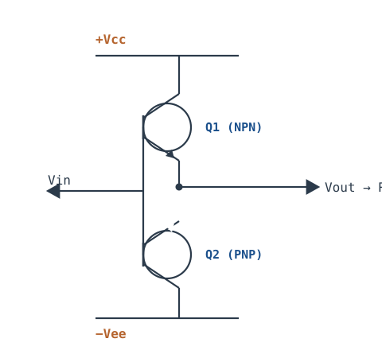
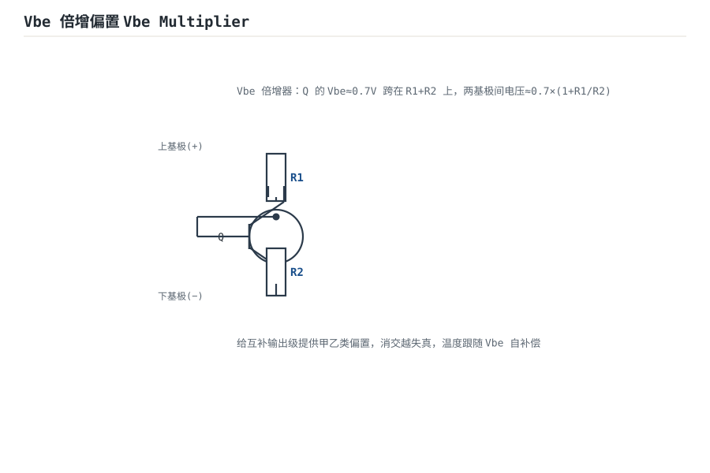
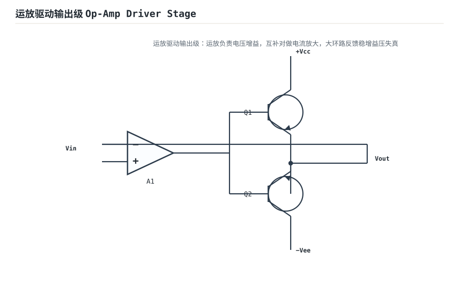
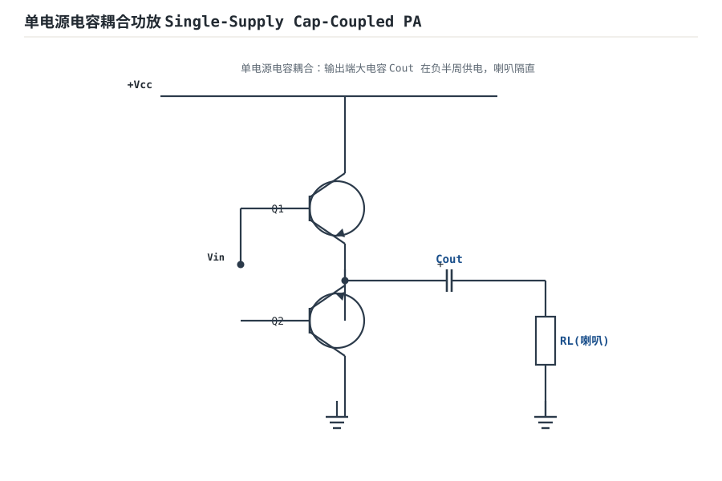
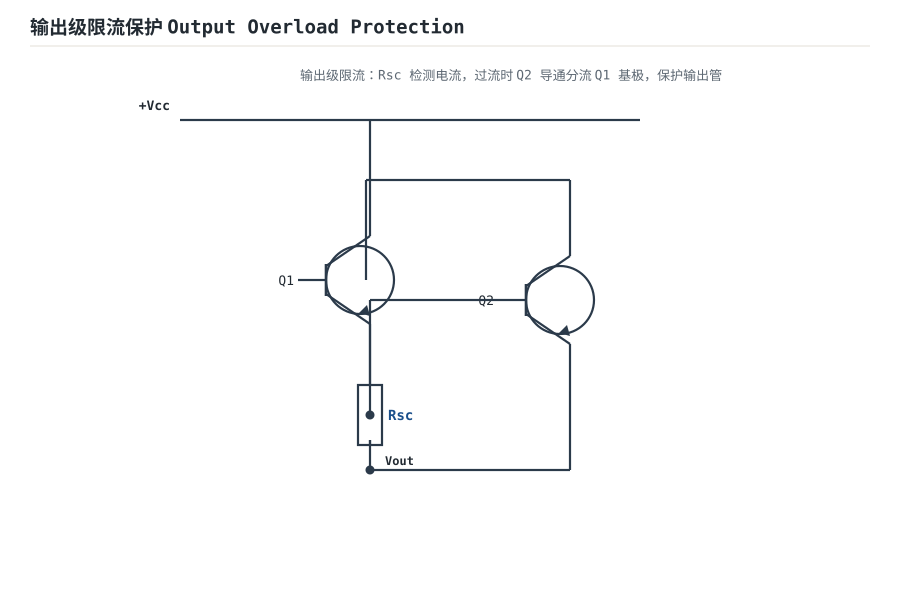

# 功率放大：甲类、乙类、甲乙类与推挽 Power Amplifier

前面的放大级只管"把电压信号算准"，输出电流很小。真正要驱动喇叭、电机、耳机这种低阻大电流负载，就得靠**功率放大级（Output Stage）**。甲类、乙类、甲乙类是按"管子在信号一周内导通多久"来分类的，核心矛盾是**效率 vs 失真**。

## 1. 设计动机

::: motivation 为什么要分级
小信号放大级输出阻抗高、带不动 8Ω 喇叭；硬拉的话电流大、烧管子、失真严重。功率级用一对互补管（NPN+PNP）推挽，专门负责"灌/抽大电流"，自己电压增益≈1，只做电流放大与阻抗变换。
:::

## 2. 原理图



## 3. 静态分析（DC）

- **乙类（图中）**：静态时两管基极电位都是 0，$V_{BE}\approx0$，两管均截止，静态电流≈0。
- **甲类**：单管始终导通，静态电流很大（至少等于最大输出电流）。
- **甲乙类**：给两管基极之间加一个小偏置电压（约 $2\times0.7V$），让静态时两管微导通，消除交越失真。

## 4. 动态分析（AC / 瞬态）

三类功放的核心结论对比：

| 类别 | 导通角 | 理论效率 | 失真 | 静态功耗 |
|---|---|---|---|---|
| 甲类 A | 360°（全周） | ≤25% | 小 | 大（始终发热） |
| 乙类 B | 180°（半周） | ≤78.5% | 交越失真 | ≈0 |
| 甲乙类 AB | 略大于180° | 接近78.5% | 小（加偏置消交越） | 小 |

乙类推挽的波形问题：在输入过零附近，$|V_{in}|<0.7V$ 时两管都不导通，输出出现一段"死区"——这就是**交越失真（Crossover Distortion）**。下图蓝线是理想推挽、橙线是实际乙类推挽过零死区：

```echarts
{
  "tooltip": {"trigger": "axis"},
  "legend": {"data": ["理想输出", "乙类推挽（交越失真）"], "bottom": 0, "textStyle": {"fontSize": 13}},
  "grid": {"left": 56, "right": 24, "top": 26, "bottom": 56},
  "xAxis": {"type": "category", "name": "角度", "data": [0,30,60,90,120,150,180,210,240,270,300,330,360], "axisLabel": {"fontSize": 11}},
  "yAxis": {"type": "value", "name": "V", "min": -3, "max": 3, "axisLabel": {"fontSize": 11}},
  "series": [
    {"name": "理想输出", "type": "line", "smooth": true, "showSymbol": false, "lineStyle": {"width": 2.4, "color": "#1a4f8b"},
     "data": [0,1.5,2.6,3,2.6,1.5,0,-1.5,-2.6,-3,-2.6,-1.5,0]},
    {"name": "乙类推挽（交越失真）", "type": "line", "smooth": true, "showSymbol": false, "lineStyle": {"width": 2.6, "color": "#b5642e"},
     "data": [0,1.5,2.6,3,2.6,1.5,0.1,-1.5,-2.6,-3,-2.6,-1.5,-0.1]}
  ]
}
```

## 5. 环路分析

推挽级本身电压增益≈1，通常作为大环路中的输出缓冲级。整个放大器（小信号放大 + 推挽输出）靠全局负反馈稳定增益、压低失真。

- **结论**：反馈能把交越失真这类非线性"压平"，但反馈环路若在高频附加相移不足，仍会自激——大功率电路因为负载电感、布线寄生更敏感。
- 保护：输出短路时电流巨大，必须加限流保护（发射极小电阻 + 保护管）。

::: advanced 进阶：效率推导
乙类中每个半周只有一只管子导通，电源提供的平均电流为 $I_{peak}/\pi$，电源功耗 $P_{supply}=2V_{cc}I_{peak}/\pi$；最大输出功率 $P_{out}=V_{cc}I_{peak}/2$。比值 $\eta=P_{out}/P_{supply}=\pi/4\approx78.5\%$——这是乙类理论上限。甲类因静态电流恒定，即使无信号也满功耗发热，效率上限 25%。实际电路因饱和压降、交越损失还要再打折扣。
:::

## 6. 元件取值与工程权衡

- **散热**：乙类管耗散约 $P_d\approx0.1P_{out(max)}$，功率级必须配散热器；甲类更甚。
- **偏置**：甲乙类偏置电流取几 mA~几十 mA，太小不消交越失真，太大逼近甲类浪费电。
- **负载匹配**：喇叭 8Ω、耳机 32Ω，直接接在推挽级上要核对输出电流能力与压摆能力。

## 7. 完整设计示例

::: example 设计一个驱动 8Ω 喇叭的 1W 音频输出
1. **需求**：$P_{out}=1W$、$R_L=8\Omega$。
2. **算电压摆幅**：$P=V_{rms}^2/R_L\Rightarrow V_{rms}=\sqrt{8}\approx2.83V$，峰值约 4V。
3. **选电源**：取 $\pm6V$ 双电源，留 1~2V 饱和压降余量。
4. **算电流**：峰值电流 $I_p=4V/8\Omega=0.5A$，选能扛 0.5A 连续的互补对管。
5. **甲乙类偏置**：两基极间用 $V_{BE}$ 倍增电路给约 1.4V 偏置，静态电流 ~10mA。
6. **验算**：最大不失真输出约 $(6-1)^2/(2\times8)\approx1.5W$，满足 1W 需求。
:::

## 8. 仿真与实验

LTspice 用互补 NPN/PNP 模型：

- 乙类不加偏置，过零处观察交越失真死区。
- 加上 $V_{BE}$ 倍增偏置（甲乙类），观察死区消失。
- 瞬态扫描输出功率，对比甲类/乙类的电源电流（体会效率差异）。

## 扩展与变种电路

### 扩展1：互补推挽与交越失真 Complementary Push-Pull

**定位**：NPN 推正半周、PNP 推负半周，双电源射极跟随输出——与甲乙类的差异是静态零偏，过零有死区。


::: example 工作原理 / 静态分析
静态两管基极同电位、$V_{BE}\approx 0$，均截止。$|V_{in}|<0.7\text{V}$ 时两管都不导通，输出出现死区——交越失真。

```echarts
{
  "tooltip": {"trigger": "axis"},
  "legend": {"data": ["理想输出", "乙类推挽（过零死区）"], "bottom": 0, "textStyle": {"fontSize": 13}},
  "grid": {"left": 56, "right": 24, "top": 26, "bottom": 56},
  "xAxis": {"type": "category", "name": "角度", "data": [0,30,60,90,120,150,180,210,240,270,300,330,360], "axisLabel": {"fontSize": 11}},
  "yAxis": {"type": "value", "name": "V", "min": -3, "max": 3, "axisLabel": {"fontSize": 11}},
  "series": [
    {"name": "理想输出", "type": "line", "smooth": true, "showSymbol": false, "lineStyle": {"width": 2.4, "color": "#1a4f8b"},
     "data": [0,1.5,2.6,3,2.6,1.5,0,-1.5,-2.6,-3,-2.6,-1.5,0]},
    {"name": "乙类推挽（过零死区）", "type": "line", "smooth": true, "showSymbol": false, "lineStyle": {"width": 2.6, "color": "#b5642e"},
     "data": [0,1.5,2.6,3,2.6,1.5,0.15,-1.5,-2.6,-3,-2.6,-1.5,-0.15]}
  ]
}
```
:::

设计要点：加偏置（扩展2）消死区；小音量人声沙哑即交越失真。

::: pitfall 推挽专属坑
- **死区没消**：小音量发声音色沙哑，是偏置太小。增大甲乙类偏置电流到几 mA，但别大到静态发烫。
:::

### 扩展2：Vbe 倍增偏置 Vbe Multiplier

**定位**：用一颗接成二极管的 BJT 在两基极间提供约 $2V_{BE}$ 的可调偏置——给互补级消交越失真，并随温度自补偿。



::: example 工作原理 / 静态分析
Q 的 $V_{BE}\approx 0.7\text{V}$ 跨在 $R_1+R_2$ 上，两基极间电压

$$V_{bias}=V_{BE}\left(1+\frac{R_1}{R_2}\right)\approx 2\times0.7\text{V}$$

调整 $R_1/R_2$ 设偏置；Q 与输出管同温度时 $V_{BE}$ 同步漂移，自动补偿静态电流。
:::

设计要点：偏置几 mA~几十 mA；贴在功率管上做热耦合。

::: pitfall Vbe 倍增专属坑
- **热耦合没做好**：倍增管远离功率管，温度不跟随，静态电流随温度漂移甚至热失控。要紧贴散热片。
:::

### 扩展3：运放驱动输出级 Op-Amp Driver Stage

**定位**：运放负责电压增益、互补对做电流放大，大环路反馈稳增益压失真——分立小信号级 + 功率级的组合。



::: example 工作原理 / 静态分析
运放接成反相/同相放大，输出驱动互补对基极；反馈从最终输出引回反相端，整个闭环增益由外部电阻定。

互补对电压增益≈1，只做电流/阻抗变换；失真由大环路反馈压低。
:::

设计要点：注意环路在高频的相位裕度，功率级易引入附加相移；补偿电容不能省。

::: pitfall 运放驱动专属坑
- **高频自激**：反馈直接从输出引回，容性负载/布线寄生让相位裕度不足，输出叠 MHz 振荡。加补偿电容或输出隔离电阻。
:::

### 扩展4：单电源电容耦合功放 Single-Supply Cap-Coupled PA

**定位**：单电源供电，输出端大电容在负半周给喇叭供电——省去负电源，代价是低频受限。



::: example 工作原理 / 静态分析
$C_{out}$ 在信号正半周充电到 $V_{cc}/2$，负半周经 $C_{out}$ 向喇叭放电。静态输出偏置在 $V_{cc}/2$，喇叭经 $C_{out}$ 隔直耦合。

低频截止 $f_L=1/(2\pi R_L C_{out})$。
:::

设计要点：$C_{out}$ 按最低音频取（$R_L=8\Omega$ 时取几百 $\mu\text{F}$）；单电源便携设备常用。

::: pitfall 单电源耦合专属坑
- **低频下潜不足**：$C_{out}$ 太小，低音发闷。按 $f_L=1/(2\pi R_L C)$ 反推，8Ω/20Hz 要 $C\approx 1000\,\mu\text{F}$。
:::

### 扩展5：输出级限流保护 Output Overload Protection

**定位**：输出短路时保护管导通分流基极驱动，把输出电流钳在安全值——功率级的保险丝。



::: example 工作原理 / 静态分析
$R_{sc}$ 检测输出电流，$V_{Rsc}=I_{out}R_{sc}\approx 0.6\text{V}$ 时保护管 Q2 导通，拉走 Q1 基极电流：

$$I_{max}\approx \frac{0.6\text{V}}{R_{sc}}$$

:::

设计要点：$R_{sc}$ 取 $0.6/I_{max}$；喇叭线短路也不会烧功率管。

::: pitfall 输出保护专属坑
- **保护管误触发**：$R_{sc}$ 上压降叠加导线电阻，大动态低音时电流超 $I_{max}$ 被误限流。按峰值电流留余量。
:::

## 9. 常见坑与故障现象

::: pitfall 常见坑
- **交越失真没消除**：小音量时人声"沙哑"，多半是甲乙类偏置太小。增大偏置电流，但别大到静态发烫。
- **散热不足**：连续大功率输出后管子发烫烧毁。功率级散热片按手册热阻算，必要时加风扇。
- **负载短路烧管**：喇叭线意外短路，推挽管直通大电流。必须加输出限流或自恢复保险。
- **甲类当乙类用**：静态电流巨大，电源和管子白发热，效率极低。按用途选对类别。
:::

## 10. 自测题

<details><summary>乙类功放理论最高效率是多少？为什么实际更低？</summary>

$\pi/4\approx78.5\%$。实际因管子饱和压降、交越失真、静态偏置功耗而更低，典型 60~70%。
</details>

<details><summary>交越失真是怎么产生的？甲乙类为什么能改善？</summary>
乙类推挽过零时 $|V_{in}|<0.7V$，NPN/PNP 都不导通，输出出现死区。甲乙类给两管基极加微小偏置，静态微导通，过零时总有一只管子接着导通，死区消失。
</details>

<details><summary>驱动 8Ω、1W 喇叭，电源应该选多大？</summary>
峰值电压 $\sqrt{2\times P\times R_L}=\sqrt{16}=4V$，留饱和压降余量后选 $\pm6V$ 左右双电源。
</details>

## 11. 参考资料

- Horowitz & Hill《The Art of Electronics》3e，Power Amplifiers 章
- Sedra/Smith《Microelectronic Circuits》8e，Output Stages 章
- Jim Williams《The Art and Science of Analog Circuit Design》
