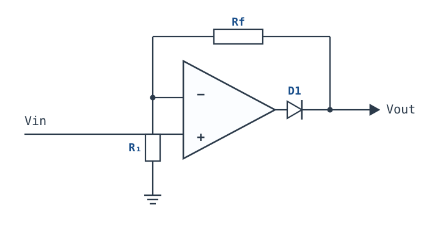
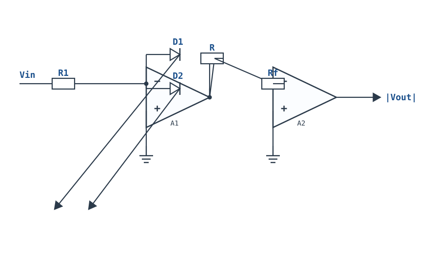
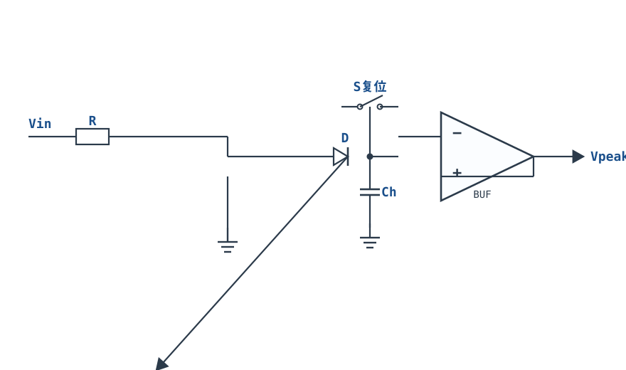
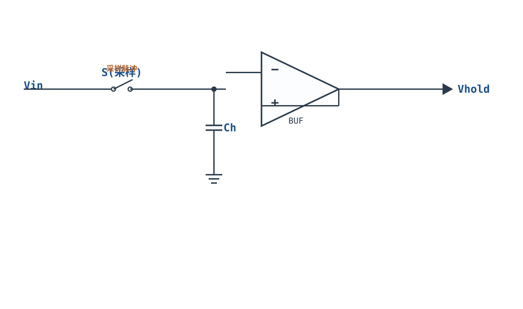
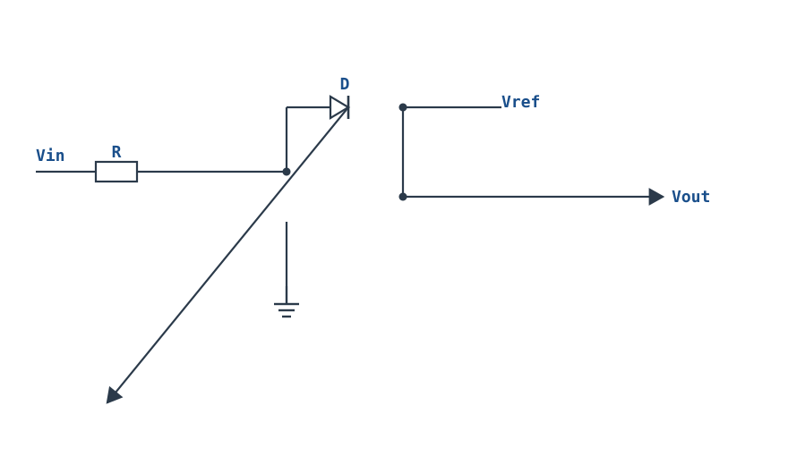

# 精密整流、峰值检测与采样保持 Precision Rectifier, Peak Detector & S/H

## 1. 设计动机

::: motivation 为什么需要精密整流
普通二极管整流有个硬伤：硅管正向导通要 ~0.7V，肖特基也要 ~0.3V。输入信号只有 0.1V 时，普通整流电路输出**恒为 0**——根本"看不见"小信号。而传感器、热电偶、音频检波经常就是毫伏级。

把二极管放进运放的**反馈环路**里，运放会自动抬高输出去补偿那 0.7V 压降，于是输出忠实复现输入，等效"零压降二极管"。这就是**精密整流（Precision Rectifier / Superdiode）**。它和峰值检测、采样保持一脉相承：都是运放 + 二极管/开关 + 电容。
:::

## 2. 原理图

**精密半波整流**：Vin 接反相端，反馈臂里串一只二极管 D1（通向输出），并并联另一只二极管 D2（输出为负时给反馈通路）。



**峰值检测**：输出接二极管给保持电容充电，电压跟随器缓冲电容。**采样保持**：用模拟开关替代二极管，由采样脉冲控制电容充放电。

## 3. 静态分析（DC）

- 精密整流：输入为正时，运放输出升高，D1 导通、D2 截止，电路是反相放大器；输入为负时 D2 导通、D1 截止，输出为 0（电容/下一级保持）。
- 关键：D1 的正向压降被环路增益"除"掉。运放输入失调 $V_{OS}$ 会直接成为整流门槛，故要选低失调运放。
- 峰值检测稳态：电容充电到峰值后，二极管反偏截止，电容无放电通路（理想），输出保持峰值。
- 采样保持保持阶段：开关断开，电容上的电压靠运放高输入阻抗维持。

## 4. 动态分析（AC / 瞬态）

精密半波整流（反相型，Rf=R1）输出：

$$V_{out}=\begin{cases}-V_{in}, & V_{in}>0 \text{（半波反相）}\\[2pt]0, & V_{in}<0\end{cases}$$

再经一级反相/加法可得**全波整流（绝对值电路）**，输出 $|V_{in}|$。普通二极管整流 vs 精密整流在小信号下的差别：

```echarts
{
  "tooltip": {"trigger": "axis"},
  "legend": {"data": ["Vin 正弦","精密整流 |Vout|","普通二极管整流"], "bottom": 0, "textStyle": {"fontSize": 12}},
  "grid": {"left": 56, "right": 24, "top": 26, "bottom": 58},
  "xAxis": {"type": "category", "name": "角度°", "data": [0,30,60,90,120,150,180,210,240,270,300,330,360], "axisLabel": {"fontSize": 11}},
  "yAxis": {"type": "value", "name": "V", "min": -1.2, "max": 1.2, "interval": 0.6, "axisLabel": {"fontSize": 11}},
  "series": [
    {"name": "Vin 正弦", "type": "line", "smooth": true, "showSymbol": false, "lineStyle": {"width": 2.4, "color": "#1a4f8b"},
     "data": [0,0.5,0.87,1,0.87,0.5,0,-0.5,-0.87,-1,-0.87,-0.5,0]},
    {"name": "精密整流 |Vout|", "type": "line", "smooth": true, "showSymbol": false, "lineStyle": {"width": 2.6, "color": "#b5642e"},
     "data": [0,0.5,0.87,1,0.87,0.5,0,0.5,0.87,1,0.87,0.5,0]},
    {"name": "普通二极管整流", "type": "line", "smooth": true, "showSymbol": false, "lineStyle": {"width": 2.0, "color": "#6b7a8a"},
     "data": [0,0,0.17,0.3,0.17,0,0,0,0,0,0,0,0]}
  ]
}
```

（普通二极管在 |Vin|<0.7V 时几乎无输出，精密整流忠实跟随。）

## 5. 环路分析

- **精密整流的"超级二极管"原理**：二极管在反馈环路内，闭环增益把二极管压降 $V_D$ 除以环路增益 $T$：等效输出误差 $V_{err}\approx V_D/T$。$T$ 越大，等效门槛越小（mV 级也能整流）。
- **稳定性**：二极管导通/截止切换时环路在"有反馈/无反馈"间跳变，运放压摆率不足会产生开关尖峰和延迟。选压摆率高、稳定的运放。
- **峰值检测充放电平衡**：要输出跟上峰值，运放输出电流须能给电容快速充电；保持靠电容漏电和缓冲器输入偏置电流，二者越小保持越久。
- 采样保持的"保持降落（Droop）"= 偏置电流 × 保持电容，$dV/dt=I_B/C$。

::: advanced 进阶：为什么需要第二只二极管 D2
当 Vin 为负、D1 截止时，如果没有 D2，运放反相端悬空、运放开环，输出会饱和到负轨，等 Vin 再转正时要花很长时间从负轨恢复（恢复延迟）。D2 在 Vin 为负时导通，把输出钳在约 −0.6V，让运放始终在线、快速翻转——这是精密整流高频可用的关键。
:::

## 6. 元件取值与工程权衡

- **二极管**：选快恢复/肖特基（反向恢复时间短），反向耐压满足输出范围。慢二极管在高频下反向恢复电荷造成误差。
- **保持/采样电容**：取 nF 级。大电容保持稳、降落小，但充电慢、采集时间长；小电容快但降落大。选 C0G/NP0，漏电极小。
- **R1、Rf**：取 10k~100k，平衡偏置电流与速度。
- **运放**：低输入失调（mV 级以下）、高压摆率（Slew Rate）、低偏置电流（尤其峰值/采样保持）。
- **缓冲**：峰值检测/采样保持输出必须接电压跟随器，否则负载电流会放光电容。

## 7. 完整设计示例

::: example 设计一个能整流 50mV 信号的精密半波整流器
1. **需求**：输入 ±50mV 音频小信号，输出正半周，不能因二极管压降丢失。
2. **选运放**：选低失调（$V_{OS}<1\text{mV}$）、压摆率 ≥1V/µs 的运放。
3. **选二极管**：肖特基（如 1N5819）或高速开关二极管。
4. **取 R**：R1=Rf=100kΩ，增益 −1。
5. **验算**：等效整流门槛 $V_D/T\approx0.3\text{V}/10^4=30\mu\text{V}$，远小于 50mV，可正常整流。
6. **峰值检测扩展**：保持电容取 1nF（C0G），接电压跟随器；偏置电流 1pA 时降落 $dV/dt=1\text{pA}/1\text{nF}=1\mu\text{V/ms}$，保持 1ms 误差仅 µV 级。
:::

## 8. 仿真与实验

LTspice 搭建精密半波整流：
- 输入 100mV 正弦（1kHz），对比普通二极管整流输出（接近 0）与精密整流输出（忠实半波）；
- 输入 50mV，观察门槛消失；
- 峰值检测：输入缓慢变化的信号，观察输出跟踪正峰值、信号回落后仍保持；
- 采样保持：用脉冲控制开关，观察开关闭合时输出跟随、断开时保持恒定。

## 扩展与变种电路

### 扩展1：精密全波整流（绝对值）Precision Full-Wave

把半波精密整流与一级反相加法组合，输出 $|V_{in}|$——小信号检波、真有效值计算、音频电平表的核心。



::: example 工作原理/静态分析
第一级对正半周反相输出；第二级把输入与第一级输出按 1:2 加权相加，最终：

$$V_{out}=|V_{in}|$$

普通二极管的 0.7V 门槛被环路增益除成 $\mu\text{V}$ 级。
:::

取值：两级电阻取同值 1%；运放选低失调、高压摆率。

::: pitfall 两级失调累积
两级运放的失调叠加在输出上，小信号绝对值电路要选 $V_{OS}<1\text{mV}$ 的精密运放。
:::

### 扩展2：有源峰值检波（带复位）Active Peak Detector

二极管给保持电容充电、电压跟随器缓冲，记录信号的正向峰值；复位开关可随时清零——用于波形峰值捕捉、传感器最大值保持。



::: example 工作原理/静态分析
信号上升时二极管导通，$C_H$ 被充电到峰值；信号回落后二极管反偏截止，$C_H$ 保持电压，缓冲器输出峰值。按下复位开关 $S$，$C_H$ 放光。
:::

取值：$C_H$ 取 nF 级（C0G）；缓冲器选 FET 输入（$I_B<1\text{pA}$），保持降落 $dV/dt=I_B/C_H$。

::: pitfall 保持降落
$C_H$ 漏电与缓冲器偏置电流会让峰值缓慢下滑。需要长保持时间时选低漏电电容、FET 输入运放。
:::

### 扩展3：改进型采样保持 Improved S&H

用模拟开关替代二极管，由采样脉冲控制电容充放电——采样时跟踪输入，保持时冻结电压，是 ADC 前的标准电路。



::: example 工作原理/静态分析
开关闭合时输出跟随输入（$V_{out}=V_{in}$）；开关断开瞬间 $C_H$ 上的电压被保持，输出冻结。保持降落 $dV/dt=I_B/C_H$。
:::

取值：$C_H$ 取 1nF；采样时间需满足 $\tau=R_{on}C_H$ 充饱。

::: pitfall 电荷注入
开关断开瞬间沟道电荷注入 $C_H$，产生 $\Delta V=Q/C_H$ 跳变。选低注入开关或增大 $C_H$。
:::

### 扩展4：精密限幅到参考 Precision Clamp

把反馈二极管的导通点接到参考电压，使输出被精确钳位在 $\pm V_{ref}$——小信号也能精确限幅，不出现 0.7V 的死区。



::: example 工作原理/静态分析
当 $|V_{in}|$ 使运放输出越过 $V_{ref}+V_D$，反馈二极管导通，把输出钳在 $V_{ref}$；二极管压降被环路增益消除，钳位点精确等于 $V_{ref}$。
:::

取值：$V_{ref}$ 由基准源提供；运放选低失调。

::: pitfall 限幅点随二极管型号
若把参考点接在二极管外侧，$V_D$ 会残留在钳位电压里。参考必须接在反馈环内侧（二极管阴极侧）。
:::


## 9. 常见坑与故障现象

::: pitfall 常见坑
- **小信号整流没输出**：用了普通二极管直接整流，门槛 0.7V。解决：把二极管放进运放反馈环路。
- **高频时输出有尖峰/延迟**：二极管反向恢复慢、运放压摆率不足。解决：换快恢复/肖特基，选高压摆率运放。
- **峰值检测保持不住（缓慢下滑）**：保持电容漏电大、缓冲器输入偏置电流大。解决：换 C0G 电容、选 FET 输入运放。
- **采样保持降落太快**：保持电容太小或偏置电流大。解决：增大电容（权衡速度）、选低偏置运放。
- **运放饱和恢复慢**：没有 D2 续流二极管。解决：加第二只二极管给负半周反馈通路。
:::

## 10. 自测题

<details><summary>为什么把二极管放进运放反馈环路就能消除 0.7V 压降？</summary>

因为二极管在环路内，闭环误差被环路增益 $T$ 压缩：等效输出误差 $\approx V_D/T$。$T$ 通常 $10^4$ 以上，0.7V 被除成几十 µV，小信号也能整流。

</details>

<details><summary>峰值检测电路的保持电容为什么必须接高输入阻抗的电压跟随器？</summary>

若直接接负载，负载电流会从电容抽走电荷，输出迅速下滑。电压跟随器输入电流几乎为 0，电容电荷得以保持。

</details>

<details><summary>采样保持电路的"保持降落"由什么决定？怎么减小？</summary>

$dV/dt=I_B/C$，由保持电容两端的漏电流（运放偏置电流 + 电容漏电）决定。减小方法：选低偏置电流的 FET 输入运放、用 C0G/聚苯乙烯低漏电电容、适当加大电容容量。

</details>

## 11. 参考资料

- TI, *Op Amps for Everyone* (SLOD006B)，精密整流与超级二极管
- Horowitz & Hill, *The Art of Electronics* (3rd Ed.)，整流、峰值检测与采样保持
- Jim Williams, *The Art and Science of Analog Circuit Design*（精密电路随笔）
