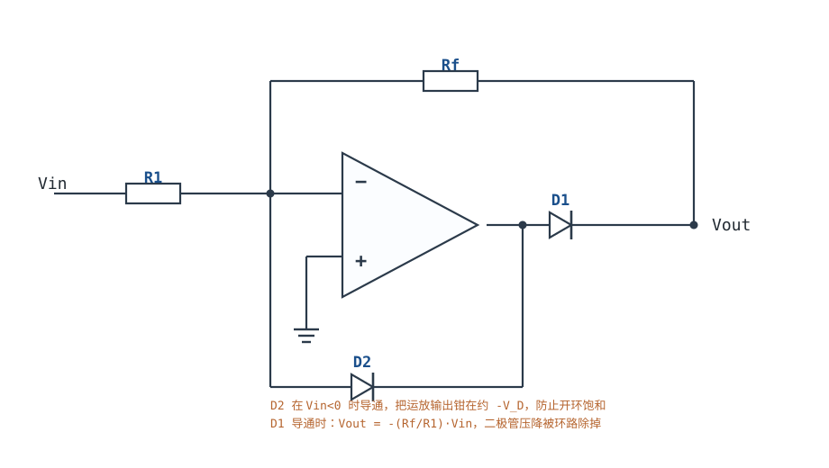
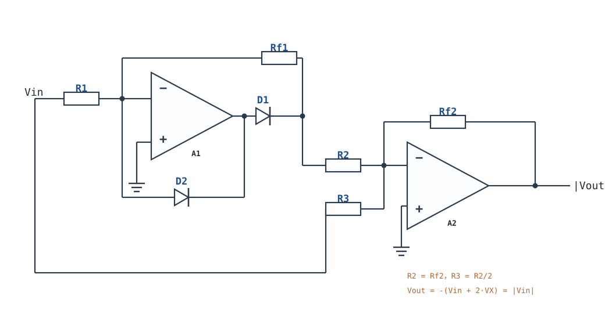
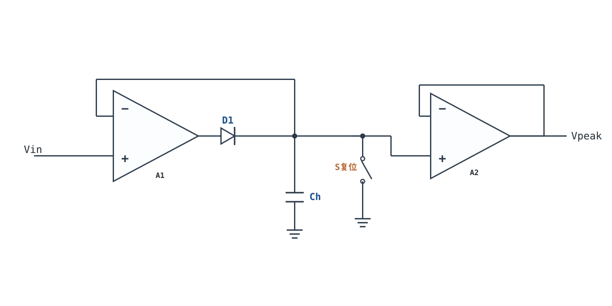
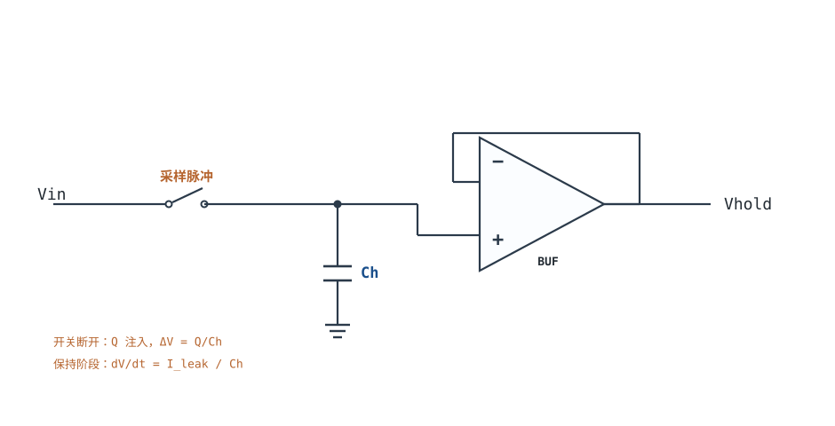

# 精密整流、峰值检测与采样保持 Precision Rectifier, Peak Detector & S/H

二极管是一个**阈值器件**：正向压降没到 0.6V 左右，电流小到可以忽略。把它直接串在信号通路里，0.1V 的信号就被"吃掉"了。但把同一只二极管放进运放的反馈环路，环路增益会把它的压降压缩成 $V_D/(1+T)$ —— 0.6V 变成几十微伏，等效于一只"零压降二极管"。这就是精密整流、峰值检测、采样保持三件事共同的内核：**非线性元件放在环内还是环外，决定了它是误差项还是判决门限**。

本章按"误差项"这条主线走：先算清普通整流为什么在 mV 级失效（§2），再算精密整流把压降除了多少、过零点又要付出多少压摆率代价（§3、§4），最后算峰值保持 1 秒的放电和采样保持的孔径误差。所有结论都落到可复算的数字上，符号与[理想模型五假设与虚短、虚断](ideal-opamp.md)、[稳定性：伯德图、相位裕度与补偿](stability-bode.md)保持一致。相关电路还可对照[比较器与迟滞比较器](comparator-hysteresis.md)（同样利用非线性，但工作在开环）与[V/I、I/V 转换与传感器接口](vi-iv-converter.md)（同样是"环内的电流—电压关系"）。

**本章约定**：$A_{OL}$ 是开环增益，$\beta$ 是反馈系数（**不是**三极管的电流放大倍数），$T=A_{OL}\beta$ 是环路增益，噪声增益 $1/\beta$，GBW 是增益带宽积，SR 是压摆率（V/µs），PM 是相位裕度，$V_D$ 是二极管正向压降，$V_{OS}$ 是输入失调电压，$I_B$ 是输入偏置电流，$C_H$ 是保持电容。**虚短、虚断只在负反馈闭合、输出未饱和、$|T|\gg1$ 时成立**；本章所有精密整流电路在二极管截止的半个周期里环路会短暂断开，这时不能用虚短分析，必须按"运放饱和/恢复"处理——这是本章与线性放大器章节最大的不同。

## 1. 设计动机

::: motivation 三个真实场景
**场景一：0.1V 的传感器信号，普通整流输出恒为 0。** 热电偶冷端补偿后的输出约 0.1V，想取出正半周做幅值检测。硅二极管在 1mA 时 $V_D\approx0.65\text{V}$，在 10µA 时约 0.45V（典型量级，以数据手册为准）；0.1V 的峰值连 10µA 都推不出来，输出端示波器上是一条 0V 直线。换肖特基（$V_D\approx0.3\text{V}$）仍然不够——**问题不是"压降大一点"，而是压降比信号还大**。

**场景二：峰值保持电路，1 秒后峰值掉了 1V。** 用 1nF 保持电容、二极管加电压跟随器记录 0.5V 峰值。保持 1 秒后读数只剩 0V 附近。复算：总漏电（二极管反偏漏电 + 缓冲器偏置电流 + PCB 漏电）只要 1nA，$dV/dt=1\text{nA}/1\text{nF}=1\text{V/s}$，1 秒正好掉 1V。**保持时间不是由电容"质量"决定的，是由漏电流除以电容决定的。**

**场景三：10kHz 精密整流，过零点出现 38mV 平台。** 1Vpp（峰值 0.5V）、10kHz 正弦，用 SR=1V/µs 的运放做精密半波整流。过零点时运放输出要从 −0.6V 跳到 +0.6V，共 1.2V，耗时 1.2µs；这 1.2µs 里输入已经走过 38mV。输出在过零点附近被"削"出一个 38mV 的平台，占峰值的 7.5%，三次谐波明显抬升。**精密整流把二极管压降解决了，却把压摆率问题放大了。**
:::

| 你想确认 | 先算/先查 | 判据（工程经验值） |
|---|---|---|
| 小信号能不能整流 | $V_{pk}$ 与 $V_D$ 比 | $V_{pk}\ge10V_D$ 才考虑普通二极管；否则必须进环 |
| 精密整流误差多大 | $V_D/(1+T)$，$T$ 用工作频率处的值 | 误差 < 满量程的 0.1% |
| 过零畸变能不能接受 | $SR\ge2\pi f\Delta V/\epsilon$ | $\epsilon\le1\%$，否则换高压摆率运放 |
| 峰值保持能撑多久 | $t=\Delta V C_H/I_{leak}$ | 保持期间误差 < 0.1% 满量程 |
| 保持电容取多大 | $I=C_H\,dV/dt$ 与运放输出电流 | 跟踪电流 < 运放短路电流的 1/3 |
| 采样保持孔径误差 | $dV/dt\cdot t_a$ | 孔径误差 < 0.5 LSB |
| 全波两半周一致吗 | 电阻匹配与运放失调 | 增益失配 < 0.1% |

**不做这四项预算会摔在哪**，四个带数字的代价：

1. **把"精密整流"当成"理想整流"。** 直流下 $V_D/(1+T)=0.6/10^5=6\mu\text{V}$，看起来完美；10kHz 时 $A_{OL}$ 只剩 $GBW/f=10^6/10^4=100$，误差变成 $0.6/100=6\text{mV}$，是直流值的 1000 倍。**环路增益随频率下降，精密整流的精度也按同样比例下降。**
2. **忽略过零恢复。** 1.2V 的二极管切换台阶除以 SR，就是"死区时间"；10kHz、SR=1V/µs 时死区 1.2µs，对应 38mV 输入、7.5% 峰值误差。要压到 1%，SR 至少要 7.5V/µs。
3. **保持电容按"越大越稳"选。** 1µF 能把 1nA 漏电的 droop 压到 1mV/s，但 10kHz、0.5V 峰值跟踪时需要 $I=C\,dV/dt=1\mu\text{F}\times31416\text{V/s}=31.4\text{mA}$，多数精密运放给不出。**保持精度和跟踪速度是同一只电容的两端。**
4. **采样保持只看电容不看开关。** 1pC 电荷注入到 20pF 采样电容上就是 50mV；对 3.3V、12 位 ADC（1 LSB=0.806mV）是 62 个 LSB。**开关的电荷注入可以比运放的失调大两个数量级。**

## 2. 定义与直观

### 2.1 二极管的门槛不是一个常数

二极管电流与电压的关系是

$$I_D=I_S\left(e^{V_D/(nV_T)}-1\right),\qquad V_T=\frac{kT}{q}$$

符号与单位：$I_D$ 是正向电流（A）；$I_S$ 是反向饱和电流（A，典型 pA~nA 量级）；$V_D$ 是正向压降（V）；$n$ 是理想因子（1~2，无量纲）；$V_T$ 是热电压（V），300K 时约 25.9mV；$k$ 是玻尔兹曼常数，$q$ 是电子电荷。

这个式子说明两件事，直接决定整流电路的做法：

- **$V_D$ 随电流对数变化。** 1mA 时 0.65V、10µA 时 0.45V、1µA 时约 0.35V（典型量级）。所谓"0.7V 压降"只是 mA 级的说法，小电流下它自己就会变。
- **$V_D$ 随温度变化。** 恒流下硅二极管的温度系数约 $-2\text{mV}/^{\circ}\text{C}$（典型量级）。温度升高 25°C，$V_D$ 下降约 50mV。对 100mV 的信号，这是 50% 的幅度误差，而且**随温度漂**。

所以普通二极管整流的输出是 $V_{out}=\max(0,V_{in}-V_D)$，它同时丢掉了 $V_D$ 的直流量和 $V_D$ 的温漂量。想把 0.1V 的信号整流出来，误差预算里必须先有"$V_D$ 比信号大"这个结论——这时唯一的出路是把二极管放进反馈环。

### 2.2 把二极管放进反馈环：超级二极管

**精密半波整流（反相型）**的接法：$V_{in}$ 经 $R_1$ 接反相端；$R_f$ 从输出接回反相端；二极管 D1 串在运放输出与 $V_{out}$ 之间（阳极接运放输出、阴极接 $V_{out}$）；D2 从反相端接到运放输出（阳极接反相端、阴极接运放输出）；同相端接地。

工作过程分两段：

- **$V_{in}>0$**：反相端电流经 $R_f$ 流向 $V_{out}$，运放输出升高，D1 导通，D2 反偏。环路闭合，$V_{out}=-V_{in}R_f/R_1$（$R_f=R_1$ 时为单位增益反相）。D1 的压降被包在环内：运放输出比 $V_{out}$ 高一个 $V_D$，这个 $V_D$ 由环路自动补掉。
- **$V_{in}<0$**：运放输出下降，D1 截止；D2 导通，把反相端与运放输出之间接成单位增益反馈，运放输出被钳在约 $-V_D$，不会饱和到负轨。此时 $V_{out}$ 没有驱动源，靠后级高阻或一只下拉电阻保持 0V。

**D2 不是可有可无的。** 没有 D2 时，$V_{in}<0$ 期间 D1 截止、反馈断开，运放进入开环，输出一路撞到负轨；等 $V_{in}$ 再转正，运放要从负轨恢复，恢复时间由 SR 和内部补偿决定，10kHz 以上根本来不及。D2 把"开环饱和"换成"单位增益跟随"，运放始终在线性区，过零恢复只需要跨过 2 个 $V_D$ 的台阶。

**误差被除了多少？** 在 D1 导通的半周，运放输出 $V_O=V_{out}+V_D$，而闭环关系是 $V_{out}=A_{OL}(0-V_-)$、$V_-$ 由 $R_1$、$R_f$ 分压。把 $V_D$ 看成叠加在运放输出上的一个扰动，它对 $V_{out}$ 的贡献是

$$V_{err}=\frac{V_D}{1+T}\approx\frac{V_D}{A_{OL}\beta},\qquad \beta=\frac{R_1}{R_1+R_f}$$

符号与单位：$V_{err}$ 是折算到输出的误差（V）；$V_D$ 是二极管压降（V）；$T=A_{OL}\beta$ 是环路增益（无量纲）；$\beta$ 是反馈系数（无量纲）。$R_f=R_1$ 时 $\beta=0.5$，直流 $A_{OL}=10^5$、$V_D=0.6\text{V}$，则 $V_{err}=0.6/(5\times10^4)=12\mu\text{V}$。**0.6V 被除了 5 万倍。** 这就是"精密"两个字的全部来源。

### 2.3 半波、全波与过零畸变

半波整流的输出只保留正半周（或反相后的正半周）。要得到 $|V_{in}|$，需要**全波整流（绝对值电路）**：第一级做精密半波，第二级把原信号与半波信号按 1:2 加权反相相加，正半周时两路抵消、负半周时两路叠加，输出恒为 $|V_{in}|$。

全波电路多出来的误差源是**两级之间的匹配**：第二级的两个输入电阻决定"原信号"和"半波信号"的权重，1% 的失配就是正负半周 1% 的增益差，输出波形在过零点两侧高度不一致，产生偶次谐波。第一级的失调被第二级放大，两级 $V_{OS}$ 叠加后直接成为输出的直流偏移，小信号绝对值电路必须选 $V_{OS}<1\text{mV}$ 的精密运放。

**过零畸变**是另一类误差，和匹配无关，只和速度有关。在输入过零点附近，D1 从截止转为导通、D2 从导通转为截止，两只二极管同时截止的瞬间环路是断开的。运放输出必须从 $-V_D$ 跳到 $+V_D$（共 $2V_D$），这个跳变由压摆率决定：

$$t_s=\frac{2V_D}{SR},\qquad \Delta V_{in}=2\pi f V_{pk}\,t_s=\frac{4\pi f V_{pk}V_D}{SR}$$

符号与单位：$t_s$ 是切换时间（s）；$SR$ 是压摆率（V/s，数据手册常给 V/µs）；$\Delta V_{in}$ 是切换期间输入走过的电压（V），也就是输出"丢掉"的那一段；$f$ 是信号频率（Hz）；$V_{pk}$ 是输入峰值（V）。1Vpp、10kHz、$V_D=0.6\text{V}$、SR=1V/µs 时 $t_s=1.2\mu\text{s}$，$\Delta V_{in}=2\pi\times10^4\times0.5\times1.2\times10^{-6}=37.7\text{mV}$，占峰值 7.5%。**这个平台不是"零点附近的非线性"，是实打实的电压丢失，后级积分或滤波也补不回来。**

### 2.4 峰值检测与采样保持：同一只电容，两种"写"法

**峰值检测**用二极管给保持电容充电：信号上升时二极管导通、$C_H$ 跟踪峰值；信号回落后二极管反偏，$C_H$ 上的电压被"冻结"；缓冲器把电容电压高阻读出。复位开关跨接在 $C_H$ 两端，用于清零。

**采样保持**把二极管换成模拟开关：开关闭合时 $C_H$ 跟踪输入，断开时冻结。相比峰值检测，它多了两个指标：

- **孔径时间（aperture time）**：从"采样命令到达"到"开关真正断开"的延迟，以及这个延迟的抖动（aperture jitter）。抖动会直接把输入斜率变成电压误差。
- **保持降落（droop）**：断开后 $C_H$ 被漏电流缓慢放电的速率，和峰值检测完全一样。

两者的共同点是"电容 + 高阻缓冲"，不同点在于**峰值检测只有一个方向**（只充电、不放电），所以它天然抑制负向噪声；采样保持是双向的，噪声和电荷注入都会原样留在电容上。模拟开关的 $R_{on}$、电荷注入与漏电细节见[模拟开关与多路复用](analog-switch-mux.md)，本章只取它的宏观参数。

::: analogy 二极管像一扇带闭门器的门
普通整流像一扇带闭门器的门：推力小于弹簧力（$V_D$）就推不开，小信号永远过不去。把门装进"伺服机构"（反馈环）里，伺服电机会先自己走一段、把门顶开，门后的位置仍然精确等于你要求的开度——门需要的力被伺服"包"掉了。

类比的边界：伺服有速度上限（SR），门从一边弹到另一边需要时间；这段时间里输入已经变了，输出跟不上，就出现过零畸变。另外，闭门器的力随温度变（$V_D$ 温漂），伺服能补掉它，但补的余量取决于环路增益——高频时环路增益下降，补得就少。
:::

## 3. 定量关系

### 3.1 精密整流的三项误差

把精密整流的输出误差拆成三项，每一项都能单独算：

$$V_{out}=G\,V_{in}+V_{err,D}+V_{err,OS}+V_{err,SR}$$

其中 $G=-R_f/R_1$（半波反相型，无量纲）；$V_{err,D}=V_D/(1+T)$ 是二极管压降残余（V）；$V_{err,OS}=V_{OS}(1+R_f/R_1)$ 是运放失调折算到输出（V）；$V_{err,SR}$ 是过零切换期间丢失的电压（V，按 §2.3 的 $\Delta V_{in}$ 估算）。

**第一项随频率变差。** 单极点运放的 $A_{OL}(f)\approx GBW/f$（$f$ 远高于主极点），所以

$$V_{err,D}(f)\approx\frac{V_D}{1+\beta\,GBW/f}\approx\frac{V_D f}{\beta\,GBW}\quad(f\gg\beta\,GBW)$$

以 $\beta=0.5$、GBW=1MHz、$V_D=0.6\text{V}$ 为例：

| 频率 | $A_{OL}(f)=GBW/f$ | $T=A_{OL}\beta$ | $V_{err,D}=V_D/(1+T)$ |
|---|---|---|---|
| 100Hz | $10^4$ | $5\times10^3$ | 120µV |
| 1kHz | $10^3$ | 500 | 1.2mV |
| 10kHz | 100 | 50 | 11.8mV |
| 100kHz | 10 | 5 | 100mV |

10kHz 时 11.8mV 的误差已经占 0.5V 峰值的 2.4%。**"精密整流"只在环路增益足够高的频段内精密**；要拓宽这个频段，只能选 GBW 更大的运放，或降低增益（提高 $\beta$）。

**第二项是直流项。** $V_{OS}$ 直接出现在输出上，且被噪声增益 $1+R_f/R_1$ 放大。$V_{OS}=1\text{mV}$、增益 1 时输出偏 2mV；增益 10 时偏 11mV。小信号整流必须选斩波稳定或激光修调的精密运放。

**第三项是速度项。** 它只在过零点附近存在，表现为一个宽度为 $t_s$、深度为 $\Delta V_{in}$ 的平台。对音频检波，这个平台听感上是"过零毛刺"；对峰值检测，它会让峰值读数偏低（峰值附近斜率小，影响反而小）。

### 3.2 过零切换对压摆率的要求

把 §2.3 的式子反过来，给定允许的丢失比例 $\epsilon=\Delta V_{in}/V_{pk}$，得到压摆率下限：

$$SR\ge\frac{4\pi f V_{pk}V_D}{\epsilon\,V_{pk}}=\frac{4\pi f V_D}{\epsilon}$$

注意 $V_{pk}$ 被约掉了：**允许的相对误差只取决于频率、二极管压降和 SR，与信号幅度无关**。这是本章最反直觉的一条结论——把小信号放大后再整流，并不会降低对 SR 的相对要求；只有提高 SR 或降低 $f$ 才行。

代入 $V_D=0.6\text{V}$、$\epsilon=1\%$：

| 频率 | 所需 SR |
|---|---|
| 1kHz | 0.75V/µs |
| 10kHz | 7.5V/µs |
| 100kHz | 75V/µs |

10kHz 要 7.5V/µs，这已经把通用运放（1~10V/µs）逼到边缘；100kHz 要 75V/µs，只有高速运放或电流反馈型能做。**这就是"精密整流不难，高速精密整流难"的定量原因。**

### 3.3 保持电容的放电速率

保持阶段，$C_H$ 上的电荷被所有并联的漏电路径放掉：

$$\frac{dV}{dt}=\frac{I_{leak}}{C_H},\qquad I_{leak}=I_{D,rev}+I_{B,buf}+I_{PCB}+I_{C,leak}$$

符号与单位：$dV/dt$ 是保持电压的变化率（V/s）；$I_{leak}$ 是总漏电流（A）；$I_{D,rev}$ 是二极管反偏漏电（A）；$I_{B,buf}$ 是缓冲器输入偏置电流（A）；$I_{PCB}$ 是 PCB 表面漏电（A）；$I_{C,leak}$ 是电容自身漏电（A）。保持时间 $t_H$ 内的误差就是 $\Delta V=(I_{leak}/C_H)t_H$。

**漏电的四个来源量级差别很大**（典型量级，以数据手册与实测为准）：

| 来源 | 典型量级 | 备注 |
|---|---|---|
| 二极管反偏漏电 | 1nA~1µA（25°C），每升 10°C 约翻倍 | 肖特基漏电比硅管大一个数量级 |
| 缓冲器 $I_B$（CMOS/FET 输入） | 1pA~1nA | 双极输入可达 10nA~1µA |
| PCB 表面漏电 | 1pA~1nA（清洁、干燥）；受潮后高几个数量级 | 助焊剂残留是主因 |
| C0G/NP0 电容漏电 | <1pA（规格常写 $\ge10^{11}\Omega$ 绝缘电阻） | 电解电容漏电大得多 |

所以"保持 1 秒"能不能做到，先看总漏电能压到多少。1nA/1nF=1V/s 显然不行；100pA/220nF=0.45mV/s，1 秒才 0.45mV——这才是可用的组合。

### 3.4 采样保持的孔径误差

孔径时间 $t_a$ 内输入仍在变化，电容上记住的是 $t_a$ 时刻之前的电压：

$$\Delta V_{ap}=\frac{dV_{in}}{dt}\,t_a=2\pi f V_{pk}\,t_a$$

以 10kHz、0.5V 峰值、$t_a=10\text{ns}$ 为例：$\Delta V_{ap}=31416\times10\times10^{-9}=0.314\text{mV}$。孔径抖动 $\Delta t_a$（比如 100ps）带来的是 $\Delta V=31416\times100\times10^{-12}=3.1\mu\text{V}$。**孔径时间是一个固定延迟，可以校准；孔径抖动是随机的，只能靠更干净的时钟和更快的开关。**

对 5V、12 位 ADC，1 LSB=1.22mV：0.314mV 的孔径误差约 0.26 LSB，可以接受；如果输入是 100kHz，同样 10ns 就是 3.14mV，2.6 LSB——**采样保持的孔径指标必须和输入频率一起看**。

### 3.5 平滑滤波后的纹波

半波整流后接 RC 平滑，电容在每个周期里放掉一部分电荷。工程估算：

$$\Delta V_{ripple}\approx\frac{V_{pk}}{f R C}$$

符号与单位：$\Delta V_{ripple}$ 是纹波峰峰值（V）；$V_{pk}$ 是整流后的峰值（V）；$f$ 是信号频率（Hz）；$R$、$C$ 是平滑网络的时间常数元件（$\Omega$、F）。这个式子的前提是 $RC\gg T=1/f$，且放电时间近似整个周期。

代入 $V_{pk}=0.5\text{V}$、$f=10\text{kHz}$、$R=10\text{k}\Omega$、$C=100\text{nF}$：$RC=1\text{ms}$，$\Delta V=0.5/(10^4\times10^{-3})=0.05\text{V}=50\text{mV}$。**10kHz 的信号想过 1ms 的时间常数，纹波必然是峰值的 10%**；要把纹波压到 1%，RC 要加大 10 倍（$C=1\mu\text{F}$），代价是响应变慢。

## 4. 典型计算

### 4.1 完整算例：1Vpp、10kHz 精密半波整流的误差预算

**需求**：输入 1Vpp（峰值 $V_{pk}=0.5\text{V}$）、10kHz 正弦；精密半波整流，增益 −1；要求输出误差 ≤1% 峰值（5mV）；后级 RC 平滑到 50mV 纹波以内。

**第 1 步：选运放。** GBW=1MHz、SR=1V/µs、$V_{OS}=1\text{mV}$、$I_B=1\text{pA}$（CMOS 输入）。$\beta=R_1/(R_1+R_f)=0.5$。

**第 2 步：二极管压降残余。** 10kHz 处 $A_{OL}=GBW/f=10^6/10^4=100$，$T=100\times0.5=50$：

$$V_{err,D}=\frac{0.6}{1+50}=11.8\text{mV}$$

这一项已经是 5mV 预算的 2.4 倍，**单靠这一项就不达标**。两个办法：换 GBW=10MHz 的运放（$T=500$，误差 1.2mV），或把增益降到 −1 但接受更大误差。本例换 GBW=10MHz。

**第 3 步：重算二极管误差。** $A_{OL}=10^7/10^4=1000$，$T=500$：

$$V_{err,D}=\frac{0.6}{501}=1.2\text{mV}\quad(0.24\%\ \text{峰值})$$

**第 4 步：过零切换的 SR 要求。** 切换台阶 $2V_D=1.2\text{V}$。若 SR=1V/µs，$t_s=1.2\mu\text{s}$：

$$\Delta V_{in}=2\pi\times10^4\times0.5\times1.2\times10^{-6}=37.7\text{mV}\quad(7.5\%)$$

远超 1%。要 $\epsilon=1\%$：

$$SR\ge\frac{4\pi f V_D}{\epsilon}=\frac{4\pi\times10^4\times0.6}{0.01}=7.54\times10^6\text{V/s}=7.5\text{V/}\mu\text{s}$$

选 SR≥10V/µs 的运放，此时 $t_s=1.2/10=0.12\mu\text{s}$，$\Delta V_{in}=37.7/10=3.77\text{mV}$（0.75%），达标。

**第 5 步：失调项。** $V_{OS}=1\text{mV}$、噪声增益 $1+R_f/R_1=2$：

$$V_{err,OS}=1\text{mV}\times2=2\text{mV}\quad(0.4\%)$$

**第 6 步：误差合成。** 三项按最坏情况相加（同号）：

$$V_{err,total}=1.2+3.77+2=6.97\text{mV}\quad(1.39\%)$$

略超 1%。把 $V_{OS}$ 换成 0.2mV 的精密运放，失调项降到 0.4mV，总误差 5.37mV（1.07%）；或把 SR 提到 20V/µs，切换项 1.9mV，总误差 5.09mV（1.02%）。**误差预算是"哪项最大就先打哪项"，本例的顺序是 SR（3.77mV）> 失调（2.0mV）> 二极管残余（1.2mV）。**

**第 7 步：输出纹波。** 取 $R=10\text{k}\Omega$、$C=100\text{nF}$：

$$\Delta V_{ripple}=\frac{0.5}{10^4\times10^{-3}}=50\text{mV}$$

正好是峰值的 10%。要 1%（5mV），$C$ 取 1µF，$RC=10\text{ms}$，$\Delta V=0.5/(10^4\times10^{-2})=5\text{mV}$；代价是建立时间约 $5RC=50\text{ms}$。

**第 8 步：验算二极管反向恢复。** 10kHz 周期 100µs，若二极管反向恢复时间 100ns，占周期 0.1%，对峰值影响可忽略；但恢复电荷会在过零点叠加一个尖峰，选快恢复管（$t_{rr}<50\text{ns}$）或肖特基。

**波形对比**：同样是 2Vpp（峰值 1V）输入，普通二极管整流的输出峰值只有 $1-0.6=0.4\text{V}$，削掉 60%，而且导通角只有 $180^{\circ}-2\arcsin(0.6/1)=180^{\circ}-73.7^{\circ}=106.3^{\circ}$；精密整流的输出严格等于 $|V_{in}|$，全周期导通。1Vpp（峰值 0.5V）时普通二极管输出恒为 0——**这就是 §1 场景一的波形版本**。

### 4.2 完整算例：峰值保持 1 秒的 droop 与跟踪电流

**需求**：记录 0.5V 峰值，保持 1 秒，误差 ≤0.1%（0.5mV）。

**第 1 步：算允许漏电。** 由 $\Delta V=I_{leak}t_H/C_H$ 反解：

$$I_{leak}\le\frac{C_H\Delta V}{t_H}$$

**第 2 步：先试 1nF。** 允许漏电 $=10^{-9}\times0.5\times10^{-3}/1=0.5\text{pA}$。二极管反偏漏电就有 nA 级，**1nF 方案直接不可行**：1nA 漏电时 droop=1V/s，1 秒掉 1V。

**第 3 步：改 220nF。** 允许漏电 $=220\times10^{-9}\times0.5\times10^{-3}/1=110\text{pA}$。要把总漏电压到 110pA 以内：二极管选低漏电型（25°C 时 <50pA）、缓冲器选 CMOS 输入（$I_B<1\text{pA}$）、PCB 加保护环并清洗。取总漏电 100pA：

$$\frac{dV}{dt}=\frac{100\text{pA}}{220\text{nF}}=0.455\text{mV/s},\qquad \Delta V(1\text{s})=0.455\text{mV}\ (0.09\%)$$

达标。

**第 4 步：跟踪电流够不够。** 10kHz、0.5V 峰值正弦的最大斜率 $2\pi fV_{pk}=31416\text{V/s}$，电容需要的充电电流：

$$I=C_H\frac{dV}{dt}=220\times10^{-9}\times31416=6.9\text{mA}$$

运放输出电流要 ≥6.9mA（并留 3 倍余量，约 20mA），否则上升沿跟不上，峰值读数偏低。**这就是"1 秒保持"的隐藏代价：电容一大，跟踪电流就上去了。**

**第 5 步：从 0 建立到 0.5V 要多久。** 若运放能给出 20mA：

$$t=\frac{C_H\Delta V}{I}=\frac{220\times10^{-9}\times0.5}{20\times10^{-3}}=5.5\mu\text{s}$$

小于 10kHz 的半个周期（50µs），可以跟踪。若运放只有 5mA，建立时间 22µs，接近半周期，峰值会明显偏低。

**第 6 步：结论。** 单级峰值保持要同时满足"220nF、100pA、20mA"三个条件，器件选择很窄。工程上更常见的做法是**两级**：第一级小电容（1nF）快速跟踪，第二级大电容（1µF）慢保持，中间用低漏电模拟开关切换；或者直接用 ADC 高速采样 + 数字峰值检测，把保持时间问题变成存储问题。

### 4.3 完整算例：采样保持的孔径与 droop

**需求**：10kHz、0.5V 峰值信号，12 位、5V ADC（1 LSB=1.22mV），要求孔径误差 <0.5 LSB。

**第 1 步：孔径时间。** 允许误差 0.61mV：

$$t_a\le\frac{\Delta V}{2\pi fV_{pk}}=\frac{0.61\times10^{-3}}{31416}=19.4\text{ns}$$

选 $t_a\le10\text{ns}$ 的开关，误差 0.314mV（0.26 LSB）。

**第 2 步：孔径抖动。** 若抖动 100ps：

$$\Delta V=31416\times100\times10^{-12}=3.1\mu\text{V}\quad(0.0026\ \text{LSB})$$

可忽略。若抖动 10ns（用 MCU 普通 GPIO 直接驱动开关），误差 314µV（0.26 LSB），已经和孔径时间同量级——**抖动和延迟一样重要**。

**第 3 步：droop。** 若 ADC 转换时间 10µs，保持电容 20pF，缓冲器 $I_B=1\text{pA}$：

$$\Delta V=\frac{I_B\,t}{C_H}=\frac{10^{-12}\times10\times10^{-6}}{20\times10^{-12}}=0.5\mu\text{V}$$

可忽略。若缓冲器是双极输入（$I_B=100\text{nA}$）：$\Delta V=50\text{mV}$，40 个 LSB——**采样保持的缓冲器必须选 CMOS/FET 输入**。

**第 4 步：电荷注入。** 开关断开时注入 $Q=1\text{pC}$：

$$\Delta V=\frac{Q}{C_H}=\frac{10^{-12}}{20\times10^{-12}}=50\text{mV}\quad(41\ \text{LSB})$$

这一项远大于孔径和 droop，是采样保持精度的主要杀手。解决办法：选 $Q<0.1\text{pC}$ 的开关（误差 5mV，4 LSB）、把 $C_H$ 加到 200pF（误差 5mV，但带宽下降）、或采用差分/底极板采样让注入电荷共模抵消。详见[模拟开关与多路复用](analog-switch-mux.md)。

### 4.4 误差预算汇总

| 误差项 | 1Vpp/10kHz 精密整流 | 峰值保持 1s | 采样保持 10µs |
|---|---|---|---|
| 二极管/开关 | 1.2mV（GBW=10MHz） | 0.46mV（droop） | 50mV（1pC 注入） |
| 运放失调 | 2mV（$V_{OS}$=1mV，G=2） | — | — |
| 速度 | 3.8mV（SR=10V/µs） | 5.5µs 建立 | 0.31mV（10ns 孔径） |
| 合计 | 7.0mV（1.4%） | 0.46mV（0.09%） | 50.3mV（41 LSB） |

**这张表的用法**：先找最大项。精密整流的最大项是速度，峰值保持是漏电，采样保持是电荷注入——**三个电路长得像，瓶颈完全不同**。

## 5. 工程含义

### 5.1 器件选择的量级

| 器件 | 关键参数 | 典型量级 | 选型依据 |
|---|---|---|---|
| 整流二极管 | $V_D$、$t_{rr}$、结电容 | 硅 0.6~0.7V；肖特基 0.3~0.4V；$t_{rr}$ 几 ns~几十 ns | 高频选快恢复/肖特基；小信号优先低漏电 |
| 运放（整流） | GBW、SR、$V_{OS}$ | GBW 1~100MHz；SR 1~1000V/µs | SR 按 §3.2 算；GBW 按 §3.1 算 |
| 运放（保持缓冲） | $I_B$、$V_{OS}$、输入电容 | CMOS 1pA~1nA；$V_{OS}$ 0.1~1mV | $I_B$ 决定 droop；输入电容影响建立 |
| 保持电容 | 介质、绝缘电阻、DA | C0G/NP0 1nF~1µF；$R_{ins}>10^{11}\Omega$ | 不用 X7R/Y5V（压电效应与 DA 大） |
| 模拟开关（S/H） | $Q$、$R_{on}$、$t_{off}$ | $Q$ 0.1~10pC；$R_{on}$ 1~100Ω | $Q/C_H$ 决定注入误差 |

### 5.2 布局与漏电：1pA 是"设计"出来的

- **保护环**：把保持节点用一圈地线包围，截断 PCB 表面漏电通路；保护环要接到低阻抗点（缓冲器输出或地）。
- **清洗**：助焊剂残留的离子迁移在潮湿环境下能把 1pA 变成 1nA；装配后用异丙醇清洗并烘干。
- **避免层间漏电**：保持节点正下方不要走数字信号或电源；必要时挖空。
- ** guarding 与屏蔽**：高阻节点用屏蔽罩或接地铜箔包围，减少电场耦合。
- **电容选择**：C0G/NP0 的介质吸收（DA）典型 <0.1%，X7R 可达 2%~5%——DA 会让保持电压"回弹"，表现为滞后误差。

### 5.3 什么时候模型不够用

- **高频（>100kHz）**：二极管的结电容、反向恢复电荷、运放的输入电容都开始分流，§3.1 的单项误差模型失效，必须按完整小信号模型算。
- **大信号**：运放输出电流受限时，$C_H$ 的充电变成恒流充电而不是 RC 充电，建立时间按 $I=C\,dV/dt$ 算，不是指数。
- **宽温度范围**：二极管漏电每 10°C 翻倍，$V_{OS}$ 和 $I_B$ 也随温度变；25°C 算好的 0.09% 在 70°C 可能变成 1%。
- **单电源**：峰值保持和采样保持的缓冲器输出不能到负轨，负峰值需要额外的电平搬移，见[单电源电路与电平偏置搬移](single-supply-biasing.md)。
- **多通道**：多路开关的寄生电容和电荷注入会串到保持节点，必须按[模拟开关与多路复用](analog-switch-mux.md)的建立时间与串扰方法单独核算。

### 5.4 什么时候该改用数字方案

峰值检测和采样保持的本质是"在某个时刻记住一个模拟量"。如果后级本来就有 ADC，**用 ADC 连续采样 + 数字比较找峰值**往往更便宜、更准：12 位、1MSPS 的 ADC 对 10kHz 信号有 100 个采样点/周期，峰值误差由 ADC 的量化误差（0.5 LSB）和采样时刻决定，不用考虑电容漏电、介质吸收和电荷注入。数字方案的代价是功耗和数据处理，模拟方案的优势是"断电也能保持"和"微秒级捕获单次脉冲"。**选型时先问"保持时间要不要跨电源周期"，答案是要，才值得用模拟保持电容。**

## 6. 常见坑

::: pitfall 常见坑
- **现象**：0.1V 信号整流后输出恒为 0，换肖特基也只有很小的尖顶。**原因**：二极管在环外，$V_D$ 比信号还大；肖特基 0.3V 仍高于 0.1V 峰值。**解决**：把二极管放进运放反馈环（超级二极管），按 §3.1 算残余误差；同时确认运放的共模范围能覆盖输入。
- **现象**：精密整流在过零点出现平台，输出波形"台阶状"，THD 明显变大。**原因**：两只二极管同时截止的瞬间环路断开，运放输出要跨过 $2V_D$，SR 不足；或缺少 D2，运放饱和后恢复慢。**解决**：加 D2 把开环饱和变成单位增益跟随；按 $SR\ge4\pi fV_D/\epsilon$ 选运放；必要时降低工作频率。
- **现象**：峰值保持 1 秒后读数掉了一半以上。**原因**：保持电容只有 nF 级，1nA 漏电就是 1V/s；漏电来自二极管反偏、缓冲器 $I_B$ 和 PCB 表面。**解决**：按 $I_{leak}\le C_H\Delta V/t_H$ 反算允许漏电；加大 $C_H$ 到 220nF~1µF、选 CMOS 缓冲器、加保护环并清洗 PCB；同时核对运放的充电电流是否够。
- **现象**：全波整流正半周和负半周幅度不一样，输出有偶次谐波。**原因**：第二级加法器的两个输入电阻失配，1% 失配就是 1% 的半周增益差；或第一级、第二级的失调不等。**解决**：用 0.1% 薄膜电阻配对；选低 $V_{OS}$ 运放；在第二级加失调调零。
- **现象**：采样保持每次采样值比实际高/低几十 mV，且随输入变化。**原因**：开关断开时的电荷注入 $\Delta V=Q/C_H$，1pC 注入 20pF 就是 50mV。**解决**：选低注入开关（$Q<0.1\text{pC}$）、增大 $C_H$、采用差分或底极板采样；在开关与电容之间加缓冲。
- **现象**：常温测试正常，高温老化后峰值保持漂移明显。**原因**：二极管反偏漏电每 10°C 翻倍，PCB 受潮后表面漏电也上升；$V_{OS}$ 温漂叠加。**解决**：按最高工作温度重算漏电预算；选低漏电二极管与 C0G 电容；做三防漆或灌封；必要时加温度补偿。
:::

## 7. 自测题

为什么把二极管放进运放反馈环就能把 0.6V 压降变成几十微伏？这个结论在 10kHz 还成立吗？

因为二极管在环内，它的压降相当于叠加在运放输出上的扰动，被环路增益压缩为 $V_{err}=V_D/(1+T)$。直流 $A_{OL}=10^5$、$\beta=0.5$ 时 $T=5\times10^4$，$V_{err}=0.6/50001\approx12\mu\text{V}$。

10kHz 时 $A_{OL}=GBW/f=10^6/10^4=100$，$T=50$，$V_{err}=0.6/51=11.8\text{mV}$——**放大了 1000 倍**。所以"精密"只在环路增益足够高的频段成立；要提高频率上限，必须换更大 GBW 的运放或降低闭环增益。

1Vpp、10kHz 的精密半波整流，SR=1V/µs，过零点会丢多少伏？要压到 1% 需要多大 SR？

切换台阶是 $2V_D=1.2\text{V}$，$t_s=1.2/1=1.2\mu\text{s}$。输入斜率 $2\pi fV_{pk}=2\pi\times10^4\times0.5=31416\text{V/s}$，丢失电压：

$$\Delta V=31416\times1.2\times10^{-6}=37.7\text{mV}$$

占峰值 7.5%。要 $\epsilon=1\%$：

$$SR\ge\frac{4\pi fV_D}{\epsilon}=\frac{4\pi\times10^4\times0.6}{0.01}=7.54\text{V/}\mu\text{s}$$

注意这个要求与信号幅度无关，只与频率和 $V_D$ 有关。

峰值保持用 1nF 电容、总漏电 1nA，保持 1 秒掉多少？要压到 0.5mV 需要多大电容（漏电不变）？

$dV/dt=I/C=1\text{nA}/1\text{nF}=1\text{V/s}$，1 秒掉 1V。

要 1 秒只掉 0.5mV：

$$C_H=\frac{I\,t}{\Delta V}=\frac{10^{-9}\times1}{0.5\times10^{-3}}=2\times10^{-3}\text{F}=2\text{mF}$$

也就是 2000µF。这说明**光靠加大电容不现实**，必须把漏电从 1nA 降到 100pA 量级，再用 220nF 左右的电容：$100\text{pA}\times1\text{s}/220\text{nF}=0.45\text{mV}$。

采样保持的开关电荷注入 1pC、保持电容 20pF，误差是多少个 12 位 LSB（3.3V 满量程）？怎么减小？

$\Delta V=Q/C=1\text{pC}/20\text{pF}=50\text{mV}$。1 LSB $=3.3/4096=0.806\text{mV}$，所以误差 $=50/0.806=62$ 个 LSB。

减小办法：选 $Q<0.1\text{pC}$ 的低注入开关（误差降到 6 LSB）、把 $C_H$ 增大到 200pF（误差 5mV，但带宽按 $1/(2\pi R_{on}C)$ 下降）、采用差分开关让注入电荷共模抵消、或在开关后加一级缓冲再进 ADC。

为什么峰值检测电路里 D2 不能省？它在正半周和负半周分别是什么状态？

D2 的作用是防止运放在输入负半周时开环饱和。负半周 D1 截止、反馈断开，没有 D2 时运放输出会撞到负轨；输入再转正时要花很长时间从负轨恢复，高频下直接丢失整个正半周。

正半周：D1 导通、D2 反偏（运放输出比反相端高），D2 不参与。负半周：D1 截止、D2 导通，运放输出被钳在约 $-V_D$，环路以单位增益闭合，运放保持在线性区。

精密整流后接 10kΩ、100nF 的 RC 平滑，10kHz、0.5V 峰值输入的纹波是多少？要 5mV 怎么改？

$RC=10^4\times100\times10^{-9}=1\text{ms}$，$\Delta V\approx V_{pk}/(fRC)=0.5/(10^4\times10^{-3})=50\text{mV}$。

要 5mV，把 $RC$ 加大 10 倍：$C=1\mu\text{F}$，$RC=10\text{ms}$，$\Delta V=0.5/(10^4\times10^{-2})=5\text{mV}$。代价是建立时间约 $5RC=50\text{ms}$，响应变慢。

## 8. 参考资料

- **TI, *Op Amps for Everyone*（SLOD006B）**：Chapter 6 *Development of the Non-Ideal Op Amp Equations* 给有限 $A_{OL}$ 下闭环误差的推导，Chapter 11 *Understanding Op Amp Parameters* 给 $V_{OS}$、$I_B$、压摆率的定义与测试条件；本章 §3.1 的 $V_D/(1+T)$ 与 §3.2 的 SR 判据按该口径整理。
- **National Semiconductor（现 TI）, AN-31 *Op Amp Circuit Collection***：精密整流器、峰值检波器与采样保持电路的经典集合，本章 §2.2~§2.4 的三种拓扑与该文一致（二极管方向与 D2 的作用按本章图重新标注）。
- **Linear Technology, AN-47 *High Speed Amplifier Techniques*（Jim Williams）**：高速精密整流与峰值检波的实现、二极管选型与布局要点；本章 §5.2 的保护环与清洗建议参照该文的实测经验。
- **Horowitz & Hill, *The Art of Electronics*（3rd ed.）**：精密整流、峰值检测与采样保持的电路演进与失效模式；本章 §2.3 的过零畸变与 §5.3 的模型边界与该书口径一致。
- **TI, *Single-Supply Op-Amp Circuit Collection*（SLOA058）**：单电源下峰值保持缓冲器的偏置与交流耦合；本章 §5.3 的单电源注意事项按该文整理。
