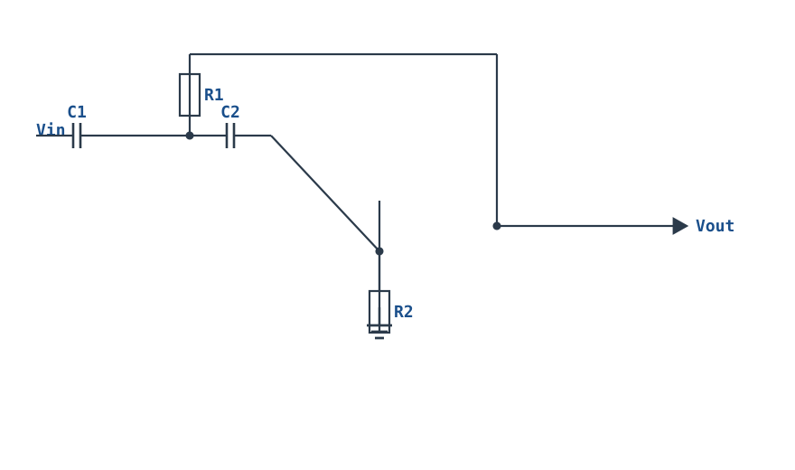
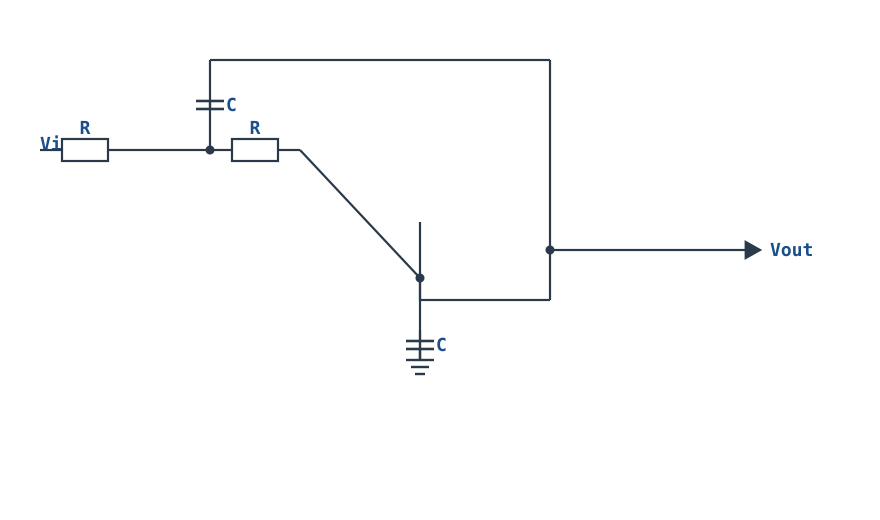
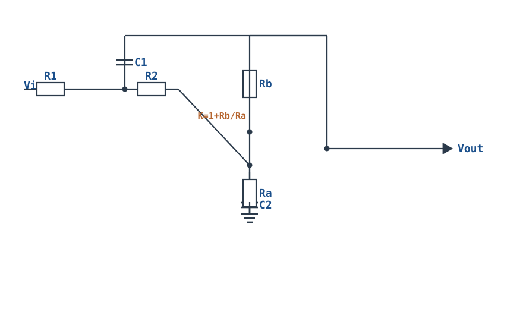
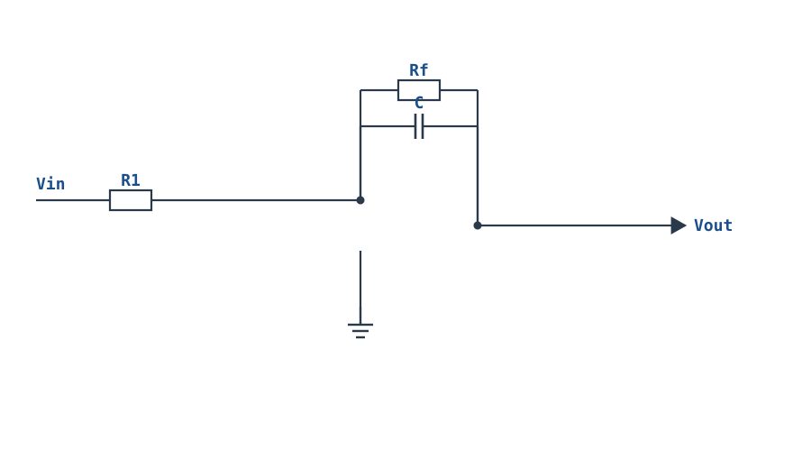

# 二阶滤波器 Sallen-Key 与 Q 值 Sallen-Key 2nd-Order Filter

## 1. 设计动机

::: motivation 为什么需要二阶滤波器
一阶滤波器在截止频率外只以 −20dB/十倍频程慢慢衰减：想滤掉 10kHz 干扰、把截止设在 1kHz，10kHz 处才衰 20dB，干扰还剩 1/10。很多场合要"通带内尽量平、截止后迅速衰减"，就需要二阶乃至更高阶。

二阶滤波器在截止频率外以 **−40dB/十倍频程**滚降，而且可以通过一个叫 **Q 值（Quality Factor，品质因数）**的参数调节通带边缘形状：Q 低则平缓，Q 高则在截止频率附近"鼓包"（peaking）。Sallen-Key 是最经典、最容易算、最容易做的二阶结构。
:::

## 2. 原理图

**单位增益/增益可调 Sallen-Key 低通**：两级 RC 在前向通路里，运放接成同相放大器（增益 $K=1+R_b/R_a$）。


## 3. 静态分析（DC）

- 直流下两个电容 C1、C2 都开路；R1、R2 直通，运放同相端电位等于直流输入（无直流衰减）。
- 运放接成同相放大器，直流增益 $K=1+R_b/R_a$，输出直流 $V_{out}=K\cdot V_{in(DC)}$。
- 同相输入阻抗高，前级 RC 网络负载很轻——这正是 Sallen-Key 用同相结构的原因。

## 4. 动态分析（AC / 瞬态）

取元件等值 **R₁=R₂=R、C₁=C₂=C** 时，传递函数简化为：

$$H(s)=\frac{K}{1+(3-K)sRC+(sRC)^2},\qquad f_c=\frac{1}{2\pi RC}$$

把它写成标准二阶形式 $H(s)=\dfrac{K\omega_c^2}{s^2+\dfrac{\omega_c}{Q}s+\omega_c^2}$，可得：

$$Q=\frac{1}{3-K},\qquad K=1+R_b/R_a$$

- $Q$ 决定频率特性形状；$K$ 越大 $Q$ 越高；
- **$K$ 必须小于 3**（即 $Q$ 为有限正值），$K\ge3$ 时 $Q\le0$，电路变成振荡器——这是稳定性红线；
- 典型设计：**Butterworth（最大平坦）$Q=1/\sqrt2\approx0.707$**，对应 $K=1.586$；Bessel（最佳群时延）$Q=0.577$。

不同 Q 值的归一化幅频曲线（横轴 $f/f_c$）：

```echarts
{
  "tooltip": {"trigger": "axis"},
  "legend": {"data": ["Q=0.5（平缓）","Q=0.707（Butterworth）","Q=1.0（微峰）","Q=5（高Q鼓包）"], "bottom": 0, "textStyle": {"fontSize": 12}},
  "grid": {"left": 56, "right": 24, "top": 26, "bottom": 62},
  "xAxis": {"type": "category", "name": "f/fc", "data": ["0.1","0.5","1","2","5","10"], "axisLabel": {"fontSize": 11}},
  "yAxis": {"type": "value", "name": "dB", "min": -45, "max": 18, "interval": 15, "axisLabel": {"fontSize": 11}},
  "series": [
    {"name": "Q=0.5（平缓）", "type": "line", "smooth": true, "showSymbol": true, "lineStyle": {"width": 2.4, "color": "#6b7a8a"},
     "data": [0, -1.9, -6, -14, -28.3, -40]},
    {"name": "Q=0.707（Butterworth）", "type": "line", "smooth": true, "showSymbol": true, "lineStyle": {"width": 2.6, "color": "#1a4f8b"},
     "data": [0, -0.3, -3, -12.3, -28, -40]},
    {"name": "Q=1.0（微峰）", "type": "line", "smooth": true, "showSymbol": true, "lineStyle": {"width": 2.4, "color": "#b5642e"},
     "data": [0, 0.9, 0, -11.1, -27.8, -40]},
    {"name": "Q=5（高Q鼓包）", "type": "line", "smooth": true, "showSymbol": true, "lineStyle": {"width": 2.4, "color": "#b03030"},
     "data": [0, 2.4, 14, -9.6, -27.6, -40]}
  ]
}
```

## 5. 环路分析

Sallen-Key 是**电压串联负反馈**（同相放大器），反馈系数 $\beta=R_a/(R_a+R_b)$，噪声增益 $K=1/\beta$。

- **Q 与稳定性的关系**：$Q=1/(3-K)$。$K$ 接近 3 时 $Q\to\infty$，二阶网络的阻尼项趋零，环路在 $f_c$ 处相移叠加后满足振荡条件——表现为输出在 $f_c$ 附近出现大鼓包甚至自激。设计时必须让 $K$ 明显小于 3（留裕量），元件误差也会推高 $Q$。
- **元件灵敏度**：Sallen-Key 对电阻电容比值的灵敏度较低，这是它比多路反馈（MFB）结构更稳、更常用的原因。
- 运放带宽要够：$f_c$ 应远小于运放增益带宽积（建议 $GBP\gg100 f_c$），否则实际 Q 会偏离设计值。

::: advanced 进阶：从节点方程推传递函数
设节点 A（R1 与 R2 之间）电位 $V_a$，同相端电位 $V_+$。由同相端 KCL：$(V_a-V_+)/R = sC V_+$。由节点 A 的 KCL：$(V_{in}-V_a)/R=(V_a-V_+)/R+sC(V_a-V_{out})$。代入 $V_{out}=K V_+$，消去 $V_a$、$V_+$，整理即得 $H(s)=K/[1+(3-K)sRC+(sRC)^2]$。可见反馈电容 C1 把输出"引回"节点 A，正是这个正反馈通路抬升了 $f_c$ 附近的响应、决定了 Q。
:::

## 6. 元件取值与工程权衡

- **先选 C**：按频率量级取标准电容。$f_c$ 在 kHz 级取 C=1nF~100nF；C 太大则 R 太小、C 太小则 R 太大。
- **反算 R**：$R=1/(2\pi f_c C)$，取 E96 标准电阻（1% 精度，Q 对元件值敏感）。
- **增益 K**：按目标响应类型定。Butterworth 用 $K=1.586$；不要为了放大信号盲目加大 K——K 大 Q 高，通带会鼓包。
- **电阻比值**：$R_b/R_a=K-1$。两个电阻都取 10k~100k，避免偏置失调。
- **电容匹配**：等值设计要求 C1=C2，实际选同批次、同精度电容，否则 Q 偏移。

## 7. 完整设计示例

::: example 设计 fc=1kHz 的 Butterworth 二阶低通
1. **需求**：−3dB 截止 1kHz，通带最大平坦（Butterworth），通带增益 1.586（≈4dB）。
2. **选电容**：取 C1=C2=10nF（C0G，1%）。
3. **算 R**：$R=1/(2\pi f_c C)=1/(2\pi\times1\text{k}\times10\text{n})\approx15.9\text{k}\Omega$，取 E96 标准值 **15.8kΩ（1%）**。
4. **定增益**：Butterworth $K=1.586$，$R_b/R_a=K-1=0.586$。取 $R_a=10\text{k}\Omega$，则 $R_b=5.86\text{k}\Omega$，取标准值 5.9kΩ（1%）。
5. **验算**：$f_c=1/(2\pi\times15.8\text{k}\times10\text{n})\approx1.005\text{kHz}$；$Q=1/(3-1.586)=0.707$；$f=10\text{kHz}$（10 倍）处滚降约 −40dB。
6. **运放选型**：选 GBP≥1MHz（如通用 LM358/OPA2134），双电源或单电源加偏置。
:::

## 8. 仿真与实验

LTspice 搭建 Sallen-Key 低通：
- AC 扫描 10Hz~100kHz，画伯德图；应在 1kHz 处比通带低 3dB，10kHz 处比一阶多衰减约 20dB；
- 故意把 $R_b$ 调大让 $K\to2.9$（Q 约 10），观察 $f_c$ 附近出现明显鼓包；再调到 $K=3$，观察电路起振——直观理解 Q 与稳定边界；
- 瞬态输入 10kHz 方波，观察输出严重衰减、近似三角波。

## 扩展与变种电路

### 扩展1：Sallen-Key 高通 SK High-Pass

把 Sallen-Key 低通里的电阻与电容位置互换，就得到二阶高通——$f_c$ 以下以 −40dB/十倍频程衰减，$f_c$ 以上平坦通过。



::: example 工作原理/静态分析
等值元件时：

$$H(s)=\frac{(sRC)^2}{1+(3-K)sRC+(sRC)^2},\qquad f_c=\frac{1}{2\pi RC}$$

形式与低通互补：低频（电容开路）信号被挡，高频（电容短路）直通。$K<3$ 的稳定性约束与低通相同。
:::

```echarts
{
  "tooltip": {"trigger": "axis"},
  "legend": {"data": ["SK 高通"], "bottom": 0, "textStyle": {"fontSize": 13}},
  "grid": {"left": 56, "right": 24, "top": 26, "bottom": 50},
  "xAxis": {"type": "category", "name": "f/fc", "data": ["0.01","0.1","0.5","1","2","5","10","100"], "axisLabel": {"fontSize": 10}},
  "yAxis": {"type": "value", "name": "dB", "min": -45, "max": 3, "interval": 10, "axisLabel": {"fontSize": 11}},
  "series": [
    {"name": "SK 高通", "type": "line", "smooth": true, "showSymbol": true, "lineStyle": {"width": 2.6, "color": "#1a4f8b"}, "data": [-40,-40,-14,-3,0,0,0,0]}
  ]
}
```

取值：与低通对称，$R,C$ 互换角色。

::: pitfall 直流增益为 0
高通在直流下增益为 0，输出静态应为 0（或偏置点）；若输出漂移说明运放本身失调，而非滤波器问题。
:::

### 扩展2：等元件单位增益 SK Equal-Component

取 $R_1=R_2=R$、$C_1=C_2=C$，运放接成单位增益缓冲器（$K=1$），是元件种类最少、最易算的二阶结构。



::: example 工作原理/静态分析
$K=1$ 时：

$$H(s)=\frac{1}{1+2sRC+(sRC)^2},\qquad Q=\frac{1}{3-K}=\frac{1}{2}=0.5$$

$Q=0.5$ 是巴特沃斯响应以外的平滑型（过阻尼），无鼓包，适合对群时延敏感的场合。
:::

取值：只需一种 $R$、一种 $C$，配 1% 元件。

::: pitfall 增益固定为 1
单位增益结构不能放大信号；需要通带增益时改用下一个"增益设定 Q"结构。
:::

### 扩展3：增益设定 Q 值 SK Gain-set Q

用反馈分压 $R_b/R_a$ 设定同相增益 $K$，从而直接决定 $Q$——想做巴特沃斯就把 $K$ 精确设在 1.586。



::: example 工作原理/静态分析
$$K=1+\frac{R_b}{R_a},\qquad Q=\frac{1}{3-K}$$

巴特沃斯 $Q=0.707$ 对应 $K=1.586$（$R_b/R_a=0.586$）；$K$ 越接近 3，$Q$ 越高、通带边缘鼓包越大。
:::

取值：$R_a=10\text{k}\Omega$，$R_b=5.86\text{k}\Omega$（1%）；$R,C$ 等值按 $f_c$ 取。

::: pitfall K 逼近 3 起振
$K>2.9$ 后 $Q$ 过大，$f_c$ 附近出现大鼓包甚至自激。设计与换元件都要让 $K$ 明显小于 3。
:::

### 扩展4：MFB 无限增益多路反馈低通 MFB Low-Pass

反相型二阶结构（运放开环作"无限增益"），用两路反馈（电阻+电容）实现低通，适合做需要反相、低 Q 的场合。



::: example 工作原理/静态分析
反相结构，同相端接地；两路反馈（$R_f$ 与 $C$）形成二阶极点。$f_c$、$Q$ 由电阻电容比值决定，增益与 $f_c$ 耦合度比 Sallen-Key 更高。
:::

取值：$Q$ 一般控制在 0.5~5；元件失配对 $f_c$ 影响比 Sallen-Key 大。

::: pitfall MFB 灵敏度高
MFB 对元件比值更敏感，$f_c$ 偏移比 Sallen-Key 明显；精密场合优先选 Sallen-Key，MFB 只在需要反相输出时使用。
:::


## 9. 常见坑与故障现象

::: pitfall 常见坑
- **K 取到 ≥3，电路自激**：现象是输出一直有高频正弦振荡，输入接不接都有。原因是 $Q\le0$，二阶网络变成振荡条件。解决：严格 $K<2.9$，留裕量。
- **通带边缘有鼓包**：现象是 $f_c$ 附近增益比通带还高。原因是 Q 偏高（K 偏大或元件失配）。要 Butterworth 就把 K 精确设为 1.586。
- **实际 Q 与设计不符**：用了 ±5% 电阻电容、C1≠C2。解决：等值设计要求同批次 1% 元件。
- **运放 GBP 不足**：$f_c$ 接近 GBP/100 时实际响应变形、Q 下降。解决：选 GBP 远大于 $f_c$ 的运放。
- **把 Sallen-Key 当反相用**：Sallen-Key 是同相结构，输入共模电压等于信号，单电源设计要保证信号在共模范围内。
:::

## 10. 自测题

<details><summary>Sallen-Key 低通 R=15.8kΩ、C=10nF，截止频率 fc 是多少？</summary>

$f_c=1/(2\pi RC)=1/(2\pi\times15.8\text{k}\times10\text{n})\approx$ **1.0kHz**。

</details>

<details><summary>Butterworth 响应要求 Q=0.707，对应的同相增益 K 是多少？K 为什么不能取 3？</summary>

$K=1+1/Q=1+1/0.707\approx$ **1.586**（即 $R_b/R_a=0.586$）。$K=3$ 时 $Q=1/(3-K)\to\infty$，二阶网络阻尼为零，满足振荡条件，电路自激。

</details>

<details><summary>二阶低通在 fc 的 10 倍频处比通带低多少 dB？比一阶多衰减多少？</summary>

二阶以 −40dB/十倍频程滚降，10 倍频处低约 **40dB**；一阶只低 20dB，二阶多衰减 **20dB**——这就是高阶滤波器的意义。

</details>

## 11. 参考资料

- Sergio Franco, *Design with Operational Amplifiers* (4th Ed.)，Sallen-Key 与 Q 值系统推导
- TI, *Op Amps for Everyone* (SLOD006B)，二阶有源滤波器设计表
- CircuitLab, *Ultimate Electronics*（在线可交互 Sallen-Key 仿真）
